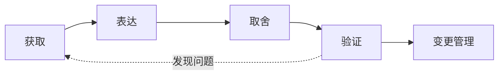

# 第 2 章 需求分析方法

上一章把开发过程拆成六个阶段，并指出需求是第一站。为什么它必须排在最前？1999 年 9 月 23 日，美国宇航局的火星气候探测者号在进入火星轨道时失联，最终在大气层中解体，项目损失约 1.25 亿美元。直接原因听起来很小：地面软件计算推进器冲量时用的是“磅力·秒”，探测器软件期望的是“牛顿·秒”，两边都没有换算。两个团队各自都“按自己的规格做对了”，系统却失败了。

这类失败把需求阶段的真正任务暴露出来：不是把用户说的话记下来，而是把“想要”变成“说清楚、可验证、能对齐”的条目。本章沿着获取、表达、取舍、验证、变更五个活动展开，重点落在用户故事、验收标准与优先级上。

## 本章学习目标

读完本章，你应该能：

1. 按敏捷实践把模糊业务描述转化为用户故事、优先级与验收标准，并按模板写出可评审的需求文档。

## 2.1 概念讲解

### 2.1.1 需求不只是功能列表

火星气候探测者号的教训在于：需求不只回答“系统做什么”，还要回答“做得怎么样”和“受什么限制”。因此，需求通常分成三类。

| 类型 | 回答的问题 | 图书借阅系统的例子 |
| --- | --- | --- |
| 功能需求 | 系统做什么 | 借书、还书、续借、查询、逾期罚款 |
| 非功能需求 | 做得怎么样 | 查询响应小于 1 秒；只有图书馆员能入库；数据每天备份 |
| 约束条件 | 外部限制 | 必须使用学校统一身份认证；部署在校园网内 |

三类需求缺一不可。只写功能，系统可能“能用但不好用”或“能用但不安全”；只写非功能，团队不知道要开发什么；漏掉约束，方案可能在落地时才发现与环境冲突。接口约定——单位、数据格式、字段含义、错误码——属于必须写清的需求内容，不能等到联调时才口头对齐。

### 2.1.2 想要的与需要的

需求分析最难的判断，是区分“用户想要的”和“用户真正需要的”。用户说“我想要一个搜索框”，背后可能是“我想快速找到某本书”。搜索框是方案，快速找到是需求。方案可以换：搜索框、筛选器、扫码、分类导航都能满足“快速找到”，但需求本身不变。

这个区分之所以重要，是因为方案会随技术和界面变化，而需求相对稳定。如果把方案当成需求写进文档，团队就会被锁死在一种实现上；更糟的是，一旦方案不能满足真实需求，返工时连“原来要解决什么问题”都说不清。

> 💡 **常见坑**：把界面当需求。“系统要有一个红色按钮”是方案，“值班员要能在一屏内确认今日值班人员”才是需求。写需求时多问一句“他要这个按钮解决什么问题”。

### 2.1.3 谁的需求：利益相关者

需求不是“用户”一个人的。一个图书借阅系统至少涉及学生、图书馆员、管理员和运维人员；一个值班统计系统至少涉及值班员、部门管理员、统计人员和系统管理员。不同角色的目标可能冲突：值班员希望少填字段，统计人员希望数据完整；管理员希望权限集中，运维希望操作可追溯。

因此，需求获取要先列出利益相关者，再分别问“他用系统做什么、最怕什么、什么情况下会出错”。漏掉一个角色，往往就漏掉一类权限、异常或数据范围。

### 2.1.4 需求获取：五种常用方法

没有一种方法能单独拿到完整需求。访谈能补业务规则与例外，观察能补实际操作习惯，问卷能补大范围意见，原型能补界面与交互，文档分析能补字段与约束。

| 方法 | 能补什么 | 例子 | 注意事项 |
| --- | --- | --- | --- |
| 用户访谈 | 业务规则、例外、优先级 | 问图书馆员：逾期怎么罚？丢书怎么赔？ | 用开放式问题，多追问“为什么” |
| 现场观察 | 实际操作习惯、隐性流程 | 看学生怎么借书、怎么找书 | 记录真实动作，不只看说法 |
| 问卷调查 | 大范围意见、使用频率 | 问学生最常用哪些功能 | 问题具体，避免引导性提问 |
| 原型法 | 界面与交互需求 | 画一个借书页面的草图 | 原型是沟通工具，不是最终界面 |
| 文档分析 | 字段、约束、接口 | 看现有借阅规则、学生信息表 | 核对字段、单位与约束 |

获取之后必须确认：把理解复述给用户听，问一句“我理解得对吗”。需求错误之所以代价最高，是因为它会沿着设计、编码、测试一路放大。

### 2.1.5 需求表达：用户故事与验收标准

把需求写成团队能共同检查的形式，常用用户故事：

> 作为 **[角色]**，我想要 **[功能]**，以便 **[价值]**。

角色回答“谁需要”，功能回答“要做什么”，价值回答“解决什么问题”。三者缺一，故事就会退化成一句功能名称。例如“系统要能借书”不是好故事；“作为学生，我想要通过学号借书，以便不用带借书证”才把角色、功能与价值说清。

仅有故事还不够，还要有验收标准。验收标准回答“做到什么程度算完成”，写法有三个检查：

1. **可验证**：能用一个操作或一组数据判断通过或不通过；
2. **覆盖异常**：正常流程之外，至少考虑无数据、超限、输入错误等情况；
3. **不写实现**：写“系统应该怎样”，不写“用哪个函数、哪个组件”。

例如“还书”的验收标准可以写成：扫描有效条码后显示借阅记录与应还日期；条码无效时提示“无法识别”且不改变借阅状态；逾期时显示逾期天数与罚款金额。

> 💡 **常见坑**：验收标准写成“界面友好”“响应快速”。这类词无法判断通过与否，等于没有标准。把它改成“在 1000 条数据、20 人并发下，查询响应不超过 1 秒”。

### 2.1.6 取舍：MoSCoW 与 MVP

需求永远多于时间。优先级不是“重要/不重要”的二分，而是明确“这一期必须做什么、可以晚一点做什么、这一期不做什么”。常用 MoSCoW 划分：

| 优先级 | 含义 | 图书借阅系统的例子 |
| --- | --- | --- |
| Must | 本期必须交付，缺了系统不能用 | 借书、还书、查询图书 |
| Should | 重要但可以短期替代 | 续借、逾期罚款 |
| Could | 有余力再做 | 预约、推荐 |
| Won't | 本期明确不做 | 社交分享、积分商城 |

与优先级配套的是最小可行产品（Minimum Viable Product，MVP）：先交付能验证核心价值的最小范围，再按反馈扩展。MVP 不是“做一半”，而是“把最关键的闭环做完整”。把 Won't 写清楚，和把 Must 写清楚同样重要，它防止范围在开发中悄悄膨胀。

### 2.1.7 非功能需求要量化

“系统要快”“系统要安全”“系统要好用”都不是可验收的需求。非功能需求必须落到可观察的条件上。

| 类别 | 模糊写法 | 可验证写法 |
| --- | --- | --- |
| 性能 | 系统要快 | 查询响应小于 1 秒（1000 条数据、20 人并发） |
| 安全 | 系统要安全 | 只有图书馆员能入库；密码不明文存储 |
| 可用性 | 要好用 | 借书流程不超过 3 步；错误提示能说明下一步 |
| 可维护性 | 代码要好 | 新增一条借阅规则不改动页面代码 |

量化的意义不只是“方便测试”，更是让开发、测试和验收三方对“做到什么程度”有同一个理解。接口约定尤其如此：单位、格式、字段含义不写清，就会出现“双方都做对、系统却失败”。



*图 2-1：需求工程的五个活动*

### 2.1.8 评审与变更

需求文档不是写完就锁死的。变更不可避免，关键是变更时有依据、有记录。评审检查清单通常包括：角色是否齐全；主要流程是否覆盖；每条用户故事是否有验收标准；优先级是否有理由；非功能需求是否可验证；接口、单位、数据格式、假设是否写清；术语、编号、字段名是否一致。

变更管理则要回答四个问题：谁提出、为什么改、影响哪些模块、何时完成。改需求往往意味着改设计、改代码、改测试，所以变更记录本身就是影响分析的起点。

### 2.1.9 需求如何影响后续环节

需求是设计、编码和测试的共同输入。设计阶段的模块划分来自需求中的角色与功能边界；接口文档来自需求中的数据项与操作；测试用例来自验收标准。需求越模糊，后续每个环节都要替它做猜测，而猜测会在联调或上线时集中暴露。这正是本章要反复强调“可验证”的原因：需求阶段多写一句可判断的标准，后面就少一次返工。

## 2.2 示范例题

#### 例 2-1：把“搜索框”还原成需求【Bloom：理解】

**题目**：下面这句话是需求还是方案？“系统要有一个搜索框，能按书名搜书。”请把它改写成一条用户故事，并指出角色、功能、价值三部分；如果原句包含方案，说明方案与需求的区别。

**解**：

1. 原句混合了方案与需求。“搜索框”是界面方案，“按书名找书”是需求；方案可以换成筛选器或扫码，需求不变。
2. 改写成用户故事：作为学生，我想要按书名查找图书，以便快速确认馆藏并借阅。
3. 拆解三要素：角色是学生；功能是按书名查找图书；价值是快速确认馆藏并借阅。
4. 方案与需求的区别：方案回答“怎么实现”，需求回答“解决什么问题”；方案会随技术变化，需求相对稳定。

**验证**：✅ 已验证（核对定义来源：M07 课次2教案“想要的 vs 需要的”“需求不是界面”；M01 第一篇第二节 2.1–2.2）

```text
核验记录：
1. 用户故事三要素：角色=学生、功能=按书名查找、价值=快速确认并借阅，齐全。
2. “搜索框是方案、快速找到是需求”与 M07 环节2 的表述一致。
3. 改写后的故事可用验收标准检验，符合“可验证”要求。
结论：三要素与方案/需求区分均可回指来源，验证通过。
```

#### 例 2-2：为“还书”写验收标准【Bloom：应用】

**题目**：为“作为图书馆员，我想要扫描图书条码完成还书，以便快速处理归还”写 3 条验收标准，分别覆盖正常流程、异常情况、业务规则。

**解**：

1. **正常流程**：扫描有效条码后，系统显示该书的借阅记录与应还日期，并将状态改为“已归还”。理由：正常路径必须能被一次操作验证。
2. **异常情况**：条码无效或图书不属于本馆时，系统提示“无法识别该图书”，且不改变借阅状态。理由：异常路径要说明系统拒绝什么、保持什么。
3. **业务规则**：若已逾期，系统显示逾期天数与罚款金额，并按规则生成罚款记录。理由：业务规则要落到可观察的结果，而不是“系统会处理”。

**验证**：✅ 已验证（核对定义来源：M07 课次2教案“写验收标准的三个检查”；M01 第一篇第二节 2.2）

```text
核验记录：
1. 三条分别对应正常、异常、业务规则，覆盖 M07 提出的“覆盖异常”要求。
2. 每条都能用一个操作或一组数据判断通过/不通过，符合“可验证”。
3. 未出现函数名、组件名等实现细节，符合“不写实现”。
结论：三条验收标准均可回指三个检查，验证通过。
```

## 2.3 引导练习

#### 例 2-3（引导练习）：把“管理员管人”写成用户故事【Bloom：应用】

**题目**：业务人员说：“管理员得能管人，谁来了谁走了都要能在系统里改。”请把它转成一条用户故事，并写出两条验收标准。

<details><summary>提示 1（方向）</summary>

先找角色（谁）、动作（做什么）、价值（为什么）。“管人”通常至少包含新增、修改、停用。

</details>

<details><summary>提示 2（关键步骤）</summary>

验收标准要能判断“改成功了没有”：一条覆盖正常保存，一条覆盖人员离开后的账号状态。

</details>

<details><summary>完整解答</summary>

作为系统管理员，我想要新增、修改和停用人员账号，以便人员变动时系统数据与实际情况一致。

验收标准：新增人员时，必填字段缺失则拒绝保存并提示缺哪一项；停用人员后，该账号不能登录，但历史值班记录仍可查询。

**验证**：✅ 已验证（核对定义来源：M07 用户故事格式与三个检查；M01 第二篇第二节 2.2）

```text
核验记录：
1. 角色=系统管理员，功能=新增/修改/停用，价值=数据与实际一致，三要素齐全。
2. 两条验收标准均可用操作判断：缺字段能否保存、停用后能否登录。
3. 未写实现细节，符合“不写实现”。
结论：故事与验收标准均可回指格式要求，验证通过。
```

</details>

#### 例 2-4（引导练习）：把“快”和“权限”写成可验证标准【Bloom：应用】

**题目**：为“作为学生，我想要查询图书，以便确认是否可借”写 2 条可验证的标准，一条关于响应时间，一条关于数据范围或权限。

<details><summary>提示 1（方向）</summary>

非功能需求要量化：给数字、给条件。“快”要写成“在多少数据量下、多少秒内”。

</details>

<details><summary>提示 2（关键步骤）</summary>

权限要写成“谁能看到什么、不能看到什么”，而不是“系统要安全”。

</details>

<details><summary>完整解答</summary>

1. 在馆藏 1000 条数据、20 人并发的条件下，按书名查询的响应时间不超过 1 秒。
2. 学生只能看到图书的可借状态与馆藏位置，不能看到其他读者的借阅记录。

**验证**：✅ 已验证（核对定义来源：M07 环节5“非功能需求量化”表；M01 第二篇第二节 2.1）

```text
核验记录：
1. 响应时间给出了数据量、并发数与秒数，符合“可验证”。
2. 权限写明了可见与不可见范围，未停留在“要安全”。
3. 两条均来自 M07 量化表的写法，未自造指标。
结论：两条标准均可操作判断，验证通过。
```

</details>

## 2.4 独立习题

#### 习题 2-1【Bloom：理解】

**题目**：判断下列用户故事的好坏，并说明理由。

1. 作为用户，我想要一个好用的系统，以便用得舒服。
2. 作为学生，我想要通过学号借书，以便不用带借书证。
3. 作为管理员，我想要系统支持所有功能。

#### 习题 2-2【Bloom：应用】

**题目**：为“学生逾期归还图书时，系统要能处理罚款”写一条用户故事（角色自选并说明），再列出 2 条验收标准。

#### 习题 2-3【Bloom：应用】

**题目**：下面这条验收标准太模糊，请改写为可验证的版本，并补一条异常场景的标准：“系统应该快速显示图书信息。”

#### 习题 2-4【Bloom：分析】

**题目**：火星气候探测者号案例中，地面软件与探测器软件各自“按自己的规格做对了”，系统却失败。请从需求与接口契约的角度指出至少三处缺失，并说明每处应补什么内容。

## 本章小结

**核心结论**：

1. 需求由功能需求、非功能需求和约束条件组成；接口约定（单位、格式、字段含义、错误码）也属于需求内容。
2. “想要的”不等于“需要的”，界面方案不等于需求；写需求要追问方案背后要解决的问题。
3. 用户故事由角色、功能、价值三部分组成；验收标准要可验证、覆盖异常、不写实现。
4. 优先级用 MoSCoW 明确本期做什么、不做什么；非功能需求必须量化，否则无法测试和验收。
5. 需求评审与变更记录让需求在变化中仍有依据，需求是设计、编码、测试的共同输入。

**与持久理解的呼应**：本章推进了「需求文档不是交差材料，而是开发、测试与验收三方共用的契约；需求越模糊，后期返工的自由度越小」——通过用户故事与验收标准，读者第一次把“三方共用”落成可检查的条目。

**自检**：回到章首的学习目标，逐条问自己做到了没有——

- [ ] 按敏捷实践把模糊业务描述转化为用户故事、优先级与验收标准，并按模板写出可评审的需求文档 → 拿不准就回看 2.1.5 与 2.1.6，自测：习题 2-2

**下一章预告**：单个用户故事解决的是“一条需求怎么写”；下一章要把角色、功能、优先级、验收标准组织成一份可评审、可交接的需求文档。
