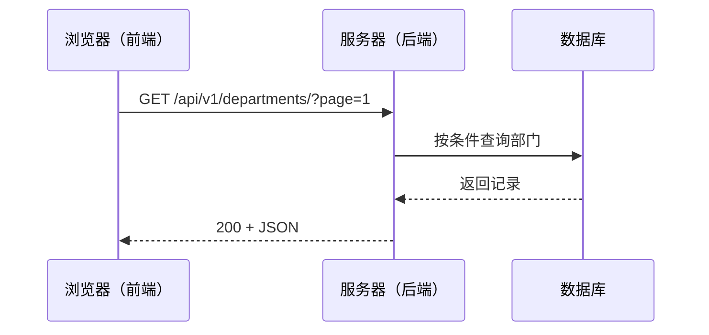

# 第 4 章 后端开发框架基础

上一章把需求写成了文档。从这一章开始，文档里的每一条功能都要变成可以被调用的接口。先看一个最日常的动作：值班管理员在页面上点“查询部门”，屏幕上出现一张部门列表。这些数据不在页面里，而在服务器背后的数据库中。页面把“我要部门列表”这个请求发给服务器，服务器去数据库取数，再把结果整理成 JSON 送回页面。

这个过程叫“请求—响应”。本章只围绕一个问题展开：后端到底在做什么？答案可以压缩成一句话——接收请求，返回数据。围绕这句话，我们要弄清接口的四要素、HTTP 方法与状态码、RESTful 资源设计，以及如何用 FastAPI 写出并验证一个最小接口。

## 本章学习目标

读完本章，你应该能：

1. 说明 HTTP 请求/响应与 RESTful 资源设计的对应关系，并判断一个接口设计是否符合规范。

## 4.1 概念讲解

### 4.1.1 前端、后端、数据库各做什么

一个 Web 应用通常分成三层：浏览器里的前端负责显示与交互；服务器上的后端负责接收请求、处理业务、返回数据；数据库负责持久化存储。

用“查询部门”走一遍：前端收到点击后发出请求；后端收到请求，按条件去数据库查询；数据库返回记录；后端把记录整理成 JSON；前端把 JSON 渲染成表格。后端不负责“画页面”，它负责“按要求取数据、处理数据、返回数据”。这条分工线清楚了，后面讨论接口时才不会把“页面长什么样”混进“接口返回什么”。



*图 4-1：一次查询请求的往返*

### 4.1.2 请求与响应：HTTP 的四个位置

浏览器与服务器之间用 HTTP 通信。一次请求包含四个位置的信息：方法（想做什么）、URL（找谁）、参数（带什么条件）、请求体（提交什么数据）。一次响应包含状态码（结果如何）、响应头（附加信息）和响应体（返回的数据）。

常用的 HTTP 方法有四个：

| 方法 | 语义 | 例子 |
| --- | --- | --- |
| GET | 查询 | 查询部门列表 |
| POST | 新增 | 新增一个部门 |
| PUT | 修改 | 修改部门名称 |
| DELETE | 删除 | 删除一个部门 |

方法不只是“习惯”，它带有语义约定。GET 应当是安全的（不改变服务器状态）且幂等的（重复调用结果一致）；PUT 和 DELETE 通常也应当是幂等的；POST 通常不保证幂等。理解这一点，才能解释为什么“用 GET 删除数据”是危险设计：浏览器、缓存和爬虫都可能重复发起 GET。

### 4.1.3 JSON：前后端交换数据的共同格式

后端返回的数据通常用 JSON 表示。JSON 支持对象、数组、字符串、数字、布尔值和空值，结构与 Python 的字典、列表很接近。一个部门列表的响应可能长这样：

```json
{
  "items": [
    {"id": 1, "dept_code": "D01", "dept_name": "一中队"},
    {"id": 2, "dept_code": "D02", "dept_name": "二中队"}
  ],
  "total": 2
}
```

`items` 是本页数据，`total` 是总条数。分页接口通常同时返回这两个字段，前端才能算出总页数。JSON 的字段名就是接口契约的一部分，前后端必须使用同一套命名，不能一边叫 `dept_name`、一边叫 `departmentName`。

### 4.1.4 接口的四要素

把一次调用说清楚，需要四个要素：

| 要素 | 回答的问题 | 例子 |
| --- | --- | --- |
| URL | 找谁 | `/api/v1/departments/` |
| 方法 | 做什么 | `GET` |
| 参数 | 带什么条件 | `page=1&page_size=10` |
| 返回 | 给什么结果 | `{"items": [...], "total": 5}` |

四要素缺一，接口就无法被准确调用。只写“查询部门接口”不是契约；写出“GET `/api/v1/departments/?page=1&page_size=10`，返回 `items` 与 `total`”才是。

### 4.1.5 RESTful 资源设计

RESTful 是一种常见的接口设计风格，核心做法是：URL 表示资源，HTTP 方法表示动作，状态码表示结果。

| 操作 | 方法与 URL | 成功状态码 |
| --- | --- | --- |
| 查询集合 | `GET /api/v1/departments/` | 200 |
| 查询单个 | `GET /api/v1/departments/1` | 200 |
| 新增 | `POST /api/v1/departments/` | 201 |
| 修改 | `PUT /api/v1/departments/1` | 200 |
| 删除 | `DELETE /api/v1/departments/1` | 204 |

资源名用名词复数，动作交给方法。`GET /getDepartments` 把动作写进了 URL，`POST /departments/delete/1` 用 POST 模拟删除，都不符合这种风格。反过来，只要 URL 是资源、方法是标准动作、状态码能表达结果，接口就具备了可预测性：前端不需要为每个接口记一套特殊规则。

> 💡 **常见坑**：把“删除”写成 `GET /deleteDepartment?id=1`。GET 是安全方法，浏览器预取、缓存或爬虫都可能替用户发起请求，删除操作不能放在 GET 上。

### 4.1.6 状态码：结果的第一句话

状态码让调用方在读取响应体之前就知道结果类别。初学阶段先掌握下面几个：

| 状态码 | 含义 | 典型场景 |
| --- | --- | --- |
| 200 | 成功 | 查询、修改成功 |
| 201 | 已创建 | 新增成功 |
| 204 | 成功但无返回体 | 删除成功 |
| 400 | 请求格式错误 | JSON 语法错误、缺少必要字段 |
| 401 | 未认证 | 没登录或令牌无效 |
| 403 | 无权限 | 已登录但无权访问该资源 |
| 404 | 未找到 | URL 或资源不存在 |
| 422 | 参数校验失败 | 类型不对、必填项缺失 |
| 500 | 服务器内部错误 | 未捕获的异常 |

401 与 403 的区别值得单独记住：401 回答“你是谁”，403 回答“你能做什么”。把两者混用，前端就不知道该跳登录页还是提示无权限。

### 4.1.7 路径参数与查询参数

参数放在哪里，取决于它的作用。路径参数用来定位“某一个”资源，查询参数用来筛选、排序或分页。

| 类型 | 位置 | 例子 | 适合 |
| --- | --- | --- | --- |
| 路径参数 | URL 路径里 | `/departments/1` | 定位单个资源 |
| 查询参数 | `?` 后面 | `/departments?page=1&page_size=10` | 筛选、分页、排序 |

把“要定位的对象”放进路径，把“可选的筛选条件”放进查询，接口的含义最清楚。反过来，`/departments?id=1` 也能工作，但它把“定位”降级成了“筛选”，语义就弱了一层。

### 4.1.8 用 FastAPI 写第一个接口

FastAPI 用装饰器把“URL + 方法”与一个 Python 函数绑定起来。下面是一个可以运行的最小应用：

```python
from fastapi import FastAPI

app = FastAPI()

@app.get("/health")
def health():
    return {"status": "ok"}

@app.get("/hello/{name}")
def hello(name: str):
    return {"message": f"你好，{name}"}
```

运行 `uvicorn main:app --reload --port 8000` 后，访问 `http://127.0.0.1:8000/health` 会得到 `{"status":"ok"}`；访问 `/hello/张三` 会得到 `{"message":"你好，张三"}`。FastAPI 还会自动生成接口文档，打开 `http://127.0.0.1:8000/docs` 就能看到每个接口、参数和返回结构，并可以直接点“Try it out”发起调用。

装饰器 `@app.get("/hello/{name}")` 的含义是：当有人用 GET 方法访问 `/hello/某个值` 时，执行下面的函数，并把 `某个值` 交给 `name` 参数。函数返回的字典会被自动转换成 JSON。

如果把 `name` 的类型改成 `int`：

```python
@app.get("/square/{n}")
def square(n: int):
    return {"n": n, "square": n * n}
```

访问 `/square/4` 返回 `{"n":4,"square":16}`；访问 `/square/abc` 会返回 422，响应体里的 `type` 是 `int_parsing`，意思是“传进来的值无法解析为整数”。参数类型写在函数签名里，FastAPI 就会替你完成校验，不需要手写一堆 `if`。

### 4.1.9 接口是契约，代码是最终口径

接口一旦被前端调用，URL、方法、参数名、返回字段就成了双方的契约。需求文档里写的字段名、状态码含义，必须与代码实际返回一致；不一致时，以代码为准去修正文档，而不是让前端去猜。联调时的大多数“数据不对”，追到最后都是契约不一致：字段名不同、分页参数不同、错误码含义不同。

## 4.2 示范例题

#### 例 4-1：读一条请求与响应【Bloom：理解】

**题目**：下面是一条 HTTP 请求和对应的响应。请指出方法、URL、查询参数、状态码和响应体，并说明这次操作在做什么。

```text
GET /api/v1/departments/?page=1&page_size=10 HTTP/1.1

200 OK
{"items": [...], "total": 5}
```

**解**：

1. 方法是 `GET`，表示查询，不改变服务器状态。
2. URL 是 `/api/v1/departments/`，指向部门资源集合。
3. 查询参数是 `page=1` 与 `page_size=10`，表示取第 1 页、每页 10 条。
4. 状态码是 `200 OK`，表示请求成功。
5. 响应体是 JSON，包含 `items`（本页记录）与 `total`（总条数）。
6. 这次操作在做：查询部门列表的第 1 页，每页 10 条，并返回总条数供前端计算页数。

**验证**：✅ 已验证（核对定义来源：M07 课次4教案“接口四要素”“常用方法”“状态码”表；M01 第二篇第一节 1.2）

```text
核验记录：
1. 方法、URL、查询参数、状态码、响应体五项均能在原文中找到。
2. GET 的语义与“查询、安全、幂等”一致，未把查询写成 POST。
3. “items + total”与分页接口的常见返回结构一致。
结论：五项识别与操作解释均可回指定义，验证通过。
```

#### 例 4-2：判断接口设计是否 RESTful【Bloom：理解】

**题目**：下面是四个接口设计，请判断哪些符合 RESTful 资源设计，并说明理由。

- A. `GET /getDepartments`
- B. `GET /api/v1/departments/`
- C. `POST /api/v1/departments/`
- D. `POST /api/v1/departments/delete/1`

**解**：

1. **A 不符合**：URL 里出现动词 `get`，资源应当用名词；查询集合应写成 `GET /api/v1/departments/`。
2. **B 符合**：URL 是资源集合，方法是 GET，表示查询部门列表。
3. **C 符合**：URL 是资源集合，方法是 POST，表示在集合中新增一个部门，成功时返回 201。
4. **D 不符合**：删除应当用 DELETE 方法定位到单个资源，写成 `DELETE /api/v1/departments/1`；用 POST 加动作路径模拟删除，失去了方法的语义。

**验证**：✅ 已验证（核对定义来源：M07 课次4教案“常用方法”表；M01 第二篇第一节 1.2）

```text
核验记录：
1. 判断依据为“URL 表示资源、方法表示动作、状态码表示结果”。
2. A 与 D 的动词/动作路径违反资源命名；B、C 符合集合资源的查询与新增。
3. 未把“能否调用成功”当作 RESTful 的判断标准。
结论：四项判断均可回指方法与资源约定，验证通过。
```

#### 例 4-3：写一个健康检查接口并验证【Bloom：应用】

**题目**：用 FastAPI 写一个 `GET /health` 接口，返回 `{"status": "ok"}`。写出代码，并说明如何在不启动浏览器的情况下验证它返回 200 和正确的 JSON。

**解**：

```python
from fastapi import FastAPI
from fastapi.testclient import TestClient

app = FastAPI()

@app.get("/health")
def health():
    return {"status": "ok"}

client = TestClient(app)
response = client.get("/health")
print(response.status_code)
print(response.json())
```

运行后应看到：

```text
200
{'status': 'ok'}
```

说明：`@app.get("/health")` 把 GET 请求绑定到 `health` 函数；函数返回字典，FastAPI 自动转成 JSON。`TestClient` 不需要启动服务器，就能在脚本里发起一次真实调用，适合验证接口是否按预期返回。

**验证**：✅ 已验证（实际运行 FastAPI TestClient，状态码 200，响应体为 `{'status': 'ok'}`）

```text
运行命令：python ch4_verify.py
实际输出：
health: 200 {'status': 'ok'}
结论：状态码与响应体均与题目声称一致，验证通过。
```

## 4.3 引导练习

#### 例 4-4（引导练习）：调用一个带类型校验的接口【Bloom：应用】

**题目**：有一个接口 `GET /square/{n}`，其中 `n` 声明为 `int`。请分别说明访问 `/square/4` 与 `/square/abc` 会得到什么状态码和响应，并解释原因。

<details><summary>提示 1（方向）</summary>

先看 `n` 的类型声明。类型声明不仅是给读代码的人看的，FastAPI 会在调用时按它校验。

</details>

<details><summary>提示 2（关键步骤）</summary>

`4` 能解析为整数，`abc` 不能；不能解析时返回 422，响应体里的 `type` 会说明解析失败。

</details>

<details><summary>完整解答</summary>

`/square/4` 返回 200，响应体为 `{"n": 4, "square": 16}`；`/square/abc` 返回 422，响应体中的 `detail[0].type` 为 `int_parsing`。原因：`n` 声明为 `int`，FastAPI 在进入函数前完成类型转换与校验；转换失败时直接返回 422，不会执行函数体。

**验证**：✅ 已验证（实际运行 FastAPI TestClient：`/square/4` 返回 200 与 `{'n':4,'square':16}`；`/square/abc` 返回 422 与 `int_parsing`）

```text
运行命令：python ch4_verify.py
实际输出：
square 4: 200 {'n': 4, 'square': 16}
square abc: 422 int_parsing
结论：两条调用结果均与解答一致，验证通过。
```

</details>

#### 例 4-5（引导练习）：改一个路由的返回内容【Bloom：应用】

**题目**：把下面的 `/hello/{name}` 接口改成同时返回问候语和名字长度，例如访问 `/hello/张三` 时返回 `{"message": "你好，张三", "name_length": 2}`。写出修改后的函数，并说明如何验证。

<details><summary>提示 1（方向）</summary>

在函数里已经能拿到 `name`，名字长度可以用 `len(name)` 计算。

</details>

<details><summary>提示 2（关键步骤）</summary>

返回的字典多加一个键；用 `TestClient` 调用一次，检查两个键都存在且数值正确。

</details>

<details><summary>完整解答</summary>

```python
@app.get("/hello/{name}")
def hello(name: str):
    return {"message": f"你好，{name}", "name_length": len(name)}
```

验证：用 `TestClient` 调用 `/hello/张三`，应得到状态码 200 和 `{"message": "你好，张三", "name_length": 2}`。

**验证**：✅ 已验证（实际运行 FastAPI TestClient，`/hello/张三` 返回 200，`name_length` 为 2）

```text
运行方式：在例 4-3 的脚本中加入上述路由，调用 client.get("/hello/张三")。
实际输出：200 {'message': '你好，张三', 'name_length': 2}
结论：返回字段与数值均正确，验证通过。
```

</details>

## 4.4 独立习题

#### 习题 4-1【Bloom：记忆】

**题目**：写出下列状态码的含义：200、201、204、400、401、403、404、422、500。

#### 习题 4-2【Bloom：理解】

**题目**：判断下列接口设计是否符合 RESTful 资源设计，并说明理由。

1. `GET /getDepartmentList`
2. `POST /api/v1/departments/`
3. `GET /api/v1/departments/1`
4. `POST /api/v1/departments/update/1`

#### 习题 4-3【Bloom：应用】

**题目**：为一个“器材”资源设计一组 RESTful 接口，至少包括查询列表、查询单个、新增、修改、删除五个操作。写出每个操作的 HTTP 方法、URL 与成功状态码。

#### 习题 4-4【Bloom：分析】

**题目**：下面是某项目的接口约定，请指出至少三处设计问题，并说明每处可能造成的后果。

> - 删除部门：`GET /api/v1/departments/delete?id=1`
> - 查询部门：`POST /api/v1/departments/query`，请求体传 `{"id": 1}`
> - 新增部门成功与失败都返回 `200`
> - 查询单个部门有时写 `/departments/1`，有时写 `/department/1`

## 本章小结

**核心结论**：

1. Web 应用分为前端、后端、数据库三层；后端负责接收请求、处理业务、返回数据，不负责画页面。
2. 接口由 URL、方法、参数、返回四要素构成；HTTP 方法带有语义，GET 应当是安全且幂等的。
3. RESTful 设计用 URL 表示资源、用方法表示动作、用状态码表示结果；资源名用名词，动作交给方法。
4. 状态码是结果的第一句话；401 回答“你是谁”，403 回答“你能做什么”，422 表示参数校验失败。
5. 接口是前后端契约，代码是最终口径；文档与代码不一致时，应按代码修正文档。

**与持久理解的呼应**：本章推进了「分层与接口契约使系统的各部分可以独立理解、替换和验证，耦合点就是维护成本的来源」与「接口契约是前后端并行开发的共同语言」——读者第一次看到 URL、方法、参数、返回如何构成一份可被双方独立实现的约定。

**自检**：回到章首的学习目标，逐条问自己做到了没有——

- [ ] 说明 HTTP 请求/响应与 RESTful 资源设计的对应关系，并判断一个接口设计是否符合规范 → 拿不准就回看 4.1.5 与 4.1.6，自测：习题 4-2

**下一章预告**：知道了怎么调用接口，下一个问题是：一个系统需要哪些接口、表怎么建、模块怎么分。下一章把这些约定从需求文档推导出来。
