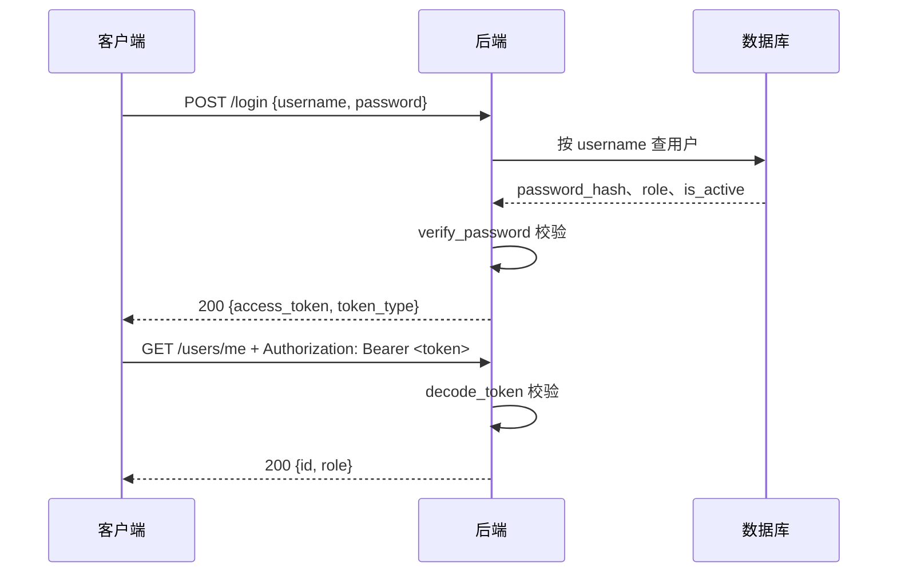

# 第 7 章 用户模块：登录认证

上一章搭好了项目骨架，服务能启动、`/health` 能返回。但骨架对所有人一视同仁：谁都能调用。真实系统必须先回答两个问题：你是谁？你能做什么？

第一个问题叫认证，第二个问题叫授权。本章先解决认证：创建用户、登录、签发令牌，再让受保护接口从令牌里认出当前用户。JWT 的内部结构本章不展开，只把它当作一张“通行证”：登录时发给你，之后每次请求带上它。

## 本章学习目标

读完本章，你应该能：

1. 用 Pydantic 定义用户创建与响应的数据结构，并解释参数校验失败时为什么返回 422。
2. 实现用户登录、JWT 令牌签发与受保护接口，说明令牌怎样在请求中传递和校验。

## 7.1 概念讲解

### 7.1.1 认证与授权：两个不同的问题

认证回答“你是谁”，授权回答“你能做什么”。登录成功后，系统知道了你的身份；访问管理员接口被拒绝，是授权问题，不是认证问题。

这两个问题对应不同的状态码：401 表示身份没有被确认（没登录、令牌无效或过期），403 表示身份已确认但权限不足。把它们混用，前端就不知道该跳登录页还是提示“无权限”。这也是本章反复强调“401 与 403 要分清”的原因。

### 7.1.2 用户表：四个核心字段

用户表至少要有四个核心字段：

| 字段 | 作用 |
| --- | --- |
| `username` | 用户名，唯一，不能重复 |
| `password_hash` | 密码的哈希值，不是明文 |
| `role` | 角色，决定权限，如 `admin`、`normal` |
| `is_active` | 是否启用，决定能不能登录 |

`username` 加唯一约束，防止出现两个同名账号；`role` 是授权判断的依据；`is_active` 让管理员可以停用账号而不删除历史数据。主键 `id` 用于在令牌里标识用户。

### 7.1.3 密码只存哈希

数据库里绝不能存明文密码。存明文的风险很直接：一旦数据库泄露，所有人的密码都会暴露；而很多人会在多个系统复用同一个密码，影响会扩散到其他系统。

正确做法是存哈希：用户注册时，用哈希函数把密码变成一串不可逆的值；登录时，用同样的函数处理用户输入，再与数据库中的哈希比对。哈希不是加密，不能“解密”回原密码，只能验证“输入是否与原来一致”。

```python
from passlib.context import CryptContext

pwd_context = CryptContext(schemes=["pbkdf2_sha256"], deprecated="auto")

def get_password_hash(password: str) -> str:
    return pwd_context.hash(password)

def verify_password(plain_password: str, hashed_password: str) -> bool:
    return pwd_context.verify(plain_password, hashed_password)
```

`get_password_hash("secret123")` 每次生成的字符串都不同，因为哈希里带了随机盐；但 `verify_password("secret123", 哈希)` 会返回 `True`，输入错误密码则返回 `False`。这正是“不可逆但可验证”的含义。

### 7.1.4 Pydantic：输入与输出分开定义

FastAPI 用 Pydantic 模型定义请求和响应的数据结构。输入模型负责校验，输出模型负责控制返回哪些字段。

```python
from pydantic import BaseModel, Field

class UserCreate(BaseModel):
    username: str = Field(..., min_length=3, max_length=100)
    password: str = Field(..., min_length=6, max_length=50)
    role: str = "normal"
```

`...` 表示必填；`min_length`、`max_length` 是约束；`role` 有默认值，不传时取 `normal`。当请求不满足这些约束时，FastAPI 在进入函数之前就返回 422，并在响应体里列出每个字段的错误类型。例如用户名只有 2 个字符、密码只有 3 个字符，会得到两条 `string_too_short`。

输入与输出必须分开。用户表里有 `password_hash`，但响应绝不能把它返回。正确做法是定义 `UserOut`，只包含 `id`、`username`、`role`、`is_active` 等可公开字段。

> 💡 **常见坑**：直接把 ORM 对象整个返回，结果把 `password_hash` 一起吐给前端。输出模型要显式列出允许返回的字段。

### 7.1.5 登录流程

登录做四件事：按用户名查用户；校验密码；检查账号是否启用；签发令牌。

```python
def login(db, username: str, password: str):
    user = db.query(User).filter(User.username == username).first()
    if not user or not verify_password(password, user.password_hash):
        raise HTTPException(status_code=401, detail="用户名或密码错误")
    if not user.is_active:
        raise HTTPException(status_code=401, detail="账号已禁用")

    token = create_access_token({"sub": str(user.id), "role": user.role})
    return {"access_token": token, "token_type": "bearer"}
```

错误提示统一写“用户名或密码错误”，不要区分“用户不存在”和“密码错误”。如果提示能区分，攻击者就能借登录接口枚举哪些用户名存在。



*图 7-1：登录与携带令牌访问受保护接口*

### 7.1.6 令牌：一张有时效的通行证

登录成功后，服务器签发一个 JWT 令牌。令牌里通常放三类信息：用户标识（`sub`）、角色（`role`）和过期时间（`exp`）。客户端保存令牌，之后每次请求把它放进请求头：

```text
Authorization: Bearer <token>
```

服务器收到请求后解析令牌：签名是否正确、是否过期、载荷里有没有用户标识。三项都通过，才认为“当前用户是谁”已经确认。

令牌不是加密的，只是签名防篡改。任何拿到令牌的人都能读出载荷内容，所以载荷里不能放密码、身份证号等敏感信息。令牌也要当作密码一样保管：不要写进日志、不要提交到 Git、不要放在 URL 查询参数里。

### 7.1.7 用依赖注入保护接口

FastAPI 的 `Depends` 可以把“解析令牌、确认当前用户”抽成一个依赖，受保护接口只要声明它，就会自动执行校验。

```python
from fastapi import Depends, HTTPException
from fastapi.security import OAuth2PasswordBearer

oauth2_scheme = OAuth2PasswordBearer(tokenUrl="/login")

def get_current_user(token: str = Depends(oauth2_scheme)):
    try:
        payload = jwt.decode(token, SECRET_KEY, algorithms=[ALGORITHM])
    except JWTError:
        raise HTTPException(status_code=401, detail="登录已过期")
    return {"id": payload.get("sub"), "role": payload.get("role")}

@router.get("/me")
def me(current_user: dict = Depends(get_current_user)):
    return current_user
```

`OAuth2PasswordBearer` 会从 `Authorization: Bearer` 头里取出令牌；没带令牌时直接返回 401。`get_current_user` 解析失败也返回 401。接口函数本身不需要写任何认证代码，它只关心“当前用户是谁”。

### 7.1.8 权限依赖：从认证到授权

确认身份之后，还可以再包一层权限检查。例如管理员接口要求 `role` 为 `admin`：

```python
def require_admin(current_user: dict = Depends(get_current_user)):
    if current_user["role"] != "admin":
        raise HTTPException(status_code=403, detail="Not enough permissions")
    return current_user

@router.get("/admin")
def admin_only(current_user: dict = Depends(require_admin)):
    return current_user
```

没登录时，`get_current_user` 先返回 401；已登录但角色不是管理员时，`require_admin` 返回 403。两层依赖分别对应认证与授权，状态码也自然分开。

### 7.1.9 安全习惯

除了代码，几条习惯同样重要：密钥放在环境变量里，不进代码和 Git；错误提示不泄露账号是否存在；日志不打印密码和完整令牌；创建用户成功后不返回 `password_hash`；停用账号时保留历史记录，不直接删除。

## 7.2 示范例题

#### 例 7-1：定义用户创建模型并解释 422【Bloom：应用】

**题目**：用 Pydantic 定义 `UserCreate`，要求用户名 3–100 个字符、密码 6–50 个字符、角色默认 `normal`。说明当用户名只有 2 个字符、密码只有 3 个字符时，接口会返回什么，以及响应里能看出什么。

**解**：

```python
from pydantic import BaseModel, Field

class UserCreate(BaseModel):
    username: str = Field(..., min_length=3, max_length=100)
    password: str = Field(..., min_length=6, max_length=50)
    role: str = "normal"
```

用户名 `ab` 只有 2 个字符，违反 `min_length=3`；密码 `123` 只有 3 个字符，违反 `min_length=6`。FastAPI 在进入处理函数前完成校验，返回 422，响应体的 `detail` 中会有两条错误，`loc` 分别指向 `username` 与 `password`，`type` 都是 `string_too_short`。这说明 422 不是“服务器坏了”，而是“请求参数不满足约定”。

**验证**：✅ 已验证（实际运行 Pydantic 校验，得到 `[('username','string_too_short'), ('password','string_too_short')]`）

```text
运行结果：
schema errors: [(('username',), 'string_too_short'), (('password',), 'string_too_short')]
结论：两个字段的校验错误类型与解答一致，验证通过。
```

#### 例 7-2：实现登录并签发令牌【Bloom：应用】

**题目**：实现一个登录函数：按用户名查用户，校验密码，检查账号是否启用，成功后返回 `access_token` 与 `token_type`。说明错误密码时返回什么状态码，以及为什么错误提示不区分“用户不存在”和“密码错误”。

**解**：

```python
def login(db, username: str, password: str):
    user = db.query(User).filter(User.username == username).first()
    if not user or not verify_password(password, user.password_hash):
        raise HTTPException(status_code=401, detail="用户名或密码错误")
    if not user.is_active:
        raise HTTPException(status_code=401, detail="账号已禁用")

    token = create_access_token({"sub": str(user.id), "role": user.role})
    return {"access_token": token, "token_type": "bearer"}
```

错误密码返回 401。提示统一为“用户名或密码错误”，是因为如果区分“用户不存在”和“密码错误”，攻击者就能通过登录接口逐个试出哪些用户名存在。

**验证**：✅ 已验证（实际运行：错误密码返回 401；正确密码返回字符串令牌；令牌解析得到 `sub` 与 `role`）

```text
实际输出：
bad login: 401 用户名或密码错误
good login token type: str
payload: {'sub': '1', 'role': 'admin', 'exp': ...}
结论：登录分支与令牌签发均符合预期，验证通过。
```

## 7.3 引导练习

#### 例 7-3（引导练习）：给接口加登录保护【Bloom：应用】

**题目**：写一个 `GET /me` 接口，要求登录后才能访问，返回当前用户的 `id` 与 `role`。请说明不带令牌、带有效令牌、带被篡改令牌三种情况下分别返回什么。

<details><summary>提示 1（方向）</summary>

用 `OAuth2PasswordBearer` 取令牌，用 `Depends` 把解析逻辑挂在接口上。

</details>

<details><summary>提示 2（关键步骤）</summary>

解析失败时抛 401；解析成功时返回载荷里的 `sub` 与 `role`。

</details>

<details><summary>完整解答</summary>

```python
oauth2_scheme = OAuth2PasswordBearer(tokenUrl="/login")

def get_current_user(token: str = Depends(oauth2_scheme)):
    try:
        payload = jwt.decode(token, SECRET_KEY, algorithms=[ALGORITHM])
    except JWTError:
        raise HTTPException(status_code=401, detail="登录已过期")
    return {"id": payload.get("sub"), "role": payload.get("role")}

@app.get("/me")
def me(current_user: dict = Depends(get_current_user)):
    return current_user
```

不带令牌：401（没有凭证）；带有效令牌：200 与 `{"id": "...", "role": "..."}`；带被篡改令牌：解析失败，401。

**验证**：✅ 已验证（实际运行 TestClient：无令牌 401；有效令牌 200；篡改令牌 401）

```text
实际输出：
no token: 401
with token: 200 {'id': '1', 'role': 'admin'}
tampered token: 401
结论：三种情况与解答一致，验证通过。
```

</details>

#### 例 7-4（引导练习）：解析令牌载荷【Bloom：应用】

**题目**：登录后拿到一个令牌。请写出解析它并取出 `sub` 与 `role` 的代码，并说明令牌被改动一个字符后会发生什么。

<details><summary>提示 1（方向）</summary>

用签发令牌时同一个密钥和算法调用 `jwt.decode`。

</details>

<details><summary>提示 2（关键步骤）</summary>

签名校验失败会抛出 `JWTError`；把它转成 401，而不是让异常冒到 500。

</details>

<details><summary>完整解答</summary>

```python
from jose import jwt, JWTError

def decode_token(token: str):
    try:
        payload = jwt.decode(token, SECRET_KEY, algorithms=[ALGORITHM])
        return payload
    except JWTError:
        return None

payload = decode_token(token)
if payload is None:
    raise HTTPException(status_code=401, detail="登录已过期")
user_id = payload.get("sub")
role = payload.get("role")
```

令牌被改动一个字符后，签名校验失败，`jwt.decode` 抛出 `JWTError`，函数返回 `None`，接口返回 401。

**验证**：✅ 已验证（实际运行：正常令牌解析出 `sub` 与 `role`；改动一个字符后抛出 `JWTError`）

```text
实际输出：
payload: {'sub': '1', 'role': 'admin', 'exp': ...}
tampered: JWTError
结论：解析与篡改检测均符合预期，验证通过。
```

</details>

## 7.4 独立习题

#### 习题 7-1【Bloom：理解】

**题目**：用自己的话说明一次“登录后访问受保护接口”的完整流程：令牌从哪里来、放在哪里、服务器如何校验、校验失败返回什么。并解释 401 与 403 的区别。

#### 习题 7-2【Bloom：应用】

**题目**：写出创建用户的完整逻辑：检查用户名是否重复、对密码做哈希、写入数据库。要求说明重复用户名返回什么状态码，以及响应中为什么不能包含 `password_hash`。

#### 习题 7-3【Bloom：应用】

**题目**：写一个管理员接口 `GET /admin/users`，要求只有 `role` 为 `admin` 的用户能访问。请给出依赖函数与接口函数的代码，并说明普通用户访问时返回什么。

#### 习题 7-4【Bloom：分析】

**题目**：下面三个现象都返回 401 或 403，请分别判断原因，并给出排查步骤。

1. 用户确认密码正确，但登录返回 401。
2. 登录成功拿到令牌，访问 `/me` 仍返回 401。
3. 普通用户访问管理员接口返回 403。

## 本章小结

**核心结论**：

1. 认证回答“你是谁”，授权回答“你能做什么”；401 表示身份未确认，403 表示权限不足。
2. 用户表至少有 `username`、`password_hash`、`role`、`is_active` 四个核心字段；密码只存哈希，不存明文。
3. Pydantic 输入模型负责校验，输出模型控制返回字段；参数不满足约束时返回 422，响应里能定位到具体字段。
4. 登录流程是“查用户、校验密码、检查启用状态、签发令牌”；错误提示统一，避免泄露账号是否存在。
5. 令牌放在 `Authorization: Bearer <token>` 中传递；受保护接口用 `Depends` 挂载校验依赖，权限检查再包一层依赖并返回 403。

**与持久理解的呼应**：本章推进了「认证回答“你是谁”、授权回答“你能做什么”，安全边界必须在设计时划定，补丁式补救代价更高」——通过用户表、密码哈希、令牌与依赖注入，读者看到安全边界如何落到字段、接口和状态码上。

**自检**：回到章首的学习目标，逐条问自己做到了没有——

- [ ] 用 Pydantic 定义用户创建与响应的数据结构，并解释参数校验失败时为什么返回 422 → 拿不准就回看 7.1.4，自测：习题 7-2
- [ ] 实现用户登录、JWT 令牌签发与受保护接口，说明令牌怎样在请求中传递和校验 → 拿不准就回看 7.1.5 至 7.1.7，自测：习题 7-3

**下一章预告**：登录解决了“你是谁”。下一章扩展用户模块：账号列表、修改角色、启用与禁用，并处理“不能把自己停用”这类业务规则。
