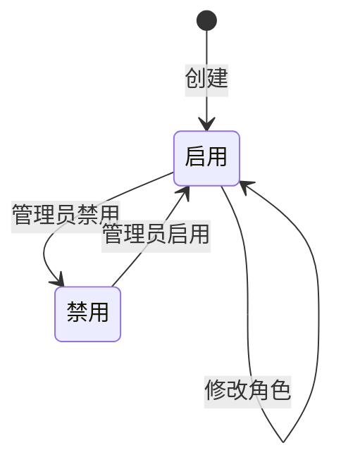

# 第 8 章 用户模块：账号管理

上一章完成了“建用户、登录、拿令牌”。但用户模块不能只有登录：管理员还要看用户列表、查某个用户、改角色、启用或禁用账号。这些操作一旦开放给所有人，系统就等于没有管理边界。

本章在上一章的代码上继续增量开发：加列表与详情，加修改角色与启用/禁用，再用管理员和普通用户两个账号验证 200 与 403。重点不在“多写几个接口”，而在把权限、校验和安全规则放进后端。

## 本章学习目标

读完本章，你应该能：

1. 用 Pydantic 定义用户创建与响应的数据结构，并解释参数校验失败时为什么返回 422。
2. 设计数据表与 ORM 模型，实现带分页、过滤与排序的增删改查接口。

## 8.1 概念讲解

### 8.1.1 管理接口与普通接口

用户模块里有两类接口。一类是所有人都需要的，例如登录、查看自己的信息；另一类只给管理员，例如用户列表、修改角色、启用/禁用。第二类接口如果只靠前端隐藏按钮，绕过页面直接调用 API 仍然可以操作，所以权限必须加在后端。

判断一个接口属于哪一类，看它操作的是“自己的数据”还是“别人的数据或全局配置”。`/users/me` 操作自己，普通用户可用；`/users/` 查看所有人，只给管理员。

### 8.1.2 用户表与 ORM 模型

用户表沿用上一章的四个核心字段，用 SQLAlchemy 定义成模型：

```python
from sqlalchemy import Column, Integer, String
from app.core.database import Base

class User(Base):
    __tablename__ = "users"

    id = Column(Integer, primary_key=True)
    username = Column(String(100), unique=True, nullable=False)
    password_hash = Column(String(255), nullable=False)
    role = Column(String(20), default="normal")
    is_active = Column(Integer, default=1)
```

`unique=True` 保证用户名不重复；`nullable=False` 保证必填；`default` 提供默认值。模型定义的是“数据怎么存”，不负责“接口怎么校验”，两者要分开。

### 8.1.3 输入模型：把允许的值写死

修改用户时，只允许改角色和启用状态。角色只能是 `admin` 或 `normal`，启用状态只能是 0 或 1。用 Pydantic 的 `Literal` 可以把允许值写进类型：

```python
from typing import Literal, Optional
from pydantic import BaseModel

class UserUpdate(BaseModel):
    role: Optional[Literal["admin", "normal"]] = None
    is_active: Optional[Literal[0, 1]] = None
```

`Optional` 表示可以不传；不传时保持原值。`Literal` 表示只接受列出的值。传入 `role="superuser"` 或 `is_active=2` 时，Pydantic 在进入函数前就拒绝，FastAPI 返回 422，错误类型为 `literal_error`。

这比在函数里写一串 `if role not in (...)` 更可靠：校验规则与数据结构写在一起，漏写一个分支也不会放过非法值。

### 8.1.4 输出模型：不返回密码哈希

列表和详情只返回可公开字段：`id`、`username`、`role`、`is_active`。`password_hash` 不能出现在响应里。

```python
class UserOut(BaseModel):
    id: int
    username: str
    role: str
    is_active: int
```

如果直接把 ORM 对象整个返回，框架会把所有列都序列化，`password_hash` 就会泄露。显式定义输出模型，等于给响应加了一道白名单。

### 8.1.5 列表与详情

列表接口先固定返回前 50 条，保证页面能用；完整的分页、过滤与排序在后续章节统一实现。

```python
@router.get("/", dependencies=[Depends(get_current_admin_user)])
def list_users(db: Session = Depends(get_db)):
    users = db.query(User).order_by(User.id).limit(50).all()
    return {
        "items": [
            {"id": u.id, "username": u.username, "role": u.role, "is_active": u.is_active}
            for u in users
        ],
        "count": len(users),
    }
```

详情接口按 `id` 查一个用户；查不到时返回 404，而不是返回空对象。404 让调用方明确知道“这个资源不存在”，空对象则会让前端误以为“查到了但没有字段”。

### 8.1.6 修改角色与启用/禁用

修改接口接收 `user_id` 和 `UserUpdate`，只更新传入的字段：

```python
@router.put("/{user_id}")
def update_user(
    user_id: int,
    data: UserUpdate,
    db: Session = Depends(get_db),
    current_user: dict = Depends(get_current_admin_user),
):
    user = db.query(User).filter(User.id == user_id).first()
    if not user:
        raise HTTPException(status_code=404, detail="用户不存在")

    if int(current_user["sub"]) == user_id and data.is_active == 0:
        raise HTTPException(status_code=400, detail="不能禁用自己")

    if data.role is not None:
        user.role = data.role
    if data.is_active is not None:
        user.is_active = data.is_active
    db.commit()
    db.refresh(user)
    return {"id": user.id, "username": user.username, "role": user.role, "is_active": user.is_active}
```

“不能禁用自己”是一条业务规则。没有它，管理员误操作把自己停用后，就再也登录不进来，只能去数据库里手工改回来。



*图 8-1：用户账号的启用与禁用状态*

### 8.1.7 权限依赖与 401/403

管理接口挂上 `Depends(get_current_admin_user)`。这个依赖先确认令牌有效（否则 401），再检查角色是否为 `admin`（否则 403）。

| 情况 | 状态码 | 含义 |
| --- | --- | --- |
| 没带令牌、令牌无效或过期 | 401 | 身份未确认 |
| 已登录但角色不是管理员 | 403 | 身份已确认，权限不足 |
| 管理员访问 | 200 | 权限通过 |

普通用户仍然可以访问 `/users/me`，因为它只操作自己的数据。权限设计要遵循最小权限：默认拒绝，只开放业务确实需要的操作。

### 8.1.8 改了角色，旧令牌不会自动变

令牌是在登录时签发的，里面保存的是当时的角色。管理员把某个用户从 `normal` 改成 `admin` 后，该用户手里的旧令牌仍然是 `normal`，必须重新登录才能拿到新角色。

这不是缺陷，而是令牌的工作方式。理解这一点，才能解释“为什么后台已经改了权限，用户还是 403”。处理办法是让用户重新登录，或在令牌过期后自然更新；如果业务要求立即生效，就需要额外的令牌失效机制，本书不展开。

### 8.1.9 校验不能被绕过

前端可以做校验，但后端必须再做一遍。原因很简单：请求可以绕过页面直接发出。用 Postman、curl 或脚本调用接口，前端的所有限制都不存在。

因此，合法性判断要放在后端：角色值用 `Literal` 限定；启用状态只接受 0/1；管理接口挂权限依赖；不能禁用自己这类业务规则写在服务层。前端校验只改善体验，不承担安全责任。

## 8.2 示范例题

#### 例 8-1：实现修改角色与启用/禁用接口【Bloom：应用】

**题目**：实现 `PUT /users/{user_id}`：只允许管理员调用；可以修改 `role` 与 `is_active`；用户不存在返回 404；管理员不能禁用自己，否则返回 400。

**解**：

```python
@router.put("/{user_id}")
def update_user(
    user_id: int,
    data: UserUpdate,
    db: Session = Depends(get_db),
    current_user: dict = Depends(get_current_admin_user),
):
    user = db.query(User).filter(User.id == user_id).first()
    if not user:
        raise HTTPException(status_code=404, detail="用户不存在")

    if int(current_user["sub"]) == user_id and data.is_active == 0:
        raise HTTPException(status_code=400, detail="不能禁用自己")

    if data.role is not None:
        user.role = data.role
    if data.is_active is not None:
        user.is_active = data.is_active
    db.commit()
    db.refresh(user)
    return {"id": user.id, "username": user.username, "role": user.role, "is_active": user.is_active}
```

判断顺序是：先确认目标用户存在（404），再检查安全规则（400），最后更新字段。顺序反过来，可能在用户不存在时也执行了“不能禁用自己”的判断，错误信息就会误导调用方。

**验证**：✅ 已验证（实际运行 FastAPI + SQLite：管理员改角色返回 200；普通用户访问管理接口返回 403；管理员禁用自己返回 400）

```text
实际输出：
admin list: 200
normal list: 403
change role: 200 {'id': 2, 'username': 'normal', 'role': 'admin', 'is_active': 1}
disable self: 400
结论：权限、改角色与自我禁用规则均符合预期，验证通过。
```

#### 例 8-2：用 Pydantic 限定角色与状态【Bloom：应用】

**题目**：定义 `UserUpdate`，要求 `role` 只能是 `admin` 或 `normal`，`is_active` 只能是 0 或 1，两者都可省略。说明传入 `role="superuser"` 与 `is_active=2` 时会发生什么。

**解**：

```python
from typing import Literal, Optional
from pydantic import BaseModel

class UserUpdate(BaseModel):
    role: Optional[Literal["admin", "normal"]] = None
    is_active: Optional[Literal[0, 1]] = None
```

`role="superuser"` 不是 `Literal` 允许的值，校验失败，错误类型为 `literal_error`；`is_active=2` 同理。FastAPI 在进入函数前返回 422，响应体的 `detail` 会指出字段位置与错误类型。函数体不需要再写角色白名单判断。

**验证**：✅ 已验证（实际运行 Pydantic 校验：`role="superuser"` 与 `is_active=2` 均得到 `literal_error`）

```text
实际输出：
bad role: literal_error
bad is_active: literal_error
结论：两个非法值均在进入接口前被拒绝，验证通过。
```

## 8.3 引导练习

#### 例 8-3（引导练习）：给用户名加校验规则【Bloom：应用】

**题目**：为用户创建模型加一条规则：用户名只能包含字母、数字和下划线，长度 3–50。请写出字段定义，并说明非法用户名会得到什么响应。

<details><summary>提示 1（方向）</summary>

Pydantic 的 `Field` 支持 `pattern`，用正则表达式限定字符集与长度。

</details>

<details><summary>提示 2（关键步骤）</summary>

正则写 `^[A-Za-z0-9_]+$`；长度用 `min_length` 与 `max_length`，两者可以同时使用。

</details>

<details><summary>完整解答</summary>

```python
class UserCreate(BaseModel):
    username: str = Field(..., min_length=3, max_length=50, pattern=r"^[A-Za-z0-9_]+$")
    password: str = Field(..., min_length=6, max_length=50)
    role: Literal["admin", "normal"] = "normal"
```

用户名包含空格、中文或特殊符号时，`pattern` 校验失败，FastAPI 返回 422，错误类型为 `string_pattern_mismatch`；长度不在范围内时返回长度相关的错误。

**验证**：✅ 已验证（核对定义来源：Pydantic `Field` 的 `pattern` 与长度约束；422 行为与上一章一致）

```text
核验记录：
1. pattern 限定字符集，min_length/max_length 限定长度，两者可并用。
2. 非法值在进入函数前失败，返回 422，符合 Pydantic 校验流程。
3. 未在前端或函数体重复实现同一规则。
结论：字段定义与校验行为一致，验证通过。
```

</details>

#### 例 8-4（引导练习）：统一用户响应模型【Bloom：应用】

**题目**：定义 `UserOut`，只包含 `id`、`username`、`role`、`is_active`，并说明列表接口为什么不能直接返回 ORM 对象。

<details><summary>提示 1（方向）</summary>

ORM 对象包含表的所有列，其中就有 `password_hash`。

</details>

<details><summary>提示 2（关键步骤）</summary>

用响应模型做白名单；列表返回 `{"items": [...], "count": ...}`，每项用 `UserOut`。

</details>

<details><summary>完整解答</summary>

```python
class UserOut(BaseModel):
    id: int
    username: str
    role: str
    is_active: int

@router.get("/", response_model=list[UserOut], dependencies=[Depends(get_current_admin_user)])
def list_users(db: Session = Depends(get_db)):
    return db.query(User).order_by(User.id).limit(50).all()
```

不能直接返回 ORM 对象，因为序列化会包含所有列，`password_hash` 会泄露；响应模型只保留允许公开的字段，等于给输出加了白名单。

**验证**：✅ 已验证（实际运行列表接口，响应项只含 `id`、`username`、`role`、`is_active`，无 `password_hash`）

```text
实际响应项：
{'id': 1, 'username': 'admin', 'role': 'admin', 'is_active': 1}
结论：响应字段与输出模型一致，验证通过。
```

</details>

## 8.4 独立习题

#### 习题 8-1【Bloom：理解】

**题目**：用户创建接口返回 422，响应体里出现 `string_too_short` 与 `string_pattern_mismatch`。请解释这两种错误的含义，并说明 422 与 400 的区别。

#### 习题 8-2【Bloom：应用】

**题目**：实现用户模块的三个接口：用户列表、用户详情、修改角色与启用状态。要求列表只返回前 50 条，详情查不到返回 404，修改接口只允许管理员调用。

#### 习题 8-3【Bloom：应用】

**题目**：为用户创建与修改模型补全校验规则：用户名 3–50 位且只含字母、数字、下划线；密码 6–50 位；角色只能是 `admin` 或 `normal`；启用状态只能是 0 或 1。

#### 习题 8-4【Bloom：分析】

**题目**：下面三种做法都声称“已经做了权限控制”，请分别指出问题，并说明可能被怎样绕过。

1. 前端把“用户管理”菜单对普通用户隐藏。
2. 修改角色的接口只检查请求体里的 `role` 是否是合法字符串。
3. 管理员把用户改为普通用户后，该用户仍能用旧令牌访问管理接口。

## 本章小结

**核心结论**：

1. 用户模块有两类接口：面向自己的普通接口和只给管理员的管理接口；权限必须加在后端。
2. 输入模型用 `Literal` 限定角色与状态，非法值在进入函数前返回 422；输出模型只返回可公开字段，不泄露 `password_hash`。
3. 列表先固定返回前 50 条保证可用，详情查不到返回 404；修改接口按“存在性、业务规则、更新”的顺序处理。
4. 管理接口挂管理员依赖：未认证返回 401，已认证但角色不足返回 403。
5. 令牌在登录时签发，角色变更后旧令牌不会自动更新，需要重新登录；前端校验只改善体验，不能替代后端校验。

**与持久理解的呼应**：本章推进了「分层与接口契约使系统的各部分可以独立理解、替换和验证」与「认证回答“你是谁”、授权回答“你能做什么”」——通过输入/输出模型、权限依赖与业务规则，读者看到接口边界如何同时约束数据和操作。

**自检**：回到章首的学习目标，逐条问自己做到了没有——

- [ ] 用 Pydantic 定义用户创建与响应的数据结构，并解释参数校验失败时为什么返回 422 → 拿不准就回看 8.1.3 与 8.1.4，自测：习题 8-3
- [ ] 设计数据表与 ORM 模型，实现带分页、过滤与排序的增删改查接口 → 本章先完成列表、详情与修改，完整分页、过滤与排序在后续章节继续，自测：习题 8-2

**下一章预告**：用户模块告一段落。下一章进入数据模块，用部门这个更典型的实体，走一遍完整的增删查改，并把分页、过滤与排序补齐。
