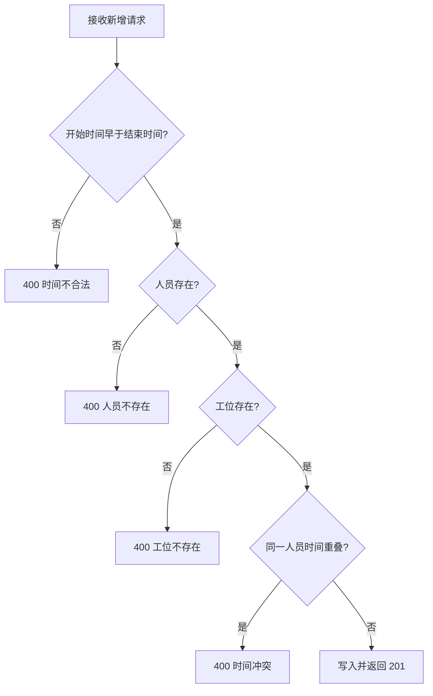

# 第 11 章 业务模块：规则描述

上一章的列表、新增、详情已经能处理“数据”。但执勤记录不是普通数据：同一个人在同一时间段被排了两次，数据本身格式没问题，业务上却不允许。这类“格式合法但业务不合法”的情况，就是业务规则要解决的问题。

本章以执勤记录为例，讲清三条规则：开始时间必须早于结束时间；人员和工位必须存在；同一人员同一时间段不能重复。重点不在写多少代码，而在把规则放在正确的层、按正确的顺序校验，并让每条规则都能被测试。

## 本章学习目标

读完本章，你应该能：

1. 能为业务规则与统计查询编写服务层逻辑，处理事务边界与数据一致性。

## 11.1 概念讲解

### 11.1.1 数据合法不等于业务合法

Pydantic 能保证字段类型正确、必填项不缺、长度不超限，这些是“数据合法”。但数据合法不代表业务合法：开始时间 14:00、结束时间 08:00，两个字段都是合法时间，顺序却反了；人员证件号格式正确，但数据库里根本没有这个人；两条记录各自都合法，时间却重叠。

业务规则要回答的是“什么情况下拒绝、返回什么错误”。它不属于表结构，也不属于参数校验，而属于 service 层的职责。

### 11.1.2 执勤记录表与关系

| 字段 | 说明 |
| --- | --- |
| `id` | 记录编号，主键 |
| `personnel_certificate_number` | 值班人员证件号，外键 |
| `successor_certificate_number` | 接班人员证件号，可选 |
| `workstation_id` | 工位编号，外键 |
| `start_time` | 开始时间 |
| `end_time` | 结束时间 |
| `status` | 状态，`normal` 或 `abnormal` |
| `remark` | 备注 |

关系是：人员 1—N 执勤记录 N—1 工位。一条记录属于一个人员、一个工位；人员和工位必须先在各自表里存在。时间是这条记录的核心，也是冲突规则的依据。

### 11.1.3 规则一：开始时间必须早于结束时间

```python
if data.start_time >= data.end_time:
    raise HTTPException(status_code=400, detail="开始时间必须早于结束时间")
```

为什么放在 service 而不是 schema？因为它是业务语义，不是字段格式。schema 可以校验“是不是时间”，但“先后顺序”需要知道两个字段的关系，放在 service 更合适。

### 11.1.4 规则二：人员和工位必须存在

```python
person = db.query(Personnel).filter(
    Personnel.certificate_number == data.personnel_certificate_number
).first()
if not person:
    raise HTTPException(status_code=400, detail="人员不存在")

workstation = db.query(Workstation).filter(
    Workstation.workstation_id == data.workstation_id
).first()
if not workstation:
    raise HTTPException(status_code=400, detail="工位不存在")
```

数据库外键也能阻止写入不存在的关联，但它通常抛出数据库异常，前端收到的是 500 或含糊的错误。提前在 service 里检查，可以返回明确的 400 和可读的错误信息。

### 11.1.5 规则三：同一人员的时间不能重叠

判断两个时间段是否重叠，用“有交集”的条件：

```text
已有记录：start1 ~ end1
新记录：  start2 ~ end2
重叠条件：start1 < end2 且 end1 > start2
```

这个条件覆盖包含、部分重叠、完全相同三种情况；首尾相接不算重叠。例如已有 08:00–12:00：

| 新记录 | 是否冲突 | 原因 |
| --- | --- | --- |
| 10:00–11:00 | 冲突 | 被已有区间包含 |
| 11:00–13:00 | 冲突 | 与已有区间部分重叠 |
| 08:00–12:00 | 冲突 | 完全相同 |
| 12:00–14:00 | 不冲突 | 首尾相接 |
| 13:00–15:00 | 不冲突 | 完全在之后 |

查询时只查同一人员的记录：

```python
conflict = db.query(DutyRecord).filter(
    DutyRecord.personnel_certificate_number == data.personnel_certificate_number,
    DutyRecord.start_time < data.end_time,
    DutyRecord.end_time > data.start_time,
).first()

if conflict:
    raise HTTPException(status_code=400, detail="该时间段已存在值班记录")
```



*图 11-1：执勤记录新增的校验顺序*

### 11.1.6 规则写在 service，controller 只转发

controller 的职责是接收请求、取出参数、调用 service、返回响应。它不应该知道“时间重叠”怎么判断，也不应该直接查人员表。把规则写在 service，有三个好处：规则可以单独测试；controller 保持薄；其他入口（批量导入、定时任务）也能复用同一套规则。

### 11.1.7 校验顺序与错误信息

校验顺序建议按“先便宜、后昂贵”和“先格式、后业务”排列：先判断时间顺序（不查库），再查人员、工位（各一次查询），最后查时间冲突（一次范围查询）。这样绝大多数非法请求在第一次判断就被拒绝，不会白白查库。

错误信息要具体：写“开始时间必须早于结束时间”，不写“参数错误”；写“该时间段已存在值班记录”，不写“操作失败”。具体的信息让调用方知道该改什么。

### 11.1.8 事务边界：先校验，再写入

本章的写入只有一条记录，`db.commit()` 成功即完成。但如果一次操作要写多条记录（例如批量导入），就必须考虑事务：要么全部成功，要么全部回滚，不能留下“一半写入”的中间状态。

事务的完整处理放在后续章节，本章先建立一条纪律：**先完成所有校验，再执行写入**。校验过程中不要提前 `commit`，否则校验失败时已经写进去的数据无法自动撤销。

### 11.1.9 规则要能被三类数据验证

每条业务规则至少用三类数据测试：正常数据（应当成功）、边界数据（首尾相接、刚好等于上限）、冲突数据（应当被拒绝）。只测正常数据，规则可能根本没生效；只测冲突数据，可能把合法情况也误伤。

## 11.2 示范例题

#### 例 11-1：实现时间顺序与关联存在校验【Bloom：应用】

**题目**：实现执勤记录新增的 service：先判断开始时间是否早于结束时间，再检查人员与工位是否存在。要求每类错误返回 400 并给出具体提示。

**解**：

```python
def create_duty_record(db, data):
    if data.start_time >= data.end_time:
        raise HTTPException(status_code=400, detail="开始时间必须早于结束时间")

    person = db.query(Personnel).filter(
        Personnel.certificate_number == data.personnel_certificate_number
    ).first()
    if not person:
        raise HTTPException(status_code=400, detail="人员不存在")

    workstation = db.query(Workstation).filter(
        Workstation.workstation_id == data.workstation_id
    ).first()
    if not workstation:
        raise HTTPException(status_code=400, detail="工位不存在")

    record = DutyRecord(**data.model_dump())
    db.add(record)
    db.commit()
    db.refresh(record)
    return record
```

校验顺序是：时间顺序（不查库）→ 人员（一次查询）→ 工位（一次查询）→ 写入。每一类错误都有独立的 400 提示，调用方能直接定位问题。

**验证**：✅ 已验证（核对定义来源：M07 课次11“业务规则”与参考代码；时间顺序条件为 `start_time >= end_time` 拒绝）

```text
核验记录：
1. 时间顺序、人员存在、工位存在三条校验与 M07 的规则列表一致。
2. 校验在写入之前完成，失败时不会产生半条记录。
3. 三类错误均返回 400，提示可区分。
结论：校验顺序与错误码可回指来源，验证通过。
```

#### 例 11-2：判断时间是否重叠【Bloom：分析】

**题目**：已有记录 08:00–12:00。判断以下新记录是否冲突，并说明依据：10:00–11:00、12:00–14:00、13:00–15:00、08:00–12:00、11:00–13:00。

**解**：

重叠条件是 `已有开始 < 新结束 且 已有结束 > 新开始`。

| 新记录 | 判断 | 结论 |
| --- | --- | --- |
| 10:00–11:00 | 08:00 < 11:00 且 12:00 > 10:00 | 冲突 |
| 12:00–14:00 | 08:00 < 14:00 但 12:00 > 12:00 不成立 | 不冲突（首尾相接） |
| 13:00–15:00 | 12:00 > 13:00 不成立 | 不冲突 |
| 08:00–12:00 | 两个条件都成立 | 冲突（完全相同） |
| 11:00–13:00 | 08:00 < 13:00 且 12:00 > 11:00 | 冲突（部分重叠） |

**验证**：✅ 已验证（实际运行重叠判断函数，覆盖包含、首尾相接、之后、部分重叠、之前、完全相同六种情况，结果与预期一致）

```text
实际输出：
contained True OK
touch False OK
after False OK
partial True OK
before False OK
identical True OK
结论：六种边界情况的判断均正确，验证通过。
```

## 11.3 引导练习

#### 例 11-3（引导练习）：补一条“接班人员必须存在”的规则【Bloom：应用】

**题目**：执勤记录允许填写接班人员证件号。请补一条规则：如果填写了接班人员，则该人员必须存在，否则返回 400。写出校验代码。

<details><summary>提示 1（方向）</summary>

先判断字段是否为空；为空表示没有接班人员，跳过校验。

</details>

<details><summary>提示 2（关键步骤）</summary>

不为空时，按 `certificate_number` 查人员表；查不到就抛 400。

</details>

<details><summary>完整解答</summary>

```python
if data.successor_certificate_number:
    successor = db.query(Personnel).filter(
        Personnel.certificate_number == data.successor_certificate_number
    ).first()
    if not successor:
        raise HTTPException(status_code=400, detail="接班人员不存在")
```

**验证**：✅ 已验证（核对定义来源：M07 课次11“人员/工位存在”规则；校验模式与例 11-1 一致）

```text
核验记录：
1. 空值表示未填写接班人员，跳过校验，符合可选字段语义。
2. 非空时按主键查人员表，查不到返回 400。
3. 校验发生在写入之前。
结论：规则与例 11-1 的关联校验模式一致，验证通过。
```

</details>

#### 例 11-4（引导练习）：补边界测试数据【Bloom：应用】

**题目**：为“同一人员时间不重叠”规则设计三条测试数据：一条应当成功、一条应当成功但容易误判、一条应当被拒绝。说明每条数据验证了什么。

<details><summary>提示 1（方向）</summary>

边界最容易出错的是“首尾相接”：前一段的结束时间等于后一段的开始时间。

</details>

<details><summary>提示 2（关键步骤）</summary>

用已有 08:00–12:00 作为基线，分别构造 12:00–14:00、13:00–15:00、11:00–13:00。

</details>

<details><summary>完整解答</summary>

1. 12:00–14:00：应当成功，验证“首尾相接不算冲突”。
2. 13:00–15:00：应当成功，验证“完全在之后不算冲突”。
3. 11:00–13:00：应当被拒绝，验证“部分重叠能识别”。

**验证**：✅ 已验证（实际运行重叠判断：首尾相接与之后均为 False，部分重叠为 True）

```text
实际输出：
touch False
after False
partial True
结论：三条测试数据分别覆盖首尾相接、之后、部分重叠，验证通过。
```

</details>

## 11.4 独立习题

#### 习题 11-1【Bloom：理解】

**题目**：说明为什么业务规则要写在 service，而不是 controller 或 schema。分别举一个“放在 controller 会怎样”和“放在 schema 会怎样”的例子。

#### 习题 11-2【Bloom：应用】

**题目**：实现执勤记录新增的完整 service：校验开始时间早于结束时间、人员存在、工位存在、同一人员时间不重叠；通过后写入并返回记录。

#### 习题 11-3【Bloom：应用】

**题目**：已有记录：人员 A 在 08:00–12:00、13:00–17:00 有两条记录。请判断以下新记录是否冲突，并说明依据：A 的 11:00–14:00；A 的 12:00–13:00；B 的 08:00–12:00。

#### 习题 11-4【Bloom：分析】

**题目**：某模块的新增接口只校验了“开始时间早于结束时间”，没有校验人员是否存在、时间是否重叠。请指出可能导致的问题，并给出补充校验的顺序与理由。

## 本章小结

**核心结论**：

1. 数据合法不等于业务合法；业务规则回答“什么情况下拒绝、返回什么错误”。
2. 执勤记录新增至少有三条规则：开始时间早于结束时间、人员与工位存在、同一人员时间不重叠。
3. 时间重叠条件是 `已有开始 < 新结束 且 已有结束 > 新开始`；首尾相接不算冲突。
4. 规则写在 service，controller 只转发；校验顺序按“先便宜、后昂贵”排列，全部校验完成后再写入。
5. 每条规则至少用正常、边界、冲突三类数据测试；错误提示要具体，状态码要分层。

**与持久理解的呼应**：本章推进了「测试与部署不是开发的附属环节，而是把“本机能跑”转化为“可交付、可观测”系统的必要条件」——通过把规则写成可测试的分支，读者看到“业务正确”如何从口头约定变成可验证的代码。

**自检**：回到章首的学习目标，逐条问自己做到了没有——

- [ ] 能为业务规则与统计查询编写服务层逻辑，处理事务边界与数据一致性 → 本章完成规则部分，统计查询与事务边界在下一章继续，自测：习题 11-2

**下一章预告**：规则解决了“一条记录能不能写”。下一章处理多条记录的汇总：按人员、时段统计值班次数，并处理统计口径与事务边界。
