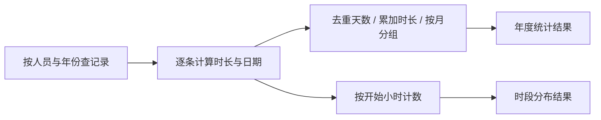

# 第 12 章 业务模块：统计校验

上一章解决的是“一条记录能不能写”。统计面对的是“多条记录合起来说明什么”：某个人一年值了多少天班、总共多少小时、哪个月最忙、一天里哪个时段最集中。

统计代码本身不复杂，难的是口径：同一天有两条记录，算 1 天还是 2 天？跨月的记录归到哪个月？没有记录时返回 0 还是报错？口径没说清，代码写得再顺，结果也无法验收。本章先定口径，再写两个统计接口：年度统计与时段分布。

## 本章学习目标

读完本章，你应该能：

1. 能为业务规则与统计查询编写服务层逻辑，处理事务边界与数据一致性。

## 12.1 概念讲解

### 12.1.1 统计是只读的

统计接口不写数据，只做三件事：按条件查记录、按口径算指标、返回结果。因为是只读，它通常不需要事务；但如果统计结果要写入汇总表，或者统计过程中伴随其他写操作，就需要事务来保证“要么全部成功，要么全部回滚”。

先记住这个区分：查询统计是只读；带写入的统计才需要事务。不要把只读查询包进事务里，也不要让写操作在没有事务保护的情况下执行一半。

### 12.1.2 先定口径，再写代码

两个统计需求对应两组口径：

| 指标 | 口径 |
| --- | --- |
| 总值班天数 | 不同日期的个数；同一天多条记录只算 1 天 |
| 总值班时长 | 每条记录“结束减开始”的小时数，再累加 |
| 月度分布 | 按 `start_time` 的月份分组，分别统计天数与时长 |
| 时段分布 | 按 `start_time` 的小时分组，统计记录条数 |
| 高峰时段 | 记录条数最多的小时；并列时返回多个 |

口径必须写在接口说明或设计文档里。例如“跨月记录按开始时间归月”是一条约定；如果不写，两个人可能一个按开始时间、一个按结束时间，统计结果就对不上。

### 12.1.3 按人员与年份取数

统计的输入通常是“某人某年”。查询时按人员证件号和年份过滤：

```python
records = db.query(DutyRecord).filter(
    DutyRecord.personnel_certificate_number == cert,
    extract("year", DutyRecord.start_time) == int(year),
).all()
```

先查人员是否存在，再查记录。人员不存在返回 400；人员存在但没有记录，返回 0 或空列表，这不是错误。

### 12.1.4 年度统计：天数去重、时长累加、月份补齐

```python
total_hours = 0.0
days = set()
monthly_days = {m: set() for m in range(1, 13)}
monthly_hours = {m: 0.0 for m in range(1, 13)}

for r in records:
    hours = (r.end_time - r.start_time).total_seconds() / 3600
    total_hours += hours
    days.add(r.start_date)
    monthly_days[r.start_time.month].add(r.start_date)
    monthly_hours[r.start_time.month] += hours

return {
    "personnel_certificate_number": cert,
    "year": year,
    "total_duty_days": len(days),
    "total_duty_hours": round(total_hours, 2),
    "duty_by_month": [
        {
            "month": m,
            "days": len(monthly_days[m]),
            "hours": round(monthly_hours[m], 2),
        }
        for m in range(1, 13)
    ],
}
```

三个细节：

1. **天数用 `set` 去重**：同一天两条记录，`days` 只会留下一个日期。
2. **时长用 `total_seconds() / 3600`**：直接减两个时间得到的是时间差对象，转成小时才方便累加。
3. **月份补齐 12 项**：没有记录的月份返回 0，前端画图时不会缺柱子。

### 12.1.5 时段分布：24 小时补齐、高峰可能并列

```python
hour_counts = {h: 0 for h in range(24)}
for r in records:
    hour_counts[r.start_time.hour] += 1

max_count = max(hour_counts.values()) if records else 0
peak_hours = [h for h, c in hour_counts.items() if c == max_count] if max_count else []

return {
    "year": year,
    "personnel_certificate_number": cert,
    "time_distribution": [{"hour": h, "count": c} for h, c in hour_counts.items()],
    "peak_hours": peak_hours,
    "total_records": len(records),
}
```

24 个小时都要返回，没有记录的小时返回 0。高峰时段可能有多个：如果 8 点和 13 点都是 2 条记录，`peak_hours` 就是 `[8, 13]`。无记录时高峰时段为空列表，而不是 `None`。

### 12.1.6 空数据不是异常

统计接口最容易在“没有数据”时报 500：`max()` 对空列表报错、除法分母为 0、前端拿到 `null` 无法渲染。正确做法是把“无记录”当作合法输入：总天数返回 0，总时长返回 0，月度与时段返回补齐的 0 列表，高峰时段返回空列表。

### 12.1.7 输入检查

统计接口至少检查两件事：年份格式是否为 4 位数字；人员是否存在。年份格式错误返回 400，人员不存在返回 400。记录为空则正常返回 0/空。

```python
if len(year) != 4 or not year.isdigit():
    raise HTTPException(status_code=400, detail="年份格式错误")

person = db.query(Personnel).filter(
    Personnel.certificate_number == cert
).first()
if not person:
    raise HTTPException(status_code=400, detail="人员不存在")
```

### 12.1.8 口径不一致会制造“假数字”

一个常见错误是：总天数用 `set` 去重，月度天数却按记录条数累加。这样同一天两条记录会让月度天数变成 2，而总天数仍是 1，两个数字对不上。正确做法是月度天数也用日期集合去重。

另一个常见错误是跨月记录：一条从 1 月 31 日 22:00 到 2 月 1 日 02:00 的记录，按开始时间归 1 月。这个约定本身可以接受，但必须写清楚；否则有人按开始时间、有人按结束时间，月度统计就会漂移。



*图 12-1：统计接口的计算路径*

### 12.1.9 事务边界：只在需要写入时使用

只读统计不需要事务。带写入的统计（例如把结果写入汇总表）需要事务：所有写入放在一个事务里，任何一步失败都回滚。

```python
try:
    db.add_all(summary_rows)
    db.commit()
except Exception:
    db.rollback()
    raise
```

回滚的意义是避免“写了一半”：统计结果要么完整写入，要么完全不写。没有回滚，失败后可能留下部分数据，下一次统计又会基于不完整的数据继续算。

### 12.1.10 结果要能手算核对

统计结果不能只看“接口返回了数字”。拿 3–5 条记录手算一遍，再和接口结果对比：总天数、总时长、各月数字、高峰时段。手算能发现口径错误，接口自测只能发现代码报错。

## 12.2 示范例题

#### 例 12-1：计算某人的年度统计【Bloom：应用】

**题目**：某人员 2026 年有以下 5 条记录：

- 1 月 5 日 08:00–12:00
- 1 月 5 日 13:00–17:00
- 1 月 6 日 08:00–10:00
- 2 月 10 日 20:00–次日 00:00
- 3 月 1 日 00:00–02:00

请计算总天数、总时长，以及 1–3 月的天数与时长。

**解**：

1. 总天数按不同日期去重：1 月 5 日、1 月 6 日、2 月 10 日、3 月 1 日，共 4 天。
2. 总时长逐条累加：4 + 4 + 2 + 4 + 2 = 16 小时。
3. 1 月：日期为 1 月 5 日、1 月 6 日，共 2 天；时长为 4 + 4 + 2 = 10 小时。
4. 2 月：1 天，4 小时。
5. 3 月：1 天，2 小时。

注意 1 月 5 日有两条记录，总天数只算 1 天，但时长要累加 8 小时；月度天数同样按日期去重，所以 1 月是 2 天，不是 3 天。

**验证**：✅ 已验证（实际运行统计函数：总天数 4、总时长 16.0；1 月 2 天/10 小时、2 月 1 天/4 小时、3 月 1 天/2 小时）

```text
实际输出：
total_days: 4 total_hours: 16.0
january: {'month': 1, 'days': 2, 'hours': 10.0}
february: {'month': 2, 'days': 1, 'hours': 4.0}
march: {'month': 3, 'days': 1, 'hours': 2.0}
结论：总天数去重、时长累加与月度分组均符合口径，验证通过。
```

#### 例 12-2：什么时候需要事务【Bloom：分析】

**题目**：下面三种操作，哪些需要事务？说明理由。1）查询某人某年的值班记录并返回统计；2）把统计结果写入汇总表；3）批量导入 100 条值班记录。

**解**：

1. **不需要**。只读查询不改变数据，失败也不会留下中间状态。
2. **需要**。写汇总表是一次写操作；如果写了一半失败，汇总数据会不完整，下一次统计会基于错误数据继续算。应把写入放在一个事务里，失败回滚。
3. **需要**。批量导入是多条写入；若第 50 条失败，前 49 条不应留在库里。应整体提交，失败整体回滚。

**验证**：✅ 已验证（核对定义来源：M07 课次12“统计是只读”；事务回滚行为已实际运行：重复插入触发回滚后记录数为 0）

```text
实际输出：
rolled back, count = 0
结论：写入失败后回滚能清除同事务内的部分写入，验证通过。
```

## 12.3 引导练习

#### 例 12-3（引导练习）：实现时段分布【Bloom：应用】

**题目**：用上面 5 条记录实现时段分布：返回 24 个小时的计数、总记录数与高峰时段。

<details><summary>提示 1（方向）</summary>

先建一个 24 小时的计数字典，全部初始化为 0；再逐条取 `start_time.hour` 累加。

</details>

<details><summary>提示 2（关键步骤）</summary>

高峰时段是计数等于最大值的所有小时；没有记录时返回空列表。

</details>

<details><summary>完整解答</summary>

5 条记录的开始小时分别是 8、13、8、20、0。计数为：0 点 1 条、8 点 2 条、13 点 1 条、20 点 1 条，其余为 0。总记录数 5，高峰时段为 `[8]`。

```python
hour_counts = {h: 0 for h in range(24)}
for r in records:
    hour_counts[r.start_time.hour] += 1

max_count = max(hour_counts.values()) if records else 0
peak_hours = [h for h, c in hour_counts.items() if c == max_count] if max_count else []
```

**验证**：✅ 已验证（实际运行：8 点计数 2，高峰 `[8]`，总记录 5，24 项齐全；无记录时高峰为空、24 项仍齐全）

```text
实际输出：
hour8: 2 peaks: [8] total: 5
empty: peaks [] counts 24
结论：时段计数、高峰与空数据处理均符合预期，验证通过。
```

</details>

#### 例 12-4（引导练习）：修正月度天数口径【Bloom：应用】

**题目**：某同学统计月度天数时，每遍历一条记录就 `days += 1`。请指出问题，并改成与总天数一致的口径。

<details><summary>提示 1（方向）</summary>

同一天可能有多条记录；按月统计天数时也要去重。

</details>

<details><summary>提示 2（关键步骤）</summary>

每个月维护一个日期集合，最后取集合长度，而不是累加记录数。

</details>

<details><summary>完整解答</summary>

问题：同一天两条记录会让月度天数变成 2，而总天数按日期去重仍是 1，两个数字对不上。

修正：

```python
monthly_days = {m: set() for m in range(1, 13)}
for r in records:
    monthly_days[r.start_time.month].add(r.start_date)

duty_by_month = [
    {"month": m, "days": len(monthly_days[m]), "hours": round(monthly_hours[m], 2)}
    for m in range(1, 13)
]
```

**验证**：✅ 已验证（实际运行：1 月 5 日有两条记录，1 月天数按去重后为 2 天，而不是 3 天）

```text
实际输出：
january_day_dedup: 2
结论：月度天数与总天数采用同一去重口径，验证通过。
```

</details>

## 12.4 独立习题

#### 习题 12-1【Bloom：应用】

**题目**：实现年度统计接口：给定人员证件号与年份，返回总天数、总时长、12 个月的月度分布。要求天数按日期去重，没有记录的月份返回 0。

#### 习题 12-2【Bloom：应用】

**题目**：实现一个“统计结果写入汇总表”的函数。要求：多条汇总记录要么全部写入，要么全部回滚；给出事务处理代码，并说明失败时如何保证数据一致。

#### 习题 12-3【Bloom：分析】

**题目**：某统计接口的总天数是 10，但 12 个月的月度天数加起来是 14。请分析可能的原因，并给出修正方案。

#### 习题 12-4【Bloom：评价】（开放题）

**题目**：跨月记录（如 1 月 31 日 22:00 到 2 月 1 日 02:00）应该归到哪个月？请给出两种可选口径，比较它们的优缺点，并说明你会选择哪一种、为什么。

## 本章小结

**核心结论**：

1. 统计是只读：查数据、算指标、返回；带写入的统计才需要事务。
2. 口径要先定：总天数按日期去重，总时长逐条累加，月度与时段补齐 12/24 项，跨月记录按约定归属。
3. 空数据不是异常：没有记录时返回 0 或空列表，不要报 500。
4. 输入检查至少覆盖年份格式与人员存在；人员存在但无记录应正常返回 0/空。
5. 月度天数必须与总天数使用同一去重口径；带写入的统计要放在事务里，失败回滚。

**与持久理解的呼应**：本章推进了「测试与部署不是开发的附属环节，而是把“本机能跑”转化为“可交付、可观测”系统的必要条件」——通过手算核对与口径约定，读者看到“数字正确”如何从感觉变成可复核的证据。

**自检**：回到章首的学习目标，逐条问自己做到了没有——

- [ ] 能为业务规则与统计查询编写服务层逻辑，处理事务边界与数据一致性 → 拿不准就回看 12.1.2 与 12.1.9，自测：习题 12-3

**下一章预告**：统计结果对不对，不能只靠手算。下一章用 pytest 把正常、边界与异常路径写成可重复执行的测试，并学习从失败信息定位缺陷。
