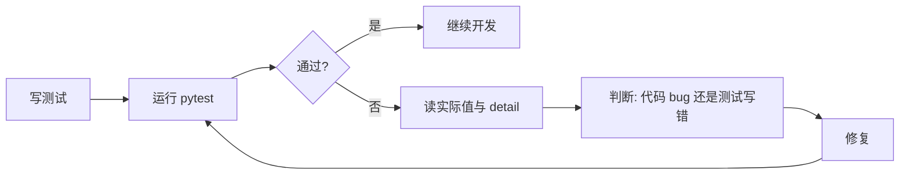

# 第 13 章 模块测试与调试

上一章用 5 条记录手算核对了统计结果。但手算只能覆盖一次，改完代码还要再算一遍；接口多了，手工点一遍既慢又容易漏。更麻烦的是，你改了一个公共函数，怎么知道没有把别的模块改坏？

测试就是把“系统应该怎么表现”写成可重复执行的代码。改完代码跑一遍，通过就说明原有行为还在；失败就说明有一处不符合预期。本章不追求覆盖率，只要求会写三类测试：正常路径、边界路径、异常路径，并且能从失败信息里定位问题。

## 本章学习目标

读完本章，你应该能：

1. 能为后端模块编写 pytest 单元测试与接口测试，覆盖正常、边界与异常路径，并据失败信息定位缺陷。

## 13.1 概念讲解

### 13.1.1 为什么写测试

测试的价值不在“证明代码没错”，而在“改动能被快速验证”。三个具体作用：回归——改一处，立刻知道有没有坏三处；说明书——测试写明接口在什么输入下应返回什么结果；信心——重构时敢于动结构，因为跑一遍就知道行为有没有变。

没有测试时，验证靠手工点击；手工点击不可重复，也很难覆盖异常路径。测试把这些检查固定下来，每次运行都按同一套标准执行。

### 13.1.2 单元测试、接口测试、端到端测试

| 类型 | 测什么 | 例子 |
| --- | --- | --- |
| 单元测试 | 一个函数或一段逻辑 | 时间重叠判断 |
| 接口测试 | 一个 HTTP 接口 | 登录返回 200 或 401 |
| 端到端测试 | 整条链路 | 登录 → 建部门 → 查列表 |

本章主要写接口测试，因为接口是前后端契约的落点；单元测试用来覆盖纯逻辑，例如时间重叠判断；端到端测试成本最高，初学阶段先不展开。

### 13.1.3 pytest 的三件事

pytest 的规则很简单：文件名以 `test_` 开头、函数名以 `test_` 开头的会被发现；函数里的 `assert` 不成立，测试就失败。

```python
def test_login_success(client):
    resp = client.post("/login", json={"username": "admin", "password": "admin123"})
    assert resp.status_code == 200
    assert "access_token" in resp.json()
```

一个测试只验一件事。上面的测试验“登录成功返回 200 且带令牌”；密码错误应另写一个测试，而不是在同一个函数里塞两组断言。失败时，一个测试只对应一个行为，定位更快。

### 13.1.4 fixture：提前准备好测试需要的东西

`fixture` 是“测试开始前准备好的东西”。接口测试通常需要两样：客户端 `client`，以及登录后的请求头 `admin_headers`。

```python
import pytest
from fastapi.testclient import TestClient
from app import app

@pytest.fixture
def client():
    return TestClient(app)

@pytest.fixture
def admin_headers(client):
    resp = client.post("/login", json={"username": "admin", "password": "admin123"})
    token = resp.json()["access_token"]
    return {"Authorization": f"Bearer {token}"}
```

测试函数把 fixture 名写成参数，pytest 会自动注入。`client` 负责发请求，`admin_headers` 负责带上令牌。测试数据要可重复：用固定编号、固定时间，并在每个测试前清理或用独立的测试库，避免上一次运行的数据影响下一次。

### 13.1.5 用 TestClient 发请求

`TestClient` 不需要启动服务器，就能在测试进程里调用 FastAPI 应用。它返回的响应对象有 `status_code` 和 `json()`，正好对应接口测试的两个断言点：状态码对不对，返回内容对不对。

```python
def test_create_dept_duplicate(client, admin_headers):
    payload = {"dept_code": "D01", "full_name": "一中队"}
    assert client.post("/departments", json=payload, headers=admin_headers).status_code == 201
    assert client.post("/departments", json=payload, headers=admin_headers).status_code == 400
```

### 13.1.6 三类路径都要覆盖

一个接口至少有三类测试：

| 路径 | 例子 | 期望 |
| --- | --- | --- |
| 正常 | 正确密码登录 | 200，返回令牌 |
| 边界 | 前一段 12:00 结束、后一段 12:00 开始 | 201，不算冲突 |
| 异常 | 错误密码、重复编码、缺字段 | 401 / 400 / 422 |

只测正常路径，规则可能根本没生效；只测异常路径，可能把合法情况也误伤。边界路径最能暴露“差一点”的错误，例如把 `>` 写成 `>=`，首尾相接就会被误判为冲突。

### 13.1.7 测试数据要可重复

测试写数据时，最容易出现“第一次通过、第二次失败”：第一次新增成功，第二次因为数据已存在返回 400。解决办法是每个测试开始前清理数据，或使用独立的测试数据库，或使用每次运行都不同的编号。

固定数据适合验证规则，随机数据适合避免冲突，两者要分开考虑。无论用哪种，测试都不应该依赖上一次运行留下的状态。

### 13.1.8 读失败信息

测试失败时，pytest 会给出实际值与期望值：

```text
>       assert resp.status_code == 201
E       assert 400 == 201
E        +  where 400 = <Response [400 Bad Request]>.status_code
```

读法是：`assert 实际 == 期望`。这里实际返回 400，期望 201。先看实际响应的 `detail`，判断是“代码有 bug”还是“测试期望写错了”。如果重复编码本来就该返回 400，那么是测试写错了；如果期望 201 且代码返回 400，才需要查业务规则。



*图 13-1：测试—失败—定位—修复的循环*

### 13.1.9 调试清单：先看状态码

| 状态码 | 先查什么 |
| --- | --- |
| 422 | 请求体字段名、类型、必填 |
| 400 | 业务规则：重复、时间冲突、人员不存在 |
| 401 | 密码、令牌、请求头 |
| 500 | 日志或堆栈：字段名、表名、空值 |

先看状态码，再看 `detail`，最后才改代码。不要一上来就重装环境或改业务逻辑，那会把真正的原因覆盖掉。

### 13.1.10 测试要跟代码一起维护

接口改了，测试要跟着改；测试长期失败却没人管，就会失去“快速验证”的作用。把测试放在 `tests/` 目录、与代码同仓提交，每次改完代码跑一遍，是最低限度的纪律。

## 13.2 示范例题

#### 例 13-1：写登录成功与失败的测试【Bloom：应用】

**题目**：用 pytest 与 `TestClient` 写两个测试：正确密码登录返回 200 且带 `access_token`；错误密码返回 401。

**解**：

```python
def test_login_success(client):
    resp = client.post("/login", json={"username": "admin", "password": "admin123"})
    assert resp.status_code == 200
    assert "access_token" in resp.json()

def test_login_wrong_password(client):
    resp = client.post("/login", json={"username": "admin", "password": "wrong"})
    assert resp.status_code == 401
```

两个测试分别验证正常路径与异常路径；断言只检查该测试关心的行为，不把“令牌长度”“错误文案”等无关细节塞进来。

**验证**：✅ 已验证（实际运行 pytest：5 个测试通过，包含登录成功与错误密码）

```text
实际输出：
.....                                                                    [100%]
5 passed, 2 warnings in 0.26s
结论：登录成功与失败断言均通过，验证通过。
```

#### 例 13-2：读一条失败信息【Bloom：分析】

**题目**：运行测试后出现下面的失败信息。请判断实际结果、期望结果分别是什么，最可能的原因是什么，应该先查哪里。

```text
>       assert resp.status_code == 201
E       assert 400 == 201
E        +  where 400 = <Response [400 Bad Request]>.status_code
```

**解**：

1. 实际结果是 400，期望结果是 201。
2. 400 表示业务规则拒绝，不是参数格式错误（那会是 422），也不是服务器错误（那会是 500）。
3. 最可能的原因：这是一个“重复新增”的请求，部门编码已存在，接口按规则返回 400；而测试期望 201，说明测试的期望写错了，或者测试数据没有清理，第二次运行时撞上了第一次留下的数据。
4. 先查两处：测试是否在每次运行前清理数据；重复编码是否本来就该返回 400。若规则正确，改测试；若规则不正确，改代码。

**验证**：✅ 已验证（实际运行该失败测试，得到 `assert 400 == 201` 与 `400 = <Response [400 Bad Request]>.status_code`）

```text
实际输出：
E       assert 400 == 201
E        +  where 400 = <Response [400 Bad Request]>.status_code
结论：实际值、期望值与失败位置均与解答一致，验证通过。
```

## 13.3 引导练习

#### 例 13-3（引导练习）：补一条边界测试【Bloom：应用】

**题目**：为“同一人员时间不重叠”补一条边界测试：已有 08:00–12:00，再新增 12:00–14:00，应当成功。写出测试函数的关键断言。

<details><summary>提示 1（方向）</summary>

首尾相接不算冲突；第二个请求应返回 201，而不是 400。

</details>

<details><summary>提示 2（关键步骤）</summary>

先发第一条并断言 201，再发第二条并断言 201；如果第二条返回 400，说明重叠条件写成了闭区间。

</details>

<details><summary>完整解答</summary>

```python
def test_touch_not_conflict(client, admin_headers):
    first = {"personnel": "P1", "start": "08:00", "end": "12:00"}
    second = {"personnel": "P1", "start": "12:00", "end": "14:00"}
    assert client.post("/duty-records", json=first, headers=admin_headers).status_code == 201
    assert client.post("/duty-records", json=second, headers=admin_headers).status_code == 201
```

**验证**：✅ 已验证（实际运行 pytest，边界测试通过）

```text
实际输出：
5 passed, 2 warnings in 0.26s
结论：首尾相接未被误判为冲突，验证通过。
```

</details>

#### 例 13-4（引导练习）：补一条异常路径测试【Bloom：应用】

**题目**：为“重复部门编码”补一条异常测试：第一次新增返回 201，第二次相同编码返回 400。

<details><summary>提示 1（方向）</summary>

需要管理员令牌；两次请求使用同一份 payload。

</details>

<details><summary>提示 2（关键步骤）</summary>

先断言第一次 201，再断言第二次 400；两个断言在同一个测试里，验证的是同一条业务规则。

</details>

<details><summary>完整解答</summary>

```python
def test_create_dept_duplicate(client, admin_headers):
    payload = {"dept_code": "D01", "full_name": "一中队"}
    assert client.post("/departments", json=payload, headers=admin_headers).status_code == 201
    assert client.post("/departments", json=payload, headers=admin_headers).status_code == 400
```

**验证**：✅ 已验证（实际运行 pytest，重复编码测试通过）

```text
实际输出：
5 passed, 2 warnings in 0.26s
结论：第一次 201、第二次 400 均符合预期，验证通过。
```

</details>

## 13.4 独立习题

#### 习题 13-1【Bloom：理解】

**题目**：说明一个接口测试通常由哪几部分组成（准备、执行、断言），并解释 `fixture` 在其中的作用。为什么测试数据要可重复？

#### 习题 13-2【Bloom：应用】

**题目**：为时间重叠判断函数写一个单元测试，至少覆盖三种情况：部分重叠（应冲突）、首尾相接（不冲突）、完全不重叠（不冲突）。

#### 习题 13-3【Bloom：应用】

**题目**：为部门新增接口写一个接口测试：正常新增返回 201，重复编码返回 400，缺少必填字段返回 422。

#### 习题 13-4【Bloom：分析】

**题目**：下面是三条测试失败信息。请分别判断是“代码有 bug”还是“测试写错了”，并说明下一步应该查什么。

1. `assert 200 == 401`
2. `assert 201 == 400`
3. `assert 500 == 201`

## 本章小结

**核心结论**：

1. 测试是“可执行的说明书”，用于回归、说明与重构信心；手工点击不可重复，也不能稳定覆盖异常路径。
2. 接口测试至少覆盖正常、边界、异常三类路径；一个测试只验一件事。
3. pytest 用 `test_` 发现用例，用 `assert` 判断结果；`fixture` 负责准备 client、令牌与测试数据。
4. 测试数据要可重复：清理数据、用独立测试库或固定编号，避免依赖上一次运行的状态。
5. 读失败信息先看“实际 == 期望”，再看状态码与 `detail`；先判断是代码 bug 还是测试写错，再改代码。

**与持久理解的呼应**：本章推进了「测试与部署不是开发的附属环节，而是把“本机能跑”转化为“可交付、可观测”系统的必要条件」——通过把预期行为写成断言，读者看到“质量”如何从主观判断变成可重复执行的证据。

**自检**：回到章首的学习目标，逐条问自己做到了没有——

- [ ] 能为后端模块编写 pytest 单元测试与接口测试，覆盖正常、边界与异常路径，并据失败信息定位缺陷 → 拿不准就回看 13.1.6 与 13.1.8，自测：习题 13-4

**下一章预告**：测试能证明“行为没变”，但代码是否好读、是否有安全隐患，还需要评审。下一章进入后端综合实践：在脚手架上读、改、扩，并按评审清单检查质量与安全。
