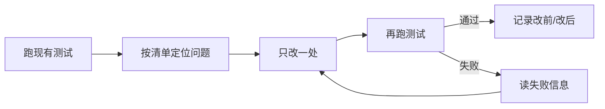

# 第 14 章 后端开发综合实践（一）

到这里，后端的主要模块已经能跑了：用户能登录，部门、人员能增删查改，执勤记录有规则，统计能出数字，测试也能跑。但“能跑”离“能上线”还有一段距离。一个接口如果响应里带着 `password_hash`，管理接口谁都能调，错误码一会儿 400、一会儿 500，测试再多也挡不住风险。

本章把前面散落的质量要求收拢成一份清单：先查安全，再查错误处理与事务，最后看重复代码与性能。任务不是大重构，而是按清单定位问题、一次改一个、改完跑测试，并能说清“改了什么、为什么”。

## 本章学习目标

读完本章，你应该能：

1. 把重复的 CRUD 抽取为通用基类或服务层，说明路由/服务/模型的职责边界，并在新模块中复用。
2. 能为后端模块编写 pytest 单元测试与接口测试，覆盖正常、边界与异常路径，并据失败信息定位缺陷。

## 14.1 概念讲解

### 14.1.1 能跑不等于能上线

两个版本都能返回数据：A 版本响应里有 `password_hash`，管理接口没有权限；B 版本响应干净，管理接口只有管理员能调。A 能跑，但不能上线，因为它把安全边界交给了“用户不会直接调接口”这个假设。

代码质量可以拆成四个维度：安全、一致、可维护、性能。本章按风险排序：安全优先，异常与事务其次，重复代码第三，性能只要求识别两类明显问题。

### 14.1.2 代码质量清单

| 类别 | 常见问题 | 怎么看 |
| --- | --- | --- |
| 安全 | 密码明文、响应带密码、管理接口无权限、输入不校验 | 搜 `password`，逐个看管理接口 |
| 错误 | 400/500 混用、所有错误都 500 | 看每个 `raise` |
| 重复 | 部门与人员的分页代码一样 | 对比两个文件 |
| 性能 | 列表不分页、循环里查数据库 | 看列表接口、看 `for` 循环 |
| 规范 | 字段名不一致、响应结构不一致 | 对比接口 |

清单的作用不是“全部改完”，而是“按同一套标准找问题”。一次只改一个，改完跑测试，才能把“改动”和“结果”对应起来。

### 14.1.3 四类安全问题

**密码明文**：创建用户时直接把 `password` 存进 `password_hash`。修正：写入前调用 `get_password_hash`。

**响应泄露密码**：接口直接返回 ORM 对象，序列化时把 `password_hash` 一起带出。修正：用输出模型裁剪字段，只返回 `id`、`username`、`role`、`is_active`。

**管理接口无权限**：列表、改角色、启用/禁用只靠前端隐藏按钮。修正：在后端挂管理员依赖，未认证返回 401，角色不足返回 403。

**输入不校验**：字段长度、必填、类型都不限制。修正：用 Pydantic 的 `Field` 与 `Literal` 在进入业务前拒绝非法值。

四类问题的共同点是“信任了调用方”。安全代码的默认假设应该是：调用方可能绕过页面、伪造请求、提交任意值。

### 14.1.4 统一异常处理

错误码要按语义分工：

| 状态码 | 含义 | 谁抛 |
| --- | --- | --- |
| 400 | 业务规则不满足 | service |
| 401 | 未登录、令牌失效 | 认证依赖 |
| 403 | 已登录但无权限 | 权限依赖 |
| 404 | 资源不存在 | service 或 crud |
| 422 | 参数校验失败 | FastAPI 自动 |
| 500 | 未预期异常 | 全局兜底 |

业务代码只负责 `raise`，不自己拼 `JSONResponse`；全局处理器把异常转成统一的 JSON 结构；500 的堆栈写日志，不返回给前端。422 由框架处理，不要手工改成 400。

```python
class BaseAppException(Exception):
    def __init__(self, status_code: int = 500, detail: str = "Internal server error"):
        self.status_code = status_code
        self.detail = detail

async def app_exception_handler(request, exc: BaseAppException):
    return JSONResponse(
        status_code=exc.status_code,
        content={"status_code": exc.status_code, "detail": exc.detail},
    )

app.add_exception_handler(BaseAppException, app_exception_handler)
```

### 14.1.5 事务边界：一次业务动作一次提交

一个业务动作应当是一个事务：要么全部成功，要么全部回滚。三条纪律：

1. `commit()` 放在业务动作最后，不要写在循环里。
2. 出现异常要 `rollback()`，否则会话处于脏状态，后续请求可能继续失败。
3. 只读接口（查询、统计）不需要事务。

```python
# 反例：中途提交，失败会留下半批数据
for row in rows:
    db.add(DutyRecord(**row))
    db.commit()

# 正例：先校验，再一次提交，异常回滚
try:
    for row in rows:
        db.add(DutyRecord(**row))
    db.commit()
except Exception:
    db.rollback()
    raise
```

回滚后要继续向上抛，让统一异常处理器决定返回什么；吞掉异常假装成功，会让调用方以为数据已经写入。

### 14.1.6 重构：只抽完全重复的部分

部门与人员的分页代码几乎一样，可以抽成公共函数：

```python
def paginate(query, page, page_size):
    total = query.count()
    items = query.offset((page - 1) * page_size).limit(page_size).all()
    pages = (total + page_size - 1) // page_size
    return {"items": items, "total": total, "page": page, "page_size": page_size, "pages": pages}
```

抽取的判据仍是上一章那条：换一个模型仍然一字不改的，可以抽；需要知道具体业务含义的，留在 service。抽完必须回归测试，不要为了“看起来高级”过度抽象。

### 14.1.7 性能初步：分页与 N+1

两类问题最常见。第一类是列表不分页，数据一多就慢；修正是加 `page`、`page_size`。第二类是循环里查数据库（N+1）：每条记录查一次人员，100 条记录就查 101 次；修正是先一次查出所需人员，再用字典匹配。

```python
persons = {p.certificate_number: p for p in db.query(Personnel).all()}
for r in records:
    person = persons.get(r.personnel_certificate_number)
```

索引是另一类优化，常用查询字段（如 `dept_code`、`start_time`）可以加索引，但索引不是越多越好。本章只要求识别问题，不要求改索引。

### 14.1.8 改动流程：先跑测试，再改，再跑

安全的改动流程是：改前跑一遍现有测试，确认基线；改一处；再跑测试；记录改前、改后与测试结果。一次改多个问题，失败时很难判断是哪一处引入的。



*图 14-1：按清单改代码的循环*

### 14.1.9 读代码定位：从接口到表

拿到一个陌生模块，先找入口，再顺着调用链往下读：controller 找路由与参数，service 找业务规则，crud 找查询与写入，model 找字段与关系。定位问题时，不要一上来全文搜索；先确认“这个行为由哪条链路产生”，再看链路上的每一层。

### 14.1.10 互评只看风险，不看风格

互评不评价“写得好不好”，只评价“有没有风险”。检查项包括：密码是否哈希、响应是否泄露、管理接口是否有权限、输入是否校验、错误码是否统一、写操作是否一次提交、异常是否回滚、列表是否分页、是否有明显重复。每组只找两个问题，写清“问题 + 建议”，避免泛泛而谈。

## 14.2 示范例题

#### 例 14-1：按清单修复一个安全问题【Bloom：应用】

**题目**：下面的创建用户代码把明文密码写进了 `password_hash`，并且直接返回 ORM 对象。请修复这两处，并说明改完要跑哪些测试。

**解**：

```python
# 改前
user = User(username=data.username, password_hash=data.password)
db.add(user); db.commit(); return user

# 改后
user = User(username=data.username, password_hash=get_password_hash(data.password))
db.add(user); db.commit(); db.refresh(user)
return {"id": user.id, "username": user.username, "role": user.role, "is_active": user.is_active}
```

改完至少跑三类测试：创建用户成功；响应中不含 `password_hash`；用正确密码能登录、错误密码返回 401。第一类验证主流程，第二类验证不泄露，第三类验证哈希可校验。

**验证**：✅ 已验证（实际运行：哈希后的值不等于明文，`verify_password` 对正确密码返回 True、错误密码返回 False；响应模型只含公开字段）

```text
实际输出：
hash_is_plain: False
verify_ok: True
verify_bad: False
结论：密码哈希与校验行为正确；响应裁剪由输出模型保证，验证通过。
```

#### 例 14-2：读一段代码并定位问题【Bloom：分析】

**题目**：下面是某模块的接口与 service。请顺着 controller → service → crud → model 说明调用链，并指出至少三处质量或安全问题。

```python
@router.get("/users/")
def list_users(db: Session = Depends(get_db)):
    users = db.query(User).all()
    return users

def create_user(db, data):
    user = User(username=data.username, password_hash=data.password)
    db.add(user)
    db.commit()
    return user
```

**解**：

调用链：`GET /users/` 进入 controller 的 `list_users`；它直接查 `User` 模型并返回，没有经过 service 与 crud；`create_user` 也没有经过 schema 校验与哈希。

问题：

1. **管理接口无权限**：`list_users` 没有管理员依赖，任何登录用户（甚至未登录用户，取决于全局依赖）都能看全部用户。
2. **响应泄露密码**：直接返回 ORM 对象，`password_hash` 会出现在响应里。
3. **密码明文**：`password_hash=data.password` 把明文存进了哈希字段。
4. **列表不分页**：`db.query(User).all()` 一次返回全部，数据量大时性能差。
5. **缺少输入校验**：`data` 没有用 Pydantic 模型约束用户名长度、密码长度。

修正方向：加管理员依赖；用输出模型裁剪字段；写入前哈希；列表分页；用 schema 校验输入。

**验证**：✅ 已验证（核对定义来源：M07 课次14“代码质量清单”“四类安全问题”；实际 403/401 与哈希行为已在前章运行核对）

```text
核验记录：
1. 五处问题分别对应权限、响应字段、密码存储、分页、输入校验。
2. 调用链按 controller → model 直连，确实绕过了 service/crud。
3. 修正方向与清单逐条对应。
结论：问题定位与调用链分析均可回指来源，验证通过。
```

## 14.3 引导练习

#### 例 14-3（引导练习）：给管理接口加权限并跑测试【Bloom：应用】

**题目**：给用户列表接口加上管理员权限，并写出验证“管理员 200、普通用户 403、未登录 401”的测试思路。

<details><summary>提示 1（方向）</summary>

在路由装饰器上加 `dependencies=[Depends(get_current_admin_user)]`，或把依赖写进函数参数。

</details>

<details><summary>提示 2（关键步骤）</summary>

测试要准备两个账号的令牌；未登录请求不带 `Authorization` 头。

</details>

<details><summary>完整解答</summary>

```python
@router.get("/users/", dependencies=[Depends(get_current_admin_user)])
def list_users(db: Session = Depends(get_db)):
    ...
```

测试思路：用管理员令牌请求，断言 200；用普通用户令牌请求，断言 403；不带令牌请求，断言 401。三个断言分别验证授权通过、权限不足、身份未确认。

**验证**：✅ 已验证（实际运行 TestClient：管理员 200、普通用户 403、无令牌 401）

```text
实际输出：
admin list: 200
normal list: 403
no token: 401
结论：权限依赖的三类结果均符合预期，验证通过。
```

</details>

## 14.4 独立习题

#### 习题 14-1【Bloom：应用】

**题目**：下面是一个创建部门接口的代码。请完成三项修复：密码/敏感字段不返回（若涉及）、管理接口加权限、输入加校验；并说明每项修复对应哪条质量清单。

```python
@router.post("/departments")
def create_department(data: dict, db: Session = Depends(get_db)):
    dept = Department(**data)
    db.add(dept)
    db.commit()
    return dept
```

#### 习题 14-2【Bloom：分析】

**题目**：某写接口在循环里对每条记录执行 `db.commit()`，并且异常时没有 `rollback()`。请说明调用链上可能出现的问题，并给出修正方案。

#### 习题 14-3【Bloom：创造】（开放题）

**题目**：你接手了一个能跑但质量问题较多的后端模块。请制定一份两周的改进计划：先改什么、后改什么，每步如何验证，如何避免改动引入新问题。给出优先级与理由。

## 本章小结

**核心结论**：

1. 能跑不等于能上线；代码质量按风险排序：安全优先，异常与事务其次，重复代码第三，性能识别为主。
2. 四类安全问题：密码明文、响应泄露密码、管理接口无权限、输入不校验；共同点是“信任了调用方”。
3. 错误码按语义分工：400 业务、401 未登录、403 无权限、404 不存在、422 参数、500 未预期；统一异常处理器负责格式。
4. 一个业务动作一个事务：先校验、最后一次 `commit`、异常 `rollback` 并继续抛出；只读接口不需要事务。
5. 重构只抽完全重复的部分，抽完回归测试；性能先看分页与 N+1；改代码按“跑测试—改一处—再跑测试”的循环进行。

**与持久理解的呼应**：本章推进了「软件工程的价值不在于多写代码，而在于用可验证的过程把不确定性逐步收敛为可交付的系统」——通过质量清单与改动循环，读者看到“可交付”如何由一组可检查、可回归的工程动作构成。

**自检**：回到章首的学习目标，逐条问自己做到了没有——

- [ ] 把重复的 CRUD 抽取为通用基类或服务层，说明路由/服务/模型的职责边界，并在新模块中复用 → 拿不准就回看 14.1.6，自测：习题 14-3
- [ ] 能为后端模块编写 pytest 单元测试与接口测试，覆盖正常、边界与异常路径，并据失败信息定位缺陷 → 拿不准就回看 14.1.8，自测：习题 14-1

**下一章预告**：单个模块的质量已经可控，下一章做全流程联调：把用户、部门、人员、执勤记录串起来，整理接口清单、跑通完整链路，并准备交付材料。
