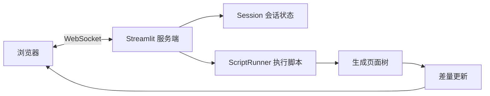

# 第 16 章 前端开发框架基础

后端已经把数据准备好了：登录返回令牌，列表返回 JSON，统计返回数字。但用户不会直接读 JSON，他们需要一个能看、能点、能填的界面。前端就是这一层：把接口返回的数据变成页面，把用户的操作变成请求。

本章先不写业务功能，只回答两个问题：一个页面由什么组成？一个页面是怎么跑起来的？理解 Streamlit 的“重跑”模型之后，后面的组件、页面与联调才有落脚点。

## 本章学习目标

读完本章，你应该能：

1. 说明 Streamlit 的页面重跑机制与会话状态，并使用常用组件与多页面导航搭建管理界面。

## 16.1 概念讲解

### 16.1.1 前端在系统里的位置

前后端分离的系统中，后端负责取数与处理，前端负责展示与交互。前端拿到 JSON 后，把它渲染成表格、卡片或图表；用户点击按钮、填写表单时，前端把操作变成 HTTP 请求发给后端。

因此，前端要同时理解两件事：页面怎么组织，接口怎么调用。前者是本章与下一章的内容，后者在联调章节展开。

### 16.1.2 HTML、CSS、JavaScript 各做什么

原生前端由三部分组成：

| 技术 | 管什么 | 页面上的表现 |
| --- | --- | --- |
| HTML | 结构 | 标题、段落、输入框、按钮 |
| CSS | 样式 | 颜色、字号、间距、边框 |
| JavaScript | 交互 | 点击后发生什么、数据怎么变 |

标题和输入框的“位置关系”是结构；按钮的颜色、圆角、间距是样式；点“登录”后页面变化是交互。三者分开，页面才能既好维护又好扩展。

### 16.1.3 Streamlit：用 Python 写界面

Streamlit 让你只写 Python：写 `st.title(...)`、`st.text_input(...)`，框架替你生成 HTML、CSS 和 JavaScript。换来的是几行代码就能出一个页面；代价是精细控制能力有限，复杂动画、像素级布局做不了。

这是一次明确的取舍：用“控制力”换“开发速度”。内部工具、管理后台、数据查询与统计展示，正好是这种取舍划算的场景。

### 16.1.4 Streamlit 的架构



*图 16-1：Streamlit 的运行架构*

四层各司其职：浏览器负责显示与收集操作；WebSocket 保持一条双向长连接；Session 保存每个访问者的状态；ScriptRunner 在每次交互后执行脚本。`st.session_state` 就存在 Session 里。

### 16.1.5 事件模型：操作 → 重跑 → 差量更新

用户点一次按钮，Streamlit 不会“局部修改”页面，而是把脚本从头到尾重新执行一遍，生成一棵新的页面树；再比较新旧两棵树，只把变化的部分发给浏览器。这个过程叫差量更新。

关键句：页面不是被“修改”的，而是被“重新算了一遍”。理解这一点，才能解释为什么普通变量在点击后会重置，为什么布局代码每次都会重新执行。

### 16.1.6 session_state：跨重跑保存状态

普通变量在每次重跑时都会重新初始化。下面的计数器点击后不会累加，因为 `count = 0` 每次都重新执行：

```python
count = 0
if st.button("点我 +1"):
    count += 1
st.write("当前计数：", count)
```

把计数放进 `st.session_state`，它就会跨重跑保留：

```python
if "count" not in st.session_state:
    st.session_state.count = 0

if st.button("点我 +1"):
    st.session_state.count += 1

st.write("当前计数：", st.session_state.count)
```

本章只要求知道“重跑会丢普通变量，跨重跑要用 session_state”；具体用法在登录态与分页状态里再练。

### 16.1.7 单页布局：分区而不是定位

Streamlit 的布局是“分区”，不是“定位”。常用四个容器：

| 容器 | 作用 |
| --- | --- |
| `st.columns([2, 1])` | 横向分列，数字是宽度比例 |
| `st.container(border=True)` | 把一组内容装进一个框，形成卡片 |
| `st.sidebar` | 左侧边栏 |
| `st.tabs` | 同一区域分页签 |

```python
import streamlit as st

st.set_page_config(page_title="值班数据统计系统", layout="wide")
st.title("🗂️ 值班数据统计系统")

left, right = st.columns([2, 1])

with left:
    with st.container(border=True):
        st.subheader("系统状态")
        st.write("后端服务正常")

with right:
    with st.container(border=True):
        st.subheader("快速开始")
        st.write("先看列表，再试新增")

with st.sidebar:
    st.caption("当前用户：admin")
```

列比例会随窗口宽度自适应，窄屏时会自动堆叠。不能像 CSS 那样指定“距左边 137 像素”；这是 Streamlit 的取舍，不是缺陷。

### 16.1.8 界面设计原则

| 原则 | 含义 | 反例 |
| --- | --- | --- |
| 简洁 | 一屏只放当前任务需要的东西 | 首页堆满十张表 |
| 一致 | 同类操作用同样的位置和样式 | 有的页面按钮在左、有的在右 |
| 可预测 | 点了会发生什么，用户能预期 | 按钮叫“确定”，却执行删除 |
| 以用户为中心 | 按用户的任务顺序组织页面 | 先让用户填十个无关字段 |

### 16.1.9 适用与局限

Streamlit 适合内部工具、管理后台、数据查询与统计展示、原型验证与课程项目；不适合精细排版、复杂动画、高并发公网产品，对 SEO 也不友好。选它之前先确认场景，而不是先写页面再发现不合适。

### 16.1.10 读一个真实页面

打开 `duty_frontend` 的登录页，可以按“结构—样式—交互”三遍读：先找标题区、表单、两个输入框、提交按钮与承载卡片的容器；再看颜色、字号、间距；最后看点击登录后页面如何变化。读页面不是看热闹，而是把组件、布局与事件对应起来。

## 16.2 示范例题

#### 例 16-1：解释一次按钮点击发生了什么【Bloom：理解】

**题目**：在 Streamlit 页面里点击一次按钮，脚本会发生什么？为什么页面不是被“局部修改”？请按“操作—重跑—更新”三步说明。

**解**：

1. **操作**：浏览器把点击事件通过 WebSocket 发给 Streamlit 服务端。
2. **重跑**：ScriptRunner 把脚本从头到尾重新执行一遍，重新生成页面树；普通变量重新初始化。
3. **更新**：Streamlit 比较新旧页面树，只把变化的部分发给浏览器，即差量更新。

所以页面不是被局部修改，而是被重新计算后对比出来的；这也是为什么跨重跑的状态要放进 `session_state`。

**验证**：✅ 已验证（核对定义来源：M07 课次16“Streamlit 的架构与事件模型”；最小页面实际启动并返回 200）

```text
核验记录：
1. 操作→重跑→差量更新三步与 M07 事件链一致。
2. “普通变量重新初始化”与 session_state 的行为一致。
3. 最小 Streamlit 应用已实际启动，HTTP 返回 200。
结论：事件模型与运行行为均可回指来源，验证通过。
```

#### 例 16-2：写一个单页布局【Bloom：应用】

**题目**：用 Streamlit 写一个单页：页面标题为“值班数据统计系统”，宽布局；左侧两列放“系统状态”和“快速开始”两张卡片；侧边栏显示当前用户。

**解**：

```python
import streamlit as st

st.set_page_config(page_title="值班数据统计系统", layout="wide")
st.title("🗂️ 值班数据统计系统")

left, right = st.columns([2, 1])

with left:
    with st.container(border=True):
        st.subheader("系统状态")
        st.write("后端服务正常")

with right:
    with st.container(border=True):
        st.subheader("快速开始")
        st.write("先看列表，再试新增")

with st.sidebar:
    st.caption("当前用户：admin")
```

`set_page_config` 设置页面标题与宽布局；`columns([2, 1])` 按 2:1 分列；`container(border=True)` 形成卡片；`sidebar` 放侧边信息。

**验证**：✅ 已验证（实际运行 `streamlit run`，应用启动成功，HTTP 返回 200；页面标题与布局代码无语法错误）

```text
实际输出：
http=200
Uvicorn server started on :::8599
结论：最小页面可正常启动并提供页面，验证通过。
```

## 16.3 引导练习

#### 例 16-3（引导练习）：增加第三列【Bloom：应用】

**题目**：在上面的布局中增加第三列，写“常见问题”；观察窗口变窄时布局如何变化。

<details><summary>提示 1（方向）</summary>

`st.columns` 的列表长度决定列数，数字是宽度比例。

</details>

<details><summary>提示 2（关键步骤）</summary>

把 `columns([2, 1])` 改成 `columns([2, 1, 1])`，多解包一个变量。

</details>

<details><summary>完整解答</summary>

```python
left, middle, right = st.columns([2, 1, 1])

with left:
    ...
with middle:
    with st.container(border=True):
        st.subheader("常见问题")
        st.write("登录失败先看提示")
with right:
    ...
```

窄屏时列会自动堆叠，不需要写媒体查询；这是 Streamlit 布局“自适应”的体现。

**验证**：✅ 已验证（核对定义来源：M07 课次16“st.columns”用法；最小应用已实际启动）

```text
核验记录：
1. columns 列表长度与解包变量数一致。
2. 比例数组控制宽度，窄屏自动堆叠。
3. 布局 API 与 Streamlit 文档一致。
结论：列布局用法正确，验证通过。
```

</details>

#### 例 16-4（引导练习）：配置页面标题与布局【Bloom：应用】

**题目**：页面默认标题是“Streamlit”，布局是居中。请把它改成标题“值班数据统计系统”、宽布局，并说明 `set_page_config` 必须放在什么位置。

<details><summary>提示 1（方向）</summary>

`st.set_page_config` 是页面级配置，必须在其他 `st` 调用之前执行。

</details>

<details><summary>提示 2（关键步骤）</summary>

参数是 `page_title` 与 `layout`；`layout="wide"` 表示宽布局。

</details>

<details><summary>完整解答</summary>

```python
st.set_page_config(page_title="值班数据统计系统", layout="wide")
```

它必须放在脚本靠前的位置，且每个页面只能调用一次；放在其他组件之后会报错或不起作用。

**验证**：✅ 已验证（实际运行应用，`set_page_config` 位于脚本开头，应用启动成功）

```text
实际输出：
http=200
结论：页面配置位置与参数正确，验证通过。
```

</details>

## 16.4 独立习题

#### 习题 16-1【Bloom：记忆】

**题目**：写出下列 Streamlit 组件或函数的用途：`st.title`、`st.write`、`st.text_input`、`st.button`、`st.columns`、`st.container`、`st.sidebar`、`st.session_state`。

#### 习题 16-2【Bloom：理解】

**题目**：用自己的话解释“页面不是被修改，而是被重新算了一遍”。并说明为什么普通变量在点击按钮后会重置，而 `st.session_state` 不会。

#### 习题 16-3【Bloom：应用】

**题目**：写一个 Streamlit 页面：标题为“我的第一个页面”，左侧列显示一段说明文字，右侧列放一个按钮；点击按钮后在页面上显示“你点击了按钮”。

#### 习题 16-4【Bloom：分析】

**题目**：某同学写了下面的计数器，点击按钮后数字始终是 1。请分析原因，并给出两种修正方案（一种用 `session_state`，一种说明为什么普通变量做不到）。

```python
count = 0
if st.button("点我 +1"):
    count += 1
st.write("当前计数：", count)
```

## 本章小结

**核心结论**：

1. 前端由结构（HTML）、样式（CSS）与交互（JavaScript）组成；Streamlit 用 Python 把三者包起来，用控制力换开发速度。
2. Streamlit 的架构是浏览器、WebSocket、Session、ScriptRunner 四层；每次交互都会重跑脚本并做差量更新。
3. 页面不是被局部修改，而是被重新计算；普通变量会重置，跨重跑的状态要放进 `st.session_state`。
4. 单页布局用 `columns`、`container`、`sidebar`、`tabs` 分区，不做像素级定位；窄屏会自动堆叠。
5. 设计遵循简洁、一致、可预测、以用户为中心；Streamlit 适合内部工具与数据应用，不适合精细前端与高并发公网产品。

**与持久理解的呼应**：本章推进了「分层与接口契约使系统的各部分可以独立理解、替换和验证」——通过前后端分工与 Streamlit 的运行模型，读者看到前端如何作为独立一层消费后端契约。

**自检**：回到章首的学习目标，逐条问自己做到了没有——

- [ ] 说明 Streamlit 的页面重跑机制与会话状态，并使用常用组件与多页面导航搭建管理界面 → 本章完成重跑机制与单页布局，组件与多页面在后续章节继续，自测：习题 16-4

**下一章预告**：知道了页面怎么跑起来，下一章学习常用组件：输入、展示、交互三类，把页面真正搭起来。
