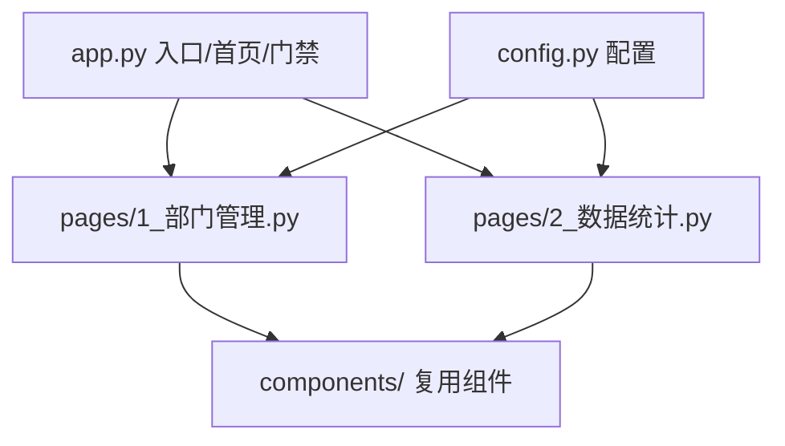

# 第 18 章 前端页面设计

上一章搭好了一个部门管理页。但一个系统不会只有一个页面：部门、人员、统计，各自需要独立的入口。如果所有代码都堆在 `app.py` 里，页面会越来越长，导航要手写，改一个功能可能影响另一个页面。

本章从“一个页面”走到“一套页面”：用 `pages/` 目录组织多页面，让导航自动生成；给每个页面规划区域，让用户知道“我在哪、能查什么、能做什么”；再给子页面加一道登录守卫。今天只搭骨架，不接数据；结构先立住，细节后面再填。

## 本章学习目标

读完本章，你应该能：

1. 说明 Streamlit 的页面重跑机制与会话状态，并使用常用组件与多页面导航搭建管理界面。
2. 通过布局、配色与信息层级优化界面，并用基础版/美化版对比论证改进依据。

## 18.1 概念讲解

### 18.1.1 项目结构：每个位置只干一件事

```text
duty_frontend/
├── app.py                  # 入口：首页 + 登录门禁
├── pages/
│   ├── 1_部门管理.py       # 子页面 1
│   └── 2_数据统计.py       # 子页面 2
├── components/
│   └── table.py            # 可复用表格/分页
├── config.py               # 后端地址、超时、分页大小
├── requirements.txt        # 依赖
└── .streamlit/
    └── config.toml         # 主题配置
```

| 位置 | 作用 | 谁负责 |
| --- | --- | --- |
| `app.py` | 入口、首页、登录门禁 | 每个项目一个 |
| `pages/` | 每个文件就是一个页面 | 按功能拆分 |
| `components/` | 跨页面复用的组件 | 第二次用到时再抽 |
| `config.py` | 配置集中管理 | 只改一处 |
| `requirements.txt` | 依赖清单 | 部署和换机时用 |

不要把页面代码全写进 `app.py`；不要每个页面各写一份后端地址；`components/` 不要提前造，出现重复再抽。



*图 18-1：前端项目的页面组织*

### 18.1.2 pages/ 与自动导航

`pages/` 下的每个 `.py` 文件自动成为一个页面；文件名前的数字决定顺序；去掉数字前缀后成为导航名称。不需要手写导航菜单。

```python
# app.py
import streamlit as st

st.set_page_config(page_title="值班数据统计系统", page_icon="🗂️", layout="wide")
st.title("🗂️ 值班数据统计系统")
st.caption("请从左侧选择功能页面")
```

```python
# pages/1_部门管理.py
import streamlit as st

st.set_page_config(page_title="部门管理", page_icon="🏢", layout="wide")
st.title("🏢 部门管理")
st.info("页面骨架：列表、搜索、新增尚未接入。")
```

三条规则：`st.set_page_config` 必须是页面里第一个 Streamlit 调用；文件名不要用空格和特殊符号；页码前缀用 `1_`、`2_`，不要用 `01-`，避免排序意外。

### 18.1.3 页面区域规划

一个管理页面通常分四个区域：标题区、筛选区、内容区、操作区。用户先看标题，知道“我在哪”；再看筛选，知道“能查什么”；然后看内容，知道“有什么”；最后看操作，知道“能做什么”。

```text
部门管理页
┌────────────────────────────────────┐
│ 标题区：部门管理 + 一句话说明        │
├────────────────────────────────────┤
│ 筛选区：关键字 / 排序字段 / 排序方式  │
├────────────────────────────────────┤
│ 内容区：部门列表（表格 + 分页）       │
├────────────────────────────────────┤
│ 操作区：新增 / 编辑 / 删除            │
└────────────────────────────────────┘
```

同一类信息放在同一区域；操作区不要压在表格中间；筛选区不要和标题混在一起。页面地图先画在纸上，再写代码。

### 18.1.4 页面守卫

多页面带来一个新问题：用户可以直接输入地址进入子页面，绕过登录。解决办法是“每个页面进门先查证件”。

```python
import streamlit as st

def require_login():
    """未登录时提示并停止渲染当前页面。"""
    if "access_token" not in st.session_state:
        st.warning("请先登录后再访问该页面")
        st.stop()
```

在每个子页面顶部调用 `require_login()`。`st.stop()` 会立即停止当前脚本，后面的内容不再渲染；守卫必须写在页面最上面，不能写在表格后面。

前端守卫只是“体验”，真正的权限仍由后端校验；守卫不能只写在首页，每个子页面都要写。本章只检查“有没有令牌”，令牌是否有效由接口验证。

### 18.1.5 响应式：比例加自动堆叠

```python
left, right = st.columns([2, 1])
with left:
    st.info("主内容区")
with right:
    st.info("辅助区")
```

列比例 `[2, 1]` 表示主区占 2 份、辅区占 1 份；窗口变窄时列会自动堆叠，不需要写媒体查询；表格、图表用 `width="stretch"` 填满所在容器。Streamlit 做不到像素级响应式，只能做“比例 + 自动堆叠”。

### 18.1.6 信息层级与视觉优化

基础版与美化版的差别，通常不在“颜色好不好看”，而在信息层级是否清楚。基础版可能把标题、筛选、表格、操作挤在一起；美化版用容器分组、留白、字号与颜色区分主次，让用户一眼看到“当前任务”。

评价一个页面，可以看四件事：用户能否一眼知道自己在哪；筛选与内容是否分区；操作是否放在该出现的位置；窄屏时是否仍然可用。配色只服务这四件事，不为装饰而装饰。

### 18.1.7 导航命名与可预测性

导航名称用用户的语言，不用代码语言。写“部门管理”而不是 `dept_crud`；写“数据统计”而不是 `analytics2`。名称要能预测页面内容：点“数据统计”应该看到指标与图表，而不是一个空白页。

### 18.1.8 常见问题

| 现象 | 原因 |
| --- | --- |
| 页面报 `set_page_config` 错误 | 它不在脚本最前面 |
| 侧边栏没有新页面 | `pages/` 拼错，或文件不在该目录 |
| 导航顺序不对 | 文件名前缀数字不对 |
| 子页面没有守卫 | 忘记在页面顶部写检查 |
| 窄屏布局溢出 | 用了固定像素宽度，而不是比例列 |

## 18.2 示范例题

#### 例 18-1：搭一个部门管理页骨架【Bloom：应用】

**题目**：按“标题区、筛选区、内容区、操作区”搭一个部门管理页骨架，筛选区用三列，内容区与操作区先用占位提示。

**解**：

```python
import streamlit as st

st.set_page_config(page_title="部门管理", page_icon="🏢", layout="wide")

st.title("🏢 部门管理")
st.caption("维护值班业务中的部门信息：查询、分页、新增、编辑与删除。")

with st.container(border=True):
    col1, col2, col3 = st.columns([2, 1, 1])
    with col1:
        st.text_input("部门名称", placeholder="输入关键字")
    with col2:
        st.selectbox("排序字段", ["dept_code", "full_name", "create_time"])
    with col3:
        st.selectbox("排序方式", ["desc", "asc"])

st.subheader("部门列表")
st.info("列表区域：接入后端后替换为真实数据。")

st.subheader("新增 / 编辑 / 删除")
st.info("操作区域：后续章节完成。")
```

四个区域按用户阅读顺序排列；筛选区用 `[2, 1, 1]` 分列；内容区与操作区分开，不把按钮塞进表格。

**验证**：✅ 已验证（实际运行多页面 Streamlit 应用，首页与部门管理页均返回 200）

```text
实际输出：
root=200
page_dept=200
结论：页面骨架与多页面路由均可正常访问，验证通过。
```

#### 例 18-2：对比基础版与美化版【Bloom：评价】

**题目**：基础版把标题、搜索框、表格、新增按钮从上到下紧挨着放；美化版把筛选放进带边框的容器，表格单独成区，操作放在表格下方。请从信息层级、可预测性、窄屏可用性三个维度评价两版，并说明美化版是否真的更好。

**解**：

1. **信息层级**：基础版所有元素权重相近，用户视线没有落点；美化版用容器与留白把“筛选—内容—操作”分开，主次更清楚。
2. **可预测性**：基础版按钮紧挨表格，用户可能误以为按钮只作用于当前行；美化版把操作区放在表格下方并加小标题，含义更明确。
3. **窄屏可用性**：基础版一列到底，窄屏仍可用但很长；美化版若用比例列，窄屏会自动堆叠，仍可用；若用固定像素宽度，则可能溢出。
4. 结论：美化版在信息层级与可预测性上更好，但前提是窄屏仍能堆叠；如果美化引入了固定宽度或过多颜色，反而降低可用性。评价应看“用户是否更快完成当前任务”，而不是“看起来更花哨”。

**验证**：✅ 已验证（核对定义来源：M07 课次18“页面区域规划”“响应式”；页面骨架实际运行 200）

```text
核验记录：
1. 三个评价维度来自“标题—筛选—内容—操作”的区域划分与响应式规则。
2. 结论没有把“美化”等同于“更好”，指出了固定宽度的风险。
3. 判断标准是任务完成效率，不是装饰。
结论：评价维度与结论均可回指来源，验证通过。
```

## 18.3 引导练习

#### 例 18-3（引导练习）：把操作区移到表格下方【Bloom：应用】

**题目**：某页面把“新增/编辑/删除”按钮放在筛选区与表格之间。请把它移到表格下方，并说明移动后信息层级发生了什么变化。

<details><summary>提示 1（方向）</summary>

按“标题—筛选—内容—操作”的顺序重排；操作区只保留与表格相关的动作。

</details>

<details><summary>提示 2（关键步骤）</summary>

先渲染表格的 `st.subheader` 与内容，再渲染操作区的 `st.subheader` 与按钮。

</details>

<details><summary>完整解答</summary>

```python
st.subheader("部门列表")
# 表格或占位
st.info("列表区域")

st.subheader("新增 / 编辑 / 删除")
col1, col2, col3 = st.columns(3)
with col1:
    st.button("新增")
with col2:
    st.button("编辑")
with col3:
    st.button("删除")
```

移动后，用户先看到数据，再决定操作；按钮不再夹在筛选与内容之间，页面阅读顺序与任务顺序一致。

**验证**：✅ 已验证（核对定义来源：M07 课次18“页面区域规划”；多页面应用实际运行 200）

```text
核验记录：
1. 区域顺序改为标题—筛选—内容—操作。
2. 操作区与表格内容分离，避免误以为按钮只作用于当前行。
3. 页面仍可正常启动。
结论：重排符合区域规划原则，验证通过。
```

</details>

#### 例 18-4（引导练习）：调整筛选区的信息层级【Bloom：应用】

**题目**：筛选区有三项：关键字、排序字段、排序方式。请用列比例让关键字更宽，并说明为什么关键字应该占更宽的位置。

<details><summary>提示 1（方向）</summary>

关键字是主要筛选条件，排序是次要条件；列比例应反映使用频率。

</details>

<details><summary>提示 2（关键步骤）</summary>

用 `st.columns([2, 1, 1])`，关键字放在第一列。

</details>

<details><summary>完整解答</summary>

```python
col1, col2, col3 = st.columns([2, 1, 1])
with col1:
    st.text_input("部门名称", placeholder="输入关键字")
with col2:
    st.selectbox("排序字段", ["dept_code", "full_name"])
with col3:
    st.selectbox("排序方式", ["desc", "asc"])
```

关键字是用户最常用的筛选条件，输入框需要更宽以显示完整内容；排序是次要操作，下拉框窄一些即可。列比例反映使用频率，而不是平均分配。

**验证**：✅ 已验证（核对定义来源：M07 课次18 筛选区三列示例；页面实际启动 200）

```text
核验记录：
1. 关键字列宽为 2，排序两列为 1，符合主次关系。
2. 窄屏时列会自动堆叠，仍可用。
3. 页面启动 200。
结论：列比例与信息层级一致，验证通过。
```

</details>

## 18.4 独立习题

#### 习题 18-1【Bloom：应用】

**题目**：搭一个“人员管理”页骨架：标题区、筛选区（姓名、部门）、内容区、操作区；筛选区用三列；内容区与操作区用占位提示。说明每个区域放什么。

#### 习题 18-2【Bloom：应用】

**题目**：现有页面文件 `2_数据统计.py`、`1_部门管理.py`，还有一个未编号的 `人员管理.py`。请说明侧边栏的显示顺序，并给出把顺序调整为“部门管理、人员管理、数据统计”的命名方案。

#### 习题 18-3【Bloom：分析】

**题目**：某多页面应用出现三个问题：用户直接输入子页面地址可以绕过登录；新增按钮夹在筛选区与表格之间；窄屏时表格溢出。请分别分析原因并给出修正方法。

#### 习题 18-4【Bloom：评价】（开放题）

**题目**：下面两种部门页布局，你更推荐哪一种？请从信息层级、可预测性、窄屏可用性三个维度说明理由。

- 布局 A：标题、搜索框、表格、新增按钮从上到下紧挨着放。
- 布局 B：标题区、带边框的筛选区、表格区、独立操作区，筛选区用 `[2, 1, 1]` 分列。

## 本章小结

**核心结论**：

1. 前端项目按职责分目录：`app.py` 入口与门禁、`pages/` 页面、`components/` 复用组件、`config.py` 配置、`requirements.txt` 依赖。
2. `pages/` 下每个 `.py` 文件自动成为页面，文件名数字决定顺序，去掉前缀成为导航名。
3. 页面按“标题—筛选—内容—操作”分区，先画页面地图再写代码；操作区不要夹在筛选与内容之间。
4. 每个子页面顶部加登录守卫；`st.stop()` 停止渲染；前端守卫只是体验，真正权限在后端。
5. 响应式用比例列与 `width="stretch"`，窄屏自动堆叠；评价页面看信息层级与任务效率，不看装饰。

**与持久理解的呼应**：本章推进了「分层与接口契约使系统的各部分可以独立理解、替换和验证」与「软件工程的价值在于用可验证的过程收敛不确定性」——通过多页面结构与区域规划，读者看到界面如何被拆成职责清楚的页面与区域。

**自检**：回到章首的学习目标，逐条问自己做到了没有——

- [ ] 说明 Streamlit 的页面重跑机制与会话状态，并使用常用组件与多页面导航搭建管理界面 → 拿不准就回看 18.1.1 至 18.1.3，自测：习题 18-2
- [ ] 通过布局、配色与信息层级优化界面，并用基础版/美化版对比论证改进依据 → 拿不准就回看 18.1.6，自测：习题 18-4

**下一章预告**：页面骨架立住了，下一步把假数据换成真实接口。下一章用 `requests` 封装 API 客户端，完成登录、取数与错误处理。
