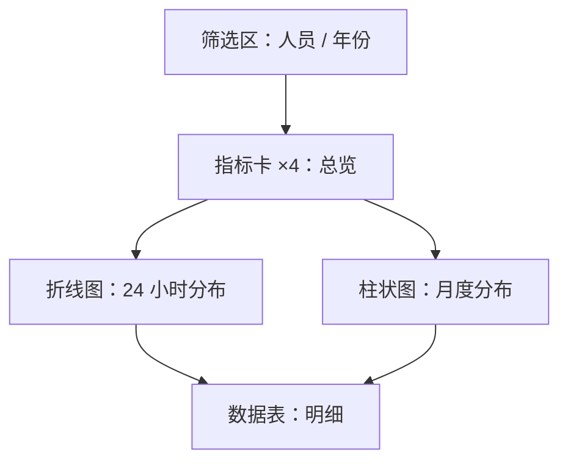

# 第 21 章 前端视觉优化与数据仪表盘

同一份统计数据，可以做成两个完全不同的页面：基础版白底、表格直接铺开、按钮默认色；美化版有统一主色、卡片分组、指标卡和图表。功能一样，后者却更容易看懂——因为它把“总体怎么样、趋势怎么样、具体是多少”分成了三个层次。

本章只做四类改动：主题、卡片、指标卡、图表。不写新功能，不改接口，把现有页面变得更好读。判断标准不是“更花哨”，而是“用户能否更快完成当前任务”。

## 本章学习目标

读完本章，你应该能：

1. 通过布局、配色与信息层级优化界面，并用基础版/美化版对比论证改进依据。

## 21.1 概念讲解

### 21.1.1 美观是为了更好用

视觉优化的目标不是装饰，而是降低阅读成本。颜色统一，用户不用猜“这个按钮和那个按钮是不是一类”；内容分组，用户能快速找到筛选、列表与操作；关键数字突出，用户一眼看到重点；留白足够，信息不挤在一起。

判断一处改动是否值得，问一句：它是否帮助用户更快完成任务？帮助了，是提升；只是好看，是装饰。

### 21.1.2 主题配置：一个主色，全站统一

在 `.streamlit/config.toml` 中配置主题：

```toml
[theme]
primaryColor = "#0F766E"
backgroundColor = "#F8FAFC"
secondaryBackgroundColor = "#FFFFFF"
textColor = "#0F172A"
font = "sans serif"

[browser]
gatherUsageStats = false
```

| 配置 | 作用 | 本课取值 |
| --- | --- | --- |
| `primaryColor` | 按钮、链接、选中态 | 青绿 `#0F766E` |
| `backgroundColor` | 页面底色 | 浅灰白 `#F8FAFC` |
| `secondaryBackgroundColor` | 卡片、侧边栏底色 | 纯白 `#FFFFFF` |
| `textColor` | 正文颜色 | 深蓝黑 `#0F172A` |

三条原则：一个主色，按钮、选中态、图表都用它或邻近色；底色与卡片分开，页面浅灰、卡片纯白，层次自然出来；对比度够，正文与背景不能“浅灰字配白底”。

改完 `config.toml` 要重启 Streamlit 才生效。主题能解决大部分视觉问题，不需要一上来写 CSS。

### 21.1.3 卡片化：把一类内容装进一个框

```python
with st.container(border=True):
    st.subheader("筛选条件")
    col1, col2, col3 = st.columns([2, 1, 1])
    ...
```

卡片把“一类内容”装进一个框，视觉上形成分组，卡片之间留白，信息不再挤在一起。不需要写 CSS，`border=True` 就有边框与内边距。

分组的粒度通常是：筛选区一张卡片、列表区一张卡片、操作区一张卡片；并列的三块内容可以用 `st.tabs`。卡片不是越多越好，一屏 3–4 张就够；同类内容才放同一张卡片；卡片里不要再套卡片，层次会乱。

### 21.1.4 指标卡：3–5 个一眼要看到的数字

```python
m1, m2, m3, m4 = st.columns(4)
m1.metric("总值班天数", 18, icon="📅", border=True)
m2.metric("总值班时长（小时）", 30.0, icon="⏱️", border=True, format="%.1f")
m3.metric("部门排名", 1, icon="🏅", border=True)
m4.metric("贡献度", "71.48%", icon="📈", border=True)
```

| 参数 | 作用 |
| --- | --- |
| 第一个位置参数 | 指标名称 |
| 第二个位置参数 | 指标值 |
| `icon` | 图标，帮助快速识别 |
| `border=True` | 加卡片边框 |
| `format` | 数字格式，如 `%d`、`%.1f` |
| `delta` | 与上期对比（可选） |

指标卡选 3–5 个“一眼要看到”的数字，每个都要有明确口径。天数用整数，时长保留一位小数，百分比带 `%`；格式统一，读者才不用每次换算。

### 21.1.5 图表类型要与数据匹配

| 目的 | 图表 | 例子 |
| --- | --- | --- |
| 比大小 | 柱状图 | 每月值班天数 |
| 看趋势 | 折线图 | 24 小时值班分布 |
| 看占比 | 饼图或条形图 | 部门贡献度 |
| 看分布 | 直方图 | 值班时长分布 |

选错图表，数据再准也读不出来。例如用饼图比较 12 个月的天数，读者很难看出差异；用折线图看“部门排名”也不合适。

### 21.1.6 图表的数据形状与配色

```python
time_rows = distribution["time_distribution"]
df_time = pd.DataFrame(time_rows).set_index("hour")
df_time.index.name = "小时"
st.line_chart(df_time, y="count", color="#0D9488", height=260)

month_rows = yearly["duty_by_month"]
df_month = pd.DataFrame(month_rows).set_index("month")
df_month.index.name = "月份"
st.bar_chart(df_month, y="days", color="#0D9488", height=260)
```

`st.line_chart` 与 `st.bar_chart` 要的是“表格”：把 JSON 列表转成 `DataFrame`，用 `set_index` 把小时或月份设为横轴，用 `y=` 指定纵轴列。图表色用主色的邻近色，同一页面只用一个图表色；颜色是为了看清，不是为了好看。

图表必须配标题和口径说明，例如“按值班开始时间的小时统计”。空数据要提示，不要画一张空图；图表下方提供“查看数据表”，方便读屏与核对。

### 21.1.7 仪表盘的三层



*图 21-1：数据仪表盘的信息层级*

第一眼是 4 个指标卡，回答“总体怎么样”；第二眼是两张图，回答“分布和趋势怎么样”；需要时展开数据表，回答“具体是多少”。信息从上到下：总览 → 趋势 → 明细。

不要堆十几张图，一屏放不下就失去“仪表盘”的意义；两张图并排时，纵轴口径要写清楚；空数据、加载失败都要有提示。

### 21.1.8 真提升与纯装饰

| 改动 | 基础版 | 美化版 | 提升点 |
| --- | --- | --- | --- |
| 主题 | 默认色 | 青绿主色 + 浅灰底 | 统一、专业 |
| 分组 | 一长串 | 卡片 + tabs | 好找、不累 |
| 表头 | 英文 | 中文 + 日期格式 | 看得懂 |
| 指标 | 无 | 4 个指标卡 | 一眼看到重点 |
| 图表 | 无 | 折线 + 柱状 | 看出趋势 |
| 反馈 | 无 | toast | 操作有回应 |

真提升是分组、中文表头、指标卡、图表、操作反馈；纯装饰是过多渐变、花哨图标、无意义动画。判断标准仍是“是否帮助用户更快完成任务”。

### 21.1.9 常见问题

| 现象 | 原因 |
| --- | --- |
| 页面很“花” | 主色不止一个，或图表色与主题不一致 |
| 图表读不出来 | 图表类型与数据不匹配，或缺口径说明 |
| 指标卡数字对不上 | 指标值手填，没有来自统计接口 |
| 空数据画了一张空图 | 没判断 `items` 是否为空 |
| 窄屏图表溢出 | 用了固定宽度，没有用比例列与 `width="stretch"` |

## 21.2 示范例题

#### 例 21-1：配置一套主题【Bloom：应用】

**题目**：写出 `.streamlit/config.toml`，要求青绿主色、浅灰白页面底色、纯白卡片底色、深蓝黑正文；说明改完后如何生效。

**解**：

```toml
[theme]
primaryColor = "#0F766E"
backgroundColor = "#F8FAFC"
secondaryBackgroundColor = "#FFFFFF"
textColor = "#0F172A"
font = "sans serif"

[browser]
gatherUsageStats = false
```

改完要重启 Streamlit 才生效。四个颜色分工明确：主色用于按钮与选中态，页面底色浅灰，卡片纯白，正文深色保证对比度。

**验证**：✅ 已验证（实际在带该配置的目录启动 Streamlit 仪表盘，应用启动成功，HTTP 返回 200）

```text
实际输出：
http=200
Uvicorn server started on :::8595
结论：主题配置可被应用读取，页面正常启动，验证通过。
```

#### 例 21-2：评价两个仪表盘的信息层级【Bloom：评价】

**题目**：仪表盘 A 把 12 张图从上到下排成一列；仪表盘 B 先放 4 个指标卡，再并排放两张图，最后提供数据表。请从信息层级、可读性、任务效率三个维度评价两版。

**解**：

1. **信息层级**：A 没有总览，读者要从第一张图开始逐张判断；B 先给总览（指标卡），再给趋势（两张图），最后给明细（数据表），层级清楚。
2. **可读性**：A 图太多，读者不知道哪张最重要；B 每屏只回答一个问题，图表有口径说明，读者能快速定位。
3. **任务效率**：A 需要滚动与比较十几张图，完成“这个月怎么样”的判断很慢；B 先看指标卡就能得到结论，需要时再展开明细。
4. 结论：B 更好，但前提是指标卡数字来自统计接口、图表口径写清、空数据有提示；如果 B 堆了过多颜色或装饰，也会抵消优势。

**验证**：✅ 已验证（核对定义来源：M07 课次21“仪表盘的三个层次”“真提升与纯装饰”；仪表盘已实际启动 HTTP 200）

```text
核验记录：
1. 三个评价维度与“总览→趋势→明细”的层级一致。
2. 结论指出了 B 成立的前提，未把“图多”当作唯一问题。
3. 判断标准是任务效率，不是装饰。
结论：评价维度与结论均可回指来源，验证通过。
```

## 21.3 引导练习

#### 例 21-3（引导练习）：把统计 JSON 转成图表【Bloom：应用】

**题目**：统计接口返回 24 小时的 `time_distribution`（每项含 `hour`、`count`）和 12 个月的 `duty_by_month`（每项含 `month`、`days`）。请分别画折线图与柱状图，并说明横轴如何设置。

<details><summary>提示 1（方向）</summary>

先把列表转成 `DataFrame`，再用 `set_index` 把小时或月份设为索引。

</details>

<details><summary>提示 2（关键步骤）</summary>

`y=` 指定纵轴列；折线图用 `count`，柱状图用 `days`。

</details>

<details><summary>完整解答</summary>

```python
df_time = pd.DataFrame(distribution["time_distribution"]).set_index("hour")
df_time.index.name = "小时"
st.line_chart(df_time, y="count", color="#0D9488", height=260)

df_month = pd.DataFrame(yearly["duty_by_month"]).set_index("month")
df_month.index.name = "月份"
st.bar_chart(df_month, y="days", color="#0D9488", height=260)
```

横轴由索引决定；纵轴由 `y` 决定。折线图适合看 24 小时的趋势，柱状图适合比较各月天数。

**验证**：✅ 已验证（实际运行 pandas 数据转换：时段 24 行、峰值 2、高峰 [8,13,20]；月度 12 行、总天数 6；仪表盘启动 200）

```text
实际输出：
time rows: 24 peak count: 2 peak hours: [8, 13, 20]
month rows: 12 total days: 6
http=200
结论：图表数据形状与横轴设置正确，验证通过。
```

</details>

#### 例 21-4（引导练习）：统一图表配色【Bloom：应用】

**题目**：页面主色是 `#0F766E`，现有折线图用红色、柱状图用蓝色。请说明问题，并给出统一方案。

<details><summary>提示 1（方向）</summary>

同一页面只用一个图表色，且与主色邻近。

</details>

<details><summary>提示 2（关键步骤）</summary>

把两张图的 `color` 都改成主色的邻近色，例如 `#0D9488`。

</details>

<details><summary>完整解答</summary>

问题：红色与蓝色各自为政，与主色没有关系，页面显得“花”，读者也会误以为两种颜色代表不同类别。统一方案：两张图都用主色邻近色 `#0D9488`；如果确实需要区分两个系列，用同一色系的不同深浅，而不是换色相。

**验证**：✅ 已验证（核对定义来源：M07 课次21“配色”原则；仪表盘实际启动 200）

```text
核验记录：
1. 同一页面只用一个图表色，与主色邻近。
2. 区分系列时用同色系深浅，不随意换色相。
3. 与 M07 的配色原则一致。
结论：配色问题与统一方案可回指来源，验证通过。
```

</details>

## 21.4 独立习题

#### 习题 21-1【Bloom：应用】

**题目**：为项目写一份主题配置：主色、页面底色、卡片底色、正文色四项；说明每项影响哪些界面元素，以及改完如何生效。

#### 习题 21-2【Bloom：应用】

**题目**：搭一个数据仪表盘：筛选区一张卡片；4 个指标卡；两张图（时段折线、月度柱状）；图表下方提供“查看数据表”。说明每部分的数据来源。

#### 习题 21-3【Bloom：分析】

**题目**：某统计页出现三个可读性问题：主色有四种、图表没有口径说明、空数据时画了一张空图。请分别分析影响并给出修正方法。

#### 习题 21-4【Bloom：评价】（开放题）

**题目**：有人主张“仪表盘图越多越显得专业”，也有人主张“一屏只放最关键的 4 个指标和 2 张图”。请评价两种观点，并给出你的仪表盘设计原则。

## 本章小结

**核心结论**：

1. 视觉优化服务于任务效率；判断标准是“是否帮助用户更快完成任务”，不是“是否更花哨”。
2. 主题配置一个主色、页面与卡片底色分开、正文对比度够；改完要重启 Streamlit。
3. 卡片把同类内容分组，一屏 3–4 张；指标卡选 3–5 个一眼要看到的数字，口径明确、格式统一。
4. 图表类型要与数据匹配：比较用柱状、趋势用折线、占比用饼图；图表要有标题、口径说明与数据表。
5. 仪表盘按“指标卡总览 → 图表趋势 → 数据表明细”组织；空数据、加载失败都要有提示。

**与持久理解的呼应**：本章推进了「分层与接口契约使系统的各部分可以独立理解、替换和验证」——通过卡片、指标卡与图表的分层组织，读者看到界面信息如何按“总览—趋势—明细”被拆成可独立理解的层次。

**自检**：回到章首的学习目标，逐条问自己做到了没有——

- [ ] 通过布局、配色与信息层级优化界面，并用基础版/美化版对比论证改进依据 → 拿不准就回看 21.1.2 至 21.1.8，自测：习题 21-4

**下一章预告**：前端功能与视觉都完成了，下一章做前端综合实践：整合页面、联调接口、排查错误，并整理可交付的成果。
