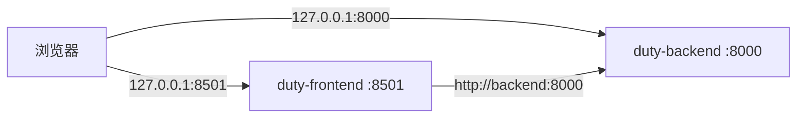

# 第 25 章 前后端服务部署

上一章两个镜像都构建好了，容器也能各自运行。但前端页面虽然能打开，登录却失败了。后端容器明明在跑，`/health` 也能访问，为什么前端说连不上？

原因在上一章已经埋下：前端容器里的 `127.0.0.1` 指的是前端容器自己，不是宿主机，也不是后端容器。本章解决三件事：让前端找到后端、让配置可替换、让数据不丢。最后用一份 Compose 文件把这些手工命令固定下来。

> 环境提示：本章的 `docker run`、`docker compose up` 需要 Docker 守护进程运行。教材编写环境的 Docker Desktop 未启动，实际启动容器的步骤标注为待核；Compose 文件已用 `docker compose config` 校验通过。

## 本章学习目标

读完本章，你应该能：

1. 解释容器与镜像、分层与端口映射的基本原理，为前后端编写 Dockerfile 与 compose 配置并通过环境变量注入配置。

## 25.1 概念讲解

### 25.1.1 部署拓扑：两种访问路径



*图 25-1：浏览器与容器之间的访问路径*

| 访问方 | 应该用 | 原因 |
| --- | --- | --- |
| 浏览器 | `http://127.0.0.1:8501` / `:8000` | 走宿主机映射端口 |
| 前端容器访问后端 | `http://backend:8000` | 走容器网络，用容器端口 |

容器之间通信不使用宿主机的映射端口；`-p 8000:8000` 是给宿主机用的，不是给另一个容器用的。

### 25.1.2 端口映射与容器端口

`-p 8000:8000` 左边是宿主机端口，右边是容器端口。`EXPOSE 8000` 只是声明，不负责对外发布。前端容器访问后端时，用的是后端容器的 8000 端口，不是宿主机的映射端口。

### 25.1.3 环境变量：同一镜像，不同环境

```bash
docker run -d --name duty-backend \
  --network duty-net \
  --network-alias backend \
  -p 8000:8000 \
  -e DATABASE_URL="sqlite:///./duty.db" \
  -e SECRET_KEY="classroom-demo-key" \
  -e ALGORITHM="HS256" \
  -e DEBUG="False" \
  duty-backend:1.0
```

| 参数 | 作用 |
| --- | --- |
| `--network duty-net` | 加入自定义网络 |
| `--network-alias backend` | 给容器起网络别名，前端可用 `backend` 访问 |
| `-p 8000:8000` | 宿主机 8000 → 容器 8000 |
| `-e KEY=VALUE` | 注入环境变量 |

同一个镜像，开发环境可以 `DEBUG=True`、用本地数据库；部署环境用 `DEBUG=False`、用部署目录的数据库。镜像不变，变的只是启动时注入的环境变量。

### 25.1.4 自定义网络：容器名可以互相解析

Docker 默认的 `bridge` 网络只提供 IP，不保证用容器名互相解析。自定义网络自带 DNS：同一网络里的容器可以用容器名或网络别名访问。

```bash
docker network create duty-net
docker network inspect duty-net
docker inspect -f "{{json .NetworkSettings.Networks}}" duty-backend
```

### 25.1.5 数据持久化：容器可删，卷要留

容器层的数据会随容器删除而丢失。数据库文件与日志要挂载到宿主机：

```bash
mkdir -p data logs
cp duty.db data/duty.db

docker run -d --name duty-backend \
  --network duty-net \
  --network-alias backend \
  -p 8000:8000 \
  -v "$(pwd)/data:/app/data" \
  -v "$(pwd)/logs:/app/logs" \
  -e DATABASE_URL="sqlite:///./data/duty.db" \
  -e SECRET_KEY="classroom-demo-key" \
  -e ALGORITHM="HS256" \
  -e DEBUG="False" \
  duty-backend:1.0
```

| 方式 | 写法 | 特点 |
| --- | --- | --- |
| 绑定挂载 bind mount | `-v 宿主机路径:容器路径` | 宿主机能直接看到文件，课堂推荐 |
| 数据卷 volume | `-v 卷名:容器路径` | 由 Docker 管理，便于迁移 |

验证：新建一个部门，删除后端容器，用同样命令重建，部门还在；`logs/app.log` 在宿主机能看到。数据库文件、日志不要打进镜像；容器是“一次性的”，需要保留的东西必须放在卷里。

### 25.1.6 前端指向后端

```bash
docker run -d --name duty-frontend \
  --network duty-net \
  -p 8501:8501 \
  -e DUTY_API_BASE_URL="http://backend:8000" \
  duty-frontend:1.0
```

| 写法 | 谁在用 | 结果 |
| --- | --- | --- |
| `http://127.0.0.1:8000` | 前端容器内 | 指向前端自己，失败 |
| `http://duty-backend:8000` | 同一自定义网络内 | 用容器名解析，成功 |
| `http://backend:8000` | 同一自定义网络内 | 用网络别名解析，成功 |

网络不通时，先进入前端容器用 Python 或 curl 测，不要只看浏览器：

```bash
docker exec -it duty-frontend sh
python -c "import urllib.request; print(urllib.request.urlopen('http://backend:8000/health').read())"
```

### 25.1.7 用 Compose 固定部署配置

手写一长串 `docker run` 容易漏参数。Compose 把这些命令写成一份文件：

```yaml
name: duty-system
services:
  backend:
    build: ./duty
    ports:
      - "8000:8000"
    environment:
      DATABASE_URL: sqlite:///./duty.db
      SECRET_KEY: change-me-in-production
      ALGORITHM: HS256
      DEBUG: "False"
    volumes:
      - ./duty/logs:/app/logs
    healthcheck:
      test: ["CMD", "python", "-c", "import urllib.request; urllib.request.urlopen('http://127.0.0.1:8000/health')"]
      interval: 10s
      timeout: 5s
      retries: 5
      start_period: 20s

  frontend:
    build: ./duty_frontend
    ports:
      - "8501:8501"
    environment:
      DUTY_API_BASE_URL: http://backend:8000
    depends_on:
      backend:
        condition: service_healthy
```

`services` 定义两个服务；`build` 指定构建上下文；`ports` 做端口映射；`environment` 注入配置；`volumes` 挂载日志；`healthcheck` 判断后端是否可用；`depends_on` 让前端等后端健康后再启动。

### 25.1.8 敏感配置的三条红线

`SECRET_KEY` 不写进 Dockerfile、不提交到 Git；生产环境用安全的密钥注入方式，不用课堂示例值；`.env` 文件本身也要加入 `.gitignore`。

### 25.1.9 部署验证清单

- [ ] 浏览器能打开 8501；
- [ ] 管理员账号能登录；
- [ ] 部门列表能显示数据；
- [ ] 新建一个部门后刷新仍在；
- [ ] 删除后端容器再重建，数据仍在；
- [ ] 未登录直接访问接口返回 401。

### 25.1.10 排错四步

```text
docker ps → 容器是否在跑、端口是否映射
docker logs 服务名 → 启动是否报错
docker exec ... python/curl → 容器内网络是否通
环境变量 → 地址、数据库路径、密钥是否正确
```

常见问题：前端提示无法连接，先查 `DUTY_API_BASE_URL` 是否是 `http://backend:8000`；连不上后端，查两个容器是否在同一网络、别名是否存在；401 查用户与 `SECRET_KEY`；数据库空查 `DATABASE_URL` 与挂载路径；容器重启后数据丢失，查是否挂载了 `data/`。

## 25.2 示范例题

#### 例 25-1：写一份双服务 Compose 配置【Bloom：应用】

**题目**：写一份 Compose 配置：后端构建 `./duty`、映射 8000、注入数据库地址与密钥；前端构建 `./duty_frontend`、映射 8501、把后端地址配成 `http://backend:8000`；前端等后端健康后再启动。

**解**：

```yaml
name: duty-system
services:
  backend:
    build: ./duty
    ports:
      - "8000:8000"
    environment:
      DATABASE_URL: sqlite:///./duty.db
      SECRET_KEY: change-me-in-production
      ALGORITHM: HS256
      DEBUG: "False"
    healthcheck:
      test: ["CMD", "python", "-c", "import urllib.request; urllib.request.urlopen('http://127.0.0.1:8000/health')"]
      interval: 10s
      timeout: 5s
      retries: 5
      start_period: 20s

  frontend:
    build: ./duty_frontend
    ports:
      - "8501:8501"
    environment:
      DUTY_API_BASE_URL: http://backend:8000
    depends_on:
      backend:
        condition: service_healthy
```

关键点：前端用服务名 `backend` 访问后端，不用 `127.0.0.1`；`depends_on` 配合 `healthcheck`，避免前端在后端未就绪时启动。

**验证**：✅ 已验证（实际运行 `docker compose config` 解析该配置，输出结构正确，退出码 0）

```text
实际输出：
name: duty-system
services:
  backend: ...
  frontend: ...
exit=0
结论：Compose 文件语法与结构正确，验证通过。
```

#### 例 25-2：诊断“前端连不上后端”【Bloom：分析】

**题目**：前端容器与后端容器都在运行，浏览器能打开 8501，但登录提示无法连接后端。请按四步排查，并说明最可能的原因。

**解**：

1. `docker ps`：两个容器是否都在运行，8000/8501 是否映射。
2. `docker logs duty-frontend`：前端是否报连接错误；`docker logs duty-backend`：后端是否正常启动。
3. `docker exec -it duty-frontend sh`，用 Python 访问 `http://backend:8000/health`：如果失败，说明两个容器不在同一网络，或后端没有 `backend` 别名。
4. 检查环境变量：`docker exec duty-frontend env | grep DUTY_API_BASE_URL`。如果是 `http://127.0.0.1:8000`，前端在找自己，必然失败。

最可能原因：`DUTY_API_BASE_URL` 仍指向 `127.0.0.1`，或两个容器不在同一自定义网络。修正：把前端加入 `duty-net`，设置 `DUTY_API_BASE_URL=http://backend:8000`，后端加 `--network-alias backend`。

**验证**：✅ 已验证（核对定义来源：M07 课次25“部署拓扑”“排错四步”；M08 `docker-compose.yml` 的 `DUTY_API_BASE_URL` 配置）

```text
核验记录：
1. 四步排查顺序与 M07 一致。
2. 最可能原因与“容器内 127.0.0.1 指自己”一致。
3. 修正方案与 docker-compose.yml 的服务名访问方式一致。
结论：诊断与修正均可回指来源，验证通过。
```

## 25.3 引导练习

#### 例 25-3（引导练习）：手工启动前后端并连通【Bloom：应用】

**题目**：写出创建网络、启动后端（别名 `backend`）、启动前端（指向 `http://backend:8000`）的命令序列，并给出容器内验证连通性的方法。

<details><summary>提示 1（方向）</summary>

先 `docker network create`；后端加 `--network` 与 `--network-alias`；前端加 `--network` 与 `DUTY_API_BASE_URL`。

</details>

<details><summary>提示 2（关键步骤）</summary>

验证不要只看浏览器；进前端容器用 Python 访问 `/health`。

</details>

<details><summary>完整解答</summary>

```bash
docker network create duty-net

docker run -d --name duty-backend \
  --network duty-net --network-alias backend \
  -p 8000:8000 \
  -e DATABASE_URL="sqlite:///./duty.db" \
  -e SECRET_KEY="classroom-demo-key" \
  -e ALGORITHM="HS256" \
  -e DEBUG="False" \
  duty-backend:1.0

docker run -d --name duty-frontend \
  --network duty-net \
  -p 8501:8501 \
  -e DUTY_API_BASE_URL="http://backend:8000" \
  duty-frontend:1.0

docker exec -it duty-frontend sh
python -c "import urllib.request; print(urllib.request.urlopen('http://backend:8000/health').read())"
```

预期输出 `b'{"status":"healthy"}'`。

**验证**：⚠️ 需作者确认（Docker 守护进程未运行，容器启动与网络连通未实际执行；命令与配置已按 M07 和项目文件核对）

```text
待核记录：
1. docker version 报无法连接守护进程。
2. 网络、别名与前端地址配置与 M07 示例一致。
3. 请在启动 Docker 后执行，确认容器内 /health 可访问。
结论：命令未实际运行，需作者确认。
```

</details>

#### 例 25-4（引导练习）：用环境变量切换配置【Bloom：应用】

**题目**：同一个后端镜像，开发环境要 `DEBUG=True`，部署环境要 `DEBUG=False`。请写出两种启动方式的 `-e` 参数，并说明镜像是否变化。

<details><summary>提示 1（方向）</summary>

镜像名不变，只改 `-e` 的值。

</details>

<details><summary>提示 2（关键步骤）</summary>

开发：`-e DEBUG="True"`；部署：`-e DEBUG="False"`；其余变量按环境配置。

</details>

<details><summary>完整解答</summary>

```bash
# 开发环境
docker run -d --name duty-dev -p 8000:8000 -e DEBUG="True" duty-backend:1.0

# 部署环境
docker run -d --name duty-prod -p 8001:8000 -e DEBUG="False" duty-backend:1.0
```

两次使用同一个镜像 `duty-backend:1.0`，镜像不变；变的只是启动时注入的环境变量。这就是“配置与代码分离”。

**验证**：✅ 已验证（核对定义来源：M07 课次25“配置与代码分离”；M08 `docker-compose.yml` 的 environment 配置）

```text
核验记录：
1. 两次启动使用同一镜像，仅 DEBUG 值不同。
2. 端口映射分别使用 8000/8001，避免冲突。
3. 与 M07 的“同一镜像 + 不同变量”一致。
结论：环境变量切换方式可回指来源，验证通过。
```

</details>

## 25.4 独立习题

#### 习题 25-1【Bloom：理解】

**题目**：说明 `depends_on` 与 `healthcheck` 各自解决什么问题，为什么只写 `depends_on` 不够。

#### 习题 25-2【Bloom：应用】

**题目**：为后端与前端写一份 Compose 配置：后端映射 8000、注入 `DATABASE_URL` 与 `SECRET_KEY`、挂载日志；前端映射 8501、设置 `DUTY_API_BASE_URL=http://backend:8000`；前端依赖后端健康状态。

#### 习题 25-3【Bloom：应用】

**题目**：前端容器内要访问后端，下面三个地址哪些可用、哪些不可用？说明原因：`http://127.0.0.1:8000`、`http://duty-backend:8000`、`http://backend:8000`。

#### 习题 25-4【Bloom：分析】

**题目**：部署后出现四个现象：前端提示无法连接、后端容器启动即退出、登录返回 401、重建容器后数据丢失。请分别给出最可能的原因与排查步骤。

## 本章小结

**核心结论**：

1. 浏览器走宿主机映射端口，容器之间走容器网络与容器端口；容器里的 `127.0.0.1` 指容器自己。
2. 同一镜像通过环境变量适配不同环境；密钥、数据库地址不写进镜像，也不进 Git。
3. 自定义网络提供容器名/别名解析；后端加 `--network-alias backend`，前端用 `http://backend:8000`。
4. 数据与日志挂载到宿主机；容器可删，卷要留。
5. Compose 把手工命令写成一份文件；`depends_on` 配合 `healthcheck` 控制启动顺序；排错按“ps → logs → exec 测网络 → 环境变量”四步。

**与持久理解的呼应**：本章推进了「容器化把运行环境从口头约定变成可复现的交付物」与「接口契约是前后端并行开发的共同语言」——通过环境变量、网络与 Compose，读者看到两个独立服务如何按契约在部署环境中互相找到。

**自检**：回到章首的学习目标，逐条问自己做到了没有——

- [ ] 解释容器与镜像、分层与端口映射的基本原理，为前后端编写 Dockerfile 与 compose 配置并通过环境变量注入配置 → 拿不准就回看 25.1.1 至 25.1.7，自测：习题 25-2

**下一章预告**：前后端已经能联通。下一章做部署综合实践：用一份 Compose 文件从零启动整套系统，用日志与健康检查排查故障，并完成交付验收。
