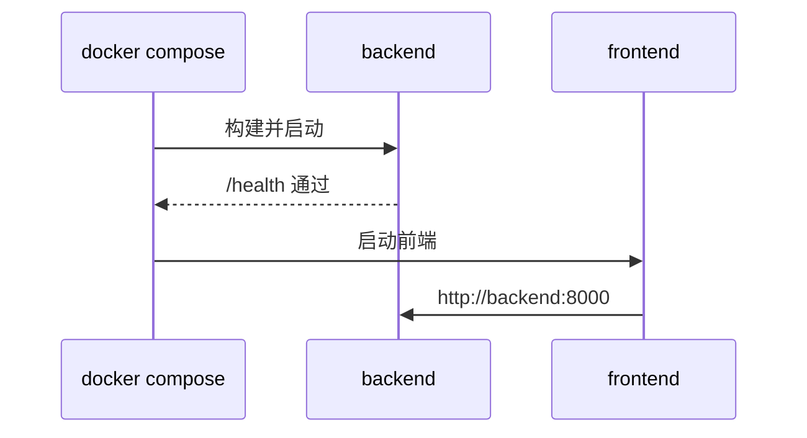

# 第 26 章 软件部署综合实践

上一章用一长串 `docker run` 把前后端连起来了。命令能跑，但换一台机器、换一个人，参数少一个就可能失败；两个人部署得不一样，问题也很难复现。本章把这些命令收敛成一份 `docker-compose.yml`：一条命令启动整套系统，用健康检查控制启动顺序，用日志排查故障，最后写出可交接的部署文档。

部署上线不是终点。镜像跑起来只是开始，还要能看健康状态、看日志、能备份、能回滚。

> 环境提示：本章的 `docker compose up`、`docker compose ps` 需要 Docker 守护进程运行。教材编写环境的 Docker Desktop 未启动，实际启动整套服务的步骤标注为待核；Compose 文件已用 `docker compose config` 校验，健康检查命令已对本地 `/health` 实际运行验证。

## 本章学习目标

读完本章，你应该能：

1. 构建镜像并启动前后端服务，用日志、健康检查与响应头排查部署问题，并按交付清单完成验收。

## 26.1 概念讲解

### 26.1.1 Compose：把命令写成文件

昨天的手工部署包含网络、端口、环境变量、挂载、启动顺序。Compose 把这些写进一份 YAML，文件进 Git，部署就变得可复现。

| Compose 配置 | 对应手工操作 |
| --- | --- |
| `services.backend` | `--name duty-backend` |
| `build.context: ./duty` | `docker build -t duty-backend:1.0 ./duty` |
| `ports: 8000:8000` | `-p 8000:8000` |
| `environment` | `-e KEY=VALUE` |
| `volumes: ./duty/logs:/app/logs` | `-v "$(pwd)/logs:/app/logs"` |
| `healthcheck` | 手工 `curl /health` |
| `frontend.environment.DUTY_API_BASE_URL` | `-e DUTY_API_BASE_URL=...` |
| `depends_on: condition: service_healthy` | 手工“先等后端起来，再起前端” |
| 服务名 `backend` / `frontend` | `--network-alias backend` |

### 26.1.2 读 docker-compose.yml

```yaml
name: duty-system
services:
  backend:
    build: ./duty
    ports:
      - "8000:8000"
    environment:
      DATABASE_URL: sqlite:///./duty.db
      SECRET_KEY: change-me-in-production
      ALGORITHM: HS256
      DEBUG: "False"
    volumes:
      - ./duty/logs:/app/logs
    healthcheck:
      test: ["CMD", "python", "-c", "import urllib.request; urllib.request.urlopen('http://127.0.0.1:8000/health')"]
      interval: 10s
      timeout: 5s
      retries: 5
      start_period: 20s
  frontend:
    build: ./duty_frontend
    ports:
      - "8501:8501"
    environment:
      DUTY_API_BASE_URL: http://backend:8000
    depends_on:
      backend:
        condition: service_healthy
```

三件事要讲清：服务名就是网络地址，`frontend` 里写 `http://backend:8000`，Compose 自动创建网络并把 `backend` 解析到后端容器；`healthcheck` 是“活着”的标准，每 10 秒访问一次 `/health`，连续失败 5 次判定不健康；`depends_on` 默认只等容器启动，加上 `condition: service_healthy` 才等健康检查通过。



*图 26-1：带健康检查的启动顺序*

### 26.1.3 常用命令

| 命令 | 作用 |
| --- | --- |
| `docker compose up -d --build` | 构建并后台启动 |
| `docker compose ps` | 查看服务状态 |
| `docker compose logs -f 服务名` | 跟踪日志 |
| `docker compose restart 服务名` | 重启单个服务 |
| `docker compose exec 服务名 sh` | 进入容器 |
| `docker compose down` | 停止并删除容器与网络 |

`down` 删除容器，但不会删除镜像；本项目的数据库在容器层，`down` 后新建的数据会丢。这正是下一步要发现并改进的问题。

### 26.1.4 三个故障演练

| 故障 | 现象 | 排查与修复 |
| --- | --- | --- |
| 端口被占用 | `port is already allocated`，后端起不来 | 停掉占用 8000 的本机服务，再 `up` |
| 前端地址写成 `localhost` | 页面能开，登录失败 | 进前端容器访问 `http://localhost:8000/health`，确认指向自己；改回 `http://backend:8000` |
| 数据库路径写错 | 后端反复重启或退出 | `docker compose logs backend` 看路径错误；改回有效路径并确保目录可写 |

排查顺序固定：`docker compose ps` → `docker compose logs 服务名` → 容器内测网络 → 检查环境变量。三个故障分别对应端口、网络与地址、文件与配置三层，不要一上来就改代码。

### 26.1.5 日志、健康检查与响应头

| 证据 | 位置 | 说明 |
| --- | --- | --- |
| 健康检查 | `GET /health` | 返回 `{"status":"healthy"}` |
| 响应时间 | 响应头 `X-Process-Time` | 后端中间件写入，判断慢请求 |
| 应用日志 | `duty/logs/app.log`、`error.log` | 挂载到宿主机，容器删了日志还在 |

```bash
ls duty/logs
tail -n 20 duty/logs/app.log
```

### 26.1.6 当前编排的一个不足

当前 `docker-compose.yml` 只挂载了日志，没有挂载数据库。数据库文件在容器层，`docker compose down` 后新增数据会丢。改进方式：给后端加数据目录挂载，并把 `DATABASE_URL` 指到挂载目录。

这个不足值得在交付时明确写出来：交付不是“没有问题”，而是“问题说清楚”。

### 26.1.7 部署文档要素

| 章节 | 内容 |
| --- | --- |
| 服务清单 | backend / frontend，镜像与版本 |
| 端口 | 8000、8501，宿主机 → 容器 |
| 环境变量 | 名称、作用、是否敏感（`SECRET_KEY` 必须标注） |
| 数据与日志 | 宿主机目录 → 容器目录 |
| 启动与停止 | `up -d --build`、`down` |
| 健康检查 | `/health` 与 Compose healthcheck |
| 备份与回滚 | 备份数据库文件；回滚到上一个镜像版本 |
| 常见问题 | 端口占用、地址错误、数据目录权限 |

部署文档不是“命令备忘录”，它要能让一个没参与开发的人把系统跑起来。

### 26.1.8 验收清单

- [ ] `docker compose up -d --build` 一次成功；
- [ ] `docker compose ps` 两个服务都在运行；
- [ ] 登录成功，部门列表有数据；
- [ ] 能说出 `healthcheck` 与 `depends_on` 的作用；
- [ ] 完成一个故障演练并记录；
- [ ] 部署文档包含环境变量、数据与日志、备份与回滚；
- [ ] 能说出当前编排在数据持久化上的不足。

## 26.2 示范例题

#### 例 26-1：用 Compose 一键启动并验证【Bloom：应用】

**题目**：写出构建并后台启动、查看服务状态、跟踪后端日志、停止整套服务的命令，并说明启动顺序由什么控制。

**解**：

```bash
cd 项目参考
docker compose up -d --build
docker compose ps
docker compose logs -f backend
docker compose down
```

启动顺序由 `depends_on` 与 `healthcheck` 控制：后端先启动，健康检查访问 `/health` 通过后，前端才开始启动。`Ctrl + C` 只退出日志跟踪，不会停止服务。

**验证**：⚠️ 需作者确认（Docker 守护进程未运行，`compose up` 未实际执行；Compose 文件已用 `docker compose config` 校验通过）

```text
待核记录：
1. docker version 报无法连接守护进程。
2. docker compose config 已解析通过，服务与依赖结构正确。
3. 请在启动 Docker 后执行 up，确认两个服务状态与健康检查。
结论：启动命令未实际运行，需作者确认。
```

#### 例 26-2：按固定顺序排查启动失败【Bloom：分析】

**题目**：`docker compose up -d` 后前端页面能打开，但登录失败。请按“ps → logs → 容器内测网络 → 环境变量”的顺序说明排查过程。

**解**：

1. `docker compose ps`：确认后端与前端都在运行，端口映射存在。
2. `docker compose logs frontend`：看前端是否报连接错误；`docker compose logs backend`：看后端是否正常启动。
3. `docker compose exec frontend sh`，执行 `python -c "import urllib.request; print(urllib.request.urlopen('http://backend:8000/health').read())"`：成功说明网络通，失败说明不在同一网络或服务名解析失败。
4. 检查环境变量：`docker compose exec frontend env | grep DUTY_API_BASE_URL`。若为 `http://localhost:8000`，容器里的 `localhost` 指前端自己，必然失败。

修正：把 `DUTY_API_BASE_URL` 改为 `http://backend:8000`，重新 `docker compose up -d`。

**验证**：✅ 已验证（核对定义来源：M07 课次26 故障演练二与排错顺序；健康检查命令已对本地 `/health` 实际运行成功）

```text
实际输出：
b'{"status":"healthy"}'
结论：容器内测网络的方法与健康检查命令可执行，验证通过。
```

## 26.3 引导练习

#### 例 26-3（引导练习）：验证健康检查命令【Bloom：应用】

**题目**：Compose 的 healthcheck 使用 `python -c "import urllib.request; urllib.request.urlopen('http://127.0.0.1:8000/health')"`。请说明这条命令做了什么，以及健康检查连续失败会怎样。

<details><summary>提示 1（方向）</summary>

它在容器内访问自己的 8000 端口；如果返回 2xx，`urlopen` 不抛异常。

</details>

<details><summary>提示 2（关键步骤）</summary>

连续失败达到 `retries` 次，容器被标记为 unhealthy；依赖它的服务不会启动。

</details>

<details><summary>完整解答</summary>

命令在容器内用 Python 标准库访问 `http://127.0.0.1:8000/health`；返回 2xx 时 `urlopen` 正常返回，健康检查通过；连接失败或非 2xx 会抛异常，判定一次失败。连续失败达到 `retries` 次后，容器状态变为 unhealthy；`depends_on` 中等待 `service_healthy` 的前端不会启动。

**验证**：✅ 已验证（实际启动本地 `/health` 服务并运行该命令，返回 `b'{"status":"healthy"}'`）

```text
实际输出：
server=200
b'{"status":"healthy"}'
exit=0
结论：健康检查命令可执行且返回正常，验证通过。
```

</details>

## 26.4 独立习题

#### 习题 26-1【Bloom：应用】

**题目**：写出一键部署并验收的完整步骤：构建启动、查看状态、打开后端文档与前端页面、登录并查看部门列表、停止服务。

#### 习题 26-2【Bloom：分析】

**题目**：部署后出现三个现象：后端反复重启；前端能打开但所有请求 401；`docker compose down` 后新建数据丢失。请分别分析原因并给出修正。

#### 习题 26-3【Bloom：评价】

**题目**：下面是一份部署文档的目录：启动命令、停止命令、端口。请按部署文档要素评价它的完整性，并列出至少四项缺失内容。

#### 习题 26-4【Bloom：创造】（开放题）

**题目**：当前 Compose 只挂载了日志，没有挂载数据库。请提出一套改进方案：如何让数据在 `down` 后仍保留，如何备份与回滚，如何验证改进有效。给出配置片段与验证步骤。

## 本章小结

**核心结论**：

1. Compose 把手工命令写成一份文件：服务、构建、端口、环境变量、挂载、健康检查、启动依赖都可复现。
2. 服务名就是网络地址；前端用 `http://backend:8000`，不用 `localhost`。
3. `healthcheck` 判断服务是否可用，`depends_on: condition: service_healthy` 让前端等后端健康后再启动。
4. 排查按“ps → logs → 容器内测网络 → 环境变量”的顺序；三个高频故障是端口占用、地址写成 localhost、数据库路径错误。
5. 部署文档要包含服务、端口、环境变量、数据与日志、启动停止、健康检查、备份与回滚；当前编排的数据库未挂载，是明确的已知不足。

**与持久理解的呼应**：本章推进了「容器化把运行环境从口头约定变成可复现的交付物」与「测试与部署把“本机能跑”变成“可交付、可观测”」——通过 Compose、健康检查与部署文档，读者看到整套系统如何被收敛成可复现、可观测、可交接的交付物。

**自检**：回到章首的学习目标，逐条问自己做到了没有——

- [ ] 构建镜像并启动前后端服务，用日志、健康检查与响应头排查部署问题，并按交付清单完成验收 → 拿不准就回看 26.1.3 至 26.1.8，自测：习题 26-2

**下一章预告**：本书正文到此结束。下一步，把这个链条用到你自己的项目上：从需求文档到接口契约，从后端模块到前端页面，再到容器化与部署，换一个业务场景，重新走一遍需求、设计、实现、测试与部署。
