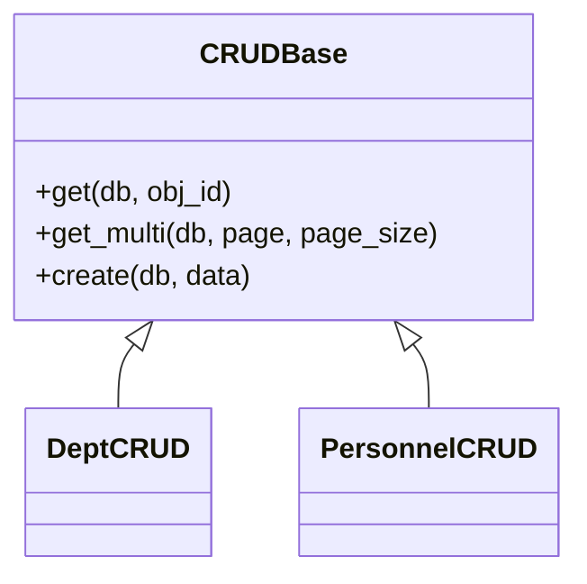

# 第 11 章 数据模块：查询复用

> **节首信息条**｜对应课次 10 · 2 学时 · 实践｜前置：第 10 章的部门与人员 CRUD；第 5 章 5.4；基本的 Python 类与继承｜章末有质量评价量表、AI 了解性侧栏与本章提示页

上一章把部门模块写透了。但系统里不只一个部门：人员、工位、值班记录，每个模块都要列表、详情、新增，每个列表都要分页、过滤、排序。如果每个模块都照抄一遍，代码会迅速膨胀，改一个分页公式就要改十几处。

本章做两件事：先把列表做得更好用——分页返回总页数（Page Count）、过滤条件加到正确位置、排序只允许白名单字段；再把重复的通用操作抽成一个 `CRUDBase`，让部门和人员共用。抽取的边界要守住：只抽“完全重复”的部分，业务规则留在各自的 service。

## 本章学习目标

读完第 11 章并完成实训后，你应该能：

1. 指出部门与人员模块中完全重复的查询代码，并说明重复带来的维护成本。
2. 实现分页返回 `pages`，并保证过滤、排序与总数计算顺序正确。
3. 把排序字段限制在白名单内，避免任意字段注入。
4. 抽取 `CRUDBase`，并说明“只抽完全重复部分”的边界。
5. 改造后跑回归测试（Regression Test），确认两个模块行为不变。

## 前置知识卡

| # | 已有知识 | 回看位置 |
| --- | --- | --- |
| 1 | 本章依赖的前置内容 | 第 10 章的部门与人员 CRUD；第 5 章 5.4；基本的 Python 类与继承 |
| 2 | 上一章的核心结论 | 见上一章「本章小结」 |
| 3 | 本章实训/案例所需的环境与数据 | 见本章实训「二、课前准备」或章首导入 |

> 卡住时先回看，不必从头重读。

## 11.1 概念讲解

### 11.1.1 重复从哪里来

部门列表和人员列表的代码几乎一样：都接收 `page`、`page_size`，都先 `count()` 再 `offset/limit`，都返回 `items` 与 `total`。只有模型类、主键名和过滤字段不同。

重复本身不是罪，问题是重复之后的维护成本：分页公式改一次，要在每个模块改一遍；某个模块漏改，行为就不一致。抽取的目标不是“代码短”，而是“同一规则只写一次”。

### 11.1.2 分页：多返回一个 pages

上一章返回 `items` 与 `total`。这一章再补三个字段：`page`、`page_size`、`pages`。`pages` 是总页数：

**代码 11-1-1** · 示例（文本）

```text
pages = ceil(total / page_size) = (total + page_size - 1) // page_size
```

用整数除法向上取整，避免浮点误差。`page` 小于 1 时按 1 处理，`page_size` 超过 100 时按 100 处理。边界处理放在通用函数里，每个模块就不用各写一遍。

### 11.1.3 过滤：条件要加在 count 之前

过滤条件必须加在 `count()` 之前。否则 `total` 统计的是全表条数，而 `items` 是过滤后的结果，前端算出的总页数就会偏大。

**代码 11-1-3** · 示例代码（Python）

```python
query = db.query(Department)
if full_name:
    query = query.filter(Department.full_name.contains(full_name))
total = query.count()
items = query.offset((page - 1) * page_size).limit(page_size).all()
```

空字符串不要当成过滤条件。用户没填名称时，`full_name` 是空串或 `None`，此时应跳过过滤，而不是用 `%` 去匹配所有记录。

### 11.1.4 排序：只允许白名单字段

排序字段来自用户输入，绝不能直接拼进 SQL。正确做法是维护一张白名单，把“用户传入的字段名”映射到“模型列”：

**代码 11-1-5** · 示例代码（Python）

```python
sort_fields = {
    "dept_code": Department.dept_code,
    "full_name": Department.full_name,
}
column = sort_fields.get(sort_by, Department.dept_code)
query = query.order_by(column.desc() if order == "desc" else column.asc())
```

白名单有两个作用：防止 SQL 注入，也防止用户按不存在的字段排序导致 500。默认排序要固定，否则同一页数据在多次请求间可能顺序不同。

### 11.1.5 参数命名要统一

真实项目里常见一种不一致：部门列表用 `sort_order`，人员列表用 `order`。功能都能用，但前端要为每个模块记一套参数名，文档也很难写。

本课程统一用 `sort_by` 与 `order`。发现文档与代码不一致时，以实际代码和 `/docs` 为准，然后把文档改过来。契约一致不是“谁对谁错”的问题，而是“只保留一个说法”。

### 11.1.6 抽取 CRUDBase

把完全重复的 `get`、`get_multi`、`create` 抽成一个类：

**代码 11-1-7** · 示例代码（Python）

```python
class CRUDBase:
    def __init__(self, model, pk: str = "id"):
        self.model = model
        self.pk = pk

    def get(self, db, obj_id):
        return db.query(self.model).filter(getattr(self.model, self.pk) == obj_id).first()

    def get_multi(self, db, page: int = 1, page_size: int = 10):
        page = max(page, 1)
        page_size = min(max(page_size, 1), 100)
        query = db.query(self.model)
        total = query.count()
        items = query.offset((page - 1) * page_size).limit(page_size).all()
        pages = (total + page_size - 1) // page_size
        return {"items": items, "total": total, "page": page, "page_size": page_size, "pages": pages}

    def create(self, db, data):
        obj = self.model(**data.model_dump())
        db.add(obj)
        db.commit()
        db.refresh(obj)
        return obj
```

使用时要指定模型和主键：

**代码 11-1-9** · 示例代码（Python）

```python
dept_crud = CRUDBase(Department, pk="dept_code")
personnel_crud = CRUDBase(Personnel, pk="certificate_number")
```

主键不一定是 `id`：部门用 `dept_code`，人员用 `certificate_number`。基类通过 `getattr(self.model, self.pk)` 找到主键列，所以能适配不同的主键名。



*图 11-1：通用 CRUDBase 与各模块的关系*

### 11.1.7 抽取的边界：只抽完全重复的

抽取不是越多越好。`CRUDBase` 只放三类操作：按主键取一条、分页取多条、创建一条。它们对所有模型都一样。

业务规则不能进基类。部门新增要查重，人员新增要查部门是否存在，这些规则只属于各自模块。把它们塞进基类，基类就会变成“什么都管”的上帝类，新模块反而更难用。

一条实用判据：如果一段代码换个模型仍然一字不改，它可以进基类；如果它需要知道“部门”或“人员”的业务含义，它应该留在 service。

### 11.1.8 改造与回归测试

抽取之后必须回归测试。至少验证三件事：两个模块的列表还能正常分页；详情还能按各自的主键查到；新增还能写入并返回。抽取最常见的破坏方式是主键名没传对——用默认的 `id` 去查 `dept_code`，结果永远查不到。

改造顺序建议是：先抽一个模块，跑通；再迁第二个模块，跑通；最后删除旧代码。一次改两个模块，出问题时很难判断是哪一步引入的。

### 11.1.9 继承层次别做太深

`CRUDBase` 只做一层。如果为了复用再派生出 `DeptCRUD(CRUDBase)`、`PersonnelCRUD(DeptCRUD)`，继承链会越来越长，读代码时要跳好几个文件才知道一个方法最终执行的是什么。

优先用“组合”而不是“深继承”：模块持有一个 `CRUDBase` 实例，在 service 里调用它；只有确实需要扩展通用行为时，才派生子类。层次浅，改动容易定位。

## 11.2 示范例题

#### 例 11-1：用 CRUDBase 复用部门与人员查询【Bloom：应用】

**题目**：写一个最小 `CRUDBase`，支持按主键取一条、分页取多条、创建一条；并用它分别为部门和人员创建实例。要求分页返回 `items`、`total`、`page`、`page_size`、`pages`。

**解**：

**代码 11-2-1** · 示例代码（Python）

```python
class CRUDBase:
    def __init__(self, model, pk: str = "id"):
        self.model = model
        self.pk = pk

    def get(self, db, obj_id):
        return db.query(self.model).filter(getattr(self.model, self.pk) == obj_id).first()

    def get_multi(self, db, page: int = 1, page_size: int = 10):
        page = max(page, 1)
        page_size = min(max(page_size, 1), 100)
        query = db.query(self.model)
        total = query.count()
        items = query.offset((page - 1) * page_size).limit(page_size).all()
        pages = (total + page_size - 1) // page_size
        return {"items": items, "total": total, "page": page, "page_size": page_size, "pages": pages}

    def create(self, db, data):
        obj = self.model(**data.model_dump())
        db.add(obj)
        db.commit()
        db.refresh(obj)
        return obj

dept_crud = CRUDBase(Department, pk="dept_code")
personnel_crud = CRUDBase(Personnel, pk="certificate_number")
```

#### 例 11-2：为什么这些代码该抽、那些不该抽【Bloom：分析】

**题目**：下面四段代码，哪些适合放进 `CRUDBase`，哪些应留在各自的 service？说明判断依据。

1. 按主键查一条记录。
2. 分页查询多条记录。
3. 新增部门前检查 `dept_code` 是否重复。
4. 新增人员前检查 `dept_code` 对应的部门是否存在。

**解**：

1. 适合。所有模型都按主键查一条，只是主键名不同；基类通过 `pk` 参数适配。
2. 适合。所有模型的分页逻辑完全相同：`count`、`offset`、`limit`、算 `pages`。
3. 不适合。它依赖“部门编码唯一”这条业务规则，只有部门模块知道；放进基类会让基类知道部门。
4. 不适合。它依赖“人员必须属于一个存在的部门”这条业务规则，只有人员模块知道；应留在人员 service。

判断依据：换一个模型仍然一字不改的，进基类；需要知道具体业务含义的，留 service。

## 11.3 引导练习

#### 例 11-3（引导练习）：为工位模块套用 CRUDBase【Bloom：应用】

**题目**：工位表主键是 `workstation_id`。请写出用 `CRUDBase` 为工位创建实例的代码，并说明 `get` 查询时基类如何找到主键列。

#### 例 11-4（引导练习）：把重复的列表改写成基类调用【Bloom：应用】

**题目**：部门列表原来自己写 `count`、`offset`、`limit`。请把它改成调用 `dept_crud.get_multi`，并说明改动后哪些行为必须保持不变。

## 11.4 独立习题

#### 习题 11-1【Bloom：应用】

**题目**：实现一个 `CRUDBase`，支持按主键取一条、分页取多条、创建一条。要求主键可配置，分页返回 `items`、`total`、`page`、`page_size`、`pages`。

#### 习题 11-2【Bloom：应用】

**题目**：把部门与人员模块中重复的 `get`、分页列表、`create` 改造成使用 `CRUDBase`，并说明改造后如何做回归测试。

#### 习题 11-3【Bloom：分析】

**题目**：某同学为了复用，设计了 `Base → CRUDBase → DeptCRUD → DeptAdminCRUD` 四层继承，并在 `CRUDBase` 里加了“部门编码查重”和“人员部门校验”。请指出至少三处问题，并说明更合适的做法。

#### 习题 11-4【Bloom：创造】（开放题）

**题目**：系统即将新增“工位”“值班记录”“查班记录”三个模块。请设计一套复用方案：哪些操作进 `CRUDBase`，哪些留在各模块的 service，参数命名如何统一，如何保证抽取后不破坏已有模块。给出类结构或代码骨架，并说明设计理由。

## ◆ 实训 11-1：数据模块：查询复用（对应课次 10 · 2 学时）

### 一、任务目标与验收

| 目标 | 验收标志 |
| --- | --- |
| 识别重复 | 列出至少三处完全重复的查询代码 |
| CRUDBase 可用 | 按主键取一条、分页取多条、创建一条 |
| 两模块切换成功 | 部门与人员都改用 CRUDBase |
| 分页与排序正确 | `pages` 正确、排序只接受白名单 |
| 回归通过 | 改造前后接口行为一致 |

### 二、课前准备

- 第 10 章两个模块的代码
- 现有接口测试或手工验证清单
- 一份“改造前”的响应样例

### 三、操作步骤

1. **找重复**
   - 做什么：找重复
   - 操作：`并排打开部门与人员模块，标出完全相同的代码`
   - 预期输出：→ 至少三处，且换模型后一字不改
   - 做错会看到什么：把“看起来像”的代码也抽走；只抽完全重复的
2. **写 CRUDBase**
   - 做什么：写 CRUDBase
   - 操作：`实现按主键取一条、分页取多条、创建一条`
   - 预期输出：→ 三个方法可被两个模型复用
   - 做错会看到什么：把业务规则写进基类；业务规则留在各自 service
3. **替换并回归**
   - 做什么：替换并回归
   - 操作：`两个模块改用 CRUDBase，跑测试`
   - 预期输出：→ 响应结构与改造前一致
   - 做错会看到什么：分页 `pages` 算错；检查向上取整公式
4. **收紧排序**
   - 做什么：收紧排序
   - 操作：`排序字段改为白名单校验`
   - 预期输出：→ 非法字段被拒绝或回落到默认
   - 做错会看到什么：直接拼接字段名；改为白名单映射

### 四、排错清单

| 现象 | 先查什么 |
| --- | --- |
| `pages` 少一页 | 向上取整公式写错 |
| 过滤后总数不变 | 条件加在 `count` 之后 |
| 抽取后行为变化 | 把非完全重复的代码也抽走了，退回各自模块 |
| 继承层次过深 | 优先组合，只有确实需要扩展时才派生 |

### 五、提交与验收

提交改造后的两个模块与回归记录；验收按“重复识别”“抽取边界”“回归结果”三项判定。

### 六、课后扩展

- 给 `CRUDBase` 补一个按条件取多条的通用方法，并说明适用边界
- 为排序白名单（Sort Whitelist）补测试
- 记录一次“抽错”的回退过程

### 七、回链

- 第 10 章 10.1.4–10.1.9；本章 11.1.1–11.1.8

## 本章小结

**核心结论**：

1. 分页返回 `items`、`total`、`page`、`page_size`、`pages`；`pages` 用 `(total + page_size - 1) // page_size` 计算。
2. 过滤条件必须加在 `count()` 之前；空字符串不能当成过滤条件。
3. 排序字段只允许白名单，不能把用户输入直接拼进 SQL；参数命名统一为 `sort_by` 与 `order`。
4. `CRUDBase` 只放完全重复的通用操作：按主键取一条、分页取多条、创建一条；主键名可配置。
5. 业务规则留在各自 service；继承层次保持浅，优先组合；抽取后必须回归测试。

**学完本章，你可以体会到**：复用不是“抽得越多越高级”，而是只把真正相同的部分收拢，让改动只发生在一处。
**自检**：回到章首的学习目标，逐条问自己做到了没有——

- [ ] 指出部门与人员模块中完全重复的查询代码，并说明重复带来的维护成本。 → 回看 11.1.1，自测：习题 11-1
- [ ] 实现分页返回 `pages`，并保证过滤、排序与总数计算顺序正确。 → 回看 11.1.2–11.1.4，自测：习题 11-1
- [ ] 把排序字段限制在白名单内，避免任意字段注入。 → 回看 11.1.4–11.1.5，自测：习题 11-1
- [ ] 抽取 `CRUDBase`，并说明“只抽完全重复部分”的边界。 → 回看 11.1.6–11.1.7，自测：习题 11-1
- [ ] 改造后跑回归测试，确认两个模块行为不变。 → 回看 11.1.8–11.1.9，自测：习题 11-1

**下一章预告**：通用查询解决了“数据怎么取”。下一章进入业务规则：值班时间冲突、状态流转、跨表校验，这些规则该写在哪一层、怎么保证不被绕过。

## 换场景总表

| 本章场景 | 换成其他场景 |
| --- | --- |
| 部门/人员分页 | 换成订单/商品分页，CRUDBase 结构不变 |
| 排序白名单 | 换成搜索字段白名单，注入防护思路不变 |
| Python 继承 | 换成组合或泛型，抽取边界判断不变 |

## 章末质量评价量表（本实训）

| 维度 | 分档描述 | 权重 |
| --- | --- | ---: |
| 重复识别 | 能准确列出完全重复的代码 | 25% |
| 抽取设计 | CRUDBase 职责单一、边界合理 | 30% |
| 分页与排序 | pages、过滤、白名单正确 | 25% |
| 回归验证 | 改造前后行为一致 | 20% |
| **合计** | | **100%** |

评价方式：自评 30% + 互评 30% + 师评 40%。

**一票否决**：涉密信息未脱敏、安全漏洞不处理、提交记录造假——出现任一项，本实训记不通过。

## AI 侧栏（了解即可）

> AI 看到重复代码就会建议抽基类，但常把业务规则一起抽走。让它先列出“换模型是否一字不改”，只对通过这一判据的部分做抽取。

## 本章提示页

> 先自己做，卡住了再看。提示按“方向 → 关键步骤 → 完整解答”排列。

**例 11-3（引导练习）：为工位模块套用 CRUDBase【Bloom：应用】**

**提示 1（方向）**

创建实例时把模型和主键名传进去：`CRUDBase(Workstation, pk="workstation_id")`。

**提示 2（关键步骤）**

基类用 `getattr(self.model, self.pk)` 取列对象，所以主键名只要是模型属性即可。

**完整解答**

**代码 11-4-1** · 示例代码（Python）

```python
workstation_crud = CRUDBase(Workstation, pk="workstation_id")

workstation = workstation_crud.get(db, "W01")
```

基类在 `get` 中执行 `getattr(self.model, self.pk)`，把字符串 `workstation_id` 变成 `Workstation.workstation_id` 列对象，再用它做过滤。因此主键名不必是 `id`，只要是模型上的属性即可。

**例 11-4（引导练习）：把重复的列表改写成基类调用【Bloom：应用】**

**提示 1（方向）**

controller 只负责取参数、调用基类、返回结果；分页公式不再出现在 controller 里。

**提示 2（关键步骤）**

保持不变的行为包括：返回字段 `items/total/page/page_size/pages`、`page` 最小为 1、`page_size` 上限 100。

**完整解答**

**代码 11-4-3** · 示例代码（Python）

```python
@router.get("/departments")
def list_departments(
    page: int = 1,
    page_size: int = 10,
    db: Session = Depends(get_db),
):
    return dept_crud.get_multi(db, page=page, page_size=page_size)
```

保持不变的行为：返回五个字段；`page` 小于 1 时按 1 处理；`page_size` 超过 100 时按 100 处理；`total` 是分页前的总数；`pages` 按向上取整计算。过滤与排序如果需要保留，应在基类方法上增加参数，或在 service 里先构造查询再交给基类。