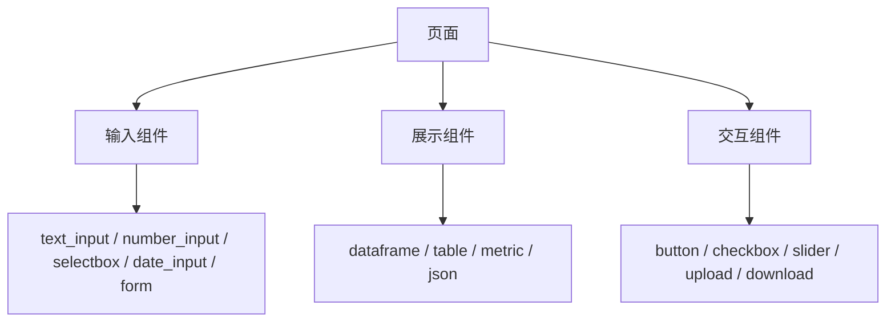

# 第 17 章 常用界面组件

> **节首信息条**｜对应课次 17 · 4 学时 · 实践｜前置：第 16 章的 Streamlit 事件模型与 session_state；基本的数据结构与表单概念｜章末有质量评价量表、AI 了解性侧栏与本章提示页

上一章知道了页面怎么跑起来，但页面还是空的。一个管理页面通常由三类“零件”组成：输入（让用户填）、展示（把数据给用户看）、交互（让用户触发动作）。零件组合起来，才是一个能用的页面。

本章不接后端，用假数据把“部门管理页”搭出来：搜索框、新增表单（Form）、指标卡、数据表格、中文列名与日期格式。先用假数据把界面逻辑跑通，再接真实接口，联调时就不会同时面对“界面不对”和“接口不对”两个问题。

## 本章学习目标

读完第 17 章并完成实训后，你应该能：

1. 把常用组件分为输入、展示、交互三类，并按场景选对组件。
2. 用表单把多次输入攒成一次提交，并解释表单与普通输入的区别。
3. 用 `column_config` 把英文列名换成中文，并控制列的展示格式。
4. 实现“先过滤、再显示”的列表页，并处理空结果。
5. 把出现第二次的组件代码抽成函数，用假数据先验证界面。

## 前置知识卡

| # | 已有知识 | 回看位置 |
| --- | --- | --- |
| 1 | 本章依赖的前置内容 | 第 16 章的 Streamlit 事件模型与 session_state；基本的数据结构与表单概念 |
| 2 | 上一章的核心结论 | 见上一章「本章小结」 |
| 3 | 本章实训/案例所需的环境与数据 | 见本章实训「二、课前准备」或章首导入 |

> 卡住时先回看，不必从头重读。

## 17.1 概念讲解

### 17.1.1 组件分为三类



*图 17-1：常用组件的三类分工*

输入组件（Input Widget）收集用户填写的值；展示组件（Display Widget）把数据渲染出来；交互组件（Interactive Widget）触发动作或改变状态。一个页面不必三类都用，但管理页面通常三类都会出现。

### 17.1.2 输入组件

| 组件 | 用途 | 关键参数 |
| --- | --- | --- |
| `st.text_input` | 单行文本 | `placeholder`、`value`、`type="password"` |
| `st.number_input` | 数字 | `min_value`、`max_value`、`step` |
| `st.selectbox` | 单选下拉 | 选项列表、`index` |
| `st.date_input` | 日期 | `value`、`min_value`、`max_value` |

**代码 17-1-2** · 示例代码（Python）

```python
full_name = st.text_input("部门名称", placeholder="输入关键字后回车")
page_size = st.number_input("每页条数", min_value=5, max_value=50, value=10, step=5)
sort_by = st.selectbox("排序字段", ["dept_code", "full_name", "created_at"])
created_at = st.date_input("成立日期")
```

输入组件的返回值就是用户当前填写的值。因为每次交互都会重跑脚本，这些值在重跑时会被重新读取；如果需要跨重跑保留，仍然要用 `session_state`。

### 17.1.3 表单：把多次输入攒成一次提交

不用表单时，用户每输入一个字符都可能触发一次重跑，页面会不断刷新。`st.form` 把多个输入攒在一起，只有点击提交按钮才重跑一次。

**代码 17-1-4** · 示例代码（Python）

```python
with st.form("create_dept", clear_on_submit=True):
    col1, col2 = st.columns(2)
    with col1:
        dept_code = st.text_input("部门编码 *", placeholder="例如 1001")
    with col2:
        full_name = st.text_input("部门名称 *")
    address = st.text_input("地址")
    submitted = st.form_submit_button("提交")
```

`clear_on_submit=True` 让提交成功后自动清空输入，避免用户重复提交同一份数据。表单的意义不只是“少刷新”，它还把“提交”这个动作变得明确：用户知道什么时候数据会被处理。

### 17.1.4 展示组件

| 组件 | 特点 | 适合 |
| --- | --- | --- |
| `st.dataframe` | 可排序、可滚动、可交互 | 数据列表 |
| `st.table` | 静态展示，全部铺开 | 少量汇总数据 |
| `st.metric` | 一个大数字 + 说明 | 关键指标 |
| `st.json` | 结构化展示 JSON | 调试接口返回 |

**代码 17-1-6** · 示例代码（Python）

```python
st.dataframe(df, width="stretch", hide_index=True)
st.metric("部门总数", len(df), delta="本月新增 2 个")
st.json({"total": len(df), "items": departments})
```

列表页优先用 `st.dataframe`，不要用 `st.table` 铺几十行；`hide_index=True` 隐藏 Pandas 自带的行号；`width="stretch"` 让表格填满容器。

### 17.1.5 column_config：把英文列名换成中文

`column_config` 是一个字典：键是原字段名，值告诉 Streamlit“这一列怎么显示”。

**代码 17-1-8** · 示例代码（Python）

```python
dept_config = {
    "dept_code": st.column_config.TextColumn("部门编码", width="small"),
    "full_name": st.column_config.TextColumn("部门名称"),
    "address": st.column_config.TextColumn("地址"),
    "created_at": st.column_config.DateColumn("成立日期", format="YYYY-MM-DD"),
}

display_df = df.copy()
display_df["created_at"] = pd.to_datetime(display_df["created_at"])

st.dataframe(display_df, width="stretch", hide_index=True, column_config=dept_config)
```

三个要点：配置的键必须与字段名一致；日期列要先转成日期类型，否则格式化不生效；把某列配置（Column Config）成 `None` 可以隐藏它。

### 17.1.6 交互组件

**代码 17-1-10** · 示例代码（Python）

```python
if st.button("查询"):
    st.write("按关键字查询")

only_with_address = st.checkbox("只看有地址的部门")
top_n = st.slider("显示前 N 条", min_value=1, max_value=len(df), value=min(5, len(df)))
uploaded = st.file_uploader("导入部门 CSV", type=["csv"])

st.download_button(
    "导出 CSV",
    data=df.to_csv(index=False).encode("utf-8-sig"),
    file_name="departments.csv",
    mime="text/csv",
)
```

`st.button` 返回 `True` 只在点击的那一次重跑中成立；`checkbox`、`slider` 的值变化也会触发重跑。所以“点击后执行的代码”要放在 `if st.button(...):` 里面，否则每次重跑都会执行。

### 17.1.7 先过滤，再显示

搜索与筛选的逻辑应当放在显示之前：

**代码 17-1-12** · 示例代码（Python）

```python
keyword = st.text_input("部门名称", placeholder="输入关键字")
filtered = df[df["full_name"].str.contains(keyword)] if keyword else df
if only_with_address:
    filtered = filtered[filtered["address"].notna()]
st.dataframe(filtered.head(top_n), width="stretch", hide_index=True)
```

先过滤再显示，页面上的数字与表格才一致。把过滤放在表格之后、或者用两套数据分别显示，很容易出现“指标说 3 条、表格显示 5 条”的不一致。

### 17.1.8 组件复用：同样代码出现第二次就抽函数

**代码 17-1-14** · 示例代码（Python）

```python
def render_table(items, column_config=None):
    if not items:
        st.info("暂无数据")
        return
    st.dataframe(
        pd.DataFrame(items),
        width="stretch",
        hide_index=True,
        column_config=column_config,
    )
```

部门列表与人员列表的表格代码几乎一样，抽成 `render_table` 后，两处都调用它。抽函数的标准是“同样的代码出现第二次”；函数只负责显示或收集，不要把业务逻辑塞进去。抽完必须再跑一遍，确认输出没变。

### 17.1.9 假数据先验证界面

本章不接后端，新增的数据只放进 `session_state`，刷新浏览器就恢复。这样做的好处是：界面逻辑（筛选、表单校验、重复提示）可以独立验证；等接真实接口时，只需要把“内存数据”换成“接口返回”，界面结构不用重写。

### 17.1.10 常见问题

| 现象 | 原因 |
| --- | --- |
| 表头还是英文 | `column_config` 的键和字段名不一致 |
| 日期显示成一串数字 | 没转成 `datetime` |
| 列没显示 | 字段不在 DataFrame 里，或配置成了 `None` |
| 点击按钮后代码每次都执行 | 执行代码没放在 `if st.button(...)` 里 |
| 表单每输入一个字就刷新 | 没用 `st.form` 包起来 |

## 17.2 示范例题

#### 例 17-1：用表单收集部门信息【Bloom：应用】

**题目**：用 `st.form` 做一个新增部门表单，包含部门编码、部门名称、地址三个输入框和一个提交按钮；提交后显示输入值。

**解**：

**代码 17-2-1** · 示例代码（Python）

```python
with st.form("create_dept", clear_on_submit=True):
    col1, col2 = st.columns(2)
    with col1:
        dept_code = st.text_input("部门编码 *", placeholder="例如 1001")
    with col2:
        full_name = st.text_input("部门名称 *")
    address = st.text_input("地址")
    submitted = st.form_submit_button("提交")

if submitted:
    st.write(dept_code, full_name, address)
```

表单把三个输入攒成一次提交；`clear_on_submit=True` 在提交后清空；`submitted` 只在点击提交的那一次重跑中为真。

#### 例 17-2：用表格展示部门列表并配置中文列名【Bloom：应用】

**题目**：有三条部门假数据，请用 `st.dataframe` 显示，隐藏行号、铺满宽度，并把列名改成中文、把 `created_at` 格式化为 `YYYY-MM-DD`。

**解**：

**代码 17-2-3** · 示例代码（Python）

```python
dept_config = {
    "dept_code": st.column_config.TextColumn("部门编码", width="small"),
    "full_name": st.column_config.TextColumn("部门名称"),
    "address": st.column_config.TextColumn("地址"),
    "created_at": st.column_config.DateColumn("成立日期", format="YYYY-MM-DD"),
}

display_df = df.copy()
display_df["created_at"] = pd.to_datetime(display_df["created_at"])

st.dataframe(display_df, width="stretch", hide_index=True, column_config=dept_config)
```

配置的键与字段名一一对应；日期先转类型；`hide_index=True` 隐藏行号；`width="stretch"` 铺满容器。

## 17.3 引导练习

#### 例 17-3（引导练习）：加一个总数指标和关键字过滤【Bloom：应用】

**题目**：在部门表格上方加一个“部门总数”指标卡；再加一个搜索框，按部门名称过滤表格。说明过滤应该在显示之前还是之后。

#### 例 17-4（引导练习）：表单提交时做非空与重复校验【Bloom：应用】

**题目**：提交新增部门表单时，如果部门编码或名称为空，提示“不能为空”；如果编码已存在，提示“编码已存在”；否则加入列表并提示成功。

## 17.4 独立习题

#### 习题 17-1【Bloom：理解】

**题目**：说明下列组件或参数的作用：`st.form`、`st.form_submit_button`、`st.dataframe` 的 `hide_index`、`st.column_config.DateColumn`、`st.button` 的返回值。

#### 习题 17-2【Bloom：应用】

**题目**：用假数据写一个部门表格：包含部门编码、名称、地址、成立日期四列；列名为中文；日期格式为 `YYYY-MM-DD`；隐藏行号；表格上方显示部门总数。

#### 习题 17-3【Bloom：应用】

**题目**：写一个新增部门表单：包含编码、名称、地址三个输入；提交时做非空与重复校验；成功后在表格中新增一行。

#### 习题 17-4【Bloom：分析】

**题目**：某同学的表格出现三个问题：表头仍是英文；日期显示为 `1735689600000`；配置了地址列却看不到。请分别分析原因并给出修正方法。

## ◆ 实训 17-1：常用界面组件（对应课次 17 · 4 学时）

### 一、任务目标与验收

| 目标 | 验收标志 |
| --- | --- |
| 三类组件齐全 | 输入、展示、交互各至少用一个 |
| 表单可用 | 提交前不触发重跑，提交后一次性处理 |
| 表格可读 | 中文列名与格式正确 |
| 过滤可用 | 过滤条件生效，空结果有提示 |
| 组件复用 | 重复代码抽成函数 |

### 二、课前准备

- 第 16 章的页面骨架
- 一份假数据（先不接后端）
- 组件速查表或 `/docs`

### 三、操作步骤

1. **搭输入区**
   - 做什么：搭输入区
   - 操作：`用输入组件与表单搭出筛选与新增入口`
   - 预期输出：→ 输入后页面不立刻重跑
   - 做错会看到什么：每次输入都重跑；放进 `st.form`
2. **搭展示区**
   - 做什么：搭展示区
   - 操作：`用表格展示假数据，配置中文列名`
   - 预期输出：→ 列名可读、数字格式正确
   - 做错会看到什么：列名仍是英文；补 `column_config`
3. **加交互**
   - 做什么：加交互
   - 操作：`用按钮与选择组件触发过滤`
   - 预期输出：→ 过滤生效，空结果有提示
   - 做错会看到什么：空结果直接报错；补空态处理
4. **抽函数**
   - 做什么：抽函数
   - 操作：`把重复的表格/表单代码抽成函数`
   - 预期输出：→ 两处调用同一函数
   - 做错会看到什么：只抽了一行；按“出现第二次就抽”执行

### 四、排错清单

| 现象 | 先查什么 |
| --- | --- |
| 输入框总被清空 | 状态没放进 session_state 或表单 |
| 表单提交后没刷新 | 提交分支未重新取数 |
| 表格列顺序乱 | 未显式指定列或配置 |
| 假数据与真接口字段不一致 | 先按接口契约造假数据，字段名逐字一致 |

### 五、提交与验收

提交页面脚本与假数据演示；验收按“组件选择”“表单与状态”“复用”三项判定。

### 六、课后扩展

- 给表格加排序与下载按钮
- 把组件函数抽到独立模块
- 用真接口替换假数据，记录字段差异

### 七、回链

- 第 16 章 16.1.5–16.1.6；本章 17.1.1–17.1.9

## 本章小结

**核心结论**：

1. 页面组件分三类：输入、展示、交互；管理页面通常三类都会用到。
2. `st.form` 把多个输入攒成一次提交，减少逐字符重跑，并让提交动作明确。
3. 列表页优先用 `st.dataframe`；`column_config` 负责中文表头、日期/数字格式与列宽；日期列要先转类型。
4. `st.button` 的返回值只在点击的那一次重跑中为真；点击后执行的代码要放在 `if` 里。
5. 先过滤再显示，指标与表格使用同一份数据；同样代码出现第二次就抽函数，抽完必须回归。

**学完本章，你可以体会到**：界面组件的选择标准不是“好看”，而是让用户少犯错、让状态不乱。
**自检**：回到章首的学习目标，逐条问自己做到了没有——

- [ ] 把常用组件分为输入、展示、交互三类，并按场景选对组件。 → 回看 17.1.1–17.1.2，自测：习题 17-1
- [ ] 用表单把多次输入攒成一次提交，并解释表单与普通输入的区别。 → 回看 17.1.3，自测：习题 17-1
- [ ] 用 `column_config` 把英文列名换成中文，并控制列的展示格式。 → 回看 17.1.4–17.1.5，自测：习题 17-1
- [ ] 实现“先过滤、再显示”的列表页，并处理空结果。 → 回看 17.1.7，自测：习题 17-1
- [ ] 把出现第二次的组件代码抽成函数，用假数据先验证界面。 → 回看 17.1.8–17.1.10，自测：习题 17-1

**下一章预告**：一个页面搭好了，系统还需要多个页面。下一章用 `pages/` 目录组织多页面，规划导航、区域与页面之间的跳转。

## 换场景总表

| 本章场景 | 换成其他场景 |
| --- | --- |
| Streamlit 组件 | 换成 Vue/React 组件库，输入/展示/交互分类不变 |
| 部门列表 | 换成订单、设备、课程列表，表格配置思路相同 |
| 假数据验证 | 换成 mock API，先界面后接口的顺序不变 |

## 章末质量评价量表（本实训）

| 维度 | 分档描述 | 权重 |
| --- | --- | ---: |
| 组件选择 | 三类组件使用恰当 | 25% |
| 表单与状态 | 提交与重跑行为正确 | 30% |
| 展示质量 | 列名、格式、空态可读 | 25% |
| 复用 | 重复组件已抽函数 | 20% |
| **合计** | | **100%** |

评价方式：自评 30% + 互评 30% + 师评 40%。

**一票否决**：涉密信息未脱敏、安全漏洞不处理、提交记录造假——出现任一项，本实训记不通过。

## AI 侧栏（了解即可）

> AI 生成的 Streamlit 代码常忽略 `st.form`，导致每输入一个字就重跑；也常把中文列名硬写在数据里。审查时先看表单边界，再看 `column_config`。

## 本章提示页

> 先自己做，卡住了再看。提示按“方向 → 关键步骤 → 完整解答”排列。

**例 17-3（引导练习）：加一个总数指标和关键字过滤【Bloom：应用】**

**提示 1（方向）**

指标卡用 `st.metric`；过滤用列表推导或 Pandas 的 `str.contains`。

**提示 2（关键步骤）**

先得到过滤后的 `rows`，再用它算指标和渲染表格；两处使用同一份数据。

**完整解答**

**代码 17-4-1** · 示例代码（Python）

```python
rows = st.session_state.departments
if keyword:
    rows = [d for d in rows if keyword in d["full_name"]]

st.metric("部门总数", len(rows))
render_table(rows, column_config=dept_config)
```

过滤必须在显示与指标之前；否则指标统计的是全量，表格显示的是过滤结果，两个数字对不上。

**例 17-4（引导练习）：表单提交时做非空与重复校验【Bloom：应用】**

**提示 1（方向）**

先判空，再查重，最后追加；三类分支互斥。

**提示 2（关键步骤）**

用 `any(d["dept_code"] == dept_code for d in departments)` 做重复判断。

**完整解答**

**代码 17-4-3** · 示例代码（Python）

```python
if submitted:
    if not dept_code or not full_name:
        st.error("部门编码和部门名称不能为空")
    elif any(d["dept_code"] == dept_code for d in st.session_state.departments):
        st.error("部门编码已存在")
    else:
        st.session_state.departments.append(
            {"dept_code": dept_code, "full_name": full_name, "address": address, "created_at": "2025-09-01"}
        )
        st.success("新增成功")
```