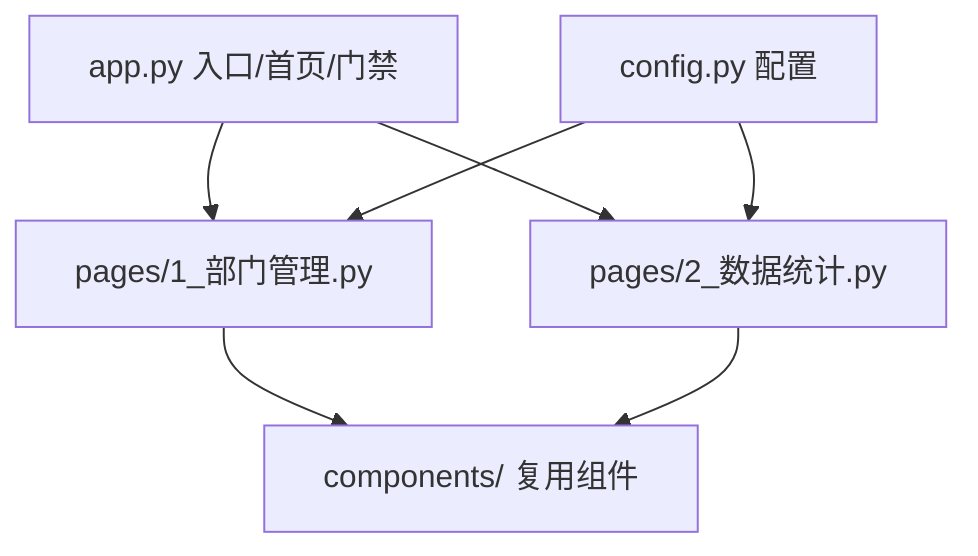

# 第 18 章 前端页面设计

> **节首信息条**｜对应课次 18 · 4 学时 · 实践｜前置：第 17 章的组件与表单；第 16 章的 session_state；基本的多页面概念｜章末有质量评价量表、AI 了解性侧栏与本章提示页

上一章搭好了一个部门管理页。但一个系统不会只有一个页面：部门、人员、统计，各自需要独立的入口。如果所有代码都堆在 `app.py` 里，页面会越来越长，导航要手写，改一个功能可能影响另一个页面。

本章从“一个页面”走到“一套页面”：用 `pages/` 目录组织多页面，让导航自动生成；给每个页面规划区域，让用户知道“我在哪、能查什么、能做什么”；再给子页面加一道登录守卫。今天只搭骨架，不接数据；结构先立住，细节后面再填。

## 本章学习目标

读完第 18 章并完成实训后，你应该能：

1. 按“每个位置只干一件事”组织项目目录，并说明 `pages/` 自动导航的规则。
2. 规划一个页面的区域：标题、筛选、操作、内容、反馈各放哪里。
3. 实现页面守卫（Page Guard），未登录用户不能直接进入管理页。
4. 用比例与自动堆叠实现响应式布局（Responsive Layout），并说明为什么不用绝对定位。
5. 按信息层级（Information Hierarchy）优化页面，并让导航命名可预测。

## 前置知识卡

| # | 已有知识 | 回看位置 |
| --- | --- | --- |
| 1 | 本章依赖的前置内容 | 第 17 章的组件与表单；第 16 章的 session_state；基本的多页面概念 |
| 2 | 上一章的核心结论 | 见上一章「本章小结」 |
| 3 | 本章实训/案例所需的环境与数据 | 见本章实训「二、课前准备」或章首导入 |

> 卡住时先回看，不必从头重读。

## 18.1 概念讲解

### 18.1.1 项目结构：每个位置只干一件事

**代码 18-1-1** · 示例（文本）

```text
duty_frontend/
├── app.py                  # 入口：首页 + 登录门禁
├── pages/
│   ├── 1_部门管理.py       # 子页面 1
│   └── 2_数据统计.py       # 子页面 2
├── components/
│   └── table.py            # 可复用表格/分页
├── config.py               # 后端地址、超时、分页大小
├── requirements.txt        # 依赖
└── .streamlit/
    └── config.toml         # 主题配置
```

| 位置 | 作用 | 谁负责 |
| --- | --- | --- |
| `app.py` | 入口、首页、登录门禁 | 每个项目一个 |
| `pages/` | 每个文件就是一个页面 | 按功能拆分 |
| `components/` | 跨页面复用的组件 | 第二次用到时再抽 |
| `config.py` | 配置集中管理 | 只改一处 |
| `requirements.txt` | 依赖清单 | 部署和换机时用 |

不要把页面代码全写进 `app.py`；不要每个页面各写一份后端地址；`components/` 不要提前造，出现重复再抽。



*图 18-1：前端项目的页面组织*

### 18.1.2 pages/ 与自动导航

`pages/` 下的每个 `.py` 文件自动成为一个页面；文件名前的数字决定顺序；去掉数字前缀后成为导航名称。不需要手写导航菜单。

**代码 18-1-4** · 示例代码（Python）

```python
# app.py
import streamlit as st

st.set_page_config(page_title="值班数据统计系统", page_icon="🗂️", layout="wide")
st.title("🗂️ 值班数据统计系统")
st.caption("请从左侧选择功能页面")
```

**代码 18-1-6** · 示例代码（Python）

```python
# pages/1_部门管理.py
import streamlit as st

st.set_page_config(page_title="部门管理", page_icon="🏢", layout="wide")
st.title("🏢 部门管理")
st.info("页面骨架：列表、搜索、新增尚未接入。")
```

三条规则：`st.set_page_config` 必须是页面里第一个 Streamlit 调用；文件名不要用空格和特殊符号；页码前缀用 `1_`、`2_`，不要用 `01-`，避免排序意外。

### 18.1.3 页面区域规划

一个管理页面通常分四个区域：标题区、筛选区、内容区、操作区。用户先看标题，知道“我在哪”；再看筛选，知道“能查什么”；然后看内容，知道“有什么”；最后看操作，知道“能做什么”。

**代码 18-1-8** · 示例（文本）

```text
部门管理页
┌────────────────────────────────────┐
│ 标题区：部门管理 + 一句话说明        │
├────────────────────────────────────┤
│ 筛选区：关键字 / 排序字段 / 排序方式  │
├────────────────────────────────────┤
│ 内容区：部门列表（表格 + 分页）       │
├────────────────────────────────────┤
│ 操作区：新增 / 编辑 / 删除            │
└────────────────────────────────────┘
```

同一类信息放在同一区域；操作区不要压在表格中间；筛选区不要和标题混在一起。页面地图（Page Map）先画在纸上，再写代码。

### 18.1.4 页面守卫

多页面带来一个新问题：用户可以直接输入地址进入子页面，绕过登录。解决办法是“每个页面进门先查证件”。

**代码 18-1-10** · 示例代码（Python）

```python
import streamlit as st

def require_login():
    """未登录时提示并停止渲染当前页面。"""
    if "access_token" not in st.session_state:
        st.warning("请先登录后再访问该页面")
        st.stop()
```

在每个子页面顶部调用 `require_login()`。`st.stop()` 会立即停止当前脚本，后面的内容不再渲染；守卫必须写在页面最上面，不能写在表格后面。

前端守卫只是“体验”，真正的权限仍由后端校验；守卫不能只写在首页，每个子页面都要写。本章只检查“有没有令牌”，令牌是否有效由接口验证。

### 18.1.5 响应式：比例加自动堆叠

**代码 18-1-12** · 示例代码（Python）

```python
left, right = st.columns([2, 1])
with left:
    st.info("主内容区")
with right:
    st.info("辅助区")
```

列比例 `[2, 1]` 表示主区占 2 份、辅区占 1 份；窗口变窄时列会自动堆叠，不需要写媒体查询；表格、图表用 `width="stretch"` 填满所在容器。Streamlit 做不到像素级响应式，只能做“比例 + 自动堆叠”。

### 18.1.6 信息层级与视觉优化

基础版与美化版的差别，通常不在“颜色好不好看”，而在信息层级是否清楚。基础版可能把标题、筛选、表格、操作挤在一起；美化版用容器分组、留白、字号与颜色区分主次，让用户一眼看到“当前任务”。

评价一个页面，可以看四件事：用户能否一眼知道自己在哪；筛选与内容是否分区；操作是否放在该出现的位置；窄屏时是否仍然可用。配色只服务这四件事，不为装饰而装饰。

### 18.1.7 导航命名与可预测性

导航名称用用户的语言，不用代码语言。写“部门管理”而不是 `dept_crud`；写“数据统计”而不是 `analytics2`。名称要能预测页面内容：点“数据统计”应该看到指标与图表，而不是一个空白页。

### 18.1.8 常见问题

| 现象 | 原因 |
| --- | --- |
| 页面报 `set_page_config` 错误 | 它不在脚本最前面 |
| 侧边栏没有新页面 | `pages/` 拼错，或文件不在该目录 |
| 导航顺序不对 | 文件名前缀数字不对 |
| 子页面没有守卫 | 忘记在页面顶部写检查 |
| 窄屏布局溢出 | 用了固定像素宽度，而不是比例列 |

## 18.2 示范例题

#### 例 18-1：搭一个部门管理页骨架【Bloom：应用】

**题目**：按“标题区、筛选区、内容区、操作区”搭一个部门管理页骨架，筛选区用三列，内容区与操作区先用占位提示。

**解**：

**代码 18-2-1** · 示例代码（Python）

```python
import streamlit as st

st.set_page_config(page_title="部门管理", page_icon="🏢", layout="wide")

st.title("🏢 部门管理")
st.caption("维护值班业务中的部门信息：查询、分页、新增、编辑与删除。")

with st.container(border=True):
    col1, col2, col3 = st.columns([2, 1, 1])
    with col1:
        st.text_input("部门名称", placeholder="输入关键字")
    with col2:
        st.selectbox("排序字段", ["dept_code", "full_name", "create_time"])
    with col3:
        st.selectbox("排序方式", ["desc", "asc"])

st.subheader("部门列表")
st.info("列表区域：接入后端后替换为真实数据。")

st.subheader("新增 / 编辑 / 删除")
st.info("操作区域：后续章节完成。")
```

四个区域按用户阅读顺序排列；筛选区用 `[2, 1, 1]` 分列；内容区与操作区分开，不把按钮塞进表格。

#### 例 18-2：对比基础版与美化版【Bloom：评价】

**题目**：基础版把标题、搜索框、表格、新增按钮从上到下紧挨着放；美化版把筛选放进带边框的容器，表格单独成区，操作放在表格下方。请从信息层级、可预测性、窄屏可用性三个维度评价两版，并说明美化版是否真的更好。

**解**：

1. **信息层级**：基础版所有元素权重相近，用户视线没有落点；美化版用容器与留白把“筛选—内容—操作”分开，主次更清楚。
2. **可预测性**：基础版按钮紧挨表格，用户可能误以为按钮只作用于当前行；美化版把操作区放在表格下方并加小标题，含义更明确。
3. **窄屏可用性**：基础版一列到底，窄屏仍可用但很长；美化版若用比例列，窄屏会自动堆叠，仍可用；若用固定像素宽度，则可能溢出。
4. 结论：美化版在信息层级与可预测性上更好，但前提是窄屏仍能堆叠；如果美化引入了固定宽度或过多颜色，反而降低可用性。评价应看“用户是否更快完成当前任务”，而不是“看起来更花哨”。

## 18.3 引导练习

#### 例 18-3（引导练习）：把操作区移到表格下方【Bloom：应用】

**题目**：某页面把“新增/编辑/删除”按钮放在筛选区与表格之间。请把它移到表格下方，并说明移动后信息层级发生了什么变化。

#### 例 18-4（引导练习）：调整筛选区的信息层级【Bloom：应用】

**题目**：筛选区有三项：关键字、排序字段、排序方式。请用列比例让关键字更宽，并说明为什么关键字应该占更宽的位置。

## 18.4 独立习题

#### 习题 18-1【Bloom：应用】

**题目**：搭一个“人员管理”页骨架：标题区、筛选区（姓名、部门）、内容区、操作区；筛选区用三列；内容区与操作区用占位提示。说明每个区域放什么。

#### 习题 18-2【Bloom：应用】

**题目**：现有页面文件 `2_数据统计.py`、`1_部门管理.py`，还有一个未编号的 `人员管理.py`。请说明侧边栏的显示顺序，并给出把顺序调整为“部门管理、人员管理、数据统计”的命名方案。

#### 习题 18-3【Bloom：分析】

**题目**：某多页面应用（Multi-page App）出现三个问题：用户直接输入子页面地址可以绕过登录；新增按钮夹在筛选区与表格之间；窄屏时表格溢出。请分别分析原因并给出修正方法。

#### 习题 18-4【Bloom：评价】（开放题）

**题目**：下面两种部门页布局，你更推荐哪一种？请从信息层级、可预测性、窄屏可用性三个维度说明理由。

- 布局 A：标题、搜索框、表格、新增按钮从上到下紧挨着放。
- 布局 B：标题区、带边框的筛选区、表格区、独立操作区，筛选区用 `[2, 1, 1]` 分列。

## ◆ 实训 18-1：前端页面设计（对应课次 18 · 4 学时）

### 一、任务目标与验收

| 目标 | 验收标志 |
| --- | --- |
| 目录结构清楚 | 入口、页面、组件、工具各就各位 |
| 导航可用 | `pages/` 页面能被自动发现 |
| 守卫生效 | 未登录访问管理页被拦截 |
| 布局响应式 | 窄屏下自动堆叠 |
| 导航命名一致 | 名称能预测页面内容 |

### 二、课前准备

- 第 17 章的可用页面
- 至少两个角色的测试账号
- 一份页面区域（Page Region）草图

### 三、操作步骤

1. **整理目录**
   - 做什么：整理目录
   - 操作：`把入口、页面、组件、工具分目录`
   - 预期输出：→ 每个文件只承担一件事
   - 做错会看到什么：所有代码堆在入口文件；按职责拆分
2. **规划区域**
   - 做什么：规划区域
   - 操作：`在纸上画出五个区域及优先级`
   - 预期输出：→ 主操作在首屏可见
   - 做错会看到什么：区域过多；合并次要信息或移到次级页
3. **加页面守卫**
   - 做什么：加页面守卫
   - 操作：`在管理页入口检查登录态与角色`
   - 预期输出：→ 未登录被拦截并提示
   - 做错会看到什么：只在按钮上隐藏；守卫必须放在页面入口
4. **响应式与命名**
   - 做什么：响应式与命名
   - 操作：`用比例列与自动堆叠改造，统一导航命名`
   - 预期输出：→ 窄屏可用、名称可预测
   - 做错会看到什么：绝对定位导致错位；改用容器与列

### 四、排错清单

| 现象 | 先查什么 |
| --- | --- |
| 页面 404 | 文件是否在 `pages/`、命名是否正确 |
| 守卫被绕过 | 检查是否只在前端隐藏按钮 |
| 窄屏错位 | 绝对定位或固定宽度 |
| 导航名难懂 | 用“对象+动作”命名，避免缩写 |

### 五、提交与验收

提交页面目录与两种屏幕宽度的截图；验收按“结构”“守卫”“布局与命名”三项判定。

### 六、课后扩展

- 给页面加面包屑或标题层级
- 把可复用区域抽成组件
- 写一份页面区域规划说明

### 七、回链

- 第 16 章 16.1.7–16.1.8；第 17 章组件；本章 18.1.1–18.1.7

## 本章小结

**核心结论**：

1. 前端项目按职责分目录：`app.py` 入口与门禁、`pages/` 页面、`components/` 复用组件、`config.py` 配置、`requirements.txt` 依赖。
2. `pages/` 下每个 `.py` 文件自动成为页面，文件名数字决定顺序，去掉前缀成为导航名。
3. 页面按“标题—筛选—内容—操作”分区，先画页面地图再写代码；操作区不要夹在筛选与内容之间。
4. 每个子页面顶部加登录守卫；`st.stop()` 停止渲染；前端守卫只是体验，真正权限在后端。
5. 响应式用比例列与 `width="stretch"`，窄屏自动堆叠；评价页面看信息层级与任务效率，不看装饰。

**学完本章，你可以体会到**：页面设计的第一原则是“让用户知道自己在哪、下一步做什么”，美观是第二位的。
**自检**：回到章首的学习目标，逐条问自己做到了没有——

- [ ] 按“每个位置只干一件事”组织项目目录，并说明 `pages/` 自动导航的规则。 → 回看 18.1.1–18.1.2，自测：习题 18-1
- [ ] 规划一个页面的区域：标题、筛选、操作、内容、反馈各放哪里。 → 回看 18.1.3，自测：习题 18-1
- [ ] 实现页面守卫，未登录用户不能直接进入管理页。 → 回看 18.1.4，自测：习题 18-1
- [ ] 用比例与自动堆叠实现响应式布局，并说明为什么不用绝对定位。 → 回看 18.1.5，自测：习题 18-1
- [ ] 按信息层级优化页面，并让导航命名可预测。 → 回看 18.1.6–18.1.7，自测：习题 18-1

**下一章预告**：页面骨架立住了，下一步把假数据换成真实接口。下一章用 `requests` 封装 API 客户端，完成登录、取数与错误处理。

## 换场景总表

| 本章场景 | 换成其他场景 |
| --- | --- |
| Streamlit 多页面 | 换成 Vue Router/React Router，目录与守卫思想不变 |
| 管理页守卫 | 换成按角色显示菜单与接口双重校验，后端校验不可省 |
| 比例布局 | 换成栅格系统，响应式目标相同 |

## 章末质量评价量表（本实训）

| 维度 | 分档描述 | 权重 |
| --- | --- | ---: |
| 结构 | 目录与职责清楚 | 25% |
| 导航与守卫 | 自动导航、权限拦截正确 | 30% |
| 布局 | 响应式、信息层级合理 | 25% |
| 命名 | 导航名称可预测 | 20% |
| **合计** | | **100%** |

评价方式：自评 30% + 互评 30% + 师评 40%。

**一票否决**：涉密信息未脱敏、安全漏洞不处理、提交记录造假——出现任一项，本实训记不通过。

## AI 侧栏（了解即可）

> AI 常把所有页面写进一个文件，或只在按钮上做权限隐藏。审查时先看目录拆分，再确认页面入口是否有守卫。

## 本章提示页

> 先自己做，卡住了再看。提示按“方向 → 关键步骤 → 完整解答”排列。

**例 18-3（引导练习）：把操作区移到表格下方【Bloom：应用】**

**提示 1（方向）**

按“标题—筛选—内容—操作”的顺序重排；操作区只保留与表格相关的动作。

**提示 2（关键步骤）**

先渲染表格的 `st.subheader` 与内容，再渲染操作区的 `st.subheader` 与按钮。

**完整解答**

**代码 18-4-1** · 示例代码（Python）

```python
st.subheader("部门列表")
# 表格或占位
st.info("列表区域")

st.subheader("新增 / 编辑 / 删除")
col1, col2, col3 = st.columns(3)
with col1:
    st.button("新增")
with col2:
    st.button("编辑")
with col3:
    st.button("删除")
```

移动后，用户先看到数据，再决定操作；按钮不再夹在筛选与内容之间，页面阅读顺序与任务顺序一致。

**例 18-4（引导练习）：调整筛选区的信息层级【Bloom：应用】**

**提示 1（方向）**

关键字是主要筛选条件，排序是次要条件；列比例应反映使用频率。

**提示 2（关键步骤）**

用 `st.columns([2, 1, 1])`，关键字放在第一列。

**完整解答**

**代码 18-4-3** · 示例代码（Python）

```python
col1, col2, col3 = st.columns([2, 1, 1])
with col1:
    st.text_input("部门名称", placeholder="输入关键字")
with col2:
    st.selectbox("排序字段", ["dept_code", "full_name"])
with col3:
    st.selectbox("排序方式", ["desc", "asc"])
```

关键字是用户最常用的筛选条件，输入框需要更宽以显示完整内容；排序是次要操作，下拉框窄一些即可。列比例反映使用频率，而不是平均分配。