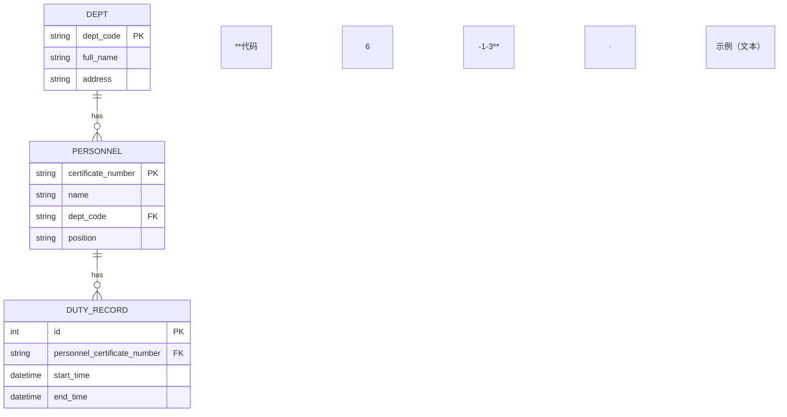

# 第 6 章 软件设计与建模

> **节首信息条**｜对应课次 5 · 2 学时 · 理论讲授｜前置：第 3 章的需求文档；第 4 章的接口四要素与 RESTful｜章末有评价要点与自评、AI 了解性侧栏与本章提示页

上一章学会了一个接口怎么调用。但一个系统不会只有一个接口：部门、人员、值班记录，每个模块都有一组接口，接口背后又对应一张或几张表（Table）。如果直接开写，最先出问题的往往不是代码语法，而是“部门表少了一个负责人字段”“人员表和值班记录表对不上”“接口参数和页面字段不一致”，然后表要改、代码要改、页面要改、测试要重做。

所以写代码之前，先想清楚两件事：表怎么建，接口怎么定。本章用一个贯穿的例子——部门、人员、值班记录——把需求文档里的功能细化成表结构、模块划分（Module Decomposition）和接口清单。

## 本章学习目标

读完第 6 章，你应该能：

1. 说明设计文档（Design Document）“施工图”的作用，以及它需要回答的两个问题：数据怎么存、接口怎么调。
2. 为一个业务对象设计表结构，正确使用主键（Primary Key）、外键（Foreign Key）并说明一对多（One-to-Many）关系。
3. 按业务能力划分模块，并用一句话说清每个模块的职责。
4. 为一个 CRUD 模块写出五个标准接口的方法、URL、参数来源与成功状态码。
5. 画出 controller / service / crud / model 四层调用关系，并说明设计与契约的一致性。

## 前置知识卡

| # | 已有知识 | 回看位置 |
| --- | --- | --- |
| 1 | 本章依赖的前置内容 | 第 3 章的需求文档；第 4 章的接口四要素与 RESTful |
| 2 | 上一章的核心结论 | 见上一章「本章小结」 |
| 3 | 本章实训/案例所需的环境与数据 | 见本章实训「二、课前准备」或章首导入 |

> 卡住时先回看，不必从头重读。

## 6.1 概念讲解

### 6.1.1 设计是施工图，不是额外文档

设计文档的作用，是让另一个人能照着建表、照着写接口、照着做页面。它不需要长，但必须写清两件事：数据怎么存，接口怎么调。

先设计再写代码，解决的是一类具体问题：改动成本。字段在编码前补，只需要改一张表；上线后再补，可能牵动接口、页面、历史数据和测试。设计阶段多花半小时，常常能省掉后面几天返工。

### 6.1.2 表、主键、外键与一对多

关系数据库用“表”存一类数据。表里的每一行是一条记录，每一列是一个字段。为了区分记录，需要一个能唯一代表这一行的字段，叫主键。为了表达两张表之间的关系，需要在一个表里存放另一个表的主键，叫外键。

用生活例子理解：学生名单是一张表，学号是主键；学生表里再放一个“班级编号”，这个编号指向班级表的主键，它就是外键。

“一对多”是最常用的关系。一个部门可以有多个人员，但一个人员只属于一个部门；一个人员可以有多条值班记录，但一条值班记录只属于一个人员。外键放在“多”的一方：人员表放部门编号，值班记录表放人员证件号。这样每条“多”的记录只存一个“一”的编号，不会在部门表里重复存一串人员。

> 💡 **常见坑**：把外键放反。若在部门表里存“人员证件号列表”，一个部门有多个人时就要在一行里塞多个值，既难查询也难约束。外键应放在“多”的一方。

### 6.1.3 从需求到模块

模块按业务能力划分，不按页面划分。需求文档里的功能清单通常已经按业务域分组：登录与账号、部门、人员、工位、值班、查班、统计。每个业务域大体对应一个模块，用一句话说清职责。

| 需求（功能簇） | 业务对象 | 模块 | 一句话职责 |
| --- | --- | --- | --- |
| 管理部门信息 | 部门 | `dept` | 维护部门基本信息 |
| 管理人员信息 | 人员 | `personnel` | 维护人员及其所属部门 |
| 记录谁在什么时间值班 | 值班记录 | `duty_record` | 记录与查询值班安排 |
| 统计值班次数与时段分布 | 统计结果 | `analytics` | 按条件汇总值班数据 |

模块划分要回答两个问题：这个模块负责哪类业务对象？它对外提供哪些操作？如果一句话说不清，通常说明模块装得太多，或者边界还没想明白。

### 6.1.4 一个模块的接口组

一个典型的 CRUD 模块，接口组通常是五个动作：查询列表、查询单个、新增、修改、删除。每个动作再确定四件事：方法、URL、参数来源、返回。

| 方法 | URL | 动作 | 参数来源 | 返回 | 成功状态码 |
| --- | --- | --- | --- | --- | --- |
| GET | `/departments` | 查列表 | 查询参数：`page`、`page_size` | 部门列表 | 200 |
| GET | `/departments/{dept_code}` | 查一个 | 路径参数：`dept_code` | 一个部门 | 200 |
| POST | `/departments` | 新增 | 请求体：部门信息 | 新增后的部门 | 201 |
| PUT | `/departments/{dept_code}` | 修改 | 路径参数 + 请求体 | 修改后的部门 | 200 |
| DELETE | `/departments/{dept_code}` | 删除 | 路径参数：`dept_code` | 成功消息 | 204 |

参数来源的选择有一条简单判据：定位“某一个”资源用路径参数；筛选、分页、排序用查询参数；新增或修改要提交的字段放请求体。把这三类混在一起，接口会变得难读，前端也容易传错位置。

### 6.1.5 分层：四个文件夹各干一件事

为了让表结构、业务规则和接口处理互不缠绕，后端通常分成四层。初学阶段不必背架构名词，先记住“四个文件夹，各干一件事”。

| 层 | 职责 | 典型问题 |
| --- | --- | --- |
| controller | 接收请求、取出参数、返回响应 | 这个请求该由谁处理？ |
| service | 写业务规则、组合多个操作 | 部门编码重复要不要拒绝？ |
| crud | 直接读写数据库 | 按条件查询部门表 |
| model | 定义表结构与字段 | 部门表有哪些列？ |

分层的好处是改动可控：换数据库主要动 crud，改业务规则主要动 service，改接口形式主要动 controller。如果所有逻辑都堆在 controller 里，任何一个变化都会牵动整个文件。

### 6.1.6 设计文档：表结构加接口清单

一份够用的模块设计文档通常只有两节：表结构和接口清单。下面是部门模块的示例。

**代码 6-1-1** · 示例（文本）

```markdown
# 部门模块设计

## 1. 表结构
| 字段 | 类型 | 说明 |
| --- | --- | --- |
| dept_code | 文本 | 主键 |
| full_name | 文本 | 部门名称 |
| address | 文本 | 地址 |

## 2. 接口清单
| 方法 | URL | 参数 | 返回 |
| --- | --- | --- | --- |
| GET | /departments | page, page_size | 部门列表 |
| GET | /departments/{dept_code} | dept_code | 一个部门 |
| POST | /departments | 部门信息 | 新增结果 |
| PUT | /departments/{dept_code} | dept_code + 部门信息 | 修改结果 |
| DELETE | /departments/{dept_code} | dept_code | 成功消息 |
**代码 6-1-2** · 示例（文本）

```

设计文档的合格标准不是篇幅，而是“别人能照着做”：字段名、类型、主键外键清楚；接口的方法、URL、参数来源、返回结构清楚；表字段与接口返回能对应上。

### 6.1.7 三张表的关系图

把部门、人员、值班记录放在一起，关系可以画成下图。



*图 6-1：部门—人员—值班记录的一对多关系*

读图时看三件事：主键（PK）在哪一列；外键（FK）指向哪张表；连线两端是“一”还是“多”。部门与人员是一对多，人员与值班记录也是一对多；外键分别放在人员表和值班记录表，也就是“多”的一方。

### 6.1.8 设计与契约的一致性

设计文档不是写完就锁进抽屉。表字段改了，接口返回要跟着改；接口参数改了，前端调用要跟着改；页面展示的字段，必须能在接口返回里找到。三者对不上，联调时就会反复出现“字段不存在”“参数位置不对”“列表少一列”。

因此，设计阶段至少要检查三组对应：表字段与接口返回字段对应；接口参数与页面输入对应；模块职责与需求功能簇对应。这三组对应，就是后面编码、测试和验收的共同依据。

## 6.2 示范例题

#### 例 6-1：指出三张表的主键、外键与关系【Bloom：理解】

**题目**：下面是部门、人员、值班记录三张表的字段。请指出每张表的主键与外键，说明“部门—人员”“人员—值班记录”分别是什么关系，并解释外键为什么放在“多”的一方。

- 部门：`dept_code`、`full_name`、`address`
- 人员：`certificate_number`、`name`、`dept_code`、`position`
- 值班记录：`id`、`personnel_certificate_number`、`start_time`、`end_time`

**解**：

1. 部门表的主键是 `dept_code`；`full_name`、`address` 是普通字段，没有外键。
2. 人员表的主键是 `certificate_number`；外键是 `dept_code`，指向部门表的主键。
3. 值班记录表的主键是 `id`；外键是 `personnel_certificate_number`，指向人员表的主键。
4. 部门与人员是一对多：一个部门有多名人员，一名人员只属于一个部门。
5. 人员与值班记录是一对多：一名人员有多条值班记录，一条值班记录只属于一名人员。
6. 外键放在“多”的一方，是因为每条人员记录只需要保存一个部门编号，每条值班记录只需要保存一个人员编号；若把人员编号列表放进部门表，一行要存多个值，既难查询也难约束。

#### 例 6-2：从需求画出三张表【Bloom：应用】

**题目**：需求是“值班管理员要按部门查询人员，并记录每人的值班时间”。请画出部门、人员、值班记录三张表的字段与关系，标出主键与外键。

**解**：

先找业务对象：部门、人员、值班记录。再给每个对象列字段，最后确定关系。

| 表 | 字段 | 主键/外键 |
| --- | --- | --- |
| 部门 | `dept_code`、`full_name`、`address` | `dept_code` 主键 |
| 人员 | `certificate_number`、`name`、`dept_code`、`position` | `certificate_number` 主键；`dept_code` 外键 |
| 值班记录 | `id`、`personnel_certificate_number`、`start_time`、`end_time` | `id` 主键；`personnel_certificate_number` 外键 |

关系：部门 1—N 人员；人员 1—N 值班记录。理由是“按部门查询人员”要求人员能关联到部门；“记录每人的值班时间”要求值班记录能关联到人员。

## 6.3 引导练习

#### 例 6-3（引导练习）：补全“工位”表【Bloom：应用】

**题目**：系统要增加“工位”管理：一个部门有多个工位，一条值班记录发生在一个工位上。请补全工位表的字段（至少包含主键、外键和两个业务字段），并说明工位与部门、值班记录的关系。

#### 例 6-4（引导练习）：为“部门”设计接口组【Bloom：应用】

**题目**：为部门模块设计 5 个接口，写出每个接口的方法、URL、参数来源、返回内容与成功状态码。

## 6.4 独立习题

#### 习题 6-1【Bloom：应用】

**题目**：为“器材借还”设计两张表：器材表与借用记录表。器材表至少包含器材编号、名称、类别、状态、存放位置；借用记录表至少包含记录编号、器材编号、借用人、借出时间、归还时间。请标出主键与外键，并说明两张表的关系。

#### 习题 6-2【Bloom：应用】

**题目**：为器材模块的“新增器材”和“查询器材列表”两个接口，写出请求字段与响应字段，并说明每个字段来自哪张表。

#### 习题 6-3【Bloom：分析】

**题目**：某值班记录表同时保存了 `personnel_certificate_number`、`personnel_name`、`dept_name`、`workstation_name`。请指出这种设计可能导致的问题，并给出修正方案。

#### 习题 6-4【Bloom：创造】（开放题）

**题目**：单位要新增“培训管理”：记录培训计划、参训人员与培训结果。请设计模块划分：列出至少两个模块、每个模块的一句话职责、涉及的表及其关系，并为其中一个模块列出 5 个接口的方法与 URL。

#### 习题 6-5【Bloom：理解】（原理解释）

**题目**：为什么外键要放在“多”的一方？如果把人员编号列表塞进部门表，会带来哪些查询与更新问题？

## ◇ 课堂活动块（课次 5 · 理论讲授）

**听讲要点**：

1. 设计是施工图，不是额外文档。
2. 表结构先定主键、外键与关系。
3. 模块按业务能力划分，不按页面划分。
4. CRUD 五接口组的四要素要写全。
5. 分层让改动有边界，设计与契约必须对得上。

**讨论·演示**：

1. （讨论）把“按页面分模块”与“按业务对象分模块”各画一次，比较后续改动的牵连范围。
2. （演示）从需求文档的一条功能，推到表字段、接口四要素与四层调用链。

**课后自测**：完成独立习题 6-1 与 6-3，作为课次 5 的书面检查。

**回链**：本章目标与习题逐条对应，见章末「本章小结与自检」。

## 本章小结

**核心结论**：

1. 设计文档是施工图：写清表怎么建、接口怎么定，目的是让改动发生在成本最低的阶段。
2. 表用主键唯一标识记录，用外键表达关系；一对多关系的外键放在“多”的一方。
3. 模块按业务能力划分，不按页面划分；每个模块用一句话说清职责。
4. 一个 CRUD 模块通常有查询列表、查询单个、新增、修改、删除五个接口；定位用路径参数，筛选用查询参数，提交用请求体。
5. 分层让改动可控：controller 接请求、service 写规则、crud 读写库、model 定义表结构；设计文档要与表、接口、页面三组对应。

**学完本章，你可以体会到**：设计文档把“大家脑子里各有一套”变成“一张能照着建表、照着写接口的图”，后面返工少一半。
**自检**：回到章首的学习目标，逐条问自己做到了没有——

- [ ] 说明设计文档“施工图”的作用，以及它需要回答的两个问题：数据怎么存、接口怎么调。 → 回看 6.1.1，自测：习题 6-1
- [ ] 为一个业务对象设计表结构，正确使用主键、外键并说明一对多关系。 → 回看 6.1.2，自测：习题 6-1
- [ ] 按业务能力划分模块，并用一句话说清每个模块的职责。 → 回看 6.1.3，自测：习题 6-1
- [ ] 为一个 CRUD 模块写出五个标准接口的方法、URL、参数来源与成功状态码。 → 回看 6.1.4，自测：习题 6-1
- [ ] 画出 controller / service / crud / model 四层调用关系，并说明设计与契约的一致性。 → 回看 6.1.5 与 6.1.8，自测：习题 6-1

**下一章预告**：设计文档写好了，下一步是把它变成可以运行的项目。下一章从零初始化一个 FastAPI 项目，并用 Git 记录每一步演进。

## 换场景总表

| 本章场景 | 换成其他场景 |
| --- | --- |
| 部门/人员/值班记录三张表 | 换成课程/教师/选课三张表，主外键规则不变 |
| CRUD 五接口组 | 换成订单、图书、设备，方法、URL、参数来源的判据不变 |
| 四层目录 | 换成其他后端框架，职责边界仍可按四层理解 |

## 章末评价要点（自评）

| 评价维度 | 达标标志 | 权重 |
| --- | --- | ---: |
| 表结构设计 | 主键、外键、关系正确 | 30% |
| 模块划分 | 职责一句话说清、边界合理 | 25% |
| 接口设计 | 五接口组四要素齐全 | 25% |
| 分层与一致性 | 四层关系与契约一致 | 20% |
| **合计** | | **100%** |

自评后对照本章习题与自检清单，标出未达标项并回看对应小节。

## AI 侧栏（了解即可）

> AI 能根据一段需求直接生成表结构和接口清单，但常把关联字段放错方向、把业务规则塞进 controller。拿到方案后，用“外键放在多的一方”“规则留在 service”两条判据复查。

## 本章提示页

> 先自己做，卡住了再看。提示按“方向 → 关键步骤 → 完整解答”排列。

**例 6-3（引导练习）：补全“工位”表【Bloom：应用】**

**提示 1（方向）**

先问：工位属于哪个部门？一条值班记录在哪个工位？外键放在“多”的一方。

**提示 2（关键步骤）**

工位表放 `dept_code` 指向部门；值班记录表增加 `workstation_id` 指向工位。

**完整解答**

工位表字段：`workstation_id`（主键）、`workstation_name`（名称）、`dept_code`（外键，指向部门）、`location`（位置）。

关系：部门 1—N 工位；工位 1—N 值班记录。值班记录表增加 `workstation_id` 外键，指向工位表。

**例 6-4（引导练习）：为“部门”设计接口组【Bloom：应用】**

**提示 1（方向）**

五个动作是查询列表、查询单个、新增、修改、删除；方法分别是 GET、GET、POST、PUT、DELETE。

**提示 2（关键步骤）**

定位单个部门用路径参数 `dept_code`；分页用查询参数；新增和修改的字段放请求体。

**完整解答**

| 方法 | URL | 参数来源 | 返回 | 状态码 |
| --- | --- | --- | --- | --- |
| GET | `/departments` | 查询参数：`page`、`page_size` | 部门列表与总数 | 200 |
| GET | `/departments/{dept_code}` | 路径参数：`dept_code` | 一个部门 | 200 |
| POST | `/departments` | 请求体：部门信息 | 新增后的部门 | 201 |
| PUT | `/departments/{dept_code}` | 路径参数 + 请求体 | 修改后的部门 | 200 |
| DELETE | `/departments/{dept_code}` | 路径参数：`dept_code` | 成功消息 | 204 |