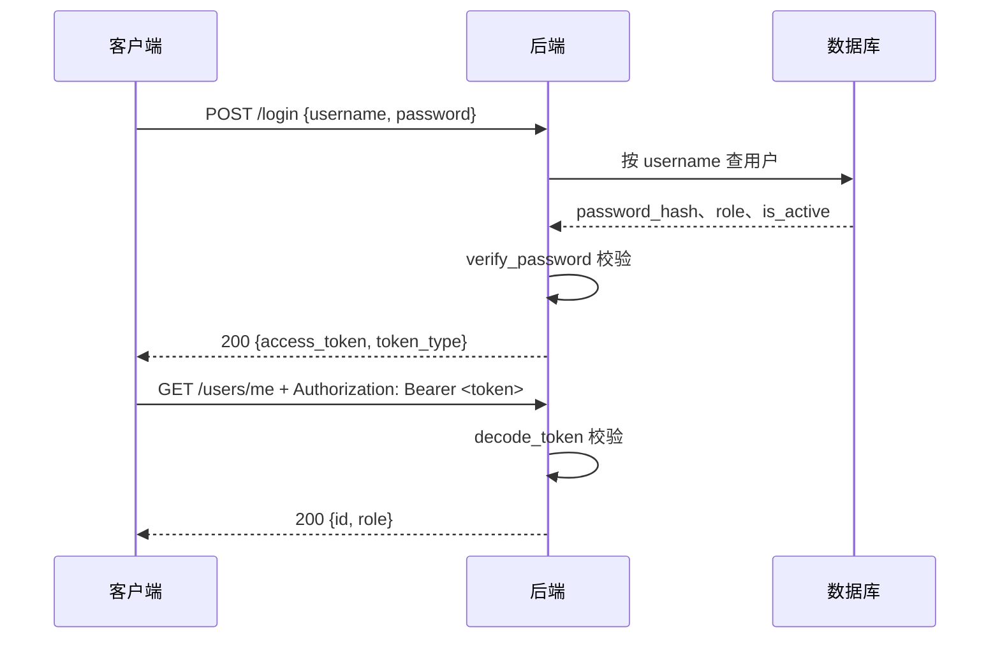

# 第 8 章 用户模块：登录认证

> **节首信息条**｜对应课次 7 · 用户模块：登录认证（4 学时 · 实践）｜前置：第 7 章《项目初始化与版本控制》搭好的项目骨架；第 5 章补课卡 K-04（Pydantic）、K-05（HTTPException）、K-06（Depends）｜本课次的动手任务见「实训 8-1」，章末有质量评价量表

上一章搭好了项目骨架，服务能启动、`/health` 能返回。但骨架对所有人一视同仁：谁都能调用。真实系统必须先回答两个问题：你是谁？你能做什么？

第一个问题叫认证，第二个问题叫授权。本章先解决认证：创建用户、登录、签发令牌，再让受保护接口从令牌里认出当前用户。JWT 的内部结构不需要掌握，把它当作一张带签名的“通行证”即可——它是怎么签出来的，8.1.6 会给出完整实现，第 5 章 5.8 的回链表里也有它的位置。

## 本章学习目标

读完第 8 章并完成实训后，你应该能：

1. 说出认证与授权的区别，并分别对应 401 与 403 两种状态码。
2. 解释用户表四个核心字段的作用，说明密码为什么只存哈希、不存明文。
3. 实现注册、登录与 `/me` 受保护接口，让 `create_access_token`、`get_current_user` 每个符号都有定义或明确出处。
4. 用 `Depends` 挂载认证依赖与权限依赖，演示 401、403 在不同场景下的返回。
5. 按实训 8-1 完成用户模块并提交，用章末量表完成自评。

## 前置知识卡

| # | 你需要会 | 不会就回看 |
| --- | --- | --- |
| 1 | `APIRouter` 与 `include_router` 的创建—挂载链路 | 第 5 章 5.3（补课卡 K-03） |
| 2 | Pydantic 输入/输出模型与 422 的来源 | 第 5 章 5.4（补课卡 K-04） |
| 3 | `Depends` 把公共逻辑抽成参数 | 第 5 章 5.6（补课卡 K-06） |
| 4 | 401 / 403 / 404 / 422 的分工 | 第 4 章 4.1.6 |
| 5 | 项目骨架的目录结构与启动方式 | 第 7 章项目初始化与版本控制 |

## 8.1 概念讲解

### 8.1.1 认证与授权：两个不同的问题

认证回答“你是谁”，授权回答“你能做什么”。登录成功后，系统知道了你的身份；访问管理员接口被拒绝，是授权问题，不是认证问题。

这两个问题对应不同的状态码：401 表示身份没有被确认（没登录、令牌无效或过期），403 表示身份已确认但权限不足。把它们混用，前端就不知道该跳登录页还是提示“无权限”。这也是本章反复强调“401 与 403 要分清”的原因。

### 8.1.2 用户表：四个核心字段

用户表至少要有四个核心字段：

| 字段 | 作用 |
| --- | --- |
| `username` | 用户名，唯一，不能重复 |
| `password_hash` | 密码的哈希值，不是明文 |
| `role` | 角色，决定权限，如 `admin`、`normal` |
| `is_active` | 是否启用，决定能不能登录 |

`username` 加唯一约束，防止出现两个同名账号；`role` 是授权判断的依据；`is_active` 让管理员可以停用账号而不删除历史数据。主键 `id` 用于在令牌里标识用户。表的创建方式在第 7 章的数据库初始化里已经完成，本章直接使用。

### 8.1.3 密码只存哈希

数据库里绝不能存明文密码。存明文的风险很直接：一旦数据库泄露，所有人的密码都会暴露；而很多人会在多个系统复用同一个密码，影响会扩散到其他系统。

正确做法是存哈希：用户注册时，用哈希函数把密码变成一串不可逆的值；登录时，用同样的函数处理用户输入，再与数据库中的哈希比对。哈希不是加密，不能“解密”回原密码，只能验证“输入是否与原来一致”。

**代码 8-1-1** · `app/core/security.py`（密码哈希，Python）

```python
from passlib.context import CryptContext

pwd_context = CryptContext(schemes=["pbkdf2_sha256"], deprecated="auto")

def get_password_hash(password: str) -> str:
    return pwd_context.hash(password)

def verify_password(plain_password: str, hashed_password: str) -> bool:
    return pwd_context.verify(plain_password, hashed_password)
```

`get_password_hash("secret123")` 每次生成的字符串都不同，因为哈希里带了随机盐；但 `verify_password("secret123", 哈希)` 会返回 `True`，输入错误密码则返回 `False`。这正是“不可逆但可验证”的含义。

### 8.1.4 输入与输出模型：按第 5 章的规则办

第 5 章 5.4 讲过 Pydantic 的规则，这里直接用进用户模块。输入模型负责校验，输出模型负责控制返回哪些字段：

**代码 8-1-2** · `app/schemas/user.py`（用户输入模型，Python）

```python
from pydantic import BaseModel, Field

class UserCreate(BaseModel):
    username: str = Field(..., min_length=3, max_length=100)
    password: str = Field(..., min_length=6, max_length=50)
    role: str = "normal"
```

`...` 表示必填；`min_length`、`max_length` 是约束；`role` 有默认值，不传时取 `normal`。当请求不满足这些约束时，FastAPI 在进入函数之前就返回 422，并在响应体里列出每个字段的错误类型。例如用户名只有 2 个字符、密码只有 3 个字符，会得到两条 `string_too_short`。

输入与输出必须分开。用户表里有 `password_hash`，但响应绝不能把它返回。正确做法是定义 `UserOut`，只包含 `id`、`username`、`role`、`is_active` 等可公开字段，接口声明 `response_model=UserOut`，多出的字段会被自动滤掉（机制见第 5 章 5.5）。

> 💡 **常见坑**：直接把 ORM 对象整个返回，结果把 `password_hash` 一起吐给前端。输出模型要显式列出允许返回的字段。

### 8.1.5 登录流程

登录做四件事：按用户名查用户；校验密码；检查账号是否启用；签发令牌。

**代码 8-1-3** · `app/routers/users.py`（登录逻辑，Python）

```python
def login(db, username: str, password: str):
    user = db.query(User).filter(User.username == username).first()
    if not user or not verify_password(password, user.password_hash):
        raise HTTPException(status_code=401, detail="用户名或密码错误")
    if not user.is_active:
        raise HTTPException(status_code=401, detail="账号已禁用")

    token = create_access_token({"sub": str(user.id), "role": user.role})
    return {"access_token": token, "token_type": "bearer"}
```

错误提示统一写“用户名或密码错误”，不要区分“用户不存在”和“密码错误”。如果提示能区分，攻击者就能借登录接口枚举哪些用户名存在。



*图 8-1：登录与携带令牌访问受保护接口*

### 8.1.6 令牌与 create_access_token：完整实现

登录成功后，服务器签发一个 JWT 令牌。令牌里通常放三类信息：用户标识（`sub`）、角色（`role`）和过期时间（`exp`）。客户端保存令牌，之后每次请求把它放进请求头：

```text
Authorization: Bearer <token>
```

`create_access_token` 的完整实现如下——它是本章实战代码里第一个“先在别处出现、这里才给定义”的函数，从现在起它有了明确出处：

**代码 8-1-4** · `app/core/security.py`（令牌签发与解析，完整实现，Python）

```python
from datetime import datetime, timedelta, timezone
from typing import Optional

from jose import jwt, JWTError

SECRET_KEY = "change-me-in-env"   # 真实项目放环境变量，见 8.1.9
ALGORITHM = "HS256"
ACCESS_TOKEN_EXPIRE_MINUTES = 30


def create_access_token(data: dict) -> str:
    to_encode = data.copy()
    expire = datetime.now(timezone.utc) + timedelta(minutes=ACCESS_TOKEN_EXPIRE_MINUTES)
    to_encode.update({"exp": expire})
    return jwt.encode(to_encode, SECRET_KEY, algorithm=ALGORITHM)


def decode_token(token: str) -> Optional[dict]:
    try:
        return jwt.decode(token, SECRET_KEY, algorithms=[ALGORITHM])
    except JWTError:
        return None
```

签发：把用户标识与角色放进载荷，加上过期时间 `exp`，用 `SECRET_KEY` 和 `ALGORITHM` 签名。解析：`jwt.decode` 会同时校验签名与过期时间，任何一项不对都抛 `JWTError`，这里转成 `None` 交给调用方处理。`Optional[dict]` 的含义见第 5 章补课卡 K-08。

令牌不是加密的，只是签名防篡改。任何拿到令牌的人都能读出载荷内容，所以载荷里不能放密码、身份证号等敏感信息。令牌也要当作密码一样保管：不要写进日志、不要提交到 Git、不要放在 URL 查询参数里。

### 8.1.7 用依赖注入保护接口

FastAPI 的 `Depends` 可以把“解析令牌、确认当前用户”抽成一个依赖，受保护接口只要声明它，就会自动执行校验（机制见第 5 章 5.6）。

**代码 8-1-5** · `app/core/dependencies.py`（认证依赖，Python）

```python
from fastapi import Depends, HTTPException
from fastapi.security import OAuth2PasswordBearer

from app.core.security import decode_token

oauth2_scheme = OAuth2PasswordBearer(tokenUrl="/api/v1/login")

def get_current_user(token: str = Depends(oauth2_scheme)):
    payload = decode_token(token)
    if payload is None:
        raise HTTPException(status_code=401, detail="登录已过期")
    return {"id": payload.get("sub"), "role": payload.get("role")}

@router.get("/me")
def me(current_user: dict = Depends(get_current_user)):
    return current_user
```

`OAuth2PasswordBearer` 会从 `Authorization: Bearer` 头里取出令牌；没带令牌时直接返回 401。`decode_token` 解析失败也返回 401。接口函数本身不需要写任何认证代码，它只关心“当前用户是谁”。

### 8.1.8 权限依赖：从认证到授权

确认身份之后，还可以再包一层权限检查。例如管理员接口要求 `role` 为 `admin`：

**代码 8-1-6** · `app/core/dependencies.py`（权限依赖，Python）

```python
def require_admin(current_user: dict = Depends(get_current_user)):
    if current_user["role"] != "admin":
        raise HTTPException(status_code=403, detail="Not enough permissions")
    return current_user

@router.get("/admin")
def admin_only(current_user: dict = Depends(require_admin)):
    return current_user
```

没登录时，`get_current_user` 先返回 401；已登录但角色不是管理员时，`require_admin` 返回 403。两层依赖分别对应认证与授权，状态码也自然分开——这就是 8.1.1 那句话的代码形态。

### 8.1.9 安全习惯

除了代码，几条习惯同样重要：密钥放在环境变量里，不进代码和 Git（`SECRET_KEY` 怎么配置见第 7 章的配置节）；错误提示不泄露账号是否存在；日志不打印密码和完整令牌；创建用户成功后不返回 `password_hash`；停用账号时保留历史记录，不直接删除。

## 8.2 示范例题

#### 例 8-1：定义用户创建模型并解释 422【Bloom：应用】

**题目**：用 Pydantic 定义 `UserCreate`，要求用户名 3–100 个字符、密码 6–50 个字符、角色默认 `normal`。说明当用户名只有 2 个字符、密码只有 3 个字符时，接口会返回什么，以及响应里能看出什么。

**解**：即代码 8-1-2。用户名 `ab` 只有 2 个字符，违反 `min_length=3`；密码 `123` 只有 3 个字符，违反 `min_length=6`。FastAPI 在进入处理函数前完成校验，返回 422，响应体的 `detail` 中会有两条错误，`loc` 分别指向 `username` 与 `password`，`type` 都是 `string_too_short`。这说明 422 不是“服务器坏了”，而是“请求参数不满足约定”——校验发生在哪一层，见第 5 章 5.4。

#### 例 8-2：实现登录并签发令牌【Bloom：应用】

**题目**：实现一个登录函数：按用户名查用户，校验密码，检查账号是否启用，成功后返回 `access_token` 与 `token_type`。说明错误密码时返回什么状态码，以及为什么错误提示不区分“用户不存在”和“密码错误”。

**解**：即代码 8-1-3。错误密码返回 401。提示统一为“用户名或密码错误”，是因为如果区分“用户不存在”和“密码错误”，攻击者就能通过登录接口逐个试出哪些用户名存在。

## 8.3 引导练习

#### 例 8-3（引导练习）：给接口加登录保护【Bloom：应用】

**题目**：写一个 `GET /me` 接口，要求登录后才能访问，返回当前用户的 `id` 与 `role`。请说明不带令牌、带有效令牌、带被篡改令牌三种情况下分别返回什么。

> 提示与完整解答集中在本章末「本章提示页」——先自己写出答案，再翻过去对照。

#### 例 8-4（引导练习）：解析令牌载荷【Bloom：应用】

**题目**：登录后拿到一个令牌。请写出解析它并取出 `sub` 与 `role` 的代码，并说明令牌被改动一个字符后会发生什么。

> 提示与完整解答集中在本章末「本章提示页」。

## 8.4 独立习题

> 独立习题的参考答案统一放在书末第 98 章，做题时先不看。

#### 习题 8-1【Bloom：理解】

**题目**：用自己的话说明一次“登录后访问受保护接口”的完整流程：令牌从哪里来、放在哪里、服务器如何校验、校验失败返回什么。并解释 401 与 403 的区别。

#### 习题 8-2【Bloom：应用】

**题目**：写出创建用户的完整逻辑：检查用户名是否重复、对密码做哈希、写入数据库。要求说明重复用户名返回什么状态码，以及响应中为什么不能包含 `password_hash`。

#### 习题 8-3【Bloom：应用】

**题目**：写一个管理员接口 `GET /admin/users`，要求只有 `role` 为 `admin` 的用户能访问。请给出依赖函数与接口函数的代码，并说明普通用户访问时返回什么。

#### 习题 8-4【Bloom：分析】

**题目**：下面三个现象都返回 401 或 403，请分别判断原因，并给出排查步骤。

1. 用户确认密码正确，但登录返回 401。
2. 登录成功拿到令牌，访问 `/me` 仍返回 401。
3. 普通用户访问管理员接口返回 403。

## ◆ 实训 8-1：给骨架装上登录认证（对应课次 7 · 4 学时）

### 一、任务目标与验收

在第 7 章搭好的项目骨架上，实现用户模块的四个接口。全部完成并通过下表验收，才算完成本课次：

| 接口 | 方法 | 成功返回 | 失败返回 |
| --- | --- | --- | --- |
| `/api/v1/users` 注册 | POST | 201 + `UserOut`（无 `password_hash`） | 用户名重复 → 400 |
| `/api/v1/login` 登录 | POST | 200 + `{access_token, token_type}` | 密码错 / 账号禁用 → 401 |
| `/api/v1/users/me` 当前用户 | GET | 200 + `{id, role}` | 未带令牌 / 令牌无效 → 401 |
| `/api/v1/users/admin` 管理员接口 | GET | 200（仅 admin） | 普通用户 → 403 |

同时要求：`create_access_token` 等每个符号在工程里有定义或明确出处（8.1.4–8.1.8）；提交一个 git 提交。

### 二、课前准备

- 回看第 5 章补课卡 K-04、K-05、K-06；不通读第 5 章的话，实训会处处卡壳。
- 安装本课次新增依赖：

```text
$ pip install "python-jose[cryptography]" passlib
```

- 确认骨架能启动：`uvicorn main:app --reload` 后访问 `/health` 得到 200。

### 三、操作步骤

每一步按“做什么 → 怎么做 → 预期 → 做错会看到什么”推进。

**步骤 1 · 建 `app/core/security.py`**
- 做什么：把 8.1.3 的代码 8-1-1 与 8.1.6 的代码 8-1-4 合成一个文件。
- 预期：`$ python -c "from app.core.security import create_access_token"` 无报错。
- 做错会看到什么：`ModuleNotFoundError: No module named 'jose'` → 依赖没装，回到课前准备。

**步骤 2 · 建用户模型与输入/输出模型**
- 做什么：确认第 7 章建好的 `User` 表模型可用；按 8.1.4 写 `UserCreate` 与 `UserOut`（放进 `app/schemas/user.py`）。
- 预期：`$ python -c "from app.schemas.user import UserCreate, UserOut"` 无报错。
- 做错会看到什么：`ImportError: cannot import name 'UserOut'` → 文件名或类名与导入不一致，检查拼写。

**步骤 3 · 注册接口**
- 做什么：`POST /api/v1/users`——查重、哈希、入库，返回 201 与 `UserOut`。
- 预期：`/docs` 里提交合法数据返回 201；重复用户名返回 400。
- 做错会看到什么：返回的 JSON 里出现 `password_hash` → 忘了声明 `response_model=UserOut`，回看 8.1.4 的常见坑。

**步骤 4 · 登录接口**
- 做什么：按 8.1.5 的代码 8-1-3 实现 `POST /api/v1/login`。
- 预期：正确账号密码返回 200 与 `access_token`；错误密码返回 401“用户名或密码错误”。
- 做错会看到什么：正确密码也 401 → 多半是注册时忘了哈希、存了明文，登录时拿明文与哈希比对必然失败，回看 8.1.3。

**步骤 5 · `/me` 受保护接口**
- 做什么：按 8.1.7 的代码 8-1-5 写 `get_current_user` 与 `/me`。
- 预期：不带令牌 401；带令牌 200 返回 `{id, role}`。
- 做错会看到什么：刚登录就 401 → `SECRET_KEY` 在两个文件里各写了一份且不一致，统一成一个出处。

**步骤 6 · 管理员接口**
- 做什么：按 8.1.8 的代码 8-1-6 写 `require_admin` 与 `/admin` 接口。
- 预期：普通用户 403，admin 200。
- 做错会看到什么：普通用户也 200 → `require_admin` 写成了只判断“是否登录”，漏了角色判断，对照 8.1.8。

**步骤 7 · 全量过一遍 `/docs`**
- 做什么：从注册开始，按“验收表”四个接口各走一遍（含失败分支）。
- 预期：与验收表逐行一致。
- 做错会看到什么：任何一行对不上 → 先查排错清单，再回对应小节。

### 四、排错清单

| 现象 | 常见原因 | 处理 |
| --- | --- | --- |
| `ModuleNotFoundError: No module named 'jose'` | 依赖未安装 | 回到课前准备重装 |
| 正确密码登录也是 401 | 注册时没哈希，或哈希与校验用了不同方案 | 检查 8.1.3 的两个函数是否同用一个 `pwd_context` |
| 刚登录就 401 | `SECRET_KEY` 有两份且不一致 | 统一从一处导入 |
| 422 `string_too_short` | 输入不满足 `Field` 约束 | 看响应 `detail` 的 `loc`，改输入或改约束 |
| 500 且日志有 `TypeError` | 直接返回 ORM 对象、字段对不上 | 接口声明 `response_model=UserOut` |
| 响应里出现 `password_hash` | 未声明输出模型 | 步骤 3 的常见坑 |

### 五、提交与验收

```text
$ git add app/
$ git commit -m "feat(users): 注册、登录、受保护接口与管理员接口"
```

验收点：验收表四行全过；`/docs` 中四个接口可见且参数说明完整；数据库与响应中无明文密码；日志与提交中无令牌。完成后按章末量表自评并留档。

### 六、课后扩展

- 把 `ACCESS_TOKEN_EXPIRE_MINUTES` 改成 1，等一分钟后再访问 `/me`，观察 401，体会 `exp` 的作用。
- 给注册接口加“用户名只允许字母、数字、下划线”的约束（提示：查 `Field` 的 `pattern` 参数）。

### 七、回链

- Pydantic / HTTPException / Depends 的机制 → 第 5 章 5.4、5.5、5.6（补课卡 K-04、K-05、K-06）
- ORM 建表与 `get_db` → 第 7 章项目初始化；增删查改完整版 → 第 10 章
- 账号管理（列表、改角色、停用、“不能停用自己”）→ 第 9 章
- 接口测试与 TestClient → 第 14 章

## 本章小结

**核心结论**：

1. 认证回答“你是谁”，授权回答“你能做什么”；401 表示身份未确认，403 表示权限不足。
2. 用户表至少有 `username`、`password_hash`、`role`、`is_active` 四个核心字段；密码只存哈希，不存明文。
3. 输入模型负责校验、输出模型控制返回字段（第 5 章 5.4 的规则）；参数不满足约束返回 422，响应里能定位到具体字段。
4. 登录流程是“查用户、校验密码、检查启用状态、签发令牌”；错误提示统一，避免泄露账号是否存在。
5. 令牌放在 `Authorization: Bearer <token>` 中传递；受保护接口用 `Depends` 挂载认证依赖，权限检查再包一层依赖并返回 403。

**学完本章，你可以体会到**：认证与授权是两条不同的安全边界——前者问“你是谁”，后者问“你能做什么”。把它们做进字段、依赖与状态码里，而不是留在口头约定上，边界才守得住。

**自检**：回到章首的学习目标，逐条问自己做到了没有——

- [ ] 说清认证与授权的区别及 401/403 对应 → 回看 8.1.1，自测：习题 8-1
- [ ] 解释用户表字段与“只存哈希” → 回看 8.1.2、8.1.3，自测：习题 8-2
- [ ] 实现注册、登录、`/me` 且符号有出处 → 回看 8.1.4–8.1.7，自测：实训 8-1 验收表
- [ ] 用 Depends 挂两层依赖并演示 401/403 → 回看 8.1.7、8.1.8，自测：习题 8-3
- [ ] 完成实训 8-1 并自评 → 实训 8-1 第五段 + 章末量表

## 换场景总表

| 本章用“用户”讲的机制 | 换到其他模块 |
| --- | --- |
| 密码哈希 `get_password_hash` | 第 9 章账号管理复用同一套函数 |
| `Depends(get_current_user)` | 第 10–15 章所有受保护接口直接挂载 |
| 权限依赖 `require_admin` | 第 9 章账号管理的管理员接口 |
| 401 / 403 两层分开 | 全书所有带权限的接口 |
| “错误提示不泄露信息” | 第 9 章查无此人的提示、第 13 章统计口径校验 |

## 章末质量评价量表（实训 8-1）

| 评价维度 | 权重 | 优秀 | 合格 | 不合格 |
| --- | ---: | --- | --- | --- |
| 功能正确性 | 40% | 验收表四行全过，失败分支也正确 | 四个接口成功分支全过 | 任一接口成功分支不通过 |
| 代码与安全 | 30% | 无明文密码、密钥在环境变量、输出模型齐全 | 有 1 处轻微问题并已登记 | 出现明文密码或密钥入库 |
| 排错记录 | 15% | 排错清单现象至少复现并解决 2 个 | 解决 1 个 | 遇错未记录、直接绕过 |
| 提交规范 | 15% | 提交信息符合规范、一次提交包含全部文件 | 提交信息可读 | 未提交或复制他人提交 |

- 权重合计 100%。
- 评价方式：自评 30% + 互评 30% + 师评 40%（对接课程过程性考核）。
- **一票否决项**（任一命中，本次实训记 0 分，与课程考核口径一致）：提交记录造假（复制他人提交或事后补造记录）；引入明文密码、密钥入库等安全漏洞且拒不修复；日志或提交中泄露敏感信息且未处理。

## 本章完整代码位置

| 本章出现的代码 | 完整可运行版本在哪 |
| --- | --- |
| 代码 8-1-1 密码哈希、代码 8-1-4 令牌签发 | 实训 8-1 步骤 1 落地为 `app/core/security.py` |
| 代码 8-1-2 输入/输出模型 | 实训 8-1 步骤 2 落地为 `app/schemas/user.py` |
| 代码 8-1-3/5/6 登录与依赖 | 实训 8-1 步骤 4–6 组装为接口 |
| 无认证版三文件最小工程 | 第 5 章 5.9（`main.py` / `schemas.py` / `deps.py` 全文） |

## AI 侧栏（了解即可）

> **AI 与认证代码**：AI 编程助手生成登录认证样板又快又全，但安全细节最容易被样板带偏——比如把 `SECRET_KEY` 硬编码进代码、错误提示区分“用户不存在”。拿到 AI 生成的认证代码，重点核对 8.1.9 的安全习惯一条条过；系统做法见附录 L（选读）。

## 本章提示页

> 本页集中存放引导练习的提示与解答。先自己动手，卡住了再看。

**例 8-3（给接口加登录保护）**

- 提示 1（方向）：用 `OAuth2PasswordBearer` 取令牌，用 `Depends` 把解析逻辑挂在接口上。
- 提示 2（关键步骤）：解析失败时抛 401；解析成功时返回载荷里的 `sub` 与 `role`。
- 完整解答：

```python
oauth2_scheme = OAuth2PasswordBearer(tokenUrl="/api/v1/login")

def get_current_user(token: str = Depends(oauth2_scheme)):
    payload = decode_token(token)
    if payload is None:
        raise HTTPException(status_code=401, detail="登录已过期")
    return {"id": payload.get("sub"), "role": payload.get("role")}

@app.get("/me")
def me(current_user: dict = Depends(get_current_user)):
    return current_user
```

  不带令牌：401（没有凭证）；带有效令牌：200 与 `{"id": "...", "role": "..."}`；带被篡改令牌：签名校验失败，401。

**例 8-4（解析令牌载荷）**

- 提示 1（方向）：用签发令牌时同一个密钥和算法调用 `jwt.decode`（已封装为 `decode_token`）。
- 提示 2（关键步骤）：签名校验失败会抛出 `JWTError`；把它转成 401，而不是让异常冒到 500。
- 完整解答：

```python
from jose import jwt, JWTError

def decode_token(token: str):
    try:
        payload = jwt.decode(token, SECRET_KEY, algorithms=[ALGORITHM])
        return payload
    except JWTError:
        return None

payload = decode_token(token)
if payload is None:
    raise HTTPException(status_code=401, detail="登录已过期")
user_id = payload.get("sub")
role = payload.get("role")
```

  令牌被改动一个字符后，签名校验失败，`jwt.decode` 抛出 `JWTError`，函数返回 `None`，接口返回 401。

---

**下一章预告**：登录解决了“你是谁”。下一章扩展用户模块：账号列表、修改角色、启用与禁用，并处理“不能把自己停用”这类业务规则。