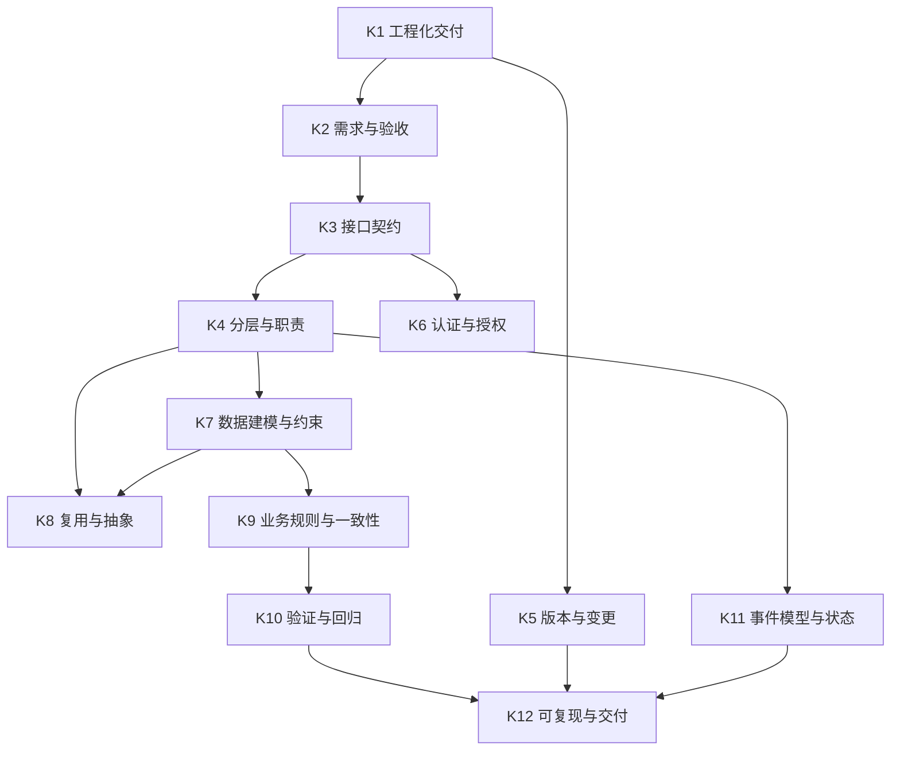

# 01 · 全书概念矩阵

> 本表是 3.0 的“知识地图”。每一章先在这里定位，再进 `02-章节骨架.md` 写具体内容。

## 一、26 章定位表

“新术语预算”指本章首次出现、且需要学生记住的术语总数（核心 + 支撑）；背景概念不计入预算，但也要控制。

| 章 | 课次 | 本章工程问题 | 核心概念 | 线 | 新术语预算 | 负荷 |
| --- | --- | --- | --- | --- | --- | --- |
| 1 软件工程基本概念 | 1 | 能跑的程序与可交付的系统差什么 | K1 工程化交付 | A | 5 | 低 |
| 2 需求分析方法 | 2 | 用户说不清时，怎样变成可开发、可验收的条目 | K2 需求与验收标准 | B | 4 | 低 |
| 3 需求文档编写 | 3 | 怎样让需求成为开发、测试、验收三方共用的契约 | K2（深化） | B | 4 | 低 |
| 4 HTTP 与接口设计 | 4 | 前后端靠什么对话 | K3 接口契约 | B | 6 | 中 |
| 5 FastAPI 核心机制 | 4 | 一份契约怎样变成可运行的服务 | K3（实现）/ K7（先导） | B、D | 4 必学（另选读 2，不计入预算） | 中 |
| 6 软件设计与建模 | 5 | 系统怎样切成可独立理解和修改的部分 | K4 分层与职责 | C | 5（另背景 3） | 中 |
| 7 项目初始化与版本控制 | 6 | 多人多轮修改，怎样可回溯、可协作 | K5 版本与变更管理 | A | 4 | 中 |
| 8 用户模块：登录认证 | 7 | 系统怎样知道“你是谁” | K6 认证与授权 | B | 4 | 中 |
| 9 用户模块：账号管理 | 8 | 系统怎样决定“你能做什么” | K6（深化） | B | 3 | 中 |
| 10 数据模块：增删查改 | 9 | 数据怎样被安全、一致地读写 | K7 数据建模与约束 | D | 5 | 中 |
| 11 数据模块：查询复用 | 10 | 重复逻辑怎样收拢而不破坏行为 | K8 复用与抽象边界 | C | 3 | 中 |
| 12 业务模块：规则描述 | 11 | 数据合法不等于业务合法，规则写在哪 | K9 业务规则与一致性 | D | 3 | 中 |
| 13 业务模块：统计校验 | 12 | 多条记录汇总时，怎样保证口径与事务正确 | K9（深化） | D | 4 | 中 |
| 14 模块测试与调试 | 13 | 怎样证明系统“做对了”，失败时怎样定位 | K10 验证与回归 | E | 5 | 中 |
| 15 后端开发综合实践 | 14–15 | 把前 14 章合成一条可运行、可交付的链路 | 无新核心（综合） | A、C、D、E | 2 | 高（任务量） |
| 16 前端开发框架基础 | 16 | 页面为什么会在点击后“重算”，状态为什么会丢 | K11 事件模型与状态 | D | 4 | 中 |
| 17 常用界面组件 | 17 | 怎样用组件搭出可用的管理界面 | 无新核心（K8 复现） | C | 5（组件名） | 低–中 |
| 18 前端页面设计 | 18 | 一张页面怎样组织信息层级与导航 | 无新核心（K4 复现） | C | 3 | 中 |
| 19 数据读取与展示 | 19 | 前端怎样按契约取数并处理三态 | K3（消费）/ K11（深化） | B、D | 4 | 中 |
| 20 数据编辑与页面状态 | 20 | 写操作与页面状态怎样保持一致 | K11（深化）/ K9（迁移） | D | 4 | 中 |
| 21 前端视觉优化与仪表盘 | 21 | 怎样让数据更易读 | 无新核心（K4 复现） | C | 4 | 低–中 |
| 22 前端开发综合实践 | 22 | 独立完成一个页面并接入真实接口 | 无新核心（综合） | B、C、D、E | 2 | 高（任务量） |
| 23 Docker 基础 | 23 | 怎样把“我的机器能跑”变成“到处能跑” | K12 可复现与交付 | E | 6 | 中 |
| 24 Docker 打包与测试 | 24 | 怎样写出可构建、体积合理的镜像 | K12（深化） | E | 5 | 中 |
| 25 前后端服务部署 | 25 | 两个服务怎样在目标环境里互相找到 | K12（深化）/ K3（迁移） | B、E | 6 | 中 |
| 26 软件部署综合实践 | 26 | 怎样完成一次可验收的交付并处理故障 | K12（迁移）/ K1、K10 | A、E | 3 | 中–高（任务量） |

### 预算说明

- 第 4、5、23、25 章的 5–6 个术语都是**具体、可指认的工具符号**（如 `@app.get`、`Dockerfile`、端口映射），不是抽象概念；它们按“先见其形、后见其名”的方式引入，计数可略放宽。
- 第 5 章是唯一允许“超预算”的章：它承担概念水库功能。但**必学只有 4 个**，其余标“◇ 选读”，第 7–9 章只取用得到的。
- 第 15、22 章任务量最大，但**新概念为零**。这是刻意的：让学生在综合实践里体验“没有新词、只有组合”，降低畏难情绪。

## 二、核心概念复现矩阵

标记说明：**引** = 首次引入并给完整定义；**用** = 在新情境中使用，不再重讲；**深** = 增加边界、反例或机制；**迁** = 作为迁移任务的判断依据。

| 概念 | 引 | 用 | 深 | 迁 |
| --- | --- | --- | --- | --- |
| K1 工程化交付 | 1 | 2、3、6 | 14、15 | 26 |
| K2 需求与验收标准 | 2 | 3、4 | 6、12、14 | 15 |
| K3 接口契约 | 4 | 5、6、8、9、10 | 16、19、25 | 22 |
| K4 分层与职责 | 6 | 7、8、9、10、12、17、18 | 11、14、21 | 22 |
| K5 版本与变更管理 | 7 | 14、15 | 24、26 | 26 |
| K6 认证与授权 | 8 | 9 | 20 | 22 |
| K7 数据建模与约束 | 5（先导）、10（正式） | 11、12 | 13、19 | 15 |
| K8 复用与抽象边界 | 11 | 17 | 22 | 15 |
| K9 业务规则与一致性 | 12 | 13 | 14、15 | 20 |
| K10 验证与回归 | 14 | 15、22、24 | 26 | 15 |
| K11 事件模型与状态 | 16 | 17、18 | 19、20 | 22 |
| K12 可复现与交付 | 23 | 24、25 | 26 | 26 |

### 检查结论

- 12 个核心概念全部满足“引入 + 至少 3 次复现 + 1 个迁移落点”。
- 每章至少承载 1 个核心概念，或明确标注“无新核心、只做综合/复现”。
- 第 15、17、18、21、22、24、25 章是呼吸章，新概念密度低于全书平均。
- 没有“只出现一次就消失”的核心概念。

## 三、概念缺口与补位

以下概念在 2.0 中缺失或只有零星提及。3.0 不把它们全部升为核心，而是按层级补位，避免负荷反弹。

| 缺失概念 | 当前状态 | 3.0 层级 | 插入位置 | 处理方式 |
| --- | --- | --- | --- | --- |
| 耦合 | 0 次 | **核心**（K4 的组成部分） | 第 6 章 | 用 duty 的 controller/service/crud 解释“改一处牵动几处” |
| 内聚 | 0 次 | **核心**（K4 的组成部分） | 第 6 章 | 用“六个文件各管什么”解释“什么该放一起” |
| 抽象 / 信息隐藏 | “抽象”1 次 | **核心**（K8 的组成部分） | 第 6、11 章 | 用 `CRUDBase` 与 `pk` 参数解释“隐藏变化点” |
| 配置管理 | 0 次 | **核心**（K5 的正式名称） | 第 7 章 | Git 不只讲命令，讲“变更可回溯” |
| 集成测试 | 0 次 | 支撑 | 第 14 章 | 与单元测试、接口测试并列，各给一个 duty 例子 |
| 可测试性 | 0 次 | 支撑 | 第 14 章 | 用“service 可独立调用”说明为什么分层让测试变容易 |
| 软件质量 / 质量属性 | 0 次 | 支撑（K1 的组成部分） | 第 1 章，后文复现 | 正确性、可靠性、安全性、性能、可维护性各一句话 |
| 需求变更 | 0 次 | 支撑 | 第 2、7 章 | 用“需求变了，哪些交付物要跟着变”串起来 |
| 技术债 | 0 次 | 背景 | 第 11、14、26 章 | 各一句“这就是技术债”，不展开 |
| 演化 | 0 次 | 背景 | 第 26 章 | 与“交付不是终点”合并 |
| 持续集成 | 0 次 | 背景（选读） | 第 24 章 | 只说明“自动构建+自动测试”的概念，不配环境 |
| 设计模式 | 0 次 | 背景（选读） | 第 6、11 章 | 只提“组合优于继承”与“模板方法”两个，不讲 GoF 目录 |
| 部署图 / 组件图 | 0 次 | 支撑（图示） | 第 6、25 章 | 补 2 张图，不新增章节 |

**取舍原则**：能用一句话说清、且不考的概念，放背景层；能影响设计判断、且后文要反复用的，放支撑或核心层。**核心层只留 12 个，不再增加。**

## 四、章际知识依赖图

3.0 的依赖不是单链，而是分层 DAG。箭头表示“理解后者需要前者”，不表示“必须先学完前一章”。

三条阅读结论：

1. **K4 是全书枢纽**：分层与职责没学透，后面的复用、规则、测试都会变成死记。
2. **K1 与 K5 是两条纵向线索**：它们不依赖具体技术，从第 1 章贯穿到第 26 章。
3. **K12 是汇合点**：部署章同时需要 K10（验证）与 K5（配置管理），不是孤立的工具章。

## 五、与 2.0 章节的对应

章节号不变，但知识角色变了：

| 2.0 的角色 | 3.0 的角色 | 涉及章节 |
| --- | --- | --- |
| 项目施工步骤 | 概念的实例与证据 | 8–13、16–21、23–25 |
| 课次内容的容器 | 知识单元的容器 | 全书 |
| 工具教程 | 概念的落地物 | 4、5、7、23–25 |
| 综合实践 | 知识综合与迁移 | 15、22、26 |
| 理论章 | 概念引入与命名 | 1、2、4、5、6、16、23 |

这张表是改写时的第一判断：**每一节写完，问它是在“推进概念”还是在“记录施工”；后者只能作为前者的证据，不能单独成节。**
