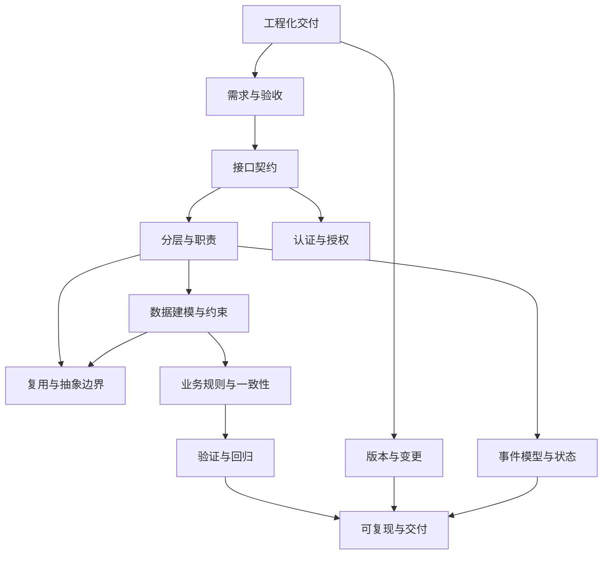

# 全书概念地图

> 编排位置：前言之后、目录之前。本页不增加新知识，只回答一个问题：这本书的 24 章，到底在讲哪几条线。

## 五条概念线

| 线 | 回答的问题 | 贯穿章节 |
| --- | --- | --- |
| 工程化与过程 | 为什么“能跑”不等于“可交付” | 1、2、4、12、13、24 |
| 需求与契约 | 做什么、和谁约定、边界在哪 | 2、3、6、7、16、23 |
| 结构与模块化 | 系统怎样切成可独立理解和修改的部分 | 4、5、8、9、10、15、20 |
| 数据与状态 | 数据怎样存、状态怎样变、规则写在哪 | 3、4、8、9、10、11、14–19 |
| 验证与交付 | 怎样证明做对了、怎样交付出去 | 11、12、13、20、21–24 |

## 12 个核心概念

| 概念 | 一句话 | 首次出现 | 后文重点 |
| --- | --- | --- | --- |
| 工程化交付 | 用可检查的过程和交付物，把能运行的程序变成可交接、可维护、可验收的系统（本书工作定义） | 第 1 章 | 12、13、24 |
| 需求与验收标准 | 把模糊表述变成可开发、可验收的条目 | 第 2 章 | 3、4、10、12、13 |
| 接口契约 | 前后端共同约定的 URL、方法、状态码与字段 | 第 3 章 | 3、4、6、7、8、14、16、20、23 |
| 分层与职责 | 按职责切分，让改动只牵动该动的地方 | 第 4 章 | 5–10、15、17、20 |
| 版本与变更管理 | 每一次修改可回溯、可协作、可复现 | 第 5 章 | 12、13、22、24 |
| 认证与授权 | 先确认身份，再判断权限 | 第 8–9 章 | 9、18、20 |
| 数据建模与约束 | 用表、主键、外键与约束保证数据可用 | 第 3 章（先导）、第 6 章 | 9、10、11、13、16 |
| 复用与抽象边界 | 只抽“换一个模型仍不改”的代码 | 第 7 章 | 13、15、20 |
| 业务规则与一致性 | 规则写在 service，事务保证一起成功 | 第 10 章 | 11、12、13、18 |
| 验证与回归 | 用可重复的测试证明行为没有变 | 第 12 章 | 13、20、22、24 |
| 事件模型与状态 | 页面重跑时，哪些状态会丢、哪些不会 | 第 14 章 | 15–18、20 |
| 可复现与交付 | 镜像、配置、健康检查让环境可复现 | 第 21 章 | 22、23、24 |

## 概念之间的关系

*图 0-1：全书核心概念的关系*

读图只需记住三件事：分层与职责是枢纽；工程化交付与版本管理是两条纵向线索；部署与交付同时需要验证和配置管理，不是孤立的工具章。

## 怎么用这张图

- **读一章前**：在表里找到本章的“首次出现”或“后文复现”，知道它接的是哪条线。
- **读一章后**：回到图上看它连向哪里，知道这个概念后面还会怎样加深。
- **复习时**：不要按章号背，按五条线各走一遍；每条线走通，比逐章重读有效。
- **做题时**：先判断这道题在考哪个概念，再想“换一个场景还成不成立”。
