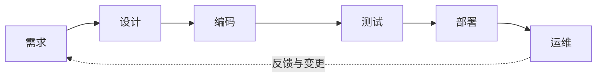

# 第 1 章 软件工程基本概念

> **节首信息条**｜对应课次 1 · 2 学时 · 理论讲授｜前置：高中阶段编程与文档写作经验；不要求软件工程基础｜**本节活动**：◇ 课堂活动块（听讲要点 / 讨论·演示 / 课后自测 / 回链）

**已会**：写过能跑起来的课程作业或小程序，体会过“本机能跑”与“交给别人也能用”的差别。
**本章只加**：工程化交付——把能运行的程序，变成可交接、可维护、可验收的系统。
**关系**：本章是全书起点；后面 25 章的文档、接口、测试与部署，都是这一个概念的具体做法。

1996 年 6 月 4 日，阿丽亚娜 5 号火箭首飞。升空约 37 秒后，火箭偏离预定轨迹，随后被地面安全系统引爆，火箭与搭载的卫星全部损失，直接经济损失约 3.7 亿美元（来源：欧洲航天局事故调查委员会 1996 年报告）。

事后调查发现，直接原因很小：惯性参考系统里有一段复用自阿丽亚娜 4 号的代码，它把 64 位浮点数转成 16 位整数；5 号的飞行轨迹让这个数值超出了 16 位的表示范围，转换失败，制导随之失效。更关键的是，备份系统运行的是同一套软件，于是也一起失效。

这不是一句“代码写错了”能解释的事故。它同时涉及复用决策、测试覆盖、规格假设和冗余设计：复用没有重新评估运行条件，测试没有覆盖新轨迹，规格没有写明数值范围，冗余没有做到独立。每一个环节单独看都不算致命，叠在一起却让整个系统失去交付能力。

## 本章要解决的问题

**一个“能跑起来”的程序，和一个“可以交付”的系统，中间差着什么？**

一份程序在开发者手上运行正常，交到别人手里却启动不了、改不动，也说不清做到什么程度算完成。代码没有坏，坏的是那些没有随代码一起交出去的东西：前提、验证方法和判断标准。

本章从这次事故出发，说明工程化交付要交出什么、为什么必须交出，以及用哪些阶段和过程模型组织这件事。

## 本章学习目标

读完第 1 章，你应该能：

1. 说明软件由程序、数据与文档组成，并解释为什么“交付源代码不等于交付软件”。
2. 按需求、设计、编码、测试、部署、运维六个阶段说出各阶段任务与至少一个交付物（Deliverable）。
3. 比较瀑布、迭代、敏捷三种过程模型的适用条件，并为给定项目选择主导模型并说明理由。
4. 用复杂性、变化、协作、质量四个根本挑战解释“越晚发现缺陷，修复成本越高”。
5. 针对一个小组项目指出至少三处工程化缺陷，并说明本应在哪一阶段避免。

## 1.1 工程化交付

阿丽亚娜 5 号的失败，最容易被误读成“程序员写错了一行代码”。但只要把事故拆开，就能看到四层问题：

| 环节 | 发生了什么 | 本可以怎样拦住 |
| --- | --- | --- |
| 复用 | 4 号的代码直接搬进 5 号，没有重新评估运行条件 | 复用前核对新环境的输入范围 |
| 规格 | 没有写明“数值不得超出 16 位”这一前提 | 在接口和设计文档里写清约束 |
| 测试 | 没有覆盖 5 号更高的初速度与轨迹 | 用新场景的输入做验证，而不只回归旧数据 |
| 冗余 | 备份系统运行同一套软件，故障不独立 | 让冗余真正独立，或至少做失效分析 |

四层问题指向同一件事：**代码本身没有错，错在把“在旧条件下能跑”当成了“在新条件下可交付”。**

由此可以命名本章的核心概念。**工程化交付**指用可检查的过程和交付物，把能运行的程序变成可交接、可维护、可验收的系统。它有三层含义：

- **可交接**：换一个人接手，照着文档就能继续做；
- **可维护**：改一处，知道会影响哪里、需要重新验证什么；
- **可验收**：做到什么程度算完成，有可判断的依据，而不是“看起来差不多了”。

判断一个交付是否成立，不看代码行数，而看一个可观察的现象：**把项目交给没有参与开发的人，他能否在不问原作者的情况下启动、修改并验证它？** 能，就是工程化交付；不能，就还停留在“本机能跑”。

> 💡 **易错点**：把“演示成功”当成“交付完成”。演示只覆盖了开发者选定的那条路径；换一台机器、换一组数据、换一个人操作，问题才会露出来。

## 1.2 软件的三部分

“工程化交付”要交的到底是什么？很多人把“软件”等同于“程序”，于是认为把源代码交出去，任务就完成了。但在工程语境里，软件由三部分组成：程序、数据和文档。

- **程序**是能被计算机执行的指令；
- **数据**是程序处理的对象，例如用户表、值班记录、日志；
- **文档**是理解、使用和维护软件的依据，包括需求说明、接口文档、部署说明和运维记录。

三者缺一，软件就不完整。只交代码不交文档，接手的人不知道每个字段为什么这样设计、接口为什么这样返回；只有代码和数据而没有使用说明，用户也不知道该怎么正确操作；有文档但没有可运行的程序与数据，系统根本启动不了。但文档也不是越多越好：判断标准是“下一阶段的人能不能用它干活”，而不是篇幅。写一份没人看、看完还不能照着做的说明书，和没写一样。

把程序、数据和文档作为一个整体来规划、构建、验证和维护，就是**软件工程**：用系统化、规范化、可度量的方法，把不确定的过程变成可预测、可控制、可复用的过程。它与“会编程”的区别在于：编程是个人把功能写出来，软件工程是团队把系统交付并长期维护；它与“项目管理”的区别在于：项目管理管进度、资源与风险，软件工程管技术过程与产品质量。

把三者放在一起看，交付物就不只是“一个文件夹”，而是一组能被下一阶段使用的材料：需求阶段交需求文档，设计阶段交表结构与接口清单，编码阶段交源代码，测试阶段交用例与缺陷记录，部署阶段交运行说明。这就是下一节六个阶段的由来。

> 💡 **易错点**：把“本机能运行”当成“已经交付”。本机运行只证明程序在开发者的环境里能跑，既不证明需求做对了，也不证明别人能接手维护。

## 1.3 四个根本挑战

为什么需要一个“工程化”的过程，而不是让会写代码的人直接写？因为软件开发面临四个绕不开的挑战。

**复杂性**来自规模和依赖。一个稍具规模的系统有几十个模块、上百个字段和大量相互调用，没有人能在脑中装下全部细节；细节装不下，理解就困难，修改就更容易牵一发而动全身。

**变化**是常态而不是例外。需求会变，技术会变，人员也会变。工程化要做的不是阻止变化，而是让变化可控：知道变了什么、影响哪些模块、需要重新验证什么。

**协作**把个人问题变成团队问题。多人、多角色、多阶段同时推进，需要统一的接口、文档、规范和版本控制；没有这些共同约定，代码会冲突，接口会对不上。

**质量**则决定系统能不能长期使用。正确性、可靠性、安全性、性能和可维护性都属于质量；质量不是最后“测出来”的，而是在需求、设计、编码和测试中一步步设计和管理的。

这四个挑战有一个共同的放大效应：**越晚发现缺陷，修复成本越高。** 需求阶段一句模糊的话，到了上线后可能变成跨模块的返工；编码阶段的一个边界遗漏，到了部署后可能变成一次事故。这条规律通常画成一条上升的变更成本（Cost of Change）曲线，本章不展开具体数值，但结论要记住：工程化的价值，很大程度上在于把问题尽量往前赶。

阿丽亚娜 5 号的事故正好走了一遍这条曲线：复用决策在架构阶段、规格缺失在设计阶段、测试遗漏在验证阶段、冗余失效在运维阶段；每一步都晚了一点，代价就大了一截。

## 1.4 软件开发生命周期

应对复杂性、变化与协作的第一个框架，是把开发过程拆成阶段，让每个阶段有明确的任务和交付物。这就是**软件开发生命周期**（Software Development Life Cycle，SDLC）。

| 阶段 | 主要任务 | 典型交付物 |
| --- | --- | --- |
| 需求 | 明确用户要什么、系统边界在哪 | 需求规格说明书、用户故事、原型 |
| 设计 | 定架构、模块、数据库与接口 | 架构图、ER 图、接口文档 |
| 编码 | 按设计实现功能 | 源代码、注释、提交记录 |
| 测试 | 验证功能、边界与异常 | 测试用例、测试报告、缺陷记录 |
| 部署 | 上线、配置、监控 | 部署文档、镜像、运行日志 |
| 运维 | 监控、修复、迭代 | 运维记录、版本更新 |

*图 1-1：软件开发生命周期的六个阶段*

这张图有两个容易误读的地方。第一，箭头是顺序，但阶段可以重叠：敏捷实践中，需求、设计、编码和测试会在一个短周期内反复发生。第二，重叠不等于省略：无论怎么组织，每项活动都要有人做，每个阶段都要留下能被下一阶段使用的交付物。**阶段可以压缩，活动不能消失。**

## 1.5 三种过程模型与选择

生命周期回答“有哪些阶段”，过程模型回答“这些阶段怎么组织”。常见的有三种。

| 模型 | 特点 | 适用场景 | 主要风险 |
| --- | --- | --- | --- |
| 瀑布 | 阶段清晰、文档完整、顺序推进 | 需求稳定、范围明确 | 变更成本高、反馈晚 |
| 迭代 | 分多轮交付，每轮完成一次完整小循环 | 需求逐步清晰 | 需要好的迭代规划 |
| 敏捷 | 小步交付、持续反馈、拥抱变化 | 需求变化快、用户参与度高 | 对团队自律和协作要求高 |

瀑布模型（Waterfall Model）像盖楼：地基、主体、装修按顺序来，每道工序验收后再进入下一道。它的优点是边界清楚、文档完整、便于按阶段评审；代价是反馈来得晚，一旦需求在中途变化，返工代价很高。

迭代模型（Iterative Model）把项目切成若干轮，每一轮都走一遍需求、设计、编码、测试的小循环，并交付一个可运行的增量。它适合需求在开始时说不全、需要边做边澄清的项目；代价是每轮范围要规划好，否则会在轮次之间反复返工。

敏捷不是“不设计、不写文档”，而是一组强调小步交付、持续反馈和拥抱变化的价值观与实践。2001 年发布的《敏捷宣言》（Agile Manifesto）强调：个体与互动高于流程与工具，可工作的软件高于详尽的文档，客户合作高于合同谈判，响应变化高于遵循计划。注意这里的“高于”不是“取代”：文档、计划和流程仍然有价值，只是在冲突时优先保证前一项。

**两个选择条件**

三种模型不是先进与落后的关系，而是对两个条件的不同回应：

1. **需求稳定吗？** 需求稳定、范围明确，瀑布的顺序推进最省沟通成本；需求边做边清晰，迭代或敏捷更合适。
2. **多久需要一次反馈？** 反馈周期越长，越要靠前期评审把问题挡住；反馈周期越短，越要保证每轮都有可运行、可验收的增量。

两个条件组合起来，选择就有了依据，而不是凭偏好。若需求稳定但反馈要求高，可以选“瀑布的文档 + 短周期评审”；若需求变化快但团队人数少，可以选“迭代的节奏 + 精简文档”。

> 💡 **易错点**：把“敏捷”当成“不用计划”。敏捷反对的是重计划、轻反馈，不是不要计划；没有验收标准和迭代规划，小步交付会变成小步返工。

## 1.6 流程的选择条件与角色分工

生命周期与过程模型回答“怎么组织”，但工程化交付并不要求所有项目都走完整流程；做到什么程度，还要看项目寿命、参与角色与协作方式。

**产品、过程与人与组织**

除了生命周期和过程模型，还可以用三个维度检查一个开发过程是否健康：产品、过程、人与组织。产品维度关心“做什么”，包括需求、设计、代码和测试；过程维度关心“怎么做”，包括生命周期、模型、方法和度量；人与组织维度关心“谁来做、怎么协作”，包括角色、评审、版本控制和沟通。后面每学一个模块，都可以用这三问检查自己：产品上做了什么？过程上怎么保证？人怎么协作？

**角色分工**

团队角色也因此需要分清。产品角色负责确认“做的是不是用户要的”；开发角色负责实现并保证代码可理解；测试角色负责提供质量证据；运维角色负责让系统在目标环境中稳定运行。角色可以兼任，但职责不能消失。

**本章不涉及的内容**

工程化交付不等于“所有项目都走完整流程”。一个只运行一次、无人维护的脚本，写清输入输出即可；流程的完整程度应与系统的寿命、使用人数和修改频率匹配。反过来，只要系统需要多人协作、长期维护或对外交付，就不能省略阶段与交付物。**流程是成本，也是保险；买多少保险，取决于风险有多大。**

本章只建立这套框架，不展开具体的管理方法。CMMI、DevOps、Scrum 的仪式细节与故事点估算都不属于本章范围，后续章节用到时再作背景介绍。

## 示范例题

#### 例 1-1：为一个图书借阅系统走一遍生命周期【Bloom：理解】

**题目**：某校园图书借阅系统从“决定做”到“稳定运行一年”，请按软件开发生命周期说明六个阶段的主要任务，并各给出至少一项交付物；最后用一句话解释：为什么“编码”不能代表整个开发过程。

**解**：

1. **需求阶段**：确认谁借书、谁管理图书、借阅期限与逾期规则、系统边界。交付物：需求规格说明书（Software Requirements Specification, SRS）、用户故事、原型。理由：后面所有设计与测试都要以需求为依据，需求不清，后面每一步都失去判断标准。
2. **设计阶段**：把需求拆成模块（用户、图书、借阅记录），确定数据库表与接口。交付物：架构图、ER 图、接口文档。理由：先定结构，编码才有团队共同的依据。
3. **编码阶段**：按设计实现功能。交付物：源代码、提交记录。理由：编码是把设计翻译成可执行程序，而不是重新做一遍设计。
4. **测试阶段**：验证正常流程、边界与异常。交付物：测试用例、测试报告、缺陷记录。理由：测试提供“系统是否达到验收标准”的证据，而不是证明“完全没有错误”。
5. **部署阶段**：把系统安装到目标环境并完成配置。交付物：部署文档、镜像、运行日志。理由：本机能运行不等于目标环境能运行。
6. **运维阶段**：监控运行、修复问题、按反馈迭代。交付物：运维记录、版本更新。理由：系统的价值在长期运行中体现，交付不是终点。

一句话：编码只把设计变成代码；需求错了、测试漏了或部署失败，代码写得再对也无法交付，软件工程的价值在于让每一步都可验证、可交接。

#### 例 1-2：三种过程模型怎么选【Bloom：分析】

**题目**：有三个项目情境，请分别选择瀑布、迭代或敏捷作为主导模型，说明理由，并指出所选模型最需要防范的风险。

- A. 某单位要在 6 个月内按上级文件交付一套报表系统，需求已明确，任何变更都要审批。
- B. 一个 4 人小组做校园二手交易平台，用户需求还在快速变化，希望每两周能看到新版本。
- C. 课程项目分三轮完成 duty 值班统计系统（本书贯穿全书的教学项目），每轮增加一个模块，需求在每轮开始前确认。

**解**：

先给出比较判据：需求稳定性、交付节奏、反馈频率、文档与评审要求、变更成本。

- **A 选瀑布。** 需求已经明确、范围固定、变更需要审批，阶段清晰与文档完整正好匹配这种条件；按需求、设计、编码、测试、部署的顺序推进，每阶段评审后进入下一阶段。最需要防范的风险是变更成本高、反馈晚：一旦中途需求变化，返工代价很大，所以需求评审和设计评审必须认真做。
- **B 选敏捷。** 需求变化快、用户参与度高、希望小步看到新版本，适合用短周期迭代持续交付可用版本并收集反馈。最需要防范的风险是对团队自律和协作要求高：如果没有稳定的验收标准和迭代节奏，容易变成“天天改、没有积累”。
- **C 选迭代。** 需求在每轮开始前确认，每轮完成一次完整小循环并交付一个可运行增量。最需要防范的风险是迭代规划：如果每轮范围失控，会在轮次之间连续返工。

结论：三种模型不是先进与落后的关系，而是对“需求稳定性”和“反馈频率”的不同回应。

## 独立习题

#### 习题 1-1【Bloom：记忆】

**题目**：列举软件开发生命周期的六个阶段，并各写出至少一个典型交付物。

#### 习题 1-2【Bloom：理解】

**题目**：判断下列说法是否正确，并说明理由。

1. 软件就是程序，交付源代码就等于交付软件。
2. 敏捷开发（Agile Development）不需要设计文档。
3. 测试阶段的主要任务是证明程序没有错误。
4. 需求阶段发现的问题，修复成本通常低于上线后发现。

#### 习题 1-3【Bloom：分析】

**题目**：阅读下面的项目过程描述，指出至少三处工程化缺陷，并说明每处缺陷最可能在哪一阶段暴露、本应如何避免。

> 小组接到做一个值班统计系统的任务后，组长让每人直接挑一个页面开始写代码。数据库表边写边改，接口字段在群里口头约定。写完在本机跑通后，直接拷到服务器上运行。上线后发现两个页面显示的“本月值班次数”不一致，查了半天才发现一个人按“自然月”算、另一个人按“最近 30 天”算。

#### 习题 1-4【Bloom：评价】（开放题）

**题目**：某课程项目只有 8 周、4 人，需求由教员给出但允许调整，最终要交付可运行系统并做答辩。请在瀑布、迭代、敏捷中选择一种主导模型，写出你的选择依据、你会坚持的两项工程实践、以及你会裁剪的一项，并说明裁剪的风险。

#### 习题 1-5【Bloom：理解】（概念辨析）

**题目**：有人说“敏捷开发就是不做设计文档、边写边改”。请用本章的生命周期与四个根本挑战说明这句话错在哪里，指出敏捷并不排斥的两项工程实践，并用 1.6 的「产品／过程／人与组织」三个维度说明这句话漏掉了哪一维度。

## ◇ 课堂活动块（课次 1 · 理论讲授）

**听讲要点**：

1. 工程化交付看的是“换一个人能不能接手”，不是“演示能不能成功”。
2. 软件由程序、数据和文档组成；交付源代码不等于交付软件。
3. 六个阶段各自留下可交接的交付物；阶段可以压缩，活动不能消失。
4. 瀑布、迭代、敏捷没有绝对优劣，取决于需求稳定性与反馈节奏。
5. 四个根本挑战决定了为什么要把问题往前赶。

**讨论·演示**：

1. （讨论）阿丽亚娜 5 号的四层问题里，哪一层是“代码错误”，哪几层是“工程问题”？如果只修代码，事故还会不会发生？
2. （演示）把“需求口头约定→上线数据口径不一致”的返工链画在白板上，标出本可拦截它的两个节点。

**课后自测**：完成独立习题 1-2、1-4（答案见书末 98-参考答案），作为课次 1 的书面检查。

**回链**：本章目标与习题逐条对应，见章末「本章小结与自检」。

## 本章小结

**核心结论**：

1. **工程化交付**是用可检查的过程和交付物，把能运行的程序变成可交接、可维护、可验收的系统；判断标准是“没有参与开发的人能否接手”。
2. 软件由程序、数据和文档组成；只交源代码不交文档，不构成完整交付。
3. 软件开发生命周期包含需求、设计、编码、测试、部署、运维六个阶段；阶段可以重叠，活动不能省略，每个阶段都要留下可交接的交付物。
4. 瀑布、迭代、敏捷没有绝对优劣；选择取决于需求稳定性与反馈节奏，任何选择都要说明代价。
5. 复杂性、变化、协作、质量是四个根本挑战；越晚发现缺陷，修复成本越高，这是工程化要把问题往前赶的根本原因。

把这章压缩成一句话：**能跑只是起点；能被别人接手、修改并验收，才算交付。**

**本章不引入**：CMMI、DevOps、Scrum 的仪式细节、故事点估算。这些内容在本课程中只作背景，不影响后续章节。

**学完本章，你可以体会到**：工程化不是多写文档，而是用一组可检查的阶段和交付物，把“做着做着就乱了”变成“每一步都知道该交什么”。

**自检**：回到章首的学习目标，逐条问自己做到了没有——

- [ ] 说明软件由程序、数据与文档组成，并解释为什么“交付源代码不等于交付软件”。
- [ ] 按六个阶段说出各阶段任务与至少一个交付物。
- [ ] 比较瀑布、迭代、敏捷的适用条件，并为给定项目选模型。
- [ ] 用四个根本挑战解释“越晚发现缺陷，修复成本越高”。
- [ ] 针对小组项目指出至少三处工程化缺陷，并说明在哪一阶段避免。

**下一章预告**：生命周期的第一站是需求。下一章要回答：当用户说不清自己想要什么时，工程师怎样把模糊表述变成可开发、可验收的需求条目。
