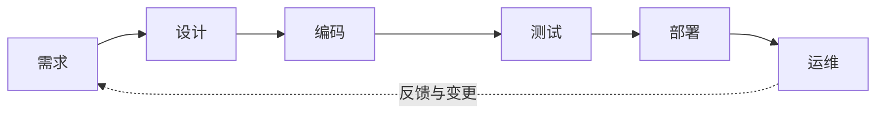

# 第 1 章 软件工程基本概念

> **节首信息条**｜对应课次 1 · 2 学时 · 理论讲授｜前置：高中阶段编程与文档写作经验；不要求软件工程基础｜**本节活动**：◇ 课堂活动块（听讲要点 / 讨论·演示 / 课后自测 / 回链）｜章末有评价要点与自评及本章提示页

一个“能跑起来”的程序，和一个“可以交付”的系统，中间差着什么？这个问题不是修辞。1996 年 6 月 4 日，阿丽亚娜 5 号火箭首飞，升空约 37 秒后偏离预定轨迹，随后被地面安全系统引爆，火箭与搭载的卫星全部损失，直接经济损失约 3.7 亿美元（来源：欧洲航天局事故调查委员会 1996 年报告）。事后调查发现，问题出在惯性参考系统的软件里：一段复用自阿丽亚娜 4 号的代码，在 5 号的新飞行轨迹下发生了数值溢出；更关键的是，备份系统运行的是同一套软件，于是也一起失效。

这不是一句“代码写错了”能解释的事故。它同时涉及复用决策、测试覆盖、规格假设、异常处理和冗余设计。本章要建立的，正是把这类问题放回工程过程中去看的框架：先说明软件工程（Software Engineering）到底解决什么问题，再展开软件开发生命周期（Software Development Life Cycle, SDLC），最后比较瀑布、迭代与敏捷三种组织方式。

## 本章学习目标

读完第 1 章，你应该能：

1. 说明软件由程序、数据与文档组成，并解释为什么“交付源代码不等于交付软件”。
2. 按需求、设计、编码、测试、部署、运维六个阶段说出各阶段任务与至少一个交付物（Deliverable）。
3. 比较瀑布、迭代、敏捷三种过程模型的适用条件，并为给定项目选择主导模型并说明理由。
4. 用复杂性、变化、协作、质量四个根本挑战解释“越晚发现缺陷，修复成本越高”。
5. 针对一个小组项目指出至少三处工程化缺陷，并说明本应在哪一阶段避免。

## 前置知识卡

| # | 已有知识 | 回看位置 |
| --- | --- | --- |
| 1 | 会写 Python 基本语法（变量、条件、函数） | 附录 A「Python 基础」 |
| 2 | 能读简单的表格与流程说明 | 本章 1.1.1 起边读边对照自己写过的程序 |
| 3 | 写过一次课程作业或小程序，体会过「能跑」与「能交接」的差别 | 本章导入案例；属既有经验，无需回看 |

> 本章是全书第 1 章，没有上一章；卡住时先回看 1.1.1，不必从头重读。

## 1.1 概念讲解

### 1.1.1 软件不只是程序

先从最容易被混用的一组词说起。很多人把“软件”等同于“程序”，于是认为把源代码交出去，任务就完成了。但在工程语境里，软件由三部分组成：程序、数据和文档。

程序是能被计算机执行的指令；数据是程序处理的对象，例如用户表、值班记录、日志；文档则是理解、使用和维护软件的依据，包括需求说明、接口文档、部署说明和运维记录。三者缺一，软件就不完整。只交代码不交文档，接手的人不知道每个字段为什么这样设计、接口为什么这样返回，系统就难以维护；只有代码和数据而没有使用说明，用户也不知道该怎么正确操作。

> 💡 **常见坑**：把“本机能运行”当成“已经交付”。本机运行只证明程序在开发者的环境里能跑，既不证明需求做对了，也不证明别人能接手维护。

### 1.1.2 从工程到软件工程

理解了“软件”的构成，还要理解“工程”二字的含义。工程不是“把事情做得正式一点”，而是用系统化、规范化、可度量的方法，把不确定的过程变成可预测、可控制、可复用的过程。系统化意味着有整体安排，不是想到哪做到哪；规范化意味着有共同的标准和检查点；可度量意味着进度和质量能被观察和判断，而不是只靠感觉。

把这两个词合起来，软件工程就是用工程化方法开发、运行和维护软件。它覆盖整个生命周期，而不只是编码；它同时关心质量、进度、成本和可维护性；它既包含技术活动，也包含管理活动。

为了把边界说清，可以记住三组区分：

| 区分 | 关键点 |
| --- | --- |
| 编程与软件工程 | 编程是个人把功能写出来；软件工程是团队把系统交付并长期维护 |
| 计算机科学与软件工程 | 计算机科学关心“能不能算、为什么能算”；软件工程关心“能不能按时、按质、可维护地交付” |
| 软件工程与项目管理 | 项目管理管进度、资源和风险；软件工程管技术过程与产品质量 |

这三组区分共同指向一个判断：软件工程不是“编程加文档”，而是用工程化方法应对系统的复杂性。

### 1.1.3 四个根本挑战

为什么需要软件工程？因为软件开发面临四个绕不开的挑战：复杂性、变化、协作和质量。

复杂性来自规模和依赖。一个稍具规模的系统有几十个模块、上百个字段和大量相互调用，没有人能在脑中装下全部细节；细节装不下，理解就困难，修改就更容易牵一发而动全身。

变化是常态而不是例外。需求会变，技术会变，人员也会变。工程化要做的不是阻止变化，而是让变化可控：知道变了什么、影响哪些模块、需要重新验证什么。

协作把个人问题变成团队问题。多人、多角色、多阶段同时推进，需要统一的接口、文档、规范和版本控制；没有这些共同约定，代码会冲突，接口会对不上。

质量则决定系统能不能长期使用。正确性、可靠性、安全性、性能和可维护性都属于质量；质量不是最后“测出来”的，而是在需求、设计、编码和测试中一步步设计和管理的。

这四个挑战有一个共同的放大效应：越晚发现缺陷，修复成本越高。需求阶段一句模糊的话，到了上线后可能变成跨模块的返工；编码阶段的一个边界遗漏，到了部署后可能变成一次事故。这条规律通常画成一条上升的变更成本（Cost of Change）曲线，本章不展开具体数值，但结论要记住：工程化的价值，很大程度上在于把问题尽量往前赶。

### 1.1.4 软件开发生命周期

应对复杂性的第一个框架，是把开发过程拆成阶段，让每个阶段有明确的任务和交付物。这就是软件开发生命周期（Software Development Life Cycle，SDLC）。

| 阶段 | 主要任务 | 典型交付物 |
| --- | --- | --- |
| 需求 | 明确用户要什么、系统边界在哪 | 需求规格说明书、用户故事、原型 |
| 设计 | 定架构、模块、数据库与接口 | 架构图、ER 图、接口文档 |
| 编码 | 按设计实现功能 | 源代码、注释、提交记录 |
| 测试 | 验证功能、边界与异常 | 测试用例、测试报告、缺陷记录 |
| 部署 | 上线、配置、监控 | 部署文档、镜像、运行日志 |
| 运维 | 监控、修复、迭代 | 运维记录、版本更新 |

*图 1-1：软件开发生命周期的六个阶段*

这张图有两个容易误读的地方。第一，箭头是顺序，但阶段可以重叠：敏捷实践中，需求、设计、编码和测试会在一个短周期内反复发生。第二，重叠不等于省略：无论怎么组织，每项活动都要有人做，每个阶段都要留下能被下一阶段使用的交付物。阶段可以压缩，活动不能消失。

### 1.1.5 三种过程模型：瀑布、迭代与敏捷

生命周期回答“有哪些阶段”，过程模型回答“这些阶段怎么组织”。常见的有三种。

| 模型 | 特点 | 适用场景 | 主要风险 |
| --- | --- | --- | --- |
| 瀑布 | 阶段清晰、文档完整、顺序推进 | 需求稳定、范围明确 | 变更成本高、反馈晚 |
| 迭代 | 分多轮交付，每轮完成一次完整小循环 | 需求逐步清晰 | 需要好的迭代规划 |
| 敏捷 | 小步交付、持续反馈、拥抱变化 | 需求变化快、用户参与度高 | 对团队自律和协作要求高 |

瀑布模型（Waterfall Model）像盖楼：地基、主体、装修按顺序来，每道工序验收后再进入下一道。它的优点是边界清楚、文档完整、便于按阶段评审；代价是反馈来得晚，一旦需求在中途变化，返工代价很高。

迭代模型（Iterative Model）把项目切成若干轮，每一轮都走一遍需求、设计、编码、测试的小循环，并交付一个可运行的增量。它适合需求在开始时说不全、需要边做边澄清的项目；代价是每轮范围要规划好，否则会在轮次之间反复返工。

敏捷不是“不设计、不写文档”，而是一组强调小步交付、持续反馈和拥抱变化的价值观与实践。2001 年发布的《敏捷宣言》（Agile Manifesto）强调：个体与互动高于流程与工具，可工作的软件高于详尽的文档，客户合作高于合同谈判，响应变化高于遵循计划。注意这里的“高于”不是“取代”：文档、计划和流程仍然有价值，只是在冲突时优先保证前一项。

在敏捷的常见框架里，Scrum 用固定时长的冲刺（Sprint）组织迭代，用产品待办列表（Product Backlog）管理需求优先级，并设置计划、每日站会、评审和回顾等事件；Kanban 用可视化的看板展示工作流，并用在制品限制（Work in Progress Limit, WIP Limit）控制同时进行的任务数量。两者都不改变“每项工程活动都要做”的事实，改变的是节奏和协作方式。

> 💡 **常见坑**：把“敏捷”当成“不用计划”。敏捷反对的是重计划、轻反馈，不是不要计划；没有验收标准和迭代规划，小步交付会变成小步返工。

### 1.1.6 三个维度与工程习惯

除了生命周期和过程模型，还可以用三个维度检查一个开发过程是否健康：产品、过程、人与组织。

产品维度关心“做什么”，包括需求、设计、代码和测试；过程维度关心“怎么做”，包括生命周期、模型、方法和度量；人与组织维度关心“谁来做、怎么协作”，包括角色、评审、版本控制和沟通。后面每学一个模块，都可以用这三问检查自己：产品上做了什么？过程上怎么保证？人怎么协作？

团队角色也因此需要分清。产品角色负责确认“做的是不是用户要的”；开发角色负责实现并保证代码可理解；测试角色负责提供质量证据；运维角色负责让系统在目标环境中稳定运行。角色可以兼任，但职责不能消失。

工程习惯则把上述框架落到日常动作：需求评审确认理解一致，设计评审确认结构可行，代码评审确认实现可维护；“先设计后编码”避免边写边改，“先测试后上线”避免把未验证的版本推给用户。

## 1.2 示范例题

#### 例 1-1：为一个图书借阅系统走一遍生命周期【Bloom：理解】

**题目**：某校园图书借阅系统从“决定做”到“稳定运行一年”，请按软件开发生命周期说明六个阶段的主要任务，并各给出至少一项交付物；最后用一句话解释：为什么“编码”不能代表整个开发过程。

**解**：

1. **需求阶段**：确认谁借书、谁管理图书、借阅期限与逾期规则、系统边界。交付物：需求规格说明书（Software Requirements Specification, SRS）、用户故事、原型。理由：后面所有设计与测试都要以需求为依据，需求不清，后面每一步都失去判断标准。
2. **设计阶段**：把需求拆成模块（用户、图书、借阅记录），确定数据库表与接口。交付物：架构图、ER 图、接口文档。理由：先定结构，编码才有团队共同的依据。
3. **编码阶段**：按设计实现功能。交付物：源代码、提交记录。理由：编码是把设计翻译成可执行程序，而不是重新做一遍设计。
4. **测试阶段**：验证正常流程、边界与异常。交付物：测试用例、测试报告、缺陷记录。理由：测试提供“系统是否达到验收标准”的证据，而不是证明“完全没有错误”。
5. **部署阶段**：把系统安装到目标环境并完成配置。交付物：部署文档、镜像、运行日志。理由：本机能运行不等于目标环境能运行。
6. **运维阶段**：监控运行、修复问题、按反馈迭代。交付物：运维记录、版本更新。理由：系统的价值在长期运行中体现，交付不是终点。

一句话：编码只把设计变成代码；需求错了、测试漏了或部署失败，代码写得再对也无法交付，软件工程的价值在于让每一步都可验证、可交接。

#### 例 1-2：三种过程模型怎么选【Bloom：分析】

**题目**：有三个项目情境，请分别选择瀑布、迭代或敏捷作为主导模型，说明理由，并指出所选模型最需要防范的风险。

- A. 某单位要在 6 个月内按上级文件交付一套报表系统，需求已明确，任何变更都要审批。
- B. 一个 4 人小组做校园二手交易平台，用户需求还在快速变化，希望每两周能看到新版本。
- C. 课程项目分三轮完成 duty 值班统计系统（本书贯穿全书的教学项目），每轮增加一个模块，需求在每轮开始前确认。

**解**：

先给出比较判据：需求稳定性、交付节奏、反馈频率、文档与评审要求、变更成本。

- **A 选瀑布。** 需求已经明确、范围固定、变更需要审批，阶段清晰与文档完整正好匹配这种条件；按需求、设计、编码、测试、部署的顺序推进，每阶段评审后进入下一阶段。最需要防范的风险是变更成本高、反馈晚：一旦中途需求变化，返工代价很大，所以需求评审和设计评审必须认真做。
- **B 选敏捷。** 需求变化快、用户参与度高、希望小步看到新版本，适合用短周期迭代持续交付可用版本并收集反馈。最需要防范的风险是对团队自律和协作要求高：如果没有稳定的验收标准和迭代节奏，容易变成“天天改、没有积累”。
- **C 选迭代。** 需求在每轮开始前确认，每轮完成一次完整小循环并交付一个可运行增量。最需要防范的风险是迭代规划：如果每轮范围失控，会在轮次之间连续返工。

结论：三种模型不是先进与落后的关系，而是对“需求稳定性”和“反馈频率”的不同回应。

## 1.3 引导练习

#### 例 1-3（引导练习）：为选课系统选模型【Bloom：应用】

**题目**：学校要在开学前上线选课系统，需求由教务处给出，主体规则固定，但每学期可能有个别调整。请选择一种主导模型，说明理由，并列出你会保留的两个评审节点。

#### 例 1-4（引导练习）：为 duty 系统列交付物【Bloom：应用】

**题目**：以 duty 值班统计系统为例，按六个阶段各写出一个交付物，并说明它在后续阶段被谁使用。

## 1.4 独立习题

#### 习题 1-1【Bloom：记忆】

**题目**：列举软件开发生命周期的六个阶段，并各写出至少一个典型交付物。

#### 习题 1-2【Bloom：理解】

**题目**：判断下列说法是否正确，并说明理由。

1. 软件就是程序，交付源代码就等于交付软件。
2. 敏捷开发（Agile Development）不需要设计文档。
3. 测试阶段的主要任务是证明程序没有错误。
4. 需求阶段发现的问题，修复成本通常低于上线后发现。

#### 习题 1-3【Bloom：分析】

**题目**：阅读下面的项目过程描述，指出至少三处工程化缺陷，并说明每处缺陷最可能在哪一阶段暴露、本应如何避免。

> 小组接到做一个值班统计系统的任务后，组长让每人直接挑一个页面开始写代码。数据库表边写边改，接口字段在群里口头约定。写完在本机跑通后，直接拷到服务器上运行。上线后发现两个页面显示的“本月值班次数”不一致，查了半天才发现一个人按“自然月”算、另一个人按“最近 30 天”算。

#### 习题 1-4【Bloom：评价】（开放题）

**题目**：某课程项目只有 8 周、4 人，需求由教员给出但允许调整，最终要交付可运行系统并做答辩。请在瀑布、迭代、敏捷中选择一种主导模型，写出你的选择依据、你会坚持的两项工程实践、以及你会裁剪的一项，并说明裁剪的风险。

#### 习题 1-5【Bloom：理解】（概念辨析）

**题目**：有人说“敏捷开发就是不做设计文档、边写边改”。请用本章的生命周期与四个根本挑战说明这句话错在哪里，指出敏捷并不排斥的两项工程实践，并用 1.1.6 的「产品／过程／人与组织」三个维度说明这句话漏掉了哪一维度。

## ◇ 课堂活动块（课次 1 · 理论讲授）

**听讲要点**：

1. 软件工程覆盖整个生命周期，不只是写代码。
2. 六个阶段各自留下可交接的交付物。
3. 瀑布、迭代、敏捷没有绝对优劣，取决于需求稳定性与反馈节奏。
4. 四个根本挑战决定了为什么要把问题往前赶。
5. 评审、版本控制、测试是可重复的工程习惯。

**讨论·演示**：

1. （讨论）8 周课程项目、4 人小组、需求可调整，该选哪种过程模型？说出两个理由。
2. （演示）把“需求口头约定→上线数据口径不一致”的返工链画在白板上，标出本可拦截它的两个节点。

**课后自测**：完成独立习题 1-2 与 1-4（答案见书末 98-参考答案），作为课次 1 的书面检查。

**回链**：本章目标与习题逐条对应，见章末「本章小结与自检」。

## 本章小结

**核心结论**：

1. 软件由程序、数据和文档组成；软件工程覆盖整个生命周期，而不是只写代码。
2. 软件开发生命周期包含需求、设计、编码、测试、部署、运维六个阶段；阶段可以重叠，活动不能省略，每个阶段都要留下可交接的交付物。
3. 瀑布、迭代、敏捷没有绝对优劣；选择取决于需求稳定性、交付节奏、反馈频率与团队条件。
4. 复杂性、变化、协作、质量是四个根本挑战；越晚发现缺陷，修复成本越高，这是工程化要把问题往前赶的根本原因。

**学完本章，你可以体会到**：工程化不是多写文档，而是用一组可检查的阶段和交付物，把“做着做着就乱了”变成“每一步都知道该交什么”。
**自检**：回到章首的学习目标，逐条问自己做到了没有——

- [ ] 说明软件由程序、数据与文档组成，并解释为什么“交付源代码不等于交付软件”。 → 回看 1.1.1–1.1.2，自测：习题 1-2 第 1 小题
- [ ] 按六个阶段说出各阶段任务与至少一个交付物。 → 回看 1.1.4 与例 1-1，自测：习题 1-1
- [ ] 比较瀑布、迭代、敏捷的适用条件，并为给定项目选模型。 → 回看 1.1.5 与例 1-2，自测：习题 1-4
- [ ] 用四个根本挑战解释“越晚发现缺陷，修复成本越高”。 → 回看 1.1.3，自测：习题 1-5
- [ ] 针对小组项目指出至少三处工程化缺陷，并说明在哪一阶段避免。 → 回看 1.1.4 与习题 1-3，自测：习题 1-3

**下一章预告**：生命周期的第一站是需求。下一章要回答：当用户说不清自己想要什么时，工程师怎样把模糊表述变成可开发、可验收的需求条目。

## 换场景总表

| 本章场景 | 换成其他场景 |
| --- | --- |
| duty 值班统计系统 | 换成图书借阅、宿舍报修或社团报名，生命周期与交付物不变 |
| 课程项目选模型 | 换成企业项目、外包项目，判断依据仍是需求稳定性与反馈频率 |
| 缺陷成本案例 | 换成装修、活动策划，越晚返工越贵的规律相同 |

## 章末评价要点（自评）

| 评价维度 | 达标标志 | 权重 |
| --- | --- | ---: |
| 概念理解 | 能脱离教材说清生命周期与四个挑战 | 30% |
| 模型选择 | 能为给定项目选模型并说明取舍 | 25% |
| 缺陷分析 | 能从案例中指出三处缺陷及拦截阶段 | 25% |
| 表达与自评 | 能用自己的话复述并完成自检 | 20% |
| **合计** | | **100%** |

自评后对照本章习题与自检清单，标出未达标项并回看对应小节。

## 本章提示页

> 先自己做，卡住了再看。提示按“方向 → 关键步骤 → 完整解答”排列。

**例 1-3（引导练习）：为选课系统选模型【Bloom：应用】**

**提示 1（方向）**

先判断需求稳定性与变更频率：主体固定、局部会变，通常不是纯瀑布，也不是完全敏捷。

**提示 2（关键步骤）**

把“主体”与“局部”分开：主体按阶段推进并评审，局部用短迭代消化。

**完整解答**

选择“以瀑布为主、局部迭代”：主体需求由教务处明确、上线时间固定，适合按阶段推进并在关键节点评审；每学期的小调整用短迭代处理。保留的两个评审节点是：需求评审（确认规则与边界）、上线前测试评审（确认验收标准达成）。风险是把“小调整”误当“大变更”，导致阶段反复；应把可调整范围提前写清楚。

**例 1-4（引导练习）：为 duty 系统列交付物【Bloom：应用】**

**提示 1（方向）**

从“下一阶段需要什么”倒推本阶段该留下什么。

**提示 2（关键步骤）**

需求阶段的交付物要能让设计阶段直接读出模块与字段；测试阶段的交付物要能让部署阶段判断能否上线。

**完整解答**

需求→需求文档（设计阶段据此划分模块与接口）；设计→ER 图与接口文档（编码阶段据此实现）；编码→源代码与提交记录（测试阶段据此写用例）；测试→测试报告与缺陷记录（部署阶段据此判断是否放行）；部署→部署文档与运行日志（运维阶段据此监控）；运维→运维记录与版本更新（反馈到下一轮需求）。