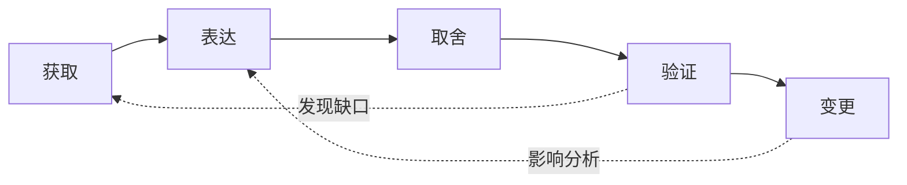

# 第 2 章 需求分析方法

> **节首信息条**｜对应课次 2 · 2 学时 · 理论讲授｜前置：第 1 章的软件生命周期与过程模型；基本的访谈与文档阅读经验｜**课次产品**：《duty 需求文档 v1》（课末布置、课后完成）｜**本节活动**：◇ 课堂活动块（听讲要点 / 讨论·演示）

1999 年 9 月 23 日，美国宇航局的火星气候探测者号在进入火星轨道时失联，最终在大气层中解体，项目损失约 1.25 亿美元（来源：美国宇航局事故调查委员会 1999 年报告）。直接原因听起来很小：地面软件计算推进器冲量时用的是“磅力·秒”，探测器软件期望的是“牛顿·秒”，两边都没有换算。两个团队各自都“按自己的规格做对了”，系统却失败了。

事故报告里还有一句更值得注意的话：这个单位约定在项目早期就存在，但在多次评审中都没有被明确写下来。也就是说，失败不是没人发现问题，而是**问题没有被写成一条可检查的需求**。

## 本章要解决的问题

**用户说不清自己想要什么时，工程师怎样把模糊表述变成可开发、可验收的条目？**

用户给出的往往是一句愿望，而不是一条需求；“想要什么”与“真正需要什么”之间隔着方案选择，也隔着不同角色之间的冲突。这些内容如果只留在对话和印象里，开发、测试与验收三方拿到的就是三份不同的理解。

本章依次处理需求的三类内容、怎样获取与分析、从模糊表述到用户故事与验收标准、以及当所有需求都要做时如何取舍，最后把条目组织成一份可交付的需求文档。

## 本章学习目标

读完第 2 章，你应该能：

1. 区分功能需求、非功能需求与约束条件，说明为什么接口的单位与格式也属于需求。
2. 区分“用户想要的”与“系统真正需要的”，并识别一个项目的主要利益相关者（Stakeholder）。
3. 把一条模糊业务描述改写成“用户故事（User Story） + 验收标准（Acceptance Criteria）”。
4. 用三个检查判断一条验收标准是否合格，并把非功能需求改写成可度量的指标。
5. 用 MoSCoW 做需求取舍，说明本期做什么、不做什么，以及需求变更时哪些交付物要跟着变。
6. 按课末「课次产品交付卡」自查，并交出一份《duty 需求文档 v1》。

## 2.1 需求的分类

**软件需求**是对系统必须提供的功能、达到的质量与所受约束的说明。按回答的层次，它可以分三层：业务需求回答“为什么做”，用户需求回答“给谁做什么”，功能需求回答“系统具体提供什么操作”。本书主要展开后两层；业务需求由项目背景与目标承担，不单独建模。

需求不是一次问完的清单，而是一组反复进行的活动：获取 → 表达 → 取舍 → 验证 → 变更。获取是把利益相关者的期望问出来；表达是写成用户故事与验收标准；取舍是用优先级定下本期范围；验证是回头确认“写下的就是对方要的”；变更则把后续修改纳入记录。这条闭环与第 1 章生命周期的“需求”阶段对应，本章 2.1–2.6 走的就是它。

*图 2-1：需求工程的五活动闭环*

火星气候探测者号的失败，把需求阶段的真正任务暴露出来：需求不只回答“系统做什么”，还要回答“做得怎么样”和“受什么限制”。因此，需求通常分成三类。

| 类型 | 回答的问题 | 图书借阅系统的例子 |
| --- | --- | --- |
| 功能需求 | 系统做什么 | 借书、还书、续借、查询、逾期罚款 |
| 非功能需求 | 做得怎么样 | 查询响应小于 1 秒；只有图书馆员能入库；数据每天备份 |
| 约束条件 | 外部限制 | 必须使用学校统一身份认证；部署在校园网内 |

三类需求缺一不可。只写功能，系统可能“能用但不好用”或“能用但不安全”；只写非功能，团队不知道要开发什么；漏掉约束，方案可能在落地时才发现与环境冲突。其中**非功能需求**最容易被写成形容词，它必须落到可观察的条件上，后文 2.5 会给出量化方法。

火星气候探测者号缺的是一条看起来最不起眼的内容：**接口约定**。单位、数据格式、字段含义、错误码，都属于必须写清的需求内容。它们不像功能那样“看得见”，却决定了两个团队能否对上。凡是“双方各自做对、合起来却失败”的事故，追到根上几乎都有一条没写下来的接口约定。

> 💡 **易错点**：把需求文档写成功能清单。功能清单只回答了第一类需求；没有非功能指标与约束，系统可能“功能全有，却不能用、不能部署”。

## 2.2 需求与方案的分界

需求分析最难的判断，是区分“用户想要的”和“用户真正需要的”。用户说“我想要一个搜索框”，背后可能是“我想快速找到某本书”。搜索框是方案，快速找到是需求。方案可以换：搜索框、筛选器、扫码、分类导航都能满足“快速找到”，但需求本身不变。

这个区分之所以重要，是因为方案会随技术和界面变化，而需求相对稳定。如果把方案当成需求写进文档，团队就会被锁死在一种实现上；更糟的是，一旦方案不能满足真实需求，返工时连“原来要解决什么问题”都说不清。

判断一条表述是需求还是方案，可以问一句：**去掉这个具体做法，原来的问题还在不在？** 还在，说明它是方案；问题本身才是需求。例如“加一个导出按钮”去掉按钮后，“值班管理员要能把月度统计带回去核对”仍然成立，后者才是需求。

> 💡 **易错点**：把界面当需求。“系统要有一个红色按钮”是方案，“值班员要能在一屏内确认今日值班人员”才是需求。写需求时多问一句“他要这个按钮解决什么问题”。

## 2.3 利益相关者与获取方法

需求不是“用户”一个人的。一个图书借阅系统至少涉及学生、图书馆员、管理员和运维人员；一个值班统计系统至少涉及值班员、部门管理员、统计人员和系统管理员。不同角色的目标可能冲突：值班员希望少填字段，统计人员希望数据完整；管理员希望权限集中，运维希望操作可追溯。因此，需求获取要先列出利益相关者，再分别问“他用系统做什么、最怕什么、什么情况下会出错”。

以 duty 项目为例，可以先列一张这样的表：

| 角色 | 关心什么 | 最怕什么 | 适合的获取方法 |
| --- | --- | --- | --- |
| 值班员 | 少填字段、看得到自己的班次 | 重复填写、排班信息滞后 | 访谈、现场观察 |
| 部门管理员 | 权限清楚、人员归属正确 | 越权查看、误改别人数据 | 访谈、文档分析 |
| 统计人员 | 数据完整、口径一致 | 口径变化导致报表对不上 | 访谈、样例数据核对 |
| 运维人员 | 可部署、可追溯 | 配置散落、日志不足 | 文档分析、原型演示 |

获取需求没有一种万能方法。下表把五种常用方法放在一起，按“能补什么、容易漏什么、获取后怎么复述确认”对照：

| 方法 | 能补什么 | 容易漏什么 | 获取后复述确认 |
| --- | --- | --- | --- |
| 访谈 | 业务规则、例外处理、角色的真实顾虑 | 说话人自己都没意识到的操作习惯 | 用一段话复述给对方，请对方指出不符处 |
| 现场观察 | 实际操作顺序、系统之外的纸质环节 | 只看到顺利的一天，漏掉异常与忙时 | 把观察到的步骤画成流程，请操作人逐项确认 |
| 问卷 | 大范围意见与偏好，适合取舍 | 问不出原因与上下文 | 对典型回答做回访，确认理解一致 |
| 原型 | 界面与交互的期望，能引出隐性需求 | 容易被当成“已经定了的方案” | 每次演示只确认一个目标，记录对方的修改理由 |
| 文档分析 | 字段、格式、既有约束与历史数据 | 文档过期，与实际流程不符 | 拿现有表格对照一次真实业务，标出差异 |

**这些方法只需知道“什么缺口用什么方法补”，不要求在本章掌握操作技巧**；后续课程项目与练习时再按需选用。

**获取之后的分析四步**

问到的材料是原始记录，还不能直接写成用户故事。分析要做四步加工：

1. **分类**：把每条记录归到功能需求、非功能需求或约束条件，先分清“要做什么”“做到什么程度”“受什么限制”。
2. **去重与冲突消解**：同一件事被不同角色重复描述时合并；两个角色的要求矛盾时，找到冲突背后的业务目标，而不是简单取一个。
3. **抽出业务对象与业务规则**：从名词里找出需要长期保存的对象（如部门、人员、值班记录），从“必须”“不能”“只能在……时”里找出规则。
4. **一致性检查**：角色名、对象名、字段名与优先级在整份材料里是否一致；不一致的地方回到获取环节补问。

四步做完，才进入 2.4 的用户故事与 2.5 的验收标准。跳过分析直接写故事，常见结果是故事很多、对象不清、规则散落。

## 2.4 用户故事的要素

把需求写成团队能共同检查的形式，常用**用户故事**：

> 作为 **[角色]**，我想要 **[功能]**，以便 **[价值]**。

角色回答“谁需要”，功能回答“要做什么”，价值回答“解决什么问题”。三者缺一，故事就会退化成一句功能名称。

例如“系统要能借书”不是好故事；“作为学生，我想要通过学号借书，以便不用带借书卡”才把角色、功能与价值说清。再比如“作为图书馆员，我想要扫描条码完成还书，以便在借阅高峰期快速处理归还”，读者能立刻判断这条故事该由谁验收、在哪个界面发生。

放到 duty 项目里，同一个写法可以落在具体页面上：“作为值班管理员，我想要按部门筛选人员列表，以便安排本周值班。”角色对应登录后的管理员身份，功能对应人员列表页的部门筛选框，价值对应排班前的核对动作。故事写到这里，开发和验收都能指着同一个界面说话。

用户故事写完后，可以用 INVEST 做一次自查：独立（Independent）、可协商（Negotiable）、有价值（Valuable）、可估算（Estimable）、足够小（Small）、可测试（Testable）。本章只要求会用最后一条：**如果一条故事无法写出验收标准，它通常还没有写清楚。**

## 2.5 验收标准的检查项

仅有故事还不够，还要有**验收标准**。验收标准回答“做到什么程度算完成”，写法有三个检查：

1. **可验证**：能用一个操作或一组数据判断通过或不通过；
2. **覆盖异常**：正常流程之外，至少考虑无数据、超限、输入错误等情况；
3. **不写实现**：写“系统应该怎样”，不写“用哪个函数、哪个组件”。

例如“还书”的验收标准可以写成：扫描有效条码后显示借阅记录与应还日期；条码无效时提示“无法识别”且不改变借阅状态；逾期时显示逾期天数与罚款金额。

**给定—当—则**

三个检查回答“合不合格”，具体写下来还需要一个统一结构。“给定—当—则”（Given-When-Then）把一条验收标准拆成三段：

- **给定**某个前置条件；
- **当**执行某个操作；
- **则**系统产生某个可观察的结果。

例如“还书”的一条标准可以写成：“给定一本处于借出状态的图书，当图书馆员扫描有效条码，则系统显示借阅记录与应还日期，并把状态改为‘已归还’。”三段各自可核对：给定是测试的初始状态，当是操作步骤，则是断言。

它比自由句子多出来的，是可执行性：测试能按“给定”造数据、按“当”走操作、按“则”写断言；验收人员也能据此判断通过与否。写不出“则”的那一条，通常说明需求还没说清要观察什么。

> 💡 **易错点**：把“则”写成实现动作。“则调用更新接口”不是可观察结果，“则页面显示已归还，借阅记录状态同步”才是。

**非功能需求的三项检查**

“系统要快”“系统要安全”“系统要好用”都不是可验收的需求。非功能需求必须落到可观察的条件上。

| 类别 | 模糊写法 | 可验证写法 |
| --- | --- | --- |
| 性能 | 系统要快 | 查询响应小于 1 秒（1000 条数据、20 人并发） |
| 安全 | 系统要安全 | 只有图书馆员能入库；密码不明文存储 |
| 可用性 | 要好用 | 借书流程不超过 3 步；错误提示能说明下一步 |
| 可维护性 | 代码要好 | 新增一条借阅规则不改动页面代码 |

量化的意义不只是“方便测试”，更是让开发、测试和验收三方对“做到什么程度”有同一个理解。接口约定尤其如此：单位、格式、字段含义不写清，就会出现“双方都做对、系统却失败”。

> 💡 **易错点**：验收标准写成“界面友好”“响应快速”。这类词无法判断通过与否，等于没有标准。把它改成“在 1000 条数据、20 人并发下，查询响应不超过 1 秒”。

## 2.6 MoSCoW 优先级

需求永远多于时间。优先级不是“重要/不重要”的二分，而是明确“这一期必须做什么、可以晚一点做什么、这一期不做什么”。常用 **MoSCoW** 划分：

| 优先级 | 含义 | 图书借阅系统的例子 |
| --- | --- | --- |
| Must | 本期必须交付，缺了系统不能用 | 借书、还书、查询图书 |
| Should | 重要但可以短期替代 | 续借、逾期罚款 |
| Could | 有余力再做 | 预约、推荐 |
| Won't | 本期明确不做 | 社交分享、积分商城 |

优先级不是拍脑袋。一个实用的判定法是逐条问：**如果本期不做这一条，哪条业务流程会断？** 会断的才是 Must；能用人工或现有工具替代的，通常是 Should 或 Could；本期明确不做的，写进 Won't 并说明原因。如果一份清单里一半以上都是 Must，等于没有排序。

与优先级配套的是最小可行产品（Minimum Viable Product，MVP）：先交付能验证核心价值的最小完整范围，再按反馈扩展。MVP 不是“做一半”，而是“把最关键的闭环做完整”。把 Won't 写清楚，和把 Must 写清楚同样重要，它防止范围在开发中悄悄膨胀。

**优先级的阶段性变化**

优先级会随业务变化而调整，所以它需要两个配套动作。

第一，**每条优先级后面写一句理由**。评审时才有讨论依据；否则争论会变成“我觉得重要”对“我觉得不重要”。

第二，**变更时评估影响**。需求变更不可避免，关键是变更时有依据、有记录。变更记录要回答四个问题：谁提出、为什么改、影响哪些模块、何时完成。改一条需求往往意味着改设计、改代码、改测试；变更记录本身就是影响分析的起点。

> 💡 **易错点**：把“用户说都要”当成优先级。用户当然都想要；工程师的任务是给出范围与代价，让“本期不做什么”成为共同决定，而不是开发到一半才发现做不完。

还有一点要提前说明：需求不是设计、编码和测试的“前置文件”，而是它们的共同输入。设计阶段的模块划分来自需求中的角色与功能边界；接口文档来自需求中的数据项与操作；测试用例来自验收标准。需求越模糊，后续每个环节都要替它做猜测，而猜测会在联调或上线时集中暴露。

**需求阶段到此为止；第 3 章起把这些条目变成接口与代码。**

## 示范例题

#### 例 2-1：把“搜索框”还原成需求【Bloom：理解】

**题目**：下面这句话是需求还是方案？“系统要有一个搜索框，能按书名搜书。”请把它改写成一条用户故事，并指出角色、功能、价值三部分；如果原句包含方案，说明方案与需求的区别。

**解**：

1. 原句混合了方案与需求。“搜索框”是界面方案，“按书名找书”是需求；方案可以换成筛选器或扫码，需求不变。
2. 改写成用户故事：作为学生，我想要按书名查找图书，以便快速确认馆藏并借阅。
3. 拆解三要素：角色是学生；功能是按书名查找图书；价值是快速确认馆藏并借阅。
4. 方案与需求的区别：方案回答“怎么实现”，需求回答“解决什么问题”；方案会随技术变化，需求相对稳定。

#### 例 2-2：为“还书”写验收标准【Bloom：应用】

**题目**：为“作为图书馆员，我想要扫描图书条码完成还书，以便快速处理归还”写 3 条验收标准，分别覆盖正常流程、异常情况、业务规则。

**解**：

1. **正常流程**：扫描有效条码后，系统显示该书的借阅记录与应还日期，并将状态改为“已归还”。理由：正常路径必须能被一次操作验证。
2. **异常情况**：条码无效或图书不属于本馆时，系统提示“无法识别该图书”，且不改变借阅状态。理由：异常路径要说明系统拒绝什么、保持什么。
3. **业务规则**：若已逾期，系统显示逾期天数与罚款金额，并按规则生成罚款记录。理由：业务规则要落到可观察的结果，而不是“系统会处理”。

## 独立习题

#### 习题 2-1【Bloom：理解】

**题目**：判断下列用户故事的好坏，并说明理由。

1. 作为用户，我想要一个好用的系统，以便用得舒服。
2. 作为学生，我想要通过学号借书，以便不用带借书卡。
3. 作为管理员，我想要系统支持所有功能。

#### 习题 2-2【Bloom：分析】

**题目**：火星气候探测者号案例中，地面软件与探测器软件各自“按自己的规格做对了”，系统却失败。请从需求与接口契约的角度指出至少三处缺失，并说明每处应补什么内容。

#### 习题 2-3【Bloom：理解】（概念辨析）

**题目**：“用户说的就是需求”这句话为什么不可靠？请结合本章“想要的与需要的”、利益相关者与验收标准三点说明。

#### 习题 2-4【Bloom：分析】（概念辨析）

**题目**：某小组要为校园二手交易平台补齐需求，遇到四个信息缺口：① 不知道交易纠纷按什么规则处理；② 不知道学生发布商品时会不会漏填关键信息；③ 想了解全校学生对“担保交易”的接受程度；④ 不确定“求购”页面该长什么样。请分别为四处缺口选择最合适的一种获取方法（访谈 / 现场观察 / 问卷 / 原型 / 文档分析），各写一句理由，并指出哪一种方法专门补「隐性流程」。

#### 习题 2-5【Bloom：创造】（开放题，换场景）

**题目**：单位要上线“器材借还管理”：值班员借出器材、登记归还，管理员能查看谁借了什么。请为这个场景写 3 条用户故事，每条标明角色、功能、价值，并为其中 2 条各写 2 条验收标准，分别覆盖正常流程与一种异常情况。**不能照抄本章借书、还书的例子**：器材有编号、可损坏、可逾期，验收标准要落到这些差异上。

#### 习题 2-6【Bloom：分析】

**题目**：下面是一段访谈记录。请按要求做纸上辨析，**不要写成功能清单或需求文档**。

> 值班员：现在排班靠 Excel，最怕两个人排到同一时段；月底统计要一格格数，容易错。
> 部门管理员：我只想看我们部门的值班情况，别让我看到别的部门；人员调动后，联系方式经常对不上。
> 统计人员：我要按月份看每个人的值班次数和总时长，跨月的班怎么算要有个准。
> 运维人员：系统要在内网跑，最好别依赖外网服务。

1. 把四条记录分别归到功能需求、非功能需求或约束条件。
2. 找出至少一处角色之间的冲突或潜在冲突，并说明冲突背后的业务目标。
3. 抽出至少三个需要长期保存的业务对象，以及至少两条业务规则。
4. 指出还需要向谁补问什么，才能把其中一条写成可验收的条目。

## 课次产品交付卡

**交什么**：课次 2 的课次产品是《duty 需求文档 v1》。课末布置、课后完成，按课次 2 提交；它是「专题一：duty 需求文档（4%）」的考核载体，不另设演示或答辩。

同一份文档要能被三方各取所需：**开发**取功能边界、角色权限与字段约束；**测试**取验收标准与异常情况；**验收**取本期 Must 范围与“做到什么程度算完成”。下面的五部分就是按这三类需要组织的。

**五部分结构**（正文按这五块组织，顺序可调，内容不能缺）：

| 部分 | 写什么 | 可检查判据 |
| --- | --- | --- |
| 项目背景与目标 | 系统解决什么业务问题、给谁用、本期明确不做什么 | 能说清系统边界与 Won’t 范围 |
| 用户角色与职责 | 谁使用、谁被管理、各自能做什么、能看哪些数据 | 每个角色有主要操作、数据权限与不能做的事 |
| 功能清单与 MoSCoW 优先级 | 按业务域组织的“动词 + 对象”条目，每条标 Must / Should / Could / Won’t | 条目可执行，每条优先级附一句理由 |
| 用户故事与验收标准 | 关键功能的角色、功能、价值，以及“给定—当—则” | 每条 Must 功能都有可执行的验收标准 |
| 非功能需求与约束 | 性能、安全与保密、可用性、兼容性、可靠性；技术栈、环境、时间与前提 | 每条非功能需求有条件与指标，约束可判断 |

**交前自查**（逐项打勾，全部为“是”再提交）：

- [ ] 角色名、功能名与字段名在全文只有一个叫法，没有“值班记录 / 值班单”这类混用
- [ ] 功能清单每条都是“动词 + 对象”，没有“XX管理”这类模块名
- [ ] 功能清单与用户故事能一一对应，关键功能都有故事
- [ ] 每条优先级都写了理由，Must 只保留“不做就断主流程”的
- [ ] 关键功能至少有 5 条“给定—当—则”，覆盖正常流程与一种异常
- [ ] 非功能需求有条件与指标，不写“稳定、系统要安全、响应快”
- [ ] 人员、部门与联系方式按前言「关于书中的数据」的三条写法处理，不含真实数据

**提交说明**：文档开头写一段文档信息（版本、日期、编写人、修订说明）；正文用 Markdown 或 Word 均可。课上的自查与互看只作检查，不另设评审课，也不印发标准答案。

## ◇ 课堂活动块（课次 2 · 理论讲授）

**听讲要点**：

1. 需求分为功能需求、非功能需求与约束条件；接口约定也是需求。
2. “想要的”不等于“需要的”，界面方案不等于需求。
3. 获取方法要与信息缺口匹配；获取后按分类、去重与冲突消解、抽业务对象与规则、一致性检查四步分析。
4. 用户故事写角色、功能与价值；写不出验收标准，通常说明还没写清。
5. 验收标准要可验证、覆盖异常、不写实现；结构化写法是“给定—当—则”；非功能需求必须量化。
6. MoSCoW 明确本期做什么、不做什么；每条优先级要有理由。
7. 课次产品按「课次产品交付卡」组织成五部分，交前逐项自查。

**讨论·演示**：

1. （讨论）教务处说“要能统计值班”，这句话里缺了哪些可以验收的信息？
2. （演示）把一条“查询要快”的非功能需求改成可度量的验收标准。

## 本章小结

**核心结论**：

1. 需求由功能需求、非功能需求与约束条件组成；接口约定（单位、格式、字段含义、错误码）也属于需求内容。
2. 获取方法要与信息缺口匹配：访谈补规则与例外，观察补操作习惯，问卷补大范围意见，原型补交互期望，文档分析补字段与约束；获取后要复述确认。
3. 分析是四步加工：分类 → 去重与冲突消解 → 抽出业务对象与业务规则 → 一致性检查；跳过分析直接写故事，会导致对象不清、规则散落。
4. “想要的”不等于“需要的”，界面方案不等于需求；**用户故事**由角色、功能、价值三部分组成；写不出验收标准的故事，通常还没写清。
5. **验收标准**要可验证、覆盖异常、不写实现；结构化的写法是“给定—当—则”。**非功能需求**必须量化，否则无法测试和验收。
6. 优先级用 **MoSCoW** 明确本期做什么、不做什么；需求变更时记录谁提出、为什么改、影响哪些模块、何时完成。

把这章压缩成一句话：**需求工作的价值，是把“我想要”翻译成“做到什么程度算完成”。**

**学完本章，你可以体会到**：需求工作的价值不是“多写几条”，而是把模糊的期望变成开发能实现、验收能判断的句子。

**自检**：回到章首的学习目标，逐条问自己做到了没有——

- [ ] 区分三类需求，说明为什么接口的单位与格式也属于需求。
- [ ] 区分“想要的”与“需要的”，识别主要利益相关者，并按缺口选择获取方法。
- [ ] 把模糊业务描述改写成“用户故事 + 验收标准”。
- [ ] 按分类、去重与冲突消解、抽对象与规则、一致性检查四步分析一段访谈记录。
- [ ] 用三个检查判断验收标准，并用“给定—当—则”写出可执行的标准；把非功能需求写成可度量指标。
- [ ] 用 MoSCoW 取舍，说明本期做什么、不做什么与变更影响。
- [ ] 按「课次产品交付卡」自查并交出《duty 需求文档 v1》。

**下一章预告**：需求阶段到此为止。下一章把需求条目变成前后端都能调用的接口：先约定契约，再用 FastAPI 写出最小实现。
