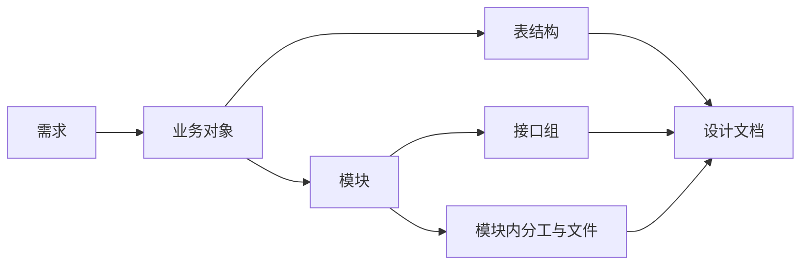
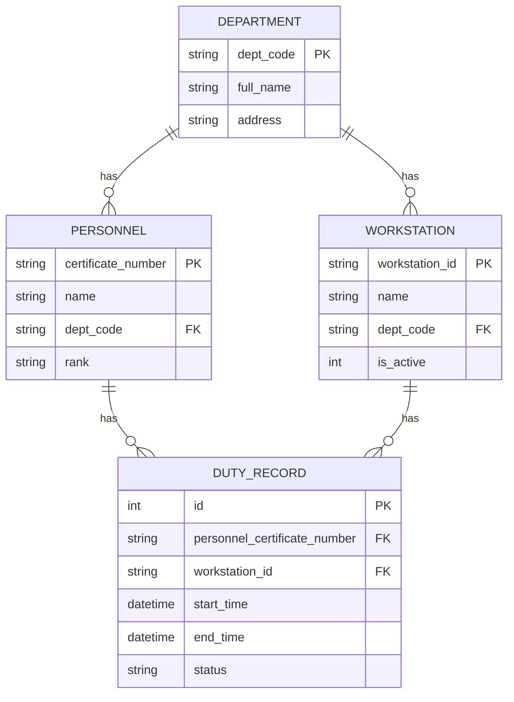

# 第 4 章 软件设计与建模

第 3 章说明了接口的形式与实现。一个系统通常包含多个业务对象，每个对象都需要相应的表、模块与接口组；这些决定彼此关联，不能只在一处成立。

决定之间的牵连，使这项工作无法等代码写完再补。

## 本章要解决的问题

**一份需求如何逐步转化为表、模块、接口组、模块内分工与文件，并形成他人可依循的设计文档？**

多个业务对象各自需要表、模块与接口，各项决定相互关联：表缺少一个字段，接口需随之修改；模块划分错误，页面与测试均需返工。若这些决定分散于代码各处，阅读者每次均需重新查找。

本章关心的是：一份需求里的名词与动作，怎样变成表、模块、接口与目录；这些决定又怎样写下来，使后来的人不必重新推导。

## 本章学习目标

读完第 4 章，应能：

1. 说明设计是从需求到结构的翻译链、每一步的产出，以及该顺序的依据与调整条件。
2. 从需求中提取业务对象，为每个对象设计表结构，正确使用主键（Primary Key）、外键（Foreign Key），并说明一对多（One-to-Many）关系。
3. 按业务能力划分模块，以一句话说明每个模块的职责，并指出每个模块对应的文件夹。
4. 判断一组接口是否符合 RESTful，并为 CRUD 模块写出五个标准接口的方法、URL、参数来源与成功状态码。
5. 用耦合与内聚说明四层分工的理由，并说明六类职责在模块模板中的位置。
6. 完成六文件最小四层实现：以单位对象为例设计表、模块、接口组与目录，写出六个文件并用 `Depends` 注入查询参数，验证状态码与设计的一致性；课后可改编为自选对象。

## 4.1 软件结构设计

设计不是撰写文档，而是将需求转化为结构的过程。该过程可分为六个步骤，每一步产生一项可检查的产物。

这六个步骤不是任选的，它们之间有一条固定的先后关系：**后一步要以前面步骤的产出为输入**——先从需求提取业务对象，业务对象再决定表怎么建、模块怎么分，模块再决定接口与内部如何分工，最后把所有决定记录成文档。正因为后面每一步都依赖前面的结论，所以顺序不能颠倒。六个步骤如下：

| 步骤 | 输入 | 要回答的问题 | 产出 |
| --- | --- | --- | --- |
| 1 | 需求 | 系统要管理哪些业务对象？ | 业务对象清单 |
| 2 | 业务对象 | 每个对象的数据怎么存？ | 表结构、主键、外键、关系 |
| 3 | 业务对象 | 每个对象由哪段代码负责？ | 模块清单与一句话职责 |
| 4 | 模块 | 模块对外提供什么操作？ | 接口组（方法、URL、参数、返回） |
| 5 | 模块 | 模块内部怎样分工？ | 模块内部的代码分工与文件安排 |
| 6 | 前五步的产物 | 这些决定怎样记录、怎样检查？ | 设计文档 |



*图 4-1：从需求到结构的设计翻译链*

该过程具有两个特点。

第一，每一步缩小问题范围。需求阶段的问题范围是整个业务；到表结构阶段，问题变为字段与关系；到接口阶段，问题变为调用方、输入与输出。问题越具体，越容易检查。

第二，跳过任一步都会放大后续错误。若未从需求提取业务对象而直接编码，通常出现字段边写边加、表边用边改；若未先确定模块，接口会按页面或人员临时分配，同一业务对象被多处读写；若未先确定模块内部的分工，业务规则会散落在处理请求的代码里，无法单独测试。设计阶段增加的半小时，可减少后续数日的返工。

**顺序的依据**

该顺序的排序原则为：**先确定变化最慢、修改代价最高的决定，再确定依赖它的决定。**

- 业务对象最稳定。单位、人员、执勤记录不因页面改版而消失；其来源是业务词汇，而非界面。
- 表结构最难修改。数据写入后，修改字段需迁移历史数据，并同步修改接口、页面与测试；因此表结构应尽早确定。
- 模块依赖业务对象。模块解决“哪段代码负责该类数据”的问题；对象确定后，模块边界才有依据。若先定模块再找对象，边界容易按页面或人员划分。
- 接口依赖模块。接口是模块对外的承诺；模块职责不清时，接口会成为按页面临时拼合的端点。
- 分工依赖操作。分工是模块内部代码如何组织的问题；明确模块提供的操作与承担的规则后，才能决定哪些代码负责接收请求、哪些代码负责写规则。
- 文件安排依赖分工。分工确定一段请求经过哪些角色，文件安排确定各角色代码写在哪个文件；分工确定后，文件位置才有依据。
- 文档最后编写。文档记录已做出的决定；先写文档等同于先写假设。

若顺序相反，会出现相应问题：

| 如果先定 | 常见后果 |
| --- | --- |
| 页面 | 页面结构决定数据模型；同一字段在多个页面重复，接口按页面定制，复用困难 |
| 模块 | 模块按页面、人员或技术切；同一张表被多个模块读写，耦合上升 |
| 接口 | 契约看起来完整，但数据库无法约束；非法状态仍能写入 |
| 分工 | 结构已划分但无实际内容；负责规则的代码为空，规则仍堆在处理请求的代码里 |
| 文件安排 | 文件按人员习惯放置，同类代码分散于多处；接手者需先花时间查找 |

**其他设计起点**

设计方法不唯一。常见的设计起点有四种：对象与数据优先、用例与行为驱动、接口优先（API-first）、领域驱动（DDD）。用例驱动从用户场景出发，接口优先从对外契约出发，领域驱动从领域模型与边界上下文出发；四者的区别只在“先确定什么”。

执勤电子年鉴采用对象与数据优先，原因有四：执勤电子年鉴是以数据为中心的 CRUD 系统；业务词汇稳定；表结构变更代价高；前后端契约是主要协作边界。若项目性质不同，该顺序可能不再适用。

**什么时候调整顺序**

设计顺序不是瀑布模型。发现对象遗漏或规则变化时，可以返回上一步；该顺序是“先明确再编码”的顺序，不是“每步只执行一次”的流程。

以下三种情况应调整顺序：

- 对外契约已经固定（例如对接上级系统）：先确定接口，再反推数据与模块。
- 领域规则复杂、跨多个子域：先建立领域模型，再确定表与模块。
- 页面或交互是主要风险：先制作原型，再反推数据与接口。

跨模块的公共决策（例如统一认证、统一分页格式）需在链外单独约定。设计文档不必写成数十页，足以指导他人实施即可；过度设计同样产生成本。

> 💡 **易错点**：将设计文档当作链的起点。文档是链的产物，不是输入；先有表、模块与接口的决定，才有可写的文档。

## 4.2 业务对象、代码模块与表结构

链的前两步是从需求中提取业务对象，并为每个对象设计表结构。需求条目中的名词通常是候选对象：单位、人员、哨位、执勤记录。一个业务对象对应一组需要长期保存的数据，通常对应一张表。

关系数据库以表存储一类数据，该模型由 Codd 于 1970 年提出。表中每一行是一条记录，每一列是一个字段。为区分记录，需要一个能唯一标识该行的字段，称为主键。为表达两张表之间的关系，需在一个表中存放另一个表的主键，称为外键；主键与外键是 SQL 标准中的约束概念。

先把这两个概念从业务里抽出来，单独看它们解决什么。设有两张表，分别记作**表 A** 与**表 B**，各自保存一类对象。表 A 的每一行需要能被单独指出，于是选一个字段作**主键**，保证它的取值在表 A 内不重复——凭这个值就能确定是哪一行。表 B 的某些行与表 A 的某一行存在关联，就在表 B 中另设一列，专门存放表 A 那一行的主键值，这列就是**外键**。外键本身不是表 B 自己的信息，而是“借用”了表 A 的主键，把两张表的一行连到一起。主键回答“这一行是谁”，外键回答“这一行和谁有关”。

“一对多”是最常用的关系。它的含义是：表 A 的一行，对应表 B 的多行；而表 B 的每一行，只对应表 A 的一行。这时外键应当放在“多”的一侧，也就是表 B 中。

下面把这个关系落到具体业务上。这个业务是**执勤数据统计分析**：一个单位里有若干人员，人员在不同哨位执勤，每次执勤形成一条执勤记录，记录汇总起来用于统计分析。四张表分别是单位（department）、人员（personnel）、哨位（workstation）与执勤记录（duty_record）。

单位表以 `dept_code` 为主键；人员表以证件号 `certificate_number` 为主键，另加一列 `dept_code` 作外键指向单位表；哨位表以 `workstation_id` 为主键，同样用 `dept_code` 外键指向单位表；执勤记录表再加 `personnel_certificate_number` 与 `workstation_id` 两列作外键，分别指向人员表与哨位表。

一个单位有多名人员，一名人员只属于一个单位；一名人员可有多条执勤记录，一条执勤记录只属于一名人员；一个哨位也可对应多条执勤记录。所以外键都放在“多”的一方：每条执勤记录只存一个人员证件号与一个哨位编号，就能表明“谁在哪个哨位执勤”。若反过来把人员证件号列表塞进单位表，一个单位几十人就要在一行里存几十个值，既难查询、也无法保证列表里的证件号都真实存在。

外键置于“多”的一方，原因可从查询与修改两方面说明。查询某单位的全部人员时，只需在人员表中按 `dept_code` 过滤；人员调整单位时，只需修改人员表中的一行。若将人员编号列表存入单位表，查询需拆分字符串，修改需重写整个列表，且数据库无法约束列表中的编号是否存在。**关系的方向决定查询与约束的写法**；外键位置颠倒时，后续代码需持续补偿该结构缺陷。

将单位、人员、哨位、执勤记录放在一起，其关系如下图。



*图 4-2：单位—人员—哨位—执勤记录的一对多关系*

读图时需确认三点：主键（PK）所在列；外键（FK）指向的表；连线两端是一还是多。单位与人员、单位与哨位、人员与执勤记录、哨位与执勤记录均为一对多；外键分别位于人员表与执勤记录表，即“多”的一方，其中执勤记录表同时持有指向人员与哨位的外键。

本步产物为核心四张表及其关系。表确定后，下一个问题是：这些表由哪些代码操作？该问题属于链的第三步，即模块。

> 💡 **易错点**：将外键置于错误的一侧。若在单位表中存储“人员证件号列表”，一个单位包含多名人员时需在一行内保存多个值，既难以查询，也无法约束。

表结构解决数据存储问题，模块解决代码归属问题。二者按同一批业务对象划分：一个业务对象通常对应一个模块，模块负责该表的读写与相关规则。

模块按业务能力划分，不按页面划分。按业务能力（业务对象）划分模块，是领域驱动设计与信息隐藏原则的共同建议。需求条目的功能清单通常已按业务域分组：登录与账号、单位、人员、哨位、执勤。每个业务域大体对应一个模块，并以一句话说明职责。

| 需求（功能簇） | 业务对象 | 模块 | 一句话职责 |
| --- | --- | --- | --- |
| 管理单位信息 | 单位 | `department` | 维护单位基本信息 |
| 管理人员信息 | 人员 | `personnel` | 维护人员及其所属单位 |
| 管理哨位信息 | 哨位 | `workstation` | 维护哨位基本信息 |
| 记录执勤数据 | 执勤记录 | `duty_record` | 记录与查询执勤安排 |
| 统计分析执勤数据 | 无独立表 | `analytics` | 汇总执勤记录并输出统计结果 |

账号与登录不在上述四个业务对象之内，`users` 表与 `user` 模块单独设计，不与这四张表建立外键关系。

模块划分需回答两个问题：该模块负责哪类业务对象？对外提供哪些操作？若一句话无法说明，通常表明模块职责过多或边界未明确。

并非每个模块都拥有自己的数据表。统计要回答的问题跨越多张表：某人在某年度的执勤天数、时段分布，都要从执勤记录、人员、哨位几张表里读出来，算完的结果不落回任何表。这类代码仍按业务能力独立成模块（`analytics`），职责是只读聚合；它依赖其他模块的表模型，其他模块不依赖它，依赖方向单一。**模块的存在依据是职责，不是是否拥有表。**

模块的产出有两项：模块清单，说明哪块业务能力由谁负责；文件夹名，说明代码所在位置。每个模块对应一个文件夹，例如 `app/modules/department/`、`app/modules/personnel/`，文件夹名与模块名一致。清单用于评审，文件夹用于代码组织，二者必须一一对应。

按页面划分模块是常见错误。页面会随界面调整而合并或拆分，业务对象不会。若“人员列表页”与“人员详情页”各对应一个模块，两个模块均需读写人员表，字段变更需修改两处；按业务对象划分时，人员表只由一个模块负责，页面仅作为调用方。

模块也不应划分过细。每个业务对象一个模块已足够；若再按“查询”“新增”拆分为独立模块，调用关系复杂，字段变更需跨多个模块。**模块粒度以“一句话能说清职责”为准**，并非越多越专业。

本步产物为模块清单及各模块的一句话职责。模块确定后，下一个问题是：模块之间、前后端之间如何通信？该问题属于链的第四步，即接口组。

## 4.3 接口组

一个业务对象通常对应多个接口：查询列表、查询单个、新增、修改、删除。若各接口分别定义 URL、方法与状态码，前端需为每个接口单独记忆规则，对接时无法预测，出错也难以定位。以下为一组反例：

- 删除单位：`GET /departments/delete?dept_code=D01`
- 查询单位：`POST /departments/query`，请求体传 `{"dept_code": "D01"}`
- 新增成功与失败都返回 `200`
- 查询单个单位有时写 `/departments/D01`，有时写 `/department/D01`

该组接口可以工作，但规则不统一：删除使用 GET，查询使用 POST，成功与失败均返回 200，单复数也不一致。他人接手时容易误用方法或地址；前端也无法依据统一规则推断新接口的调用方式。

**接口组**是围绕同一资源的一组接口。良好的接口组设计应使同类资源的操作遵循同一套规则，前端可据此推断其他接口的用法。REST 提供了这套规则。**REST**（表述性状态转移）由 Roy Fielding 于 2000 年的博士论文中提出；RESTful 指按该风格设计的接口。这套风格的核心做法可以概括为三点：URL 表示资源，HTTP 方法表示动作，状态码表示结果。该概括不是 Fielding 原文的完整定义；完整的 REST 还包含无状态、统一接口等约束。

| 操作 | 方法与 URL | 成功状态码 |
| --- | --- | --- |
| 查询集合 | `GET /departments` | 200 |
| 查询单个 | `GET /departments/D01` | 200 |
| 新增 | `POST /departments` | 201 |
| 修改 | `PUT /departments/D01` | 200 |
| 删除 | `DELETE /departments/D01` | 204 |

该表同时构成一个资源的接口组，包含查询列表、查询单个、新增、修改、删除五个动作。一个业务模块通常围绕一个业务对象提供此类接口组，因此接口组也是模块对外的承诺。下文说明接口组与模块职责的对应关系。

资源名使用名词复数，动作由 HTTP 方法表示。`GET /getDepartments` 将动作写入 URL，`POST /departments/delete/1` 以 POST 模拟删除，均不符合该风格。反之，当 URL 表示资源、方法表示标准动作、状态码表示结果时，接口具备可预测性：前端无需为每个接口记忆特殊规则，这张表本身也可作为接口核对清单。

**路径中的标识**

`GET /departments/D01` 中的 `D01` 是**路径参数**（Path Parameter），写在路径中，用于定位单个资源。该值不是页码，此处是资源标识，表示编码为 `D01` 的单位；服务端按 `dept_code` 查询这一条记录。REST 未规定标识必须是整数：整数主键、业务编码与 UUID 都可以。选择依据是唯一性、稳定性与可读性——单位编码由人指定、在业务中长期不变，一看即知是哪个单位，因此直接用它作标识。

集合使用 `/departments`，单个成员使用 `/departments/D01`，都不带末尾斜杠。项目内应保持一致：FastAPI 默认对末尾斜杠执行重定向，虽能访问，但写法不统一会增加对接成本，也让接口文档出现两个地址。

**RESTful 之外的设计方式**

RESTful 适用于资源清晰、以增删改查为主的系统，本课程的执勤电子年鉴属于此类。RESTful 并非唯一选择：需要一次获取多张关联表的数据时，RESTful 可能产生多次请求；对外提供固定业务动作时，将动作写入 URL 更直接。选择 RESTful 的理由是以同一套规则覆盖多数接口，降低前后端记忆成本；代价是复杂查询需在资源化与可读性之间折中。

> 💡 **易错点**：仅检查 URL 是否使用名词，而不检查方法与状态码。`GET /departments/D01` 与 `DELETE /departments/D01` 使用同一资源地址，区别在于方法；若删除也写成 `GET`，风格问题即转化为数据安全问题。

**接口组的范围与跨模块约定**

前述已给出一个资源的五个标准动作及其方法与 URL；第 3 章 3.2–3.3 说明了请求、响应与状态码。此处仅回答模块层面的两个问题：一个模块对应哪些业务对象、对外提供哪组接口；多个模块的接口组如何保持一致。

模块负责的业务对象决定接口组的对象范围。单位模块的接口组以 `dept_code` 定位，人员模块的接口组以 `certificate_number` 定位；动作相同，定位字段不同。若模块的一句话职责无法说明，接口组通常会出现用途不明的端点。

接口组代码写在模块文件夹的 `controller.py` 中，只声明契约，不写业务规则。

参数来源的判据见第 3 章 3.3：定位单个资源使用路径参数；筛选、分页使用查询参数；新增或修改的字段放入请求体。

多个模块的接口组应遵循同一套约定：分页参数统一为 `page` / `page_size`，列表返回统一包含 `items` / `total`，错误码含义一致。筛选参数按资源自身的业务字段命名，例如单位列表用 `dept_code`，执勤记录列表用 `personnel_certificate_number` 与 `workstation_id`；列表不设跨模块通用的排序参数。否则前端需为每个模块记忆一套参数名，接口文档也难以统一描述。

这构成一项设计检查：模块之间的接口组可以不同，但同类动作的约定必须相同。

本步产物为每个模块的接口清单及跨模块约定清单。接口确定后，仍需回答：请求进入模块后经过哪些代码？该问题属于链的第五步，即分层与目录。

## 4.4 模块内的分层与六类职责

第 3 章以路由与输入模型示例说明了 FastAPI 的机制；这些示例仅覆盖单个模块。单位、人员、执勤记录各有表、规则与接口，若全部写入 `main.py`，文件将达数百行，修改一处需通读全文。

本节回答：模块内部代码如何按职责分层，并落成哪六个文件？

**四层调用结构**

常见做法是将后端分为四层，每层承担一项职责；这是分层架构在本课程项目中的一种实现，其他项目的层数与名称可能不同。

| 层 | 职责 | 典型问题 |
| --- | --- | --- |
| controller | 接收请求、取出参数、返回响应 | 请求由哪一层处理？ |
| service | 写业务规则、组合多个操作 | 单位编码重复时是否拒绝？ |
| crud | 直接读写数据库 | 按条件查询单位表 |
| model | 定义表结构与字段 | 单位表有哪些列？ |

分层的理由可用两个概念说明。

**耦合**指两部分之间的依赖程度，即修改一处是否迫使修改另一处。**内聚**指模块内部各元素是否围绕同一件事。二者是软件设计中的经典度量概念。若 controller 直接编写 SQL，更换数据库需修改 controller；若 controller 仅调用 service，数据库变化被 crud 隔离，controller 不受影响。**分层的目的不是增加文件数量，而是将变化限制在最小范围内。**

`model` 仅负责表结构，`schema` 仅负责进出字段，`crud` 仅负责读写；若一个文件同时处理三类职责，修改其中一类将影响另外两类。内聚高的模块在阅读时无需在多个关注点之间切换。

另一相关概念是**信息隐藏**：每层只暴露调用方需要知道的接口，实现细节保留在内部。controller 无需了解 SQL 写法，service 无需了解表结构。隐藏越彻底，替换实现时影响越小。

**六个文件的分工**

四层之外，还有两类代码不位于请求处理路径上，但每个模块均需具备。

| 文件 | 负责什么 | 回答的问题 |
| --- | --- | --- |
| `schema.py` | 输入与输出模型 | 什么能进、什么能出？ |
| `param.py` | 查询参数模型 | 分页、过滤、排序怎么传？ |

请求体先由 `schema.py` 校验，校验失败返回 422；响应返回前由输出模型过滤字段，避免输出不应暴露的列。`param.py` 接收 `?` 之后的查询条件；参数较少时可直接写入函数签名，参数较多时收进模型。

因此，本课程的项目模板将标准模块定为六个文件：controller、service、crud、model 四层，加 schema、param 两个边界。**六类职责不等于六层**：四层描述请求路径，schema 与 param 描述进出的数据结构。

六类职责落成六个文件，置于一个模块文件夹中：

```text
app/modules/department/
├── __init__.py
├── controller.py
├── service.py
├── crud.py
├── model.py
├── schema.py
└── param.py
```

该目录结构包含三项约定：

1. `app/modules/` 下每个文件夹对应一个模块。新增业务模块时新增文件夹，六类代码各就其位。
2. 每个包目录均需包含 `__init__.py`，包括 `app/`、`app/core/`、`app/modules/` 及每个模块目录；缺少该文件时，导入可能失败。
3. 六个文件是**拥有数据表**的模块的标准配置。`analytics` 不拥有表，没有 `model.py` 与 `crud.py`，筛选条件由查询参数直接给出，只需 `schema.py`、`service.py`、`controller.py` 三个文件（`__init__.py` 是包本身，不计在内）。文件数量由职责决定，不由模板强制。

该结构只描述一个模块内部；把模块挂到应用上的工程级入口 `main.py` 在 4.5 的代码 4-5-8 出现，完整的工程目录见第 5 章 5.1。

**分层的成本**

分层也产生成本：每增加一层，即增加一次调用、一个文件与一处转发代码。小项目采用四层可能显得繁琐；本课程的执勤电子年鉴包含多个模块、多人协作，并需后续测试与部署，四层带来的定位成本低于其节省的修改成本。**分层并非越多越好，满足需要即可。**

> 💡 **易错点**：将所有逻辑集中于 controller。该写法在初期最快，但业务规则、SQL 与响应组装混杂，修改一个字段需通读整个函数，测试也无法单独调用规则。另一种更隐蔽的问题是“文件齐备但职责未分”：六个文件均已建立，controller 仍直接查询数据库，service 为空；分层仅具形式，修改时仍会遇到相同困难。

## 4.5 六文件最小实现

4.4 给出了六文件的模板，但模板本身不能运行。本节把 3.3 的单文件单位接口拆进六个文件，让五个端点在同一副骨架上跑通。数据仍放在内存中。

**代码 4-5-1** · 模块目录（文本）

```text
app/modules/department/
├── __init__.py
├── controller.py
├── service.py
├── crud.py
├── model.py
├── schema.py
└── param.py
```

**代码 4-5-2** · `app/modules/department/model.py`（内存版表结构，Python）

```python
from dataclasses import dataclass


@dataclass
class Department:
    dept_code: str
    full_name: str
    address: str | None = None


TABLE: list[Department] = []
```

`Department` 描述一行有哪些字段；`TABLE` 充当“表”，保存全部记录。`dataclass` 只管字段与类型，不管存取，因此这一段没有连接、事务与查询的代码。

**代码 4-5-3** · `app/modules/department/crud.py`（读写，Python）

```python
from . import model


def list_all() -> list[model.Department]:
    return model.TABLE


def get(dept_code: str) -> model.Department | None:
    for item in model.TABLE:
        if item.dept_code == dept_code:
            return item
    return None


def create(item: model.Department) -> model.Department:
    model.TABLE.append(item)
    return item


def update(item: model.Department, data: dict) -> model.Department:
    for key, value in data.items():
        setattr(item, key, value)
    return item


def delete(item: model.Department) -> None:
    model.TABLE.remove(item)
```

`crud.py` 只回答“怎么存取”，不判断“能不能存”。编码是否重复、资源是否存在，都属于 `service.py`。

**代码 4-5-4** · `app/modules/department/service.py`（规则，Python）

```python
from fastapi import HTTPException

from . import crud, model, schema


def list_departments(page: int, page_size: int) -> dict:
    items = crud.list_all()
    start = (page - 1) * page_size
    page_items = items[start : start + page_size]
    return {
        "items": [schema.DepartmentOut.model_validate(item) for item in page_items],
        "total": len(items),
    }


def get_department(dept_code: str) -> model.Department:
    item = crud.get(dept_code)
    if item is None:
        raise HTTPException(status_code=404, detail="单位不存在")
    return item


def create_department(data: schema.DepartmentCreate) -> model.Department:
    if crud.get(data.dept_code) is not None:
        raise HTTPException(status_code=400, detail="单位编码已存在")
    return crud.create(model.Department(**data.model_dump()))


def update_department(
    dept_code: str, data: schema.DepartmentUpdate
) -> model.Department:
    item = crud.get(dept_code)
    if item is None:
        raise HTTPException(status_code=404, detail="单位不存在")
    return crud.update(item, data.model_dump(exclude_unset=True))


def delete_department(dept_code: str) -> None:
    item = crud.get(dept_code)
    if item is None:
        raise HTTPException(status_code=404, detail="单位不存在")
    crud.delete(item)
```

规则集中在这一层：编码重复返回 400，资源不存在返回 404。controller 不写这些判断，crud 也不写。

**代码 4-5-5** · `app/modules/department/schema.py`（输入输出模型，Python）

```python
from pydantic import BaseModel, ConfigDict, Field


class DepartmentCreate(BaseModel):
    dept_code: str = Field(..., min_length=2, max_length=20)
    full_name: str = Field(..., min_length=2, max_length=100)
    address: str | None = Field(default=None, max_length=500)


class DepartmentUpdate(BaseModel):
    full_name: str | None = Field(default=None, min_length=2, max_length=100)
    address: str | None = Field(default=None, max_length=500)


class DepartmentOut(BaseModel):
    model_config = ConfigDict(from_attributes=True)

    dept_code: str
    full_name: str
    address: str | None = None


class DepartmentPage(BaseModel):
    items: list[DepartmentOut]
    total: int
```

输入模型决定“什么能进来”，输出模型决定“什么能出去”。`from_attributes=True` 使输出模型能直接读取 `Department` 对象的属性。

**代码 4-5-6** · `app/modules/department/param.py`（查询参数，Python）

```python
from pydantic import BaseModel, Field


class DepartmentQueryParams(BaseModel):
    page: int = Field(1, ge=1)
    page_size: int = Field(10, ge=1, le=100)
```

`page` 与 `page_size` 的缺省值与边界写在一处。参数越多，收进 `param.py` 的价值越大。

**代码 4-5-7** · `app/modules/department/controller.py`（接口，Python）

```python
from fastapi import APIRouter, Depends, status

from . import param, schema, service

router = APIRouter(prefix="/departments", tags=["单位"])


@router.get("", response_model=schema.DepartmentPage)
def list_departments(params: param.DepartmentQueryParams = Depends()):
    return service.list_departments(params.page, params.page_size)


@router.get("/{dept_code}", response_model=schema.DepartmentOut)
def get_department(dept_code: str):
    return service.get_department(dept_code)


@router.post(
    "", response_model=schema.DepartmentOut, status_code=status.HTTP_201_CREATED
)
def create_department(data: schema.DepartmentCreate):
    return service.create_department(data)


@router.put("/{dept_code}", response_model=schema.DepartmentOut)
def update_department(dept_code: str, data: schema.DepartmentUpdate):
    return service.update_department(dept_code, data)


@router.delete("/{dept_code}", status_code=status.HTTP_204_NO_CONTENT)
def delete_department(dept_code: str):
    service.delete_department(dept_code)
```

controller 只做三件事：取出参数、调用 service、返回结果。五个端点的 URL 与方法同 4.3 的表；状态码由装饰器与 service 共同决定。

**代码 4-5-8** · `main.py`（装配，Python）

```python
from fastapi import FastAPI

from app.modules.department import controller as department_controller

app = FastAPI(title="Duty API", version="0.1.0")

app.include_router(department_controller.router, prefix="")
```

两段前缀相加，完整路径为 `/departments`。`main.py` 不出现任何业务代码。

**一条请求的走向**

以 `GET /departments/D01` 为例：

1. `main.py` 按前缀把请求交给 `department` 模块的 `controller`；
2. `controller.get_department` 取出路径参数 `dept_code`，调用 `service.get_department`；
3. `service` 调用 `crud.get` 取记录；取不到时抛出 `HTTPException(404)`；
4. `crud` 从 `model.TABLE` 中查找并返回对象；
5. `controller` 返回对象，`response_model=DepartmentOut` 在返回前过滤字段。

请求经过 controller → service → crud → model，`schema` 在进出两端，`param` 只处理查询参数。这条链就是 4.4 所说“分层把变化限制在最小范围”的具体形态。

**用 `Depends` 注入查询参数**

列表接口的参数声明为 `params: param.DepartmentQueryParams = Depends()`。`Depends()` 告诉框架：进入 `list_departments` 之前，先按 `DepartmentQueryParams` 解析查询参数；缺省值、类型与范围由模型负责，越界时返回 422；解析结果作为 `params` 传入函数。

依赖注入的作用是“把进入函数前必须完成的工作写在一处”。列表接口只声明需要的参数模型，不写取值与检查代码；其他列表接口可以复用同一个 `DepartmentQueryParams`。第 6 章 6.1 的 `get_db` 使用同一机制注入数据库会话，只是依赖的返回值从查询参数换成了会话对象。

依赖只承担准备与拦截，不承担业务规则。编码是否重复仍属于 service；若把它放进依赖，400 与 422 的分工将重新模糊。

> 💡 **易错点**：六个文件都建了，controller 却仍直接操作 `TABLE`，service 只做转发。判断标准是：controller 中是否出现数据存取或业务判断。若出现，说明职责被绕过，分层只剩文件名。

**改动落点**

六文件结构的作用可由“改一件事要动几个文件”检验：

| 要改的事 | 只动哪个文件 |
| --- | --- |
| 加一个字段 | `model.py` 与 `schema.py` |
| 改一条业务规则 | `service.py` |
| 换存储方式 | `model.py` 与 `crud.py` |
| 改 URL、方法或状态码 | `controller.py` |
| 加一个查询条件 | `param.py` |

把内存换成数据库这类实现替换，动的只是数据层；对外契约（URL、方法、状态码、字段）不变，内部函数签名会随实现调整，例如 service 增加数据库会话参数，这不属于契约变化。

## 示范例题

五道例题对应链的不同环节。例 4-1 检验表结构，例 4-2 检验需求到表结构的转化，例 4-3 检验接口组是否符合 RESTful，例 4-4 检验查询参数的抽取，例 4-5 检验单文件接口如何落进六文件。

#### 例 4-1：指出三张表的主键、外键与关系

**题目**：下面是单位、人员、执勤记录三张表的字段。请指出每张表的主键与外键，说明“单位—人员”“人员—执勤记录”分别是什么关系，并解释外键为什么放在“多”的一方。

- 单位：`dept_code`、`full_name`、`address`
- 人员：`certificate_number`、`name`、`dept_code`、`rank`
- 执勤记录：`id`、`personnel_certificate_number`、`start_time`、`end_time`

**解**：

1. 单位表的主键是 `dept_code`；`full_name`、`address` 是普通字段，没有外键。
2. 人员表的主键是 `certificate_number`；外键是 `dept_code`，指向单位表的主键。
3. 执勤记录表的主键是 `id`；外键是 `personnel_certificate_number`，指向人员表的主键。
4. 单位与人员是一对多：一个单位有多名人员，一名人员只属于一个单位。
5. 人员与执勤记录是一对多：一名人员有多条执勤记录，一条执勤记录只属于一名人员。
6. 外键放在“多”的一方，因为每条人员记录只需保存一个单位编号，每条执勤记录只需保存一个人员编号；若将人员编号列表放入单位表，一行需保存多个值，既难查询也难约束。

#### 例 4-2：从需求画出三张表

**题目**：需求是“值班干部要按单位查询人员，并记录每人的执勤时间”。请画出单位、人员、执勤记录三张表的字段与关系，标出主键与外键，并指出三张表分别落在哪个模块的哪个文件。

**解**：

先提取业务对象：单位、人员、执勤记录。再为每个对象列出字段，最后确定关系与代码位置。

| 表 | 字段 | 主键/外键 | 归位 |
| --- | --- | --- | --- |
| 单位 | `dept_code`、`full_name`、`address` | `dept_code` 主键 | `app/modules/department/model.py` |
| 人员 | `certificate_number`、`name`、`dept_code`、`rank` | `certificate_number` 主键；`dept_code` 外键 | `app/modules/personnel/model.py` |
| 执勤记录 | `id`、`personnel_certificate_number`、`start_time`、`end_time` | `id` 主键；`personnel_certificate_number` 外键 | `app/modules/duty_record/model.py` |

关系：单位 1—N 人员；人员 1—N 执勤记录。依据是“按单位查询人员”要求人员关联单位，“记录每人执勤时间”要求执勤记录关联人员。

代码位置：一个业务对象对应一个模块，表模型进入各模块的 `model.py`，接口写在各模块的 `controller.py`。表确定后，代码位置随之确定。

#### 例 4-3：判断接口设计是否 RESTful

**题目**：下面是四个接口设计，请判断哪些符合 RESTful 资源设计，并说明理由。

- A. `GET /getDepartments`
- B. `GET /departments`
- C. `POST /departments`
- D. `POST /departments/delete/1`

**解**：

1. **A 不符合**：URL 中出现动词 `get`，资源应使用名词；查询集合应写为 `GET /departments`。
2. **B 符合**：URL 是资源集合，方法为 GET，表示查询单位列表。
3. **C 符合**：URL 是资源集合，方法为 POST，表示在集合中新增单位，成功时返回 201。
4. **D 不符合**：删除应使用 DELETE 方法定位单个资源，写为 `DELETE /departments/D01`；以 POST 加动作路径模拟删除，失去了方法的语义。

#### 例 4-4：用 `Depends` 抽取分页参数

**题目**：下面的三个列表接口分别读取 `page`、`page_size`，并在函数体中检查范围。请改用 `Depends`：写出依赖函数与其中一个接口，说明参数来源、越界时返回的状态码，以及该改造相对原写法的改进。

```python
@app.get("/departments")
def list_departments(page: int = 1, page_size: int = 10):
    if page < 1 or page_size < 1 or page_size > 100:
        raise HTTPException(400, "分页参数越界")
    return {"page": page, "page_size": page_size, "items": []}

# /personnel、/duty-records 两个接口与此完全同构，略
```

**解**：

**代码 4-4-1** · 抽出的分页依赖（Python）

```python
from fastapi import Depends, Query


def page_params(
    page: int = Query(1, ge=1),
    page_size: int = Query(10, ge=1, le=100),
):
    return {"page": page, "page_size": page_size}
```

**代码 4-4-2** · 用依赖改写后的接口（Python）

```python
@app.get("/departments")
def list_departments(params: dict = Depends(page_params)):
    return {"page": params["page"], "page_size": params["page_size"], "items": []}
```

1. 参数仍来自 URL 查询串，但声明由接口签名移至依赖签名；`Query(ge=1)`、`Query(le=100)` 将范围写为约束，不再依赖函数体内的 `if`。
2. 三个接口均改为 `params: dict = Depends(page_params)`，取值逻辑只写一次；修改上限（例如每页最多 50 条）时只改依赖。
3. 越界请求在进入接口前被拦截，状态码为 **422**，不再手动抛出 400。越界属于参数不符合约定，由 Pydantic 处理；400 保留给参数符合约定但业务不允许的情况。
4. 依赖只承担准备与约束；三个接口的函数体仅保留按参数返回数据的逻辑。代码 4-5-7 的 `params: DepartmentQueryParams = Depends()` 把同一作法换成了模型写法。

#### 例 4-5：把一个单文件接口拆进六文件

**题目**：下面是 3.3 单文件应用中的新增接口。请指出它应拆到哪几个文件、每个文件写什么，并说明拆分后修改“输出字段”要动哪几处。

```python
@app.post("/departments", status_code=201)
def create_department(data: dict):
    dept_code = data.get("dept_code")
    full_name = data.get("full_name")
    if not dept_code or not full_name:
        raise HTTPException(400, "缺少必填字段")
    if dept_code in DEPARTMENTS:
        raise HTTPException(400, "单位编码已存在")
    DEPARTMENTS[dept_code] = {"dept_code": dept_code, "full_name": full_name}
    return DEPARTMENTS[dept_code]
```

**解**：

| 原代码中的部分 | 归入文件 | 说明 |
| --- | --- | --- |
| 路由与方法、状态码 | `controller.py` | `@router.post(..., status_code=201)`，只取参与返回 |
| “编码是否重复”判断 | `service.py` | 规则返回 400，controller 不判断 |
| 字典的读写 | `crud.py` | `get` 与 `create`，不判断规则 |
| 记录有哪些字段 | `model.py` | `Department` 的字段定义 |
| 请求体字段与约束 | `schema.py` | `DepartmentCreate`，字段缺失改由 422 返回 |
| 输出字段 | `schema.py` | `DepartmentOut`，由 `response_model` 过滤 |

拆分后的新增接口见代码 4-5-7 与 4-5-4。

1. controller 只保留 `def create_department(data: schema.DepartmentCreate)` 与 `return service.create_department(data)`。
2. 原来的手写字段检查删除，改由 `DepartmentCreate` 在进入函数前返回 422；重复检查留在 service，返回 400。
3. 字典写入改由 `crud.create` 完成，`model.py` 描述字段。
4. 修改“输出字段”只动 `schema.py` 的 `DepartmentOut`，并确认 `response_model` 已声明；controller、service 与 crud 均不需要改动。
5. 若把存储换成数据库，只需改 `model.py` 与 `crud.py`，对外契约不变。

## 独立习题

#### 习题 4-1

**题目**：某执勤记录表同时保存了 `personnel_certificate_number`、`personnel_name`、`dept_name`、`workstation_name`。请指出这种设计可能导致的问题，并给出修正方案。

#### 习题 4-2

**题目**：单位要新增“培训管理”：记录培训计划、参训人员与培训结果。请设计模块划分：列出至少两个模块、每个模块的一句话职责、涉及的表及其关系，画出每个模块的目录与六个文件，并为其中一个模块列出 5 个接口的方法与 URL。

#### 习题 4-3

**题目**：为什么外键要放在“多”的一方？如果将人员编号列表存入单位表，会带来哪些查询与更新问题？

#### 习题 4-4

**题目**：下面是某项目的接口约定，请指出至少三处设计问题，并说明每处可能造成的后果。

> - 删除单位：`GET /departments/delete?dept_code=D01`
> - 查询单位：`POST /departments/query`，请求体传 `{"dept_code": "D01"}`
> - 新增单位成功与失败都返回 `200`
> - 查询单个单位有时写 `/departments/D01`，有时写 `/department/D01`

#### 习题 4-5

**题目**：为“器材”资源设计列表、详情、新增、删除四个端点，写出每个端点的方法、URL、参数来源与成功状态码；再为“借用已被借出的器材”设计失败响应，说明状态码与响应体应写什么。**不得照抄本章单位接口的路径与字段**：器材具有编号、状态（在库 / 借出）与借用人，设计应体现上述差异。

## ◇ 课堂活动块（课次 4 · 理论部分）

**听讲要点**（课上跟随讲师梳理，课后自查能否复述）：

1. 设计是一条翻译链：需求 → 业务对象 → 表 → 模块 → 接口 → 分层与目录 → 文档；顺序依据是先定变化最慢、代价最高的决定。
2. 业务对象决定表；关系的方向决定查询与约束的写法。
3. 模块按业务能力划分，不按页面划分；一个模块对应一个文件夹；一句话无法说明职责，表明边界未明确。
4. 一个标准模块包含六个文件：controller / service / crud / model 四层，加 schema / param 两个边界；六类职责不等于六层。
5. 模块内部按职责分四层：controller / service / crud / model；schema 管理进出字段，param 管理查询参数。请求进入模块后的完整路径见 4.5。

**讨论·演示**：

1. （讨论）分别按“页面”与“业务对象”划分模块，比较后续改动的牵连范围。
2. （演示）从一条需求条目出发，沿翻译链依次写出业务对象、表、模块、接口，再指出每个决定对应的文件夹与文件，并标出一处最可能变化的耦合点。

## ◆ 综合实训 4-1：接口与设计综合实践

### 一、任务目标与验收

本实训以设计为主、代码为辅：课堂统一以单位对象为例，写出表结构、接口组与模块目录，再用六文件实现五个接口；自选对象的完整改编转为课后。设计文档、可运行代码与接口验证记录均需提交。每一步的语法卡片、逐行解释、命令与检查点见《实训手册 4-1》分步实现指南。

| 目标 | 验收标志 |
| --- | --- |
| 表结构设计 | 字段、类型、主键清楚；有一对多关系时，外键放在“多”的一方并说明理由 |
| 模块模板 | 一句话说清模块职责；模块对应一个文件夹；六个文件齐备 |
| 接口组设计 | 五个标准动作的方法、URL、参数来源、成功状态码齐全；至少一条规则性失败的说明 |
| 六文件实现可运行 | `controller` / `service` / `crud` / `model` / `schema` / `param` 齐备，五个接口均可调用；`/docs` 可打开 |
| 状态码验证 | 200、201、204、400、404、422 至少各出现一次，并记录实际结果 |
| 设计文档 | 表结构、接口清单、模块目录三节齐全；两组一致性检查通过 |

本实训的数据放在内存中，五个动作全部要求实现：需求到对象的提取、表结构、模块划分、接口组与六文件实现。

### 二、课前准备

- 读过第 3 章 3.3–3.4（五个端点、输入模型、规则性失败），能在本机启动并打开 `/docs`。
- 读过 4.2–4.5，了解表、模块、接口组、分层、六文件与 `Depends` 的关系。
- 课堂统一使用单位对象；自选对象（哨位、器材、课程、图书）的完整改编放在课后。
- 打开 starter：`model.py`、`schema.py`、`param.py` 与 `controller.py` 的路由骨架已给出，待补 `crud.py`、`service.py` 与五个接口。
- 准备空白的「接口验证记录」与设计文档模板（本实训提供 `设计文档模板.md`：单位示例 + 空格待填）。
- 本实训 4 学时（180 分钟）；语法与操作细节见《实训手册 4-1》分步实现指南。

### 三、操作步骤

每一步的语法卡片、逐行解释、命令与检查点见《实训手册 4-1》分步实现指南；本节只列任务与验收。

1. **起点与目录结构（10 分钟）**
   - 做什么：在 `starter/` 启动应用，打开 `/docs`；指出六个职责文件与三个 `__init__.py` 的位置；理解包、绝对导入与相对导入。
   - 预期输出：`python -c "from app.modules.department import model; print(model.Department.__annotations__)"` 能打印三个字段；`/docs` 可打开，但暂无业务端点。
   - 做错会看到什么：`ModuleNotFoundError: app` 说明目录或包文件不对；`NotImplementedError` 说明还在骨架，属于起点正常状态。
2. **设计文档：单位对象（25 分钟）**
   - 做什么：填表结构、接口清单、模块目录三节；写明主键、可空字段、五个接口的参数来源与成功状态码；写一条规则性失败（重复编码 400）。
   - 预期输出：三节齐全，主键与可空字段有理由，五个接口都有方法、URL、参数来源、成功状态码。
   - 做错会看到什么：对象选得太大（如“管理系统”）；URL 写成 `/getDepartments`；分页参数放到请求体。
3. **`model.py`：dataclass 与内存表（20 分钟）**
   - 做什么：读懂 `Department` 的三个字段与 `TABLE`；在 REPL 中创建、追加、遍历记录；把示例数据改为空表。
   - 预期输出：能打印 `Department(...)`，能说出 `@dataclass`、`str | None = None`、`list[Department]` 的作用。
   - 做错会看到什么：`TypeError: Department() takes no arguments` 说明漏了 `@dataclass`；`TABLE` 写成字典。
4. **`schema.py`：Pydantic 模型（20 分钟）**
   - 做什么：读懂 Create/Update/Out/Page 四个模型；验证一个字典；试缺字段，观察 `ValidationError` 与 422 的关系。
   - 预期输出：`model_dump()` 输出三字段；缺字段时框架在进入函数前拒绝，返回 422。
   - 做错会看到什么：输入输出共用一个模型；忘记 `ConfigDict(from_attributes=True)`；把 422 当 400。
5. **`crud.py`：五个存取函数（25 分钟）**
   - 做什么：补 `list_all`、`get`、`create`、`update`、`delete`，只做存取；查不到返回 `None`，不抛 404。
   - 预期输出：REPL 能增、查、改、删；crud 中不出现 `HTTPException`。
   - 做错会看到什么：把“编码重复”写进 crud；`get` 找不到就抛异常；`update` 用新对象替换列表元素。
6. **`service.py`：规则与分页（30 分钟）**
   - 做什么：补五个服务函数；列表切片并组装 `{items, total}`；编码重复抛 400；详情、修改、删除不存在抛 404；更新用 `exclude_unset=True`。
   - 预期输出：列表返回 `{items, total}`；重复编码 400；不存在 404；第二页的 `total` 仍是全量。
   - 做错会看到什么：service 只做转发；`total` 用当前页长度；更新清空未传字段。
7. **`param.py` + `controller.py` + `main.py`（30 分钟）**
   - 做什么：使用 `DepartmentQueryParams`；登记五个路由；列表用 `Depends()`，单条用 `response_model`，POST 声明 201，DELETE 声明 204；根 `main.py` 挂 router。
   - 预期输出：`/docs` 出现五个单位端点；路径无 `/api/v1`；新增 201、删除 204 且无正文。
   - 做错会看到什么：业务接口全 404；列表 422；新增 200；删除 204 带正文；响应字段不符合模型。
8. **状态码验证与两组一致性（15 分钟）**
   - 做什么：从空表启动，制造 200、201、204、400、404、422；填写记录表；核对表字段与响应字段、目录与磁盘文件两组对应。
   - 预期输出：六种状态码各至少一次；204 正文为空；两组检查逐项有依据。
   - 做错会看到什么：只验证成功路径；在已有数据上套“空列表”；把 422 当服务异常。
9. **提交（5 分钟）**
   - 做什么：整理设计文档、六文件代码、记录表；删除 `__pycache__`、`.pytest_cache`；确认不提交 `venv/`。
   - 预期输出：提交三项齐全，代码可独立启动。
   - 做错会看到什么：漏 `__init__.py`；提交缓存目录；设计文档与代码不一致。

### 四、排错清单

| 现象 | 先查什么 |
| --- | --- |
| 表字段与接口返回字段不一致 | 以设计文档为清单，逐字段对照 schema 与表设计 |
| 模块目录与模块清单不对应 | 每个模块一个文件夹；六文件是否齐 |
| 接口组缺动作 | 对照 4.3 的五动作表，补齐或说明为什么不提供 |
| 参数来源错误 | 定位单个资源用路径参数；筛选分页用查询参数；提交数据放请求体 |
| 设计文档与代码不一致 | 先记录差异，再判断改文档还是改代码；不要默认以任何一方为准 |
| 422 与 400 混用 | 输入不符合约定交 422（Pydantic）；业务规则不满足交 `HTTPException(400)` |
| 非法请求仍成功 | 接口参数是否声明为模型类型、字段约束是否写在模型里 |
| 输出带出内部字段 | 是否用 `response_model` 过滤字段 |
| 删除返回 200 或带响应体 | 装饰器是否声明 `status_code=204`；函数是否返回了内容 |
| 重复删除仍返回 204 | 是否先判断资源存在，再执行删除 |
| 重启后数据消失 | 内存存储的正常行为；数据库在第 6 章引入 |
| `/docs` 打不开或接口全 404 | 服务是否启动、`include_router` 的两段前缀是否都写、单复数是否一致 |
| `/docs` 空白 | 内网是否拿不到 Swagger UI 的 CDN 资源；改用 `/openapi.json` 或教师提供的本地 Swagger |
| `ModuleNotFoundError: app` | 当前目录是否有 `main.py`、三个 `__init__.py` 是否齐全 |

### 五、提交与验收

提交三项：**设计文档**、**最小实现代码**、**接口验证记录**。

设计文档按《实训手册 4-1》的 `设计文档模板.md` 填写：表结构、接口清单、模块目录三节；模板给出单位示例与空格，学生补必填性、成功状态码与一条规则性失败，末尾补一段模块职责与分层说明。

**代码 4-1-1** · 设计文档模板（文本）

```markdown
# 单位模块设计

## 1. 表结构
| 字段 | 类型 | 必填 | 说明 |
| --- | --- | --- | --- |
| dept_code | 文本 | 是 | 主键 |
| full_name | 文本 | 是 | 单位名称 |
| address | 文本 | 否 | 地址 |

## 2. 接口清单
| 方法 | URL | 参数来源 | 参数 | 成功状态码 |
| --- | --- | --- | --- | --- |
| GET | /departments | 查询参数 | page, page_size | 200 |
| GET | /departments/{dept_code} | 路径参数 | dept_code | 200 |
| POST | /departments | 请求体 | 单位信息 | 201 |
| PUT | /departments/{dept_code} | 路径参数 + 请求体 | dept_code + 单位信息 | 200 |
| DELETE | /departments/{dept_code} | 路径参数 | dept_code | 204（无响应体） |

## 3. 模块目录
app/modules/department/
├── __init__.py
├── controller.py    # 接口
├── service.py       # 业务规则
├── crud.py          # 读写数据（本章为内存）
├── model.py         # 表结构
├── schema.py        # 输入输出模型
└── param.py         # 查询参数
```

文档完成后，至少检查两组对应，并逐项写一句依据：

1. 表字段与接口返回字段对应；
2. 模块目录与模块清单对应。

接口验证记录的表头如下，按行填写，不必另建文档；六种状态码各至少一行：

| 方法 | URL | 输入 | 预期状态码 | 实际状态码 | 响应体是否为空 | 结论 |
| --- | --- | --- | --- | --- | --- | --- |
|  |  |  |  |  |  |  |

发现差异时，不应默认修改某一方；先记录期望值与实际值，再判断是设计文档有误还是实现偏离。

验收按三项判定：**设计可依循**（表、模块、目录、接口清单齐全，两组对应逐项检查）、**实现可运行**（六个文件齐备，`/docs` 可打开，五个接口可调用）、**状态码齐全**（200/201/204/400/404/422 均出现）。课堂统一使用单位对象；自选对象的字段、路径与函数名改编放在课后。

### 六、课后扩展

- 把单位完整改编为自选对象（哨位、器材、课程、图书），同步修改字段、路径、函数名、设计文档与记录表。
- 为业务对象增加关联对象（如人员所属单位），补外键与接口，更新模块模板与设计文档
- 修改一个字段名，追踪表、接口、页面三处影响，写一条变更记录
- 把内存存储换成写入 JSON 文件，记录只改了哪两个文件、哪些文件未动
- 将设计文档交由另一位同学，按文档复现一次，记录其受阻环节
- **复习任务**：回看 4.3（接口组）、3.4（422 与 `HTTPException`、规则性失败）、4.5（六文件与 `Depends`）；设计文档模板见本节，指出最易遗漏的一项及依据

## 本章小结

**核心结论**：

1. 设计是一条翻译链：需求 → 业务对象 → 表 → 模块 → 接口 → 分层与目录 → 设计文档（综合实训 4-1 交付物）。前一步的产出是后一步的输入；顺序依据是先定变化最慢、代价最高的决定。设计方法不唯一，执勤电子年鉴采用对象与数据优先。
2. 需求中的名词是业务对象的候选；一个业务对象通常对应一张表，以主键唯一标识记录，以外键表达关系；一对多关系的外键置于“多”的一方。
3. 模块按业务能力划分，不按页面划分；一个模块对应一个文件夹；每个模块以一句话说明职责，粒度以“一句话能说清”为准。
4. 模块对外提供五个标准接口；定位使用路径参数，筛选使用查询参数，提交使用请求体。
5. 模块内部有六类职责：controller / service / crud / model 四层，加 schema / param 两个边界文件；分层以耦合与内聚衡量，每层隐藏实现细节。
6. 模块模板是分层的落点：`app/modules/<模块>/` 下六个同名文件；工程级的 `app/core/`、`main.py`、`tests/` 与根目录配置文件见第 5 章 5.1。
7. 六文件最小实现把五个接口串成 controller → service → crud → model 一条链；`schema` 管进出，`param` 管查询参数，`Depends` 把参数解析放在进入函数之前。
8. 设计决定之间有依赖：表确定后才划分模块，模块确定后才定接口，接口确定后才分层并落成目录；后一步要回到前一步的产出核对，综合实训把这些决定合在一份设计文档里检查一致性。

该链可概括为：**需求转化为对象，对象转化为表与模块；模块对外提供接口，对内分层；分层落成目录，最后写入文档并检查一致性。**

模块模板把设计决定固定为文件位置：文档记录决定，模块承载实现，编码、测试与交接据此核对。

**自检**：对照章首学习目标逐条检查——

- [ ] 能否说明设计是从需求到结构的翻译链，以及每一步的产出。
- [ ] 能否从需求中提取业务对象、设计表结构、正确使用主键与外键，并说明一对多关系。
- [ ] 能否按业务能力划分模块，以一句话说明每个模块的职责，并指出对应的文件夹。
- [ ] 能否为 CRUD 模块写出五个标准接口的方法、URL、参数来源与成功状态码。
- [ ] 能否用耦合与内聚说明分层理由，并说明六类职责在模块模板中的位置。
- [ ] 能否完成综合实训：为自选对象设计表、模块、接口组与模块模板，写出六文件实现并验证状态码与设计的一致性。
- [ ] 能否说明五个接口在 controller → service → crud → model 中的走向，以及 `Depends` 在其中的位置。
