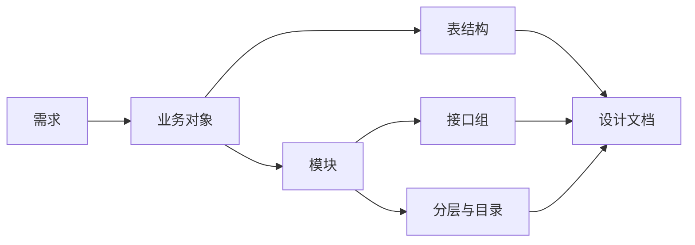
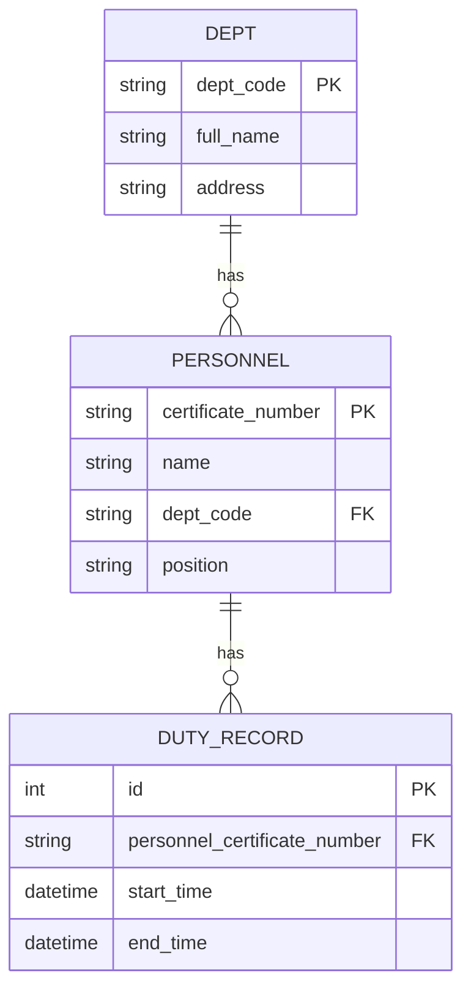

# 第 4 章 软件设计与建模

> **节首信息条**｜**专题二第 2 章**｜对应课次 4（2 学时 · 理论讲授）与课次 5（2 学时 · 实践）｜本章含 ◆ 综合实训 4-1｜前置：第 2 章的需求条目与验收标准；第 3 章的接口与实现｜**本节活动**：◇ 课堂活动块（听讲要点 / 讨论·演示）

第 3 章解决了单个接口与一组接口怎样定义、怎样用 FastAPI 实现。一个系统不会只有一个资源：部门、人员、值班记录，每个业务对象都有自己的表、模块与接口组。第 3 章回答“接口长什么样、怎么写出来”；本章回答“这些接口背后的数据、模块与目录怎样设计”，最后用一个综合实训把两章合起来。本章给出的是模块模板与设计产物；把模板放进完整工程目录、写清每个文件的内容，在第 5 章完成。

## 本章要解决的问题

**一份需求，怎样一步步变成表、模块、接口组、分层与目录，并写成别人能照着做的设计文档？**

多个业务对象各自需要表、模块与接口，这些决定彼此牵连：表少一个字段，接口就要改；模块划错，页面与测试都要跟着返工。这些决定散落在代码的各个位置时，读代码的人每次都要重新找一遍。

本章把需求到结构的过程拆成几步：先找业务对象，再定表、模块、接口与分层，最后把决定写进一份别人能照着做的文档，并让目录成为设计的一部分。

## 本章学习目标

读完第 4 章，应能：

1. 说明设计是一条从需求到结构的翻译链、每一步的产出，以及为什么按这个顺序、什么情况下应调整。
2. 从需求中找出业务对象，为每个对象设计表结构，正确使用主键（Primary Key）、外键（Foreign Key）并说明一对多（One-to-Many）关系。
3. 按业务能力划分模块，用一句话说清每个模块的职责，并说出每个模块对应的文件夹。
4. 判断一组接口是否符合 RESTful，并为一个 CRUD 模块写出五个标准接口的方法、URL、参数来源与成功状态码。
5. 用耦合与内聚说明四层分工的理由，并说明六类职责在模块模板中的位置。
6. 完成接口与设计综合实训：为自选业务对象设计表、模块、接口组与目录，写出最小实现，并验证状态码与契约。

## 4.1 需求到结构的翻译

设计不是“写一份文档”，而是把需求翻译成结构的过程。本章按六步讲解这个过程，每一步留下一个可检查的产物。

| 步骤 | 输入 | 要回答的问题 | 产出 |
| --- | --- | --- | --- |
| 1 | 需求 | 系统要管理哪些业务对象？ | 业务对象清单 |
| 2 | 业务对象 | 每个对象的数据怎么存？ | 表结构、主键、外键、关系 |
| 3 | 业务对象 | 每个对象由哪段代码负责？ | 模块清单与一句话职责 |
| 4 | 模块 | 模块对外提供什么操作？ | 接口组（方法、URL、参数、返回） |
| 5 | 模块 | 模块内部怎样分工？ | 分层、六类职责与目录 |
| 6 | 前五步的产物 | 这些决定怎样记录、怎样检查？ | 设计文档（综合实训 4-1 交付物） |



*图 4-1：从需求到结构的设计翻译链*

这条链有两个特点。

第一，**每一步都在收窄问题**。需求阶段的问题范围是整个业务；到表结构，问题变成“哪些字段、什么关系”；到接口，问题变成“谁调用、传什么、返回什么”。问题越具体，越容易检查对错。

第二，**跳过任何一步，错误会在后面放大**。不从需求找业务对象，直接开写代码，通常会出现“字段边写边加、表边用边改”；不先定模块，接口会按页面或按人临时分配，同一个业务对象被多处读写；不先定分层，业务规则会散落在 controller 里，测试时无法单独调用。设计阶段多花半小时，省下的是后面几天的返工。

**这个顺序的依据**

这条链的排序原则可以概括为一句话：**先定变化最慢、修改代价最高的决定，再定依赖它的决定。**

- 业务对象最稳定。部门、人员、值班记录不会因为页面改版而消失；它们来自业务词汇，而不是界面。
- 表最难改。数据一旦写入，改字段要迁移历史数据、改接口、改页面、改测试；因此表结构应尽早确定。
- 模块跟着对象走。模块回答“谁负责这类数据”，对象定了，模块边界才有依据；先定模块再找对象，边界容易按页面或按人切。
- 接口跟着模块走。接口是模块对外的承诺；模块职责不清，接口就会变成按页面临时拼出的端点。
- 分层跟着操作走。分层是模块内部的实现分工；知道模块提供哪些操作、承担哪些规则，才知道 service 该放什么。
- 目录跟着分层走。分层回答“请求经过哪些角色”，目录回答“这些角色的代码放在哪个文件”；层定了，文件位置才有依据，否则目录只是按个人习惯摆文件。
- 文档最后。文档记录已经做出的决定；先写文档，等于先写猜测。

反过来做，会出现对应的结构问题：

| 如果先定 | 常见后果 |
| --- | --- |
| 页面 | 页面结构决定数据模型；同一字段在多个页面重复，接口按页面定制，复用困难 |
| 模块 | 模块按页面、人员或技术层切；同一张表被多个模块读写，耦合上升 |
| 接口 | 契约看起来完整，但数据库无法约束；非法状态仍能写入 |
| 分层 | 层建好了却没有内容；service 空转，规则仍堆在 controller |
| 目录 | 文件按人随手放，同类代码分散在多个地方；换人接手先要花时间找 |

**顺序的其他选择**

设计方法不止一种。常见的设计起点有四种：对象与数据优先、用例与行为驱动、接口优先（API-first）与领域驱动（DDD）；下表把它们放在一起比较，后三种只需了解，区别在“从哪里开始”。

| 方法 | 起点 | 适合的场景 |
| --- | --- | --- |
| 对象与数据优先（本章） | 业务对象、表结构 | 业务对象稳定、CRUD 为主、数据约束重要 |
| 用例与行为驱动 | 用户场景、操作流程 | 行为复杂，需求通过场景澄清 |
| 接口优先（API-first） | 对外契约 | 多端或多团队依赖同一接口，或对接已有系统 |
| 领域驱动（DDD） | 领域模型、边界上下文 | 领域规则复杂，包含多个子域 |

本课程选择对象与数据优先，原因有四个：执勤电子年鉴是以数据为中心的 CRUD 系统；业务词汇稳定；表结构变更代价高；前后端契约是主要协作边界。换成另一个项目，这个顺序可能不再合适。

**这条链不覆盖的情况**

设计顺序不是瀑布。发现对象漏了、规则变了，可以回到上一步；链是“先想清楚再写代码”的顺序，不是“每步只做一次”的流程。

在三种情况下，应调整顺序：

- 对外契约已经固定（例如对接上级系统）：先定接口，再反推数据与模块。
- 领域规则复杂、跨多个子域：先做领域模型，再定表与模块。
- 页面或交互是主要风险：先做原型，再反推数据与接口。

跨模块的公共决策（例如统一认证、统一分页格式）需要在链外单独约定。设计文档也不必写成几十页，够别人照着做即可；过度设计同样有成本。

> 💡 **易错点**：把设计文档当成链的起点。文档是链的产物，不是输入；先有表、模块、接口的决定，才有可写的文档。

## 4.2 业务对象与表结构

链的前两步，是从需求里找出业务对象，再为每个对象设计表结构。需求条目中的名词通常就是候选对象：部门、人员、值班记录、工位、培训计划。一个业务对象对应一组需要长期保存的数据，也通常对应一张表。

关系数据库用“表”存一类数据，这一模型由 Codd 在 1970 年提出（Codd, 1970）。表里的每一行是一条记录，每一列是一个字段。为了区分记录，需要一个能唯一代表这一行的字段，叫主键。为了表达两张表之间的关系，需要在一个表里存放另一个表的主键，叫外键；主键与外键是 SQL 标准中的约束概念（ISO/IEC 9075）。

用生活例子理解：学生名单是一张表，学号是主键；学生表里再放一个“班级编号”，这个编号指向班级表的主键，它就是外键。

“一对多”是最常用的关系。一个部门可以有多个人员，但一个人员只属于一个部门；一个人员可以有多条值班记录，但一条值班记录只属于一个人员。外键放在“多”的一方：人员表放部门编号，值班记录表放人员证件号。这样每条“多”的记录只存一个“一”的编号，不会在部门表里重复存一串人员。

外键放在“多”的一方的理由，可以从一次查询和一次修改分别看。查询“某部门有哪些人”，只需在人员表按 `dept_code` 过滤；修改“某人换部门”，只需改人员表的一行。若把人员编号列表塞进部门表，查询要拆开字符串，修改要重写整个列表，而且数据库无法约束列表里的编号是否真实存在。**关系的方向决定了查询与约束的写法**，外键放反，后面的代码会一直绕着它打补丁。

把部门、人员、值班记录放在一起，关系可以画成下图。



*图 4-2：部门—人员—值班记录的一对多关系*

读图时看三件事：主键（PK）在哪一列；外键（FK）指向哪张表；连线两端是“一”还是“多”。部门与人员是一对多，人员与值班记录也是一对多；外键分别放在人员表和值班记录表，也就是“多”的一方。

这一步的产出是三张表及其关系。表定好了，下一个问题自然出现：**这些表由哪些代码来操作？** 这就是链的第三步——模块。表结构在代码里会落成模块的 `model.py`；到 4.5 会看到它具体长什么样。

> 💡 **易错点**：把外键放反。若在部门表里存“人员证件号列表”，一个部门有多个人时就要在一行里塞多个值，既难查询也难约束。

## 4.3 模块划分

表回答“数据怎么存”，模块回答“哪段代码负责这类数据”。二者大体按同一批业务对象划分：一个业务对象通常对应一个模块，模块负责这张表的读写与相关规则；统计这类跨对象的汇总，可以单独成模块。

模块按业务能力划分，不按页面划分。按业务能力（业务对象）划分模块，是领域驱动设计与信息隐藏原则的共同建议（Evans, 2003；Parnas, 1972）。需求条目里的功能清单通常已经按业务域分组：登录与账号、部门、人员、工位、值班、查班、统计。每个业务域大体对应一个模块，用一句话说清职责。

| 需求（功能簇） | 业务对象 | 模块 | 一句话职责 |
| --- | --- | --- | --- |
| 管理部门信息 | 部门 | `dept` | 维护部门基本信息 |
| 管理人员信息 | 人员 | `personnel` | 维护人员及其所属部门 |
| 记录谁在什么时间值班 | 值班记录 | `duty_record` | 记录与查询值班安排 |
| 统计值班次数与时段分布 | 统计结果 | `analytics` | 按条件汇总值班数据 |

模块划分要回答两个问题：这个模块负责哪类业务对象？它对外提供哪些操作？如果一句话说不清，通常说明模块装得太多，或者边界还没想明白。

模块的产出因此有两个：一张模块清单，说明哪类业务对象由谁负责；一组文件夹名，说明这些代码放在哪。每个模块在项目里对应一个文件夹——`app/modules/dept/`、`app/modules/personnel/`——文件夹名与模块名一致。清单给评审看，文件夹给代码用，两者必须一一对应。

按页面划分模块是一种常见错误。页面会随界面调整而合并或拆分，业务对象不会。若“人员列表页”和“人员详情页”各自对应一个模块，两个模块都要读写人员表，字段一变就要改两处；按业务对象划分，人员表只有一个模块负责，页面只是它的调用方。

模块也不能切得太细。每个业务对象一个模块，已经足够；再按“查询”“新增”拆成独立模块，调用关系会变得复杂，改一个字段要跨多个模块。**模块的粒度以“一句话能说清职责”为准**，不是越多越专业。

这一步的产出是模块清单与每个模块的一句话职责。模块定好了，下一个问题自然出现：**模块之间、前后端之间怎样说话？** 这就是链的第四步——接口组。

## 4.4 接口组

一个业务对象通常不止一个接口：查询列表、查询单个、新增、修改、删除。如果每个接口各写各的 URL、方法和状态码，前端就要为每个接口记一套规则，前后端对接时无法预测，出错也难以定位。先看一组反例：

- 删除部门：`GET /api/v1/departments/delete?id=1`
- 查询部门：`POST /api/v1/departments/query`，请求体传 `{"id": 1}`
- 新增成功与失败都返回 `200`
- 查询单个部门有时写 `/departments/1`，有时写 `/department/1`

这组接口能工作，但每个接口都要单独记：删除用了 GET，查询用了 POST，成功和失败都返回 200，单复数还不一致。换一个人接手，很容易用错方法或地址；前端也无法用一套规则推断新接口该怎么调。

**接口组**是围绕同一个资源的一组接口。好的接口组设计，要让同一类资源的操作遵循同一套规则，前端只看一眼就能推断出其他接口怎么调。REST 提供了这样一套规则。**REST**（表述性状态转移）由 Roy Fielding 在 2000 年的博士论文中提出（Fielding, 2000）；RESTful 指按这种风格设计的接口。本章按教学需要把核心做法简化为三句话：URL 表示资源，HTTP 方法表示动作，状态码表示结果；这不是 Fielding 原文的完整定义，完整的 REST 还包含无状态、统一接口等约束。

| 操作 | 方法与 URL | 成功状态码 |
| --- | --- | --- |
| 查询集合 | `GET /api/v1/departments/` | 200 |
| 查询单个 | `GET /api/v1/departments/1` | 200 |
| 新增 | `POST /api/v1/departments/` | 201 |
| 修改 | `PUT /api/v1/departments/1` | 200 |
| 删除 | `DELETE /api/v1/departments/1` | 204 |

这张表同时是一个资源的接口组：查询列表、查询单个、新增、修改、删除五个动作。一个业务模块（按业务对象划分的一组接口与代码）通常围绕一个业务对象提供这样一组接口，所以它也是模块对外的承诺。下面看这组接口怎样与模块职责对应。

资源名用名词复数，动作交给方法。`GET /getDepartments` 把动作写进了 URL，`POST /departments/delete/1` 用 POST 模拟删除，都不符合这种风格。反过来，只要 URL 是资源、方法是标准动作、状态码能表达结果，接口就具备了可预测性：前端不需要为每个接口记一套特殊规则，综合实训 4-1 的核对也可以照着这张表逐行打勾。

**路径里的标识**

`GET /api/v1/departments/1` 里的 `1` 是**路径参数**（Path Parameter）：它写在路径里，用来定位单个资源。它不是页码，也不是随便写的数字；这里它是资源标识，读作“id 为 1 的部门”。服务端拿这个 id 去查对应的记录。REST 没有规定标识必须是整数：也可以用业务编码（如 `/departments/D01`）或 UUID。选哪种，取决于它是否唯一、稳定、可读；本书用 id，因为它与数据库主键一致，后面查库最直接。

集合用 `/departments/`，单个成员用 `/departments/1`；这是常见约定，不是 HTTP 标准的强制要求。项目内要保持一致，不要一会儿带斜杠、一会儿不带；FastAPI 默认会对末尾斜杠做重定向，但路径写法不统一仍会让前后端对接多一层困惑。

**RESTful 之外的设计方式**

RESTful 适合“资源清楚、增删改查为主”的系统，本课程的执勤电子年鉴正属于这一类。但它不是唯一选择：需要一次取回多张关联表的数据时，RESTful 可能要多次请求；对外提供固定业务动作时，把动作写进 URL 反而更直白。选择 RESTful 的理由，是它用同一套规则覆盖大多数接口，降低前后端记忆成本；代价是遇到复杂查询时，需要在“资源化”和“可读性”之间做折中。

> 💡 **易错点**：只看 URL 是否用了名词，不看方法与状态码。`GET /departments/1` 与 `DELETE /departments/1` 用的是同一个资源地址，区别在方法；如果删除也写成 `GET`，风格问题就变成了数据安全问题。

**接口组与模块职责的对应**

上面已经给出一个资源的五个标准动作及其方法与 URL；第 3 章 3.2 讲了请求、响应与状态码。这里只回答模块层面的两个问题：一个模块对应哪些业务对象、它对外提供哪组接口；多个模块的接口组怎样保持一致。

一个模块负责哪类业务对象，接口组就围绕这类对象提供五个动作。部门模块的接口组以 `dept_code` 定位，人员模块的接口组以 `certificate_number` 定位；动作相同，定位字段不同。若模块的一句话职责说不清，接口组通常也会多出几个用途不明的端点。

接口组的代码写在模块文件夹的 `controller.py` 里。这里先把契约定清楚，4.5 再说明它怎样按职责落成六个文件。

参数来源的判据见第 3 章 3.2：定位“某一个”资源用路径参数；筛选、分页、排序用查询参数；新增或修改要提交的字段放请求体。

**跨模块的一致性**

多个模块的接口组放在一起，还要保持同一套约定：分页参数都叫 `page` / `page_size`，排序都叫 `sort_by` / `order`，列表返回都含 `items` / `total` / `page` / `page_size` / `pages`，错误码的含义一致。否则前端要为每个模块记一套参数名，接口文档也难以统一描述。

第 9 章会以“参数命名一致性”为例说明这种不一致的维护成本；本章先把它作为设计检查项：模块之间的接口组可以不同，但同类动作的约定必须相同。

这一步的产出是每个模块的接口清单，以及一份跨模块的约定清单。接口定好了，模块对外能调了，但一个请求进入模块后要经过哪些代码？这就是链的第五步——分层与目录。

## 4.5 模块内的分层与六类职责

第 3 章用路由与输入模型的小例子讲了 FastAPI 的机制；这些例子只够一个模块：部门、人员、值班记录各有自己的表、规则和接口，全部塞进 `main.py`，文件会变成几百行，改一处要通读全文。

这一节回答：模块内部的代码怎样按职责分层，落成哪六个文件？

**四层调用结构**

最常见的做法是把后端分成四层，每层只做一件事；这是分层架构在本课程项目中的一种落法（Fowler, 2002；Martin, 2017），其他项目可能层数与名称不同。

| 层 | 职责 | 典型问题 |
| --- | --- | --- |
| controller | 接收请求、取出参数、返回响应 | 这个请求该由谁处理？ |
| service | 写业务规则、组合多个操作 | 部门编码重复要不要拒绝？ |
| crud | 直接读写数据库 | 按条件查询部门表 |
| model | 定义表结构与字段 | 部门表有哪些列？ |

这样分层的理由，可以用两个概念说明。

**耦合**指两部分之间的依赖程度：改一处，会不会被迫改另一处。**内聚**指一个模块内部的东西是否围绕同一件事。两者是软件设计中的经典度量概念（Yourdon & Constantine, 1979；ISO/IEC/IEEE 24765:2017）。若 controller 里直接写 SQL，换数据库就要改 controller；若 controller 只调用 service，数据库变化被挡在 crud 里，controller 不受影响。**分层的目标不是“文件更多”，而是把变化关在尽量小的范围内。**

`model` 只管表结构，`schema` 只管进出字段，`crud` 只管读写；一个文件里同时处理三种事，改其中一种就会碰到另外两种。内聚高的模块，读的时候不需要在多个关注点之间来回切换。

还有一个相关概念是**信息隐藏**（Parnas, 1972）：每一层只暴露调用方需要知道的接口，把实现细节留在内部。controller 不需要知道 SQL 怎么写，service 不需要知道表有哪些列。隐藏得越干净，替换实现时影响越小。

**schema 与 param 的分工**

四层之外，还有两类代码不属于“请求往里走”的路径，但每个模块都需要。

| 文件 | 负责什么 | 回答的问题 |
| --- | --- | --- |
| `schema.py` | 输入与输出模型 | 什么能进、什么能出？ |
| `param.py` | 查询参数模型 | 分页、过滤、排序怎么传？ |

请求体进来先由 `schema.py` 校验，校验失败返回 422；响应返回前再由输出模型过滤字段，避免把不该露出的列带出去。`param.py` 接住写在 `?` 后面的条件；参数少时也可以直接写在函数签名里，参数一多就收进模型。

所以本课程的项目模板把标准模块定为六个文件：controller、service、crud、model 四层，加 schema、param 两个边界。**六类职责不等于六层**：四层描述请求的路径，schema 与 param 描述进出的形状。

**模块模板：六个文件**

六类职责落成六个文件，放在一个模块文件夹里：

```text
app/modules/dept/
├── __init__.py
├── controller.py
├── service.py
├── crud.py
├── model.py
├── schema.py
└── param.py
```

读这棵树，看两件事：

1. **`app/modules/` 下每个文件夹是一个模块。** 新增一个业务模块，就新增一个文件夹；打开文件夹，六类代码各就各位。
2. **每个包目录都要有 `__init__.py`**，包括 `app/`、`app/core/`、`app/modules/` 与每个模块目录；缺了它，导入时可能找不到模块。

这只是模块模板。工程级的入口 `main.py`、跨模块的 `app/core/`、`tests/` 与根目录的配置文件，在第 5 章 5.1 展开；一条请求从 `main.py` 进入、经过这些文件的完整路径，也在那里。

**分层的适度**

分层也有代价。每多一层，就多一次调用、多一个文件、多一处需要维护的转发代码。小项目搭四层，可能显得繁琐；但本课程的执勤电子年鉴有多个模块、多人协作、后续还要测试与部署，四层带来的定位成本低于它省下的修改成本。**分层不是越多越好，够用即可。**

> 💡 **易错点**：把所有逻辑堆在 controller。初学时这样写最快，但业务规则、SQL、响应组装混在一处，改一个字段要通读整个函数，测试也无法单独调用规则。另一种更隐蔽的坑是“文件都在，职责没分”：六个文件建齐了，controller 里照样直接查库、service 空着——这是形式上的分层，改动时该痛的地方一样会痛。

## 示范例题

三道例题对应翻译链的不同环节。例 4-1 检验表结构：能否从字段里认出主键、外键，并说明外键为什么放在“多”的一方。例 4-2 检验从需求到表结构的翻译。例 4-3 检验接口组是否符合 RESTful。

#### 例 4-1：指出三张表的主键、外键与关系【Bloom：理解】

**题目**：下面是部门、人员、值班记录三张表的字段。请指出每张表的主键与外键，说明“部门—人员”“人员—值班记录”分别是什么关系，并解释外键为什么放在“多”的一方。

- 部门：`dept_code`、`full_name`、`address`
- 人员：`certificate_number`、`name`、`dept_code`、`position`
- 值班记录：`id`、`personnel_certificate_number`、`start_time`、`end_time`

**解**：

1. 部门表的主键是 `dept_code`；`full_name`、`address` 是普通字段，没有外键。
2. 人员表的主键是 `certificate_number`；外键是 `dept_code`，指向部门表的主键。
3. 值班记录表的主键是 `id`；外键是 `personnel_certificate_number`，指向人员表的主键。
4. 部门与人员是一对多：一个部门有多名人员，一名人员只属于一个部门。
5. 人员与值班记录是一对多：一名人员有多条值班记录，一条值班记录只属于一名人员。
6. 外键放在“多”的一方，是因为每条人员记录只需要保存一个部门编号，每条值班记录只需要保存一个人员编号；若把人员编号列表放进部门表，一行要存多个值，既难查询也难约束。

#### 例 4-2：从需求画出三张表【Bloom：应用】

**题目**：需求是“值班管理员要按部门查询人员，并记录每人的值班时间”。请画出部门、人员、值班记录三张表的字段与关系，标出主键与外键，并指出三张表分别落在哪个模块的哪个文件。

**解**：

先找业务对象：部门、人员、值班记录。再给每个对象列字段，最后确定关系与归位。

| 表 | 字段 | 主键/外键 | 归位 |
| --- | --- | --- | --- |
| 部门 | `dept_code`、`full_name`、`address` | `dept_code` 主键 | `app/modules/dept/model.py` |
| 人员 | `certificate_number`、`name`、`dept_code`、`position` | `certificate_number` 主键；`dept_code` 外键 | `app/modules/personnel/model.py` |
| 值班记录 | `id`、`personnel_certificate_number`、`start_time`、`end_time` | `id` 主键；`personnel_certificate_number` 外键 | `app/modules/duty_record/model.py` |

关系：部门 1—N 人员；人员 1—N 值班记录。理由是“按部门查询人员”要求人员能关联到部门；“记录每人的值班时间”要求值班记录能关联到人员。

归位：一个业务对象一个模块，表模型进各自模块的 `model.py`；对应的接口写在各自模块的 `controller.py`。表定完，代码位置也就定了。

#### 例 4-3：判断接口设计是否 RESTful【Bloom：理解】

**题目**：下面是四个接口设计，请判断哪些符合 RESTful 资源设计，并说明理由。

- A. `GET /getDepartments`
- B. `GET /api/v1/departments/`
- C. `POST /api/v1/departments/`
- D. `POST /api/v1/departments/delete/1`

**解**：

1. **A 不符合**：URL 里出现动词 `get`，资源应当用名词；查询集合应写成 `GET /api/v1/departments/`。
2. **B 符合**：URL 是资源集合，方法是 GET，表示查询部门列表。
3. **C 符合**：URL 是资源集合，方法是 POST，表示在集合中新增一个部门，成功时返回 201。
4. **D 不符合**：删除应当用 DELETE 方法定位到单个资源，写成 `DELETE /api/v1/departments/1`；用 POST 加动作路径模拟删除，失去了方法的语义。

## 独立习题

#### 习题 4-1【Bloom：分析】

**题目**：某值班记录表同时保存了 `personnel_certificate_number`、`personnel_name`、`dept_name`、`workstation_name`。请指出这种设计可能导致的问题，并给出修正方案。

#### 习题 4-2【Bloom：创造】（开放题）

**题目**：单位要新增“培训管理”：记录培训计划、参训人员与培训结果。请设计模块划分：列出至少两个模块、每个模块的一句话职责、涉及的表及其关系，画出每个模块的目录与六个文件，并为其中一个模块列出 5 个接口的方法与 URL。

#### 习题 4-3【Bloom：理解】（原理解释）

**题目**：为什么外键要放在“多”的一方？如果把人员编号列表塞进部门表，会带来哪些查询与更新问题？

#### 习题 4-4【Bloom：分析】

**题目**：下面是某项目的接口约定，请指出至少三处设计问题，并说明每处可能造成的后果。

> - 删除部门：`GET /api/v1/departments/delete?id=1`
> - 查询部门：`POST /api/v1/departments/query`，请求体传 `{"id": 1}`
> - 新增部门成功与失败都返回 `200`
> - 查询单个部门有时写 `/departments/1`，有时写 `/department/1`

#### 习题 4-5【Bloom：创造】（开放题，换场景）

**题目**：为“器材”资源设计列表、详情、新增、删除四个端点，写出每个端点的方法、URL、参数来源与成功状态码；再为“借用已被借出的器材”设计失败响应，说明状态码与响应体应写什么。**不能照抄本章部门接口的路径与字段**：器材有编号、状态（在库 / 借出）、借用人，设计要落到这些差异上。

## ◇ 课堂活动块（课次 4 · 理论讲授）

**听讲要点**（课上跟着讲师过一遍，课后自查能否复述）：

1. 设计是一条翻译链：需求 → 业务对象 → 表 → 模块 → 接口 → 分层与目录 → 文档；顺序依据是先定变化最慢、代价最高的决定。
2. 业务对象决定表；表的方向决定查询与约束的写法。
3. 模块按业务能力划分，不按页面划分；一个模块一个文件夹，一句话说不清职责，说明边界没想明白。
4. 一个标准模块六个文件：controller / service / crud / model 四层，加 schema / param 两个边界；六类职责不是六层。
5. 模块内部按职责分四层：controller / service / crud / model；schema 管进出字段，param 管查询参数。一条请求进入模块后的完整路径见第 5 章 5.1。

**讨论·演示**：

1. （讨论）把“按页面分模块”与“按业务对象分模块”各画一次，比较后续改动的牵连范围。
2. （演示）从一条需求条目出发，沿翻译链依次写出业务对象、表、模块、接口，再指出每个决定落在哪个文件夹的哪个文件，并标出一处最可能变化的耦合点。

## ◆ 综合实训 4-1：接口与设计综合实践（对应课次 5 · 2 学时 · 实践）

### 一、任务目标与验收

本实训把第 3 章与第 4 章合起来：先为一个自选业务对象设计表、模块、接口组与目录，再用第 3 章的 FastAPI 机制写出最小实现，最后核对状态码与契约。设计文档与可运行代码都要交。

| 目标 | 验收标志 |
| --- | --- |
| 表结构设计 | 字段、类型、主键清楚；有一对多关系时，外键放在“多”的一方并说明理由 |
| 模块模板 | 一句话说清模块职责；模块对应一个文件夹；按 4.5 的模块模板画出六个文件 |
| 接口组设计 | 五个标准动作的方法、URL、参数来源、成功状态码齐全；至少一个规则性失败的状态码与说明 |
| 最小实现能跑 | 新建最小 `main.py` 与 `schemas.py`，写输入/输出模型，以及查询集合、新增、一个带路径参数或规则性失败的接口；`/docs` 可打开 |
| 状态码验证 | 200、201、204、404、422 至少各出现一次，并记录实际结果 |
| 契约与实现核对 | 「契约—实现核对记录」每行能指出实现位置或差异；不一致时说明改哪边 |
| 设计文档 | 表结构、接口清单、模块目录三节齐全；四组一致性检查通过 |

**本实训不做的**（留给后续章）：六文件的具体内容与真实数据库（第 5、8 章）、pytest 与 TestClient 自动测试（第 12 章）、Git 与虚拟环境配置（第 5 章）、登录认证（第 6 章）。本实训只要求设计出模块模板，代码实现停在最小 `main.py` + `schemas.py`。

### 二、课前准备

- 读过第 3 章的路由、输入模型与 Depends 小例子，能在自己机器上启动、打开 `/docs`
- 读过 4.2–4.5，知道表、模块、接口组、分层、模块模板与设计文档的关系
- 从工位、器材、课程、图书中选定**一个**业务对象，写下 3–5 个字段、主键，并判断是否有一对多关系
- 准备一张空白的「接口验证记录」、一张「契约—实现核对记录」，以及一份设计文档模板（表结构、接口清单、模块目录）

### 三、操作步骤

1. **选对象与写验收标准（10 分钟）**
   - 做什么：确定业务对象、字段、主键和关联关系；写 2–3 条验收标准，至少覆盖正常流程与一种异常
   - 预期输出：一条能说清“这个对象是什么、谁在用、做到什么程度算完成”的说明
   - 做错会看到什么：对象选得太大（如“管理系统”）；缩到一个业务对象，再继续
2. **设计表结构（20 分钟）**
   - 做什么：为字段定名称、类型、是否必填；定主键；有一对多关系时，把外键放在“多”的一方
   - 预期输出：一张表结构表，字段名与类型能直接用于建表
   - 做错会看到什么：把多个编号塞进一行、或把“多”方字段放进“一”方；回到 4.2 的一对多判断
3. **定模块与模块模板（15 分钟）**
   - 做什么：给模块起名，用一句话写职责；按 4.5 的模块模板画出 `app/modules/<模块>/` 下六个文件的目录树
   - 预期输出：controller、service、crud、model、schema、param 六个文件各就其位
   - 做错会看到什么：模块按页面划分、或一句话说不清职责；回到 4.3 的模块划分判据。`app/core/` 与 `tests/` 不在本实训中建，第 5 章补
4. **设计接口组（15 分钟）**
   - 做什么：按 4.4 的五动作表，写出列表、详情、新增、修改、删除的方法、URL、参数来源与成功状态码；为一条业务规则写出失败状态码与说明
   - 预期输出：一张接口清单，能直接交给前端对照
   - 做错会看到什么：用 GET 删除、成功失败都返回 200、路径单复数混用；对照 4.4 的规则逐行改
5. **实现最小后端（25 分钟）**
   - 做什么：新建最小 `main.py` 与 `schemas.py`：`schemas.py` 写输入/输出模型，`main.py` 写查询集合、新增、一个带路径参数或规则性失败的接口，用 `APIRouter` 挂载
   - 预期输出：`/docs` 出现你的分组；查询 200、新增 201、删除 204
   - 做错会看到什么：接口全 404、非法请求仍成功、输出带出内部字段；按第 3 章 3.4–3.5 的前缀、模型与 `response_model` 排查
6. **验证状态码与契约（15 分钟）**
   - 做什么：在 `/docs` 制造 200、201、204、404、422；填两张记录表
   - 预期输出：五种状态码都出现；每条记录能对应到设计文档或代码位置
   - 做错会看到什么：所有错误都返回 500 或 200；按 3.2 的状态码责任表判断该由谁拒绝
7. **写设计文档与一致性检查（15 分钟）**
   - 做什么：按本节的设计文档模板写表结构、接口清单、模块目录三节；检查四组对应：表字段与接口返回、接口参数与页面输入、模块职责与需求功能簇、模块目录与模块清单
   - 预期输出：别人能照着文档建表、写接口、建目录
   - 做错会看到什么：文档只写“已完成”、没有字段与路径；补上可检查的条目
8. **提交与互查（5 分钟）**
   - 做什么：两人交换设计文档，按对方的文档抽查一条接口；发现差异只记录，不直接改对方代码
   - 预期输出：每条差异都有“文档问题 / 实现问题 / 已知不同”的结论
   - 做错会看到什么：只写“没问题”；要求至少指出一条具体依据

### 四、排错清单

| 现象 | 先查什么 |
| --- | --- |
| 表字段与接口返回字段不一致 | 以设计文档为清单，逐字段对照 schema 与表设计 |
| 模块目录与模块清单不对应 | 每个模块一个文件夹；六文件是否齐 |
| 接口组缺动作 | 对照 4.4 的五动作表，补齐或说明为什么不提供 |
| 参数来源错误 | 定位单个资源用路径参数；筛选分页用查询参数；提交数据放请求体 |
| 设计文档与代码不一致 | 先记录差异，再判断改文档还是改代码；不要默认以任何一方为准 |
| 422 与 400 混用 | 输入不符合约定交 422（Pydantic）；业务规则不满足交 `HTTPException(400)` |
| 非法请求仍成功 | 接口参数是否声明为模型类型、字段约束是否写在模型里 |
| 输出带出内部字段 | 是否用 `response_model` 过滤字段 |
| `/docs` 打不开或接口全 404 | 服务是否启动、`include_router` 的两段前缀是否都写、单复数是否一致 |

### 五、提交与验收

提交四样：**设计文档**、**最小实现代码**、**接口验证记录**、**契约—实现核对记录**。

设计文档按下面的模板写：表结构、接口清单、模块目录三节；末尾补一段模块职责与分层说明。

**代码 4-1-1** · 设计文档模板（文本）

```markdown
# 部门模块设计

## 1. 表结构
| 字段 | 类型 | 说明 |
| --- | --- | --- |
| dept_code | 文本 | 主键 |
| full_name | 文本 | 部门名称 |
| address | 文本 | 地址 |

## 2. 接口清单
| 方法 | URL | 参数 | 返回 |
| --- | --- | --- | --- |
| GET | /departments | page, page_size | 部门列表 |
| GET | /departments/{dept_code} | dept_code | 一个部门 |
| POST | /departments | 部门信息 | 新增结果 |
| PUT | /departments/{dept_code} | dept_code + 部门信息 | 修改结果 |
| DELETE | /departments/{dept_code} | dept_code | 成功消息 |

## 3. 模块目录
app/modules/dept/
├── controller.py    # 接口
├── service.py       # 业务规则
├── crud.py          # 读写数据库
├── model.py         # 表结构
├── schema.py        # 输入输出模型
└── param.py         # 查询参数
```

写完文档后，至少检查四组对应：

1. 表字段与接口返回字段对应；
2. 接口参数与页面输入对应；
3. 模块职责与需求功能簇对应；
4. 模块目录与模块清单对应。

两张记录表的表头如下，按行填满即可，不必另建文档：

| 方法 | URL | 输入 | 预期状态码 | 实际状态码 | 结论 |
| --- | --- | --- | --- | --- | --- |
|  |  |  |  |  |  |

| 契约项 | 期望 | 实现位置 | 结论 |
| --- | --- | --- | --- |
| URL 与方法 |  |  | 一致 / 差异说明 |
| 输入字段与约束 |  |  | 一致 / 差异说明 |
| 成功状态码 |  |  | 一致 / 差异说明 |
| 失败状态码 |  |  | 一致 / 差异说明 |

发现差异时，不要默认改哪一边；先记录期望与实际，再判断是设计文档写错还是实现偏离。

验收按四项判定：**设计能照着做**（表、模块、目录、接口清单齐全）、**实现能跑**（最小 `main.py` 启动，`/docs` 可打开）、**状态码齐全**（200/201/204/404/422 都出现）、**一致性有据**（四组对应逐项检查，差异有结论）。**本章不给完整参考实现**：资源由你自己选，字段与路径也由你定；能自证核对过的接口，才算完成。

### 六、课后扩展

- 给业务对象加一个关联对象（如人员所属部门），补外键与接口，更新模块模板与设计文档
- 改一个字段名，追踪表、接口、页面三处影响，写一条变更记录
- 把设计文档交给另一位同学，按文档复现一次，记录他卡在哪一步
- **复习任务**：回看 4.4（接口组）、3.5（422 与 `HTTPException`）、4.2（主外键）、4.5（分层与六类职责）；设计文档模板见本节，指出自己最容易漏的一项及依据

## 本章小结

**核心结论**：

1. 设计是一条翻译链：需求 → 业务对象 → 表 → 模块 → 接口 → 分层与目录 → 设计文档（综合实训 4-1 交付物）。前一步的产出是后一步的输入；顺序依据是先定变化最慢、代价最高的决定。设计方法不唯一，本课程选对象与数据优先。
2. 需求里的名词是业务对象的候选；一个业务对象通常对应一张表，用主键唯一标识记录，用外键表达关系；一对多关系的外键放在“多”的一方。
3. 模块按业务能力划分，不按页面划分；一个模块对应一个文件夹；每个模块用一句话说清职责，粒度以“一句话能说清”为准。
4. 模块对外提供五个标准接口；定位用路径参数，筛选用查询参数，提交用请求体。
5. 模块内部有六类职责：controller / service / crud / model 四层，加 schema / param 两个边界文件；分层用耦合与内聚衡量，每层隐藏实现细节。
6. 模块模板是分层的落点：`app/modules/<模块>/` 下六个同名文件；工程级的 `app/core/`、`main.py`、`tests/` 与根目录配置文件见第 5 章 5.1。
7. 第 3 章与本章是一个单元：先定接口与实现，再把接口背后的表、模块与模块模板设计出来；综合实训把两件事合起来。

把这条链压缩成一句话：**需求先变成对象，对象变成表和模块，模块对外是接口、对内是分层，分层落成目录，最后在综合实训里写进文档并检查一致。**

**学完本章，你可以体会到**：模块模板不是“建几个空文件”，而是把已经做出的设计决定固定下来。决定写在文档里，位置落在模块里，后面写代码、测试和交接才有共同的依据。

**自检**：回到章首的学习目标，逐条问自己做到了没有——

- [ ] 说明设计是一条从需求到结构的翻译链，以及每一步的产出。
- [ ] 从需求中找出业务对象，设计表结构，正确使用主键、外键并说明一对多关系。
- [ ] 按业务能力划分模块，用一句话说清每个模块的职责，并说出每个模块对应的文件夹。
- [ ] 为一个 CRUD 模块写出五个标准接口的方法、URL、参数来源与成功状态码。
- [ ] 用耦合与内聚说明分层理由，并说明六类职责在模块模板中的位置。
- [ ] 完成综合实训：为自选对象设计表、模块、接口组与模块模板，写出最小实现并验证状态码与契约。

**下一章**：模块模板已经定好，下一步是把它放进完整工程目录，用 Git 记录每一步修改，并用虚拟环境、依赖清单与配置让项目可回退、换台机器也能跑。
