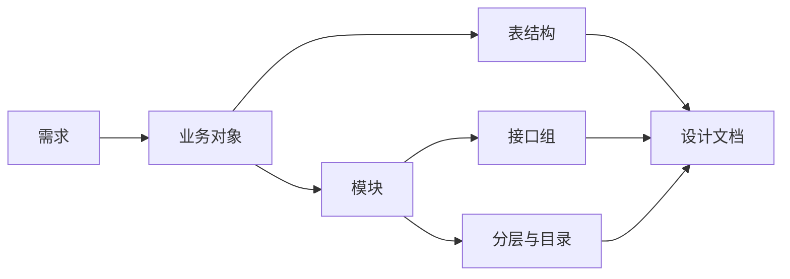
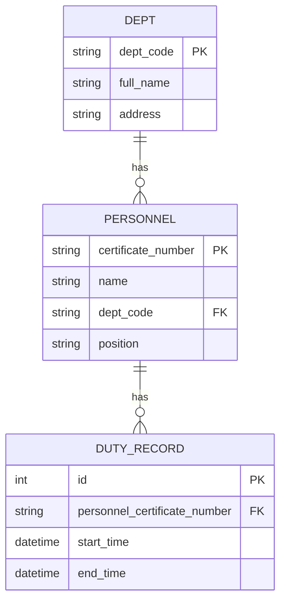

# 第 4 章 软件设计与建模

> **节首信息条**｜**专题二第 2 章**｜对应课次 4（2 学时 · 理论讲授）与课次 5（2 学时 · 实践）｜本章含 ◆ 综合实训 4-1｜前置：第 2 章的需求条目与验收标准；第 3 章的接口与实现｜**本节活动**：◇ 课堂活动块（听讲要点 / 讨论·演示）

第 3 章说明了单个接口与一组接口的定义方式，以及使用 FastAPI 的实现方法。一个系统通常包含多个资源：部门、人员、值班记录，每个业务对象均需相应的表、模块与接口组。第 3 章回答“接口的形式与实现”；本章回答“接口背后的数据、模块与目录如何设计”，并在章末以综合实训结合两章内容。本章给出模块模板与设计产物；将模板放入完整工程目录、说明各文件的内容，在第 5 章完成。

## 本章要解决的问题

**一份需求如何逐步转化为表、模块、接口组、分层与目录，并形成他人可依循的设计文档？**

多个业务对象各自需要表、模块与接口，各项决定相互关联：表缺少一个字段，接口需随之修改；模块划分错误，页面与测试均需返工。若这些决定分散于代码各处，阅读者每次均需重新查找。

本章将需求到结构的过程分为若干步骤：先提取业务对象，再确定表、模块、接口与分层，最后将决定写入他人可依循的文档，并使目录成为设计的一部分。

## 本章学习目标

读完第 4 章，应能：

1. 说明设计是从需求到结构的翻译链、每一步的产出，以及该顺序的依据与调整条件。
2. 从需求中提取业务对象，为每个对象设计表结构，正确使用主键（Primary Key）、外键（Foreign Key），并说明一对多（One-to-Many）关系。
3. 按业务能力划分模块，以一句话说明每个模块的职责，并指出每个模块对应的文件夹。
4. 判断一组接口是否符合 RESTful，并为 CRUD 模块写出五个标准接口的方法、URL、参数来源与成功状态码。
5. 用耦合与内聚说明四层分工的理由，并说明六类职责在模块模板中的位置。
6. 完成接口与设计综合实训：为自选业务对象设计表、模块、接口组与目录，写出最小实现，并验证状态码与设计的一致性。

## 4.1 需求到结构的翻译

设计不是撰写文档，而是将需求转化为结构的过程。本章按六个步骤说明该过程，每一步产生一项可检查的产物。

| 步骤 | 输入 | 要回答的问题 | 产出 |
| --- | --- | --- | --- |
| 1 | 需求 | 系统要管理哪些业务对象？ | 业务对象清单 |
| 2 | 业务对象 | 每个对象的数据怎么存？ | 表结构、主键、外键、关系 |
| 3 | 业务对象 | 每个对象由哪段代码负责？ | 模块清单与一句话职责 |
| 4 | 模块 | 模块对外提供什么操作？ | 接口组（方法、URL、参数、返回） |
| 5 | 模块 | 模块内部怎样分工？ | 分层、六类职责与目录 |
| 6 | 前五步的产物 | 这些决定怎样记录、怎样检查？ | 设计文档（综合实训 4-1 交付物） |



*图 4-1：从需求到结构的设计翻译链*

该过程具有两个特点。

第一，每一步缩小问题范围。需求阶段的问题范围是整个业务；到表结构阶段，问题变为字段与关系；到接口阶段，问题变为调用方、输入与输出。问题越具体，越容易检查。

第二，跳过任一步都会放大后续错误。若未从需求提取业务对象而直接编码，通常出现字段边写边加、表边用边改；若未先确定模块，接口会按页面或人员临时分配，同一业务对象被多处读写；若未先确定分层，业务规则会散落在 controller 中，无法单独测试。设计阶段增加的半小时，可减少后续数日的返工。

**顺序的依据**

该顺序的排序原则为：**先确定变化最慢、修改代价最高的决定，再确定依赖它的决定。**

- 业务对象最稳定。部门、人员、值班记录不因页面改版而消失；其来源是业务词汇，而非界面。
- 表结构最难修改。数据写入后，修改字段需迁移历史数据，并同步修改接口、页面与测试；因此表结构应尽早确定。
- 模块依赖业务对象。模块解决“哪段代码负责该类数据”的问题；对象确定后，模块边界才有依据。若先定模块再找对象，边界容易按页面或人员划分。
- 接口依赖模块。接口是模块对外的承诺；模块职责不清时，接口会成为按页面临时拼合的端点。
- 分层依赖操作。分层是模块内部的实现分工；明确模块提供的操作与承担的规则后，才能确定 service 的职责。
- 目录依赖分层。分层确定请求经过的角色，目录确定各角色代码所在的文件；层确定后，文件位置才有依据。
- 文档最后编写。文档记录已做出的决定；先写文档等同于先写假设。

若顺序相反，会出现相应问题：

| 如果先定 | 常见后果 |
| --- | --- |
| 页面 | 页面结构决定数据模型；同一字段在多个页面重复，接口按页面定制，复用困难 |
| 模块 | 模块按页面、人员或技术层切；同一张表被多个模块读写，耦合上升 |
| 接口 | 契约看起来完整，但数据库无法约束；非法状态仍能写入 |
| 分层 | 层已建立但无实际内容；service 为空，规则仍集中于 controller |
| 目录 | 文件按人员习惯放置，同类代码分散于多处；接手者需先花时间查找 |

**其他设计起点**

设计方法不唯一。常见的设计起点有四种：对象与数据优先、用例与行为驱动、接口优先（API-first）、领域驱动（DDD）。下表比较四种起点；后三种只需了解，区别在于起点不同。

| 方法 | 起点 | 适合的场景 |
| --- | --- | --- |
| 对象与数据优先（本章） | 业务对象、表结构 | 业务对象稳定、CRUD 为主、数据约束重要 |
| 用例与行为驱动 | 用户场景、操作流程 | 行为复杂，需求通过场景澄清 |
| 接口优先（API-first） | 对外契约 | 多端或多团队依赖同一接口，或对接已有系统 |
| 领域驱动（DDD） | 领域模型、边界上下文 | 领域规则复杂，包含多个子域 |

本章采用对象与数据优先，原因有四：执勤电子年鉴是以数据为中心的 CRUD 系统；业务词汇稳定；表结构变更代价高；前后端契约是主要协作边界。若项目性质不同，该顺序可能不再适用。

**该过程的适用范围**

设计顺序不是瀑布模型。发现对象遗漏或规则变化时，可以返回上一步；该顺序是“先明确再编码”的顺序，不是“每步只执行一次”的流程。

以下三种情况应调整顺序：

- 对外契约已经固定（例如对接上级系统）：先确定接口，再反推数据与模块。
- 领域规则复杂、跨多个子域：先建立领域模型，再确定表与模块。
- 页面或交互是主要风险：先制作原型，再反推数据与接口。

跨模块的公共决策（例如统一认证、统一分页格式）需在链外单独约定。设计文档不必写成数十页，足以指导他人实施即可；过度设计同样产生成本。

> 💡 **易错点**：将设计文档当作链的起点。文档是链的产物，不是输入；先有表、模块与接口的决定，才有可写的文档。

## 4.2 业务对象与表结构

链的前两步是从需求中提取业务对象，并为每个对象设计表结构。需求条目中的名词通常是候选对象：部门、人员、值班记录、工位、培训计划。一个业务对象对应一组需要长期保存的数据，通常对应一张表。

关系数据库以表存储一类数据，该模型由 Codd 于 1970 年提出（Codd, 1970）。表中每一行是一条记录，每一列是一个字段。为区分记录，需要一个能唯一标识该行的字段，称为主键。为表达两张表之间的关系，需在一个表中存放另一个表的主键，称为外键；主键与外键是 SQL 标准中的约束概念（ISO/IEC 9075）。

以学生名单为例：学号是主键；学生表中的“班级编号”指向班级表的主键，是外键。

“一对多”是最常用的关系。一个部门可包含多名人员，一名人员只属于一个部门；一名人员可有多条值班记录，一条值班记录只属于一名人员。外键置于“多”的一方：人员表存放部门编号，值班记录表存放人员证件号。由此，每条“多”的记录只保存一个“一”的编号，部门表无需重复存储人员编号列表。

外键置于“多”的一方，原因可从查询与修改两方面说明。查询某部门的全部人员时，只需在人员表中按 `dept_code` 过滤；人员调整部门时，只需修改人员表中的一行。若将人员编号列表存入部门表，查询需拆分字符串，修改需重写整个列表，且数据库无法约束列表中的编号是否存在。**关系的方向决定查询与约束的写法**；外键位置颠倒时，后续代码需持续补偿该结构缺陷。

将部门、人员、值班记录放在一起，其关系如下图。



*图 4-2：部门—人员—值班记录的一对多关系*

读图时需确认三点：主键（PK）所在列；外键（FK）指向的表；连线两端是一还是多。部门与人员、人员与值班记录均为一对多；外键分别位于人员表与值班记录表，即“多”的一方。

本步产物为三张表及其关系。表确定后，下一个问题是：这些表由哪些代码操作？该问题属于链的第三步，即模块。表结构在代码中对应模块的 `model.py`；具体形式见 4.5。

> 💡 **易错点**：将外键置于错误的一侧。若在部门表中存储“人员证件号列表”，一个部门包含多名人员时需在一行内保存多个值，既难以查询，也无法约束。

## 4.3 模块划分

表结构解决数据存储问题，模块解决代码归属问题。二者按同一批业务对象划分：一个业务对象通常对应一个模块，模块负责该表的读写与相关规则；跨对象的统计汇总可单独成模块。

模块按业务能力划分，不按页面划分。按业务能力（业务对象）划分模块，是领域驱动设计与信息隐藏原则的共同建议（Evans, 2003；Parnas, 1972）。需求条目的功能清单通常已按业务域分组：登录与账号、部门、人员、工位、值班、查班、统计。每个业务域大体对应一个模块，并以一句话说明职责。

| 需求（功能簇） | 业务对象 | 模块 | 一句话职责 |
| --- | --- | --- | --- |
| 管理部门信息 | 部门 | `dept` | 维护部门基本信息 |
| 管理人员信息 | 人员 | `personnel` | 维护人员及其所属部门 |
| 记录谁在什么时间值班 | 值班记录 | `duty_record` | 记录与查询值班安排 |
| 统计值班次数与时段分布 | 统计结果 | `analytics` | 按条件汇总值班数据 |

模块划分需回答两个问题：该模块负责哪类业务对象？对外提供哪些操作？若一句话无法说明，通常表明模块职责过多或边界未明确。

模块的产出有两项：模块清单，说明哪类业务对象由谁负责；文件夹名，说明代码所在位置。每个模块对应一个文件夹，例如 `app/modules/dept/`、`app/modules/personnel/`，文件夹名与模块名一致。清单用于评审，文件夹用于代码组织，二者必须一一对应。

按页面划分模块是常见错误。页面会随界面调整而合并或拆分，业务对象不会。若“人员列表页”与“人员详情页”各对应一个模块，两个模块均需读写人员表，字段变更需修改两处；按业务对象划分时，人员表只由一个模块负责，页面仅作为调用方。

模块也不应划分过细。每个业务对象一个模块已足够；若再按“查询”“新增”拆分为独立模块，调用关系复杂，字段变更需跨多个模块。**模块粒度以“一句话能说清职责”为准**，并非越多越专业。

本步产物为模块清单及各模块的一句话职责。模块确定后，下一个问题是：模块之间、前后端之间如何通信？该问题属于链的第四步，即接口组。

## 4.4 接口组

一个业务对象通常对应多个接口：查询列表、查询单个、新增、修改、删除。若各接口分别定义 URL、方法与状态码，前端需为每个接口单独记忆规则，对接时无法预测，出错也难以定位。以下为一组反例：

- 删除部门：`GET /api/v1/departments/delete?id=1`
- 查询部门：`POST /api/v1/departments/query`，请求体传 `{"id": 1}`
- 新增成功与失败都返回 `200`
- 查询单个部门有时写 `/departments/1`，有时写 `/department/1`

该组接口可以工作，但规则不统一：删除使用 GET，查询使用 POST，成功与失败均返回 200，单复数也不一致。他人接手时容易误用方法或地址；前端也无法依据统一规则推断新接口的调用方式。

**接口组**是围绕同一资源的一组接口。良好的接口组设计应使同类资源的操作遵循同一套规则，前端可据此推断其他接口的用法。REST 提供了这套规则。**REST**（表述性状态转移）由 Roy Fielding 于 2000 年的博士论文中提出（Fielding, 2000）；RESTful 指按该风格设计的接口。本章按教学需要将核心做法简化为三点：URL 表示资源，HTTP 方法表示动作，状态码表示结果。该表述不是 Fielding 原文的完整定义；完整的 REST 还包含无状态、统一接口等约束。

| 操作 | 方法与 URL | 成功状态码 |
| --- | --- | --- |
| 查询集合 | `GET /api/v1/departments/` | 200 |
| 查询单个 | `GET /api/v1/departments/1` | 200 |
| 新增 | `POST /api/v1/departments/` | 201 |
| 修改 | `PUT /api/v1/departments/1` | 200 |
| 删除 | `DELETE /api/v1/departments/1` | 204 |

该表同时构成一个资源的接口组，包含查询列表、查询单个、新增、修改、删除五个动作。一个业务模块通常围绕一个业务对象提供此类接口组，因此接口组也是模块对外的承诺。下文说明接口组与模块职责的对应关系。

资源名使用名词复数，动作由 HTTP 方法表示。`GET /getDepartments` 将动作写入 URL，`POST /departments/delete/1` 以 POST 模拟删除，均不符合该风格。反之，当 URL 表示资源、方法表示标准动作、状态码表示结果时，接口具备可预测性：前端无需为每个接口记忆特殊规则，综合实训 4-1 的核对也可按该表逐行检查。

**路径中的标识**

`GET /api/v1/departments/1` 中的 `1` 是**路径参数**（Path Parameter），写在路径中，用于定位单个资源。该值不是页码，此处是资源标识，表示 id 为 1 的部门。服务端以该 id 查询对应记录。REST 未规定标识必须为整数，也可以使用业务编码（如 `/departments/D01`）或 UUID。选择依据是唯一性、稳定性与可读性；本书使用 id，因其与数据库主键一致，便于后续查询。

集合使用 `/departments/`，单个成员使用 `/departments/1`。这是常见约定，不是 HTTP 标准的强制要求。项目内应保持一致，不应交替使用带斜杠与不带斜杠的写法；FastAPI 默认对末尾斜杠执行重定向，但写法不统一仍会增加对接成本。

**RESTful 之外的设计方式**

RESTful 适用于资源清晰、以增删改查为主的系统，本课程的执勤电子年鉴属于此类。RESTful 并非唯一选择：需要一次获取多张关联表的数据时，RESTful 可能产生多次请求；对外提供固定业务动作时，将动作写入 URL 更直接。选择 RESTful 的理由是以同一套规则覆盖多数接口，降低前后端记忆成本；代价是复杂查询需在资源化与可读性之间折中。

> 💡 **易错点**：仅检查 URL 是否使用名词，而不检查方法与状态码。`GET /departments/1` 与 `DELETE /departments/1` 使用同一资源地址，区别在于方法；若删除也写成 `GET`，风格问题即转化为数据安全问题。

**接口组与模块职责的对应**

前述已给出一个资源的五个标准动作及其方法与 URL；第 3 章 3.2 说明了请求、响应与状态码。此处仅回答模块层面的两个问题：一个模块对应哪些业务对象、对外提供哪组接口；多个模块的接口组如何保持一致。

模块负责的业务对象决定接口组的对象范围。部门模块的接口组以 `dept_code` 定位，人员模块的接口组以 `certificate_number` 定位；动作相同，定位字段不同。若模块的一句话职责无法说明，接口组通常会出现用途不明的端点。

接口组代码写在模块文件夹的 `controller.py` 中。此处先明确契约，4.5 说明其如何按职责落成六个文件。

参数来源的判据见第 3 章 3.2：定位单个资源使用路径参数；筛选、分页、排序使用查询参数；新增或修改的字段放入请求体。

**跨模块的一致性**

多个模块的接口组应遵循同一套约定：分页参数统一为 `page` / `page_size`，排序参数统一为 `sort_by` / `order`，列表返回统一包含 `items` / `total` / `page` / `page_size` / `pages`，错误码含义一致。否则前端需为每个模块记忆一套参数名，接口文档也难以统一描述。

第 9 章将以参数命名一致性为例说明不一致的维护成本；本章将其列为设计检查项：模块之间的接口组可以不同，但同类动作的约定必须相同。

本步产物为每个模块的接口清单及跨模块约定清单。接口确定后，仍需回答：请求进入模块后经过哪些代码？该问题属于链的第五步，即分层与目录。

## 4.5 模块内的分层与六类职责

第 3 章以路由与输入模型示例说明了 FastAPI 的机制；这些示例仅覆盖单个模块。部门、人员、值班记录各有表、规则与接口，若全部写入 `main.py`，文件将达数百行，修改一处需通读全文。

本节回答：模块内部代码如何按职责分层，并落成哪六个文件？

**四层调用结构**

常见做法是将后端分为四层，每层承担一项职责；这是分层架构在本课程项目中的一种实现（Fowler, 2002；Martin, 2017），其他项目的层数与名称可能不同。

| 层 | 职责 | 典型问题 |
| --- | --- | --- |
| controller | 接收请求、取出参数、返回响应 | 请求由哪一层处理？ |
| service | 写业务规则、组合多个操作 | 部门编码重复时是否拒绝？ |
| crud | 直接读写数据库 | 按条件查询部门表 |
| model | 定义表结构与字段 | 部门表有哪些列？ |

分层的理由可用两个概念说明。

**耦合**指两部分之间的依赖程度，即修改一处是否迫使修改另一处。**内聚**指模块内部各元素是否围绕同一件事。二者是软件设计中的经典度量概念（Yourdon & Constantine, 1979；ISO/IEC/IEEE 24765:2017）。若 controller 直接编写 SQL，更换数据库需修改 controller；若 controller 仅调用 service，数据库变化被 crud 隔离，controller 不受影响。**分层的目的不是增加文件数量，而是将变化限制在最小范围内。**

`model` 仅负责表结构，`schema` 仅负责进出字段，`crud` 仅负责读写；若一个文件同时处理三类职责，修改其中一类将影响另外两类。内聚高的模块在阅读时无需在多个关注点之间切换。

另一相关概念是**信息隐藏**（Parnas, 1972）：每层只暴露调用方需要知道的接口，实现细节保留在内部。controller 无需了解 SQL 写法，service 无需了解表结构。隐藏越彻底，替换实现时影响越小。

**schema 与 param 的分工**

四层之外，还有两类代码不位于请求处理路径上，但每个模块均需具备。

| 文件 | 负责什么 | 回答的问题 |
| --- | --- | --- |
| `schema.py` | 输入与输出模型 | 什么能进、什么能出？ |
| `param.py` | 查询参数模型 | 分页、过滤、排序怎么传？ |

请求体先由 `schema.py` 校验，校验失败返回 422；响应返回前由输出模型过滤字段，避免输出不应暴露的列。`param.py` 接收 `?` 之后的查询条件；参数较少时可直接写入函数签名，参数较多时收进模型。

因此，本课程的项目模板将标准模块定为六个文件：controller、service、crud、model 四层，加 schema、param 两个边界。**六类职责不等于六层**：四层描述请求路径，schema 与 param 描述进出的数据结构。

**模块模板：六个文件**

六类职责落成六个文件，置于一个模块文件夹中：

```text
app/modules/dept/
├── __init__.py
├── controller.py
├── service.py
├── crud.py
├── model.py
├── schema.py
└── param.py
```

该目录结构包含两项约定：

1. `app/modules/` 下每个文件夹对应一个模块。新增业务模块时新增文件夹，六类代码各就其位。
2. 每个包目录均需包含 `__init__.py`，包括 `app/`、`app/core/`、`app/modules/` 及每个模块目录；缺少该文件时，导入可能失败。

该结构仅为模块模板。工程级入口 `main.py`、跨模块的 `app/core/`、`tests/` 及根目录配置文件见第 5 章 5.1；请求从 `main.py` 进入并经过这些文件的完整路径也在该节说明。

**分层的成本**

分层也产生成本：每增加一层，即增加一次调用、一个文件与一处转发代码。小项目采用四层可能显得繁琐；本课程的执勤电子年鉴包含多个模块、多人协作，并需后续测试与部署，四层带来的定位成本低于其节省的修改成本。**分层并非越多越好，满足需要即可。**

> 💡 **易错点**：将所有逻辑集中于 controller。该写法在初期最快，但业务规则、SQL 与响应组装混杂，修改一个字段需通读整个函数，测试也无法单独调用规则。另一种更隐蔽的问题是“文件齐备但职责未分”：六个文件均已建立，controller 仍直接查询数据库，service 为空；分层仅具形式，修改时仍会遇到相同困难。

## 示范例题

三道例题对应链的不同环节。例 4-1 检验表结构，例 4-2 检验需求到表结构的转化，例 4-3 检验接口组是否符合 RESTful。

#### 例 4-1：指出三张表的主键、外键与关系【Bloom：理解】

**题目**：下面是部门、人员、值班记录三张表的字段。请指出每张表的主键与外键，说明“部门—人员”“人员—值班记录”分别是什么关系，并解释外键为什么放在“多”的一方。

- 部门：`dept_code`、`full_name`、`address`
- 人员：`certificate_number`、`name`、`dept_code`、`position`
- 值班记录：`id`、`personnel_certificate_number`、`start_time`、`end_time`

**解**：

1. 部门表的主键是 `dept_code`；`full_name`、`address` 是普通字段，没有外键。
2. 人员表的主键是 `certificate_number`；外键是 `dept_code`，指向部门表的主键。
3. 值班记录表的主键是 `id`；外键是 `personnel_certificate_number`，指向人员表的主键。
4. 部门与人员是一对多：一个部门有多名人员，一名人员只属于一个部门。
5. 人员与值班记录是一对多：一名人员有多条值班记录，一条值班记录只属于一名人员。
6. 外键放在“多”的一方，因为每条人员记录只需保存一个部门编号，每条值班记录只需保存一个人员编号；若将人员编号列表放入部门表，一行需保存多个值，既难查询也难约束。

#### 例 4-2：从需求画出三张表【Bloom：应用】

**题目**：需求是“值班管理员要按部门查询人员，并记录每人的值班时间”。请画出部门、人员、值班记录三张表的字段与关系，标出主键与外键，并指出三张表分别落在哪个模块的哪个文件。

**解**：

先提取业务对象：部门、人员、值班记录。再为每个对象列出字段，最后确定关系与代码位置。

| 表 | 字段 | 主键/外键 | 归位 |
| --- | --- | --- | --- |
| 部门 | `dept_code`、`full_name`、`address` | `dept_code` 主键 | `app/modules/dept/model.py` |
| 人员 | `certificate_number`、`name`、`dept_code`、`position` | `certificate_number` 主键；`dept_code` 外键 | `app/modules/personnel/model.py` |
| 值班记录 | `id`、`personnel_certificate_number`、`start_time`、`end_time` | `id` 主键；`personnel_certificate_number` 外键 | `app/modules/duty_record/model.py` |

关系：部门 1—N 人员；人员 1—N 值班记录。依据是“按部门查询人员”要求人员关联部门，“记录每人值班时间”要求值班记录关联人员。

代码位置：一个业务对象对应一个模块，表模型进入各模块的 `model.py`，接口写在各模块的 `controller.py`。表确定后，代码位置随之确定。

#### 例 4-3：判断接口设计是否 RESTful【Bloom：理解】

**题目**：下面是四个接口设计，请判断哪些符合 RESTful 资源设计，并说明理由。

- A. `GET /getDepartments`
- B. `GET /api/v1/departments/`
- C. `POST /api/v1/departments/`
- D. `POST /api/v1/departments/delete/1`

**解**：

1. **A 不符合**：URL 中出现动词 `get`，资源应使用名词；查询集合应写为 `GET /api/v1/departments/`。
2. **B 符合**：URL 是资源集合，方法为 GET，表示查询部门列表。
3. **C 符合**：URL 是资源集合，方法为 POST，表示在集合中新增部门，成功时返回 201。
4. **D 不符合**：删除应使用 DELETE 方法定位单个资源，写为 `DELETE /api/v1/departments/1`；以 POST 加动作路径模拟删除，失去了方法的语义。

## 独立习题

#### 习题 4-1【Bloom：分析】

**题目**：某值班记录表同时保存了 `personnel_certificate_number`、`personnel_name`、`dept_name`、`workstation_name`。请指出这种设计可能导致的问题，并给出修正方案。

#### 习题 4-2【Bloom：创造】（开放题）

**题目**：单位要新增“培训管理”：记录培训计划、参训人员与培训结果。请设计模块划分：列出至少两个模块、每个模块的一句话职责、涉及的表及其关系，画出每个模块的目录与六个文件，并为其中一个模块列出 5 个接口的方法与 URL。

#### 习题 4-3【Bloom：理解】（原理解释）

**题目**：为什么外键要放在“多”的一方？如果将人员编号列表存入部门表，会带来哪些查询与更新问题？

#### 习题 4-4【Bloom：分析】

**题目**：下面是某项目的接口约定，请指出至少三处设计问题，并说明每处可能造成的后果。

> - 删除部门：`GET /api/v1/departments/delete?id=1`
> - 查询部门：`POST /api/v1/departments/query`，请求体传 `{"id": 1}`
> - 新增部门成功与失败都返回 `200`
> - 查询单个部门有时写 `/departments/1`，有时写 `/department/1`

#### 习题 4-5【Bloom：创造】（开放题，换场景）

**题目**：为“器材”资源设计列表、详情、新增、删除四个端点，写出每个端点的方法、URL、参数来源与成功状态码；再为“借用已被借出的器材”设计失败响应，说明状态码与响应体应写什么。**不得照抄本章部门接口的路径与字段**：器材具有编号、状态（在库 / 借出）与借用人，设计应体现上述差异。

## ◇ 课堂活动块（课次 4 · 理论讲授）

**听讲要点**（课上跟随讲师梳理，课后自查能否复述）：

1. 设计是一条翻译链：需求 → 业务对象 → 表 → 模块 → 接口 → 分层与目录 → 文档；顺序依据是先定变化最慢、代价最高的决定。
2. 业务对象决定表；关系的方向决定查询与约束的写法。
3. 模块按业务能力划分，不按页面划分；一个模块对应一个文件夹；一句话无法说明职责，表明边界未明确。
4. 一个标准模块包含六个文件：controller / service / crud / model 四层，加 schema / param 两个边界；六类职责不等于六层。
5. 模块内部按职责分四层：controller / service / crud / model；schema 管理进出字段，param 管理查询参数。请求进入模块后的完整路径见第 5 章 5.1。

**讨论·演示**：

1. （讨论）分别按“页面”与“业务对象”划分模块，比较后续改动的牵连范围。
2. （演示）从一条需求条目出发，沿翻译链依次写出业务对象、表、模块、接口，再指出每个决定对应的文件夹与文件，并标出一处最可能变化的耦合点。

## ◆ 综合实训 4-1：接口与设计综合实践（对应课次 5 · 2 学时 · 实践）

### 一、任务目标与验收

本实训以设计为主、代码为辅：先为自选业务对象写出表结构、接口组与模块目录，再用最小实现验证其中三个接口。设计文档、可运行代码与接口验证记录均需提交。

| 目标 | 验收标志 |
| --- | --- |
| 表结构设计 | 字段、类型、主键清楚；有一对多关系时，外键放在“多”的一方并说明理由 |
| 模块模板 | 一句话说清模块职责；模块对应一个文件夹；按 4.5 的模块模板画出六个文件 |
| 接口组设计 | 五个标准动作的方法、URL、参数来源、成功状态码齐全；至少一条规则性失败的说明 |
| 最小实现可运行 | 最小 `main.py` 与 `schemas.py` 实现查询集合、新增、查询单个三个接口；`/docs` 可打开 |
| 状态码验证 | 200、201、404、422 至少各出现一次，并记录实际结果 |
| 设计文档 | 表结构、接口清单、模块目录三节齐全；两组一致性检查通过 |

**本实训不做的**（留给后续章）：修改与删除接口的实现、六文件的具体内容与真实数据库（第 8 章）、pytest 与 TestClient 自动测试（第 12 章）、Git 与虚拟环境配置（第 5 章）、登录认证（第 6 章）。五个动作只要求设计，其中三个要求实现。

### 二、课前准备

- 读过第 3 章的路由、输入模型与 `Depends` 示例，能在本机启动并打开 `/docs`
- 读过 4.2–4.5，了解表、模块、接口组、分层、模块模板与设计文档的关系
- 从工位、器材、课程、图书中选定**一个**业务对象，写出 3–5 个字段与主键，并判断是否存在一对多关系
- 准备空白的「接口验证记录」与设计文档模板（表结构、接口清单、模块目录）

### 三、操作步骤

1. **选对象与写字段（10 分钟）**
   - 做什么：确定业务对象，列出 3–5 个字段与主键，判断是否存在关联对象
   - 预期输出：一条能说清“这个对象是什么、谁在用”的说明，以及字段清单
   - 做错会看到什么：对象选得太大（如“管理系统”）；缩到一个业务对象，再继续
2. **设计表结构（20 分钟）**
   - 做什么：为字段定名称、类型、是否必填；定主键；有一对多关系时，把外键放在“多”的一方
   - 预期输出：一张表结构表，字段名与类型能直接用于建表
   - 做错会看到什么：将多个编号置于一行，或将“多”方字段放入“一”方；回到 4.2 的一对多判断
3. **设计接口组（20 分钟）**
   - 做什么：按 4.4 的五动作表，写出列表、详情、新增、修改、删除的方法、URL、参数来源与成功状态码；为一条业务规则写出失败状态码与说明
   - 预期输出：一张接口清单，能直接交给前端对照
   - 做错会看到什么：用 GET 删除、成功失败都返回 200、路径单复数混用；对照 4.4 的规则逐行修改
4. **画模块目录（10 分钟）**
   - 做什么：给模块起名，用一句话写职责；按 4.5 的模块模板画出 `app/modules/<模块>/` 下六个文件的目录树
   - 预期输出：controller、service、crud、model、schema、param 六个文件各就其位
   - 做错会看到什么：模块按页面划分、或一句话说不清职责；回到 4.3 的模块划分判据。`app/core/` 与 `tests/` 不在本实训中建，第 5 章补
5. **实现最小后端（20 分钟）**
   - 做什么：新建最小 `main.py` 与 `schemas.py`：`schemas.py` 写输入/输出模型；`main.py` 用 `APIRouter` 实现查询集合、新增、查询单个三个接口
   - 预期输出：`/docs` 出现对应分组；查询 200、新增 201、查询不存在的编号 404
   - 做错会看到什么：接口全 404、非法请求仍成功、输出带出内部字段；按第 3 章 3.4–3.5 的前缀、模型与 `response_model` 排查
6. **验证状态码与提交（10 分钟）**
   - 做什么：在 `/docs` 制造 200、201、404、422；填写接口验证记录；核对表字段与接口返回、模块目录与六个文件两组对应
   - 预期输出：四种状态码都出现；每组对应都能指出具体依据
   - 做错会看到什么：所有错误都返回 500 或 200；按 3.2 的状态码责任表判断该由谁拒绝

### 四、排错清单

| 现象 | 先查什么 |
| --- | --- |
| 表字段与接口返回字段不一致 | 以设计文档为清单，逐字段对照 schema 与表设计 |
| 模块目录与模块清单不对应 | 每个模块一个文件夹；六文件是否齐 |
| 接口组缺动作 | 对照 4.4 的五动作表，补齐或说明为什么不提供 |
| 参数来源错误 | 定位单个资源用路径参数；筛选分页用查询参数；提交数据放请求体 |
| 设计文档与代码不一致 | 先记录差异，再判断改文档还是改代码；不要默认以任何一方为准 |
| 422 与 400 混用 | 输入不符合约定交 422（Pydantic）；业务规则不满足交 `HTTPException(400)` |
| 非法请求仍成功 | 接口参数是否声明为模型类型、字段约束是否写在模型里 |
| 输出带出内部字段 | 是否用 `response_model` 过滤字段 |
| `/docs` 打不开或接口全 404 | 服务是否启动、`include_router` 的两段前缀是否都写、单复数是否一致 |

### 五、提交与验收

提交三项：**设计文档**、**最小实现代码**、**接口验证记录**。

设计文档按下述模板编写：表结构、接口清单、模块目录三节；末尾补一段模块职责与分层说明。

**代码 4-1-1** · 设计文档模板（文本）

```markdown
# 部门模块设计

## 1. 表结构
| 字段 | 类型 | 必填 | 说明 |
| --- | --- | --- | --- |
| dept_code | 文本 | 是 | 主键 |
| full_name | 文本 | 是 | 部门名称 |
| address | 文本 | 否 | 地址 |

## 2. 接口清单
| 方法 | URL | 参数来源 | 参数 | 成功状态码 |
| --- | --- | --- | --- | --- |
| GET | /departments | 查询参数 | page, page_size | 200 |
| GET | /departments/{dept_code} | 路径参数 | dept_code | 200 |
| POST | /departments | 请求体 | 部门信息 | 201 |
| PUT | /departments/{dept_code} | 路径参数 + 请求体 | dept_code + 部门信息 | 200 |
| DELETE | /departments/{dept_code} | 路径参数 | dept_code | 204（无响应体） |

## 3. 模块目录
app/modules/dept/
├── __init__.py
├── controller.py    # 接口
├── service.py       # 业务规则
├── crud.py          # 读写数据库
├── model.py         # 表结构
├── schema.py        # 输入输出模型
└── param.py         # 查询参数
```

文档完成后，至少检查两组对应：

1. 表字段与接口返回字段对应；
2. 模块目录与模块清单对应。

接口验证记录的表头如下，按行填写，不必另建文档：

| 方法 | URL | 输入 | 预期状态码 | 实际状态码 | 结论 |
| --- | --- | --- | --- | --- | --- |
|  |  |  |  |  |  |

发现差异时，不应默认修改某一方；先记录期望值与实际值，再判断是设计文档有误还是实现偏离。

验收按三项判定：**设计可依循**（表、模块、目录、接口清单齐全，两组对应逐项检查）、**实现可运行**（最小 `main.py` 启动，`/docs` 可打开，三个接口可调用）、**状态码齐全**（200/201/404/422 均出现）。**本章不提供完整参考实现**：资源由学生自选，字段与路径自行确定。

### 六、课后扩展

- 为业务对象增加关联对象（如人员所属部门），补外键与接口，更新模块模板与设计文档
- 修改一个字段名，追踪表、接口、页面三处影响，写一条变更记录
- 将设计文档交由另一位同学，按文档复现一次，记录其受阻环节
- **复习任务**：回看 4.4（接口组）、3.5（422 与 `HTTPException`）、4.2（主外键）、4.5（分层与六类职责）；设计文档模板见本节，指出最易遗漏的一项及依据

## 本章小结

**核心结论**：

1. 设计是一条翻译链：需求 → 业务对象 → 表 → 模块 → 接口 → 分层与目录 → 设计文档（综合实训 4-1 交付物）。前一步的产出是后一步的输入；顺序依据是先定变化最慢、代价最高的决定。设计方法不唯一，本章采用对象与数据优先。
2. 需求中的名词是业务对象的候选；一个业务对象通常对应一张表，以主键唯一标识记录，以外键表达关系；一对多关系的外键置于“多”的一方。
3. 模块按业务能力划分，不按页面划分；一个模块对应一个文件夹；每个模块以一句话说明职责，粒度以“一句话能说清”为准。
4. 模块对外提供五个标准接口；定位使用路径参数，筛选使用查询参数，提交使用请求体。
5. 模块内部有六类职责：controller / service / crud / model 四层，加 schema / param 两个边界文件；分层以耦合与内聚衡量，每层隐藏实现细节。
6. 模块模板是分层的落点：`app/modules/<模块>/` 下六个同名文件；工程级的 `app/core/`、`main.py`、`tests/` 与根目录配置文件见第 5 章 5.1。
7. 第 3 章与本章构成一个单元：先确定接口与实现，再设计接口背后的表、模块与模块模板；综合实训结合两项内容。

该链可概括为：**需求转化为对象，对象转化为表与模块；模块对外提供接口，对内分层；分层落成目录，最后写入文档并检查一致性。**

**本章的作用**：模块模板不是若干空文件，而是将已做出的设计决定固定下来。决定记录于文档，位置落在模块中，后续编码、测试与交接方有共同依据。

**自检**：对照章首学习目标逐条检查——

- [ ] 能否说明设计是从需求到结构的翻译链，以及每一步的产出。
- [ ] 能否从需求中提取业务对象、设计表结构、正确使用主键与外键，并说明一对多关系。
- [ ] 能否按业务能力划分模块，以一句话说明每个模块的职责，并指出对应的文件夹。
- [ ] 能否为 CRUD 模块写出五个标准接口的方法、URL、参数来源与成功状态码。
- [ ] 能否用耦合与内聚说明分层理由，并说明六类职责在模块模板中的位置。
- [ ] 能否完成综合实训：为自选对象设计表、模块、接口组与模块模板，写出最小实现并验证状态码与设计的一致性。

**下一章**：模块模板已经确定。下一步是将其放入完整工程目录，以 Git 记录每次修改，并通过虚拟环境、依赖清单与配置使项目可回退、可复现。
