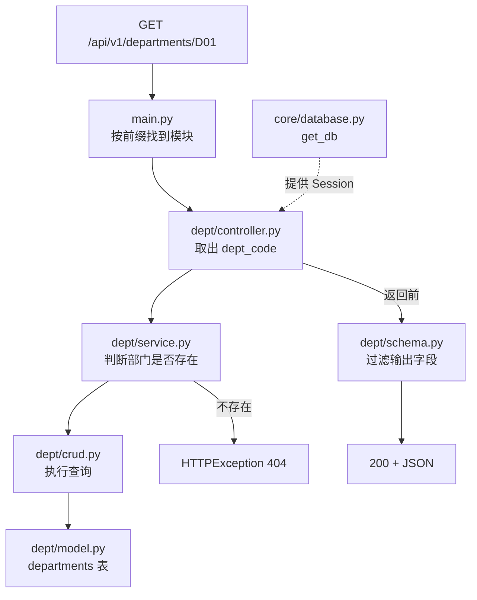

# 第 5 章 项目初始化与版本控制

> **节首信息条**｜对应课次 6 · 4 学时 · 实践｜前置：第 4 章的模块模板；第 3 章 3.4（`APIRouter`）与 3.6（`Depends`）｜**本节实训**：◆ 实训 5-1 项目初始化与版本控制

第 4 章定下了模块模板。从这一章起，项目不再由一个人写完。

## 本章要解决的问题

**多人、多轮修改同一个项目时，怎样保证每一次变更可回溯、可协作、可复现？**

同一份文件经过几个人的手，最后留下的可能不是最新的那一份；代码只存在一台电脑上，硬盘坏了就没了；改出问题想退回前一版，却找不到“昨天能跑”的状态。这些都不是谁不小心，而是项目缺少一份变更记录。

本章建立这套机制：用仓库记录修改，用分支隔离并行开发，用可复现的环境与配置保证换台机器也能跑。

## 本章学习目标

读完第 5 章并完成实训后，你应该能：

1. 说明版本控制解决的三类问题，并解释“提交可回溯”对多人协作的意义。
2. 说明工程目录中每个文件的职责，并解释 `main.py` 如何把模块装配成应用。
3. 创建虚拟环境、写依赖清单，并用 `.env` 与环境变量管理配置。
4. 完成 Git 初始化、暂存、提交、分支与合并，正确处理一次冲突。
5. 写出可读的提交信息，并用 `.gitignore` 排除虚拟环境、数据库与密钥文件。
6. 以第 4 章实训的产物为起点，补全工程目录与入口，并验证服务可启动。

## 5.1 项目文件全景

第 4 章给出的是一个模块的模板：六个文件各管一类职责。一个工程还有入口、跨模块的基础设施、测试与配置。本节先把整个工程的目录与文件职责摆出来，后面几节再谈怎样用 Git 与配置管理它。

**完整目录**

**代码 5-1-1** · 工程目录（文本）

```text
duty/
├── main.py                    # 创建应用、挂路由、建表
├── requirements.txt           # 依赖清单
├── .env.example               # 需要配置哪些变量（进 Git）
├── .env                       # 本机实际值（不进 Git）
├── .gitignore                 # 排除规则
├── README.md                  # 启动命令与目录说明
├── app/
│   ├── __init__.py
│   ├── core/
│   │   ├── __init__.py
│   │   ├── database.py        # 引擎、会话、Base、get_db
│   │   └── security.py        # 第 6 章：密码哈希与令牌
│   └── modules/
│       ├── __init__.py
│       ├── dept/              # 六文件，见 4.5
│       ├── personnel/         # 同构，第 7–12 章逐个补
│       └── ...
├── tests/                     # 第 12 章：pytest 用例
├── logs/                      # 运行生成，不进 Git
└── duty.db                    # 运行生成，不进 Git
```

`app/core/` 放跨模块的基础设施，`app/modules/` 下每个文件夹是一个模块（模板见 4.5），`logs/` 与 `duty.db` 是运行产物、不手工创建。`tests/` 与 `security.py` 先留空位，后面按章补。

**每个文件写什么**

| 文件 | 职责 | 本章写什么 | 完整实现见 |
| --- | --- | --- | --- |
| `main.py` | 创建应用、挂路由、建表 | 能启动的最小装配 | 本节 |
| `app/core/database.py` | 引擎、会话、`Base`、`get_db` | 完整 | 本节 |
| `app/modules/<模块>/controller.py` | 接请求、返回响应 | 一个最小接口 | 第 8 章 |
| `.../service.py` | 业务规则 | 空文件 | 第 8、10、11 章 |
| `.../crud.py` | 读写数据库 | 空文件 | 第 8 章 |
| `.../model.py` | 表结构 | 空文件 | 第 8 章 |
| `.../schema.py` | 输入输出模型 | 可沿用第 4 章实训的模型 | 第 3 章 3.5、第 8 章 |
| `.../param.py` | 查询参数 | 空文件 | 第 8 章 |
| `requirements.txt` | 依赖清单 | 完整 | 5.5 |
| `.env.example` / `.env` | 配置变量与本机取值 | 完整 | 5.6 |
| `.gitignore` | 排除规则 | 完整 | 5.3 |
| `README.md` | 启动命令与目录说明 | 完整 | 本节 |

空文件先把职责落位；第 8 章会把 dept 模块填满，其余模块同构复制。

**入口：main.py**

**代码 5-1-2** · `main.py`（装配，Python）

```python
from fastapi import FastAPI

from app.core.database import Base, engine
from app.modules.dept import controller as dept_controller
from app.modules.dept import model  # noqa: F401  建表前必须先导入模型

app = FastAPI(title="Duty API", version="0.1.0")


@app.get("/health")
def health():
    return {"status": "healthy"}


app.include_router(dept_controller.router, prefix="/api/v1")

Base.metadata.create_all(bind=engine)
```

`main.py` 只做三件事——创建应用、挂路由、建表，不写业务代码。`create_all` 只认识已导入的模型，所以 `from ... import model` 这行必需，即使看起来没被使用；这也是“先有模块、后有入口”的原因。

**基础设施：database.py**

**代码 5-1-3** · `app/core/database.py`（Python）

```python
from sqlalchemy import create_engine
from sqlalchemy.orm import declarative_base, sessionmaker

DATABASE_URL = "sqlite:///./duty.db"

engine = create_engine(DATABASE_URL, connect_args={"check_same_thread": False})
SessionLocal = sessionmaker(bind=engine, autoflush=False, autocommit=False)
Base = declarative_base()


def get_db():
    db = SessionLocal()
    try:
        yield db
    finally:
        db.close()
```

`get_db` 是 3.6 讲的 `Depends` 在项目里的第一个落点：接口签名写 `db: Session = Depends(get_db)`，框架在调用前建会话、调用后关闭。`yield` 的写法保证函数抛异常时也会执行 `finally`。

**一条请求的调用路径**

以 `GET /api/v1/departments/D01` 为例，请求依次经过下面的文件。



*图 5-1：一条详情请求经过的文件*

1. `main.py` 用 `include_router` 把部门模块挂到 `/api/v1`；URL 前缀与模块 router 的 `/departments` 拼成完整路径，请求转给 controller。
2. `app/modules/dept/controller.py` 接住请求，取出路径参数 `dept_code`，调用 service。
3. `app/modules/dept/service.py` 调 crud 查询；查不到时抛 `HTTPException(404)`，请求在这里结束。
4. `app/modules/dept/crud.py` 用 `Session` 执行 `db.query(Department).filter(...).first()`。
5. `app/modules/dept/model.py` 决定查哪张表、有哪些列。
6. `app/core/database.py` 的 `get_db` 已经为本次请求准备好 `Session`；controller 由依赖拿到 `Session`（机制见 3.6）。
7. `app/modules/dept/schema.py` 的 `response_model` 在返回前过滤字段，最终得到 200 与 JSON。

列表请求多用一个文件：`param.py` 接住 `page`、`page_size` 与过滤条件，controller 用 `params: DepartmentQueryParams = Depends()` 注入，再交给 service 与 crud。参数少时也可以直接写在函数签名里；列表接口参数多，收进 `param.py` 更整齐，第 8 章会展开。

> 💡 **易错点**：把所有文件堆在项目根目录，或六个文件建齐了却不知道谁调用谁。判断标准是：从 `main.py` 出发，能否沿调用路径找到处理请求的每一层。

## 5.2 版本控制

没有版本控制时，项目往往同时遇到三类问题。

**覆盖**：两个人改同一个文件，后发回的那份把先改的内容盖掉。文件名里的“最终版”“真的最终版”“最终版-小张”就是覆盖留下的痕迹。

**丢失**：代码只存在某一台电脑上。硬盘坏了、系统重装了、文件夹误删了，项目就没了。即使有备份，也常常不知道备份的是哪一天的版本。

**无法回退**：改出一个 bug 后，想回到“昨天能跑”的状态，却找不到那一版；只能凭记忆一行行改回去，改着改着又引入新问题。

三类问题指向同一个缺失：项目没有记录“每次修改是什么、为什么改、改完是什么状态”。补上它，就是**版本控制**：用仓库保存历史，每次修改成为可查看、可比较、可回退的记录。

> 💡 **易错点**：把“文件复制一份”当成版本控制。`项目-备份-最终版-2` 这类文件夹没有记录改了什么，也无法比较两版的差异；版本一多，连作者自己都分不清。

## 5.3 版本库的区域与提交

Git 把一次修改从“正在编辑的文件”送到“历史记录”，中间经过暂存区（Git 官方文档）。


*图 5-2：Git 的工作区、暂存区、本地仓库与远程仓库*

三个区域各管一件事：**工作区**是当前正在编辑的目录；**暂存区**存放“这次准备提交哪些改动”；**本地仓库**保存已经提交的历史。`git add` 把改动放进暂存区，`git commit` 把暂存区记录成一次**提交**，`git push` 把本地提交共享到远程仓库。`git status` 看当前有哪些改动，`git log` 看历史。

暂存区的意义在于“选择”：一次改动了五个文件，可以只把其中相关的三个放进这次提交，另外两个留到下一次。这样每条提交只讲一件事，回退时才能精确地撤掉一件事。

**代码 5-1-4** · 命令（Bash）

```bash
git init -b main
git add .
git commit -m "chore: init fastapi project"
```

**提交信息与提交粒度**

提交信息是给未来的自己和同伴看的。常用类型前缀（Conventional Commits 约定）有：`feat:` 新功能、`fix:` 修复、`docs:` 文档、`test:` 测试、`chore:` 构建或杂务。一个提交只做一件事，提交信息就能说清这件事。

“update”“修改一下”“最终版”这类提交信息，过两周连作者自己都看不懂改了什么。反过来，“feat: add hello endpoint”“fix: correct database path”能让历史自己讲故事。

**提交与忽略的文件**

虚拟环境、数据库文件、日志和密钥都不应该提交。它们要么体积大，要么因机器而异，要么含敏感信息。`.gitignore` 把这些路径排除掉：

**代码 5-1-5** · `.gitignore` 片段

```gitignore
venv/
__pycache__/
*.pyc
.env
*.db
logs/
.pytest_cache/
```

`.gitignore` 必须在第一次提交前写好。如果已经误提交了 `venv/`，先把它加进 `.gitignore`，再用 `git rm -r --cached venv` 从索引中移除，然后提交这次移除。注意：`.gitignore` 只影响“以后是否跟踪”，已经进入历史的大文件仍留在历史里，所以第一次提交前就要设好。

> 💡 **易错点**：提交了整个虚拟环境或 `.env`。仓库会迅速变大，密钥也会随历史永久留存；即使后来删除文件，历史里仍然能翻到。发现时先停手，按上面的步骤从索引移除，并更换已泄露的密钥。

## 5.4 分支与合并

分支让改动可以并行。主分支保持可用，新功能在独立分支上开发，完成后再合并回来。

**分支的作用**：两个人同时改 `main`，谁的提交在后面，谁就要先处理对方的改动；如果改的是同一处，冲突会在最不适合的时候出现。分支把“各自的实验”隔开，合并时再集中处理差异。

**代码 5-1-6** · 命令（Bash）

```bash
git switch -c feature/hello
# 修改代码
git add main.py
git commit -m "feat: add hello endpoint"
git switch main
git merge feature/hello
```

如果主分支在分叉后没有新提交，合并通常是“快进”，历史是一条直线。如果两边都改了同一处，Git 无法自动决定保留哪一版，就会产生冲突。冲突文件里会出现三组标记：

**代码 5-1-7** · 示例（文本）

```text
<<<<<<< HEAD
当前分支的内容
=======
要合并进来的内容
>>>>>>> feature/hello
```

处理方法是：打开文件，保留需要的内容，删掉三组标记，然后 `git add` 标记为已解决，再 `git commit` 完成合并。冲突不是错误，它只是提示“这里需要人做决定”。

**分支策略的选择**

小团队不必一上来就套用完整的分支模型。一个够用的起点是：`main` 始终保持可运行；每个功能或修复开一个短分支；合并前至少一人看过改动；合并后删除分支。分支开得越久，合并冲突越多；分支切得越细，集成越频繁，但每次集成的成本也越低。选择取决于团队规模与发布节奏，而不是“越专业越好”。

> 💡 **易错点**：所有工作都直接提交在 `main` 上，或者一个分支开两周不合并。前者让任何人随时可能破坏主分支，后者让冲突在最后集中爆发。分支的生命周期应与一次可验收的改动相当。

## 5.5 可复现的运行环境

目录与六文件在第 4 章已经定好。但同一份代码，在不同机器上仍可能跑不起来：系统 Python 里可能装着各种版本的库，两个项目需要同一个库的不同主版本时，装在一起就会冲突。虚拟环境给每个项目一套独立的库，Python 通过标准库中的 `venv` 模块提供这一能力（Python 官方文档）。

**代码 5-1-8** · 命令（Bash）

```bash
python -m venv venv
```

Windows 下激活：

**代码 5-1-9** · 命令（Bash）

```bash
venv\Scripts\activate
```

Linux 或 macOS 下激活：

**代码 5-1-10** · 命令（Bash）

```bash
source venv/bin/activate
```

激活后，命令提示符前通常会出现 `(venv)`。此时安装的依赖只进入这个环境。依赖清单 `requirements.txt` 记录项目需要哪些库，别人拿到清单就能复现环境。本章骨架用到的最小清单如下：

**代码 5-1-11** · `requirements.txt` 示例（文本）

```text
fastapi
uvicorn[standard]
sqlalchemy
pydantic
```

其中 `fastapi` 是 Web 框架、`uvicorn[standard]` 是开发服务器、`sqlalchemy` 负责 ORM 与数据库连接、`pydantic` 负责输入校验（第 3 章 3.5）。第 6 章做登录时再往清单里加 `python-jose[cryptography]` 与 `passlib`。教学环境先用机房统一安装的版本；**正式项目应当把版本锁定**（例如 `fastapi==0.110.0`），因为 12-Factor 要求显式声明并隔离依赖（12-Factor App）；否则半年后换机器装到的可能是另一个版本，就失去了「可复现」的意义。

装齐依赖的命令：

**代码 5-1-12** · 命令（Bash）

```bash
pip install -r requirements.txt
```

> 💡 **易错点**：在系统 Python 里直接 `pip install`。项目换机器时依赖版本对不上，或者不同项目互相覆盖。看到命令提示符前没有 `(venv)`，先激活再装。

**启动与验证**

依赖装齐后，服务能否启动的判据是：`/health` 返回 200，`/docs` 能打开（启动命令见第 3 章 3.3，`main.py` 的内容见 5.1）。健康检查的意义不只是“证明服务活着”，它还是部署后判断服务是否可用的第一项证据。

## 5.6 配置管理

目录、虚拟环境与依赖清单解决“代码和库能不能装齐”；还有一类东西同样影响复现：配置。数据库地址、密钥、调试开关随环境变化，不能写死在代码里。

**配置的外置**

项目通常按“配置外置”的思路提供两个文件（12-Factor App）：`.env.example` 记录需要哪些变量、示例值是什么；`.env` 保存本机实际值。

**代码 5-1-13** · `.env` 示例

```env
DATABASE_URL="sqlite:///./duty.db"
SECRET_KEY="change-me-in-env"
ALGORITHM="HS256"
ACCESS_TOKEN_EXPIRE_MINUTES=30
DEBUG=True
```

`.env.example` 进 Git，`.env` 不进 Git。原因是 `.env` 往往含真实密钥，提交上去等于泄露；而 `.env.example` 让新同事知道要配哪些项。生产环境必须替换默认 `SECRET_KEY`。

**配置、依赖与忽略规则**

**版本与变更管理**关心的不是某条命令怎么写，而是“每一次修改是什么、为什么改、改完是什么状态、能不能回到之前”。IEEE Std 828 把配置管理分为四项活动：配置标识、配置控制、状态记录与配置审核（IEEE Std 828；ISO/IEC/IEEE 12207:2017）。本课程把其中与“换台机器能跑”直接相关的部分落到四件事上：代码与依赖清单、环境配置、忽略规则、变更记录。它们的关系如下：

| 组成 | 解决什么 | 本章对应 |
| --- | --- | --- |
| 版本控制 | 改了什么、能否回退 | 5.2–5.4 |
| 依赖清单 | 装哪些库、哪个版本 | 5.5 |
| 环境配置 | 地址、密钥等随环境变化的值 | 本节 `.env` |
| 忽略规则 | 哪些东西不该进仓库 | 5.3 `.gitignore` |

四件事缺一件，“换台机器能跑”就不成立：没有依赖清单，装不齐库；没有环境配置，数据库地址写死；没有忽略规则，密钥进仓库；没有版本控制，改坏了回不去。

> 💡 **易错点**：把 `.env` 提交进仓库。它往往含真实密钥，提交上去等于泄露；`.env.example` 只放变量名与示例值，才是可以进 Git 的那一份。

## 示范例题

#### 例 5-1：读工程目录，说出一条请求的路径【Bloom：分析】

**题目**：下面是 5.1 的项目目录（节选）。请指出 `GET /api/v1/departments/D01` 会经过哪些文件、每个文件做什么；如果该编码不存在，404 由哪一层产生。

```text
duty/
├── main.py
└── app/
    ├── core/
    │   └── database.py
    └── modules/
        └── dept/
            ├── controller.py
            ├── service.py
            ├── crud.py
            ├── model.py
            ├── schema.py
            └── param.py
```

**解**：

1. `main.py` 用 `include_router(controller.router, prefix="/api/v1")` 把部门模块挂进应用；`/api/v1` 与模块 router 的 `/departments` 拼成完整 URL，请求转给 controller。
2. `app/modules/dept/controller.py` 接住请求，取出路径参数 `dept_code`，调用 service。
3. `app/modules/dept/service.py` 调 crud 查询；查不到时抛 `HTTPException(404)`，所以 404 来自 service，不是 controller，也不是数据库。
4. `app/modules/dept/crud.py` 用 `Session` 执行 `db.query(Department).filter(...).first()`。
5. `app/modules/dept/model.py` 定义 `departments` 表的字段与主键 `dept_code`。
6. `app/modules/dept/schema.py` 的 `response_model` 在返回前过滤字段，决定哪些列能出现在 JSON 里。
7. `app/core/database.py` 的 `get_db` 为本次请求提供 `Session`；controller 只声明依赖，不自己开关连接（机制见第 3 章 3.6）。
8. `app/modules/dept/param.py` 在这个请求里不参与；列表请求才会用到分页与过滤参数。

#### 例 5-2：为项目仓库列出提交清单【Bloom：应用】

**题目**：项目已按 5.1 的工程目录搭好，包含部门、人员两个模块与测试目录。请列出应纳入 Git 的内容与应排除的内容，并说明每类排除项的理由。

**解**：

先看应提交的内容：

| 应提交 | 理由 |
| --- | --- |
| `main.py`、`app/`、`tests/` | 代码与测试同仓，换机器能拿到同一份 |
| `requirements.txt` | 依赖清单，别人据此能装齐库 |
| `.env.example` | 说明需要配哪些变量，不含真实值 |
| `.gitignore` | 排除规则本身也要进仓库 |
| `README.md`（可选） | 启动命令与目录说明 |

再看应排除的内容：

| 应排除 | 理由 |
| --- | --- |
| `venv/` | 体积大、因机器而异，可由依赖清单复现 |
| `.env` | 含真实密钥，不能进历史 |
| `*.db` | 运行数据，不属于代码 |
| `__pycache__/`、`*.pyc` | 解释器生成，可重建 |
| `logs/` | 运行日志 |
| `.pytest_cache/` | 测试缓存 |

目录本身（`app/core/`、`app/modules/dept/`）会随其中的文件一起进入仓库。Git 不跟踪空目录，所以每个包目录里的 `__init__.py` 同时承担了“让目录进仓库”的作用。

#### 例 5-3：完成第一次 Git 提交【Bloom：应用】

**题目**：写出把一个已搭好骨架的 FastAPI 项目纳入 Git 的命令，要求：初始化主分支为 `main`、提交前排除虚拟环境与密钥、完成第一次提交。

**解**：

**代码 5-3-1** · 命令（Bash）

```bash
git init -b main
git add .gitignore
git commit -m "chore: add gitignore"
git add .
git commit -m "chore: init fastapi project"
```

其中 `.gitignore` 至少包含：

**代码 5-3-2** · `.gitignore` 片段

```gitignore
venv/
__pycache__/
.env
*.db
logs/
```

先单独提交 `.gitignore` 的好处是：后续 `git add .` 时，虚拟环境、`.env` 与数据库文件已经被排除，不会误入仓库。

## 独立习题

#### 习题 5-1【Bloom：记忆】

**题目**：写出下列 Git 操作对应的命令：初始化仓库、查看状态、暂存全部改动、提交、创建并切换分支、合并分支、查看简洁历史图。

#### 习题 5-2【Bloom：分析】

**题目**：下面是某小组的 Git 历史与仓库内容。请指出至少三处问题，并说明可能造成的后果。

> 提交历史有 20 条，信息分别是“update”“修改”“再改”“最终版”“真的最终版”；仓库里能看到 `venv/`、`.env`、`duty.db`；所有工作都直接提交在 `main` 上，没有分支。

#### 习题 5-3【Bloom：创造】（开放题，换场景）

**题目**：一个 4 人小组要共同开发一个 FastAPI 项目，持续 8 周。请设计一套 Git 分支与提交规范：至少说明主分支、功能分支、合并方式、提交信息格式、代码评审时机，并解释每条规则要解决的问题。**不能照抄本章的两分支示例**：要说明 4 人并行时，分支何时开、何时合、冲突由谁处理。

#### 习题 5-4【Bloom：分析】

**题目**：下面是某同学提交的项目目录（`logs/` 已被 Git 跟踪）。请指出至少三处组织问题及可能后果，并给出每处的修正位置。

```text
duty/
├── main.py
├── service.py
├── app/
│   ├── core/
│   │   └── dept_service.py
│   └── modules/
│       └── dept/
│           ├── controller.py
│           ├── crud.py
│           ├── model.py
│           ├── schema.py
│           └── param.py
└── logs/            # 已被 Git 跟踪
```

## ◆ 实训 5-1：项目初始化与版本控制（对应课次 6 · 4 学时）

### 一、任务目标与验收

本实训的起点是第 4 章综合实训 4-1 的产物：一份设计文档、一个最小实现、两张记录表。本实训把它补成一个能启动、能回溯、换台机器能跑起来的仓库，不再从空目录重搭。

| 目标 | 验收标志 |
| --- | --- |
| 项目能启动 | `uvicorn main:app` 后可访问 `/health` 与 `/docs` |
| 工程目录与 5.1 一致 | 入口、`app/core/`、`app/modules/<模块>/` 六个文件、`tests/` 与根目录配置齐备；模块模板与 4.5 一致 |
| 六文件职责说明 | 能逐个说明六个文件负责什么、当前哪些是空位、何时补齐 |
| 依赖可复现 | `pip install -r requirements.txt` 能装齐；`.env.example` 列出所需变量 |
| Git 历史可读 | 至少 3 次提交，信息说明做了什么 |
| 分支合并完成 | 有一次分支开发与合并记录 |

### 二、课前准备

- Python 3.10+ 与 Git 已安装
- **第 4 章综合实训 4-1 的产物**：设计文档、最小实现（`main.py` 与 `schemas.py`）、接口验证记录与契约—实现核对记录
- 一张从 5.1 抄下的工程目录清单

### 三、操作步骤

1. **核对并迁移 4-1 产物（10 分钟）**
   - 做什么：把 4-1 的最小实现按模块拆进 `app/modules/<模块>/`；对照 5.1 的目录，标出还缺哪些文件
   - 操作：把 `schemas.py` 的内容移入模块的 `schema.py`，把接口移入 `controller.py`；缺的 service / crud / model / param 先建空文件
   - 预期输出：设计文档里的模块模板与磁盘上的目录一致
   - 做错会看到什么：文件都在根目录、模块目录是空的；先迁移再继续，否则后面的路径都对不上
2. **补全工程目录（20 分钟）**
   - 做什么：补 `app/core/`、`tests/`、每个包目录的 `__init__.py`，以及 `requirements.txt`、`.env.example`、`.gitignore`、`README.md`
   - 预期输出：`python -c "import app"` 不报错；目录与 5.1 逐项对得上
   - 做错会看到什么：`ModuleNotFoundError: No module named 'app'`：多为缺 `__init__.py` 或不在项目根目录执行
3. **写 database.py 与装配 main.py（25 分钟）**
   - 做什么：按 5.1 写 `app/core/database.py` 与 `main.py`，用 3.6 的 `Depends` 形式接入 `get_db`
   - 操作：`include_router` 带 `prefix="/api/v1"`；`create_all` 前确认模型已导入
   - 预期输出：`/health` 返回 200，`/docs` 可打开，模块接口出现在分组里
   - 做错会看到什么：`/docs` 404（前缀或启动文件）、`OperationalError`（数据库路径）、接口拿不到会话（依赖签名写错）
4. **虚拟环境与依赖清单（20 分钟）**
   - 做什么：建虚拟环境、写 `requirements.txt`、装依赖
   - 操作：`python -m venv venv`；激活后 `pip install -r requirements.txt`
   - 预期输出：提示符前出现 `(venv)`，`pip list` 能看到所列依赖
   - 做错会看到什么：依赖装进系统环境；或换台机器装到不同版本（未锁定）
5. **Git 初始化与首次提交（25 分钟）**
   - 做什么：先写 `.gitignore` 并单独提交，再把骨架纳入版本控制
   - 操作：`git init -b main`、`git add .gitignore`、`git commit`、`git add .`、`git commit`
   - 预期输出：`git log` 有 2 条提交；`venv/`、`.env`、`*.db`、`logs/` 均未被跟踪
   - 做错会看到什么：`git status` 出现 `venv/`：`.gitignore` 没生效或路径写错
6. **分支开发与合并（25 分钟）**
   - 做什么：在独立分支上给模块加一个字段或一个接口，再合并回 `main`
   - 操作：`git switch -c feature/<模块>-<改动>`，改一处、提交、切回 `main` 合并
   - 预期输出：历史可读，无冲突或冲突已解决
   - 做错会看到什么：冲突标记未删干净；保留需要的内容后删除三组标记再提交
7. **启动验证与提交（20 分钟）**
   - 做什么：重新启动服务，填验收表；把设计文档的目录一节更新为实际目录
   - 预期输出：`/health` 200、`/docs` 200、`git log` 可读、目录与文档一致
   - 做错会看到什么：文档里的路径与磁盘不一致；以磁盘为准改文档，并记录差异

### 四、排错清单

| 现象 | 先查什么 |
| --- | --- |
| 服务起不来 | 端口占用、依赖缺失、语法错误 |
| `/docs` 打不开 | 服务是否启动、路由前缀是否正确 |
| `ModuleNotFoundError` | 包目录是否缺 `__init__.py`、是否在项目根目录执行 |
| 依赖装到系统环境 | 虚拟环境是否激活 |
| 提交为空 | `git status`、`.gitignore` 是否误伤 |
| 合并冲突 | 保留目标内容，删除 `<<<<<<<` 三组标记后再 `git add` |
| 换台机器跑不起来 | 依赖是否锁定、`.env.example` 是否列全、数据库文件是否被误提交 |

### 五、提交与验收

提交：更新后的**设计文档**、**项目仓库**、`git log`、`/health` 与 `/docs` 的验证记录。验收按“能启动”“目录与配置”“六文件职责说明”“Git 历史”四项判定。

### 六、课后扩展

- 给项目补 `README.md`，写清启动命令与目录说明
- 把配置项补进 `.env.example`，并验证另一台机器能照文档装起来
- 练习一次 `git revert` 或 `git reset` 的安全回退
- **复习任务**：回看第 3 章 3.4（APIRouter）与 3.6（`Depends`）、第 4 章 4.5（六类职责）与本章 5.1（工程目录），说明项目骨架复用了哪些前两章的机制

## 本章小结

**核心结论**：

1. 没有版本控制会同时出现覆盖、丢失与无法回退；**版本控制**用仓库记录每次修改，使历史可查看、可比较、可回退。
2. Git 用工作区、暂存区、本地仓库组织一次**提交**；暂存区让每条提交只包含相关的改动，提交信息说明改了什么、为什么改。
3. 分支用于并行开发；合并时同一处出现不同改动会产生冲突，冲突需要人工决定保留哪一版。
4. 模块模板在第 4 章已经定好；本章把它落成完整工程目录（入口、基础设施、模块、测试与配置），再用虚拟环境隔离依赖、用依赖清单让换机器能复现。
5. **配置管理**把代码、依赖、环境配置、忽略规则与变更记录放在一起；`.env.example` 进 Git、`.env` 不进，密钥与数据库地址不写死在代码里。
6. 一个工程由 `main.py` 入口、`app/core/` 基础设施、`app/modules/` 模块、`tests/` 与根目录配置组成；模块内部沿用 4.5 的六类职责，`get_db` 用 3.6 的 `Depends` 注入。

把这章压缩成一句话：**可回溯靠提交，可协作靠分支，可复现靠配置管理。**

**学完本章，你可以体会到**：项目初始化不是“建个文件夹”，而是把后面所有章节要复用的启动、配置与版本管理一次做对。

**自检**：回到章首的学习目标，逐条问自己做到了没有——

- [ ] 说明版本控制解决的三类问题，并解释“提交可回溯”的意义。
- [ ] 说明工程目录中每个文件的职责，并解释 `main.py` 如何把模块装配成应用。
- [ ] 创建虚拟环境、写依赖清单，并用 `.env` 与环境变量管理配置。
- [ ] 完成 Git 初始化、暂存、提交、分支与合并，正确处理一次冲突。
- [ ] 写出可读的提交信息，并用 `.gitignore` 排除虚拟环境、数据库与密钥文件。
- [ ] 以第 4 章实训的产物为起点，补全工程目录与入口，并验证服务可启动。
