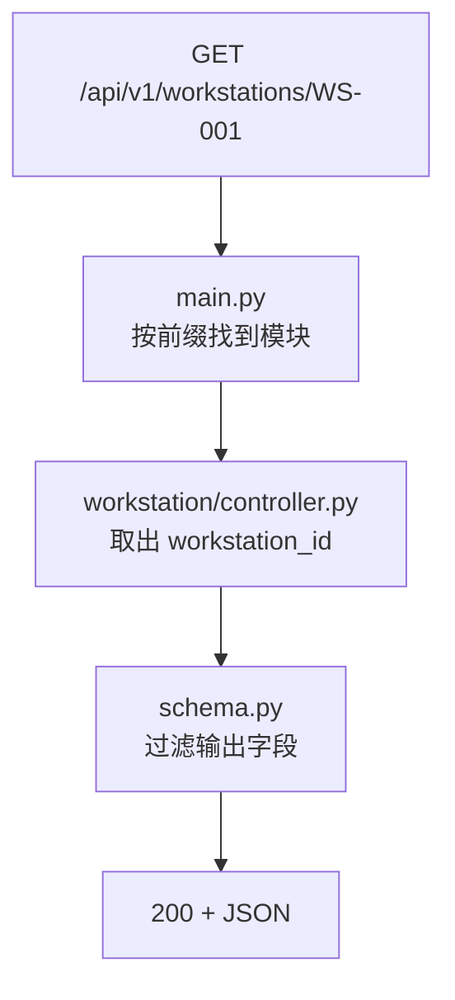

# 第 5 章 项目初始化与版本控制

> **节首信息条**｜对应课次 6 · 4 学时 · 实践｜前置：第 4 章的模块模板；第 3 章 3.4（`APIRouter`）｜**本节实训**：◆ 实训 5-1 项目初始化与版本控制

第 4 章确定了模块模板。本章起，项目不再由单人一次完成。

## 本章要解决的问题

**多人、多轮修改同一项目时，如何保证每次变更可回溯、可协作、可复现？**

同一文件经多人修改后，最终保留的可能不是最新版本；代码仅存于一台计算机时，硬盘故障即导致项目丢失；修改引入缺陷后，无法找回“昨日可运行”的版本。上述问题均源于项目缺少变更记录。

本章说明相应机制：以仓库记录修改，以分支隔离并行开发，以可复现的环境与配置保证项目在另一台机器上可运行。

## 本章学习目标

读完第 5 章并完成实训后，应能：

1. 说明版本控制解决的三类问题，并解释“提交可回溯”对多人协作的意义。
2. 说明工程目录中各文件的职责，并解释 `main.py` 如何将模块装配为应用。
3. 创建虚拟环境、编写依赖清单，并使用 `.env` 与环境变量管理配置。
4. 完成 Git 初始化、暂存、提交、分支与合并，正确处理一次冲突。
5. 编写可读的提交信息，并使用 `.gitignore` 排除虚拟环境、数据库与密钥文件。
6. 以第 4 章实训的产物为起点，补全工程目录与入口，并验证服务可启动。

## 5.1 项目文件全景

第 4 章给出的是一个模块的模板：六个文件分别承担一类职责。完整工程还包括入口、跨模块基础设施、测试与配置。本节说明整个工程的目录结构及各文件职责；后续各节说明如何使用 Git 与配置管理该工程。

**工程目录**

**代码 5-1-1** · 工程目录（文本）

```text
duty/
├── main.py                    # 创建应用、挂路由
├── requirements.txt           # 依赖清单
├── .env.example               # 需要配置哪些变量（进 Git）
├── .env                       # 本机实际值（不进 Git）
├── .gitignore                 # 排除规则
├── README.md                  # 启动命令与目录说明
└── app/
    ├── __init__.py
    └── modules/
        ├── __init__.py
        └── workstation/       # 第 4 章实训选定的业务对象
            ├── __init__.py
            ├── controller.py  # 接口：由 4-1 的 main.py 迁入
            └── schema.py      # 输入输出模型：由 4-1 的 schemas.py 迁入
```

本章只建**当前用到的文件**。第 4 章 4.5 的模块模板仍是完整的六文件，但当四个文件尚无内容时，先建空文件只会增加阅读负担；它们按“第一次需要”补齐：

| 文件或目录 | 何时加入 | 第一次用到它的内容 |
| --- | --- | --- |
| `app/core/database.py` | 第 6 章 | 用户表与登录会话 |
| `app/core/security.py` | 第 6 章 | 密码哈希与令牌 |
| 模块的 `model.py`、`crud.py`、`service.py`、`param.py` | 第 8 章 | 业务数据的读写与规则 |
| `tests/` | 第 12 章 | 自动化测试 |

这条规则的依据与 5.1 之前所述一致：目录服务于职责，职责尚未出现时，空文件只占位置，不承担任何职责。

**各文件的职责**

| 文件 | 职责 | 本章写什么 | 完整实现见 |
| --- | --- | --- | --- |
| `main.py` | 创建应用、挂路由 | 能启动的最小装配 | 本节 |
| `app/modules/<模块>/controller.py` | 接请求、返回响应 | 由 4-1 迁入的三个接口 | 第 8 章扩展 |
| `.../schema.py` | 输入输出模型 | 由 4-1 迁入 | 3.5、8.2 |
| `requirements.txt` | 依赖清单 | 完整 | 5.5 |
| `.env.example` / `.env` | 配置变量与本机取值 | 完整 | 5.6 |
| `.gitignore` | 排除规则 | 完整 | 5.3 |
| `README.md` | 启动命令与目录说明 | 完整 | 本节 |

表中未列出的文件按上一节的时机加入：`app/core/database.py` 与 `security.py` 在第 6 章，模块其余四个文件在第 8 章，`tests/` 在第 12 章。

**入口文件 main.py**

**代码 5-1-2** · `main.py`（装配，Python）

```python
from fastapi import FastAPI

from app.modules.workstation import controller as workstation_controller

app = FastAPI(title="Duty API", version="0.1.0")


@app.get("/health")
def health():
    return {"status": "healthy"}


app.include_router(workstation_controller.router, prefix="/api/v1")
```

`main.py` 只承担两项职责：创建应用、挂载路由，不包含业务代码。建表在第 6 章引入数据库时一并加入：届时补 `from app.core.database import Base, engine` 与 `Base.metadata.create_all(bind=engine)`；`create_all` 只识别已导入的模型，因此还要导入模块的 `model`。本章没有模型，不建表。

**数据库基础设施在需要时引入**

本章的三个接口使用内存列表，不访问数据库，因此不需要 `app/core/database.py`。第 6 章建立用户表时才第一次需要引擎、会话与 `Base`，届时一并写出该文件（代码 6-1-1）。

**一条请求的调用路径**

以 `GET /api/v1/workstations/WS-001` 为例，请求经过以下文件。



*图 5-1：本章一条详情请求经过的文件*

1. `main.py` 通过 `include_router` 将工位模块挂载到 `/api/v1`；URL 前缀与模块 router 的 `/workstations` 拼接为完整路径，请求转交 controller。
2. `app/modules/workstation/controller.py` 接收请求，取出路径参数 `workstation_id`，在内存数据中查找；未找到时抛出 `HTTPException(404)`，请求在此结束。
3. `app/modules/workstation/schema.py` 的 `response_model` 在返回前过滤字段，最终生成 200 与 JSON。

第 8 章加入 `service.py` 与 `crud.py` 后，路径变为 controller → service → crud → model，404 改由 service 抛出；第 6 章加入 `database.py` 后，会话通过 `Depends(get_db)` 注入。此时 404 由 controller 产生，原因是规则层尚未建立；位置会随后续章节前移，判断依据始终是“谁负责这条规则”。

列表请求还需要查询参数；本章的列表接口没有分页，`param.py` 在第 8 章加入。

> 💡 **易错点**：将所有文件置于项目根目录，或文件位置与职责不符。判断标准为：从 `main.py` 出发，能否沿调用路径找到处理请求的每一层。若不能，则文件位置错误或职责被绕过。

## 5.2 版本控制

缺少版本控制时，项目通常同时出现三类问题。

**覆盖**：两人基于同一份文件分别修改。其中一人将修改后的文件发回时，整份替换了对方的版本；对方的修改未经合并，随即丢失。文件名中的“最终版”“真的最终版”“最终版-小张”并非覆盖本身，而是以复制文件代替版本管理留下的痕迹。

**丢失**：代码仅存于一台计算机。硬盘故障、系统重装或文件夹误删均可导致项目丢失。即使存在备份，也常无法确定备份对应的版本日期。

**无法回退**：修改引入缺陷后，无法找回“昨日可运行”的版本，只能凭记忆逐行还原，并可能引入新问题。

三类问题指向同一缺失：项目未记录每次修改的内容、原因与结果状态。补上该记录即为**版本控制**：以仓库保存历史，使每次修改成为可查看、可比较、可回退的记录。

> 💡 **易错点**：将“复制文件”视为版本控制。`项目-备份-最终版-2` 一类文件夹未记录修改内容，也无法比较两版差异；版本增多后，作者亦难以区分。

## 5.3 版本库的区域与提交

Git 将一次修改从工作区送入历史记录，中间经过暂存区（Git 官方文档）。


*图 5-2：Git 的工作区、暂存区、本地仓库与远程仓库*

三个区域分别承担一项职责：**工作区**是当前编辑的目录；**暂存区**存放本次准备提交的改动；**本地仓库**保存已提交的历史。`git add` 将改动放入暂存区，`git commit` 将暂存区记录为一次**提交**，`git push` 将本地提交共享至远程仓库。`git status` 查看当前改动，`git log` 查看历史。

暂存区的作用是选择提交范围：一次修改五个文件时，可仅将相关的三个文件纳入本次提交，其余两个留待下次。由此，每次提交只包含一项改动，回退时可精确撤销该项改动。

**代码 5-1-3** · 命令（Bash）

```bash
git init -b main
git add .
git commit -m "chore: init fastapi project"
```

**提交信息与提交粒度**

提交信息供后续维护者阅读。常用类型前缀（Conventional Commits 约定）包括：`feat:` 新功能、`fix:` 修复、`docs:` 文档、`test:` 测试、`chore:` 构建或杂务。一次提交只完成一项改动，提交信息即可说明该改动。

“update”“修改一下”“最终版”一类提交信息，两周后连作者也难以理解修改内容；而“feat: add hello endpoint”“fix: correct database path”可使提交历史清晰可读。

**提交与忽略的文件**

虚拟环境、数据库文件、日志与密钥不应提交。上述内容或体积较大，或因机器而异，或包含敏感信息。`.gitignore` 用于排除这些路径：

**代码 5-1-4** · `.gitignore` 片段

```gitignore
venv/
__pycache__/
*.pyc
.env
*.db
logs/
.pytest_cache/
```

`.gitignore` 必须在首次提交前编写。若已误提交 `venv/`，应先将其加入 `.gitignore`，再执行 `git rm -r --cached venv` 从索引中移除，然后提交该移除操作。需注意：`.gitignore` 仅影响后续是否跟踪；已进入历史的大文件仍保留在历史中，因此首次提交前即应完成设置。

> 💡 **易错点**：提交整个虚拟环境或 `.env`。仓库体积将迅速增大，密钥亦随历史永久保留；即使后续删除文件，历史中仍可查到。发现后应立即停止提交，按上述步骤从索引移除，并更换已泄露的密钥。

## 5.4 分支与合并

分支使改动可以并行：主分支保持可用，新功能在独立分支上开发，完成后合并回主分支。

**分支的作用**：两人同时修改 `main` 时，后提交者须先处理对方的改动；若修改同一位置，冲突往往在不宜处理的时点出现。分支将各自的修改隔离，合并时再集中处理差异。

**代码 5-1-5** · 命令（Bash）

```bash
git switch -c feature/hello
# 修改代码
git add main.py
git commit -m "feat: add hello endpoint"
git switch main
git merge feature/hello
```

若主分支在分叉后无新提交，合并通常为快进，历史呈直线。若双方修改同一位置，Git 无法自动决定保留哪一版，即产生冲突。冲突文件中出现三组标记：

**代码 5-1-6** · 示例（文本）

```text
<<<<<<< HEAD
当前分支的内容
=======
要合并进来的内容
>>>>>>> feature/hello
```

处理方法为：打开文件，保留所需内容，删除三组标记，执行 `git add` 标记为已解决，再执行 `git commit` 完成合并。冲突不是错误，而是提示该处需要人工决定。

**分支策略的选择**

小团队无需一开始采用完整分支模型。可用的起点为：`main` 始终保持可运行；每个功能或修复建立短分支；合并前至少一人审阅改动；合并后删除分支。分支存在越久，合并冲突越多；分支划分越细，集成越频繁，单次集成成本越低。选择取决于团队规模与发布节奏，而非复杂程度。

> 💡 **易错点**：全部工作直接提交至 `main`，或将一个分支保持两周不合并。前者使主分支随时可能被破坏，后者使冲突在最后集中出现。分支生命周期应与一次可验收的改动相当。

## 5.5 可复现的运行环境

目录与模块模板已在第 4 章确定。但同一份代码在不同机器上仍可能无法运行：系统 Python 中可能安装多个版本的库；两个项目依赖同一库的不同主版本时，安装于同一环境将产生冲突。虚拟环境为每个项目提供独立的库，Python 通过标准库 `venv` 模块提供该能力（Python 官方文档）。

**代码 5-1-7** · 命令（Bash）

```bash
python -m venv venv
```

Windows 下激活：

**代码 5-1-8** · 命令（Bash）

```bash
venv\Scripts\activate
```

Linux 或 macOS 下激活：

**代码 5-1-9** · 命令（Bash）

```bash
source venv/bin/activate
```

激活后，命令提示符前通常出现 `(venv)`；此后安装的依赖仅进入该环境。依赖清单 `requirements.txt` 记录项目所需的库，他人依据清单即可复现环境。本章骨架所需的最小清单如下：

**代码 5-1-10** · `requirements.txt` 示例（文本）

```text
fastapi
uvicorn[standard]
pydantic
```

其中 `fastapi` 为 Web 框架，`uvicorn[standard]` 为开发服务器，`pydantic` 负责输入校验（第 3 章 3.5）。第 6 章建立用户表时，再加入 `sqlalchemy`（ORM 与数据库连接）与 `python-jose[cryptography]`、`passlib`、`python-dotenv`（认证）。教学环境先使用机房统一安装的版本；**正式项目应锁定版本**（例如 `fastapi==0.110.0`），因为 12-Factor 要求显式声明并隔离依赖（12-Factor App）；否则半年后在其他机器上可能安装为其他版本，从而失去“可复现”的意义。

安装依赖的命令：

**代码 5-1-11** · 命令（Bash）

```bash
pip install -r requirements.txt
```

> 💡 **易错点**：在系统 Python 中直接执行 `pip install`。项目换机时依赖版本不一致，不同项目也可能相互覆盖。命令提示符前无 `(venv)` 时，应先激活环境再安装。

**启动与验证**

依赖安装完成后，服务能否启动的判据为：`/health` 返回 200，`/docs` 可打开（启动命令见第 3 章 3.3，`main.py` 内容见 5.1）。健康检查的作用不仅是证明服务运行，也是部署后判断服务可用的第一项证据。

## 5.6 配置管理

目录、虚拟环境与依赖清单解决代码与库的安装问题；配置同样影响可复现性。数据库地址、密钥、调试开关随环境变化，不得硬编码于代码中。

**配置的外置**

项目通常按配置外置的思路提供两个文件（12-Factor App）：`.env.example` 记录所需变量及示例值；`.env` 保存本机实际值。

**代码 5-1-12** · `.env` 示例

```env
SECRET_KEY="change-me-in-env"
ALGORITHM="HS256"
ACCESS_TOKEN_EXPIRE_MINUTES=30
DEBUG=True
```

`.env.example` 纳入 Git，`.env` 不纳入。原因是 `.env` 通常含真实密钥，提交即构成泄露；`.env.example` 可使新成员了解所需配置项。生产环境必须替换默认 `SECRET_KEY`。数据库地址 `DATABASE_URL` 在第 6 章引入数据库时加入清单。

**配置、依赖与忽略规则**

**版本与变更管理**关注的不是某条命令的写法，而是每次修改的内容、原因、结果状态及可回退性。IEEE Std 828 将配置管理分为四项活动：配置标识、配置控制、状态记录与配置审核（IEEE Std 828；ISO/IEC/IEEE 12207:2017）。本课程将其中与“换机可运行”直接相关的部分落实为四项：代码与依赖清单、环境配置、忽略规则、变更记录。四者关系如下：

| 组成 | 解决什么 | 本章对应 |
| --- | --- | --- |
| 版本控制 | 改了什么、能否回退 | 5.2–5.4 |
| 依赖清单 | 装哪些库、哪个版本 | 5.5 |
| 环境配置 | 地址、密钥等随环境变化的值 | 本节 `.env` |
| 忽略规则 | 哪些文件不应纳入仓库 | 5.3 `.gitignore` |

四项缺一，“换机可运行”即不成立：缺少依赖清单，无法安装所需库；缺少环境配置，数据库地址硬编码；缺少忽略规则，密钥进入仓库；缺少版本控制，修改出错后无法回退。

> 💡 **易错点**：将 `.env` 提交至仓库。该文件通常含真实密钥，提交即构成泄露；`.env.example` 仅包含变量名与示例值，方可纳入 Git。

## 示范例题

#### 例 5-1：读工程目录，说出一条请求的路径【Bloom：分析】

**题目**：下面是 5.1 的工程目录（节选）。请指出 `GET /api/v1/workstations/WS-001` 会经过哪些文件、每个文件承担什么职责；若该编号不存在，404 由哪一层产生；并说明哪些文件在本章尚未建立。

```text
duty/
├── main.py
└── app/
    └── modules/
        └── workstation/
            ├── controller.py
            └── schema.py
```

**解**：

1. `main.py` 通过 `include_router(controller.router, prefix="/api/v1")` 将工位模块挂入应用；`/api/v1` 与模块 router 的 `/workstations` 拼接为完整 URL，请求转交 controller。
2. `app/modules/workstation/controller.py` 接收请求，取出路径参数 `workstation_id`，在内存数据中查找。
3. 未找到记录时，controller 抛出 `HTTPException(404)`；因此当前的 404 由 controller 产生。
4. `app/modules/workstation/schema.py` 的 `response_model` 在返回前过滤字段，决定哪些字段可出现在 JSON 中。
5. 本章尚未建立的文件：`service.py`、`crud.py`、`model.py`、`param.py` 在第 8 章加入，`app/core/database.py` 在第 6 章加入，`tests/` 在第 12 章加入。
6. 上述文件加入后，404 的抛出位置从 controller 前移到 service：controller 只取参数并返回结果，规则由 service 判断。位置变化的依据是“谁负责这条规则”，不是文件数量。

#### 例 5-2：为项目仓库列出提交清单【Bloom：应用】

**题目**：项目已按 5.1 的工程目录搭建，并已按后续章节补入部门、人员两个模块与测试目录。请列出应纳入 Git 的内容与应排除的内容，并说明每类排除项的理由。

**解**：

应提交的内容：

| 应提交 | 理由 |
| --- | --- |
| `main.py`、`app/`、`tests/` | 代码与测试同仓，换机器能拿到同一份 |
| `requirements.txt` | 依赖清单，别人据此能装齐库 |
| `.env.example` | 说明需要配哪些变量，不含真实值 |
| `.gitignore` | 排除规则本身也要进仓库 |
| `README.md`（可选） | 启动命令与目录说明 |

应排除的内容：

| 应排除 | 理由 |
| --- | --- |
| `venv/` | 体积大、因机器而异，可由依赖清单复现 |
| `.env` | 含真实密钥，不能进历史 |
| `*.db` | 运行数据，不属于代码 |
| `__pycache__/`、`*.pyc` | 解释器生成，可重建 |
| `logs/` | 运行日志 |
| `.pytest_cache/` | 测试缓存 |

目录本身（`app/core/`、`app/modules/dept/`）随其中文件进入仓库。Git 不跟踪空目录，因此每个包目录中的 `__init__.py` 同时承担使目录进入仓库的作用。

#### 例 5-3：完成第一次 Git 提交【Bloom：应用】

**题目**：写出将一个已搭建骨架的 FastAPI 项目纳入 Git 的命令，要求：初始化主分支为 `main`、提交前排除虚拟环境与密钥、完成第一次提交。

**解**：

**代码 5-3-1** · 命令（Bash）

```bash
git init -b main
git add .gitignore
git commit -m "chore: add gitignore"
git add .
git commit -m "chore: init fastapi project"
```

其中 `.gitignore` 至少包含：

**代码 5-3-2** · `.gitignore` 片段

```gitignore
venv/
__pycache__/
.env
*.db
logs/
```

先单独提交 `.gitignore` 的作用是：后续执行 `git add .` 时，虚拟环境、`.env` 与数据库文件已被排除，不会误入仓库。

## 独立习题

#### 习题 5-1【Bloom：记忆】

**题目**：写出下列 Git 操作对应的命令：初始化仓库、查看状态、暂存全部改动、提交、创建并切换分支、合并分支、查看简洁历史图。

#### 习题 5-2【Bloom：分析】

**题目**：下面是某小组的 Git 历史与仓库内容。请指出至少三处问题，并说明可能造成的后果。

> 提交历史有 20 条，信息分别是“update”“修改”“再改”“最终版”“真的最终版”；仓库里能看到 `venv/`、`.env`、`duty.db`；所有工作都直接提交在 `main` 上，没有分支。

#### 习题 5-3【Bloom：创造】（开放题，换场景）

**题目**：一个 4 人小组要共同开发一个 FastAPI 项目，持续 8 周。请设计一套 Git 分支与提交规范：至少说明主分支、功能分支、合并方式、提交信息格式、代码评审时机，并解释每条规则要解决的问题。**不得照抄本章的两分支示例**：应说明 4 人并行时，分支何时建立、何时合并、冲突由谁处理。

#### 习题 5-4【Bloom：分析】

**题目**：下面是某学生提交的项目目录（`logs/` 已被 Git 跟踪）。请指出至少三处组织问题及可能后果，并给出每处的修正位置。

```text
duty/
├── main.py
├── service.py
├── app/
│   ├── core/
│   │   └── dept_service.py
│   └── modules/
│       └── dept/
│           ├── controller.py
│           ├── crud.py
│           ├── model.py
│           ├── schema.py
│           └── param.py
└── logs/            # 已被 Git 跟踪
```

## ◆ 实训 5-1：项目初始化与版本控制（对应课次 6 · 4 学时）

### 一、任务目标与验收

本实训以第 4 章综合实训 4-1 的产物为起点：一份设计文档、一个最小实现、一张接口验证记录。任务是将该产物补全为可启动、可回溯、可在另一台机器上运行的仓库，不再从空目录重建。

| 目标 | 验收标志 |
| --- | --- |
| 项目能启动 | `uvicorn main:app` 后可访问 `/health` 与 `/docs` |
| 工程目录与 5.1 一致 | 入口、`app/modules/<模块>/{controller,schema}` 与根目录配置齐备；其余文件按“用到才建”暂不创建 |
| 文件职责说明 | 能说明每个已建文件的职责，以及未建文件为何暂不建、何时加入 |
| 依赖可复现 | `pip install -r requirements.txt` 能装齐；`.env.example` 列出所需变量 |
| Git 历史可读 | 至少 3 次提交，信息说明做了什么 |
| 分支合并完成 | 有一次分支开发与合并记录 |

### 二、课前准备

- Python 3.10+ 与 Git 已安装
- **第 4 章综合实训 4-1 的产物**：设计文档、最小实现（`main.py` 与 `schemas.py`）、接口验证记录
- 一份从 5.1 抄录的工程目录清单

### 三、操作步骤

1. **迁移 4-1 产物（15 分钟）**
   - 做什么：建 `app/modules/<模块>/`，把 `schemas.py` 的内容移入 `schema.py`，把三个接口移入 `controller.py`；每个包目录放一个空 `__init__.py`
   - 操作：模块 `router` 的前缀写 `"/workstations"`（或自己的资源名）；删除 `app = FastAPI()`，应用留给根目录 `main.py`；导入改为 `app.modules.<模块>.schema`
   - 预期输出：`python -c "from app.modules.workstation import controller; print(controller.router.prefix)"` 输出 `/workstations`
   - 做错会看到什么：文件仍在根目录、模块目录为空；`controller.py` 里还留着 `app = FastAPI()`；导入仍写 `from schemas import ...`
2. **补全配置并装配 main.py（25 分钟）**
   - 做什么：写 `requirements.txt`、`.env.example`、`.gitignore`、`README.md`；写根目录 `main.py`，只做创建应用与挂路由两件事
   - 操作：`include_router(..., prefix="/api/v1")`；本章不建数据库、不写 `create_all`
   - 预期输出：`/health` 返回 200，`/docs` 可打开，模块接口路径为 `/api/v1/workstations/`
   - 做错会看到什么：`/docs` 404（启动文件或前缀）、接口全 404（两段前缀缺一）、`ModuleNotFoundError: app.core.database`（本章还没建该文件，应删除导入）
3. **虚拟环境与依赖清单（20 分钟）**
   - 做什么：建立虚拟环境、安装依赖
   - 操作：`python -m venv venv`；激活后执行 `pip install -r requirements.txt`
   - 预期输出：提示符前出现 `(venv)`，`pip list` 可见所列依赖
   - 做错会看到什么：依赖装入系统环境；或换机后安装为不同版本（未锁定）
4. **Git 初始化与首次提交（30 分钟）**
   - 做什么：先编写 `.gitignore` 并单独提交，再将工程纳入版本控制
   - 操作：`git init -b main`、`git add .gitignore`、`git commit`、`git add .`、`git commit`
   - 预期输出：`git log` 有 2 条提交；`venv/`、`.env`、`*.db`、`logs/` 均未被跟踪
   - 做错会看到什么：`git status` 出现 `venv/`：`.gitignore` 未生效或路径写错；已跟踪时用 `git rm -r --cached venv`
5. **分支开发与合并（35 分钟）**
   - 做什么：在独立分支上修改 `/health` 的返回值，再合并回 `main`；按教师要求制造并解决一次冲突
   - 操作：`git switch -c feature/health-version`，修改、提交、切回 `main` 合并
   - 预期输出：历史可读，分支与合并可见；冲突时三组标记删除后提交
   - 做错会看到什么：冲突标记未删除；保留所需内容后删除三组标记再提交
6. **启动验证与提交（20 分钟）**
   - 做什么：重新启动服务，填写验收表；将设计文档的目录一节更新为实际目录
   - 预期输出：`/health` 200、`/docs` 200、`git log` 可读、目录与文档一致
   - 做错会看到什么：文档中的路径与磁盘不一致；应以磁盘为准修改文档，并记录差异

### 四、排错清单

| 现象 | 先查什么 |
| --- | --- |
| 服务起不来 | 端口占用、依赖缺失、语法错误 |
| `/docs` 打不开 | 服务是否启动、路由前缀是否正确 |
| 接口全 404 | `include_router` 的两段前缀是否都写、单复数是否一致 |
| `ModuleNotFoundError` | 包目录是否缺 `__init__.py`、是否在项目根目录执行 |
| 依赖装到系统环境 | 虚拟环境是否激活 |
| 提交为空 | `git status`、`.gitignore` 是否误伤 |
| 合并冲突 | 保留目标内容，删除 `<<<<<<<` 三组标记后再 `git add` |
| 换台机器无法运行 | 依赖是否锁定、`.env.example` 是否列全、数据库文件是否被误提交 |

### 五、提交与验收

提交：更新后的**设计文档**、**项目仓库**、`git log`、`/health` 与 `/docs` 的验证记录。验收按“能启动”“目录与配置”“文件职责说明”“Git 历史”四项判定。

### 六、课后扩展

- 为项目补充 `README.md`，写明启动命令与目录说明
- 将配置项补入 `.env.example`，并验证另一台机器可依据文档完成安装
- 练习一次 `git revert` 或 `git reset` 的安全回退
- **复习任务**：回看第 3 章 3.4（`APIRouter`）、第 4 章 4.5（六类职责）与本章 5.1（工程目录），说明当前工程复用了前两章的哪些机制，并指出哪些文件要到第 6、8 章才加入

## 本章小结

**核心结论**：

1. 缺少版本控制会同时出现覆盖、丢失与无法回退三类问题；**版本控制**以仓库记录每次修改，使历史可查看、可比较、可回退。
2. Git 通过工作区、暂存区与本地仓库组织一次**提交**；暂存区使每次提交只包含相关改动，提交信息说明修改内容与原因。
3. 分支用于并行开发；合并时同一位置出现不同改动会产生冲突，冲突需人工决定保留版本。
4. 模块模板已在第 4 章确定；本章将其落成完整工程目录（入口、基础设施、模块、测试与配置），再以虚拟环境隔离依赖、以依赖清单保证换机可复现。
5. **配置管理**将代码、依赖、环境配置、忽略规则与变更记录一并考虑；`.env.example` 纳入 Git，`.env` 不纳入；密钥与数据库地址不得硬编码于代码中。
6. 本章的工程由 `main.py` 入口、`app/modules/` 模块与根目录配置组成；`app/core/`、模块其余四个文件与 `tests/` 按“第一次需要”在第 6、8、12 章加入。目录服务于职责，不为将来预留空文件。

本章可概括为：**可回溯依赖提交，可协作依赖分支，可复现依赖配置管理。**

**本章的作用**：项目初始化不是创建文件夹，而是将后续各章所需的启动方式、配置与版本管理一次确定。

**自检**：对照章首学习目标逐条检查——

- [ ] 能否说明版本控制解决的三类问题，并解释“提交可回溯”的意义。
- [ ] 能否说明工程目录中各文件的职责，并解释 `main.py` 如何将模块装配为应用。
- [ ] 能否创建虚拟环境、编写依赖清单，并使用 `.env` 与环境变量管理配置。
- [ ] 能否完成 Git 初始化、暂存、提交、分支与合并，并正确处理一次冲突。
- [ ] 能否编写可读的提交信息，并使用 `.gitignore` 排除虚拟环境、数据库与密钥文件。
- [ ] 能否以第 4 章实训的产物为起点，补全工程目录与入口，并验证服务可启动。
