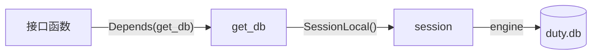
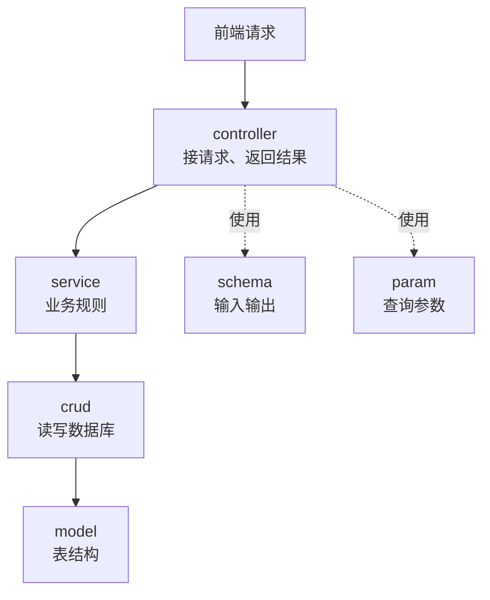

# 第 6 章 数据模块：增删查改

第 5 章的单位数据放在内存列表里，服务一停就清空。要让数据在重启后还在、被多人反复读写，还要在写入时就被检查，就得把记录交给数据库。本章的读写接口先保持开放，身份与权限在第 8、9 章统一加。

## 本章要解决的问题

**数据怎样存下来、被安全一致地读写，并让错误在正确的层被拒绝？**

同一条业务编码可以被写进两次，一条记录可以指向一个不存在的对象，一个文本字段可以被塞进远超上限的内容。这些问题在写入时不报错，等到查询、汇总或关联时才暴露，而此时已经很难追溯是哪一次写入造成的。

数据要存下来，先得有表。写入时数据库按模型上的约束逐项检查：编码重复、指向不存在的对象、文本超长，都在写入那一刻被拒绝，而不是等查询时才暴露。本章沿这条线展开：先弄清一次数据库读写要经过哪些对象，再用单位模块 department 走一遍完整读写——请求进入后经过哪些约束、落到表里又如何被读回，每一道拒绝由谁说出、以什么方式说出，列表怎样按页返回并给出总条数。

## 本章学习目标

读完第 6 章并完成实训后，你应该能：

1. 说明数据为什么要落库，以及 engine、`Session`、`Base`、`get_db` 各管什么。
2. 说明 departments 表怎样建立、主键与长度约束怎样在写入时生效。
3. 说出一个 CRUD 模块六个文件的职责与调用关系，并用 department 实现新增、详情、修改与删除。
4. 实现分页并用 `DepartmentPage` 返回 `items` 与 `total`，说明 `page`、`page_size`、`offset`、`limit` 之间的关系；过滤与排序在第 7 章补齐。
5. 按“谁产生、谁负责”区分 422、400、404、500 四类错误，并把读写机制套用到课后的人员模块扩展。

## 6.1 数据库基础设施

第 5 章的单位模块把数据放在 `model.TABLE` 列表里。这样写能跑通接口，却挡不住三件事：同一个编码可以被写进两次，因为列表不会自己查重；进程一停数据就清空，因为没有地方持久保存；两个请求各看各的列表，因为没有统一的读写边界。三件事指向同一个缺口：记录要落到一个能被约束检查、能被反复读写、能被多个请求共享的存储里。

改用数据库后，程序不再直接碰记录，中间至少要有四类角色：一个知道数据存在哪、怎么连；一个界定「这一次请求」的读写范围并在结束时归还；一个让表结构带着约束被声明出来；一个把这些角色接进接口函数。少一个都补不上前面那三个缺口——不知道位置就无法持久化，没有读写边界就无法共享，约束不写进表定义就只能在业务代码里到处补判断，不接进接口就得每个函数自己开连接。

本课程用 SQLite。一个 SQLite 数据库就是一个文件，项目根目录下的 `duty.db`。文件里按表存数据：一行是一条记录，一列是一个字段。Python 程序不直接读写这个文件，中间要经过四个名字：



- **engine**：知道数据库文件在哪、怎么连。
- **session**：一次请求期间和数据库的对话。
- **Base**：定义表模型时要继承的父类。
- **get_db**：开一个 session，交给接口，用完关掉。

代码在 `app/core/database.py`：

**代码 6-1-1** · `app/core/database.py`（数据库基础设施，Python）

```python
import os

from sqlalchemy import create_engine
from sqlalchemy.orm import declarative_base, sessionmaker

DATABASE_URL = os.getenv("DATABASE_URL", "sqlite:///./duty.db")

engine = create_engine(DATABASE_URL, connect_args={"check_same_thread": False})
SessionLocal = sessionmaker(bind=engine, autoflush=False, autocommit=False)
Base = declarative_base()


def get_db():
    db = SessionLocal()
    try:
        yield db
    finally:
        db.close()
```

逐行看：`DATABASE_URL` 从环境变量读取，未设置时回落到项目根目录的 `duty.db`，同一份代码在开发机与容器里即可指向不同的数据库文件；`create_engine(...)` 创建 engine，保存“怎么连”；`sessionmaker(...)` 创建的是能造出 session 的对象，每次 `SessionLocal()` 得到一个新 session；`declarative_base()` 创建父类 `Base`，表模型继承它，SQLAlchemy 才知道类对应一张表。

`get_db()` 是 FastAPI 的依赖函数。每个请求进来，FastAPI 先 `SessionLocal()` 开一个 session，`yield db` 把 session 交给接口；接口执行完，回到 `finally`，`db.close()` 关闭。`yield` 不是“返回一个值就结束”，而是“先交出去，等接口函数执行完再回来继续”，所以关闭写在 `finally` 里：无论成功还是抛异常都会执行。

接口签名里写 `db: Session = Depends(get_db)`，FastAPI 在调用接口前先执行 `get_db`，把 session 传给 `db` 参数。第 4 章 4.5 讲过 `Depends` 的机制，这里是它第一次用在数据库会话上。

根目录 `main.py` 还要补三行：导入 `Base` 与 `engine`、导入单位模块的表模型、调用 `Base.metadata.create_all(bind=engine)`。`create_all` 只识别已经导入的 ORM 模型，而当前的 `model.py` 还是第 5 章的内存版，要到 6.2 才换成 `Department(Base)`；因此这三行留到 6.2 定义模型之后再写，现在先记住它们的作用。

数据库能连上。接下来先把 `model.py` 换成 ORM 模型，再回到 `main.py` 建表。

## 6.2 数据读写机制

表结构是数据的第一道约束。**表**是关系数据库中存放一类数据的结构；**主键**是能唯一标识一行的字段；**外键**是指向另一张表主键、用于表达关系的字段（定义见第 4 章 4.2）。

单位表用一个业务编码做主键，避免依赖自增 id 做对外标识：

| 字段 | 类型 | 必填 | 说明 |
| --- | --- | --- | --- |
| `dept_code` | 文本 | 是 | 单位编码，主键，唯一 |
| `full_name` | 文本 | 是 | 单位名称 |
| `address` | 文本 | 否 | 地址 |

`dept_code` 既是主键又是业务编码，新增时要检查重复；`full_name` 必填且有长度上限；`address` 可空但要限制最大长度，防止超长文本进入数据库。

**代码 6-2-1** · `app/modules/department/model.py`（单位表模型，Python）

```python
from sqlalchemy import Column, String

from app.core.database import Base


class Department(Base):
    __tablename__ = "departments"

    dept_code = Column(String(20), primary_key=True)
    full_name = Column(String(100), nullable=False)
    address = Column(String(500), nullable=True)
```

三个参数对应三类**约束**：`primary_key=True` 声明主键，保证一行能被唯一定位；`nullable=False` 声明必填，缺值写入会被数据库拒绝；`String(100)` 声明长度上限，超长文本进不来。唯一约束 `unique=True` 在单位表里由主键隐式提供；其他需要唯一的非主键列（例如用户表的 `username`）则要显式声明。

数据库理论把写入时出错的问题分成三类**完整性**：重复编码属实体完整性，人员表的 `dept_code` 指向不存在的单位属参照完整性，超长文本属域完整性。三类问题都不是“读”的时候才出现，而是“写”的时候就已经错了，所以拦截要放在写入路径上。重复编码与超长文本由模型上的约束拦下，人员表 `dept_code` 的指向则要先查一次单位表，由 service 拦下。

模型定义好后，回到 `main.py` 把 6.1 说的三行补上：

**代码 6-2-2** · `main.py`（建表三行，续写，Python）

```python
from app.core.database import Base, engine
from app.modules.department import model as department_model  # noqa: F401  建表前先导入模型

Base.metadata.create_all(bind=engine)
```

`create_all` 只建表结构，不写数据；表存在时重复调用不会清空数据。模型导入那一行不能省：`create_all` 只识别已经导入的 `Base` 子类。现在 `duty.db` 里出现 `departments` 表，可以开始写入。

**六个文件的分工**

第 4 章 4.5 已经建好 `app/modules/department/` 的六文件骨架；6.1 建好数据层，6.2 前两小节定义了 `Department` 模型并建出 `departments` 表。本节按同一套分工走通读写，六个文件各自拦住一类问题：



*图 6-1：CRUD 模块的调用关系*

| 文件 | 一句话职责 | 拦住哪类问题 |
| --- | --- | --- |
| `model.py` | 表长什么样 | 字段类型、主键、外键、唯一、必填 |
| `schema.py` | 输入与输出长什么样 | 字段长度、必填、类型、输出白名单 |
| `param.py` | 查询参数长什么样 | 页码、每页条数的边界 |
| `crud.py` | 增删改查的数据库操作 | 查询与写入的复用 |
| `service.py` | 业务规则，例如重复校验；含外键的模块再加外键校验 | 重复编码、孤儿记录 |
| `controller.py` | 接口，负责接收请求与返回响应 | 状态码与错误信息 |

边界要守住：controller 不写 SQL、不写业务规则；service 不直接拼 SQL，而是调用 crud；crud 不判断业务规则；schema 决定哪些字段能进、哪些字段能出。

表结构管“存什么”，输入模型管“什么能进来”，输出模型管“什么能出去”。三者不是同一件事。

**代码 6-2-3** · `app/modules/department/schema.py`（输入与输出模型，Python）

```python
from pydantic import BaseModel, ConfigDict, Field


class DepartmentCreate(BaseModel):
    dept_code: str = Field(..., min_length=2, max_length=20)
    full_name: str = Field(..., min_length=2, max_length=100)
    address: str | None = Field(default=None, max_length=500)


class DepartmentUpdate(BaseModel):
    full_name: str | None = Field(default=None, min_length=2, max_length=100)
    address: str | None = Field(default=None, max_length=500)


class DepartmentOut(BaseModel):
    model_config = ConfigDict(from_attributes=True)

    dept_code: str
    full_name: str
    address: str | None = None


class DepartmentPage(BaseModel):
    items: list[DepartmentOut]
    total: int
```

`Field(...)` 表示必填，`min_length`、`max_length` 限定长度，`| None` 表示可空。输入模型只负责“能不能进”，输出模型负责“哪些能出”。`DepartmentUpdate` 只列允许修改的字段，主键 `dept_code` 不在其中；`DepartmentPage` 把 `items` 与 `total` 的返回结构写进模型，列表接口用它声明 `response_model`。`from_attributes=True` 让输出模型能直接读取 ORM 对象。表约束是最后一道防线，防止任何路径写入脏数据；输入模型在请求进入函数前给出可读的 422。两者都要有，不能互相替代。

**新增、详情、修改与删除**

新增接口先检查业务编码是否重复，再写入数据库。重复时返回 400，成功时返回 201；查重属于业务规则放 service，写入属于数据库操作放 crud。

**代码 6-2-4** · `app/modules/department/crud.py`（查询与写入，Python）

```python
from sqlalchemy.orm import Session

from app.modules.department.model import Department


def get_by_code(db: Session, dept_code: str):
    return db.query(Department).filter(Department.dept_code == dept_code).first()


def create(db: Session, data):
    department = Department(**data.model_dump())
    db.add(department)
    db.commit()
    db.refresh(department)
    return department
```

**代码 6-2-5** · `app/modules/department/service.py`（新增与详情规则，Python）

```python
from fastapi import HTTPException

from app.modules.department import crud


def create_department(db, data):
    if crud.get_by_code(db, data.dept_code):
        raise HTTPException(status_code=400, detail="单位编码已存在")
    return crud.create(db, data)


def get_department(db, dept_code: str):
    department = crud.get_by_code(db, dept_code)
    if not department:
        raise HTTPException(status_code=404, detail="单位不存在")
    return department
```

为什么要先查重，而不是等数据库的唯一约束报错？数据库报错是一条异常，前端看到的是 500；提前查重能返回 400 和“单位编码已存在”，调用方知道该改什么。数据库约束仍然保留，作为并发写入时的最后一道防线。

**代码 6-2-6** · `app/modules/department/controller.py`（新增与详情接口，Python）

```python
from fastapi import APIRouter, Depends, status
from sqlalchemy.orm import Session

from app.core.database import get_db
from app.modules.department import service
from app.modules.department.schema import DepartmentCreate, DepartmentOut

router = APIRouter(prefix="/departments", tags=["单位"])


@router.post("", response_model=DepartmentOut, status_code=status.HTTP_201_CREATED)
def create_department(data: DepartmentCreate, db: Session = Depends(get_db)):
    return service.create_department(db, data)


@router.get("/{dept_code}", response_model=DepartmentOut)
def read_department(dept_code: str, db: Session = Depends(get_db)):
    return service.get_department(db, dept_code)
```

详情接口按主键查询；查不到时由 service 返回 404，而不是返回空对象。404 让调用方明确知道“这个资源不存在”，空对象则会让前端误以为“查到了但没有字段”。

修改（`PUT`）的动作是“先查、再改、再返回”：service 按主键查到记录，找不到返回 404；service 用 `data.model_dump(exclude_unset=True)` 只取请求里出现的字段，再交给 crud 覆盖，没传的字段保持原值。完整实现放在例 6-1，先读那三块代码，再回看本节的分层。

**代码 6-2-7** · `app/modules/department/crud.py`（删除，续写，Python）

```python
def delete(db: Session, department):
    db.delete(department)
    db.commit()
```

**代码 6-2-8** · `app/modules/department/service.py`（删除规则，续写，Python）

```python
def delete_department(db, dept_code: str) -> None:
    department = crud.get_by_code(db, dept_code)
    if not department:
        raise HTTPException(status_code=404, detail="单位不存在")
    crud.delete(db, department)
```

**代码 6-2-9** · `app/modules/department/controller.py`（删除接口，续写，Python）

```python
@router.delete("/{dept_code}", status_code=status.HTTP_204_NO_CONTENT)
def delete_department(dept_code: str, db: Session = Depends(get_db)):
    service.delete_department(db, dept_code)
```

crud 只执行删除，404 由 service 判断。删除成功返回 204，函数不返回正文；资源不存在返回 404。重复删除第二次得到 404，服务器状态不变，符合 DELETE 的幂等语义（第 3 章 3.4）。

**测试清单**

每完成一个模块，至少走一遍下面九条：新增成功返回 201；重复编码返回 400；缺字段返回 422；列表返回 200 且分页正确；详情返回 200；不存在的编码返回 404；修改成功返回 200、修改不存在的编码返回 404；删除成功返回 204；重复删除返回 404。九条都过，模块才算可用。

## 6.3 分页参数与返回结构

数据量大时不能一次返回全部记录。分页接口通常接收两个查询参数：`page`（第几页，从 1 开始）和 `page_size`（每页多少条）。第 4 章 4.5 已经把这两个参数收进 `param.py` 的 `DepartmentQueryParams`，本章沿用该模型，只补数据库版的换算与查询。

**代码 6-3-1** · `app/modules/department/param.py`（查询参数，Python）

```python
from pydantic import BaseModel, Field


class DepartmentQueryParams(BaseModel):
    page: int = Field(1, ge=1)
    page_size: int = Field(10, ge=1, le=100)
```

`ge` 表示“大于等于”，`le` 表示“小于等于”。不给 `page_size` 设上限，调用方传 `page_size=100000` 时，一次查询就可能把数据库拖垮。

数据库查询用 `offset` 与 `limit` 实现：

**代码 6-3-2** · 示例（文本）

```text
offset = (page - 1) * page_size
limit = page_size
```

响应同时返回本页数据和总条数：

**代码 6-3-3** · 示例响应（JSON）

```json
{"items": [...], "total": 35}
```

`DepartmentPage` 把 `items` 与 `total` 声明成模型。`total` 让前端能算出总页数：`ceil(total / page_size)`。只返回 `items` 而不返回 `total`，前端就不知道还有没有下一页。

**代码 6-3-4** · `app/modules/department/crud.py`（列表分页，续写，Python）

```python
def list_page(db: Session, offset: int, limit: int):
    items = (
        db.query(Department)
        .offset(offset)
        .limit(limit)
        .all()
    )
    total = db.query(Department).count()
    return items, total
```

这里先不带 `order_by`：翻页可能出现重复记录，原因与固定排序键在第 7 章 7.4 展开。

**代码 6-3-5** · `app/modules/department/service.py`（列表，续写，Python）

```python
def list_departments(db, params):
    offset = (params.page - 1) * params.page_size
    items, total = crud.list_page(db, offset, params.page_size)
    return {"items": items, "total": total}
```

**代码 6-3-6** · `app/modules/department/controller.py`（列表接口，续写，Python）

```python
@router.get("", response_model=DepartmentPage)
def list_departments(
    params: DepartmentQueryParams = Depends(),
    db: Session = Depends(get_db),
):
    return service.list_departments(db, params)
```

`Depends()` 不带参数时，FastAPI 会把 `DepartmentQueryParams` 当作查询参数模型，从 `?` 后面读取字段；`ge` / `le` 的边界在进入函数前就完成校验。service 把 crud 取回的本页数据与总数组装成 `items` 与 `total`，controller 用 `response_model=DepartmentPage` 声明返回结构后透传；在 6-2-6 的导入行里补上 `DepartmentPage`。

列表先实现分页；过滤与计数的次序、固定排序键见第 7 章 7.3–7.4。

## 6.4 错误分层

数据进入系统时，不同问题应由不同层拒绝。按 RFC 9110 的状态码类别与“谁产生、谁负责”的分工，可以把错误分配如下，而不是一律 500。

| 情况 | 状态码 | 产生位置 | 谁的问题 |
| --- | --- | --- | --- |
| 缺字段、类型不对、长度超限 | 422 | 请求校验层，进入函数前 | 调用方 |
| 业务编码重复、外键不存在 | 400 | service 的业务规则 | 调用方 |
| 资源不存在 | 404 | service 查不到 | 调用方 |
| 未捕获的异常 | 500 | 框架兜底 | 服务方 |

错误码是契约的一部分，前端据此决定提示方式：422 提示“检查输入”，400 提示“业务不允许”，404 提示“资源不存在”，500 提示“联系管理员”。

> 💡 **易错点**：把数据库报错直接返回给前端，或把所有错误都写成 500。调用方无法区分“我传错了”和“服务器坏了”，排查方向会被带偏；错误码要按产生位置分层。

## 示范例题

#### 例 6-1：实现单位修改

**题目**：实现 `PUT /departments/{dept_code}`。只允许修改 `full_name` 与 `address`；编码不存在返回 404；成功返回 200。

**解**：

修改的顺序是“查询、更新、返回”：service 先按主键取记录，取不到抛 404；crud 只覆盖请求里出现的字段，没传的字段保持原值；controller 用 `DepartmentUpdate` 接收请求体（在 6-2-6 的导入行里补上它），并用 `response_model=DepartmentOut` 过滤输出。

**代码 6-4-1** · `app/modules/department/crud.py`（修改，续写，Python）

```python
def update(db: Session, department, data: dict):
    for field, value in data.items():
        setattr(department, field, value)
    db.commit()
    db.refresh(department)
    return department
```

**代码 6-4-2** · `app/modules/department/service.py`（修改规则，续写，Python）

```python
def update_department(db, dept_code: str, data):
    department = crud.get_by_code(db, dept_code)
    if not department:
        raise HTTPException(status_code=404, detail="单位不存在")
    return crud.update(db, department, data.model_dump(exclude_unset=True))
```

**代码 6-4-3** · `app/modules/department/controller.py`（修改接口，续写，Python）

```python
@router.put("/{dept_code}", response_model=DepartmentOut)
def update_department(
    dept_code: str, data: DepartmentUpdate, db: Session = Depends(get_db)
):
    return service.update_department(db, dept_code, data)
```

`exclude_unset=True` 只取请求里真正出现的字段：只传 `full_name` 时，`address` 不会被覆盖成 `None`。这与 `DepartmentCreate` 不同——新增要求字段齐全，修改允许只改一部分。

## 独立习题

#### 习题 6-1

**题目**：解释 `page`、`page_size`、`offset`、`limit`、`total` 五个概念的含义及它们之间的关系。为什么响应里必须返回 `total`？

#### 习题 6-2

**题目**：按单位模块的结构，为人员模块设计一套 CRUD：人员表包含证件号、姓名、所属单位编码、职级。请写出表结构、输入/输出模型、列表与新增接口的关键代码，并说明新增时如何校验 `dept_code` 是否存在。

#### 习题 6-3

**题目**：为单位“哨位”实体设计表结构、输入/输出模型与四类错误：哨位编号（主键）、位置、是否启用、所属单位编码。请列出字段与约束，说明哪些错误由数据库约束拦住、哪些由 service 返回 400、哪些由输入模型返回 422，并各给出一个触发例子。**不能照抄单位表的字段**：哨位有启用状态，单位没有。

## 课后拓展：把读写机制用到人员模块

按单位模块的六文件结构复制出人员模块，要改四处——表名与字段、查询主键（`certificate_number`）、列表过滤字段、新增时的外键校验。人员表有 `dept_code`，它指向单位表主键；新增前要确认该单位存在，不存在时返回 400，而不是让数据库抛外键错误产生 500。

| 文件 | 从单位改什么 |
| --- | --- |
| `model.py` | 表名 `personnel`；字段换成人员的；`dept_code` 外键 |
| `schema.py` | 人员字段；证件号可按需加 18 位校验 |
| `param.py` | `name`、`dept_code`（人员自身的过滤参数；过滤计数次序见第 7 章） |
| `crud.py` | `get_by_certificate_number` |
| `service.py` | 人员查重 + 单位存在校验 |
| `controller.py` | URL `/personnel` |

复制时最容易残留的是单位字段：表名改了，字段名没改；URL 改了，查询条件还写着 `dept_code`。复制完成后逐项对照表检查一遍，比事后排错省时间。

人员模块须在第 10 章开课前完成：第 10 章的执勤记录规则、第 11 章的统计都要查 `personnel` 表。

## ◆ 实训 6-1：数据模块：增删查改

### 一、任务目标与验收

| 目标 | 验收标志 |
| --- | --- |
| 六个文件职责清楚 | controller / service / crud / model / schema / param 各就各位 |
| 数据重启后仍在 | 新增单位后重启服务，记录仍在 |
| department 读写可用 | 列表 200、详情 200、新增 201、修改 200、删除 204；重复编码 400，资源不存在或重复删除返回 404 |
| 分页正确（课内必做） | 列表能按页返回 `items` 与 `total`（代码 6-3-1～6-3-6） |
| 过滤排序（课后衔接第 7 章） | 过滤条件先于 `count()`、固定排序键（见第 7 章 7.3/7.4） |
| 错误码分层 | 422/400/404/500 各归其位 |

### 二、课前准备

- 第 4 章的目录与第 5 章的仓库可启动
- 6.1 已建 `app/core/database.py`；6.2 已定义 `Department` 模型并建出 departments 表，新增单位后重启服务记录仍在
- 一份单位的测试数据

### 三、操作步骤

1. **建库与建表**
   - 做什么：跟随 6.1 建 `app/core/database.py`；按 6.2 定义 `Department` 模型，再在 `main.py` 加建表三行
   - 操作：按代码 6-1-1 与 6-2-1、6-2-2 落地，确认 `duty.db` 出现、`departments` 表建立
   - 预期输出：→ 数据库文件与单位表就位，旧接口仍为 200
   - 做错会看到什么：表没建出来：检查模型是否导入、`create_all` 是否执行
2. **department 读写全流程**
   - 做什么：按数据库版补齐六个文件、增删改查、分页与四类错误验证
   - 操作：课内按代码 6-2-1～6-3-6 落地；逐项走 6.2 的九条测试清单；过滤与排序见第 7 章
   - 预期输出：→ 列表有 `items`/`total`，新增 201、重复 400、详情 404、修改 200、删除 204
   - 做错会看到什么：列表只有 `items` 没有 `total` → 检查 service 是否组装了总数；重复不报错 → 先查重逻辑缺失
3. **验证与提交**
   - 做什么：走完九条测试清单，确认单位记录在重启后仍在，提交
   - 预期输出：→ 九条接口验证全部通过，工作区干净
   - 做错会看到什么：`duty.db` 进了提交 → 用 `git rm --cached duty.db`

### 四、排错清单

| 现象 | 先查什么 |
| --- | --- |
| 列表总数不对 | 过滤条件是否加在 `count()` 之前（第 7 章 7.3 课后衔接项） |
| 新增重复不报错 | 唯一约束或先查重逻辑缺失 |
| 详情返回 500 | 查不到时未抛 404，直接访问空对象字段 |
| 翻页出现重复记录 | 列表是否带固定 `order_by`（第 7 章 7.4 课后衔接项） |
| 重启后单位记录消失 | 是否仍用内存版 `model.py`；`create_all` 是否执行 |

### 五、提交与验收

提交单位 CRUD 模块的代码与九条接口验证记录；验收按“数据重启后仍在”“department CRUD 完整”“分页骨架与错误码”三项判定。

### 六、课后扩展

**人员模块**：按本章“课后拓展”的六文件对照表完成，第 10 章开课前必须做完。

- 给列表加按名称模糊查询
- 为常用过滤字段加索引并说明依据
- 把重复的分页代码标记出来，为第 7 章判断复用边界做准备
- **复习任务**：回看第 4 章 4.2（表、主键、外键）与第 3 章 3.5（Pydantic 校验），对照本章 6.2–6.4，说明同一类错误在表结构、输入模型与 service 三层分别由谁拦住

## 本章小结

**核心结论**：

1. 标准 CRUD 模块拆成 model、schema、param、crud、service、controller 六个文件，目录位置沿用第 4 章 4.5 的 `app/modules/department/`，各层职责不能越界。
2. 数据落库要引入 `engine`、`Session`、`Base` 与 `get_db`；表模型继承 `Base`，读写通过 `Session`，接口用 `Depends(get_db)` 拿到会话。
3. 完整性问题分三类：实体完整性（重复）、参照完整性（孤儿）、域完整性（超限）；它们都在写入时产生，要靠约束与校验在入口拦住。
4. 单位表用业务编码做主键；主键、外键、唯一与必填约束是数据的第一道防线；新增重复返回 400、成功 201；详情查不到返回 404；修改只覆盖请求中出现的字段，成功 200、不存在 404；删除成功 204、重复删除 404。
5. 分页用 `page`、`page_size` 换算出 `offset` 与 `limit`；查询参数沿用 4.5 的 `DepartmentQueryParams`；响应由 `DepartmentPage` 声明 `items` 与 `total`，`total` 让前端能算总页数；过滤与排序的次序在第 7 章补齐。
6. **错误分层**：422 参数校验、400 业务规则、404 资源不存在、500 未捕获异常；复制模块时重点检查字段残留与外键校验。

把这章压缩成一句话：**数据的第一道防线是表与校验，最后一道是错误码；两者都要在写入入口生效。**

CRUD 是后端最重复的工作；六个文件的边界划清后，加模块即为复制结构，而非复制混乱。

**自检**：回到章首的学习目标，逐条问自己做到了没有——

- [ ] 说明数据为什么要落库，以及 engine、`Session`、`Base`、`get_db` 各管什么。
- [ ] 说明 departments 表怎样建立、主键与长度约束怎样在写入时生效。
- [ ] 说出一个 CRUD 模块六个文件的职责与调用关系，并用 department 实现新增、详情、修改与删除。
- [ ] 实现分页并用 `DepartmentPage` 返回 `items` 与 `total`，说明 `page`、`page_size`、`offset`、`limit` 之间的关系。
- [ ] 按“谁产生、谁负责”区分 422、400、404、500 四类错误，并把读写机制套用到课后的人员模块扩展。

