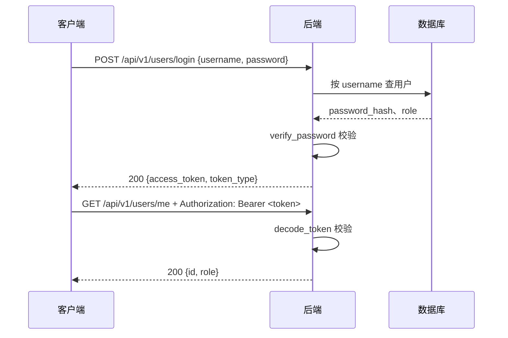

# 第 6 章 用户模块：登录认证

> **节首信息条**｜对应课次 7 · 用户模块：登录认证（4 学时 · 实践）｜前置：第 5 章搭好的项目骨架；第 3 章 3.5（Pydantic、HTTPException）与 3.6（`Depends`）｜**本节实训**：◆ 实训 6-1 给骨架装上登录认证

第 5 章的接口对所有人开放。

## 本章要解决的问题

**系统怎样确认“你是谁”，并让后续请求带着这个身份？**

没有认证时，把用户列表接口直接挂在应用上，任何人都能调用：

```text
GET /api/v1/users             → 200，返回全部用户
DELETE /api/v1/departments/D01 → 204，部门被删除
```

请求里没有说“我是谁”，服务器只能照做。页面上的登录与菜单只影响正常用户的操作路径，不改变接口是否执行。

**认证就是先确认“你是谁”；确认通过，请求才进入业务代码。** 这也是信息安全中对认证与授权的一般区分（ISO/IEC/IEEE 24765:2017）。本章处理认证；授权是另一个问题，第 7 章展开。

要确认身份，系统得先记住用户：用户存在哪里、密码怎么存、登录后凭什么证明身份。本章按这条线展开：先建数据库与用户表，再处理密码与令牌，最后让接口从令牌认出当前用户。

## 本章学习目标

读完第 6 章并完成实训后，应能：

1. 说明认证回答什么问题，以及 401 表示什么。
2. 解释用户表四个字段的作用，说明密码为什么只存哈希。
3. 实现注册、登录与 `/me`，让令牌的签发、携带与校验走通。
4. 用 `Depends` 挂认证依赖，说明未带令牌与令牌无效都返回 401。

## 6.1 数据库基础设施

先回忆第 5 章的接口：新建一条数据，停掉服务再启动，数据还在吗？不在。第 5 章把数据放在内存列表里，进程一停，列表就清空。要让数据在重启后还在，必须写到磁盘上的数据库。

本课程用 SQLite。一个 SQLite 数据库就是一个文件，项目根目录下的 `duty.db`。文件里按表存数据：一行是一条记录，一列是一个字段。6.2 会建 `users` 表。

Python 程序不直接读写这个文件，中间要经过这几个名字：

```mermaid
flowchart LR
    A[接口函数] -->|Depends(get_db)| B[get_db]
    B -->|SessionLocal()| C[session]
    C -->|engine| D[(duty.db)]
```

- **engine**：知道数据库文件在哪、怎么连。
- **session**：一次请求期间和数据库的对话。
- **Base**：6.2 定义表时要继承的父类。
- **get_db**：开一个 session，交给接口，用完关掉。

代码在 `app/core/database.py`：

**代码 6-1-1** · `app/core/database.py`（Python）

```python
from sqlalchemy import create_engine
from sqlalchemy.orm import declarative_base, sessionmaker

DATABASE_URL = "sqlite:///./duty.db"

engine = create_engine(DATABASE_URL, connect_args={"check_same_thread": False})
SessionLocal = sessionmaker(bind=engine, autoflush=False, autocommit=False)
Base = declarative_base()


def get_db():
    db = SessionLocal()
    try:
        yield db
    finally:
        db.close()
```

逐行看：

1. `DATABASE_URL` 告诉程序数据库文件的位置。`sqlite:///./duty.db` 表示项目根目录下的 `duty.db`。
2. `create_engine(...)` 创建 engine。它保存“怎么连”：文件在哪、用什么驱动。`check_same_thread=False` 是 SQLite 的要求，让同一进程里的多个请求都能用这个连接。
3. `sessionmaker(...)` 创建的不是一个 session，而是一个能造出 session 的对象。每次写 `SessionLocal()`，就得到一个新的 session。`bind=engine` 表示新 session 用这个 engine 连库；`autoflush=False`、`autocommit=False` 表示什么时候提交由代码决定。
4. `declarative_base()` 创建父类 `Base`。6.2 写 `class User(Base)` 时，SQLAlchemy 才知道 User 对应一张表。这一行现在只需知道它先放在这里。
5. `get_db()` 是 FastAPI 的依赖函数。每个请求进来，FastAPI 调用它：先 `SessionLocal()` 开一个 session，`yield db` 把 session 交给接口；接口执行完，回到 `finally`，`db.close()` 关闭。

`yield` 是这段代码里最不直观的一行。它不是“返回一个值就结束”，而是“先把 `db` 交出去，等接口函数执行完，再回到这里继续”。所以 `db.close()` 写在 `finally` 里：无论接口成功还是抛异常，关闭都会执行。

接口签名里写 `db: Session = Depends(get_db)`。它的意思是：FastAPI 在调用接口前先执行 `get_db`，把拿到的 session 传给 `db` 参数。第 3 章 3.6 讲过 `Depends` 的机制，这里是它在数据库上的第一次使用。如果每个接口都自己 `SessionLocal()` 再 `try/finally`，代码会重复，也容易忘记关闭；写成一个依赖，接口只声明“我需要一个 session”。

把四个名字放回使用位置：

| 名字 | 一句话 | 谁使用 |
| --- | --- | --- |
| `engine` | 与数据库建立连接 | `main.py` 建表 |
| `SessionLocal` | 产出 session | `get_db` |
| `Base` | 表模型的父类 | `model.py` |
| `get_db` | 为每个请求提供 session，请求结束关闭 | controller 的 `Depends` |

根目录 `main.py` 还要补三行：导入 `Base` 与 `engine`、导入用户模型、调用 `Base.metadata.create_all(bind=engine)`。`create_all` 只识别已经导入的模型，模型导入那一行不能省。

这一节不需要记住 SQLAlchemy 的内部原理。只需要记住三件事：数据库是磁盘上的文件；engine 管连接，session 管一次对话；接口通过 `Depends(get_db)` 拿 session，不自己开关。

数据库能连上了。下一节告诉它存什么。

## 6.2 用户表


数据库能连上之后，下一步是告诉它存什么。用户表是认证要操作的对象：登录时按用户名找用户，校验密码，读取角色与启用状态。

**四个核心字段**

| 字段 | 作用 |
| --- | --- |
| `username` | 用户名，唯一，不能重复 |
| `password_hash` | 密码的哈希值，不是明文 |
| `role` | 角色，如 `admin`、`normal`，第 7 章据此判断权限 |
| `is_active` | 是否启用，第 7 章用于启用与禁用 |

`username` 加唯一约束，防止两个同名账号；`role` 在第 7 章决定权限；`is_active` 让管理员可以停用账号而不删除历史数据。主键 `id` 用于在令牌里标识用户。

**代码 6-1-2** · `app/modules/user/model.py`（用户表模型，Python）

```python
from sqlalchemy import Column, Integer, String

from app.core.database import Base


class User(Base):
    __tablename__ = "users"

    id = Column(Integer, primary_key=True)
    username = Column(String(100), unique=True, nullable=False)
    password_hash = Column(String(255), nullable=False)
    role = Column(String(20), default="normal")
    is_active = Column(Integer, default=1)
```

`__tablename__ = "users"` 指定表名。每一列对应一个字段：`id` 是主键；`username` 唯一且必填；`password_hash` 必填；`role` 默认 `normal`；`is_active` 默认 `1`。`unique=True`、`nullable=False`、`default` 就是这三类约束的写法。

模型只定义“表长什么样”，不会自己建表。`main.py` 启动时调用 `Base.metadata.create_all(bind=engine)`，它只识别已经导入的模型，所以还要加一行 `from app.modules.user import model`。第 5 章的工程还没有 `model.py`，本章第一次建表。

表中 `password_hash` 这一列存什么、为什么不能存明文，是 6.3 的问题；字段留在用户表，哈希函数放到 `app/core/security.py`。

## 6.3 密码哈希与令牌


登录时要证明“你是这个账号的主人”，最常用的办法是密码。密码怎么存，决定了数据库泄露时的损失。6.2 的用户表里只留 `password_hash` 这一列；这一列的值怎么算、怎么验，以及登录后怎么发令牌，都放在 `app/core/security.py`。

**只存哈希的理由**

数据库里不能存明文密码。一旦数据库泄露，所有人的密码都会暴露；很多人在多个系统复用同一个密码，影响会扩散到其他系统。

正确做法是存**哈希**：注册时把密码交给哈希函数，得到一串不可逆的值；登录时用同一个函数处理输入，再与库里的值比对。哈希不是加密，不能还原出原密码，只能验证“输入是否与原来一致”。密码哈希的常用方案见 RFC 8018（PBKDF2）与 OWASP 密码存储指南。

**令牌：登录后的凭证**

密码只在登录时用一次。登录成功后，服务器发给客户端一张**令牌**，之后的请求带令牌，不再带密码。本章使用 JWT（JSON Web Token，一种带签名的令牌格式，RFC 7519）。令牌里放三样东西：用户标识（`sub`）、角色（`role`）和过期时间（`exp`），再用密钥签名。客户端保存令牌，之后每次请求把它放进请求头：

```text
Authorization: Bearer <token>
```

**代码 6-1-3** · `app/core/security.py`（密码哈希与令牌，Python）

```python
import os
from datetime import datetime, timedelta, timezone
from typing import Optional

from dotenv import load_dotenv
from jose import JWTError, jwt
from passlib.context import CryptContext

load_dotenv()

SECRET_KEY = os.getenv("SECRET_KEY", "change-me-in-env")
ALGORITHM = os.getenv("ALGORITHM", "HS256")
ACCESS_TOKEN_EXPIRE_MINUTES = int(os.getenv("ACCESS_TOKEN_EXPIRE_MINUTES", "30"))

pwd_context = CryptContext(schemes=["pbkdf2_sha256"], deprecated="auto")


def get_password_hash(password: str) -> str:
    return pwd_context.hash(password)


def verify_password(plain_password: str, hashed_password: str) -> bool:
    return pwd_context.verify(plain_password, hashed_password)


def create_access_token(data: dict) -> str:
    to_encode = data.copy()
    expire = datetime.now(timezone.utc) + timedelta(minutes=ACCESS_TOKEN_EXPIRE_MINUTES)
    to_encode.update({"exp": expire})
    return jwt.encode(to_encode, SECRET_KEY, algorithm=ALGORITHM)


def decode_token(token: str) -> Optional[dict]:
    try:
        return jwt.decode(token, SECRET_KEY, algorithms=[ALGORITHM])
    except JWTError:
        return None
```

`get_password_hash("secret123")` 每次生成的字符串都不同，因为哈希里带了随机种子；`verify_password("secret123", 哈希)` 返回 `True`，输入错误密码返回 `False`。这就是“不可逆但可验证”。

签发时把载荷与过期时间一起签名；解析时 `jwt.decode` 同时校验签名与过期时间，任何一项不对都抛出 `JWTError`，这里转成 `None` 交给调用方。`load_dotenv()` 先加载第 5 章 5.6 的 `.env`，三项配置再从中读取；变量未设置时使用教学占位值。**正式部署必须设置 `SECRET_KEY`**，否则任何人拿到书里的占位密钥就能伪造令牌。

> 💡 **易错点**：把 JWT 的三段结构与编码算法当成本章重点。本章只需要知道“令牌带签名、会过期”。

## 6.4 注册与登录

注册创建账号，登录把账号换成令牌。两个动作操作的都是用户数据，所以都放在 user 模块。

**输入模型与输出模型**

输入模型负责检查请求，输出模型决定返回哪些字段：

**代码 6-1-4** · `app/modules/user/schema.py`（输入与输出模型，Python）

```python
from pydantic import BaseModel, Field


class UserCreate(BaseModel):
    username: str = Field(..., min_length=3, max_length=100)
    password: str = Field(..., min_length=6, max_length=50)


class UserOut(BaseModel):
    id: int
    username: str
    role: str
    is_active: int


class LoginIn(BaseModel):
    username: str
    password: str


class TokenOut(BaseModel):
    access_token: str
    token_type: str = "bearer"
```

`...` 表示必填，`min_length`、`max_length` 是约束。请求不满足约束时，FastAPI 不会进入函数，直接返回 422，并指出是哪个字段、什么错误。注册只接收用户名与密码，角色由服务端固定为 `normal`，客户端无权指定。

输入与输出必须分开。用户表里有 `password_hash`，响应绝不能把它返回。`UserOut` 只列可公开字段，接口声明 `response_model=UserOut` 后，多出的字段会被自动滤掉。

> 💡 **易错点**：直接把 ORM 对象整个返回，结果把 `password_hash` 一起返回给前端。输出模型要显式列出允许返回的字段。

**注册与登录流程**

注册做三件事：查重、哈希、入库。登录做三件事：按用户名查用户、校验密码、签发令牌。

**代码 6-1-5** · `app/modules/user/service.py`（建号与登录，Python）

```python
from fastapi import HTTPException

from app.core.security import create_access_token, get_password_hash, verify_password
from app.modules.user.model import User


def create_user(db, data) -> User:
    if db.query(User).filter(User.username == data.username).first():
        raise HTTPException(status_code=400, detail="用户名已存在")
    user = User(
        username=data.username,
        password_hash=get_password_hash(data.password),
    )
    db.add(user)
    db.commit()
    db.refresh(user)
    return user


def login(db, data) -> dict:
    user = db.query(User).filter(User.username == data.username).first()
    if not user or not verify_password(data.password, user.password_hash):
        raise HTTPException(status_code=401, detail="用户名或密码错误")
    token = create_access_token({"sub": str(user.id), "role": user.role})
    return {"access_token": token, "token_type": "bearer"}
```

错误提示统一写“用户名或密码错误”，不区分“用户不存在”和“密码错误”。如果提示能区分，攻击者就能借登录接口枚举哪些用户名存在。

`sub` 按令牌规范存字符串，读取时再转回整数；`role` 随令牌带上，第 7 章做权限判断时直接使用。

controller 的函数签名写 `db: Session = Depends(get_db)`；会话由 6.1 的 `get_db` 提供，接口不自己开关。

**代码 6-1-6** · `app/modules/user/controller.py`（注册与登录接口，Python）

```python
from fastapi import APIRouter, Depends
from sqlalchemy.orm import Session

from app.core.database import get_db
from app.modules.user import service
from app.modules.user.schema import LoginIn, TokenOut, UserCreate, UserOut

router = APIRouter(prefix="/users", tags=["用户"])


@router.post("", response_model=UserOut, status_code=201)
def register(data: UserCreate, db: Session = Depends(get_db)):
    return service.create_user(db, data)


@router.post("/login", response_model=TokenOut)
def login_endpoint(data: LoginIn, db: Session = Depends(get_db)):
    return service.login(db, data)
```

`main.py` 用 `app.include_router(user_controller.router, prefix="/api/v1")` 挂载，因此注册的完整路径是 `POST /api/v1/users`，登录是 `POST /api/v1/users/login`。登录与注册同属一个模块、一个路由前缀，不需要另建文件夹。

登录的调用关系可以画成下图。



*图 6-1：登录与携带令牌访问受保护接口*

图中上半段是“用用户名密码换取令牌”，下半段是“之后每次请求都带上令牌”。两段之间服务器不保存登录状态，令牌本身就是凭证。

## 6.5 受保护接口

令牌签发之后，每个受保护接口都要先做同一件事：从请求头取出令牌、解析、确认有效、得到当前用户。每个函数都写一遍，既重复又容易漏。用 `Depends` 把这段逻辑抽出来，就是认证依赖。

**代码 6-1-7** · `app/core/security.py`（认证依赖，续写，Python）

在文件顶部补两行导入，再在文件末尾追加：

```python
from fastapi import Depends, HTTPException
from fastapi.security import HTTPAuthorizationCredentials, HTTPBearer

bearer_scheme = HTTPBearer(auto_error=False)


def get_current_user(
    credentials: HTTPAuthorizationCredentials = Depends(bearer_scheme),
) -> dict:
    if credentials is None:
        raise HTTPException(status_code=401, detail="未提供令牌")
    payload = decode_token(credentials.credentials)
    if payload is None or payload.get("sub") is None:
        raise HTTPException(status_code=401, detail="令牌无效或已过期")
    return {"id": int(payload["sub"]), "role": payload.get("role")}
```

`HTTPBearer(auto_error=False)` 会从 `Authorization: Bearer` 头里取出令牌；没带令牌时返回 `None`，由函数转成 401。`decode_token` 解析失败或载荷缺少用户标识也返回 401。返回的字典把 `sub` 转成整数 `id`，后续接口可以直接与用户主键比较。

在 `/docs` 中先调用登录接口取得 `access_token`，再点右上角 Authorize 粘贴该令牌，即可验证受保护接口。

**当前用户接口**

**代码 6-1-8** · `app/modules/user/controller.py`（当前用户接口，续写，Python）

在文件顶部从 `app.core.security` 导入 `get_current_user`，再追加：

```python
@router.get("/me")
def me(current_user: dict = Depends(get_current_user)):
    return current_user
```

接口函数本身不需要写任何认证代码，它只关心“当前用户是谁”。完整路径是 `GET /api/v1/users/me`。

> 💡 **易错点**：令牌只签名、不加密。任何拿到令牌的人都能读出载荷内容，所以载荷里不能放密码、身份证号等敏感信息；令牌也要当作密码保管，不写进日志、不提交到 Git。

到这里，本章的代码都出现了。回头看一下它们的分工。

**本章的代码组织**

本章新增两个基础设施文件和一个模块：

```text
app/
├── core/
│   ├── database.py        引擎、会话、Base、get_db
│   └── security.py        哈希、令牌、认证依赖
└── modules/user/
    ├── model.py           表结构
    ├── schema.py          输入与输出模型
    ├── service.py         注册、登录与修改规则
    └── controller.py      路由
```

判断一段代码该放哪里，看它回答什么问题：

| 要改的事 | 改哪个文件 |
| --- | --- |
| 加一个用户字段 | `model.py` 与 `schema.py` |
| 改登录规则（查重、校验、禁用） | `service.py` |
| 改路径、方法、状态码 | `controller.py` |
| 改哈希方案或令牌有效期 | `security.py` |

为什么这样分：请求先到 controller；规则写在 service；数据长什么样写在 model 与 schema；哈希、令牌这类跨模块能力放在 security。登录没有单建 `auth/`，因为它操作的就是用户数据；本章也不建 `crud.py`，查询直接写在 service，等第 8 章数据多了再拆。

## 示范例题

#### 例 6-1：走通注册、登录与受保护接口【Bloom：应用】

**题目**：按本章代码实现三个接口。依次发出四次请求：注册 `alice`；用 `alice` 登录；不带令牌与带令牌各访问一次 `/me`。写出每次请求的路径、请求体或请求头，以及预期状态码。

**解**：

| 请求 | 请求体或请求头 | 状态码 | 说明 |
| --- | --- | --- | --- |
| `POST /api/v1/users` | `{"username": "alice", "password": "secret123"}` | 201 | 返回 `UserOut`，不含 `password_hash` |
| `POST /api/v1/users/login` | 同上 | 200 | 返回 `access_token` 与 `token_type` |
| `GET /api/v1/users/me` | 无 | 401 | `bearer_scheme` 没取到令牌 |
| `GET /api/v1/users/me` | `Authorization: Bearer <token>` | 200 | 返回 `{"id": 1, "role": "normal"}` |

第三次请求的令牌取自第二次响应。若把令牌拼错或换成一个过期令牌，第四次也会变成 401：`decode_token` 返回 `None`，认证依赖在进入接口函数前结束请求。

## 独立习题

#### 习题 6-1【Bloom：理解】

**题目**：用自己的话说明一次“登录后访问受保护接口”的完整流程：令牌从哪里来、放在哪里、服务器如何校验、校验失败返回什么。并解释 401 表示什么。

#### 习题 6-2【Bloom：分析】

**题目**：下面三个现象都返回 401，请分别判断原因，并给出排查步骤。

1. 用户确认密码正确，但登录返回 401。
2. 登录成功拿到令牌，访问 `/me` 仍返回 401。
3. 令牌使用一段时间后，`/me` 返回 401。

## ◆ 实训 6-1：给骨架装上登录认证（对应课次 7 · 4 学时）

### 一、任务目标与验收

在第 5 章的仓库上，实现用户模块的三个接口。全部完成并通过下表验收，才算完成本课次：

| 接口 | 方法 | 成功返回 | 失败返回 |
| --- | --- | --- | --- |
| `/api/v1/users` 注册 | POST | 201 + `UserOut`（无 `password_hash`） | 用户名重复 → 400 |
| `/api/v1/users/login` 登录 | POST | 200 + `{access_token, token_type}` | 密码错 → 401 |
| `/api/v1/users/me` 当前用户 | GET | 200 + `{id, role}` | 未带令牌 / 令牌无效 → 401 |

同时要求：每个符号在工程里有定义或明确出处（6.3–6.5）；提交一个 git 提交。

### 二、课前准备

- 回看第 3 章 3.5 与 3.6；本章 6.5 讲 `Depends` 在认证中的应用。
- 安装本课次新增依赖：

```text
$ pip install sqlalchemy "python-jose[cryptography]" passlib python-dotenv
```

把 `sqlalchemy` 补进第 5 章 5.5 的 `requirements.txt`，并把 `DATABASE_URL` 加入 `.env.example`。
- 确认骨架能启动：`uvicorn main:app --reload` 后访问 `/health` 得到 200。

### 三、操作步骤

每一步按“做什么 → 怎么做 → 预期 → 做错会看到什么”推进。

**步骤 1 · 建 `app/core/security.py`**
- 做什么：写 6.3 的配置、哈希两函数与令牌两函数。
- 预期：`$ python -c "from app.core.security import create_access_token"` 无报错。
- 做错会看到什么：`ModuleNotFoundError: No module named 'jose'` → 依赖没装，回到课前准备。

**步骤 2 · 建数据库基础设施、用户模型与输入输出模型**
- 做什么：按 6.1 写 `app/core/database.py`，按 6.2 写 `app/modules/user/model.py` 的 `User`；在 `main.py` 导入 `Base`、`engine` 与 `model`，并调用 `create_all`；写 `app/modules/user/schema.py` 的四个模型。
- 预期：重启服务后数据库里出现 `users` 表。
- 做错会看到什么：`no such table: users` → `main.py` 忘了导入模型或没执行 `create_all`；`OperationalError` → 数据库路径不对。

**步骤 3 · 注册与登录接口**
- 做什么：按 6.4 写 `service.py` 与 `controller.py` 的四条函数与两条路由。
- 预期：合法注册返回 201；重复用户名返回 400；正确账号密码返回 200 与 `access_token`；错误密码返回 401。
- 做错会看到什么：正确密码也 401 → 通常是注册时忘了哈希、存了明文，登录时拿明文与哈希比对必然失败，回看 6.3。

**步骤 4 · `/me` 受保护接口**
- 做什么：按 6.5 写 `get_current_user` 与 `/me` 路由。
- 预期：不带令牌 401；带令牌 200 返回 `{id, role}`。
- 做错会看到什么：刚登录就 401 → 检查请求头是否写成 `Authorization: Bearer <token>`，以及签发与解析是否读同一份配置。

**步骤 5 · 全量过一遍 `/docs`**
- 做什么：从注册开始，按验收表三个接口各走一遍，含失败分支。
- 预期：与验收表逐行一致。
- 做错会看到什么：任何一行对不上 → 先查排错清单，再回对应小节。

### 四、排错清单

| 现象 | 常见原因 | 处理 |
| --- | --- | --- |
| `ModuleNotFoundError: No module named 'jose'` | 依赖未安装 | 回到课前准备重装 |
| 正确密码登录也是 401 | 注册时没哈希，或哈希与校验用了不同方案 | 检查 6.3 的两个函数是否同用一个 `pwd_context` |
| 刚登录就 401 | 请求头格式不对，或签发与解析的密钥不一致 | 检查 `Authorization: Bearer` 与 `SECRET_KEY` 的唯一出处 |
| 422 `string_too_short` | 输入不满足 `Field` 约束 | 看响应 `detail` 的 `loc`，改输入或改约束 |
| 响应里出现 `password_hash` | 未声明输出模型 | 检查 `response_model=UserOut` |
| 注册或列表返回 307 | 请求地址多了尾斜杠 | 去掉尾斜杠，写成 `/api/v1/users` |

### 五、提交与验收

```text
$ git add app/
$ git commit -m "feat(users): 注册、登录与受保护接口"
```

验收点：验收表三行全过；`/docs` 中三个接口可见且参数说明完整；数据库与响应中无明文密码；日志与提交中无令牌。完成后按验收点自评并留档。

### 六、课后扩展

- 把 `ACCESS_TOKEN_EXPIRE_MINUTES` 改成 1，等一分钟后再访问 `/me`，观察 401，体会 `exp` 的作用。
- 给注册接口加“用户名只允许字母、数字、下划线”的约束（提示：查 `Field` 的 `pattern` 参数）。
- **复习任务**：回看第 3 章 3.5 与 3.6，对照本章 6.3–6.5，指出 Pydantic、`Depends` 与 `HTTPException` 分别落在哪个文件、解决什么问题。

## 本章小结

**核心结论**：

1. 认证回答“你是谁”；身份未确认时返回 401。
2. 用户表至少有 `username`、`password_hash`、`role`、`is_active` 四个核心字段；密码只存**哈希**，不存明文。
3. 注册做查重、哈希、入库；登录做查用户、验密码、签发令牌。
4. 令牌放在 `Authorization: Bearer <token>` 中传递；受保护接口用 `Depends` 挂认证依赖，未带令牌或令牌无效都返回 401。
5. 注册、登录与 `/me` 同属 user 模块；认证依赖与业务代码分开，接口函数只声明依赖。

把这章压缩成一句话：**认证把“你是谁”变成一张可校验的令牌，再用依赖把它接到每个受保护接口上。**

**学完本章，你可以体会到**：认证的边界不是画在页面上的，而是画在接口入口处的，由令牌、依赖与状态码共同守住。

**自检**：回到章首的学习目标，逐条问自己做到了没有——

- [ ] 说明认证回答什么问题，以及 401 表示什么。
- [ ] 解释用户表四个字段的作用，说明密码为什么只存哈希。
- [ ] 实现注册、登录与 `/me`，让令牌的签发、携带与校验走通。
- [ ] 用 `Depends` 挂认证依赖，说明未带令牌与令牌无效都返回 401。
- [ ] 完成实训 6-1 并自评。

## 本章完整代码位置

| 本章出现的代码 | 完整可运行版本在哪 |
| --- | --- |
| 代码 6-1-1 数据库基础设施 | 实训 6-1 步骤 2 落地为 `app/core/database.py` |
| 代码 6-1-2 用户表 | 实训 6-1 步骤 2 落地为 `app/modules/user/model.py` |
| 代码 6-1-3 密码哈希与令牌、代码 6-1-7 认证依赖 | 实训 6-1 步骤 1、4 合成 `app/core/security.py` |
| 代码 6-1-4 输入与输出模型 | 实训 6-1 步骤 2 落地为 `app/modules/user/schema.py` |
| 代码 6-1-5 建号与登录 | 实训 6-1 步骤 3 落地为 `app/modules/user/service.py` |
| 代码 6-1-6 注册与登录接口、代码 6-1-8 当前用户接口 | 实训 6-1 步骤 3–4 落地为 `app/modules/user/controller.py` |
| 工程目录与入口 | 第 5 章 5.1（最小工程）与本章对 `main.py` 的补充 |
