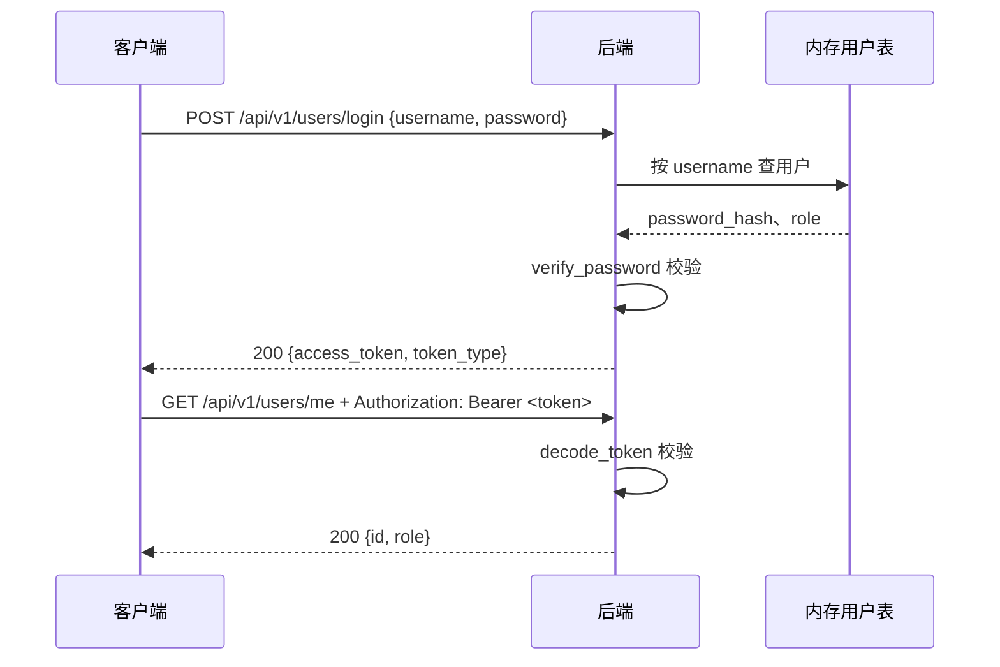

# 第 6 章 用户模块：登录认证

第 5 章完成的接口默认接受任何调用者。要让接口按人区分行为，系统先得知道请求来自谁。

## 本章要解决的问题

**系统怎样确认“你是谁”，并让后续请求带着这个身份？**

没有认证时，任何知道地址的人都能调用管理数据的接口，服务器只能照做。请求里没有说“我是谁”，页面上的登录与菜单只影响正常用户的操作路径，不改变接口是否执行。

**认证就是先确认“你是谁”；确认通过，请求才进入业务代码。** 这也是信息安全中对认证与授权的一般区分（ISO/IEC/IEEE 24765:2017）。本章关心的是：系统凭什么相信请求里的身份，以及这个身份怎样一路带到业务代码面前；授权是另一个问题，下一章展开。

## 本章学习目标

读完第 6 章并完成实训后，应能：

1. 说明认证回答什么问题，以及 401 表示什么。
2. 解释用户数据四个核心字段的作用，说明密码为什么只存哈希。
3. 实现注册、登录与 `/me`，让令牌的签发、携带与校验走通。
4. 用 `Depends` 挂认证依赖，说明未带令牌与令牌无效都返回 401。

## 6.1 认证与用户数据的组织

第 5 章的单位模块把数据放在 `model.TABLE` 列表里，`crud.py` 直接操作列表；进程一停，列表就清空。本章沿用同一套写法，给认证准备一份用户数据：登录时按用户名找到账号，校验密码，读出角色与启用状态。

**本章的用户账号存在内存里，重启即失。** 数据库到第 8 章数据模块才引入；那时只换存储层（`model.py` 与 `crud.py`），本章的哈希、令牌与认证逻辑一行不改。先把“认证要什么数据、数据怎么组织”讲清楚，落库才不会变成重写。

**四个核心字段**

| 字段 | 作用 |
| --- | --- |
| `username` | 用户名，不能重复；注册查重时据此判断 |
| `password_hash` | 密码的哈希值，不是明文（6.2 说明为什么） |
| `role` | 角色，如 `admin`、`normal`，第 7 章据此判断权限 |
| `is_active` | 是否启用，第 7 章用于启用与禁用 |

主键 `id` 由 `crud.create` 分配，令牌用它标识用户。`role` 默认 `normal`，注册接口不接受客户端指定角色；`is_active` 让管理员可以停用账号而不删除记录。与第 5 章 `Department` 的写法一致，`User` 用 `dataclass` 描述一行有哪些字段，`TABLE` 充当“表”。

**代码 6-1-1** · `app/modules/user/model.py`（内存版用户数据，Python）

```python
from dataclasses import dataclass


@dataclass
class User:
    id: int
    username: str
    password_hash: str
    role: str = "normal"
    is_active: int = 1


TABLE: list[User] = []
```

`id` 不放在注册请求里，由 `crud.py` 按 `TABLE` 现有记录数分配；`role` 与 `is_active` 有默认值，注册时不必传。表中现在还没有数据，第一次注册才写入第一条。

**crud.py：用户数据访问**

查询与写入集中在 `crud.py`，service 只负责规则与流程。五个函数的签名在第 8 章换库时会加 `db: Session` 参数，函数职责与调用方式不变。

**代码 6-1-2** · `app/modules/user/crud.py`（内存读写，Python）

```python
from . import model


def get_by_username(username: str) -> model.User | None:
    for item in model.TABLE:
        if item.username == username:
            return item
    return None


def get_by_id(user_id: int) -> model.User | None:
    for item in model.TABLE:
        if item.id == user_id:
            return item
    return None


def list_all() -> list[model.User]:
    return model.TABLE


def create(username: str, password_hash: str) -> model.User:
    user = model.User(
        id=len(model.TABLE) + 1,
        username=username,
        password_hash=password_hash,
    )
    model.TABLE.append(user)
    return user


def update(user: model.User, data: dict) -> model.User:
    for key, value in data.items():
        setattr(user, key, value)
    return user
```

`get_by_username` 同时服务注册查重与登录查询；`list_all` 与 `update` 在第 7 章使用。crud 不判断“用户名是否重复”，只负责“查得到/查不到”，判断留在 service。这一分工与第 4 章 4.5 的单位模块相同：controller 接请求，service 判规则，crud 动数据。

账号在内存里，重启就要重新注册——这是本章的已知代价，不是缺陷。第 8 章把它换成数据库时，改的只是 `model.py` 与 `crud.py` 两处。

## 6.2 密码哈希与令牌

登录时要证明“你是这个账号的主人”，最常用的办法是密码。密码怎么存，决定了用户数据泄露时的损失。6.1 的用户记录里只留 `password_hash` 这一字段；这一字段的值怎么算、怎么验，以及登录后怎么发令牌，都放在 `app/core/security.py`。

**只存哈希的理由**

用户数据里不能存明文密码。一旦数据泄露，所有人的密码都会暴露；很多人在多个系统复用同一个密码，影响会扩散到其他系统。

正确做法是存**哈希**：注册时把密码交给哈希函数，得到一串不可逆的值；登录时用同一个函数处理输入，再与记录里的值比对。哈希不是加密，不能还原出原密码，只能验证“输入是否与原来一致”。密码哈希的常用方案见 RFC 8018（PBKDF2）与 OWASP 密码存储指南。

**令牌：登录后的凭证**

密码只在登录时用一次。登录成功后，服务器发给客户端一张**令牌**，之后的请求带令牌，不再带密码。本章使用 JWT（JSON Web Token，一种带签名的令牌格式，RFC 7519）。令牌里放三样东西：用户标识（`sub`）、角色（`role`）和过期时间（`exp`），再用密钥签名。客户端保存令牌，之后每次请求把它放进请求头：

```text
Authorization: Bearer <token>
```

**代码 6-1-3** · `app/core/security.py`（密码哈希与令牌，Python）

```python
import os
from datetime import datetime, timedelta, timezone
from typing import Optional

from dotenv import load_dotenv
from jose import JWTError, jwt
from passlib.context import CryptContext

load_dotenv()

SECRET_KEY = os.getenv("SECRET_KEY", "change-me-in-env")
ALGORITHM = os.getenv("ALGORITHM", "HS256")
ACCESS_TOKEN_EXPIRE_MINUTES = int(os.getenv("ACCESS_TOKEN_EXPIRE_MINUTES", "30"))

pwd_context = CryptContext(schemes=["pbkdf2_sha256"], deprecated="auto")


def get_password_hash(password: str) -> str:
    return pwd_context.hash(password)


def verify_password(plain_password: str, hashed_password: str) -> bool:
    return pwd_context.verify(plain_password, hashed_password)


def create_access_token(data: dict) -> str:
    to_encode = data.copy()
    expire = datetime.now(timezone.utc) + timedelta(minutes=ACCESS_TOKEN_EXPIRE_MINUTES)
    to_encode.update({"exp": expire})
    return jwt.encode(to_encode, SECRET_KEY, algorithm=ALGORITHM)


def decode_token(token: str) -> Optional[dict]:
    try:
        return jwt.decode(token, SECRET_KEY, algorithms=[ALGORITHM])
    except JWTError:
        return None
```

`get_password_hash("secret123")` 每次生成的字符串都不同，因为哈希里带了随机种子；`verify_password("secret123", 哈希)` 返回 `True`，输入错误密码返回 `False`。这就是“不可逆但可验证”。

签发时把载荷与过期时间一起签名；解析时 `jwt.decode` 同时校验签名与过期时间，任何一项不对都抛出 `JWTError`，这里转成 `None` 交给调用方。`load_dotenv()` 先加载第 5 章的 `.env`，三项配置再从中读取；变量未设置时使用教学占位值。**正式部署必须设置 `SECRET_KEY`**，否则任何人拿到书里的占位密钥就能伪造令牌。

> 💡 **易错点**：把 JWT 的三段结构与编码算法当成本章重点。本章只需要知道“令牌带签名、会过期”。

## 6.3 注册与登录

注册创建账号，登录把账号换成令牌。两个动作操作的都是用户数据，所以都放在 user 模块。

**注册的输入与输出**

输入模型负责检查请求，输出模型决定返回哪些字段：

**代码 6-1-4** · `app/modules/user/schema.py`（输入与输出模型，Python）

```python
from pydantic import BaseModel, Field


class UserCreate(BaseModel):
    username: str = Field(..., min_length=3, max_length=100)
    password: str = Field(..., min_length=6, max_length=50)


class UserOut(BaseModel):
    id: int
    username: str
    role: str
    is_active: int


class LoginIn(BaseModel):
    username: str
    password: str


class TokenOut(BaseModel):
    access_token: str
    token_type: str = "bearer"
```

`...` 表示必填，`min_length`、`max_length` 是约束。请求不满足约束时，FastAPI 不会进入函数，直接返回 422，并指出是哪个字段、什么错误。注册只接收用户名与密码，角色由服务端固定为 `normal`，客户端无权指定。

输入与输出必须分开。用户记录里有 `password_hash`，响应绝不能把它返回。`UserOut` 只列可公开字段，接口声明 `response_model=UserOut` 后，多出的字段会被自动滤掉。

> 💡 **易错点**：直接把对象整个返回，结果把 `password_hash` 一起返回给前端。输出模型要显式列出允许返回的字段。

**注册与登录流程**

注册做三件事：查重、哈希、写进内存表。登录做三件事：按用户名查用户、校验密码、签发令牌。

**代码 6-1-5** · `app/modules/user/service.py`（建号与登录，Python）

```python
from fastapi import HTTPException

from app.core.security import create_access_token, get_password_hash, verify_password
from app.modules.user import crud
from app.modules.user.model import User


def create_user(data) -> User:
    if crud.get_by_username(data.username):
        raise HTTPException(status_code=400, detail="用户名已存在")
    return crud.create(data.username, get_password_hash(data.password))


def login(data) -> dict:
    user = crud.get_by_username(data.username)
    if not user or not verify_password(data.password, user.password_hash):
        raise HTTPException(status_code=401, detail="用户名或密码错误")
    token = create_access_token({"sub": str(user.id), "role": user.role})
    return {"access_token": token, "token_type": "bearer"}
```

取用户与写入都经 `crud.py`，service 只写“查重、哈希、比对、签发”这些规则。错误提示统一写“用户名或密码错误”，不区分“用户不存在”和“密码错误”：如果提示能区分，攻击者就能借登录接口枚举哪些用户名存在。

`sub` 按令牌规范存字符串，读取时再转回整数；`role` 随令牌带上，第 7 章做权限判断时直接使用。

controller 的函数签名不再需要会话参数，注册与登录直接调用 service：

**代码 6-1-6** · `app/modules/user/controller.py`（注册与登录接口，Python）

```python
from fastapi import APIRouter

from app.modules.user import service
from app.modules.user.schema import LoginIn, TokenOut, UserCreate, UserOut

router = APIRouter(prefix="/users", tags=["用户"])


@router.post("", response_model=UserOut, status_code=201)
def register(data: UserCreate):
    return service.create_user(data)


@router.post("/login", response_model=TokenOut)
def login_endpoint(data: LoginIn):
    return service.login(data)
```

`main.py` 用 `app.include_router(user_controller.router, prefix="/api/v1")` 挂载，因此注册的完整路径是 `POST /api/v1/users`，登录是 `POST /api/v1/users/login`。登录与注册同属一个模块、一个路由前缀，不需要另建文件夹。

登录的调用关系可以画成下图。



*图 6-1：登录与携带令牌访问受保护接口*

图中上半段是“用用户名密码换取令牌”，下半段是“之后每次请求都带上令牌”。两段之间服务器不保存登录状态，令牌本身就是凭证；用户表存在内存里，只负责登录时查一下哈希与角色。

## 6.4 受保护接口

令牌签发之后，每个受保护接口都要先做同一件事：从请求头取出令牌、解析、确认有效、得到当前用户。每个函数都写一遍，既重复又容易漏。用 `Depends` 把这段逻辑抽出来，就是认证依赖。

**代码 6-1-7** · `app/core/security.py`（认证依赖，续写，Python）

在文件顶部补两行导入，再在文件末尾追加：

```python
from fastapi import Depends, HTTPException
from fastapi.security import HTTPAuthorizationCredentials, HTTPBearer

bearer_scheme = HTTPBearer(auto_error=False)


def get_current_user(
    credentials: HTTPAuthorizationCredentials = Depends(bearer_scheme),
) -> dict:
    if credentials is None:
        raise HTTPException(status_code=401, detail="未提供令牌")
    payload = decode_token(credentials.credentials)
    if payload is None or payload.get("sub") is None:
        raise HTTPException(status_code=401, detail="令牌无效或已过期")
    return {"id": int(payload["sub"]), "role": payload.get("role")}
```

`HTTPBearer(auto_error=False)` 会从 `Authorization: Bearer` 头里取出令牌；没带令牌时返回 `None`，由函数转成 401。`decode_token` 解析失败或载荷缺少用户标识也返回 401。返回的字典把 `sub` 转成整数 `id`，后续接口可以直接与用户主键比较。认证依赖只读令牌，不查用户表——这也是第 8 章换库时它一行不改的原因。

在 `/docs` 中先调用登录接口取得 `access_token`，再点右上角 Authorize 粘贴该令牌，即可验证受保护接口。

**当前用户接口**

**代码 6-1-8** · `app/modules/user/controller.py`（当前用户接口，续写，Python）

在文件顶部从 `app.core.security` 导入 `get_current_user`，再追加：

```python
@router.get("/me")
def me(current_user: dict = Depends(get_current_user)):
    return current_user
```

接口函数本身不需要写任何认证代码，它只关心“当前用户是谁”。完整路径是 `GET /api/v1/users/me`。

> 💡 **易错点**：令牌只签名、不加密。任何拿到令牌的人都能读出载荷内容，所以载荷里不能放密码、身份证号等敏感信息；令牌也要当作密码保管，不写进日志、不提交到 Git。

到这里，本章的代码都出现了。回头看一下它们的分工。

**本章的代码组织**

本章新增一个基础设施文件和一个模块：

```text
app/
├── core/
│   └── security.py        哈希、令牌、认证依赖
└── modules/user/
    ├── model.py           内存用户数据与 TABLE
    ├── schema.py          输入与输出模型
    ├── crud.py            取用户与写入
    ├── service.py         注册、登录与修改规则
    └── controller.py      路由
```

判断一段代码该放哪里，看它回答什么问题：

| 要改的事 | 改哪个文件 |
| --- | --- |
| 加一个用户字段 | `model.py` 与 `schema.py` |
| 改登录规则（查重、校验、禁用） | `service.py` |
| 改查询条件或写入方式 | `crud.py` |
| 改路径、方法、状态码 | `controller.py` |
| 改哈希方案或令牌有效期 | `security.py` |

为什么这样分：请求先到 controller；规则写在 service；数据怎么取、怎么写写在 crud；数据长什么样写在 model 与 schema；哈希、令牌这类跨模块能力放在 security。登录没有单建 `auth/`，因为它操作的就是用户数据。这一结构与第 4 章 4.5 的单位模块相同；第 7 章的列表与修改继续使用同一个 `crud.py`。第 8 章引入数据库时，`app/core/database.py` 才会作为第二个基础设施文件出现。

## 示范例题

#### 例 6-1：走通注册、登录与受保护接口

**题目**：按本章代码实现三个接口。依次发出四次请求：注册 `alice`；用 `alice` 登录；不带令牌与带令牌各访问一次 `/me`。写出每次请求的路径、请求体或请求头，以及预期状态码。

**解**：

| 请求 | 请求体或请求头 | 状态码 | 说明 |
| --- | --- | --- | --- |
| `POST /api/v1/users` | `{"username": "alice", "password": "secret123"}` | 201 | 返回 `UserOut`，不含 `password_hash` |
| `POST /api/v1/users/login` | 同上 | 200 | 返回 `access_token` 与 `token_type` |
| `GET /api/v1/users/me` | 无 | 401 | `bearer_scheme` 没取到令牌 |
| `GET /api/v1/users/me` | `Authorization: Bearer <token>` | 200 | 返回 `{"id": 1, "role": "normal"}` |

第三次请求的令牌取自第二次响应。若把令牌拼错或换成一个过期令牌，第四次也会变成 401：`decode_token` 返回 `None`，认证依赖在进入接口函数前结束请求。

## 独立习题

#### 习题 6-1

**题目**：用自己的话说明一次“登录后访问受保护接口”的完整流程：令牌从哪里来、放在哪里、服务器如何校验、校验失败返回什么。并解释 401 表示什么。

#### 习题 6-2

**题目**：下面三个现象都返回 401，请分别判断原因，并给出排查步骤。

1. 用户确认密码正确，但登录返回 401。
2. 登录成功拿到令牌，访问 `/me` 仍返回 401。
3. 令牌使用一段时间后，`/me` 返回 401。

## ◆ 实训 6-1：给骨架装上登录认证

### 一、任务目标与验收

在第 5 章的最小工程上继续，保留单位模块，新增内存版用户模块，实现三个接口。

| 接口 | 方法 | 成功返回 | 失败返回 |
| --- | --- | --- | --- |
| `/api/v1/users` 注册 | POST | 201 + `UserOut`（无 `password_hash`） | 用户名重复 → 400；字段不合法 → 422 |
| `/api/v1/users/login` 登录 | POST | 200 + `{access_token, token_type}` | 密码错 → 401 |
| `/api/v1/users/me` 当前用户 | GET | 200 + `{id, role}` | 未带令牌 / 令牌无效 → 401 |

同时要求：依赖与配置已更新；用户内存表 `TABLE` 已建立；第 5 章的单位接口仍可访问；每个符号在工程里有定义或明确出处（6.2–6.4）；提交一次可读的 Git 记录。

### 二、课前准备

- 回看第 3 章 3.5 与 3.6；`Depends` 的写法见第 4 章 4.5，本章 6.4 讲它在认证中的应用。
- 第 5 章的工程还没有用户模块，本次要新建 `app/core/` 与 `app/modules/user/` 两个目录，以及各级 `__init__.py`。
- 安装本课次新增依赖：

```text
$ pip install "python-jose[cryptography]" passlib python-dotenv
```

把这三项补进第 5 章 5.5 的 `requirements.txt`。数据库依赖第 8 章数据模块才引入。

- 确认骨架能启动：`uvicorn main:app --reload` 后访问 `/health` 与 `/api/v1/departments/` 均成功。

### 三、操作步骤

每一步按“做什么 → 怎么做 → 预期 → 做错会看到什么”推进；完整代码见各步骤标注的代码块。

**步骤 1 · 依赖与配置（15 分钟）**
- 做什么：把三项依赖补进 `requirements.txt`；激活虚拟环境后安装；复制 `.env.example` 为 `.env`（可选）。
- 预期：`pip list` 可见三项新依赖；`/health` 与单位列表仍为 200。
- 做错会看到什么：`ModuleNotFoundError: No module named 'jose'` → 依赖装到了系统 Python，确认 `(venv)` 已激活。

**步骤 2 · 内存用户存储与四个字段（30 分钟）**
- 做什么：按 6.1 写 `app/modules/user/model.py` 的 `User` dataclass 与 `TABLE`，再写 `crud.py` 的五个函数；在 `main.py` 挂上 user 路由，保留第 5 章的单位路由。
- 预期：注册前 `TABLE` 为空；`/docs` 中出现用户分组；单位接口仍为 200。
- 做错会看到什么：`ModuleNotFoundError: app.core` → 缺 `__init__.py`；重启后刚注册的账号消失 → 内存存储的预期行为，第 8 章落库后解决；哨位接口 404 → 替换 `main.py` 时删掉了旧路由。

**步骤 3 · 密码哈希与令牌（30 分钟）**
- 做什么：按 6.2 写 `app/core/security.py` 的配置、哈希两函数与令牌两函数。
- 预期：`$ python -c "from app.core.security import create_access_token"` 无报错。
- 做错会看到什么：`ModuleNotFoundError: No module named 'jose'` → 依赖没装；签发后解析失败 → 两处 `SECRET_KEY` 或算法不一致。

**步骤 4 · 注册与登录（40 分钟）**
- 做什么：按 6.3 写 `schema.py` 的四个模型、`crud.py` 的取用户与写入函数、`service.py` 的 `create_user` 与 `login`、`controller.py` 的注册与登录两条路由。
- 预期：注册 201；重名 400；短密码 422；登录 200 并返回 `access_token`；错密码 401。
- 做错会看到什么：正确密码也 401 → 注册时忘了哈希，回看 6.2；响应出现 `password_hash` → 未写 `response_model=UserOut`。

**步骤 5 · `/me` 受保护接口（30 分钟）**
- 做什么：按 6.4 在 `security.py` 追加 `get_current_user`，在 `controller.py` 追加 `/me` 路由。
- 预期：不带令牌 401；有效令牌 200 返回 `{id, role}`；无效令牌 401。
- 做错会看到什么：刚登录就 401 → 请求头写成 `Authorization: Bearer <token>`，或签发与解析读的不是同一份配置。

**步骤 6 · 验证与提交（25 分钟）**
- 做什么：从注册开始，按验收表三个接口各走一遍，含失败分支；确认单位接口仍为 200；提交。
- 预期：与验收表逐行一致；`git status` 干净；`git ls-files` 中无 `.env`、`venv/`。
- 做错会看到什么：漏提交依赖 → 用 `git add -A` 而不是只加 `app/`。

### 四、排错清单

| 现象 | 常见原因 | 处理 |
| --- | --- | --- |
| `ModuleNotFoundError: No module named 'jose'` | 依赖未安装 | 回到课前准备重装 |
| 正确密码登录也是 401 | 注册时没哈希，或哈希与校验用了不同方案 | 检查 6.2 的两个函数是否同用一个 `pwd_context` |
| 刚登录就 401 | 请求头格式不对，或签发与解析的密钥不一致 | 检查 `Authorization: Bearer` 与 `SECRET_KEY` 的唯一出处 |
| 422 `string_too_short` | 输入不满足 `Field` 约束 | 看响应 `detail` 的 `loc`，改输入或改约束 |
| 响应里出现 `password_hash` | 未声明输出模型 | 检查 `response_model=UserOut` |
| 注册返回 307 | 请求地址多了尾斜杠 | 去掉尾斜杠，写成 `/api/v1/users` |
| `ModuleNotFoundError: app.core` | 缺少 `app/core/__init__.py` | 补空文件后重启 |
| `/api/v1/users` 返回 404 | `main.py` 未挂 user 路由 | 补 `include_router(user_controller.router, prefix="/api/v1")` |
| 哨位接口返回 404 | 替换 `main.py` 时删掉了 workstation 路由 | 恢复该行并确认前缀 |
| 重启后账号全部消失 | 用户数据在内存里，进程结束即清空 | 本章预期行为；第 8 章落库后不再丢失 |

### 五、提交与验收

```text
$ git add -A
$ git commit -m "feat(users): 注册、登录与受保护接口"
```

`git add -A` 会把依赖清单与入口文件的改动一并纳入。提交前用 `git status` 确认没有 `.env` 与 `venv/`。

验收点：验收表三行全过（含 400、422、401）；`/docs` 中三个接口可见且参数说明完整；内存中无明文密码；第 5 章的单位接口仍为 200；日志与提交中无令牌。完成后按验收点自评并留档。

### 六、课后扩展

- 把 `ACCESS_TOKEN_EXPIRE_MINUTES` 改成 1，等一分钟后再访问 `/me`，观察 401，体会 `exp` 的作用。
- 给注册接口加“用户名只允许字母、数字、下划线”的约束（提示：查 `Field` 的 `pattern` 参数）。
- **复习任务**：对照第 5 章与本章，指出新增了哪些目录与文件、各自解决什么问题；说明 `app/core/` 为什么此时才出现，以及 Pydantic、`Depends`、`HTTPException` 分别落在哪个文件。

## 本章小结

**核心结论**：

1. 认证回答“你是谁”；身份未确认时返回 401。
2. 用户数据至少有 `username`、`password_hash`、`role`、`is_active` 四个核心字段，本章存在内存表里；密码只存**哈希**，不存明文。
3. 注册做查重、哈希、写入；登录做查用户、验密码、签发令牌。
4. 令牌放在 `Authorization: Bearer <token>` 中传递；受保护接口用 `Depends` 挂认证依赖，未带令牌或令牌无效都返回 401。
5. 注册、登录与 `/me` 同属 user 模块；认证依赖与业务代码分开，接口函数只声明依赖。

把这章压缩成一句话：**认证把“你是谁”变成一张可校验的令牌，再用依赖把它接到每个受保护接口上。**

**学完本章，你可以体会到**：认证的边界不是画在页面上的，而是画在接口入口处的，由令牌、依赖与状态码共同守住。账号此刻还在内存里；第 8 章只换存储层，这条边界不动。

**自检**：回到章首的学习目标，逐条问自己做到了没有——

- [ ] 说明认证回答什么问题，以及 401 表示什么。
- [ ] 解释用户数据四个核心字段的作用，说明密码为什么只存哈希。
- [ ] 实现注册、登录与 `/me`，让令牌的签发、携带与校验走通。
- [ ] 用 `Depends` 挂认证依赖，说明未带令牌与令牌无效都返回 401。
- [ ] 完成实训 6-1 并自评。

## 本章完整代码位置

| 本章出现的代码 | 完整可运行版本在哪 |
| --- | --- |
| 代码 6-1-1 内存版用户数据 | 实训 6-1 步骤 2 落地为 `app/modules/user/model.py` |
| 代码 6-1-2 用户数据访问 | 实训 6-1 步骤 2、4 落地为 `app/modules/user/crud.py` |
| 代码 6-1-3 密码哈希与令牌、代码 6-1-7 认证依赖 | 实训 6-1 步骤 3、5 合成 `app/core/security.py` |
| 代码 6-1-4 输入与输出模型 | 实训 6-1 步骤 4 落地为 `app/modules/user/schema.py` |
| 代码 6-1-5 建号与登录 | 实训 6-1 步骤 4 落地为 `app/modules/user/service.py` |
| 代码 6-1-6 注册与登录接口、代码 6-1-8 当前用户接口 | 实训 6-1 步骤 4–5 落地为 `app/modules/user/controller.py` |
| 工程目录与入口 | 第 5 章 5.1（最小工程）与本章对 `main.py` 的补充 |
