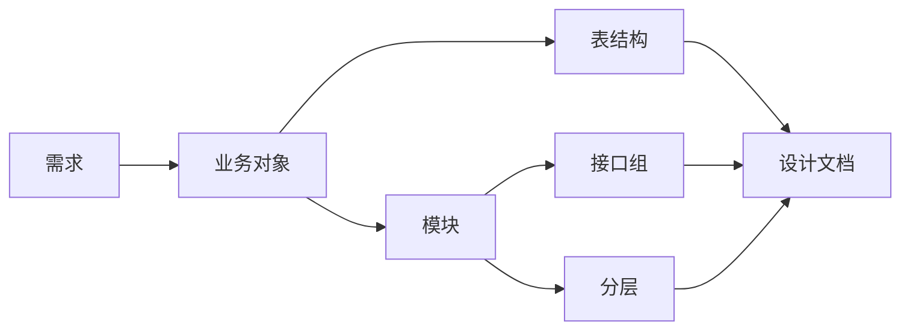
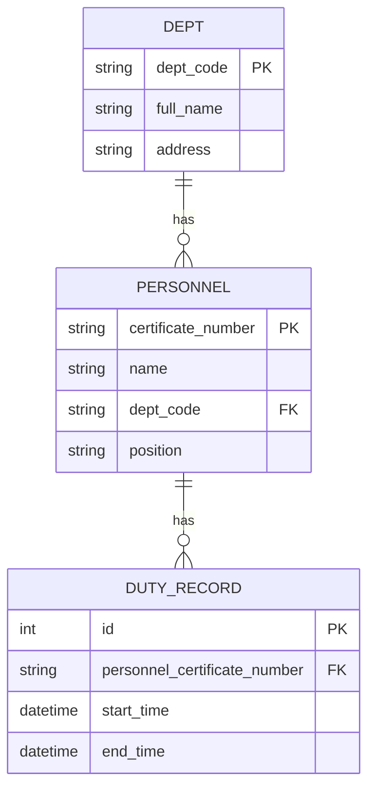

# 第 6 章 软件设计与建模

> **节首信息条**｜对应课次 5 · 2 学时 · 理论讲授｜前置：第 3 章的需求文档；第 4 章的接口四要素与 RESTful｜**本节活动**：◇ 课堂活动块（听讲要点 / 讨论·演示 / 课后自测 / 回链）

**已会**：第 3 章的需求文档与第 4 章的接口四要素。
**本章只加**：结构与职责——用一条翻译链把需求变成表、模块、接口与分层。
**关系**：需求回答“做什么”，接口回答“怎么调”；本章回答“需求怎样一步步变成可以照着施工的结构”。

第 4 章解决了一个接口怎样定义。但一个系统不会只有一个接口：部门、人员、值班记录，每个业务对象都有一组接口，接口背后又对应一张或几张表。如果直接开始写代码，最先出问题的往往不是语法，而是结构：部门表少了一个负责人字段，人员表与值班记录表对不上，接口参数与页面字段不一致。此后表要改、接口要改、页面要改、测试要重做。

这些错误看起来分散，实际上来自同一处：**需求没有经过设计，直接被翻译成了代码**。设计的作用，是把这一步翻译拆成几个可检查的中间产物——先找出系统要管理哪些业务对象，再决定每个对象的数据怎么存、由哪个模块负责、对外提供什么接口、内部怎样分层，最后把这些决定写进一份别人能照着做的文档。每一步的产出，都是下一步的输入。

本章只回答一个问题：**一份需求，怎样一步步变成可以照着建表、写接口、做页面的结构？**

## 本章学习目标

读完第 6 章，应能：

1. 说明设计是一条从需求到结构的翻译链、每一步的产出，以及为什么按这个顺序、什么情况下应调整。
2. 从需求中找出业务对象，为每个对象设计表结构，正确使用主键（Primary Key）、外键（Foreign Key）并说明一对多（One-to-Many）关系。
3. 按业务能力划分模块，并用一句话说清每个模块的职责。
4. 为一个 CRUD 模块写出五个标准接口的方法、URL、参数来源与成功状态码。
5. 用耦合与内聚说明四层分工的理由，并把表、接口、页面与模块职责写进设计文档、检查一致性。

## 前置知识卡

| # | 已有知识 | 回看位置 |
| --- | --- | --- |
| 1 | 需求文档的五部分结构与「动词＋对象」功能条目 | 第 3 章 3.1.2 |
| 2 | 接口四要素、RESTful 资源命名与状态码 | 第 4 章 4.1.2–4.1.3 |
| 3 | 路径参数 / 查询参数 / 请求体的分工 | 第 4 章 4.1.2、第 5 章 5.1.3 |

> 本章是理论课，不设实训；卡住时回看上面三处，不必从头重读。

## 6.1 概念讲解

### 6.1.1 从需求到结构

设计不是“写一份文档”，而是把需求翻译成结构的过程。这个过程可以拆成六步，每一步留下一个可检查的产物。

| 步骤 | 输入 | 要回答的问题 | 产出 |
| --- | --- | --- | --- |
| 1 | 需求 | 系统要管理哪些业务对象？ | 业务对象清单 |
| 2 | 业务对象 | 每个对象的数据怎么存？ | 表结构、主键、外键、关系 |
| 3 | 业务对象 | 每个对象由哪段代码负责？ | 模块清单与一句话职责 |
| 4 | 模块 | 模块对外提供什么操作？ | 接口组（方法、URL、参数、返回） |
| 5 | 模块 | 模块内部怎样分工？ | 分层与调用方向 |
| 6 | 前五步的产物 | 这些决定怎样记录、怎样检查？ | 设计文档 |



*图 6-1：从需求到结构的设计翻译链*

这条链有两个特点。

第一，**每一步都在收窄问题**。需求阶段的问题范围是整个业务；到表结构，问题变成“哪些字段、什么关系”；到接口，问题变成“谁调用、传什么、返回什么”。问题越具体，越容易检查对错。

第二，**跳过任何一步，错误会在后面放大**。不从需求找业务对象，直接开写代码，通常会出现“字段边写边加、表边用边改”；不先定模块，接口会按页面或按人临时分配，同一个业务对象被多处读写；不先定分层，业务规则会散落在 controller 里，测试时无法单独调用。设计阶段多花半小时，省下的是后面几天的返工。

**为什么是这个顺序**

这条链的排序原则可以概括为一句话：**先定变化最慢、修改代价最高的决定，再定依赖它的决定。**

- 业务对象最稳定。部门、人员、值班记录不会因为页面改版而消失；它们来自业务词汇，而不是界面。
- 表最难改。数据一旦写入，改字段要迁移历史数据、改接口、改页面、改测试；因此表结构应尽早确定。
- 模块跟着对象走。模块回答“谁负责这类数据”，对象定了，模块边界才有依据；先定模块再找对象，边界容易按页面或按人切。
- 接口跟着模块走。接口是模块对外的承诺；模块职责不清，接口就会变成按页面临时拼出的端点。
- 分层跟着操作走。分层是模块内部的实现分工；知道模块提供哪些操作、承担哪些规则，才知道 service 该放什么。
- 文档最后。文档记录已经做出的决定；先写文档，等于先写猜测。

反过来做，会出现对应的结构问题：

| 如果先定 | 常见后果 |
| --- | --- |
| 页面 | 页面结构决定数据模型；同一字段在多个页面重复，接口按页面定制，复用困难 |
| 模块 | 模块按页面、人员或技术层切；同一张表被多个模块读写，耦合上升 |
| 接口 | 契约看起来完整，但数据库无法约束；非法状态仍能写入 |
| 分层 | 层建好了却没有内容；service 空转，规则仍堆在 controller |

**这个顺序不是唯一的**

设计方法不止一种。下表以本章方法为基线，列出三种常见替代；后三种只需了解，不要求掌握，它们的区别在“从哪里开始”。

| 方法 | 起点 | 适合的场景 |
| --- | --- | --- |
| 对象与数据优先（本章） | 业务对象、表结构 | 业务对象稳定、CRUD 为主、数据约束重要 |
| 用例与行为驱动 | 用户场景、操作流程 | 行为复杂，需求通过场景澄清 |
| 接口优先（API-first） | 对外契约 | 多端或多团队依赖同一接口，或对接已有系统 |
| 领域驱动（DDD） | 领域模型、边界上下文 | 领域规则复杂，包含多个子域 |

本课程选择对象与数据优先，原因有四个：duty 是以数据为中心的 CRUD 系统；业务词汇稳定；表结构变更代价高；前后端契约是主要协作边界。换成另一个项目，这个顺序可能不再合适。

**这条链的边界**

设计顺序不是瀑布。发现对象漏了、规则变了，可以回到上一步；链是“先想清楚再写代码”的顺序，不是“每步只做一次”的流程。

在三种情况下，应调整顺序：

- 对外契约已经固定（例如对接上级系统）：先定接口，再反推数据与模块。
- 领域规则复杂、跨多个子域：先做领域模型，再定表与模块。
- 页面或交互是主要风险：先做原型，再反推数据与接口。

跨模块的公共决策（例如统一认证、统一分页格式）需要在链外单独约定。设计文档也不必写成几十页，够别人照着做即可；过度设计同样有成本。

> 💡 **常见坑**：把设计文档当成链的起点。文档是链的产物，不是输入；先有表、模块、接口的决定，才有可写的文档。

### 6.1.2 业务对象与表结构

链的前两步，是从需求里找出业务对象，再为每个对象设计表结构。需求文档中的名词通常就是候选对象：部门、人员、值班记录、工位、培训计划。一个业务对象对应一组需要长期保存的数据，也通常对应一张表。

关系数据库用“表”存一类数据。表里的每一行是一条记录，每一列是一个字段。为了区分记录，需要一个能唯一代表这一行的字段，叫主键。为了表达两张表之间的关系，需要在一个表里存放另一个表的主键，叫外键。

用生活例子理解：学生名单是一张表，学号是主键；学生表里再放一个“班级编号”，这个编号指向班级表的主键，它就是外键。

“一对多”是最常用的关系。一个部门可以有多个人员，但一个人员只属于一个部门；一个人员可以有多条值班记录，但一条值班记录只属于一个人员。外键放在“多”的一方：人员表放部门编号，值班记录表放人员证件号。这样每条“多”的记录只存一个“一”的编号，不会在部门表里重复存一串人员。

外键放在“多”的一方的理由，可以从一次查询和一次修改分别看。查询“某部门有哪些人”，只需在人员表按 `dept_code` 过滤；修改“某人换部门”，只需改人员表的一行。若把人员编号列表塞进部门表，查询要拆开字符串，修改要重写整个列表，而且数据库无法约束列表里的编号是否真实存在。**关系的方向决定了查询与约束的写法**，外键放反，后面的代码会一直绕着它打补丁。

把部门、人员、值班记录放在一起，关系可以画成下图。



*图 6-2：部门—人员—值班记录的一对多关系*

读图时看三件事：主键（PK）在哪一列；外键（FK）指向哪张表；连线两端是“一”还是“多”。部门与人员是一对多，人员与值班记录也是一对多；外键分别放在人员表和值班记录表，也就是“多”的一方。

这一步的产出是三张表及其关系。表定好了，下一个问题自然出现：**这些表由哪些代码来操作？** 这就是链的第三步——模块。

> 💡 **常见坑**：把外键放反。若在部门表里存“人员证件号列表”，一个部门有多个人时就要在一行里塞多个值，既难查询也难约束。

### 6.1.3 从业务对象到模块

表回答“数据怎么存”，模块回答“哪段代码负责这类数据”。二者大体按同一批业务对象划分：一个业务对象通常对应一个模块，模块负责这张表的读写与相关规则；统计这类跨对象的汇总，可以单独成模块。

模块按业务能力划分，不按页面划分。需求文档里的功能清单通常已经按业务域分组：登录与账号、部门、人员、工位、值班、查班、统计。每个业务域大体对应一个模块，用一句话说清职责。

| 需求（功能簇） | 业务对象 | 模块 | 一句话职责 |
| --- | --- | --- | --- |
| 管理部门信息 | 部门 | `dept` | 维护部门基本信息 |
| 管理人员信息 | 人员 | `personnel` | 维护人员及其所属部门 |
| 记录谁在什么时间值班 | 值班记录 | `duty_record` | 记录与查询值班安排 |
| 统计值班次数与时段分布 | 统计结果 | `analytics` | 按条件汇总值班数据 |

模块划分要回答两个问题：这个模块负责哪类业务对象？它对外提供哪些操作？如果一句话说不清，通常说明模块装得太多，或者边界还没想明白。

按页面划分模块是一种常见错误。页面会随界面调整而合并或拆分，业务对象不会。若“人员列表页”和“人员详情页”各自对应一个模块，两个模块都要读写人员表，字段一变就要改两处；按业务对象划分，人员表只有一个模块负责，页面只是它的调用方。

模块也不能切得太细。每个业务对象一个模块，已经足够；再按“查询”“新增”拆成独立模块，调用关系会变得复杂，改一个字段要跨多个模块。**模块的粒度以“一句话能说清职责”为准**，不是越多越专业。

这一步的产出是模块清单与每个模块的一句话职责。模块定好了，下一个问题自然出现：**模块之间、前后端之间怎样说话？** 这就是链的第四步——接口组。

### 6.1.4 模块的接口组

第 4 章 4.1.4 已经给出一个资源的五个标准动作及其方法与 URL，4.1.3 与 4.1.2 补充状态码与参数来源。本节不重复这些内容，只讨论模块层面的两个问题：接口组怎样由模块职责推出；多个模块的接口组怎样保持一致。

**接口组由模块职责推出**

一个模块负责哪类业务对象，接口组就围绕这类对象提供五个动作。部门模块的接口组以 `dept_code` 定位，人员模块的接口组以 `certificate_number` 定位；动作相同，定位字段不同。若模块的一句话职责说不清，接口组通常也会多出几个用途不明的端点。

参数来源的判据见第 4 章 4.1.2：定位“某一个”资源用路径参数；筛选、分页、排序用查询参数；新增或修改要提交的字段放请求体。

**跨模块的一致性**

多个模块的接口组放在一起，还要保持同一套约定：分页参数都叫 `page` / `page_size`，排序都叫 `sort_by` / `order`，列表返回都含 `items` / `total` / `page` / `page_size` / `pages`，错误码的含义一致。否则前端要为每个模块记一套参数名，接口文档也难以统一描述。

第 11 章会以“参数命名一致性”为例说明这种不一致的维护成本；本章先把它作为设计检查项：模块之间的接口组可以不同，但同类动作的约定必须相同。

这一步的产出是每个模块的接口清单，以及一份跨模块的约定清单。接口定好了，模块对外能调了，但一个请求进入模块后要经过哪些代码？这就是链的第五步——分层。

### 6.1.5 模块内部的分层

第 5 章已经见过这些零件：`APIRouter` 是模块边界，`Depends` 是公共逻辑，`Session` / `get_db` 是数据访问。本节不再解释这些机制，只把它们组织成四层。

注意区分两组“层”：第 4 章的前端 / 后端 / 数据库是**部署三层**；这里的 controller / service / crud / model 是**后端内部四层**。两者不是同一组层，不要混用。

表、模块、接口都定好后，还要决定代码怎么放。最常见的做法是把后端分成四层，每层只做一件事。

| 层 | 职责 | 典型问题 |
| --- | --- | --- |
| controller | 接收请求、取出参数、返回响应 | 这个请求该由谁处理？ |
| service | 写业务规则、组合多个操作 | 部门编码重复要不要拒绝？ |
| crud | 直接读写数据库 | 按条件查询部门表 |
| model | 定义表结构与字段 | 部门表有哪些列？ |

这样分层的理由，可以用两个概念说明。

**耦合**指两部分之间的依赖程度：改一处，会不会被迫改另一处。若 controller 里直接写 SQL，换数据库就要改 controller；若 controller 只调用 service，数据库变化被挡在 crud 里，controller 不受影响。**分层的目标不是“文件更多”，而是把变化关在尽量小的范围内。**

**内聚**指一个模块内部的东西是否围绕同一件事。`model` 只管表结构，`schema` 只管进出字段，`crud` 只管读写；一个文件里同时处理三种事，改其中一种就会碰到另外两种。内聚高的模块，读的时候不需要在多个关注点之间来回切换。

还有一个相关概念是**信息隐藏**：每一层只暴露调用方需要知道的接口，把实现细节留在内部。controller 不需要知道 SQL 怎么写，service 不需要知道表有哪些列。隐藏得越干净，替换实现时影响越小。

分层也有代价。每多一层，就多一次调用、多一个文件、多一处需要维护的转发代码。小项目搭四层，可能显得繁琐；但本课程的 duty 项目有多个模块、多人协作、后续还要测试与部署，四层带来的定位成本低于它省下的修改成本。**分层不是越多越好，够用即可。**

这一步的产出是四层分工与调用方向。到这里，表、模块、接口、分层都已经确定，但它们还散在脑子里；最后一步是把它们写下来，并检查彼此是否对得上。

> 💡 **常见坑**：把所有逻辑堆在 controller。初学时这样写最快，但业务规则、SQL、响应组装混在一处，改一个字段要通读整个函数，测试也无法单独调用规则。

### 6.1.6 设计文档与一致性

设计文档是前五步的汇总，不是另起一项工作。一份够用的模块设计文档通常只有两节：表结构和接口清单。下面是部门模块的示例。

**代码 6-1-1** · 示例（文本）

```markdown
# 部门模块设计

## 1. 表结构
| 字段 | 类型 | 说明 |
| --- | --- | --- |
| dept_code | 文本 | 主键 |
| full_name | 文本 | 部门名称 |
| address | 文本 | 地址 |

## 2. 接口清单
| 方法 | URL | 参数 | 返回 |
| --- | --- | --- | --- |
| GET | /departments | page, page_size | 部门列表 |
| GET | /departments/{dept_code} | dept_code | 一个部门 |
| POST | /departments | 部门信息 | 新增结果 |
| PUT | /departments/{dept_code} | dept_code + 部门信息 | 修改结果 |
| DELETE | /departments/{dept_code} | dept_code | 成功消息 |
```

设计文档的合格标准不是篇幅，而是“别人能照着做”：字段名、类型、主键外键清楚；接口的方法、URL、参数来源、返回结构清楚；表字段与接口返回能对应上。

文档末尾还应有模块职责与分层说明。它们不必写成正式章节，但必须能让读者回答：这个模块负责哪类对象，请求进入后依次经过哪几层。

写文档的过程，也是检查一致性的过程。至少要检查三组对应：表字段与接口返回字段对应；接口参数与页面输入对应；模块职责与需求功能簇对应。这三组对应，就是后面编码、测试和验收的共同依据。

不一致的代价很直接。若表字段从 `full_name` 改成 `dept_name`，而接口返回仍写 `full_name`，页面就会出现一列空白；联调时看到的“字段不存在”“列表少一列”，多数是这类断裂。三组对应逐一核对，比等到联调时再猜要省事得多。

需要说明的是，设计文档是某一时刻的快照，代码才是最终口径。当代码与文档不一致时，应以实际代码和 `/docs` 为准，并回头修改文档；不能反过来让代码迁就一份过时的文档。这和第 4 章的接口契约是同一条原则：**只保留一个说法，并让它与运行中的系统一致。**

## 6.2 示范例题

两道例题对应翻译链的前两步。例 6-1 检验表结构：能否从字段里认出主键、外键，并说明外键为什么放在“多”的一方。例 6-2 检验从需求到表结构的翻译：给定一句业务需求，能否找到业务对象、列出字段、确定关系。

#### 例 6-1：指出三张表的主键、外键与关系【Bloom：理解】

**题目**：下面是部门、人员、值班记录三张表的字段。请指出每张表的主键与外键，说明“部门—人员”“人员—值班记录”分别是什么关系，并解释外键为什么放在“多”的一方。

- 部门：`dept_code`、`full_name`、`address`
- 人员：`certificate_number`、`name`、`dept_code`、`position`
- 值班记录：`id`、`personnel_certificate_number`、`start_time`、`end_time`

**解**：

1. 部门表的主键是 `dept_code`；`full_name`、`address` 是普通字段，没有外键。
2. 人员表的主键是 `certificate_number`；外键是 `dept_code`，指向部门表的主键。
3. 值班记录表的主键是 `id`；外键是 `personnel_certificate_number`，指向人员表的主键。
4. 部门与人员是一对多：一个部门有多名人员，一名人员只属于一个部门。
5. 人员与值班记录是一对多：一名人员有多条值班记录，一条值班记录只属于一名人员。
6. 外键放在“多”的一方，是因为每条人员记录只需要保存一个部门编号，每条值班记录只需要保存一个人员编号；若把人员编号列表放进部门表，一行要存多个值，既难查询也难约束。

#### 例 6-2：从需求画出三张表【Bloom：应用】

**题目**：需求是“值班管理员要按部门查询人员，并记录每人的值班时间”。请画出部门、人员、值班记录三张表的字段与关系，标出主键与外键。

**解**：

先找业务对象：部门、人员、值班记录。再给每个对象列字段，最后确定关系。

| 表 | 字段 | 主键/外键 |
| --- | --- | --- |
| 部门 | `dept_code`、`full_name`、`address` | `dept_code` 主键 |
| 人员 | `certificate_number`、`name`、`dept_code`、`position` | `certificate_number` 主键；`dept_code` 外键 |
| 值班记录 | `id`、`personnel_certificate_number`、`start_time`、`end_time` | `id` 主键；`personnel_certificate_number` 外键 |

关系：部门 1—N 人员；人员 1—N 值班记录。理由是“按部门查询人员”要求人员能关联到部门；“记录每人的值班时间”要求值班记录能关联到人员。

## 6.3 独立习题

#### 习题 6-1【Bloom：分析】

**题目**：某值班记录表同时保存了 `personnel_certificate_number`、`personnel_name`、`dept_name`、`workstation_name`。请指出这种设计可能导致的问题，并给出修正方案。

#### 习题 6-2【Bloom：创造】（开放题）

**题目**：单位要新增“培训管理”：记录培训计划、参训人员与培训结果。请设计模块划分：列出至少两个模块、每个模块的一句话职责、涉及的表及其关系，并为其中一个模块列出 5 个接口的方法与 URL。

#### 习题 6-3【Bloom：理解】（原理解释）

**题目**：为什么外键要放在“多”的一方？如果把人员编号列表塞进部门表，会带来哪些查询与更新问题？

## ◇ 课堂活动块（课次 5 · 理论讲授）

**听讲要点**：

1. 设计是一条翻译链：需求 → 业务对象 → 表 → 模块 → 接口 → 分层 → 文档；顺序依据是先定变化最慢、代价最高的决定。
2. 业务对象决定表；表的方向决定查询与约束的写法。
3. 模块按业务能力划分，不按页面划分；一句话说不清职责，说明边界没想明白。
4. 接口组由模块职责推出，五个动作、四要素要写全。
5. 分层用耦合与内聚衡量：改动是否只牵动该动的地方，模块内部是否只做一件事。

**讨论·演示**：

1. （讨论）把“按页面分模块”与“按业务对象分模块”各画一次，比较后续改动的牵连范围。
2. （演示）从需求文档的一条功能出发，沿翻译链依次写出业务对象、表、模块、接口与分层，并标出一处最可能变化的耦合点。

**课后自测**：完成独立习题 6-1（答案见书末《98-参考答案》），作为课次 5 的书面检查。

**回链**：本章目标与习题逐条对应，见章末「本章小结与自检」。

## 本章小结

**核心结论**：

1. 设计是一条翻译链：需求 → 业务对象 → 表 → 模块 → 接口 → 分层 → 设计文档。前一步的产出是后一步的输入；顺序依据是先定变化最慢、代价最高的决定。设计方法不唯一，本课程选对象与数据优先。
2. 需求里的名词是业务对象的候选；一个业务对象通常对应一张表，用主键唯一标识记录，用外键表达关系；一对多关系的外键放在“多”的一方。
3. 模块按业务能力划分，不按页面划分；每个模块用一句话说清职责，粒度以“一句话能说清”为准。
4. 模块对外提供五个标准接口；定位用路径参数，筛选用查询参数，提交用请求体。
5. 模块内部按耦合与内聚分层：controller 接请求、service 写规则、crud 读写库、model 定义表结构；每层隐藏实现细节。
6. 设计文档是链的汇总：表字段、接口返回、页面输入、模块职责四者对齐；文档是快照，代码是最终口径。

把这条链压缩成一句话：**需求先变成对象，对象变成表和模块，模块对外是接口、对内是分层，最后写进文档并检查一致。**

**自检**：对照本章学习目标逐条检查——

- [ ] 说明设计是一条从需求到结构的翻译链，以及每一步的产出。 → 回看 6.1.1，自测：习题 6-2
- [ ] 从需求中找出业务对象，设计表结构，正确使用主键、外键并说明一对多关系。 → 回看 6.1.2、例 6-1、例 6-2，自测：习题 6-1、习题 6-3
- [ ] 按业务能力划分模块，并用一句话说清每个模块的职责。 → 回看 6.1.3，自测：习题 6-2
- [ ] 为一个 CRUD 模块写出五个标准接口的方法、URL、参数来源与成功状态码。 → 回看 6.1.4，自测：习题 6-2
- [ ] 用耦合与内聚说明四层分工的理由，并把表、接口、页面与模块职责写进设计文档、检查一致性。 → 回看 6.1.5–6.1.6，自测：习题 6-1

**下一章**：设计文档写好了，下一步是把它变成可以运行的项目。下一章从零初始化一个 FastAPI 项目，并用 Git 记录每一步演进。
