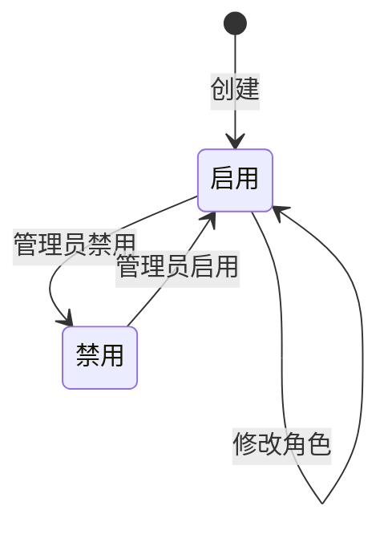

# 第 7 章 用户模块：账号管理

> **节首信息条**｜对应课次 8 · 用户模块：账号管理（2 学时 · 实践）｜前置：第 6 章的登录认证与令牌；第 3 章 3.5（Pydantic、HTTPException）｜**本节实训**：◆ 实训 7-1 用户模块：账号管理

第 6 章完成后，普通用户已经能登录、能访问 `/users/me`。但管理接口如果照着同样的方式挂出去，也会对所有人开放。

## 本章要解决的问题

**认证之后，系统怎样决定“你能做什么”，并把越权挡在后端？**

身份确认之后，接口仍然对所有人一视同仁：普通用户只要知道地址，就能调用管理员接口，或修改本不该由他修改的字段。前端隐藏按钮只改变看不看得见，不改变接口是否执行。

本章处理授权：按角色划出权限边界，用 401 与 403 区分两种失败，并用输入模型限制可修改的字段。

## 本章学习目标

读完第 7 章并完成实训后，应能：

1. 区分认证与授权，说明为什么权限必须加在后端。
2. 用管理员依赖实现 401 与 403 的分工，并解释两个状态码各对应什么处理。
3. 实现用户列表与修改角色、启用/禁用两个接口，处理 404 与“不能禁用自己”。
4. 用 `Literal` / `Optional` 限定可修改字段，并解释 422 的产生位置。

## 7.1 授权与角色

用户模块里有两类接口。一类是所有人都需要的，例如登录、查看自己的信息；另一类只给管理员，例如用户列表、修改角色、启用/禁用。第二类接口如果只靠前端隐藏按钮，绕过页面直接调用 API 仍然可以操作。

**授权**要解决的就是这件事：在身份已经确认的前提下，判断“这个身份能不能做这个操作”。**授权是按身份限制可执行操作的过程；权限不足时拒绝，而不是靠界面遮挡。** 这也是信息安全中对认证与授权的一般区分（ISO/IEC/IEEE 24765:2017）。

判断一个接口属于哪一类，看它操作的是“自己的数据”还是“别人的数据或全局配置”。`/users/me` 操作自己，普通用户可用；`/users/` 查看所有人，只给管理员。这个判断要写在**后端**，因为后端是请求进入系统的唯一入口。

**越权**指身份合法，但做了超出权限范围的事。普通用户调用管理员接口属于垂直越权，越权修改本不该改的字段属于对象级授权失效（OWASP API Security Top 10）。前者靠依赖拦截，后者靠输入模型限制，本章两件都要做。

> 💡 **易错点**：把“前端没显示按钮”当成“没有权限”。前端隐藏只影响正常用户的操作路径；攻击者、脚本和误操作的同事都可能直接调接口。权限检查必须在后端执行。

**角色**是权限的归组方式。本课程只用一个简单模型：`role` 为 `admin` 或 `normal`。

| 操作 | 普通用户 | 管理员 |
| --- | --- | --- |
| 登录、查看 `/users/me` | 允许 | 允许 |
| 查看用户列表 | 拒绝（403） | 允许 |
| 修改角色、启用/禁用 | 拒绝（403） | 允许 |
| 禁用自己 | 不适用 | 拒绝（400，业务规则） |

这张表就是“权限边界”。它的判据是最小权限（Least Privilege，Saltzer & Schroeder, 1975）：默认拒绝，只开放业务确实需要的操作。

## 7.2 管理员依赖与 401/403

第 6 章 6.5 的 `get_current_user` 只确认“令牌有效”，不判断角色。管理接口还需要再包一层权限检查。

**代码 7-1-1** · `app/core/security.py`（权限依赖，续写，Python）

```python
def get_current_admin_user(current_user: dict = Depends(get_current_user)) -> dict:
    if current_user["role"] != "admin":
        raise HTTPException(status_code=403, detail="权限不足")
    return current_user
```

没登录时，`get_current_user` 先返回 401；已登录但角色不是管理员时，`get_current_admin_user` 返回 403。两层依赖分别对应认证与授权，状态码也自然分开。

| 情况 | 状态码 | 含义 |
| --- | --- | --- |
| 没带令牌、令牌无效或过期 | 401 | 身份未确认 |
| 已登录但角色不是管理员 | 403 | 身份已确认，权限不足 |
| 管理员访问 | 200 | 权限通过 |

两个状态码的分工不是为了“好看”，而是为了让调用方知道该做什么：401 要重新登录，403 要换账号或申请权限。把 403 写成 401，用户会被反复要求登录；把 401 写成 403，用户会以为自己的权限出了问题。

**旧令牌的角色滞后**

令牌在登录时签发，里面保存的是当时的角色。管理员把某个用户从 `normal` 改成 `admin` 后，该用户手里的旧令牌仍然是 `normal`，必须重新登录才能拿到新角色。这不是缺陷，而是令牌的工作方式；处理办法是让用户重新登录。

**管理员账号从哪来**

第 6 章的注册接口只创建普通用户。管理员账号由一次性脚本创建，脚本不挂路由，也不进入请求链路。

**代码 7-1-2** · `app/scripts/create_admin.py`（创建管理员账号，Python）

```python
from app.core.database import SessionLocal
from app.core.security import get_password_hash
from app.modules.user.model import User


def create_admin(username: str = "admin", password: str = "admin123") -> None:
    db = SessionLocal()
    try:
        user = db.query(User).filter(User.username == username).first()
        if user is None:
            db.add(User(
                username=username,
                password_hash=get_password_hash(password),
                role="admin",
            ))
            print(f"已创建管理员：{username}")
        else:
            user.password_hash = get_password_hash(password)
            user.role = "admin"
            print(f"已更新管理员：{username}")
        db.commit()
    finally:
        db.close()


if __name__ == "__main__":
    create_admin()
```

`app/scripts/` 与 `app/modules/` 同级，放一次性维护脚本。先建一个空的 `app/scripts/__init__.py`，然后在项目根目录运行：

```text
$ python -m app.scripts.create_admin
```

脚本可重复运行：账号不存在时创建；同名账号已存在时，将其角色改为 `admin` 并重置密码。

## 7.3 用户列表

列表接口先固定返回前 50 条，保证页面能用；分页、过滤与排序在后续章节统一实现。

**代码 7-1-3** · `app/modules/user/service.py`（用户列表，续写，Python）

```python
def list_users(db) -> dict:
    users = db.query(User).order_by(User.id).limit(50).all()
    return {
        "items": [
            {"id": u.id, "username": u.username, "role": u.role, "is_active": u.is_active}
            for u in users
        ],
        "count": len(users),
    }
```

返回结构包含 `items` 与 `count`，前端可直接渲染。字段只列可公开的四项，`password_hash` 不在其中。

**代码 7-1-4** · `app/modules/user/controller.py`（列表接口，续写，Python）

```python
from app.core.security import get_current_admin_user

@router.get("", dependencies=[Depends(get_current_admin_user)])
def list_users(db: Session = Depends(get_db)):
    return service.list_users(db)
```

`dependencies=[...]` 写在路由装饰器里，表示“进入这个接口前先通过权限检查”，函数本身不需要使用当前用户。完整路径是 `GET /api/v1/users`。

## 7.4 修改角色与启用/禁用

修改用户时，只允许改角色与启用状态。角色只能是 `admin` 或 `normal`，启用状态只能是 0 或 1。用 Pydantic 的 `Literal` 把允许值写进类型。在 `schema.py` 顶部补一行导入，再追加：

**代码 7-1-5** · `app/modules/user/schema.py`（修改模型，续写，Python）

```python
from typing import Literal, Optional


class UserUpdate(BaseModel):
    role: Optional[Literal["admin", "normal"]] = None
    is_active: Optional[Literal[0, 1]] = None
```

`Optional` 让字段可以不传，不传时保持原值；`Literal` 把允许值写死，只接受列出的取值。传入 `role="superuser"` 或 `is_active=2` 时，Pydantic 在进入函数前就拒绝，FastAPI 返回 422，错误类型为 `literal_error`。`Optional` 与 `Literal` 的完整讲解见第 3 章 3.5。

**代码 7-1-6** · `app/modules/user/service.py`（修改用户，续写，Python）

```python
def update_user(db, user_id: int, data, current_user: dict) -> User:
    user = db.query(User).filter(User.id == user_id).first()
    if not user:
        raise HTTPException(status_code=404, detail="用户不存在")
    if current_user["id"] == user_id and data.is_active == 0:
        raise HTTPException(status_code=400, detail="不能禁用自己")
    if data.role is not None:
        user.role = data.role
    if data.is_active is not None:
        user.is_active = data.is_active
    db.commit()
    db.refresh(user)
    return user
```

判断顺序是“存在性、业务规则、更新”。顺序反过来，可能在用户不存在时也执行了“不能禁用自己”的判断，错误信息就会误导调用方。

“不能禁用自己”是一条业务规则：没有它，管理员误操作把自己停用后，就再也登录不进来，只能去数据库里手工改回来。`current_user["id"]` 已经是整数，可以直接与 `user_id` 比较。

查不到用户时返回 404，而不是返回空对象。404 让调用方明确知道“这个资源不存在”，空对象则会让前端误以为“查到了但没有字段”。

**代码 7-1-7** · `app/modules/user/controller.py`（修改接口，续写，Python）

```python
from app.modules.user.schema import UserUpdate

@router.put("/{user_id}", response_model=UserOut)
def update_user(
    user_id: int,
    data: UserUpdate,
    db: Session = Depends(get_db),
    current_user: dict = Depends(get_current_admin_user),
):
    return service.update_user(db, user_id, data, current_user)
```

修改接口把权限依赖写在参数里，因为函数需要当前用户的 `id` 来判断“不能禁用自己”。完整路径是 `PUT /api/v1/users/{user_id}`。

**禁用之后不能登录**

第 6 章 6.4 的 `login` 只校验密码。账号被禁用后仍能登录，`is_active` 就形同虚设。在签发令牌前补一段检查：

**代码 7-1-8** · `app/modules/user/service.py`（修改第 6 章 6.4 的 `login`，Python）

```python
def login(db, data) -> dict:
    user = db.query(User).filter(User.username == data.username).first()
    if not user or not verify_password(data.password, user.password_hash):
        raise HTTPException(status_code=401, detail="用户名或密码错误")
    if not user.is_active:
        raise HTTPException(status_code=401, detail="账号已禁用")
    token = create_access_token({"sub": str(user.id), "role": user.role})
    return {"access_token": token, "token_type": "bearer"}
```

账号状态的变化可以画成下图。



*图 7-1：用户账号的启用与禁用状态*

账号创建后进入“启用”；管理员可以来回切换启用与禁用，改角色不改变状态。被禁用的账号仍在库里，历史记录不会丢。

## 示范例题

#### 例 7-1：实现启用/禁用接口【Bloom：应用】

**题目**：实现 `PUT /api/v1/users/{user_id}`：只允许管理员调用；可以修改 `role` 与 `is_active`；用户不存在返回 404；管理员不能禁用自己，否则返回 400。列出 200、400、404、422 各由什么请求触发。

**解**：即代码 7-1-5～7-1-7。service 先确认目标用户存在（404），再检查安全规则（400），最后更新字段；controller 只接请求、挂依赖、调 service。

| 请求 | 状态码 |
| --- | --- |
| 管理员把普通用户的 `is_active` 改为 0 | 200 |
| 管理员把自己的 `is_active` 改为 0 | 400 |
| `user_id` 在库中不存在 | 404 |
| 请求体写 `{"role": "superuser"}` 或 `{"is_active": 2}` | 422 |

422 在进入函数前产生，404 与 400 在 service 中产生。三类错误的归属不同，排查时先看请求是否通过校验。

## 独立习题

#### 习题 7-1【Bloom：理解】

**题目**：用自己的话区分认证与授权，说明 401 与 403 各对应什么处理。为什么权限检查必须写在后端？

#### 习题 7-2【Bloom：分析】

**题目**：下面三种做法都声称“已经做了权限控制”，请分别指出问题，并说明可能被怎样绕过。

1. 前端把“用户管理”菜单对普通用户隐藏。
2. 修改角色的接口只检查请求体里的 `role` 是否是合法字符串。
3. 管理员把用户改为普通用户后，该用户仍能用旧令牌访问管理接口。

#### 习题 7-3【Bloom：创造】（开放题，换场景）

**题目**：单位要新增“工位管理”：管理员维护工位编号、位置与启用状态；普通值班员只能查看启用中的工位，用于安排值班。请为这个模块设计权限边界：列出至少 3 个接口，逐个标明允许的角色、未登录/普通用户/管理员的结果状态码，并说明哪些字段普通用户不能修改、由什么机制拦住。另请说明：登录接口为什么不能挂认证依赖？**不能照抄本章用户表的字段与接口名**：工位没有用户名、密码和角色。

## ◆ 实训 7-1：用户模块：账号管理（对应课次 8 · 2 学时）

### 一、任务目标与验收

| 目标 | 验收标志 |
| --- | --- |
| 管理接口可用 | 列表与修改两个接口返回符合约定 |
| 权限边界正确 | 未登录 401、普通用户 403、管理员 200 |
| 业务规则生效 | 不能禁用自己返回 400 |
| 非法值被拦截 | `role="superuser"` 与 `is_active=2` 返回 422 |
| 禁用生效 | 被禁用账号登录返回 401 |

### 二、课前准备

- 第 6 章已完成，`users` 表与注册、登录、`/me` 可用
- 第 4、5 章搭好的目录与仓库正常，`main.py` 能启动
- Postman、curl 或 `/docs` 可发起请求

### 三、操作步骤

1. **建管理员账号**
   - 做什么：让普通用户之外有一个管理员，用于验证 200 与 403 的差别
   - 操作：建空文件 `app/scripts/__init__.py`，写代码 7-1-2，在项目根目录运行 `python -m app.scripts.create_admin`
   - 预期输出：终端输出“已创建管理员”或“已更新管理员”；`admin` 能用密码 `admin123` 登录并拿到令牌
   - 做错会看到什么：`No module named app.scripts` → 缺少 `__init__.py`，或在错误的目录下运行
2. **实现列表接口**
   - 做什么：写 `service.list_users` 与带管理员依赖的 `GET /users`
   - 操作：按代码 7-1-3、7-1-4 落地
   - 预期输出：未登录 401、普通用户 403、管理员 200 且 `count` 等于用户数
   - 做错会看到什么：普通用户仍 200 → 依赖未挂或角色判断写反
3. **实现修改接口**
   - 做什么：写 `UserUpdate`、`service.update_user` 与 `PUT /users/{user_id}`
   - 操作：按代码 7-1-5～7-1-7 落地
   - 预期输出：正常修改 200；用户不存在 404；禁用自己 400；非法值 422
   - 做错会看到什么：禁用自己仍 200 → 漏了 `current_user["id"] == user_id` 的判断
4. **验证禁用规则**
   - 做什么：用管理员令牌禁用普通用户，再用该用户登录
   - 操作：先 `PUT` 把 `is_active` 改为 0，再向 `/users/login` 发请求
   - 预期输出：修改 200，登录 401“账号已禁用”
   - 做错会看到什么：被禁用账号仍能登录 → 没有按代码 7-1-8 补上检查

### 四、排错清单

| 现象 | 先查什么 |
| --- | --- |
| 401 与 403 混淆 | 认证依赖是否先执行、角色字段是否为 `admin` |
| 普通用户也能看列表 | 路由上是否写了 `dependencies=[Depends(get_current_admin_user)]` |
| `Literal` 报错 | 取值是否与定义完全一致（区分字符串与整数） |
| 旧令牌仍有旧权限 | 令牌载荷未刷新，重新登录即可 |
| 禁用后仍能登录 | `login` 中是否补了 `is_active` 检查 |
| `no such table: users` | 尚未启动过服务建表；先运行一次服务，让 `create_all` 建表 |

### 五、提交与验收

提交接口代码、脚本与三种身份的验证记录；验收按“接口完整”“权限边界”“业务规则”三项判定。

### 六、课后扩展

- 给列表接口补分页参数
- 把“不能禁用自己”抽成独立业务函数并补测试
- 检查所有响应是否都经过输出模型
- **复习任务**：回看第 3 章 3.5（Pydantic 与 `Optional`/`Literal`）、3.6（`Depends`）、第 6 章 6.5（认证依赖），对照本章 7.2–7.4，说明接口校验、权限依赖与业务规则各拦住了哪一类问题

## 本章小结

**核心结论**：

1. 认证确认身份，授权判断权限；401 表示身份未确认，403 表示权限不足。
2. 权限必须加在后端；前端隐藏按钮不构成权限控制。
3. 管理接口用 `Depends(get_current_admin_user)` 挂权限检查；需要当前用户时把它写在参数里，不需要时写在 `dependencies=[...]`。
4. 输入模型用 `Literal` 限定角色与启用状态，非法值在进入函数前返回 422；查不到用户返回 404；业务规则写在 service。
5. 禁用账号后，登录必须检查 `is_active`，否则禁用形同虚设。
6. 令牌在登录时签发，角色变更后旧令牌不会自动更新，需要重新登录。

把这章压缩成一句话：**认证确认你是谁，授权决定你能做什么；越权要挡在接口入口，而不是藏在页面里。**

**学完本章，你可以体会到**：账号管理的难点不是多写几个接口，而是把“谁能做什么”写成后端可执行的检查。

**自检**：回到章首的学习目标，逐条问自己做到了没有——

- [ ] 区分认证与授权，说明为什么权限必须加在后端。
- [ ] 用管理员依赖实现 401 与 403 的分工，并解释两个状态码各对应什么处理。
- [ ] 实现用户列表与修改角色、启用/禁用接口，处理 404 与“不能禁用自己”。
- [ ] 用 `Literal`/`Optional` 限定可修改字段，解释 422 的产生位置。
- [ ] 完成实训 7-1 并自评。

**下一章预告**：用户模块告一段落。下一章进入数据模块，用部门这个更典型的实体，走一遍完整的增删查改，并把分页、过滤与排序补齐。
