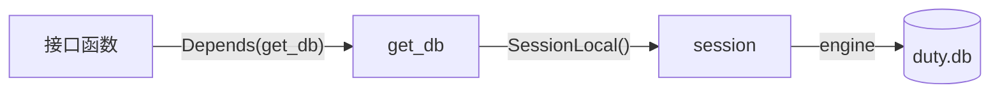
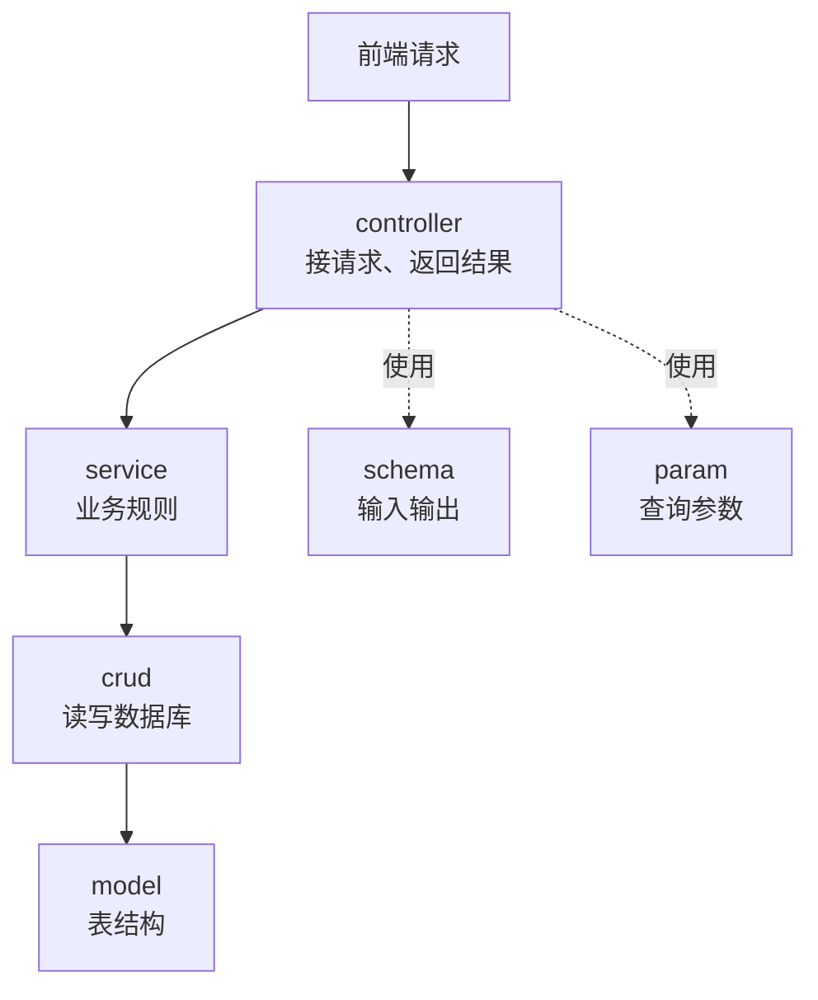

# 第 8 章 数据模块：增删查改

第 6、7 章的账号跑在内存里，服务一停就清空。真实系统里，数据要能存下来、被多人反复读写，还要在写入时就被检查。本章先用 user 演示只换存储层、不动认证逻辑，再把同一套读写路径用到单位模块。

## 本章要解决的问题

**数据怎样存下来、被安全一致地读写，并让错误在正确的层被拒绝？**

同一条业务编码可以被写进两次，一条记录可以指向一个不存在的对象，一个文本字段可以被塞进远超上限的内容。这些问题在写入时不报错，等到查询、汇总或关联时才暴露，而此时已经很难追溯是哪一次写入造成的。

本章先解决“存下来”：引入数据库，把第 6、7 章的用户模块从内存搬到磁盘，借此看清“换存储只改两处”。再用学员最熟的单位模块（dept）走一遍完整读写：请求进入后经过哪些约束、落到表里又如何被读回，每一道拒绝该由谁说出、以什么方式说出，并让列表能按页返回、知道总条数；过滤与排序的第 2 个实现放到第 9 章。

## 本章学习目标

读完第 8 章并完成实训后，你应该能：

1. 说明数据为什么要落库，以及 engine、`Session`、`Base`、`get_db` 各管什么。
2. 说出把 user 模块从内存换成数据库时改了哪些文件、哪些代码一行没动。
3. 说出一个 CRUD 模块六个文件的职责与调用关系，并用 dept 实现新增、详情与删除。
4. 实现分页并返回 `items` 与 `total`，说明 `page`、`page_size`、`offset`、`limit` 之间的关系；过滤与排序在第 9 章补齐。
5. 按“谁产生、谁负责”区分 422、400、404、500 四类错误，并把读写机制套用到课后的人员模块扩展。

## 8.1 让数据落地

第 6 章的单位模块和第 6、7 章的用户模块都把数据放在 `model.TABLE` 列表里。进程一停，列表就清空。要让数据在重启后还在，必须写到磁盘上的数据库。

本课程用 SQLite。一个 SQLite 数据库就是一个文件，项目根目录下的 `duty.db`。文件里按表存数据：一行是一条记录，一列是一个字段。Python 程序不直接读写这个文件，中间要经过四个名字：



- **engine**：知道数据库文件在哪、怎么连。
- **session**：一次请求期间和数据库的对话。
- **Base**：定义表模型时要继承的父类。
- **get_db**：开一个 session，交给接口，用完关掉。

代码在 `app/core/database.py`：

**代码 8-1-1** · `app/core/database.py`（数据库基础设施，Python）

```python
from sqlalchemy import create_engine
from sqlalchemy.orm import declarative_base, sessionmaker

DATABASE_URL = "sqlite:///./duty.db"

engine = create_engine(DATABASE_URL, connect_args={"check_same_thread": False})
SessionLocal = sessionmaker(bind=engine, autoflush=False, autocommit=False)
Base = declarative_base()


def get_db():
    db = SessionLocal()
    try:
        yield db
    finally:
        db.close()
```

逐行看：`DATABASE_URL` 告诉程序数据库文件的位置；`create_engine(...)` 创建 engine，保存“怎么连”；`sessionmaker(...)` 创建的是能造出 session 的对象，每次 `SessionLocal()` 得到一个新 session；`declarative_base()` 创建父类 `Base`，表模型继承它，SQLAlchemy 才知道类对应一张表。

`get_db()` 是 FastAPI 的依赖函数。每个请求进来，FastAPI 先 `SessionLocal()` 开一个 session，`yield db` 把 session 交给接口；接口执行完，回到 `finally`，`db.close()` 关闭。`yield` 不是“返回一个值就结束”，而是“先交出去，等接口函数执行完再回来继续”，所以关闭写在 `finally` 里：无论成功还是抛异常都会执行。

接口签名里写 `db: Session = Depends(get_db)`，FastAPI 在调用接口前先执行 `get_db`，把 session 传给 `db` 参数。第 4 章 4.5 讲过 `Depends` 的机制，这里是它第一次用在数据库会话上。

根目录 `main.py` 还要补三行：导入 `Base` 与 `engine`、导入用户模型、调用 `Base.metadata.create_all(bind=engine)`。`create_all` 只识别已经导入的模型，模型导入那一行不能省。

**代码 8-1-2** · `main.py`（建表三行，续写，Python）

```python
from app.core.database import Base, engine
from app.modules.user import model as user_model  # noqa: F401  建表前先导入模型

Base.metadata.create_all(bind=engine)
```

`create_all` 只建表结构，不写数据；表存在时重复调用不会清空数据。

**换存储只改两处：user 模块演示**

现在把第 6、7 章的内存版 user 模块搬到数据库上。先看改动范围：

| 文件 | 第 6、7 章（内存版） | 本章（数据库版） | 改动 |
| --- | --- | --- | --- |
| `model.py` | `dataclass` 与 `TABLE` | 继承 `Base` 的表模型 | 改 |
| `crud.py` | 操作列表 | 操作 `Session` | 改 |
| `service.py` | 无 `db` 参数 | 增加 `db: Session` 参数 | 小改 |
| `controller.py` | 无 `db` 参数 | 增加 `db: Session = Depends(get_db)` | 小改 |
| `schema.py` | 输入输出模型 | 不变 | 不变 |
| `param.py` | 查询参数 | 不变 | 不变 |
| `security.py` | 哈希、令牌、认证依赖 | 不变 | 不变 |

这就是第 4 章 4.5 所说“换存储只动 `model.py` 与 `crud.py`”的具体验证。真正改的是前两个文件；service 与 controller 的小改只是把会话传下去，不改接口约定（URL、方法、状态码、字段名）。

先改 `model.py`：内存 `User` dataclass 换成继承 `Base` 的表模型。

**代码 8-1-3** · `app/modules/user/model.py`（落库版，Python）

```python
from sqlalchemy import Column, Integer, String

from app.core.database import Base


class User(Base):
    __tablename__ = "users"

    id = Column(Integer, primary_key=True)
    username = Column(String(100), unique=True, nullable=False)
    password_hash = Column(String(255), nullable=False)
    role = Column(String(20), default="normal")
    is_active = Column(Integer, default=1)
```

`unique=True` 防止两个同名账号，`nullable=False` 要求必填，`String(100)` 限定长度。这三个参数就是**约束**：数据库在写入时就拒绝不合法的数据。约束的完整分类不在本章展开，先知道模型处能写约束即可。

再改 `crud.py`：五个函数的签名都加上 `db: Session`，函数体从遍历 `TABLE` 改为构造查询。

**代码 8-1-4** · `app/modules/user/crud.py`（落库版，Python）

```python
from sqlalchemy.orm import Session

from app.modules.user.model import User


def get_by_username(db: Session, username: str) -> User | None:
    return db.query(User).filter(User.username == username).first()


def get_by_id(db: Session, user_id: int) -> User | None:
    return db.query(User).filter(User.id == user_id).first()


def list_all(db: Session) -> list[User]:
    return db.query(User).order_by(User.id).all()


def create(db: Session, username: str, password_hash: str) -> User:
    user = User(username=username, password_hash=password_hash)
    db.add(user)
    db.commit()
    db.refresh(user)
    return user


def update(db: Session, user: User, data: dict) -> User:
    for key, value in data.items():
        setattr(user, key, value)
    db.commit()
    db.refresh(user)
    return user
```

`db.query(User).filter(...)` 是 ORM 的参数化查询，不拼字符串；`db.commit()` 真正写入，`db.refresh()` 取回数据库生成的值（如自增主键）。五个函数的名字与职责和内存版一一对应，只是多了一个 `db` 参数。

service 与 controller 只把会话往下传：

**代码 8-1-5** · `app/modules/user/service.py`（落库版，续写，Python）

```python
from fastapi import HTTPException

from app.core.security import create_access_token, get_password_hash, verify_password
from app.modules.user import crud
from app.modules.user.model import User


def create_user(db, data) -> User:
    if crud.get_by_username(db, data.username):
        raise HTTPException(status_code=400, detail="用户名已存在")
    return crud.create(db, data.username, get_password_hash(data.password))


def login(db, data) -> dict:
    user = crud.get_by_username(db, data.username)
    if not user or not verify_password(data.password, user.password_hash):
        raise HTTPException(status_code=401, detail="用户名或密码错误")
    if not user.is_active:
        raise HTTPException(status_code=401, detail="账号已禁用")
    token = create_access_token({"sub": str(user.id), "role": user.role})
    return {"access_token": token, "token_type": "bearer"}
```

**代码 8-1-6** · `app/modules/user/controller.py`（落库版，续写，Python）

```python
from fastapi import APIRouter, Depends
from sqlalchemy.orm import Session

from app.core.database import get_db
from app.core.security import get_current_user
from app.modules.user import service
from app.modules.user.schema import LoginIn, TokenOut, UserCreate, UserOut

router = APIRouter(prefix="/users", tags=["用户"])


@router.post("", response_model=UserOut, status_code=201)
def register(data: UserCreate, db: Session = Depends(get_db)):
    return service.create_user(db, data)


@router.post("/login", response_model=TokenOut)
def login_endpoint(data: LoginIn, db: Session = Depends(get_db)):
    return service.login(db, data)


@router.get("/me")
def me(current_user: dict = Depends(get_current_user)):
    return current_user
```

> 💡 **演示要点**：把代码 8-1-3～8-1-6 与第 6、7 章的内存版并排看——变的是 `model.py` 与 `crud.py`，service 和 controller 只多传一个 `db`。**哈希、令牌、`get_current_user`、注册登录与禁用规则一行没动。** 管理员 seed 脚本同样只需把 `crud.get_by_username` / `crud.create` 换成带 `db` 的调用，第 7 章的权限判断照旧。

数据库能连上、用户的账号也能落库了。接下来用单位模块（dept）练习完整的读写机制：它是干净的练习对象，不在演示代码里预先写过。

## 8.2 数据读写机制

表结构是数据的第一道约束。**表**是关系数据库中存放一类数据的结构；**主键**是能唯一标识一行的字段；**外键**是指向另一张表主键、用于表达关系的字段（定义见第 4 章 4.2）。

单位表用一个业务编码做主键，避免依赖自增 id 做对外标识：

| 字段 | 类型 | 必填 | 说明 |
| --- | --- | --- | --- |
| `dept_code` | 文本 | 是 | 单位编码，主键，唯一 |
| `full_name` | 文本 | 是 | 单位名称 |
| `address` | 文本 | 否 | 地址 |
| `longitude` | 数字 | 否 | 经度 |
| `latitude` | 数字 | 否 | 纬度 |
| `parent_dept_code` | 文本 | 否 | 父单位编码 |

`dept_code` 既是主键又是业务编码，新增时要检查重复；`full_name` 必填且有长度上限；`address` 可空但要限制最大长度，防止超长文本进入数据库。

**代码 8-1-7** · `app/modules/dept/model.py`（单位表模型，Python）

```python
from sqlalchemy import Column, Float, String

from app.core.database import Base


class Department(Base):
    __tablename__ = "departments"

    dept_code = Column(String(20), primary_key=True)
    full_name = Column(String(100), nullable=False)
    address = Column(String(500), nullable=True)
    longitude = Column(Float, nullable=True)
    latitude = Column(Float, nullable=True)
    parent_dept_code = Column(String(20), nullable=True)
```

三个参数对应三类**约束**：`primary_key=True` 声明主键，保证一行能被唯一定位；`nullable=False` 声明必填，缺值写入会被数据库拒绝；`String(100)` 声明长度上限，超长文本进不来。唯一约束 `unique=True` 在单位表里由主键隐式提供；人员表的 `username` 一类字段则需要显式声明。

> 💡 **难度提示**：数据库理论把写入问题分成三类完整性（实体、参照、域）。它们都不是“读”的时候才出错，而是“写”的时候已经错了：重复编码属实体完整性，`dept_code` 指向不存在的单位属参照完整性，超长文本属域完整性。知道这个分类有助于判断“该在哪一层拦”，但本章不展开理论，只按层实现拦截。

**六个文件的分工**

第 4 章 4.5 已经建好 `app/modules/dept/` 的六文件骨架；8.1 演示了把内存版换成数据库版的方法。现在 dept 也照此换库，六层各自拦住一类问题：



*图 8-1：CRUD 模块的调用关系*

| 文件 | 一句话职责 | 拦住哪类问题 |
| --- | --- | --- |
| `model.py` | 表长什么样 | 字段类型、主键、外键、唯一、必填 |
| `schema.py` | 输入与输出长什么样 | 字段长度、必填、类型、输出白名单 |
| `param.py` | 查询参数长什么样 | 页码、每页条数的边界 |
| `crud.py` | 增删改查的数据库操作 | 查询与写入的复用 |
| `service.py` | 业务规则，例如重复校验、外键校验 | 重复编码、孤儿记录 |
| `controller.py` | 接口，负责接收请求与返回响应 | 状态码与错误信息 |

边界要守住：controller 不写 SQL、不写业务规则；service 不直接拼 SQL，而是调用 crud；crud 不判断业务规则；schema 决定哪些字段能进、哪些字段能出。

表结构管“存什么”，输入模型管“什么能进来”，输出模型管“什么能出去”。三者不是同一件事。

**代码 8-1-8** · `app/modules/dept/schema.py`（输入与输出模型，Python）

```python
class DepartmentCreate(BaseModel):
    dept_code: str = Field(..., min_length=1, max_length=20)
    full_name: str = Field(..., min_length=1, max_length=100)
    address: str | None = Field(default=None, max_length=500)
    longitude: float | None = None
    latitude: float | None = None
    parent_dept_code: str | None = None


class DepartmentOut(BaseModel):
    dept_code: str
    full_name: str
    address: str | None
```

`Field(...)` 表示必填，`min_length`、`max_length` 限定长度，`| None` 表示可空。输入模型只负责“能不能进”，输出模型负责“哪些能出”。表约束是最后一道防线，防止任何路径写入脏数据；输入模型在请求进入函数前给出可读的 422。两者都要有，不能互相替代。

**新增、详情与删除**

新增接口先检查业务编码是否重复，再写入数据库。重复时返回 400，成功时返回 201；查重属于业务规则放 service，写入属于数据库操作放 crud。

**代码 8-1-9** · `app/modules/dept/crud.py`（查询与写入，Python）

```python
from sqlalchemy.orm import Session

from app.modules.dept.model import Department


def get_by_code(db: Session, dept_code: str):
    return db.query(Department).filter(Department.dept_code == dept_code).first()


def create(db: Session, data):
    department = Department(**data.model_dump())
    db.add(department)
    db.commit()
    db.refresh(department)
    return department
```

**代码 8-1-10** · `app/modules/dept/service.py`（新增与详情规则，Python）

```python
from fastapi import HTTPException

from app.modules.dept import crud


def create_department(db, data):
    if crud.get_by_code(db, data.dept_code):
        raise HTTPException(status_code=400, detail="单位编码已存在")
    return crud.create(db, data)


def get_department(db, dept_code: str):
    department = crud.get_by_code(db, dept_code)
    if not department:
        raise HTTPException(status_code=404, detail="单位不存在")
    return department
```

为什么要先查重，而不是等数据库的唯一约束报错？数据库报错是一条异常，前端看到的是 500；提前查重能返回 400 和“单位编码已存在”，调用方知道该改什么。数据库约束仍然保留，作为并发写入时的最后一道防线。

**代码 8-1-11** · `app/modules/dept/controller.py`（新增与详情接口，Python）

```python
from fastapi import APIRouter, Depends, status
from sqlalchemy.orm import Session

from app.core.database import get_db
from app.modules.dept import service
from app.modules.dept.schema import DepartmentCreate, DepartmentOut

router = APIRouter(prefix="/departments", tags=["单位"])


@router.post("", response_model=DepartmentOut, status_code=status.HTTP_201_CREATED)
def create_department(data: DepartmentCreate, db: Session = Depends(get_db)):
    return service.create_department(db, data)


@router.get("/{dept_code}", response_model=DepartmentOut)
def read_department(dept_code: str, db: Session = Depends(get_db)):
    return service.get_department(db, dept_code)
```

详情接口按主键查询；查不到时由 service 返回 404，而不是返回空对象。404 让调用方明确知道“这个资源不存在”，空对象则会让前端误以为“查到了但没有字段”。

**代码 8-1-12** · `app/modules/dept/crud.py`（删除，续写，Python）

```python
def delete(db: Session, department):
    db.delete(department)
    db.commit()
```

**代码 8-1-13** · `app/modules/dept/service.py`（删除规则，续写，Python）

```python
def delete_department(db, dept_code: str) -> None:
    department = crud.get_by_code(db, dept_code)
    if not department:
        raise HTTPException(status_code=404, detail="单位不存在")
    crud.delete(db, department)
```

**代码 8-1-14** · `app/modules/dept/controller.py`（删除接口，续写，Python）

```python
@router.delete("/{dept_code}", status_code=status.HTTP_204_NO_CONTENT)
def delete_department(dept_code: str, db: Session = Depends(get_db)):
    service.delete_department(db, dept_code)
```

crud 只执行删除，404 由 service 判断。删除成功返回 204，函数不返回正文；资源不存在返回 404。重复删除第二次得到 404，服务器状态不变，符合 DELETE 的幂等语义（第 3 章 3.4）。

**测试清单**

每完成一个模块，至少走一遍下面八条：新增成功返回 201；重复编码返回 400；缺字段返回 422；列表返回 200 且分页正确；详情返回 200；不存在的编码返回 404；删除成功返回 204；重复删除返回 404。八条都过，模块才算可用。

## 8.3 分页参数与返回结构

数据量大时不能一次返回全部记录。分页接口通常接收两个查询参数：`page`（第几页，从 1 开始）和 `page_size`（每页多少条）。参数少时可以直接写在函数签名里；列表接口的参数一多，收进 `param.py` 更整齐，也能集中写边界约束。

**代码 8-1-15** · `app/modules/dept/param.py`（查询参数，Python）

```python
from pydantic import BaseModel, Field


class DepartmentQueryParams(BaseModel):
    page: int = Field(default=1, ge=1)
    page_size: int = Field(default=10, ge=1, le=100)
```

`ge` 表示“大于等于”，`le` 表示“小于等于”。不给 `page_size` 设上限，调用方传 `page_size=100000` 时，一次查询就可能把数据库拖垮。

数据库查询用 `offset` 与 `limit` 实现：

**代码 8-1-16** · 示例（文本）

```text
offset = (page - 1) * page_size
limit = page_size
```

响应同时返回本页数据和总条数：

**代码 8-1-17** · 示例响应（JSON）

```json
{"items": [...], "total": 35}
```

`total` 让前端能算出总页数：`ceil(total / page_size)`。只返回 `items` 而不返回 `total`，前端就不知道还有没有下一页。

**代码 8-1-18** · `app/modules/dept/service.py`（列表，Python）

```python
def list_departments(db, params):
    items, total = crud.list_departments(db, params)
    return {"items": items, "total": total}
```

**代码 8-1-19** · `app/modules/dept/controller.py`（列表接口，Python）

```python
@router.get("")
def list_departments(
    params: DepartmentQueryParams = Depends(),
    db: Session = Depends(get_db),
):
    return service.list_departments(db, params)
```

`Depends()` 不带参数时，FastAPI 会把 `DepartmentQueryParams` 当作查询参数模型，从 `?` 后面读取字段；`ge` / `le` 的边界在进入函数前就完成校验。service 把 crud 取回的本页数据与总数组装成 `items` 与 `total`，controller 只透传。

> **前向指引**：过滤与计数的次序、排序白名单在第 9 章 9.3/9.4 补齐；本章只需能按页码取出一页并知道总条数。

## 8.4 错误分层与课后拓展

数据进入系统时，不同问题应由不同层拒绝。按 RFC 9110 的状态码类别与“谁产生、谁负责”的分工，可以把错误分配如下，而不是一律 500。

| 情况 | 状态码 | 产生位置 | 谁的问题 |
| --- | --- | --- | --- |
| 缺字段、类型不对、长度超限 | 422 | 请求校验层，进入函数前 | 调用方 |
| 业务编码重复、外键不存在 | 400 | service 的业务规则 | 调用方 |
| 资源不存在 | 404 | service 查不到 | 调用方 |
| 未捕获的异常 | 500 | 全局异常处理 | 服务方 |

错误码是契约的一部分，前端据此决定提示方式：422 提示“检查输入”，400 提示“业务不允许”，404 提示“资源不存在”，500 提示“联系管理员”。

> 💡 **易错点**：把数据库报错直接返回给前端，或把所有错误都写成 500。调用方无法区分“我传错了”和“服务器坏了”，排查方向会被带偏；错误码要按产生位置分层。

**课后拓展：把读写机制用到人员模块**

人员模块不是本章课内任务，而是课后练习：按单位模块的六文件结构复制，但要改四处——表名与字段、查询主键（`certificate_number`）、列表过滤字段、新增时的外键校验。人员表有 `dept_code`，它指向单位表主键；新增前要确认该单位存在，不存在时返回 400，而不是让数据库抛外键错误产生 500。

| 文件 | 从单位改什么 |
| --- | --- |
| `model.py` | 表名 `personnel`；字段换成人员的；`dept_code` 外键 |
| `schema.py` | 人员字段；证件号可按需加 18 位校验 |
| `param.py` | `name`、`dept_code`（人员自身的过滤参数；排序白名单与过滤计数次序见第 9 章） |
| `crud.py` | `get_by_certificate_number` |
| `service.py` | 人员查重 + 单位存在校验 |
| `controller.py` | URL `/personnel` |

复制时最容易残留的是单位字段：表名改了，字段名没改；URL 改了，查询条件还写着 `dept_code`。复制完成后逐项对照表检查一遍，比事后排错省时间。

**这一拓展有时限**：第 10 章的执勤记录规则、第 11 章的统计都要查 `personnel` 表，因此人员模块必须在第 10 章开课前完成。

## 示范例题

#### 例 8-1：实现单位新增与详情

**题目**：实现 `POST /departments` 与 `GET /departments/{dept_code}`。要求新增时检查编码重复（重复返回 400），成功返回 201；详情查不到返回 404。

**解**：

按六类职责分三块：crud 负责查重用的查询与写入，service 负责“重复就 400、查不到就 404”，controller 只声明路由与响应模型。

**代码 8-1-20** · `app/modules/dept/crud.py`（节选，Python）

```python
def get_by_code(db, dept_code: str):
    return db.query(Department).filter(Department.dept_code == dept_code).first()


def create(db, data):
    department = Department(**data.model_dump())
    db.add(department)
    db.commit()
    db.refresh(department)
    return department
```

**代码 8-1-21** · `app/modules/dept/service.py`（节选，Python）

```python
def create_department(db, data):
    if crud.get_by_code(db, data.dept_code):
        raise HTTPException(status_code=400, detail="单位编码已存在")
    return crud.create(db, data)


def get_department(db, dept_code: str):
    department = crud.get_by_code(db, dept_code)
    if not department:
        raise HTTPException(status_code=404, detail="单位不存在")
    return department
```

**代码 8-1-22** · `app/modules/dept/controller.py`（节选，Python）

```python
@router.post("", response_model=DepartmentOut, status_code=status.HTTP_201_CREATED)
def create_department(data: DepartmentCreate, db: Session = Depends(get_db)):
    return service.create_department(db, data)


@router.get("/{dept_code}", response_model=DepartmentOut)
def read_department(dept_code: str, db: Session = Depends(get_db)):
    return service.get_department(db, dept_code)
```

新增的处理顺序是“查重、写入、返回”；详情的处理顺序是“查询、判断、返回”。两个接口都不把 ORM 对象直接返回，避免输出多余字段。

## 独立习题

#### 习题 8-1

**题目**：解释 `page`、`page_size`、`offset`、`limit`、`total` 五个概念的含义及它们之间的关系。为什么响应里必须返回 `total`？

#### 习题 8-2

**题目**：按单位模块的结构，为人员模块设计一套 CRUD：人员表包含证件号、姓名、所属单位编码、职位、职级、入职日期。请写出表结构、输入/输出模型、列表与新增接口的关键代码，并说明新增时如何校验 `dept_code` 是否存在。

#### 习题 8-3

**题目**：为单位“哨位”实体设计表结构、输入/输出模型与四类错误：哨位编号（主键）、位置、是否启用、所属单位编码。请列出字段与约束，说明哪些错误由数据库约束拦住、哪些由 service 返回 400、哪些由输入模型返回 422，并各给出一个触发例子。**不能照抄单位表的字段**：哨位有启用状态，单位没有。

## ◆ 实训 8-1：数据模块：增删查改

### 一、任务目标与验收

| 目标 | 验收标志 |
| --- | --- |
| 六个文件职责清楚 | controller / service / crud / model / schema / param 各就各位 |
| user 落库成功 | 用户注册登录后重启服务，账号仍在 |
| dept CRUD 可用 | 列表 200、详情 200、新增 201、修改 200、删除 204；资源不存在或重复删除返回 404 |
| 分页正确（课内必做） | 列表能按页返回 `items` 与 `total`（代码 8-1-15～19） |
| 过滤排序（课后衔接第 9 章） | 过滤条件进入 `count()`、排序白名单、`pages`（见第 9 章 9.3/9.4） |
| 错误码分层 | 422/400/404/500 各归其位 |

### 二、课前准备

- 第 8 章 8.1 已建 `app/core/database.py` 与用户表；第 6、7 章的内存版 user 模块可用
- 第 4 章的目录与第 5 章的仓库可启动，第 7 章的用户与权限依赖可用
- 一份单位的测试数据

### 三、操作步骤

1. **建库与建表**
   - 做什么：跟随 8.1 建 `app/core/database.py`，在 `main.py` 加建表三行
   - 操作：按代码 8-1-1、8-1-2 落地，确认 `duty.db` 出现、`users` 表建立
   - 预期输出：→ 数据库文件与用户表就位，旧接口仍为 200
   - 做错会看到什么：表没建出来：检查模型是否导入、`create_all` 是否执行
2. **把 user 模块落库（教师演示，学员对照）**
   - 做什么：跟随 8.1 的演示把 user 的 `model.py` 与 `crud.py` 换成数据库版，service/controller 加会话参数
   - 操作：对照代码 8-1-3～8-1-6 改自己的工程；`security.py` 不动
   - 预期输出：→ 注册、登录、`/me` 仍可用，且哈希/令牌逻辑一行未改
   - 做错会看到什么：`no such table: users` → 未执行建表；登录 401 → 检查 `db` 是否传到 crud
3. **dept 换库并读写全流程（学员独立完成）**
   - 做什么：把单位模块换成数据库版，补齐六个文件、分页与四类错误验证
   - 操作：课内按代码 8-1-7～8-1-19 落地；逐项走 8.2 的八条测试清单；过滤、排序与 `pages` 见第 9 章
   - 预期输出：→ 列表有 `items`/`total`，新增 201、重复 400、详情 404、删除 204
   - 做错会看到什么：列表只有 `items` 没有 `total` → 检查 service 是否组装了总数；重复不报错 → 先查重逻辑缺失
4. **验证与提交**
   - 做什么：走完八条测试清单，确认用户模块重启后账号仍在，提交
   - 预期输出：→ 八条接口验证全部通过，工作区干净
   - 做错会看到什么：`duty.db` 进了提交 → 用 `git rm --cached duty.db`

### 四、排错清单

| 现象 | 先查什么 |
| --- | --- |
| 列表总数不对 | 过滤条件是否加在 `count()` 之前（第 9 章 9.3 课后衔接项） |
| 新增重复不报错 | 唯一约束或先查重逻辑缺失 |
| 详情返回 500 | 查不到时未抛 404，直接访问空对象字段 |
| 排序参数注入风险 | 排序字段必须走白名单（第 9 章 9.4 课后衔接项） |
| 重启后用户账号消失 | user 模块是否按 8.1 落库；`create_all` 是否执行 |

### 五、提交与验收

提交用户落库版与单位 CRUD 两个模块的代码、八条接口验证记录；验收按“user 落库”“dept CRUD 完整”“分页骨架与错误码”三项判定。

### 六、课后扩展

**人员模块（按 8.4 指引完成，第 10 章开课前必须做完）**：按 dept 的六文件结构复制出 `app/modules/personnel/`，改表名与字段、查询主键 `certificate_number`、过滤字段，并在新增时校验 `dept_code` 存在（不存在返回 400）。第 10 章的执勤记录规则、第 11 章的统计都要查 `personnel` 表。

- 给列表加按名称模糊查询
- 为常用过滤字段加索引并说明依据
- 把重复的分页代码标记出来，为第 9 章抽取做准备
- **复习任务**：回看第 4 章 4.2（表、主键、外键）与第 3 章 3.5（Pydantic 校验），对照本章 8.2–8.4，说明同一类错误在表结构、输入模型与 service 三层分别由谁拦住

## 本章小结

**核心结论**：

1. 标准 CRUD 模块拆成 model、schema、param、crud、service、controller 六个文件，目录位置沿用第 4 章 4.5 的 `app/modules/dept/`，各层职责不能越界。
2. 数据落库要引入 `engine`、`Session`、`Base` 与 `get_db`；换存储只改 `model.py` 与 `crud.py`，user 模块已在本章用同法落库，哈希、令牌与认证逻辑不动。
3. 完整性问题分三类：实体完整性（重复）、参照完整性（孤儿）、域完整性（超限）；它们都在写入时产生，要靠约束与校验在入口拦住。
4. 单位表用业务编码做主键；主键、外键、唯一与必填约束是数据的第一道防线；新增时检查重复，重复返回 400，成功返回 201；详情查不到返回 404。
5. 分页用 `page`、`page_size` 换算出 `offset` 与 `limit`；查询参数收进 `param.py`；响应返回 `items` 与 `total`，`total` 让前端能算总页数；过滤与排序的次序与白名单在第 9 章补齐。
6. **错误分层**：422 参数校验、400 业务规则、404 资源不存在、500 未捕获异常；复制模块时重点检查字段残留与外键校验。

把这章压缩成一句话：**数据的第一道防线是表与校验，最后一道是错误码；两者都要在写入入口生效。**

**学完本章，你可以体会到**：CRUD 是后端最重复的工作，把六个文件的边界划清，后面加模块才是“复制结构”而不是“复制混乱”。

**自检**：回到章首的学习目标，逐条问自己做到了没有——

- [ ] 说明数据为什么要落库，以及 engine、`Session`、`Base`、`get_db` 各管什么。
- [ ] 说出把 user 模块从内存换成数据库时改了哪些文件、哪些代码一行没动。
- [ ] 说出一个 CRUD 模块六个文件的职责与调用关系，并用 dept 实现新增、详情与删除。
- [ ] 实现分页并返回 `items` 与 `total`，说明 `page`、`page_size`、`offset`、`limit` 之间的关系。
- [ ] 按“谁产生、谁负责”区分 422、400、404、500 四类错误，并把读写机制套用到课后的人员模块扩展。

**下一章预告**：第 9 章先把第 8 章的分页骨架补成完整查询（过滤计数次序、排序白名单、`pages`），再把两处相同的查询收拢成基类。
