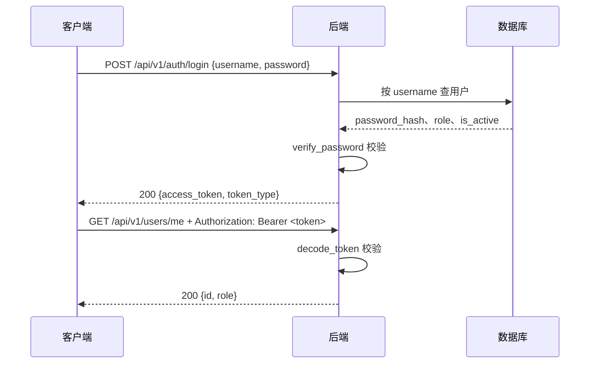

# 第 8 章 用户模块：登录认证

> **节首信息条**｜对应课次 7 · 用户模块：登录认证（4 学时 · 实践）｜前置：第 6 章的目录与六文件、第 7 章搭好的项目仓库；第 5 章 5.1.3（Pydantic）、5.1.5（HTTPException）、5.1.4（Depends）｜**本节实训**：◆ 实训 8-1 给骨架装上登录认证

**已会**：第 7 章的可运行仓库——服务能启动、`/health` 能返回、路由能挂载；第 6 章知道六类代码放在哪。
**本章只加**：认证——系统怎样确认“你是谁”，并让后续请求带着这个身份。
**关系**：第 7 章让服务跑起来；本章让服务只对确认过身份的人开放。

第 7 章搭好的骨架，对所有人一视同仁：谁都能调用。

## 本章要解决的问题

**系统怎样确认“你是谁”，并让后续请求带着这个身份？**

接口本身不区分调用者：只要知道地址，谁都能拿到数据，也能删掉数据。页面上的登录与菜单只影响正常用户的操作路径，不改变接口答不答应。

本章处理认证：创建用户、登录、签发令牌，再让受保护接口从令牌里认出当前用户。授权是另一个问题，第 9 章展开。

## 本章学习目标

读完第 8 章并完成实训后，你应该能：

1. 说明认证与授权各回答什么问题，并分别对应 401 与 403 两种状态码。
2. 解释用户表四个核心字段的作用，说明密码为什么只存哈希、不存明文。
3. 实现注册、登录与 `/me` 受保护接口，让 `create_access_token`、`get_current_user` 每个符号都有定义或明确出处。
4. 用 `Depends` 挂载认证依赖与权限依赖，演示 401、403 在不同场景下的返回。
5. 按实训 8-1 完成用户模块并提交，按验收点完成自评。

## 前置知识卡

| # | 你需要会 | 不会就回看 |
| --- | --- | --- |
| 1 | `APIRouter` 与 `include_router` 的创建—挂载链路 | 第 5 章 5.1.2 |
| 2 | Pydantic 输入/输出模型与 422 的来源 | 第 5 章 5.1.3 |
| 3 | `Depends` 把公共逻辑抽成参数 | 第 5 章 5.1.4 |
| 4 | 401 / 403 / 404 / 422 的分工 | 第 4 章 4.1.3 |
| 5 | 项目目录、六类职责与启动方式 | 第 6 章 6.1.5、第 7 章 7.1.5 |

## 8.1 概念讲解

### 8.1.1 认证与用户模型

没有认证时，把用户列表接口直接挂在应用上，任何人都能调用：

```text
GET /api/v1/users/            → 200，返回全部用户
DELETE /api/v1/departments/D01 → 204，部门被删除
```

请求里没有任何“我是谁”的信息，服务器也无从判断该不该答应。它只能按“收到请求就执行”处理。

**认证**要补的正是这条信息：让每个请求带上一个可验证的身份凭证，服务器先确认凭证有效，再决定是否执行。它的定义可以压缩成一句：**认证是确认“你是谁”的过程；凭证有效，身份成立，请求才进入业务代码。**

认证与授权容易混在一起。认证回答“你是谁”，授权回答“你能做什么”。登录成功后系统知道你的身份，这是认证完成；访问管理员接口被拒绝，是授权问题，不是认证问题。两者对应不同的状态码：401 表示身份没有被确认（没登录、令牌无效或过期），403 表示身份已确认但权限不足。把它们混用，前端就不知道该跳登录页还是提示“无权限”。

本章的链路可以画成三步：**登录换凭证 → 请求带凭证 → 服务端验证凭证**。下面四节依次解决“密码怎么存”“登录怎么走”“凭证怎么发与怎么验”“验证结果怎么变成当前用户”。

先看认证要操作的对象——用户表。

**用户表：四个核心字段**

| 字段 | 作用 |
| --- | --- |
| `username` | 用户名，唯一，不能重复 |
| `password_hash` | 密码的哈希值，不是明文 |
| `role` | 角色，决定权限，如 `admin`、`normal` |
| `is_active` | 是否启用，决定能不能登录 |

`username` 加唯一约束，防止出现两个同名账号；`role` 是第 9 章授权判断的依据；`is_active` 让管理员可以停用账号而不删除历史数据。主键 `id` 用于在令牌里标识用户。

**代码 8-1-1** · `app/modules/user/model.py`（用户表模型，Python）

```python
from sqlalchemy import Column, Integer, String
from app.core.database import Base

class User(Base):
    __tablename__ = "users"

    id = Column(Integer, primary_key=True)
    username = Column(String(100), unique=True, nullable=False)
    password_hash = Column(String(255), nullable=False)
    role = Column(String(20), default="normal")
    is_active = Column(Integer, default=1)
```

`unique=True`、`nullable=False`、`default` 分别对应「唯一约束、必填、默认值」，三条约束各自解决什么问题，第 9 章 9.1.5 结合账号管理再展开。定义好之后，还要在 `main.py` 里加一行 `from app.modules.user.model import User`，第 6 章 6.1.5 的 `Base.metadata.create_all(bind=engine)` 才会在启动时把 `users` 表建出来——第 6 章搭目录时还没有表模型，所以那时 `create_all` 什么都不建。本章后续代码里的 `User` 都从 `app.modules.user.model` 导入。

**输入模型与输出模型**

第 5 章 5.1.3 讲过 Pydantic 的规则，这里直接用进用户模块。输入模型负责校验，输出模型负责控制返回哪些字段：

**代码 8-1-2** · `app/modules/user/schema.py`（用户输入模型，Python）

```python
from pydantic import BaseModel, Field

class UserCreate(BaseModel):
    username: str = Field(..., min_length=3, max_length=100)
    password: str = Field(..., min_length=6, max_length=50)
    role: str = "normal"
```

`...` 表示必填；`min_length`、`max_length` 是约束；`role` 有默认值，不传时取 `normal`。当请求不满足这些约束时，FastAPI 在进入函数之前就返回 422，并在响应体里列出每个字段的错误类型。例如用户名只有 2 个字符、密码只有 3 个字符，会得到两条 `string_too_short`。

输入与输出必须分开。用户表里有 `password_hash`，但响应绝不能把它返回。正确做法是定义 `UserOut`，只包含 `id`、`username`、`role`、`is_active` 等可公开字段，接口声明 `response_model=UserOut`，多出的字段会被自动滤掉（机制见第 5 章 5.1.3）：

**代码 8-1-3** · `app/modules/user/schema.py`（用户输出模型，Python）

```python
class UserOut(BaseModel):
    id: int
    username: str
    role: str
    is_active: int
```

第 9 章 9.1.5 会把同一个输出模型用在用户列表上。

> 💡 **易错点**：直接把 ORM 对象整个返回，结果把 `password_hash` 一起吐给前端。输出模型要显式列出允许返回的字段。

### 8.1.2 密码哈希

认证的第一步是“证明你是这个账号的主人”。最常见的方式是密码。密码怎么存，决定了数据库泄露时损失有多大。

**为什么只存哈希**

数据库里绝不能存明文密码。存明文的风险很直接：一旦数据库泄露，所有人的密码都会暴露；而很多人会在多个系统复用同一个密码，影响会扩散到其他系统。

正确做法是存**哈希**：用户注册时，用哈希函数把密码变成一串不可逆的值；登录时，用同样的函数处理用户输入，再与数据库中的哈希比对。哈希不是加密，不能“解密”回原密码，只能验证“输入是否与原来一致”。

**代码 8-1-4** · `app/core/security.py`（密码哈希实现，Python）

```python
from passlib.context import CryptContext

pwd_context = CryptContext(schemes=["pbkdf2_sha256"], deprecated="auto")

def get_password_hash(password: str) -> str:
    return pwd_context.hash(password)

def verify_password(plain_password: str, hashed_password: str) -> bool:
    return pwd_context.verify(plain_password, hashed_password)
```

`get_password_hash("secret123")` 每次生成的字符串都不同，因为哈希里带了随机盐（Salt）；但 `verify_password("secret123", 哈希)` 会返回 `True`，输入错误密码则返回 `False`。这正是“不可逆但可验证”的含义。

### 8.1.3 登录流程

登录把一个请求变成一张令牌。先看它放在哪个模块，再走一遍流程。

**登录放在哪个模块**

登录不属于用户资源的增删改查，而是一个独立动作。项目里为它单建一个模块文件夹 `app/modules/auth/`，挂载在 `/api/v1/auth` 下，登录接口是 `POST /api/v1/auth/login`。auth 没有自己的表，所以只放三个文件：`controller.py` 接请求，`service.py` 写登录流程，`schema.py` 定义登录的输入与输出。这正是第 6 章 6.1.5 的规则：六个文件按职责需要存在，不凑数。

**登录流程**

登录做四件事：按用户名查用户；校验密码；检查账号是否启用；签发令牌。前三件是“确认你是谁”，放在 user 模块的 `service.py` 里，auth 直接复用；第四件是“发通行证”，放在 auth 的 `service.py` 里。

**代码 8-1-5** · `app/modules/user/service.py`（确认用户身份，Python）

```python
from fastapi import HTTPException

from app.core.security import verify_password
from app.modules.user.model import User


def authenticate_user(db, username: str, password: str):
    user = db.query(User).filter(User.username == username).first()
    if not user or not verify_password(password, user.password_hash):
        raise HTTPException(status_code=401, detail="用户名或密码错误")
    if not user.is_active:
        raise HTTPException(status_code=401, detail="账号已禁用")
    return user
```

错误提示统一写“用户名或密码错误”，不要区分“用户不存在”和“密码错误”。如果提示能区分，攻击者就能借登录接口枚举哪些用户名存在。

这里的用户查询直接写在 service 里，是为了让登录流程在一个文件里读完；第 9 章 9.1.2 会把查询收进 `crud.py`，service 只留判断。

**代码 8-1-6** · `app/modules/auth/schema.py`（登录输入与输出，Python）

```python
from pydantic import BaseModel


class LoginIn(BaseModel):
    username: str
    password: str


class TokenOut(BaseModel):
    access_token: str
    token_type: str = "bearer"
```

**代码 8-1-7** · `app/modules/auth/service.py`（登录与签发令牌，Python）

```python
from app.core.security import create_access_token
from app.modules.auth.schema import LoginIn
from app.modules.user.service import authenticate_user


def login(db, data: LoginIn) -> dict:
    user = authenticate_user(db, data.username, data.password)
    token = create_access_token({"sub": str(user.id), "role": user.role})
    return {"access_token": token, "token_type": "bearer"}
```

**代码 8-1-8** · `app/modules/auth/controller.py`（登录接口，Python）

```python
from fastapi import APIRouter, Depends
from sqlalchemy.orm import Session

from app.core.database import get_db
from app.modules.auth import service
from app.modules.auth.schema import LoginIn, TokenOut

router = APIRouter(prefix="/auth", tags=["认证"])


@router.post("/login", response_model=TokenOut)
def login_endpoint(data: LoginIn, db: Session = Depends(get_db)):
    return service.login(db, data)
```

登录的调用关系可以画成下图。



*图 8-1：登录与携带令牌访问受保护接口*

图中上半段是「用用户名密码换一张通行证」，下半段是「之后每次请求都带上这张通行证」；两段之间服务器不保存登录状态，令牌本身就是凭证。

### 8.1.4 令牌的签发与校验

密码只在登录时用一次。登录成功后，服务器需要给客户端一张“通行证”，让后续请求不必每次都带密码；这张通行证就是令牌。令牌里通常放三类信息：用户标识（`sub`）、角色（`role`）和过期时间（`exp`）。客户端保存令牌，之后每次请求把它放进请求头（Request Header）：

```text
Authorization: Bearer <token>
```

`create_access_token` 的完整实现如下——它是本章实战代码里第一个“先在别处出现、这里才给定义”的函数，从现在起它有了明确出处：

**代码 8-1-9** · `app/core/security.py`（令牌签发与解析，完整实现，Python）

```python
import os
from datetime import datetime, timedelta, timezone
from typing import Optional

from jose import jwt, JWTError

# 键名与第 7 章 7.1.5 的 .env.example 一致；未设置时才用教学占位值
SECRET_KEY = os.getenv("SECRET_KEY", "change-me-in-env")
ALGORITHM = os.getenv("ALGORITHM", "HS256")
ACCESS_TOKEN_EXPIRE_MINUTES = int(os.getenv("ACCESS_TOKEN_EXPIRE_MINUTES", "30"))


def create_access_token(data: dict) -> str:
    to_encode = data.copy()
    expire = datetime.now(timezone.utc) + timedelta(minutes=ACCESS_TOKEN_EXPIRE_MINUTES)
    to_encode.update({"exp": expire})
    return jwt.encode(to_encode, SECRET_KEY, algorithm=ALGORITHM)


def decode_token(token: str) -> Optional[dict]:
    try:
        return jwt.decode(token, SECRET_KEY, algorithms=[ALGORITHM])
    except JWTError:
        return None
```

签发：把用户标识与角色放进载荷（Payload），加上过期时间 `exp`，用 `SECRET_KEY` 和 `ALGORITHM` 签名。解析：`jwt.decode` 会同时校验签名与过期时间，任何一项不对都抛 `JWTError`，这里转成 `None` 交给调用方处理。`Optional[dict]` 的含义见第 5 章 5.1.5。

三项配置都用 `os.getenv` 从环境变量读，键名与第 7 章 7.1.5 的 `.env.example` 完全一致；没有设置时才退回教学占位值。**真实部署必须先设置环境变量并替换 `SECRET_KEY`**，否则任何人都能用这个写在书里的占位密钥伪造令牌。签发与解析必须读同一份配置，这正是排错清单里「`SECRET_KEY` 有两份且不一致」要避免的情况。

`os.getenv` 读的是**进程的环境变量**，不会自动去读 `.env` 文件。教学环境可以在启动服务前用命令行设置（Windows PowerShell：`$env:SECRET_KEY="..."`；Linux／macOS：`export SECRET_KEY=...`），或由机房统一配置；`python-dotenv` 这类库能自动加载 `.env`，本书不额外引入。判断方法很简单：如果签发与解析都退回了 `change-me-in-env`，说明环境变量没生效。

**令牌的边界**

令牌不是加密的，只是签名防篡改。任何拿到令牌的人都能读出载荷内容，所以载荷里不能放密码、身份证号等敏感信息。令牌也要当作密码一样保管：不要写进日志、不要提交到 Git、不要放在 URL 查询参数里。

令牌还会过期。过期后需要重新登录，这不是缺陷，而是把“凭证长期有效”的风险限制在一段时间内。需要“立即失效”或“刷新令牌”的场景，要在令牌之外再加机制，本书不展开。

> 💡 **易错点**：把 JWT 的三段结构与签名算法当成本章重点。本章只需要知道“令牌是一张带签名、会过期的通行证”；内部怎么编码，不影响你实现登录与校验。

### 8.1.5 认证依赖与权限依赖

令牌签发之后，每个受保护接口都要做同一件事：从请求头取出令牌、解析、确认有效、得到当前用户。如果每个函数都写一遍，重复且容易漏。用 `Depends` 把这段逻辑抽出来，就是认证依赖。

**代码 8-1-10** · `app/core/dependencies.py`（认证依赖，Python）

```python
from fastapi import Depends, HTTPException
from fastapi.security import OAuth2PasswordBearer

from app.core.security import decode_token

oauth2_scheme = OAuth2PasswordBearer(tokenUrl="/api/v1/auth/login")

def get_current_user(token: str = Depends(oauth2_scheme)):
    payload = decode_token(token)
    if payload is None:
        raise HTTPException(status_code=401, detail="登录已过期")
    return {"id": payload.get("sub"), "role": payload.get("role")}

@router.get("/me")
def me(current_user: dict = Depends(get_current_user)):
    return current_user
```

`OAuth2PasswordBearer` 会从 `Authorization: Bearer` 头里取出令牌；没带令牌时直接返回 401。`decode_token` 解析失败也返回 401。接口函数本身不需要写任何认证代码，它只关心“当前用户是谁”。代码 8-1-10 与 8-1-11 末尾的 `/me`、`/admin` 路由实际写在 `app/modules/user/controller.py`，与依赖函数排在一起只为对照，落地时按模块拆开。

注意这里的代码写的是**模块内相对路径**：`router` 来自 `app/modules/user/controller.py` 顶部的 `APIRouter(prefix="/users")`，在 `main.py` 里以 `prefix="/api/v1"` 挂载（第 6 章 6.1.5），所以 `/me` 的完整路径是 `/api/v1/users/me`。登录接口 `/api/v1/auth/login` 由 auth 模块的 controller 提供（8.1.3），不挂在 user 路由下；两个模块都在 `main.py` 里以 `prefix="/api/v1"` 挂载。写进接口契约（实训 8-1 验收表）时一律写完整路径，避免前后端口径不一致。

**权限依赖：从认证到授权**

确认身份之后，还可以再包一层权限检查。例如管理员接口要求 `role` 为 `admin`：

**代码 8-1-11** · `app/core/dependencies.py`（权限依赖，Python）

```python
def get_current_admin_user(current_user: dict = Depends(get_current_user)):
    if current_user["role"] != "admin":
        raise HTTPException(status_code=403, detail="Not enough permissions")
    return current_user

@router.get("/admin")
def admin_only(current_user: dict = Depends(get_current_admin_user)):
    return current_user
```

没登录时，`get_current_user` 先返回 401；已登录但角色不是管理员时，`get_current_admin_user` 返回 403。两层依赖分别对应认证与授权，状态码也自然分开——这就是 8.1.1 那句话的代码形态。

这个依赖名与 duty 参考工程的 `app/core/dependencies.py` 一致；第 9 章及以后所有管理接口都直接复用 `get_current_admin_user`，不再另起名字。

**安全习惯与边界**

除了代码，几条习惯同样重要：密钥放在环境变量里，不进代码和 Git；错误提示不泄露账号是否存在；日志不打印密码和完整令牌；创建用户成功后不返回 `password_hash`；停用账号时保留历史记录，不直接删除。

认证也有代价：每个请求多一次令牌解析；令牌一旦签发，在过期前无法轻易作废；用户改角色后，旧令牌仍带旧角色。这些代价换来的是“服务器不保存会话、横向扩展容易”。什么时候不该用无状态令牌？需要立即踢下线、需要精细的会话管理时，就要配合服务端会话或额外的失效机制——这超出本章范围，但要知道它不是“万能方案”。

## 8.2 示范例题

#### 例 8-1：定义用户创建模型并解释 422【Bloom：应用】

**题目**：用 Pydantic 定义 `UserCreate`，要求用户名 3–100 个字符、密码 6–50 个字符、角色默认 `normal`。说明当用户名只有 2 个字符、密码只有 3 个字符时，接口会返回什么，以及响应里能看出什么。

**解**：即代码 8-1-3。用户名 `ab` 只有 2 个字符，违反 `min_length=3`；密码 `123` 只有 3 个字符，违反 `min_length=6`。FastAPI 在进入处理函数前完成校验，返回 422，响应体的 `detail` 中会有两条错误，`loc` 分别指向 `username` 与 `password`，`type` 都是 `string_too_short`。这说明 422 不是“服务器坏了”，而是“请求参数不满足约定”——校验发生在哪一层，见第 5 章 5.1.3。

#### 例 8-2：实现登录并签发令牌【Bloom：应用】

**题目**：实现一个登录流程：按用户名查用户，校验密码，检查账号是否启用，成功后返回 `access_token` 与 `token_type`。说明错误密码时返回什么状态码，以及为什么错误提示不区分“用户不存在”和“密码错误”。

**解**：即代码 8-1-5～8-1-8。用户名或密码不对时，`authenticate_user` 返回 401；账号停用也返回 401。提示统一为“用户名或密码错误”，是因为如果区分“用户不存在”和“密码错误”，攻击者就能通过登录接口逐个试出哪些用户名存在。校验通过后，auth 的 `service.login` 调用 `create_access_token` 签发令牌，controller 只负责接请求与返回。

## 8.3 独立习题

> 独立习题的参考答案统一放在书末《98-参考答案》，做题时先不看。

#### 习题 8-1【Bloom：理解】

**题目**：用自己的话说明一次“登录后访问受保护接口”的完整流程：令牌从哪里来、放在哪里、服务器如何校验、校验失败返回什么。并解释 401 与 403 的区别。

#### 习题 8-2【Bloom：分析】

**题目**：下面三个现象都返回 401 或 403，请分别判断原因，并给出排查步骤。

1. 用户确认密码正确，但登录返回 401。
2. 登录成功拿到令牌，访问 `/me` 仍返回 401。
3. 普通用户访问管理员接口返回 403。

#### 习题 8-3【Bloom：分析】（换场景）

**题目**：第 10 章会做一个“部门”模块，它已经有 `GET /api/v1/departments/`、`POST /api/v1/departments/` 等接口，但任何人都能调用。现在要求：**查看**部门允许所有登录用户，**新增、修改、删除**只允许管理员。请列出要改动的文件与关键代码（依赖挂在哪、哪些接口挂哪一种），并说明未登录、普通用户、管理员三种请求分别会得到什么状态码。**不能照抄本章 `/users/me` 与 `/admin` 的代码**：要说明登录接口本身为什么不能加认证依赖。

## ◆ 实训 8-1：给骨架装上登录认证（对应课次 7 · 4 学时）

### 一、任务目标与验收

在第 6 章的目录与第 7 章的仓库上，实现用户模块与认证模块的四个接口。全部完成并通过下表验收，才算完成本课次：

| 接口 | 方法 | 成功返回 | 失败返回 |
| --- | --- | --- | --- |
| `/api/v1/users` 注册 | POST | 201 + `UserOut`（无 `password_hash`） | 用户名重复 → 400 |
| `/api/v1/auth/login` 登录 | POST | 200 + `{access_token, token_type}` | 密码错 / 账号禁用 → 401 |
| `/api/v1/users/me` 当前用户 | GET | 200 + `{id, role}` | 未带令牌 / 令牌无效 → 401 |
| `/api/v1/users/admin` 管理员接口 | GET | 200（仅 admin） | 普通用户 → 403 |

同时要求：`create_access_token` 等每个符号在工程里有定义或明确出处（8.1.2–8.1.5）；提交一个 git 提交。

### 二、课前准备

- 回看第 5 章 5.1.3、5.1.4、5.1.5；不通读第 5 章的话，实训会处处卡壳。
- 安装本课次新增依赖：

```text
$ pip install "python-jose[cryptography]" passlib
```

把这两项也补进第 7 章 7.1.4 的 `requirements.txt`，否则换机器复现环境时又会漏装。

- 确认骨架能启动：`uvicorn main:app --reload` 后访问 `/health` 得到 200。
- 若已按第 7 章 7.1.5 配好 `.env`，记得把 `SECRET_KEY` 等变量设进**启动服务的那个进程的环境**（8.1.4 用的是 `os.getenv`）；只写在 `.env` 文件里而不加载，读到的仍是教学占位值，见 8.1.4 说明。

### 三、操作步骤

每一步按“做什么 → 怎么做 → 预期 → 做错会看到什么”推进。

**步骤 1 · 建 `app/core/security.py`**
- 做什么：把 8.1.2 的代码 8-1-4 与 8.1.4 的代码 8-1-9 合成一个文件。
- 预期：`$ python -c "from app.core.security import create_access_token"` 无报错。
- 做错会看到什么：`ModuleNotFoundError: No module named 'jose'` → 依赖没装，回到课前准备。

**步骤 2 · 建用户模型与输入/输出模型**
- 做什么：按 8.1.1 写 `app/modules/user/model.py` 的 `User` 表模型，并在 `main.py` 里导入它让 `create_all` 建表；写 `UserCreate` 与 `UserOut`（放进 `app/modules/user/schema.py`）。
- 预期：`$ python -c "from app.modules.user.model import User; from app.modules.user.schema import UserCreate, UserOut"` 无报错；重启服务后数据库里出现 `users` 表。
- 做错会看到什么：`ImportError: cannot import name 'UserOut'` → 文件名或类名与导入不一致，检查拼写；`no such table: users` → `main.py` 忘了导入 `User`，`create_all` 没看到这张表。

**步骤 3 · 注册接口**
- 做什么：`POST /api/v1/users`——查重、哈希、入库，返回 201 与 `UserOut`；路由写在 `app/modules/user/controller.py`。
- 预期：`/docs` 里提交合法数据返回 201；重复用户名返回 400。
- 做错会看到什么：返回的 JSON 里出现 `password_hash` → 忘了声明 `response_model=UserOut`，回看 8.1.1 的易错点。

**步骤 4 · 登录接口**
- 做什么：按 8.1.3 的代码 8-1-5～8-1-8，实现 `app/modules/auth/` 的三个文件与 `POST /api/v1/auth/login`。
- 预期：正确账号密码返回 200 与 `access_token`；错误密码返回 401“用户名或密码错误”。
- 做错会看到什么：正确密码也 401 → 多半是注册时忘了哈希、存了明文，登录时拿明文与哈希比对必然失败，回看 8.1.2。

**步骤 5 · `/me` 受保护接口**
- 做什么：按 8.1.5 的代码 8-1-10 写 `get_current_user` 与 `/me`。
- 预期：不带令牌 401；带令牌 200 返回 `{id, role}`。
- 做错会看到什么：刚登录就 401 → `SECRET_KEY` 在两个文件里各写了一份且不一致，统一成一个出处。

**步骤 6 · 管理员接口**
- 做什么：按 8.1.5 的代码 8-1-11 写 `get_current_admin_user` 与 `/admin` 接口。
- 预期：普通用户 403，admin 200。
- 做错会看到什么：普通用户也 200 → `get_current_admin_user` 写成了只判断“是否登录”，漏了角色判断，对照 8.1.5。

**步骤 7 · 全量过一遍 `/docs`**
- 做什么：从注册开始，按“验收表”四个接口各走一遍（含失败分支）。
- 预期：与验收表逐行一致。
- 做错会看到什么：任何一行对不上 → 先查排错清单，再回对应小节。

### 四、排错清单

| 现象 | 常见原因 | 处理 |
| --- | --- | --- |
| `ModuleNotFoundError: No module named 'jose'` | 依赖未安装 | 回到课前准备重装 |
| 正确密码登录也是 401 | 注册时没哈希，或哈希与校验用了不同方案 | 检查 8.1.2 的两个函数是否同用一个 `pwd_context` |
| 刚登录就 401 | `SECRET_KEY` 有两份且不一致 | 统一从一处导入 |
| 422 `string_too_short` | 输入不满足 `Field` 约束 | 看响应 `detail` 的 `loc`，改输入或改约束 |
| 500 且日志有 `TypeError` | 直接返回 ORM 对象、字段对不上 | 接口声明 `response_model=UserOut` |
| 响应里出现 `password_hash` | 未声明输出模型 | 回到步骤 3 检查输出模型 |

### 五、提交与验收

```text
$ git add app/
$ git commit -m "feat(users): 注册、登录、受保护接口与管理员接口"
```

验收点：验收表四行全过；`/docs` 中四个接口可见且参数说明完整；数据库与响应中无明文密码；日志与提交中无令牌。完成后按验收点自评并留档。

### 六、课后扩展

- 把 `ACCESS_TOKEN_EXPIRE_MINUTES` 改成 1，等一分钟后再访问 `/me`，观察 401，体会 `exp` 的作用。
- 给注册接口加“用户名只允许字母、数字、下划线”的约束（提示：查 `Field` 的 `pattern` 参数）。
- **复习任务**：回看第 5 章 5.1.3、5.1.4、5.1.5，对照本章 8.1.1–8.1.5，指出 Pydantic、Depends 与 HTTPException 分别落在哪个文件、解决什么问题。

## 本章小结

**核心结论**：

1. 认证回答“你是谁”，授权回答“你能做什么”；401 表示身份未确认，403 表示权限不足。
2. 用户表至少有 `username`、`password_hash`、`role`、`is_active` 四个核心字段；密码只存**哈希**，不存明文。
3. 输入模型负责校验、输出模型控制返回字段（第 5 章 5.1.3 的规则）；参数不满足约束返回 422，响应里能定位到具体字段。
4. 登录流程是“查用户、校验密码、检查启用状态、签发令牌”；前三件在 user 模块的 `service.py`，签发令牌在 auth 模块的 `service.py`，auth 没有自己的表，只放 controller / service / schema 三个文件。
5. 令牌放在 `Authorization: Bearer <token>` 中传递；受保护接口用 `Depends` 挂载认证依赖，权限检查再包一层依赖并返回 403。

把这章压缩成一句话：**认证把“你是谁”变成一张可校验的令牌，再用依赖把它接到每个受保护接口上。**

**本章不引入**：OAuth2 授权码、刷新令牌、JWT 三段结构的内部细节。这些在后续课程或工程环境中按需了解。

**学完本章，你可以体会到**：认证与授权是两条不同的安全边界——前者问“你是谁”，后者问“你能做什么”。把它们做进字段、依赖与状态码里，而不是留在口头约定上，边界才守得住。

**自检**：回到章首的学习目标，逐条问自己做到了没有——

- [ ] 说明认证与授权各回答什么问题，并分别对应 401 与 403。
- [ ] 解释用户表四个核心字段的作用，说明密码为什么只存哈希、不存明文。
- [ ] 实现注册、登录与 `/me` 受保护接口，让每个符号有定义或明确出处。
- [ ] 用 `Depends` 挂载认证依赖与权限依赖，演示 401、403 的不同场景。
- [ ] 完成实训 8-1 并自评。

## 本章完整代码位置

| 本章出现的代码 | 完整可运行版本在哪 |
| --- | --- |
| 代码 8-1-2 密码哈希、代码 8-1-9 令牌签发 | 实训 8-1 步骤 1 落地为 `app/core/security.py` |
| 代码 8-1-1 用户表、代码 8-1-3/4 输入/输出模型 | 实训 8-1 步骤 2 落地为 `app/modules/user/model.py` 与 `app/modules/user/schema.py` |
| 代码 8-1-5～8-1-8 用户校验、登录模型、登录服务与接口 | 实训 8-1 步骤 4 组装为 `app/modules/user/service.py` 与 `app/modules/auth/` 三个文件 |
| 代码 8-1-10/11 认证依赖与权限依赖 | 实训 8-1 步骤 5–6 组装为接口 |
| 无认证版三文件最小工程 | 第 5 章 5.1.5（`main.py` / `schemas.py` / `deps.py` 全文） |
