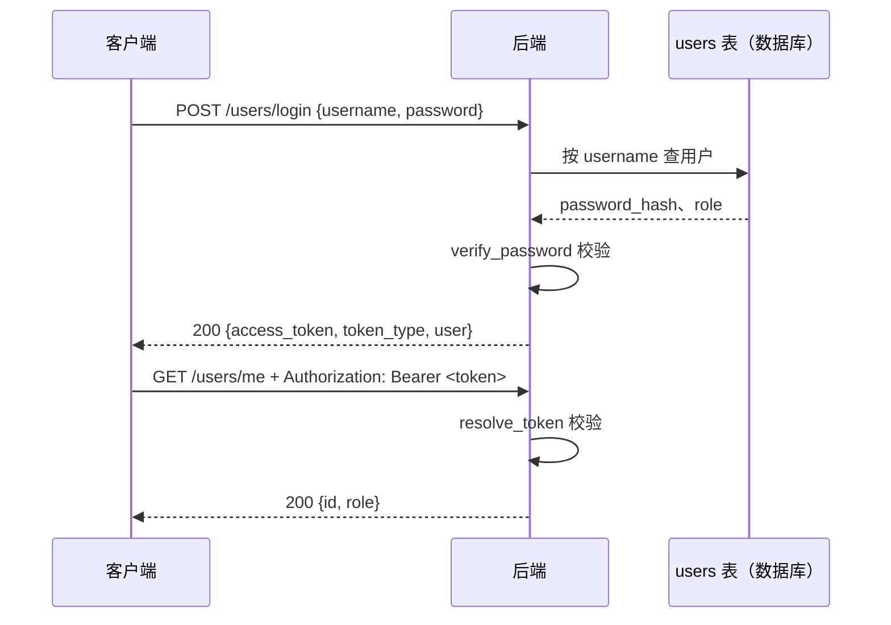

# 第 8 章 用户模块：登录认证

第 6、7 章把单位数据落到了数据库，列表查询也已定型。但这些接口默认接受任何调用者。要让接口按人区分行为，系统先得知道请求来自谁。

## 本章要解决的问题

**系统怎样确认“你是谁”，并让后续请求带着这个身份？**

没有认证时，任何知道地址的人都能调用管理数据的接口，服务器只能照做。请求里没有说“我是谁”，页面上的登录与菜单只影响正常用户的操作路径，不改变接口是否执行。

**认证就是先确认“你是谁”；确认通过，请求才进入业务代码。** 这也是信息安全中对认证与授权的一般区分（ISO/IEC/IEEE 24765:2017）。本章关心的是：系统凭什么相信请求里的身份，以及这个身份怎样一路带到业务代码面前；授权是另一个问题，下一章展开。

## 本章学习目标

读完第 8 章并完成实训后，应能：

1. 说明认证回答什么问题，以及 401 表示什么。
2. 解释用户数据四个核心字段的作用，说明密码为什么只存哈希、盐起什么作用。
3. 实现注册、登录与 `/me`，让令牌的签发、携带与校验走通。
4. 用 `Depends` 挂认证依赖，说明未带令牌与令牌无效都返回 401。

## 8.1 认证与用户数据的组织

认证要判断请求里的身份，系统至少要做三件事：能按一个名字找到唯一那条记录；能比对一个不能明文保存的凭证；能知道这条记录当前是否还有效。第一件事要求名字唯一，第二件事要求存的是凭证的哈希而不是凭证本身，第三件事要求有一个启停标记。再往后，管理接口还要能按角色区分谁可以做什么。把这四件事逐一落到一行记录上，就是用户表要有的四个核心字段。

字段定了，数据放在哪里也跟着定了：第 6 章已经建立 `app/core/database.py`，其中 `Base` 是表模型的父类，`get_db` 把一次请求的会话交给接口。用户数据沿用同一套基础设施——模型继承 `Base`，读写经 `Session`，建表仍由根目录 `main.py` 的 `create_all` 完成。

**四个核心字段**

| 字段 | 作用 |
| --- | --- |
| `username` | 用户名，不能重复；注册查重时据此判断 |
| `password_hash` | 密码的哈希值，不是明文（8.2 说明为什么） |
| `role` | 角色，如 `admin`、`normal`，第 9 章据此判断权限 |
| `is_active` | 是否启用，第 9 章用于启用与禁用 |

`id` 由数据库自增分配，令牌登记的是这个 `id`。`role` 默认 `normal`，注册接口不接受客户端指定角色；`is_active` 让管理员可以停用账号而不删除记录。

**代码 8-1-1** · `app/modules/user/model.py`（users 表模型，Python）

```python
from sqlalchemy import Column, Integer, String

from app.core.database import Base


class User(Base):
    __tablename__ = "users"

    id = Column(Integer, primary_key=True, autoincrement=True)
    username = Column(String(100), unique=True, nullable=False)
    password_hash = Column(String(255), nullable=False)
    role = Column(String(20), default="normal")
    is_active = Column(Integer, default=1)
```

`unique=True` 防止两个同名账号，`nullable=False` 要求必填，`String(100)` 限定长度。这些写在模型上的参数就是**约束**：数据库在写入时拒绝不合法的数据，不必等业务代码逐个判断。第 5 章的内存列表做不到这一点，查重只能靠 `crud.py` 自己遍历。

表模型写好了，还要让它被建出来。第 6 章代码 6-1-2 已经在 `main.py` 写了 `Base.metadata.create_all(bind=engine)`，并为此导入了 `department_model`；`create_all` 只识别**已经导入**的模型，所以现在要在同一处补一行 `from app.modules.user import model as user_model`，然后重启服务。少这一行，`duty.db` 里就不会有 `users` 表，直到第一次注册才看到 `no such table: users`。已经建好的表不会被 `create_all` 重建或清空。

**crud.py：用户数据访问**

查询与写入集中在 `crud.py`，service 只负责规则与流程。

**代码 8-1-2** · `app/modules/user/crud.py`（用户数据访问，Python）

```python
from sqlalchemy.orm import Session

from app.modules.user.model import User


def get_by_username(db: Session, username: str) -> User | None:
    return db.query(User).filter(User.username == username).first()


def get_by_id(db: Session, user_id: int) -> User | None:
    return db.query(User).filter(User.id == user_id).first()


def list_all(db: Session) -> list[User]:
    return db.query(User).order_by(User.id).all()


def create(db: Session, username: str, password_hash: str) -> User:
    user = User(username=username, password_hash=password_hash)
    db.add(user)
    db.commit()
    db.refresh(user)
    return user


def update(db: Session, user: User, changes: dict) -> User:
    for field, value in changes.items():
        setattr(user, field, value)
    db.commit()
    db.refresh(user)
    return user
```

`get_by_username` 同时服务注册查重与登录查询；`list_all` 与 `update` 在第 9 章使用。crud 不判断“用户名是否重复”，只负责“查得到/查不到”，判断留在 service。这一分工与第 6 章的单位模块相同：controller 接请求，service 判规则，crud 动数据。

`db.query(User).filter(...)` 是 ORM 的参数化查询，不拼字符串；`db.commit()` 才真正写入，`db.refresh()` 取回数据库生成的值——自增的 `id` 就在这一步回填到对象上，签发令牌时才能拿到它。

## 8.2 密码哈希与令牌

登录时要证明“你是这个账号的主人”，最常用的办法是密码。密码怎么存，决定了用户数据泄露时的损失。8.1 的 users 表里只留 `password_hash` 这一字段；这一字段的值怎么算、怎么验，以及登录后怎么发令牌，都放在 `app/core/security.py`。

**只存哈希的理由**

用户数据里不能存明文密码。一旦数据泄露，所有人的密码都会暴露；很多人在多个系统复用同一个密码，影响会扩散到其他系统。

正确做法是存**哈希**：注册时把密码交给哈希函数，得到一串不可逆的值；登录时用同一个函数处理输入，再与记录里的值比对。哈希不是加密，不能还原出原密码，只能验证“输入是否与原来一致”。密码哈希的常用方案见 RFC 8018（PBKDF2）与 OWASP 密码存储指南；本章用标准库 `hashlib` 自己实现，把盐的生成与校验两步摊开来看。

哈希有个已知弱点：相同密码会得到相同哈希。攻击者可以预先算出一大批常见密码的哈希，做成“彩虹表”，拿到数据库后逐一比对，就能反推明文。破解办法是给每个密码加一段**随机盐**——盐不同，同一个密码的哈希也不同，彩虹表就失效了。盐不必保密，它和摘要一起存，校验时再取出来用。

**代码 8-1-3** · `app/core/security.py`（密码哈希，Python）

```python
import hashlib
import secrets


def get_password_hash(password: str) -> str:
    salt = secrets.token_hex(16)
    digest = hashlib.sha256((salt + password).encode()).hexdigest()
    return f"{salt}${digest}"


def verify_password(plain_password: str, hashed_password: str) -> bool:
    salt, digest = hashed_password.split("$", 1)
    return hashlib.sha256((salt + plain_password).encode()).hexdigest() == digest
```

`get_password_hash` 分三步：先 `secrets.token_hex(16)` 生成 16 字节随机盐，再把“盐 + 密码”拼起来做 SHA-256 得到摘要，最后用 `$` 把盐和摘要串成 `盐$摘要` 存进数据库。`verify_password` 反着做：把存储值从 `$` 处拆成盐和摘要，用同样的盐处理输入的密码，比对摘要是否一致。

`get_password_hash("secret123")` 每次生成的字符串都不同，因为盐每次随机；`verify_password("secret123", 哈希)` 返回 `True`，输入错误密码返回 `False`。这就是“不可逆但可验证”：哈希算不出原密码，但能判断输入对不对。`hashlib` 与 `secrets` 都是 Python 标准库，不需要额外安装依赖。

> 💡 **易错点**：把“哈希”和“加密”混为一谈。加密能解密还原，哈希不能；密码要的是“不可逆但可验证”，所以用哈希，不用加密。

**令牌：登录后的凭证**

密码只在登录时用一次。登录成功后，服务器发给客户端一张**令牌**，之后的请求带令牌，不再带密码。令牌有几种做法；本章采用不依赖外部库的一种，称为**简单令牌**：登录时生成一个随机字符串交给客户端，服务器用一个字典记住“这个字符串属于哪个用户”，校验时查这个字典。

```text
Authorization: Bearer <token>
```

**代码 8-1-4** · `app/core/security.py`（令牌，续写，Python）

在 `security.py` 末尾追加：

```python
# 令牌表：token -> user_id，内存字典，重启即清空
TOKEN_STORE: dict[str, int] = {}


def create_access_token(user_id: int) -> str:
    token = secrets.token_hex(16)
    TOKEN_STORE[token] = user_id
    return token


def resolve_token(token: str) -> int | None:
    return TOKEN_STORE.get(token)
```

`create_access_token` 生成一个 16 字节的随机字符串作为令牌，在 `TOKEN_STORE` 里登记“这个令牌属于 user_id”，再把令牌交给客户端；`resolve_token` 拿到令牌后查字典，返回对应的 user_id，查不到返回 `None`。令牌本身不携带任何信息，它只是一把“钥匙”，真正的对应关系在服务端的字典里。

这种令牌换来了实现上的直接：读代码就能看清凭证是怎么发的、怎么认的。代价是服务端要维护一张字典：令牌与用户的对应关系存在内存里，服务重启后字典清空，先前发出的令牌随之失效；users 表里的数据则留在磁盘上不受影响。所以重启后账号还在，客户端要重新登录一次取新令牌。当令牌要跨多个服务校验、要防止被人伪造、又不想服务端存状态时，需要带签名的令牌（如 JWT），见本章课后扩展。

## 8.3 注册与登录

注册创建账号，登录把账号换成令牌。两个动作操作的都是用户数据，所以都放在 user 模块。

**注册的输入与输出**

输入模型负责检查请求，输出模型决定返回哪些字段：

**代码 8-1-5** · `app/modules/user/schema.py`（输入与输出模型，Python）

```python
from pydantic import BaseModel, ConfigDict, Field


class UserCreate(BaseModel):
    username: str = Field(..., min_length=1, max_length=100)
    password: str = Field(..., min_length=6, max_length=128)


class UserOut(BaseModel):
    model_config = ConfigDict(from_attributes=True)

    id: int
    username: str
    role: str
    is_active: int


class UserLogin(BaseModel):
    username: str = Field(..., min_length=1, max_length=100)
    password: str = Field(..., min_length=1, max_length=128)


class TokenOut(BaseModel):
    access_token: str
    token_type: str = "bearer"
    user: UserOut
```

`...` 表示必填，`min_length`、`max_length` 是约束。请求不满足约束时，FastAPI 不会进入函数，直接返回 422，并指出是哪个字段、什么错误。注册只接收用户名与密码，角色由服务端固定为 `normal`，客户端无权指定。

输入与输出必须分开。用户记录里有 `password_hash`，响应绝不能把它返回。`UserOut` 只列可公开字段，接口声明 `response_model=UserOut` 后，多出的字段会被自动滤掉。

> 💡 **易错点**：直接把对象整个返回，结果把 `password_hash` 一起返回给前端。输出模型要显式列出允许返回的字段。

登录成功后，客户端还要知道当前是哪个账号、什么角色：页面要显示用户名，也要按角色决定哪些入口可见。可以再调一次 `/me`，但登录时服务端本来已经查出了这条用户记录，多一次往返没有带来新信息。所以把这条记录一起放进登录响应，`TokenOut` 里再列一个 `user: UserOut`。

这里要跨过一道类型上的坎：`crud.py` 交回来的是 ORM 对象，字段挂在对象属性上，而 Pydantic 默认按键从字典取值。要让嵌套的输出模型按属性名取值，就在 `UserOut` 里写 `model_config = ConfigDict(from_attributes=True)`。经过 `response_model=TokenOut` 之后，`user` 仍只剩 `UserOut` 列出的四个字段，`password_hash` 一样出不去。

**注册与登录流程**

注册做三件事：查重、哈希、写进 users 表。登录做三件事：按用户名查用户、校验密码、签发令牌。

**代码 8-1-6** · `app/modules/user/service.py`（建号与登录，Python）

```python
from fastapi import HTTPException

from app.core.security import create_access_token, get_password_hash, verify_password
from app.modules.user import crud
from app.modules.user.model import User


def create_user(db, data) -> User:
    if crud.get_by_username(db, data.username):
        raise HTTPException(status_code=400, detail="用户名已存在")
    return crud.create(db, data.username, get_password_hash(data.password))


def login(db, data) -> dict:
    user = crud.get_by_username(db, data.username)
    if not user or not verify_password(data.password, user.password_hash):
        raise HTTPException(status_code=401, detail="用户名或密码错误")
    token = create_access_token(user.id)
    return {"access_token": token, "token_type": "bearer", "user": user}
```

取用户与写入都经 `crud.py`，service 只写“查重、哈希、比对、签发”这些规则。错误提示统一写“用户名或密码错误”，不区分“用户不存在”和“密码错误”：如果提示能区分，攻击者就能借登录接口枚举哪些用户名存在。

`create_access_token` 只登记 user_id 与令牌的对应关系，不携带角色；第 9 章做权限判断时，`get_current_user` 会按 user_id 查用户表取角色。

controller 的函数签名要加上会话参数：由 `Depends(get_db)` 提供 session，注册与登录把 `db` 传给 service。

**代码 8-1-7** · `app/modules/user/controller.py`（注册与登录接口，Python）

```python
from fastapi import APIRouter, Depends
from sqlalchemy.orm import Session

from app.core.database import get_db
from app.modules.user import service
from app.modules.user.schema import TokenOut, UserCreate, UserLogin, UserOut

router = APIRouter(prefix="/users", tags=["用户"])


@router.post("", response_model=UserOut, status_code=201)
def register(data: UserCreate, db: Session = Depends(get_db)):
    return service.create_user(db, data)


@router.post("/login", response_model=TokenOut)
def login_endpoint(data: UserLogin, db: Session = Depends(get_db)):
    return service.login(db, data)
```

`main.py` 用 `app.include_router(user_controller.router, prefix="")` 挂载，因此注册的完整路径是 `POST /users`，登录是 `POST /users/login`。登录与注册同属一个模块、一个路由前缀，不需要另建文件夹。

登录的调用关系可以画成下图。



*图 8-1：登录与携带令牌访问受保护接口*

图中上半段是“用用户名密码换取令牌”，下半段是“之后每次请求都带上令牌”。两段之间服务器在令牌字典里保存了“令牌属于谁”，令牌本身只是随机字符串；用户表落在数据库里，登录时查哈希，校验令牌时再查一次用户表取角色。

## 8.4 受保护接口

令牌签发之后，每个受保护接口都要先做同一件事：从请求头取出令牌、解析、确认有效、得到当前用户。每个函数都写一遍，既重复又容易漏。用 `Depends` 把这段逻辑抽出来，就是认证依赖。

**代码 8-1-8** · `app/core/security.py`（认证依赖，续写，Python）

在文件顶部补上会话相关的导入，再在文件末尾追加：

```python
from fastapi import Depends, HTTPException
from fastapi.security import HTTPAuthorizationCredentials, HTTPBearer
from sqlalchemy.orm import Session

from app.core.database import get_db

bearer_scheme = HTTPBearer(auto_error=False)


def get_current_user(
    credentials: HTTPAuthorizationCredentials = Depends(bearer_scheme),
    db: Session = Depends(get_db),
) -> dict:
    if credentials is None:
        raise HTTPException(status_code=401, detail="未提供令牌")
    user_id = resolve_token(credentials.credentials)
    if user_id is None:
        raise HTTPException(status_code=401, detail="令牌无效")
    from app.modules.user import crud
    user = crud.get_by_id(db, user_id)
    if user is None:
        raise HTTPException(status_code=401, detail="令牌无效")
    return {"id": user.id, "role": user.role}
```

`HTTPBearer(auto_error=False)` 会从 `Authorization: Bearer` 头里取出令牌；没带令牌时返回 `None`，由函数转成 401。`resolve_token` 在令牌字典里查 user_id，查不到说明令牌无效，同样返回 401。令牌字典里只存 user_id，不存角色，所以还要按 user_id 查一次用户表，把 `role` 一起带出。返回的字典含 `id` 与 `role`，第 9 章的权限依赖会用到 `role`。认证依赖因此每次都要查一次用户表：令牌里只登记对应关系、不携带角色，角色只能从用户表里取。

在 `/docs` 中先调用登录接口取得 `access_token`，再点右上角 Authorize 粘贴该令牌，即可验证受保护接口。

**当前用户接口**

**代码 8-1-9** · `app/modules/user/controller.py`（当前用户接口，续写，Python）

在文件顶部从 `app.core.security` 导入 `get_current_user`，再追加：

```python
@router.get("/me")
def me(current_user: dict = Depends(get_current_user)):
    return current_user
```

接口函数本身不需要写任何认证代码，它只关心“当前用户是谁”。完整路径是 `GET /users/me`。

> 💡 **易错点**：令牌就是“钥匙”，谁拿到都能以对应身份访问。令牌要当作密码保管：不写进日志、不提交到 Git、不在消息里截图转发。

到这里，本章的代码都出现了。回头看一下它们的分工。

**本章的代码组织**

本章在第 6 章的数据层上新增 users 表与用户模块：

```text
app/
├── core/
│   ├── database.py     第 6 章建立：engine、Session、Base、get_db
│   └── security.py     密码哈希、令牌与认证依赖
└── modules/user/
    ├── model.py        users 表模型，继承 Base
    ├── schema.py       输入与输出模型
    ├── crud.py         带 db 的取用户与写入
    ├── service.py      注册、登录与修改规则
    └── controller.py   路由
```

判断一段代码该放哪里，看它回答什么问题：

| 要改的事 | 改哪个文件 |
| --- | --- |
| 加一个用户字段 | `model.py` 与 `schema.py` |
| 改登录规则（查重、校验、禁用） | `service.py` |
| 改查询条件或写入方式 | `crud.py` |
| 改路径、方法、状态码 | `controller.py` |
| 改哈希方案或令牌有效期 | `security.py` |

为什么这样分：请求先到 controller；规则写在 service；数据怎么取、怎么写写在 crud；数据长什么样写在 model 与 schema；哈希、令牌这类跨模块能力放在 security。登录没有单建 `auth/`，因为它操作的就是用户数据。这一结构与第 6 章的单位模块相同；第 9 章的列表与修改继续使用同一个 `crud.py`。

## 示范例题

#### 例 8-1：走通注册、登录与受保护接口

**题目**：按本章代码实现三个接口。依次发出四次请求：注册 `alice`；用 `alice` 登录；不带令牌与带令牌各访问一次 `/me`。写出每次请求的路径、请求体或请求头，以及预期状态码。

**解**：

| 请求 | 请求体或请求头 | 状态码 | 说明 |
| --- | --- | --- | --- |
| `POST /users` | `{"username": "alice", "password": "secret123"}` | 201 | 返回 `UserOut`，不含 `password_hash` |
| `POST /users/login` | 同上 | 200 | 返回 `access_token`、`token_type` 与 `user` |
| `GET /users/me` | 无 | 401 | `bearer_scheme` 没取到令牌 |
| `GET /users/me` | `Authorization: Bearer <token>` | 200 | 返回 `{"id": 1, "role": "normal"}` |

第三次请求的令牌取自第二次响应。若把令牌拼错或换成一个没登记过的令牌，第四次也会变成 401：`resolve_token` 返回 `None`，认证依赖在进入接口函数前结束请求。

## 独立习题

#### 习题 8-1

**题目**：用自己的话说明一次“登录后访问受保护接口”的完整流程：令牌从哪里来、放在哪里、服务器如何校验、校验失败返回什么。并解释 401 表示什么。

#### 习题 8-2

**题目**：下面三个现象都返回 401，请分别判断原因，并给出排查步骤。

1. 用户确认密码正确，但登录返回 401。
2. 登录成功拿到令牌，访问 `/me` 仍返回 401。
3. 令牌使用一段时间后，`/me` 返回 401。

## ◆ 实训 8-1：在落库工程上装登录认证

### 一、任务目标与验收

在第 6、7 章的工程上继续，保留单位模块，按已建立的 `Base` 与 `get_db` 新增 users 表与用户模块，实现三个接口。

| 接口 | 方法 | 成功返回 | 失败返回 |
| --- | --- | --- | --- |
| `/users` 注册 | POST | 201 + `UserOut`（无 `password_hash`） | 用户名重复 → 400；字段不合法 → 422 |
| `/users/login` 登录 | POST | 200 + `{access_token, token_type, user}` | 密码错 → 401 |
| `/users/me` 当前用户 | GET | 200 + `{id, role}` | 未带令牌 / 令牌无效 → 401 |

同时要求：`users` 表已建立，新增账号在重启后仍在；第 6 章的单位接口仍可访问；每个符号在工程里有定义或明确出处（8.1–8.4）；提交一次可读的 Git 记录。

### 二、课前准备

- 回看第 3 章 3.5 与 3.6；`Depends` 的写法见第 4 章 4.5，会话依赖 `get_db` 见第 6 章 6.1，本章 8.4 讲它在认证中的应用。
- 第 6 章已建 `app/core/database.py` 与 departments 表；本次要新建 `app/modules/user/` 目录、`app/core/security.py`，以及各级 `__init__.py`。
- 本章密码哈希与令牌都用标准库 `hashlib` 与 `secrets`，SQLAlchemy 在第 6 章已安装，**无需安装新依赖**。
- 确认骨架能启动：`uvicorn main:app --reload` 后访问 `/health` 与 `/departments` 均成功，`duty.db` 已生成。

### 三、操作步骤

每一步按“做什么 → 怎么做 → 预期 → 做错会看到什么”推进；完整代码见各步骤标注的代码块。

**步骤 1 · 目录与配置（10 分钟）**
- 做什么：新建 `app/modules/user/` 及各级 `__init__.py`，`app/core/` 沿用第 6 章已有的 `database.py`；无需改 `requirements.txt`。
- 预期：`/health` 与单位列表仍为 200。
- 做错会看到什么：`ModuleNotFoundError: app.core.database` → 第 6 章的 `database.py` 未落地，回看 6.1。

**步骤 2 · users 表与四个字段（30 分钟）**
- 做什么：按 8.1 写 `app/modules/user/model.py` 的 `User(Base)` 与 `crud.py` 的五个带 `db` 的函数；在 `main.py` 补 `user_model` 导入，保留第 6 章的单位路由与 `create_all`。
- 预期：重启后 `duty.db` 中出现 `users` 表；`/docs` 中出现用户分组；单位接口仍为 200。
- 做错会看到什么：`no such table: users` → `main.py` 漏了模型导入，或服务未重启执行 `create_all`；`TypeError` 提示缺 `db` → `crud.py` 仍是内存版签名。

**步骤 3 · 密码哈希与令牌（30 分钟）**
- 做什么：按 8.2 写 `app/core/security.py` 的密码哈希两函数与令牌两函数。
- 预期：`$ python -c "from app.core.security import create_access_token"` 无报错。
- 做错会看到什么：`verify_password` 恒返回 `False` → 盐的生成与拆分不一致，核对 `$` 分隔符。

**步骤 4 · 注册与登录（40 分钟）**
- 做什么：按 8.3 写 `schema.py` 的四个模型、`service.py` 的 `create_user` 与 `login`、`controller.py` 的注册与登录两条路由；接口签名带 `db: Session = Depends(get_db)`。
- 预期：注册 201；重名 400；短密码 422；登录 200 并返回 `access_token`、`token_type` 与 `user`；错密码 401；重启服务后用原账号仍可登录。
- 做错会看到什么：正确密码也 401 → 注册时忘了哈希，回看 8.2；响应出现 `password_hash` → 未写 `response_model`；登录响应缺 `user` 或 `user` 是空对象 → `TokenOut` 没嵌 `UserOut`，或 `UserOut` 没设 `from_attributes=True`；`no such table: users` → 回到步骤 2。

**步骤 5 · `/me` 受保护接口（30 分钟）**
- 做什么：按 8.4 在 `security.py` 追加带 `db: Session = Depends(get_db)` 的 `get_current_user`，在 `controller.py` 追加 `/me` 路由。
- 预期：不带令牌 401；有效令牌 200 返回 `{id, role}`；无效令牌 401。
- 做错会看到什么：刚登录就 401 → 请求头写成 `Authorization: Bearer <token>`，或令牌字典没登记成功；`get_current_user` 报缺 `db` → 会话依赖未挂。

**步骤 6 · 验证与提交（25 分钟）**
- 做什么：从注册开始，按验收表三个接口各走一遍，含失败分支；重启一次服务，确认账号仍在、旧令牌已失效；确认单位接口仍为 200；提交。
- 预期：与验收表逐行一致；`git status` 干净；`git ls-files` 中无 `venv/`、`duty.db`。
- 做错会看到什么：漏提交依赖 → 用 `git add -A` 而不是只加 `app/`；数据库文件被提交 → 补进 `.gitignore`。

### 四、排错清单

| 现象 | 常见原因 | 处理 |
| --- | --- | --- |
| `verify_password` 恒为 `False` | 盐的生成与拆分不一致 | 核对 `get_password_hash` 与 `verify_password` 是否都用 `$` 分隔、同一拼接顺序 |
| 正确密码登录也是 401 | 注册时没哈希，或哈希与校验用了不同方案 | 检查 8.2 的两个函数是否同用一套“盐 + 密码”拼接 |
| 刚登录就 401 | 请求头格式不对，或令牌没登记进 `TOKEN_STORE` | 检查 `Authorization: Bearer` 与 `create_access_token` 是否被调用 |
| `no such table: users` | `main.py` 未导入 user 模型，`create_all` 不知道它的存在 | 补 `from app.modules.user import model as user_model` 并重启 |
| 422 `string_too_short` | 输入不满足 `Field` 约束 | 看响应 `detail` 的 `loc`，改输入或改约束 |
| 响应里出现 `password_hash` | 未声明输出模型 | 检查 `response_model=UserOut` |
| 登录响应缺 `user`，或 `user` 全是默认值 | `TokenOut` 没嵌 `UserOut`，或 `UserOut` 未设 `from_attributes=True` | 补 `user: UserOut` 与 `model_config`，让嵌套模型按对象属性取值 |
| 注册返回 307 | 请求地址多了尾斜杠 | 去掉尾斜杠，写成 `/users` |
| `/users` 返回 404 | `main.py` 未挂 user 路由 | 补 `include_router(user_controller.router, prefix="")` |
| 哨位接口返回 404 | 替换 `main.py` 时删掉了 workstation 路由 | 恢复该行并确认前缀 |
| 重启后账号全部消失 | `model.py` 仍是内存版，或数据写进了别的文件 | 检查 `User` 是否继承 `Base`、`DATABASE_URL` 是否指向同一个 `duty.db` |
| 重启后 `/me` 返回 401 | 令牌字典 `TOKEN_STORE` 随进程清空 | 重新登录取新令牌；账号本身没有丢 |

### 五、提交与验收

```text
$ git add -A
$ git commit -m "feat(users): 注册、登录与受保护接口"
```

`git add -A` 会把依赖清单与入口文件的改动一并纳入。提交前用 `git status` 确认没有 `venv/` 与 `duty.db`。

验收点：验收表三行全过（含 400、422、401）；`/docs` 中三个接口可见且参数说明完整；users 表里无明文密码；重启后账号仍在；第 6 章的单位接口仍为 200；日志与提交中无令牌。完成后按验收点自评并留档。

### 六、课后扩展

- 给令牌加过期：在 `TOKEN_STORE` 里把 `user_id` 换成“`user_id` + 签发时间”，校验时判断是否超时；观察超时后 `/me` 返回 401。
- 给注册接口加“用户名只允许字母、数字、下划线”的约束（提示：查 `Field` 的 `pattern` 参数）。
- **扩展知识：JWT——无状态的带签名令牌**。本章的令牌是“随机字符串 + 服务端字典”，好处是简单、不依赖外部库；代价是服务端要维护令牌字典（有状态），且令牌换个进程、换个服务就认不出来了。当系统有多个服务要共用登录态、又不想维护一张共享令牌表时，常用 JWT（JSON Web Token，RFC 7519）：把用户标识、角色、过期时间放进一段载荷，用密钥签名后交给客户端，服务端拿到令牌只验签名与过期，不查表。JWT 的关键是“带签名、会过期、无状态”，代价是要管好签名密钥、不能把敏感信息放进载荷（载荷只是编码，不是加密）。
- **复习任务**：对照第 6 章与本章，指出本章新增了哪些文件、各自解决什么问题；说明 users 表为什么不必改 `database.py`、为什么仍要在 `main.py` 补一行导入，以及 Pydantic、`Depends`、`HTTPException` 分别落在哪个文件。

## 本章小结

**核心结论**：

1. 认证回答“你是谁”；身份未确认时返回 401。
2. 用户数据至少有 `username`、`password_hash`、`role`、`is_active` 四个核心字段，本章建在 users 表里，与第 6 章共用 `Base` 与 `get_db`；密码只存**哈希**，并加**盐**防彩虹表。
3. 注册做查重、哈希、写入；登录做查用户、验密码、签发令牌。
4. 令牌是一串随机字符串，服务端用字典记住“令牌属于谁”；受保护接口用 `Depends` 挂认证依赖，未带令牌或令牌无效都返回 401。
5. 注册、登录与 `/me` 同属 user 模块；认证依赖与业务代码分开，接口函数只声明依赖。

把这章压缩成一句话：**认证把“你是谁”变成一张可校验的令牌，再用依赖把它接到每个受保护接口上。**

**学完本章，你可以体会到**：认证的边界不是画在页面上的，而是画在接口入口处的，由令牌、依赖与状态码共同守住。账号此刻已经落在数据库里，这条边界与存储方式无关。

**自检**：回到章首的学习目标，逐条问自己做到了没有——

- [ ] 说明认证回答什么问题，以及 401 表示什么。
- [ ] 解释用户数据四个核心字段的作用，说明密码为什么只存哈希。
- [ ] 实现注册、登录与 `/me`，让令牌的签发、携带与校验走通。
- [ ] 用 `Depends` 挂认证依赖，说明未带令牌与令牌无效都返回 401。
- [ ] 完成实训 8-1 并自评。

## 本章完整代码位置

| 本章出现的代码 | 完整可运行版本在哪 |
| --- | --- |
| 代码 8-1-1 users 表模型 | 实训 8-1 步骤 2 落地为 `app/modules/user/model.py`；继承的 `Base` 见第 6 章 6.1 的 `app/core/database.py` |
| `main.py` 的 user 模型导入 | 实训 8-1 步骤 2 补进根目录 `main.py`，与第 6 章代码 6-1-2 的 `create_all` 同处 |
| 代码 8-1-2 用户数据访问 | 实训 8-1 步骤 2 落地为 `app/modules/user/crud.py` |
| 代码 8-1-3、8-1-4 密码哈希与令牌、代码 8-1-8 认证依赖 | 实训 8-1 步骤 3、5 合成 `app/core/security.py` |
| 代码 8-1-5 输入与输出模型 | 实训 8-1 步骤 4 落地为 `app/modules/user/schema.py` |
| 代码 8-1-6 建号与登录 | 实训 8-1 步骤 4 落地为 `app/modules/user/service.py` |
| 代码 8-1-7 注册与登录接口、代码 8-1-9 当前用户接口 | 实训 8-1 步骤 4–5 落地为 `app/modules/user/controller.py` |
| 会话依赖与建表入口 | 第 6 章 6.1（`get_db`、`create_all`）；工程目录见第 4 章 4.5 与第 5 章 5.1 |

**下一章预告**：身份确认之后，还有“能做什么”没有回答。下一章在这张 users 表上划出权限边界：管理接口怎样只对管理员开放，401 与 403 各由谁返回，以及为什么权限检查必须写在后端。
