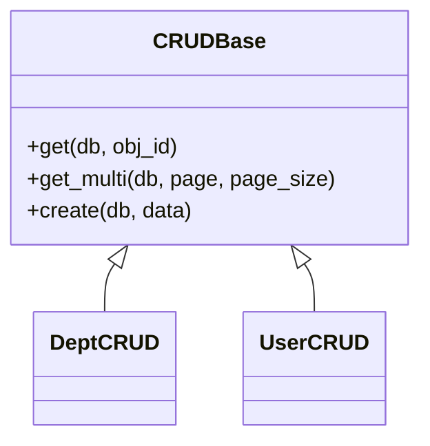

# 第 9 章 数据模块：查询复用

第 8 章已经能让列表按页返回 `items` 与 `total`。但两个模块的列表代码几乎相同，而且搜索后页数对不上。本章先补齐查询机制，再判断哪些代码该收拢。

## 本章要解决的问题

**重复的查询逻辑，怎样收拢，才既消除重复、又不破坏行为？**

同一条规则被复制成两份之后，每次修改都要记得改两处；漏掉一处，系统内部就会出现两种互相矛盾的行为。这类代价不表现为程序无法运行，而表现为每次改动都要额外确认另一处是否同步。

本章关心的是：两处看起来相同的查询，是否真的在做同一件事；把重复收拢到一处时，哪些部分可以一起搬走，哪些必须留在原处。

## 本章学习目标

读完第 9 章并完成实训后，应能：

1. 指出单位与用户模块中完全重复的查询代码，并说明重复带来的维护成本。
2. 实现分页返回 `pages`，并保证过滤、排序与总数计算的次序正确。
3. 把排序字段限制在白名单内，避免任意字段注入。
4. 抽取 `CRUDBase`，并说明“只抽完全重复部分”的边界。
5. 改造后运行回归测试（Regression Test），确认两个模块行为不变。

## 9.1 重复代码的维护成本

本节说明两个模块的列表接口为何会产生行为差异，以及这种重复带来的维护成本。

**两个列表接口的同一段代码**

比较第 8 章的 `/departments` 与第 7、8 章的 `/users` 两个列表函数，可以看到相同的结构：接收 `page` 与 `page_size`，先调用 `count()` 统计总数，再用 `offset` 与 `limit` 取出当前页，最后返回 `items` 与 `total`。差异只有两处：查询的模型、主键字段名。

复制粘贴在编写阶段并没有错，错在复制之后缺少唯一性约束。分页公式一旦需要调整，两个文件都必须修改；遗漏一处，同一系统内便出现两种行为。本章开头提到的“搜索后仍显示 12 页”正是这种遗漏的结果。

由此产生的代价就是**维护成本**（对应 ISO/IEC 25010 的可维护性）：它不表现为代码无法运行，而表现为每一次修改都必须额外承担“另一处是否已经同步”的检查负担。

因此，本章的抽取目标不是缩短代码，而是使同一条规则只有一个实现。9.6 将把这一目标表述为可操作的判据。

## 9.2 分页返回的结构

第 8 章的列表接口返回 `{"items": [...], "total": 23}`，页数要前端自己算。前端由 `total` 与 `page_size` 自行推算总页数：23 ÷ 10 = 2.3，取 2 会遗漏最后 3 条，取 3 则需要额外处理不足一页的情况。该计算不应由前端承担：后端已经持有 `page_size`，可以在返回时直接给出总页数。

列表返回因此扩展为五个字段，本课程约定列表返回这一结构：`items`（本页数据）、`total`（符合条件的总条数）、`page`（当前页码）、`page_size`（每页条数）、`pages`（总页数）。`pages` 按向上取整计算：

**代码 9-1-1** · 示例（文本）

```text
pages = ceil(total / page_size) = (total + page_size - 1) // page_size
```

采用整数写法而非 `math.ceil(total / page_size)`，原因有二：除法会先产生浮点数，条数较大时多一次不必要的类型转换；整数运算可以直接得到结果。23 条、每页 10 条时，`(23 + 10 - 1) // 10 = 3`；20 条时结果为 2，不会多出一页空页。

边界条件也应在同一处统一处理：`page` 小于 1 时按 1 处理；`page_size` 超过 100 时按 100 处理，避免一次请求取走整张表；`page_size` 小于等于 0 时按 1 处理。集中处理之后，各模块不必重复实现，也不会出现“单位页最少 1 条、用户页最少 0 条”这类不一致。

第 7 章的用户列表固定取前 50 条（`count` 字段）；本章把它升级为同一套分页返回，`user` 成为本章第二个练习模块。用户列表的 service 不再自己截断，而是交给通用的分页方法（其定义见 9.5）：

**代码 9-1-2** · `app/modules/user/service.py`（分页后的列表，Python）

```python
def list_users(db, page: int = 1, page_size: int = 10) -> dict:
    return user_crud.get_multi(db, page, page_size)
```

`user_crud` 在 9.5 用 `CRUDBase(User, pk="id")` 构造。返回值已是 `items`、`total`、`page`、`page_size`、`pages` 五个字段，controller 直接透传即可。

## 9.3 过滤与计数的次序

本节分析本章开头案例中分页数字对不上的直接原因。

**先计数后过滤的后果**

单位表共有 120 条记录。搜索框输入“张”，表格显示 3 行，页脚却显示“共 120 条 / 12 页”。点击第 2 页，内容为空。

一种做法是在前端隐藏分页：搜索结果只有 3 条时，分页控件没有意义。但用户取消搜索后分页仍需恢复，且“共几条”本身具有信息价值。另一种做法是把 `total` 改为 `len(items)`：这样第一页永远显示 10 条，翻页功能随之失效。两种做法都只改变了显示，没有修正数字。

`total` 与 `items` 出自同一个 `query` 对象，错误在于执行次序：缺陷版本在 `if full_name: query = query.filter(...)` 之前调用了 `total = query.count()`。于是 `total` 统计的是未过滤的 120 条，`items` 取到的却是过滤后的 3 条。两个数值各自正确，组合在一起却互相矛盾：`pages` 按 120 计算为 12 页，而实际数据只有 3 条，第 2 页自然为空。

过滤条件必须在 `count()` 之前加入，使 `total` 与 `items` 出自同一个已经过滤的 `query`。这不是需要记忆的约定，而是“总数与列表必须描述同一批数据”的直接推论。

第 8 章 dept 列表查询的正确实现如下（这是从第 8 章迁来的 `crud.py` 查询代码）：

**代码 9-1-3** · `app/modules/dept/crud.py`（过滤后计数，Python）

```python
def list_departments(db: Session, params):
    query = db.query(Department)
    if params.name:
        query = query.filter(Department.full_name.contains(params.name))
    total = query.count()
    if params.sort_order == "desc":
        query = query.order_by(Department.dept_code.desc())
    else:
        query = query.order_by(Department.dept_code.asc())
    items = query.offset((params.page - 1) * params.page_size).limit(params.page_size).all()
    return items, total
```

对照缺陷版，差异只在次序：缺陷版在 `if params.name: query = query.filter(...)` **之前**调用了 `total = query.count()`，于是 `total` 统计未过滤的 120 条、`items` 取到过滤后的 3 条。上面这段把 `count()` 放在过滤之后，`total` 与 `items` 就描述同一批数据。

**空字符串与排查入口**

用户未填写名称时，`name` 为 `None` 或 `""`，此时应跳过 `filter`；以空串调用 `contains` 会混淆“未搜索”与“搜索空串”两种状态，并使 SQL 产生一次无意义的条件拼接。

分页数字不一致时，应首先检查 `count()` 所在行，确认其上方是否已经加入过滤条件。实训“四、排错清单”中的“过滤后总数不变”对应的即是此处。

这段代码里的 `sort_order` 仍是改造前的参数名，9.4 处理它。

## 9.4 排序参数的限制

**改造前：参数各自为政**

第 8 章 dept 的 `param.py` 为了支持过滤与排序，扩展成了下面这样（这是第 8 章完整版，第 8 章正文只留了 `page`/`page_size` 两字段的骨架版）：

**代码 9-1-4** · `app/modules/dept/param.py`（改造前，Python）

```python
from pydantic import BaseModel, Field


class DepartmentQueryParams(BaseModel):
    page: int = Field(default=1, ge=1)
    page_size: int = Field(default=10, ge=1, le=100)
    sort_order: str = "asc"
    name: str | None = None
```

而 user 模块用的是另一套参数名。两个模块的排序参数一个叫 `sort_order`、一个叫 `order`，过滤参数名也不一致。参数名不统一，抽取基类时就得为每个模块写分支，通用性反而下降——这正是 9.5 抽取前必须先解决的问题。

**排序字段的白名单**

列表需要支持按表头排序。最直接的实现是把前端传入的字段名拼接进 `order_by`：传入 `full_name` 按名称排序，传入 `dept_code` 按编码排序。该实现看似可行，直到有人在地址栏把 `sort_by` 改为 `password`——接口可能返回 500，也可能按一个本不应参与排序的字段排序。用户可控的字符串不能直接作为 SQL 的一部分。

允许范围必须由后端划定：先建立一张**白名单**，把允许的字符串映射到实际的模型列，无法映射时回落到默认列。用户可控字符串直接进入 SQL 是注入风险的常见来源（OWASP Top 10）。

**代码 9-1-5** · 示例代码（改造后，Python）

```python
sort_fields = {
    "dept_code": Department.dept_code,
    "full_name": Department.full_name,
}
column = sort_fields.get(sort_by, Department.dept_code)
query = query.order_by(column.desc() if order == "desc" else column.asc())
```

三行代码分别承担三项职责：字典定义**允许范围**，只有两个键合法；`get(..., Department.dept_code)` 定义**非法输入的落点**，不报错而回到默认值；最后一行决定升序或降序。白名单同时阻止两类问题：任意字段拼入 SQL 带来的注入风险，以及按不存在的字段排序导致的 500。

默认排序必须固定。否则两次请求可能返回同一批数据但顺序不同，用户翻到第 2 页时会看到第 1 页已经出现过的记录。这是“翻页重复”最常见的原因。

**sort_by 与 order**

实际项目中常见一种不一致：单位列表使用 `sort_order`，用户列表使用 `order`。两种实现都能运行，但前端需要为每个模块记忆一套参数名，接口文档也难以统一描述。

本课程统一使用 `sort_by` 与 `order`。文档与代码不一致时，以实际代码与 `/docs` 为准，并同步修改文档。契约一致不是判断谁对谁错，而是只保留一种说法。

这也是 9.5 能够抽取的前提：若两个模块连参数名都不相同，提取出的通用方法就必须包含分支来兼容差异，通用性反而下降。

## 9.5 通用查询基类的设计

本节把“修改两处”转化为“修改一处”：提取一个通用查询基类。

**进入基类的判据**

提取之前，先明确本章的判据：**换一个模型仍然不需要任何改动的代码，才可以进入基类**。单位与用户的“按主键取一条、分页取多条、创建一条”满足该判据：它们只依赖“查询哪张表”与“主键是哪一列”，不需要知道当前处理的是单位还是用户。

把这两项信息作为参数，即可得到 `CRUDBase`：

**代码 9-1-6** · `app/core/base_crud.py`（通用 CRUD 基类，Python）

```python
class CRUDBase:
    def __init__(self, model, pk: str = "id"):
        self.model = model
        self.pk = pk

    def get(self, db, obj_id):
        return db.query(self.model).filter(getattr(self.model, self.pk) == obj_id).first()

    def get_multi(self, db, page: int = 1, page_size: int = 10):
        page = max(page, 1)
        page_size = min(max(page_size, 1), 100)
        query = db.query(self.model)
        total = query.count()
        items = query.offset((page - 1) * page_size).limit(page_size).all()
        pages = (total + page_size - 1) // page_size
        return {"items": items, "total": total, "page": page, "page_size": page_size, "pages": pages}

    def create(self, db, data):
        obj = self.model(**data.model_dump())
        db.add(obj)
        db.commit()
        db.refresh(obj)
        return obj
```

该实现由三个部分构成：

1. `__init__` 只接收两项信息：`model` 表示查询哪张表，`pk` 表示以哪一列作为主键，默认值为 `id`。
2. `get_multi` 即 9.2 的分页逻辑，未作改动，仅把固定的 `Department` 替换为 `self.model`。
3. `get` 中的 `getattr(self.model, self.pk)` 是唯一需要额外说明的写法，含义是“按名称从模型上取出对应列”。`self.pk` 为字符串 `"dept_code"`，`getattr(Department, "dept_code")` 取得 `Department.dept_code` 这一列。之所以需要通过名称间接获取，是因为不同模块的主键名不同，写死 `Department.id` 便无法用于用户。`create` 中的 `**data.model_dump()` 同理，把输入模型的字段展开为构造参数，不依赖具体字段集合。

这个类放在 `app/core/base_crud.py`：它不属于任何一个业务模块，而是所有模块共用的基础设施，和第 8 章 8.1 的 `database.py` 一样放在 `app/core/` 下。

使用时，只需告诉基类查询哪张表、以哪一列为主键：

**代码 9-1-7** · `app/modules/dept/crud.py` 与 `app/modules/user/crud.py`（各一行，Python）

```python
dept_crud = CRUDBase(Department, pk="dept_code")
user_crud = CRUDBase(User, pk="id")
```

两种主键的对比更强：单位的 `dept_code` 是业务编码（字符串），由人指定；用户的 `id` 是数据库自增整数，由系统分配。`pk` 参数存在的理由在于此——`dept` 必须显式指定 `pk="dept_code"`，否则基类会按默认的 `id` 查询，结果始终为空且不报错；`user` 用默认的 `id`，写出 `pk="id"` 是为了让两行对照更清楚。



*图 9-1：通用 CRUDBase 与各模块的关系*

图中的两个子类在本章并不要求实现。多数情况下，模块直接持有一个 `CRUDBase` 实例即可，理由见 9.6。

## 9.6 通用查询的提取原则

提取完成后还有三个问题需要回答：哪些代码不应提取，如何确认提取没有改变行为，继承应做到多深。

**可提取的代码范围**

提取并非越多越好。`CRUDBase` 只应包含三类操作：按主键取一条、分页取多条、创建一条。这三类操作对所有模型都相同。

业务规则不能进入基类。单位新增需要检查单位编码是否重复，用户新增需要检查用户名是否重复。这两条规则只有各自的模块知道。若放入基类，基类就必须先判断“当前是否为单位”，再决定执行哪条检查；一个本应通用的类开始认识具体业务，此后每新增一个模块都要回来修改它。软件设计文献把这类“什么都管、谁都要改”的类称为**上帝类**（Brown et al., 1998），其维护难度高于复制粘贴。

可操作的判据是：**一段代码换一个模型仍然不需要改动，可以进入基类；需要知道“单位”或“用户”业务含义的，应留在 service**。例 9-2 的四段代码即按此判据逐条判断。

该判据也是本章开头的两个模块能够合并的前提：不需要改动的部分收进 `CRUDBase`，各不相同的规则留在原处，“修改一处”才真正只修改一处。

**改造与回归测试**

提取之后必须进行回归测试（Regression Test）：代码更整洁不等于行为未变。回归测试是软件工程中的通用概念，指修改后重新运行既有测试，确认原有行为未被破坏（ISO/IEC/IEEE 24765:2017）。**本课程的回归指改造前后用同一组请求逐字段比对响应，不要求先学 pytest；第 12 章的自动化测试只是把这一动作固定下来。** 至少应验证三件事：两个模块的列表仍能正常分页；详情仍能按各自的主键查到；新增仍能写入并返回。

改造前应保留一份响应样例（第 8 章实训的版本即可），改造后用相同请求再次执行，逐字段比较 `items`、`total`、`page`、`page_size`、`pages`。这比依据印象判断可靠，也是实训“四、排错清单”中若干现象的对照依据。

最常见的破坏方式是主键名传递错误：使用默认的 `id` 查询 `dept_code`，结果始终为空，且不报错。此类问题只能通过回归测试发现。

改造顺序宜为：先提取一个模块并验证，再迁移第二个模块并验证，最后删除旧代码。同时修改两个模块时，一旦出现问题，很难判断由哪一步引入。

**继承层次的限制**

`CRUDBase` 只应有一层。若为继续复用而派生 `DeptCRUD(CRUDBase)`、`UserCRUD(DeptCRUD)`，阅读代码时需要跨越多个文件才能确定某个方法最终执行的是哪一版；修改基类也会同时影响继承链上的所有类。

应优先使用组合而非深继承（Gamma et al., 1994）：模块持有一个 `CRUDBase` 实例，在 service 中调用它，即 9.5 中的 `dept_crud = CRUDBase(...)`；只有在确实需要扩展通用行为时，才派生子类。层次越浅，改动越容易定位。

习题 9-1 中的四层继承同时违反了本章的三条边界：继承过深、基类混入业务规则、为复用而复用。

## 示范例题

两道例题分别对应本章开头的两个问题。例 9-1 把“不需要改动的部分”实现为可运行的 `CRUDBase`，完成后可对照本章开头的案例检验：修改分页公式时，是否确实只需修改一处。例 9-2 用于检验边界判断：对四段代码逐条检验“换一个模型是否仍然一字不改”，答案是否定的应留在 service。

#### 例 9-1：用 CRUDBase 复用单位与用户查询

**题目**：写一个最小 `CRUDBase`，支持按主键取一条、分页取多条、创建一条；并用它分别为单位和用户创建实例。要求分页返回 `items`、`total`、`page`、`page_size`、`pages`。

**解**：

**代码 9-1-8** · `app/core/base_crud.py` 与两个模块的 `crud.py`（节选，Python）

```python
class CRUDBase:
    def __init__(self, model, pk: str = "id"):
        self.model = model
        self.pk = pk

    def get(self, db, obj_id):
        return db.query(self.model).filter(getattr(self.model, self.pk) == obj_id).first()

    def get_multi(self, db, page: int = 1, page_size: int = 10):
        page = max(page, 1)
        page_size = min(max(page_size, 1), 100)
        query = db.query(self.model)
        total = query.count()
        items = query.offset((page - 1) * page_size).limit(page_size).all()
        pages = (total + page_size - 1) // page_size
        return {"items": items, "total": total, "page": page, "page_size": page_size, "pages": pages}

    def create(self, db, data):
        obj = self.model(**data.model_dump())
        db.add(obj)
        db.commit()
        db.refresh(obj)
        return obj

dept_crud = CRUDBase(Department, pk="dept_code")
user_crud = CRUDBase(User, pk="id")
```

该实现只依赖 `model` 与 `pk` 两个参数，因此对任何符合项目约定的模型都适用。两个实例的差别仅在于主键名，方法体不需要为单位或用户分别修改。

#### 例 9-2：为什么这些代码该抽、那些不该抽

**题目**：下面四段代码，哪些适合放进 `CRUDBase`，哪些应留在各自的 service？说明判断依据。

1. 按主键查一条记录。
2. 分页查询多条记录。
3. 新增单位前检查 `dept_code` 是否重复。
4. 新增用户前检查 `username` 是否重复。

**解**：

1. 适合。所有模型都按主键查一条，只是主键名不同；基类通过 `pk` 参数适配。
2. 适合。所有模型的分页逻辑完全相同：`count`、`offset`、`limit`、算 `pages`。
3. 不适合。它依赖“单位编码唯一”这条业务规则，只有单位模块知道；放进基类会让基类知道单位。
4. 不适合。它依赖“用户名不能重复”这条业务规则，只有用户模块知道；应留在用户 service。

判断依据：换一个模型仍然一字不改的，进基类；需要知道具体业务含义的，留 service。

#### 例 9-3：把部门列表接到统一返回结构

**题目**：第 8 章的 dept 列表已能分页返回 `items`/`total`，第 9 章补齐了 `pages`、过滤计数次序与排序白名单后，service 与 controller 应怎样写才能保持薄层透传？

**解**：

机制变化落在 crud 与 param，入口代码不必改。service 把 crud 返回的结果组装成五字段结构，controller 声明响应模型后透传：

**代码 9-1-9** · `app/modules/dept/service.py`（列表，Python）

```python
def list_departments(db, params):
    items, total = crud.list_departments(db, params)
    pages = (total + params.page_size - 1) // params.page_size
    return {
        "items": items,
        "total": total,
        "page": params.page,
        "page_size": params.page_size,
        "pages": pages,
    }
```

**代码 9-1-10** · `app/modules/dept/controller.py`（列表接口，Python）

```python
@router.get("")
def list_departments(
    params: DepartmentQueryParams = Depends(),
    db: Session = Depends(get_db),
):
    return service.list_departments(db, params)
```

过滤、排序白名单与 `count()` 的次序都已经在 9.3/9.4 落到 crud 与 param 里，service 与 controller 只做组装与透传。这正说明第 9 章的目标不是让入口代码变复杂，而是把变化收敛到该收敛的层。

## 独立习题

#### 习题 9-1

**题目**：某同学为了复用，设计了 `Base → CRUDBase → DeptCRUD → DeptAdminCRUD` 四层继承，并在 `CRUDBase` 里加了“单位编码查重”和“用户名查重”。请指出至少三处问题，并说明更合适的做法。

#### 习题 9-2

**题目**：系统即将新增“哨位”“执勤记录”“查勤记录”三个模块。请设计一套复用方案：哪些操作进 `CRUDBase`，哪些留在各模块的 service，参数命名如何统一，如何保证抽取后不破坏已有模块。给出类结构或代码骨架，并说明设计理由。

## ◆ 实训 9-1：数据模块：查询复用

### 一、任务目标与验收

| 目标 | 验收标志 |
| --- | --- |
| 识别重复 | 列出至少三处完全重复的查询代码 |
| CRUDBase 可用 | 按主键取一条、分页取多条、创建一条 |
| 两模块切换成功 | 单位与用户都改用 CRUDBase |
| 分页与排序正确 | `pages` 正确、排序只接受白名单 |
| 回归通过 | 改造前后同一组请求响应逐字段一致（手工清单即可） |

### 二、课前准备

- 第 8 章的 dept 与 user 落库版代码（列表已能分页返回 `items`/`total`）
- 现有接口测试或手工验证清单
- 一份“改造前”的响应样例

### 三、操作步骤

1. **找重复**
   - 做什么：找出两个模块中完全相同的查询代码
   - 操作：先按 9.3/9.4 把 dept 列表补齐，再与 user 列表并排比较，标出完全相同的代码
   - 预期输出：→ 至少三处，且换模型后一字不改
   - 做错会看到什么：把“看起来像”的代码也抽走；应只抽完全重复的部分
2. **写 CRUDBase**
   - 做什么：实现通用查询基类
   - 操作：实现按主键取一条、分页取多条、创建一条
   - 预期输出：→ 三个方法可被两个模型复用
   - 做错会看到什么：把业务规则写进基类；业务规则应留在各自 service
3. **替换并回归**
   - 做什么：两个模块改用基类并验证行为不变
   - 操作：两个模块改用 CRUDBase，运行测试
   - 预期输出：→ 响应结构与改造前一致
   - 做错会看到什么：分页 `pages` 算错；应检查向上取整公式
4. **收紧排序**
   - 做什么：把排序字段限制在白名单内
   - 操作：排序字段改为白名单校验
   - 预期输出：→ 非法字段被拒绝或回落到默认
   - 做错会看到什么：直接拼接字段名；应改为白名单映射

### 四、排错清单

| 现象 | 先查什么 |
| --- | --- |
| `pages` 少一页 | 向上取整公式写错 |
| 过滤后总数不变 | 条件加在 `count` 之后 |
| 抽取后行为变化 | 把非完全重复的代码也抽走了，退回各自模块 |
| 继承层次过深 | 优先组合，只有确实需要扩展时才派生 |

### 五、提交与验收

提交改造后的两个模块与回归记录；验收按“重复识别”“抽取边界”“回归结果”三项判定。

### 六、课后扩展

- 给 `CRUDBase` 补一个按条件取多条的通用方法，并说明适用边界
- 为排序白名单（Sort Whitelist）补测试
- 记录一次“抽错”的回退过程
- **复习任务**：回看第 8 章 8.2–8.4 与本章 9.1–9.6，指出哪些重复代码适合抽取、哪些因为带有业务含义必须留在 service

## 本章小结

**核心结论**：

1. **重复的代价**：复制粘贴本身不是问题，问题是同一条规则存在两个副本；列表返回统一为 `items`、`total`、`page`、`page_size`、`pages` 五个字段，`pages = (total + page_size - 1) // page_size`。
2. **查询的正确性**：`filter` 必须在 `count()` 之前，使 `total` 与 `items` 出自同一个 `query`；空串跳过过滤，排序只取白名单，参数统一为 `sort_by` 与 `order`。
3. **通用基类的抽取**：把 `model` 与 `pk` 做成参数，三个方法对任何模型一字不改；`getattr` 与 `**data.model_dump()` 都是为了避免写死具体的表与字段。
4. **抽取的边界与回归**：换模型仍一字不改的才进基类，业务规则留 service；继承只做一层，优先组合；改造后用改造前的响应样例逐字段回归。

本章讨论的复用，其目标不是提高抽象程度，而是把真正相同的部分收拢到一处，使改动只发生在一个地方。

**自检**：对照本章学习目标逐条检查——

- [ ] 指出单位与用户模块中完全重复的查询代码，并说明重复带来的维护成本。
- [ ] 实现分页返回 `pages`，并保证过滤、排序与总数计算的次序正确。
- [ ] 把排序字段限制在白名单内，避免任意字段注入。
- [ ] 抽取 `CRUDBase`，并说明“只抽完全重复部分”的边界。
- [ ] 改造后运行回归测试，确认两个模块行为不变。

**下一章**：通用查询解决了“数据怎么取”。下一章讨论业务规则：执勤时间冲突、状态流转、跨表校验，这些规则应写在哪一层，以及如何保证不被绕过。
