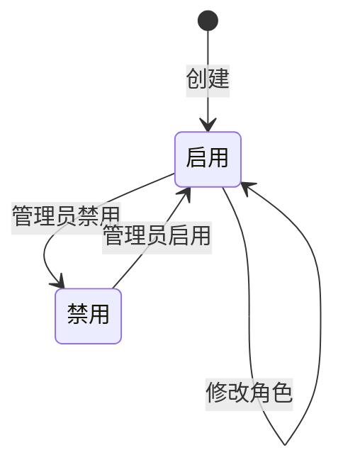

# 第 9 章 用户模块：账号管理

> **节首信息条**｜对应课次 8 · 2 学时 · 实践｜前置：第 8 章的登录认证与令牌；第 5 章 5.1.4/5.1.6/5.1.7 与补课卡 K-08｜**本节实训**：◆ 实训 9-1 用户模块：账号管理

上一章完成了“建用户、登录、拿令牌”。但用户模块不能只有登录：管理员还要看用户列表、查某个用户、改角色（Role）、启用或禁用账号。这些操作一旦开放给所有人，系统就等于没有管理边界。

本章在上一章的代码上继续增量开发：加列表与详情，加修改角色与启用/禁用（Deactivate），再用管理员和普通用户两个账号验证 200 与 403。重点不在“多写几个接口”，而在把权限、校验和安全规则放进后端。

## 本章学习目标

读完第 9 章并完成实训后，你应该能：

1. 区分管理接口与普通接口，并说明为什么权限必须加在后端。
2. 说明用户表 ORM 模型中唯一约束、必填与默认值各自的作用，并区分「模型定义」与「接口校验」。
3. 用 `Literal` / `Optional` 限定可修改字段，并解释 422 的产生位置。
4. 实现用户列表、详情、修改角色与启用/禁用接口，处理 404 与“不能禁用自己”。
5. 用管理员依赖实现 401/403 分工，并解释为什么改角色后旧令牌不会自动更新。

## 前置知识卡

| # | 你需要会 | 不会就回看 |
| --- | --- | --- |
| 1 | 两层依赖怎么分出 401 与 403 | 第 8 章 8.1.7（认证依赖）、8.1.8（`get_current_admin_user`） |
| 2 | `User` 表模型的字段与三个约束 | 第 8 章 8.1.2 |
| 3 | Pydantic 输入／输出模型与 422 | 第 5 章 5.1.4（补课卡 K-04）；第 8 章 8.1.4 |
| 4 | `Optional` 与 `Literal` | 第 5 章 5.1.7（补课卡 K-08） |

> 卡住时先回看，不必从头重读。

## 9.1 概念讲解

### 9.1.1 管理接口与普通接口

用户模块里有两类接口。一类是所有人都需要的，例如登录、查看自己的信息；另一类只给管理员，例如用户列表、修改角色、启用/禁用。第二类接口如果只靠前端隐藏按钮，绕过页面直接调用 API 仍然可以操作，所以权限必须加在后端。

判断一个接口属于哪一类，看它操作的是“自己的数据”还是“别人的数据或全局配置”。`/users/me` 操作自己，普通用户可用；`/users/` 查看所有人，只给管理员。

### 9.1.2 用户表与 ORM 模型

用户表沿用上一章的四个核心字段。模型定义在第 8 章 8.1.2 的 `app/models/user.py` 已经给出，这里重印一次，方便对照本节要讲的三个约束（纸质教材不必来回翻页）：

**代码 9-1-1** · `app/models/user.py`（重印第 8 章 8.1.2，Python）

```python
from sqlalchemy import Column, Integer, String
from app.core.database import Base

class User(Base):
    __tablename__ = "users"

    id = Column(Integer, primary_key=True)
    username = Column(String(100), unique=True, nullable=False)
    password_hash = Column(String(255), nullable=False)
    role = Column(String(20), default="normal")
    is_active = Column(Integer, default=1)
```

`unique=True` 保证用户名不重复——两个同名账号会让登录时按用户名查询取到不确定的那一个（第 8 章 8.1.5）；`nullable=False` 保证必填——缺了 `password_hash` 的行根本没法完成密码校验；`default` 提供默认值——新建用户不传 `role` 就自动是 `normal`、不传 `is_active` 就自动是 `1`，不必在每个创建接口里重复写。三条都是**数据库层面**的约束。模型管的是「数据怎么存」，不管「接口怎么校验」；后者由 9.1.3 的 `UserUpdate` 承担，两者要分开。

`Base` 不是本章定义的：它的完整写法在第 7 章《项目初始化与版本控制》的「从 `@app.get` 到 `@router.get`」一节（`app/core/database.py`），机制的最小讲解见第 5 章 5.1.7 与补课卡 K-07。本章直接继承它，不重复定义。

### 9.1.3 输入模型：把允许的值写死

修改用户时，只允许改角色和启用状态。角色只能是 `admin` 或 `normal`，启用状态只能是 0 或 1。用 Pydantic 的 `Literal` 可以把允许值写进类型：

**代码 9-1-3** · 示例代码（Python）

```python
from typing import Literal, Optional
from pydantic import BaseModel

class UserUpdate(BaseModel):
    role: Optional[Literal["admin", "normal"]] = None
    is_active: Optional[Literal[0, 1]] = None
```

`Optional` 与 `Literal` 的首次讲解见第 5 章 5.1.7 的补课卡 K-08，这里只回顾它们在账号管理里的作用：`Optional` 让字段可以不传，不传时保持原值；`Literal` 把允许值写死，只接受列出的取值。传入 `role="superuser"` 或 `is_active=2` 时，Pydantic 在进入函数前就拒绝，FastAPI 返回 422，错误类型为 `literal_error`。

这比在函数里写一串 `if role not in (...)` 更可靠：校验规则与数据结构写在一起，漏写一个分支也不会放过非法值。

### 9.1.4 输出模型：不返回密码哈希

列表和详情只返回可公开字段：`id`、`username`、`role`、`is_active`。`password_hash` 不能出现在响应里。这与第 8 章 8.1.4 注册接口的 `UserOut` 是同一个模型，这里重印一次，列表接口直接复用即可：

**代码 9-1-5** · `app/schemas/user.py`（重印第 8 章 8.1.4，Python）

```python
class UserOut(BaseModel):
    id: int
    username: str
    role: str
    is_active: int
```

如果直接把 ORM 对象整个返回，框架会把所有列都序列化，`password_hash` 就会泄露。显式定义输出模型，等于给响应加了一道白名单。

### 9.1.5 列表与详情

列表接口先固定返回前 50 条，保证页面能用；完整的分页、过滤与排序在后续章节统一实现。

> 为让代码与表格紧凑，本章示例里的 URL 省略统一的 `/api/v1` 前缀；`router` 自带 `/users` 前缀、`main.py` 再挂 `/api/v1`（第 7 章 7.1.5），所以 `@router.get("/")` 的完整路径是 `/api/v1/users/`。写进接口契约时前缀不能省，口径与第 4 章 4.1.5、第 6 章 6.1.4（接口组约定）一致。

代码里的 `router`、`Session`、`get_db` 都来自项目骨架，本章不重复定义：`router` 由 `app/routers/users.py` 顶部的 `APIRouter(...)` 创建、在 `main.py` 用 `include_router` 挂载（见第 5 章 5.1.3）；`Session` 与 `get_db` 的完整写法见第 7 章《项目初始化与版本控制》的「从 `@app.get` 到 `@router.get`」一节，机制见第 5 章 5.1.7。

**代码 9-1-7** · 示例代码（Python）

```python
@router.get("/", dependencies=[Depends(get_current_admin_user)])
def list_users(db: Session = Depends(get_db)):
    users = db.query(User).order_by(User.id).limit(50).all()
    return {
        "items": [
            {"id": u.id, "username": u.username, "role": u.role, "is_active": u.is_active}
            for u in users
        ],
        "count": len(users),
    }
```

详情接口按 `id` 查一个用户；查不到时返回 404，而不是返回空对象。404 让调用方明确知道“这个资源不存在”，空对象则会让前端误以为“查到了但没有字段”。

### 9.1.6 修改角色与启用/禁用

修改接口接收 `user_id` 和 `UserUpdate`，只更新传入的字段。注意 `current_user` 是第 8 章 8.1.7 `get_current_user` 返回的字典，键是 `id` 与 `role`——它已经把令牌载荷里的 `sub` 转成 `id` 再返回（duty 参考工程的 `app/core/dependencies.py` 同样如此），所以这里取 `current_user["id"]`；写成 `["sub"]` 会直接抛 `KeyError`：

**代码 9-1-9** · 示例代码（Python）

```python
@router.put("/{user_id}")
def update_user(
    user_id: int,
    data: UserUpdate,
    db: Session = Depends(get_db),
    current_user: dict = Depends(get_current_admin_user),
):
    user = db.query(User).filter(User.id == user_id).first()
    if not user:
        raise HTTPException(status_code=404, detail="用户不存在")

    if int(current_user["id"]) == user_id and data.is_active == 0:
        raise HTTPException(status_code=400, detail="不能禁用自己")

    if data.role is not None:
        user.role = data.role
    if data.is_active is not None:
        user.is_active = data.is_active
    db.commit()
    db.refresh(user)
    return {"id": user.id, "username": user.username, "role": user.role, "is_active": user.is_active}
```

“不能禁用自己”是一条业务规则。没有它，管理员误操作把自己停用后，就再也登录不进来，只能去数据库里手工改回来。



*图 9-1：用户账号的启用与禁用状态*

账号创建后进入「启用」；管理员可以来回切换启用与禁用，改角色不改变状态（图中「启用 → 启用」那条自环）。被禁用的账号仍在库里，历史记录不会丢。

### 9.1.7 权限依赖与 401/403

管理接口挂上 `Depends(get_current_admin_user)`。这个依赖先确认令牌有效（否则 401），再检查角色是否为 `admin`（否则 403）。它的完整实现在第 8 章 8.1.8「权限依赖」，**函数名与本章以及第 15 章、书末答案完全一致**，本章直接复用，不再重写，也不另起别名。

| 情况 | 状态码 | 含义 |
| --- | --- | --- |
| 没带令牌、令牌无效或过期 | 401 | 身份未确认 |
| 已登录但角色不是管理员 | 403 | 身份已确认，权限不足 |
| 管理员访问 | 200 | 权限通过 |

普通用户仍然可以访问 `/users/me`，因为它只操作自己的数据。权限设计要遵循最小权限（Least Privilege）：默认拒绝，只开放业务确实需要的操作。

### 9.1.8 改了角色，旧令牌不会自动变

令牌是在登录时签发的，里面保存的是当时的角色。管理员把某个用户从 `normal` 改成 `admin` 后，该用户手里的旧令牌仍然是 `normal`，必须重新登录才能拿到新角色。

这不是缺陷，而是令牌的工作方式。理解这一点，才能解释“为什么后台已经改了权限，用户还是 403”。处理办法是让用户重新登录，或在令牌过期后自然更新；如果业务要求立即生效，就需要额外的令牌失效机制，本书不展开。

### 9.1.9 校验不能被绕过

前端可以做校验，但后端必须再做一遍。原因很简单：请求可以绕过页面直接发出。用 Postman、curl 或脚本调用接口，前端的所有限制都不存在。

因此，合法性判断要放在后端：角色值用 `Literal` 限定；启用状态只接受 0/1；管理接口挂权限依赖；不能禁用自己这类业务规则写在服务层。前端校验只改善体验，不承担安全责任。

## 9.2 示范例题

#### 例 9-1：实现修改角色与启用/禁用接口【Bloom：应用】

**题目**：实现 `PUT /users/{user_id}`：只允许管理员调用；可以修改 `role` 与 `is_active`；用户不存在返回 404；管理员不能禁用自己，否则返回 400。

**解**：

**代码 9-2-1** · 示例代码（Python）

```python
@router.put("/{user_id}")
def update_user(
    user_id: int,
    data: UserUpdate,
    db: Session = Depends(get_db),
    current_user: dict = Depends(get_current_admin_user),
):
    user = db.query(User).filter(User.id == user_id).first()
    if not user:
        raise HTTPException(status_code=404, detail="用户不存在")

    if int(current_user["id"]) == user_id and data.is_active == 0:
        raise HTTPException(status_code=400, detail="不能禁用自己")

    if data.role is not None:
        user.role = data.role
    if data.is_active is not None:
        user.is_active = data.is_active
    db.commit()
    db.refresh(user)
    return {"id": user.id, "username": user.username, "role": user.role, "is_active": user.is_active}
```

判断顺序是：先确认目标用户存在（404），再检查安全规则（400），最后更新字段。顺序反过来，可能在用户不存在时也执行了“不能禁用自己”的判断，错误信息就会误导调用方。

#### 例 9-2：用 Pydantic 限定角色与状态【Bloom：应用】

**题目**：定义 `UserUpdate`，要求 `role` 只能是 `admin` 或 `normal`，`is_active` 只能是 0 或 1，两者都可省略。说明传入 `role="superuser"` 与 `is_active=2` 时会发生什么。

**解**：

**代码 9-2-3** · 示例代码（Python）

```python
from typing import Literal, Optional
from pydantic import BaseModel

class UserUpdate(BaseModel):
    role: Optional[Literal["admin", "normal"]] = None
    is_active: Optional[Literal[0, 1]] = None
```

`role="superuser"` 不是 `Literal` 允许的值，校验失败，错误类型为 `literal_error`；`is_active=2` 同理。FastAPI 在进入函数前返回 422，响应体的 `detail` 会指出字段位置与错误类型。函数体不需要再写角色白名单判断。

## 9.3 独立习题

#### 习题 9-1【Bloom：理解】

**题目**：用户创建接口返回 422，响应体里出现 `string_too_short` 与 `string_pattern_mismatch`。请解释这两种错误的含义，并说明 422 与 400 的区别。

#### 习题 9-2【Bloom：分析】

**题目**：下面三种做法都声称“已经做了权限控制”，请分别指出问题，并说明可能被怎样绕过。

1. 前端把“用户管理”菜单对普通用户隐藏。
2. 修改角色的接口只检查请求体里的 `role` 是否是合法字符串。
3. 管理员把用户改为普通用户后，该用户仍能用旧令牌访问管理接口。

#### 习题 9-3【Bloom：分析】（ORM 约束与接口校验的分工）

**题目**：某小组把 `users` 表模型简写成了下面这样，随后出现三个现象。请逐条指出该补哪一项约束、由**数据库层面**还是**接口层面**负责，并写出对应的 `Column(...)` 参数或校验手段。

```python
class User(Base):
    __tablename__ = "users"
    id = Column(Integer, primary_key=True)
    username = Column(String(100))
    password_hash = Column(String(255))
    role = Column(String(20))
    is_active = Column(Integer)
```

1. 注册接口忘了查重，两个同名账号都写进了库，登录时按用户名查询取到了不确定的一条。
2. 创建用户时没传 `role` 与 `is_active`，这两列是空的，登录后访问管理接口直接返回 403。
3. 管理员提交 `role="superuser"`，接口把值原样写进了库。

要求：答案中至少出现 `unique`、`nullable`、`default`、`Literal` 四个词，并说明第 3 条为什么不能只靠「`role` 是字符串类型」来防住。

## ◆ 实训 9-1：用户模块：账号管理（对应课次 8 · 2 学时）

### 一、任务目标与验收

| 目标 | 验收标志 |
| --- | --- |
| 管理接口可用 | 列表、详情、修改、启停四个接口返回符合约定 |
| 输入输出模型分离 | 响应不含 `password_hash` |
| 权限边界正确 | 未登录 401、普通用户 403、管理员 200 |
| 业务规则生效 | 不能禁用自己返回 400 |
| 非法值被拦截 | `role="superuser"` 与 `is_active=2` 返回 422 |

### 二、课前准备

- 第 8 章登录认证已完成，`app/models/user.py` 的 `User` 表模型可用，能拿到管理员与普通用户令牌
- 第 7 章搭好的骨架（`Base`、`get_db`、`main.py` 的 `create_all`）正常，`users` 表已建出
- Postman/curl 或 `/docs` 可发起请求

### 三、操作步骤

1. **写输入输出模型**
   - 做什么：把「允许修改的字段」与「允许返回的字段」分别限定住
   - 操作：在 `app/schemas/user.py` 写 `UserUpdate` 与 `UserOut`（后者重印第 8 章 8.1.4 的定义）
   - 预期输出：→ `UserOut` 只含 `id`、`username`、`role`、`is_active`
   - 做错会看到什么：响应里仍有 `password_hash`：把 ORM 对象直接返回了，改用 `response_model=UserOut`
2. **实现列表与详情**
   - 做什么：写列表与按 id 查详情，并让「查不到」明确报错
   - 操作：用 `@router.get` 写 `/` 与 `/{user_id}`，详情里 `raise HTTPException(404)`
   - 预期输出：→ 列表 200 且只返回前 50 条；不存在的 id 返回 404
   - 做错会看到什么：查不到返回 `{}`：改为抛 404，别让前端误以为查到了空记录
3. **加管理员依赖**
   - 做什么：给四个管理接口都挂上权限检查
   - 操作：在路由上写 `dependencies=[Depends(get_current_admin_user)]`，或在参数里声明该依赖
   - 预期输出：→ 未登录 401、普通用户 403、管理员 200
   - 做错会看到什么：普通用户仍 200：依赖未挂或角色判断写反
4. **验证业务规则**
   - 做什么：用管理员令牌试着禁用自己，确认被 400 拦下
   - 操作：`PUT /api/v1/users/{自己的 id}`，请求体 `{"is_active": 0}`
   - 预期输出：→ 400「不能禁用自己」，账户状态不变
   - 做错会看到什么：真被禁用后无法登录；恢复账号并补 `current_user["id"] == user_id` 的判断

### 四、排错清单

| 现象 | 先查什么 |
| --- | --- |
| 响应仍带 `password_hash` | 是否直接返回 ORM 对象、输出模型是否生效 |
| 401 与 403 混淆 | 认证依赖是否先执行、角色字段是否为 `admin` |
| `Literal` 报错 | 取值是否与定义完全一致（区分字符串与整数） |
| 旧令牌仍有旧权限 | 说明令牌载荷未刷新，重新登录即可 |

### 五、提交与验收

提交接口代码与三种身份的验证记录；验收按“接口完整”“权限边界”“校验与业务规则”三项判定。

### 六、课后扩展

- 给列表接口补分页参数
- 把“不能禁用自己”抽成独立业务函数并补测试
- 检查所有响应是否都经过输出模型

### 七、回链

- 第 5 章 5.1.4（Pydantic）、5.1.6（Depends）、5.1.7（K-08）；第 8 章 8.1.7–8.1.8；本章 9.1.3–9.1.7

## 本章小结

**核心结论**：

1. 用户模块有两类接口：面向自己的普通接口和只给管理员的管理接口；权限必须加在后端。
2. 输入模型用 `Literal` 限定角色与状态，非法值在进入函数前返回 422；输出模型只返回可公开字段，不泄露 `password_hash`。
3. 列表先固定返回前 50 条保证可用，详情查不到返回 404；修改接口按“存在性、业务规则、更新”的顺序处理。
4. 管理接口挂管理员依赖：未认证返回 401，已认证但角色不足返回 403。
5. 令牌在登录时签发，角色变更后旧令牌不会自动更新，需要重新登录；前端校验只改善体验，不能替代后端校验。

**学完本章，你可以体会到**：账号管理的难点不是多写几个接口，而是把“谁能做什么”写成后端可执行的检查。
**自检**：回到章首的学习目标，逐条问自己做到了没有——

- [ ] 区分管理接口与普通接口，并说明为什么权限必须加在后端。 → 回看 9.1.1、9.1.9，自测：习题 9-2 第 1 项
- [ ] 说明 ORM 模型中唯一约束、必填与默认值的作用，区分模型定义与接口校验。 → 回看 9.1.2，自测：习题 9-3
- [ ] 用 `Literal` / `Optional` 限定可修改字段，并解释 422 的产生位置。 → 回看 9.1.3 与例 9-2，自测：习题 9-1、9-2
- [ ] 实现用户列表、详情、修改角色与启用/禁用接口，处理 404 与“不能禁用自己”。 → 回看 9.1.5–9.1.6 与例 9-1，自测：习题 9-1
- [ ] 用管理员依赖实现 401/403 分工，并解释为什么改角色后旧令牌不会自动更新。 → 回看 9.1.7–9.1.8，自测：习题 9-2 第 2、3 项

**下一章预告**：用户模块告一段落。下一章进入数据模块，用部门这个更典型的实体，走一遍完整的增删查改，并把分页、过滤与排序补齐。

