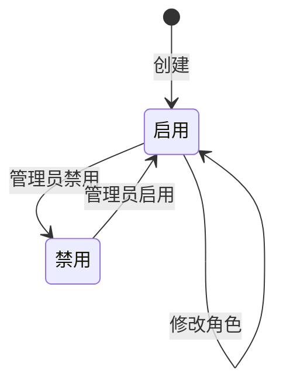

# 第 9 章 用户模块：账号管理

第 8 章解决了“请求来自谁”。但知道身份并不等于知道能做什么：管理接口若只是照常挂出，普通用户同样可以调用。

## 本章要解决的问题

**认证之后，系统怎样决定“你能做什么”，并把越权挡在后端？**

身份确认之后，接口仍然对所有人一视同仁：普通用户只要知道地址，就能调用管理员接口，或修改本不该由他修改的字段。前端隐藏按钮只改变看不看得见，不改变接口是否执行。

本章关心的是：身份确认之后，权限边界画在哪里才拦得住越权；同样是被拒绝，调用方应当怎样区分“没登录”与“没权限”。

## 本章学习目标

读完第 9 章并完成实训后，应能：

1. 区分认证与授权，说明为什么权限必须加在后端。
2. 用管理员依赖实现 401 与 403 的分工，并解释两个状态码各对应什么处理。
3. 实现用户列表与修改角色、启用/禁用两个接口，处理 404 与“不能禁用自己”。
4. 用 `Literal` / `Optional` 限定可修改字段，并解释 422 的产生位置。

## 9.1 授权与角色

用户模块里有两类接口。一类是所有人都需要的，例如登录、查看自己的信息；另一类只给管理员，例如用户列表、修改角色、启用/禁用。第二类接口如果只靠前端隐藏按钮，绕过页面直接调用 API 仍然可以操作。

**授权**要解决的就是这件事：在身份已经确认的前提下，判断“这个身份能不能做这个操作”。**授权是按身份限制可执行操作的过程；权限不足时拒绝。** 

判断一个接口属于哪一类，看它操作的是“自己的数据”还是“别人的数据或全局配置”。`/users/me` 操作自己，普通用户可用；`/users` 查看所有人，只给管理员。这个判断要写在**后端**，因为后端是请求进入系统的唯一入口。

**越权**指身份合法，但做了超出权限范围的事。普通用户调用管理员接口属于垂直越权，越权修改本不该改的字段属于对象级授权失效。前者靠依赖拦截，后者靠输入模型限制，本章两件都要做。

> 💡 **易错点**：把“前端没显示按钮”当成“没有权限”。前端隐藏只影响正常用户的操作路径；攻击者、脚本和误操作的同事都可能直接调接口。权限检查必须在后端执行。

**角色**是权限的归组方式。本课程设置普通用户和管理员两种角色：`role` 为 `admin`（管理员）或 `normal`（普通用户），他们各自的权限如下：

| 操作 | 普通用户 | 管理员 |
| --- | --- | --- |
| 登录、查看 `/users/me` | 允许 | 允许 |
| 查看用户列表 | 拒绝（403） | 允许 |
| 修改角色、启用/禁用 | 拒绝（403） | 允许 |
| 禁用自己 | 不适用 | 拒绝（400，业务规则） |

这张表就是“权限边界”。它的判据是最小权限（Least Privilege，Saltzer & Schroeder, 1975）：默认拒绝，只开放业务确实需要的操作。

## 9.2 管理员依赖与 401/403

认证只回答了“你是谁”，没有回答“你能做什么”。登录之后，请求带着令牌，系统据此能认出调用者；但认出来不等于允许操作。管理接口如果只做身份确认，任何登录用户，包括普通用户，都能查看全部账号、修改角色或停用别人。要挡住这类越权，必须在接口执行之前再加一道检查：读取调用者的角色，不是管理员就拒绝。

这道检查会出现在不止一个管理接口上，因此写成可复用的依赖，而不是在每个接口里各写一遍 `if`。接口只需在声明处挂一次；认证与授权分开之后，两者各自只负责一件事，出问题时也容易定位。

第 8 章 8.4 的 `get_current_user` 完成的是前一步：确认令牌有效，取出当前用户。它不判断角色，管理接口要在它之上再包一层。

**代码 9-1-1** · `app/core/security.py`（权限依赖，续写，Python）

```python
def get_current_admin_user(current_user: dict = Depends(get_current_user)) -> dict:
    if current_user["role"] != "admin":
        raise HTTPException(status_code=403, detail="权限不足")
    return current_user
```

没登录时，`get_current_user` 先返回 401；已登录但角色不是管理员时，`get_current_admin_user` 返回 403。两层依赖分别对应认证与授权，状态码也自然分开。

| 情况 | 状态码 | 含义 |
| --- | --- | --- |
| 没带令牌或令牌无效 | 401 | 身份未确认 |
| 已登录但角色不是管理员 | 403 | 身份已确认，权限不足 |
| 管理员访问 | 200 | 权限通过 |

两个状态码的分工是为了让调用方知道该做什么：401 要重新登录，403 要换账号或申请权限。把 403 写成 401，用户会被反复要求登录；把 401 写成 403，用户会以为自己的权限出了问题。

**角色变更即时生效**

本章的令牌字典只登记“令牌属于哪个 user_id”，角色不在令牌里，而是在每次校验令牌时从用户表里查。因此管理员把某个用户从 `normal` 改成 `admin` 后，该用户手里的令牌立刻就能按新角色访问——因为 `get_current_user` 每次都会按 user_id 重新读一次角色。若把角色连同令牌一起签发，角色在令牌到手时就已固定，改角色后必须重新登录才生效；本章不取这种做法，代价是每次校验多查一次用户表（第 8 章 8.4 已说明）。

**管理员账号从哪来**

第 8 章的注册接口只创建普通用户。管理员账号由一次性脚本创建，脚本不挂路由，也不进入请求链路。

**代码 9-1-2** · `app/scripts/create_admin.py`（创建管理员账号，Python）

```python
from app.core.database import SessionLocal
from app.core.security import get_password_hash
from app.modules.user import crud


def create_admin(username: str = "admin", password: str = "admin123") -> None:
    '''向 users 表写入/更新管理员账号；可重复运行。'''
    db = SessionLocal()
    try:
        user = crud.get_by_username(db, username)
        if user is None:
            crud.create(db, username, get_password_hash(password))
            user = crud.get_by_username(db, username)
            crud.update(db, user, {"role": "admin"})
            print(f"已创建管理员：{username}")
        else:
            crud.update(db, user, {
                "password_hash": get_password_hash(password),
                "role": "admin",
            })
            print(f"已更新管理员：{username}")
    finally:
        db.close()


if __name__ == "__main__":
    create_admin()
```

`SessionLocal` 来自第 6 章的 `app/core/database.py`，与接口依赖 `get_db` 同源；脚本不在请求链路上，要自己开一个 session 并在结束时关闭。`crud` 的五个函数都带 `db`，脚本按同一套函数读写，不必另写一份查询。

`app/scripts/` 与 `app/modules/` 同级，放一次性维护脚本。先建一个空的 `app/scripts/__init__.py`，然后在项目根目录运行：

```text
$ python -m app.scripts.create_admin
```

脚本可重复运行：账号不存在时创建；同名账号已存在时，将其角色改为 `admin` 并重置密码。账号写进 `duty.db` 的 users 表，服务重启后仍在，不必每次启动都 seed——这与第 8 章令牌字典 `TOKEN_STORE` 的“重启即清空”不同：重启后账号还在，只是需要重新登录取新令牌。

## 9.3 用户列表

管理员账号建好后，管理接口的第一件事是“看见”：管理员得先知道系统里有哪些账号，才能选中某个用户去改角色或停用。9.1 的权限边界表里有一行“查看用户列表”，管理员允许，普通用户 403；本节把这个接口实现出来。

第 7 章已经把列表查询定型：查询参数收进 `param.py`，`crud.list_page(db, offset, limit)` 返回 `(items, total)`，service 换算 `offset` 并组装二字段响应，controller 只声明契约。用户列表沿用同一套骨架，不另写一份分页逻辑。第 6 章建立分页，第 7 章补齐参数边界、过滤次序与固定排序键，本章只需把它们接到 users 表上；判断“换一个模型要不要重写分页”，看的就是这里。

先给 user 模块补一个参数模型：

**代码 9-1-3** · `app/modules/user/param.py`（分页参数，Python）

```python
from pydantic import BaseModel, Field


class UserQueryParams(BaseModel):
    page: int = Field(default=1, ge=1)
    page_size: int = Field(default=10, ge=1, le=100)
```

`ge` 与 `le` 的边界沿用第 7 章 7.2 的约定，参数名也统一为 `page` 与 `page_size`；前端不必为这个模块另记一套名字。

**代码 9-1-4** · `app/modules/user/crud.py`（分页查询，续写，Python）

```python
def list_page(db, offset: int, limit: int):
    query = db.query(User)
    total = query.count()
    items = query.order_by(User.id).offset(offset).limit(limit).all()
    return items, total
```

`count()` 取自同一个 `query`，`order_by(User.id)` 给翻页一个稳定顺序；这两点分别来自第 7 章 7.3 与 7.4。用户列表暂不提供过滤条件，因此没有需要放在 `count()` 之前的 `filter`；一旦加上按角色筛选，就必须先过滤再计数。

**代码 9-1-5** · `app/modules/user/service.py`（用户列表，续写，Python）

```python
def list_users(db, params) -> dict:
    offset = (params.page - 1) * params.page_size
    items, total = crud.list_page(db, offset, params.page_size)
    return {
        "items": [
            {"id": u.id, "username": u.username, "role": u.role, "is_active": u.is_active}
            for u in items
        ],
        "total": total,
    }
```

service 只做换算、整理与组装。字段仍只列可公开的四项，`password_hash` 不在其中；返回结构是 `items` 与 `total`，前端按 `ceil(total / page_size)` 算总页数。

**代码 9-1-6** · `app/modules/user/controller.py`（列表接口，续写，Python）

```python
from app.core.security import get_current_admin_user
from app.modules.user.param import UserQueryParams

@router.get("", dependencies=[Depends(get_current_admin_user)])
def list_users(
    params: UserQueryParams = Depends(),
    db: Session = Depends(get_db),
):
    return service.list_users(db, params)
```

`dependencies=[...]` 写在路由装饰器里，表示“进入这个接口前先通过权限检查”，函数本身不需要使用当前用户；`Depends()` 不带参数时把 `UserQueryParams` 当作查询参数模型。完整路径是 `GET /users`，例如 `GET /users?page=2&page_size=5`。

## 9.4 修改角色与启用/禁用

修改用户时，只允许改角色与启用状态。角色只能是 `admin` 或 `normal`，启用状态只能是 0 或 1。用 Pydantic 的 `Literal` 把允许值写进类型。在 `schema.py` 顶部补一行导入，再追加：

**代码 9-1-7** · `app/modules/user/schema.py`（修改模型，续写，Python）

```python
from typing import Literal, Optional


class UserUpdate(BaseModel):
    role: Optional[Literal["admin", "normal"]] = None
    is_active: Optional[Literal[0, 1]] = None
```

`Optional` 让字段可以不传，不传时保持原值；`Literal` 把允许值写死，只接受列出的取值。两者在此首次出现：`Optional[X]` 等价于 `X | None`；`Literal[...]` 限定常量集合。传入 `role="superuser"` 或 `is_active=2` 时，Pydantic 在进入函数前就拒绝，FastAPI 返回 422，错误类型为 `literal_error`。

**代码 9-1-8** · `app/modules/user/service.py`（修改用户，续写，Python）

```python
def update_user(db, user_id: int, data, current_user: dict) -> User:
    user = crud.get_by_id(db, user_id)
    if not user:
        raise HTTPException(status_code=404, detail="用户不存在")
    if current_user["id"] == user_id and data.is_active == 0:
        raise HTTPException(status_code=400, detail="不能禁用自己")
    return crud.update(db, user, data.model_dump(exclude_unset=True))
```

查用户经 `crud.get_by_id(db, ...)`，写入经 `crud.update(db, ...)`；service 只判断“存在性”与“不能禁用自己”两条规则。

判断顺序是“存在性、业务规则、更新”。顺序反过来，可能在用户不存在时也执行了“不能禁用自己”的判断，错误信息就会误导调用方。

“不能禁用自己”是一条业务规则：没有它，管理员误操作把自己停用后，就再也登录不进来，只能去数据库里手工改回来。`current_user["id"]` 已经是整数，可以直接与 `user_id` 比较。

查不到用户时返回 404，而不是返回空对象。404 让调用方明确知道“这个资源不存在”，空对象则会让前端误以为“查到了但没有字段”。

**代码 9-1-9** · `app/modules/user/controller.py`（修改接口，续写，Python）

```python
from app.modules.user.schema import UserUpdate

@router.put("/{user_id}", response_model=UserOut)
def update_user(
    user_id: int,
    data: UserUpdate,
    current_user: dict = Depends(get_current_admin_user),
    db: Session = Depends(get_db),
):
    return service.update_user(db, user_id, data, current_user)
```

修改接口把权限依赖写在参数里，因为函数需要当前用户的 `id` 来判断“不能禁用自己”。完整路径是 `PUT /users/{user_id}`。

**禁用之后不能登录**

第 8 章 8.3 的 `login` 只校验密码。账号被禁用后仍能登录，`is_active` 就形同虚设。在签发令牌前补一段检查：

**代码 9-1-10** · `app/modules/user/service.py`（修改第 8 章 8.3 的 `login`，Python）

```python
def login(db, data) -> dict:
    user = crud.get_by_username(db, data.username)
    if not user or not verify_password(data.password, user.password_hash):
        raise HTTPException(status_code=401, detail="用户名或密码错误")
    if not user.is_active:
        raise HTTPException(status_code=401, detail="账号已禁用")
    token = create_access_token(user.id)
    return {"access_token": token, "token_type": "bearer", "user": user}
```

账号状态的变化可以画成下图。



*图 9-1：用户账号的启用与禁用状态*

账号创建后进入“启用”；管理员可以来回切换启用与禁用，改角色不改变状态。被禁用的账号仍在 users 表里，没有被删除。

**把权限挂回已建的数据接口**

第 6 章讲数据层时先说明过：读写接口暂不设身份与权限检查。9.1 又给出判据——越权要挡在接口入口。两句话合起来看，`/departments` 的新增与删除接口到现在还没挂任何依赖，任何知道地址的人都能调用，正是本章定义的越权敞口。权限依赖建立之后，要把这一步补上。

**代码 9-1-11** · `app/modules/department/controller.py`（补权限依赖，续写，Python）

在文件顶部补一行导入，再给第 6 章代码 6-1-7、6-1-10 的两条写接口加上 `dependencies`：

```python
from app.core.security import get_current_admin_user

@router.post("", response_model=DepartmentOut, status_code=status.HTTP_201_CREATED,
             dependencies=[Depends(get_current_admin_user)])
def create_department(data: DepartmentCreate, db: Session = Depends(get_db)):
    return service.create_department(db, data)


@router.delete("/{dept_code}", status_code=status.HTTP_204_NO_CONTENT,
               dependencies=[Depends(get_current_admin_user)])
def delete_department(dept_code: str, db: Session = Depends(get_db)):
    service.delete_department(db, dept_code)
```

查询类接口是否开放，取决于业务：本课程的 `/departments` 列表与详情供普通执勤人员查看，不加管理员依赖；新增与删除只给管理员。挂完之后用普通用户令牌重试一次新增，应返回 403，用管理员令牌重试应返回 201。这一步不做，9.1 的权限边界就只覆盖用户模块，前两章写出来的接口仍然对所有人敞开。

## 示范例题

#### 例 9-1：实现启用/禁用接口

**题目**：实现 `PUT /users/{user_id}`：只允许管理员调用；可以修改 `role` 与 `is_active`；用户不存在返回 404；管理员不能禁用自己，否则返回 400。列出 200、400、404、422 各由什么请求触发。

**解**：即代码 9-1-7～9-1-9。service 先确认目标用户存在（404），再检查安全规则（400），最后更新字段；controller 只接请求、挂依赖、调 service。

| 请求 | 状态码 |
| --- | --- |
| 管理员把普通用户的 `is_active` 改为 0 | 200 |
| 管理员把自己的 `is_active` 改为 0 | 400 |
| `user_id` 在库中不存在 | 404 |
| 请求体写 `{"role": "superuser"}` 或 `{"is_active": 2}` | 422 |

422 在进入函数前产生，404 与 400 在 service 中产生。三类错误的归属不同，排查时先看请求是否通过校验。

## 独立习题

#### 习题 9-1

**题目**：用自己的话区分认证与授权，说明 401 与 403 各对应什么处理。为什么权限检查必须写在后端？

#### 习题 9-2

**题目**：下面三种做法都声称“已经做了权限控制”，请分别指出问题，并说明可能被怎样绕过。

1. 前端把“用户管理”菜单对普通用户隐藏。
2. 修改角色的接口只检查请求体里的 `role` 是否是合法字符串。
3. 认证依赖只调用了 `resolve_token` 校验令牌，没有按 user_id 查用户表取角色，于是把 `role` 写死成了 `normal`（或漏查）。

#### 习题 9-3

**题目**：单位要新增“哨位管理”：管理员维护哨位编号、位置与启用状态；普通执勤人员只能查看启用中的哨位，用于安排执勤。请为这个模块设计权限边界：列出至少 3 个接口，逐个标明允许的角色、未登录/普通用户/管理员的结果状态码，并说明哪些字段普通用户不能修改、由什么机制拦住。另请说明：登录接口为什么不能挂认证依赖？**不能照抄本章用户表的字段与接口名**：哨位没有用户名、密码和角色。

## ◆ 实训 9-1：用户模块：账号管理

### 一、任务目标与验收

| 目标 | 验收标志 |
| --- | --- |
| 管理接口可用 | 列表按页返回 `items`/`total`；修改接口返回符合约定 |
| 权限边界正确 | 未登录 401、普通用户 403、管理员 200 |
| 业务规则生效 | 不能禁用自己返回 400 |
| 非法值被拦截 | `role="superuser"` 与 `is_active=2` 返回 422 |
| 禁用生效 | 被禁用账号登录返回 401 |
| 数据接口已回收 | `/departments` 新增与删除挂上管理员依赖，普通用户调用返回 403 |

### 二、课前准备

- 第 6–8 章的工程可启动，`app/core/database.py`、`departments` 表与 `users` 表都已建好；注册、登录、`/me` 可用，重启后账号仍在（只需重新登录取新令牌）
- 第 7 章定型的 `param.py` 加 `list_page` 骨架在手，用户列表直接复用
- Postman、curl 或 `/docs` 可发起请求；`python -m app.scripts.create_admin` 可在项目根目录执行

### 三、操作步骤

1. **建管理员账号**
   - 做什么：让普通用户之外有一个管理员，用于验证 200 与 403 的差别
   - 操作：建空文件 `app/scripts/__init__.py`，写代码 9-1-2，在项目根目录运行 `python -m app.scripts.create_admin`
   - 预期输出：终端输出“已创建管理员”或“已更新管理员”；`admin` 能用密码 `admin123` 登录并拿到令牌；重启服务后账号仍在
   - 做错会看到什么：`No module named app.scripts` → 缺少 `__init__.py`，或在错误的目录下运行；`no such table: users` → 回看第 8 章实训步骤 2 补模型导入
2. **实现列表接口**
   - 做什么：写 `param.py`、`crud.list_page`、`service.list_users` 与带管理员依赖的 `GET /users`
   - 操作：按代码 9-1-3～9-1-6 落地
   - 预期输出：未登录 401、普通用户 403、管理员 200 且 `total` 等于用户总数；`?page=2&page_size=5` 能翻页
   - 做错会看到什么：普通用户仍 200 → 依赖未挂或角色判断写反；`total` 与 `items` 不符 → `count()` 与分页取数不是同一个 query
3. **实现修改接口**
   - 做什么：写 `UserUpdate`、`service.update_user` 与 `PUT /users/{user_id}`，各函数带 `db`
   - 操作：按代码 9-1-7～9-1-9 落地
   - 预期输出：正常修改 200；用户不存在 404；禁用自己 400；非法值 422
   - 做错会看到什么：禁用自己仍 200 → 漏了 `current_user["id"] == user_id` 的判断；`TypeError` 缺 `db` → service/controller 未把会话传下去
4. **验证禁用规则**
   - 做什么：用管理员令牌禁用普通用户，再用该用户登录
   - 操作：先 `PUT` 把 `is_active` 改为 0，再向 `/users/login` 发请求
   - 预期输出：修改 200，登录 401“账号已禁用”
   - 做错会看到什么：被禁用账号仍能登录 → 没有按代码 9-1-10 补上检查
5. **把权限挂回数据接口**
   - 做什么：给 `/departments` 的新增与删除接口挂管理员依赖
   - 操作：按代码 9-1-11 改写 `app/modules/department/controller.py`
   - 预期输出：普通用户令牌调用新增返回 403，管理员令牌调用返回 201；列表与详情仍可访问
   - 做错会看到什么：普通用户仍 201 → `dependencies` 写在了函数体里而不是路由装饰器上

### 四、排错清单

| 现象 | 先查什么 |
| --- | --- |
| 401 与 403 混淆 | 认证依赖是否先执行、角色字段是否为 `admin` |
| 普通用户也能看列表 | 路由上是否写了 `dependencies=[Depends(get_current_admin_user)]` |
| `Literal` 报错 | 取值是否与定义完全一致（区分字符串与整数） |
| 改角色后普通用户仍能访问 | `get_current_user` 是否在每次校验时按 user_id 查了用户表取 `role` |
| 禁用后仍能登录 | `login` 中是否补了 `is_active` 检查，且 `db` 是否传到 crud |
| 管理员账号不存在 | 是否运行过 `python -m app.scripts.create_admin`；`DATABASE_URL` 是否指向同一个 `duty.db` |
| `no such table: users` | `main.py` 是否导入 user 模型并执行 `create_all` |
| 重启后管理员账号消失 | 是否仍在用内存版 `model.py`；`User` 应继承 `Base` |

### 五、提交与验收

提交接口代码、脚本、数据接口补依赖的改动与三种身份的验证记录；验收按“接口完整”“权限边界”“业务规则”“数据接口回收”四项判定。

### 六、课后扩展

- 给列表接口补按角色筛选，并说明过滤为什么要放在 `count()` 之前（第 7 章 7.3）
- 把“不能禁用自己”抽成独立业务函数并补测试
- 检查所有响应是否都经过输出模型
- **复习任务**：回看第 3 章 3.5（Pydantic）、3.6（`HTTPException`）、第 4 章 4.5（`Depends`）、第 7 章 7.2–7.4（查询骨架）、第 8 章 8.4（认证依赖），对照本章 9.2–9.4，说明接口校验、权限依赖与业务规则各拦住了哪一类问题

## 本章小结

**核心结论**：

1. 认证确认身份，授权判断权限；401 表示身份未确认，403 表示权限不足。
2. 权限必须加在后端；前端隐藏按钮不构成权限控制。
3. 管理接口用 `Depends(get_current_admin_user)` 挂权限检查；需要当前用户时把它写在参数里，不需要时写在 `dependencies=[...]`。
4. 输入模型用 `Literal` 限定角色与启用状态，非法值在进入函数前返回 422；查不到用户返回 404；业务规则写在 service。
5. 禁用账号后，登录必须检查 `is_active`，否则禁用形同虚设。
6. 令牌在登录时签发，只登记 user_id；角色在每次校验令牌时从用户表里查，因此角色变更即时生效。
7. 用户列表复用第 7 章的查询骨架；第 6 章建立的写接口在本章补挂管理员依赖后，权限边界才覆盖全部入口。

把这章压缩成一句话：**认证确认你是谁，授权决定你能做什么；越权要挡在接口入口，而不是藏在页面里。**

**学完本章，你可以体会到**：账号管理的难点不是多写几个接口，而是把“谁能做什么”写成后端可执行的检查。

**自检**：回到章首的学习目标，逐条问自己做到了没有——

- [ ] 区分认证与授权，说明为什么权限必须加在后端。
- [ ] 用管理员依赖实现 401 与 403 的分工，并解释两个状态码各对应什么处理。
- [ ] 实现用户列表与修改角色、启用/禁用接口，处理 404 与“不能禁用自己”。
- [ ] 用 `Literal`/`Optional` 限定可修改字段，解释 422 的产生位置。
- [ ] 完成实训 9-1 并自评。

**下一章预告**：账号与权限到此闭环。下一章转向业务规则：执勤时间先后、跨表引用与时段重叠这些记录之间要同时满足的约束，应写在哪一层，以及如何保证不被绕过。
