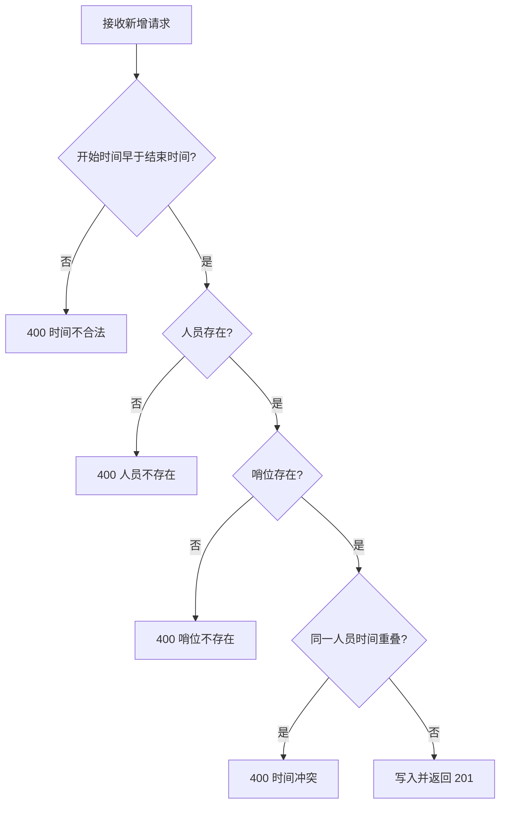

# 第 10 章 业务模块：规则描述

第 8 章解决的是数据的形状：字段类型、必填与长度。但形状正确不等于业务成立——记录之间的先后、跨对象的引用、时间段的边界，都要同时看多个字段才判断得出。

一条约束写在哪里、由谁拒绝，决定了它能否被稳定执行。

## 本章要解决的问题

**数据在格式上合法，不等于在业务上合法；一条业务约束应该怎样被识别、分类，并放到该放的位置？**

字段类型、必填与长度能保证数据的形状正确，却管不了记录之间的先后关系、跨表的引用是否存在，以及多段记录是否重叠。这些判断需要同时看多个字段、多张表或多条记录。放错位置，要么拦不住，要么把错误推到数据库或前端。

本章关心的是：一条业务约束怎样从需求文字变成可测试的代码——它凭什么成立，该由哪一层守住，失败时又以什么方式说清楚。

## 本章学习目标

读完第 10 章并完成实训后，你应该能：

1. 区分数据合法与业务合法，说明同一约束在 schema、service、数据库约束三种位置分别会被怎样拒绝。
2. 从需求文字中识别约束，并按单字段、跨字段、跨表、跨记录分类。
3. 为一条规则确定归属层，说明为什么不能交给 schema 或数据库。
4. 按固定顺序校验，返回可定位的错误码与信息，并守住“先校验、后写入”。
5. 产出一份规则清单，为每条规则设计正常与冲突用例，并为有边界的规则补边界用例。

## 10.1 数据合法与业务合法

本章用执勤记录表做例子。表的结构如下：

| 字段 | 说明 |
| --- | --- |
| `id` | 记录编号，主键 |
| `personnel_certificate_number` | 执勤人员证件号，外键 |
| `successor_certificate_number` | 接岗人员证件号，可选 |
| `workstation_id` | 哨位编号，外键 |
| `start_time` | 开始时间 |
| `end_time` | 结束时间 |
| `status` | 状态，`normal` 或 `abnormal` |
| `remark` | 备注 |

关系是：人员 1—N 执勤记录 N—1 哨位。一条记录属于一个人员、一个哨位；人员和哨位必须先在各自表里存在。时间是这条记录的核心，也是冲突规则的依据。

Pydantic 能保证字段类型正确、必填项不缺、长度不超限，这些是“数据合法”。数据库的主键、外键、唯一与必填约束，能保证“存进去的数据形状正确”。但两者都管不了“业务上讲不讲得通”。

| 情况 | 数据层能拦住吗 | 为什么 |
| --- | --- | --- |
| 开始 14:00、结束 08:00 | 不能 | 两个时间字段都合法，问题在先后关系 |
| 人员证件号格式正确但人不存在 | 数据库外键能拦，接口反馈差 | 外键抛异常，前端可能收到 500 |
| 同一人员两段时间重叠 | 不能 | 每条记录单独看都合法，问题在记录之间 |

**业务规则**（Business Rule）在需求工程中泛指对业务行为的约束（IIBA BABOK）；本章把落进代码的那部分表述为“什么情况下拒绝、返回什么错误”的判断。本章的核心概念是**业务规则与一致性**：规则回答“这条写不写”，一致性回答“多条规则、多次写入之间不能互相矛盾”。

一条约束最后由哪一层拒绝，取决于它要看到多少数据。单个字段的格式与取值范围，schema 就能判断；两个字段的先后关系、关联记录是否存在、多条记录是否重叠，需要 service 来查；数据库约束只适合兜住形状，不适合承担需要可读错误信息的业务判断。按校验依赖的范围，业务规则可以分为四类，10.2 逐类展开；规则放在哪一层，10.3 给出判据。

## 10.2 业务规则的识别与分类

业务规则不是从代码里“想”出来的，而是从需求文字里“读”出来的。读的时候先找线索，再按规则要看到的数据范围分类。分类决定了它该由哪一层拒绝。

**按来源与范围分类**

- **字段取值**：类型、必填、长度、格式、取值范围。例如“工号必填”“证件号必须是 18 位”。
- **对象关系**：一条记录引用的另一条记录是否存在、是否属于某个范围。例如“人员必须属于某单位”“器材必须在库”。
- **时序与状态**：字段之间的先后、记录之间的重叠、当前状态允许哪些动作。例如“借出后才能归还”“同一时段不能重复排班”。

| 类型 | 需要看到什么 | 常见例子 |
| --- | --- | --- |
| 单字段 | 一个字段的取值 | 证件号必填、长度不超过 18 位 |
| 跨字段 | 同一条记录的两个及以上字段 | 开始时间早于结束时间 |
| 跨表 | 另一张表里是否存在对应记录 | 人员、哨位必须存在 |
| 跨记录 | 同一实体的多条记录之间是否冲突 | 同一人员的时间不能重叠 |

单字段规则通常由 schema 承担；跨字段、跨表、跨记录规则需要 service 查库或比较。分类不是学术练习，它直接回答“这条规则放在哪一层”。

下面三句摘自执勤电子年鉴的需求文档，本章以它们为例：

> 1. 执勤人员必须是在册人员，哨位必须是已登记哨位。
> 2. 每条执勤记录的开始时间必须早于结束时间。
> 3. 同一人员在同一时间段内不得有两条执勤记录；前一条的结束时间等于后一条的开始时间时，视为连续排班，不算冲突。

| 摘录 | 约束 | 范围类型 |
| --- | --- | --- |
| 第 1 句 | 人员、哨位必须存在 | 跨表 |
| 第 2 句 | 开始早于结束 | 跨字段 |
| 第 3 句 | 同一人员时间不重叠；首尾相接不算冲突 | 跨记录 |

**规则一：开始时间必须早于结束时间**

**代码 10-1-1** · `app/modules/duty_record/service.py`（规则代码，Python）

```python
if data.start_time >= data.end_time:
    raise HTTPException(status_code=400, detail="开始时间必须早于结束时间")
```

它来自摘录第 2 句，属于跨字段。为什么放在 service 而不是 schema？因为它是业务语义，不是字段格式。schema 可以校验“是不是时间”，但“先后顺序”需要同时看到两个字段，放在 service 更合适。

**规则二：人员和哨位必须存在**

**代码 10-1-2** · `app/modules/duty_record/service.py`（规则代码，Python）

```python
person = db.query(Personnel).filter(
    Personnel.certificate_number == data.personnel_certificate_number
).first()
if not person:
    raise HTTPException(status_code=400, detail="人员不存在")

workstation = db.query(Workstation).filter(
    Workstation.workstation_id == data.workstation_id
).first()
if not workstation:
    raise HTTPException(status_code=400, detail="哨位不存在")
```

它来自摘录第 1 句，属于跨表。数据库外键也能阻止写入不存在的关联，但它通常抛出数据库异常，前端收到的是 500 或含糊的错误。提前在 service 里检查，可以返回明确的 400 和可读的错误信息。

**规则三：同一人员的时间不能重叠**

它来自摘录第 3 句，属于跨记录。判断两个时间段是否重叠，用“有交集”的条件。区间关系的这套判断方式来自 Allen 的区间代数（Allen, 1983）：

**代码 10-1-3** · 示例（文本）

```text
已有记录：start1 ~ end1
新记录：  start2 ~ end2
重叠条件：start1 < end2 且 end1 > start2
```

这个条件覆盖包含、部分重叠、完全相同三种情况；首尾相接不算重叠。例如已有 08:00–12:00：

| 新记录 | 是否冲突 | 原因 |
| --- | --- | --- |
| 10:00–11:00 | 冲突 | 被已有区间包含 |
| 11:00–13:00 | 冲突 | 与已有区间部分重叠 |
| 08:00–12:00 | 冲突 | 完全相同 |
| 12:00–14:00 | 不冲突 | 首尾相接 |
| 13:00–15:00 | 不冲突 | 完全在之后 |

查询时只查同一人员的记录：

**代码 10-1-4** · `app/modules/duty_record/service.py`（规则代码，Python）

```python
conflict = db.query(DutyRecord).filter(
    DutyRecord.personnel_certificate_number == data.personnel_certificate_number,
    DutyRecord.start_time < data.end_time,
    DutyRecord.end_time > data.start_time,
).first()

if conflict:
    raise HTTPException(status_code=400, detail="该时间段已存在执勤记录")
```

**容易漏掉的三类规则**

- **唯一性**：看起来只涉及一个字段，实际要查库。“同一人员同一天只能有一条记录”必须放在 service，不能只靠 schema。
- **状态迁移**：当前状态决定允许的动作。“已归还的器材不能再次归还”“已取消的记录不能再修改”，都要先读当前状态再判断。
- **并发**：两条请求同时通过校验、同时写入，单条校验都正确，合起来却冲突。需要在数据库层加唯一约束，或用事务与锁控制写入顺序；本章只要求识别，事务边界的处理见第 11 章 11.3。

三条规则合起来怎样排序，10.4 展开；图 10-1 先给出整体轮廓。



*图 10-1：执勤记录新增的校验顺序*

> 💡 **易错点**：重叠条件写成 `start1 <= end2 and end1 >= start2`。多出来的等号会把“首尾相接”误判为冲突：08:00–12:00 之后接 12:00–14:00 是合法的连续排班，不该被拒绝。边界要用手算用例逐条验证。

## 10.3 业务规则的归属与控制点

controller 的职责是接收请求、取出参数、调用 service、返回响应。它不应该知道“时间重叠”怎么判断，也不应该直接查人员表。controller 不承载规则；业务规则可能落在 schema、service、crud 或数据库约束四个位置，选错位置，规则要么拦不住，要么反馈不清楚。

**四个可能的落点**

| 落点 | 适合放什么 | 放了会怎样 |
| --- | --- | --- |
| schema | 单字段的类型、必填、长度、格式、取值范围 | 能校验字段本身；跨字段、跨表、跨记录的业务判断不放这里。模型校验器技术上能比较同一条记录的字段，但本课程把业务判断集中在 service，便于复用与测试 |
| service | 跨字段、跨表、跨记录的业务判断 | 一处判断、多处复用；可以单独调用测试；代价是依赖数据库会话 |
| crud | 只负责读写，不含业务判断 | 放了判断就要在每个调用处重复；crud 保持可复用 |
| 数据库约束 | 主键、外键、唯一、非空 | 能兜住数据形状，但报错是数据库异常，不适合直接给前端 |

四个落点中，schema、service、数据库约束会拒绝不合法的写入；crud 只负责读写，不承担判断。

**服务层**指承载业务规则、组合多个操作的那一层。它与 crud 的分工是：crud 只回答“怎么读写”，service 回答“什么情况下允许写”。controller 只转发调用，不参与判断。

**归属判据**

判断一条逻辑该放在哪一层，看它要看到多少数据：

- 只看一个字段的，放 schema。
- 要看多个字段、多张表或多条记录的，放 service。
- 只负责读写、不含判断的，放 crud。
- 只兜住数据形状的，放数据库约束，不承担可读错误信息。

例外的“唯一性”看似是单字段，实际要查库，所以也放 service。规则写在 service 也带来一个代价：service 依赖数据库会话，测试时要准备数据或替换依赖。这个代价是值得的，因为“规则可测试”本身就是质量的一部分（第 12 章会用到）。

**规则清单**

把每条规则写进一张表，归属层与校验顺序才不会散落在代码里。本课程用**规则清单**指下面这张七列表：

| 规则 | 来源（需求原句） | 范围类型 | 归属层 | 校验顺序 | 错误码与信息 | 用例 |
| --- | --- | --- | --- | --- | --- | --- |
| 开始早于结束 | 摘录第 2 句 | 跨字段 | service | 1 | 400「开始时间必须早于结束时间」 | 正常／相等／倒置 |

各列的用途：

- **规则**：一句话写清什么情况下拒绝，是清单的主键。
- **来源**：贴需求原句，防止规则是拍脑袋加出来的。
- **范围类型**：单字段、跨字段、跨表、跨记录，决定下一列。
- **归属层**：schema、service、crud 或数据库约束。
- **顺序与错误信息**：数字越小越先执行，10.4 说明排序依据。
- **错误码与信息**：调用方据此知道该改什么。
- **用例**：至少正常、冲突各一条；有自然边界的再补边界（如相等、首尾相接），10.4 说明怎么设计。

清单不是交差材料，而是把需求、实现与测试串起来的一行一规则。换一个业务场景，列的用法不变。

## 10.4 规则校验的执行

**校验顺序**

校验顺序可按“先便宜、后昂贵”和“先格式、后业务”排列：先判断时间顺序（不查库），再查人员、哨位（各一次查询），最后查时间冲突（一次范围查询）。这样绝大多数非法请求在第一次判断就被拒绝，不会白白查库。

顺序还影响错误信息的准确性。如果先查时间冲突、再查人员是否存在，人员不存在时可能先命中一条无关的冲突记录，返回“时间冲突”，把调用方引向错误的方向。

错误信息要具体：写“开始时间必须早于结束时间”，不写“参数错误”；写“该时间段已存在执勤记录”，不写“操作失败”。具体的信息让调用方知道该改什么。状态码也要分层：业务规则不满足用 400，参数格式不对由 Pydantic 返回 422，资源不存在用 404。错误信息最好能对上规则清单里的某一行。

**写入纪律**

本章的写入只有一条记录，`db.commit()` 成功即完成。一次操作要写多条记录时，要么全部成功、要么全部回滚，不能留下“一半写入”的中间状态；完整的事务处理见第 11 章 11.3。本章只需守住一条纪律：**先完成所有校验，再执行写入**，校验过程中不要提前 `commit`。

**从清单到用例**

规则清单写完，测试用例可以照着长出来。每条规则至少写正常与冲突两条；有自然边界的规则再加一条边界：

1. **正常**：满足规则，期望写入成功。
2. **冲突**：违反规则，期望返回清单里写明的状态码与信息。
3. **边界**（有自然边界时）：取等号、首尾相接、刚好等于上限，期望结果与规则约定一致。

存在性规则没有自然的边界值，写“存在／不存在”两条即可，不必硬凑第三条。边界要单独列，因为它最容易写错：08:00–12:00 之后接 12:00–14:00 是连续排班，不算冲突。冲突用例不能只写“失败”，要写清“返回 400 和哪一句提示”。完整的三类路径写法见第 12 章 12.4。

> 💡 **易错点**：先写库、再校验。写入已经提交，后面发现不合法再删除，中间状态可能被其他请求读到；更糟的是删除失败，脏数据永久留下。校验必须在写入之前完成。

## 示范例题

#### 例 10-1：实现时间顺序与关联存在校验

**题目**：实现执勤记录新增的 service：先判断开始时间是否早于结束时间，再检查人员与哨位是否存在。要求每类错误返回 400 并给出具体提示。

**解**：

先按七列列出规则清单：

| 规则 | 来源（需求原句） | 范围类型 | 归属层 | 校验顺序 | 错误码与信息 | 用例 |
| --- | --- | --- | --- | --- | --- | --- |
| 开始早于结束 | 摘录第 2 句 | 跨字段 | service | 1 | 400「开始时间必须早于结束时间」 | 正常／相等／倒置 |
| 人员存在 | 摘录第 1 句 | 跨表 | service | 2 | 400「人员不存在」 | 存在／不存在 |
| 哨位存在 | 摘录第 1 句 | 跨表 | service | 3 | 400「哨位不存在」 | 存在／不存在 |

再照清单实现：

**代码 10-2-1** · `app/modules/duty_record/service.py`（规则代码，Python）

```python
def create_duty_record(db, data):
    if data.start_time >= data.end_time:
        raise HTTPException(status_code=400, detail="开始时间必须早于结束时间")

    person = db.query(Personnel).filter(
        Personnel.certificate_number == data.personnel_certificate_number
    ).first()
    if not person:
        raise HTTPException(status_code=400, detail="人员不存在")

    workstation = db.query(Workstation).filter(
        Workstation.workstation_id == data.workstation_id
    ).first()
    if not workstation:
        raise HTTPException(status_code=400, detail="哨位不存在")

    record = DutyRecord(**data.model_dump())
    db.add(record)
    db.commit()
    db.refresh(record)
    return record
```

校验顺序是：时间顺序（不查库）→ 人员（一次查询）→ 哨位（一次查询）→ 写入。每一类错误都有独立的 400 提示，调用方能直接定位问题。

#### 例 10-2：判断时间是否重叠

**题目**：已有记录 08:00–12:00。判断以下新记录是否冲突，并说明依据：10:00–11:00、12:00–14:00、13:00–15:00、08:00–12:00、11:00–13:00。

**解**：

判断分两步：先写区间条件，再逐条代入。区间条件是 `已有开始 < 新结束 且 已有结束 > 新开始`。

| 新记录 | 判断 | 结论 |
| --- | --- | --- |
| 10:00–11:00 | 08:00 < 11:00 且 12:00 > 10:00 | 冲突 |
| 12:00–14:00 | 08:00 < 14:00 但 12:00 > 12:00 不成立 | 不冲突（首尾相接） |
| 13:00–15:00 | 12:00 > 13:00 不成立 | 不冲突 |
| 08:00–12:00 | 两个条件都成立 | 冲突（完全相同） |
| 11:00–13:00 | 08:00 < 13:00 且 12:00 > 11:00 | 冲突（部分重叠） |

## 独立习题

#### 习题 10-1

**题目**：单字段、跨字段、跨表、跨记录四类规则各举一例，并说明为什么它们的归属层不同。

#### 习题 10-2

**题目**：某模块的新增接口只校验了“开始时间早于结束时间”，没有校验人员是否存在、时间是否重叠。请指出可能导致的问题，并按规则清单的列补全缺失的规则、分类与校验顺序。

#### 习题 10-3

**题目**：为“器材借还”写三条业务规则：器材必须存在、器材必须处于“在库”才能借出、同一器材不能同时被两个人借走。请按规则清单的七列写全，再写出“归还”时的校验顺序。**不能照抄本章执勤记录的时间字段**：器材借用有借出时间与归还时间，但没有“同一人员时间重叠”这条规则。

## ◆ 实训 10-1：业务模块：规则描述

### 一、任务目标与验收

| 目标 | 验收标志 |
| --- | --- |
| 规则清单完整 | 七列齐全，每条规则有需求原句 |
| 表与关联正确 | 执勤记录含人员、哨位、起止时间等字段 |
| 三条规则生效 | 分别有通过/失败用例 |
| 校验顺序与错误信息 | 顺序固定，400 提示能定位到规则 |
| 用例覆盖 | 每条规则有正常与冲突用例，有边界的补边界 |
| 事务边界正确 | 失败后无半条记录 |

### 二、课前准备

- 第 8 章的项目与数据库
- 人员、哨位测试数据
- 专题一完成的需求文档，或教材 10.2 的需求摘录
- 一份七列规则清单模板

### 三、操作步骤

1. **读需求、列约束（20 分钟）**
   - 做什么：从需求文档或 10.2 摘录中找出约束
   - 操作：一句需求对一行，填进规则清单的“来源”列
   - 预期输出：→ 三条以上约束，每条有原句
   - 做错会看到什么：直接抄代码里的 if；回到需求文字找依据
2. **分类与定层（20 分钟）**
   - 做什么：为每条规则填范围类型与归属层
   - 操作：按单字段、跨字段、跨表、跨记录判断，再看要不要查库
   - 预期输出：→ 每条规则有类型与层，理由一句话
   - 做错会看到什么：把跨记录规则放进 schema；检查它是否要查库
3. **建表并实现三条规则（50 分钟）**
   - 做什么：写 `DutyRecord` 模型与外键字段，实现三条规则
   - 操作：先建表与关联，再加校验
   - 预期输出：→ 表能表达人员—哨位—时间；违规返回 400
   - 做错会看到什么：字段名与接口不一致；直接写入导致悬空外键
4. **排序与错误信息（30 分钟）**
   - 做什么：按先便宜后昂贵排序，统一错误码与提示
   - 操作：时间顺序 → 人员 → 哨位 → 重叠；业务规则 400，格式 422
   - 预期输出：→ 顺序固定，提示能定位到清单行
   - 做错会看到什么：先查重叠再查人员，错误指向错误的方向
5. **清单转用例（40 分钟）**
   - 做什么：为每条规则写正常与冲突用例，有边界的补边界
   - 操作：边界取相等与首尾相接；冲突写期望状态码与信息
   - 预期输出：→ 每条规则至少一正一反，有边界的再加一条
   - 做错会看到什么：只测正常路径；补冲突与边界
6. **事务边界与回归（20 分钟）**
   - 做什么：把校验放在写入前，失败不提交
   - 操作：一次提交；异常回滚；重跑用例
   - 预期输出：→ 失败后数据库无残留；清单定稿
   - 做错会看到什么：循环内提交或吞异常；改为一次提交 + 回滚

### 四、排错清单

| 现象 | 先查什么 |
| --- | --- |
| 规则通过但数据仍脏 | 校验在写入之后，或异常被吞 |
| 重叠判断漏掉边界 | 区间比较未统一开闭 |
| 错误码混用 | 业务规则用 400，参数校验用 422 |
| 规则散落在 controller | 把规则移到 service，controller 只转发 |

### 五、提交与验收

提交规则清单、规则实现与用例表；验收按“规则清单完整”“表与关联正确”“三条规则生效”“校验顺序与错误信息”“用例覆盖”“事务边界正确”六项判定，覆盖上面六个步骤。

### 六、课后扩展

- 补一条“跨天执勤”的规则用例
- 把重叠查询改为一次 SQL 查询并说明性能
- 为规则写 pytest 参数化用例
- **复习任务**：回看第 8 章 8.4（错误分层）与第 3 章 3.6（HTTPException），对照本章 10.2–10.4，说明三条规则分别由哪一层拒绝、为什么不能都交给数据库

## 本章小结

**核心结论**：

1. 数据合法不等于业务合法；**业务规则**回答“什么情况下拒绝、返回什么错误”，它可能同时看字段、表或记录。
2. 约束从需求文字里读出来，按**单字段、跨字段、跨表、跨记录**四类划分。
3. 归属层看它要看到多少数据：单字段放 schema，跨字段、跨表、跨记录放 service，纯读写放 crud，形状兜底放数据库约束。
4. 校验顺序按“先便宜、后昂贵”排列，全部校验完成后再写入；错误码分层，提示要能定位到规则。
5. **规则清单**七列，把需求原句、归属层、顺序、错误信息与三类用例串在一行里。

把这章压缩成一句话：**格式校验挡住“写错的形状”，业务规则挡住“说不通的组合”。**

**学完本章，你可以体会到**：业务规则不是“多加几个判断”，而是把现实约束写成可验证、可回归的代码；规则清单让这件事从个人经验变成可交接的产物。

**自检**：回到章首的学习目标，逐条问自己做到了没有——

- [ ] 区分数据合法与业务合法，说明同一约束在 schema、service、数据库约束三种位置分别会被怎样拒绝。
- [ ] 从需求文字中识别约束，并按单字段、跨字段、跨表、跨记录分类。
- [ ] 为一条规则确定归属层，说明为什么不能交给 schema 或数据库。
- [ ] 按固定顺序校验，返回可定位的错误码与信息，并守住“先校验、后写入”。
- [ ] 产出一份规则清单，为每条规则设计正常与冲突用例，并为有边界的规则补边界用例。

**下一章预告**：规则解决了“一条记录能不能写”。下一章处理多条记录的汇总：先把业务问题拆成指标，写清口径，再选择聚合动作并核对结果。
