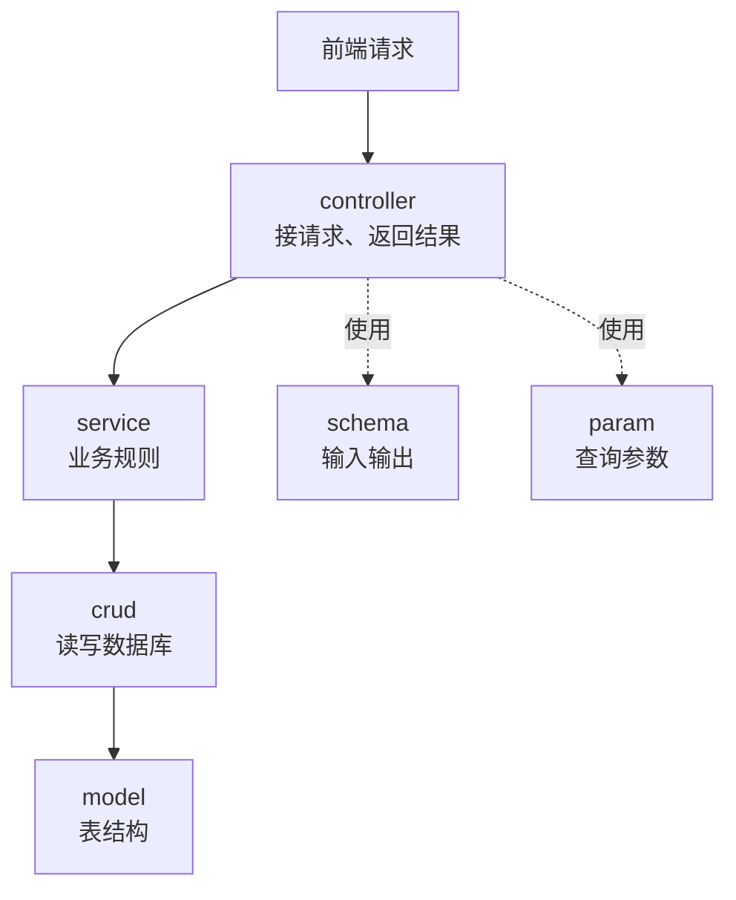

# 第 10 章 数据模块：增删查改

> **节首信息条**｜对应课次 9 · 4 学时 · 实践｜前置：第 7 章的项目骨架与数据库；第 5 章 5.1.3–5.1.5；第 9 章的权限判断

**已会**：第 7 章的项目骨架与数据库连接；第 9 章的权限依赖与 401/403 分工。
**本章只加**：数据建模与约束——让数据在写入前就被拦住，而不是事后修补。
**关系**：用户模块管“谁能操作”；本章管“数据以什么形状、在什么条件下才能进入系统”。

用户模块只处理账号，字段少、关系简单。真实系统里更典型的是“业务数据”：部门、人员、工位、值班记录。它们有唯一的业务编码（Business Code）、有必填字段、有重复校验，还要支持分页（Pagination）、过滤和排序。

先看一个没有约束的部门表会发生什么：两条记录的 `dept_code` 都是 `D01`，按编码查部门时取到哪一条全看运气；人员表里写着 `dept_code = "D99"`，可部门表里根本没有 `D99`，这条人员成了“孤儿”；`full_name` 里被写进两万字的复制粘贴文本，列表页直接撑爆。三个问题都不是代码语法错误，而是**数据在进入系统时没有被约束**。

本章用部门模块做样板，把一个标准 CRUD（Create/Read/Update/Delete） 模块写透：六个文件各干什么，表结构怎样约束数据，输入输出模型怎样分工，422、400、404、500 分别在哪里产生。掌握这一套，再把部门复制成人员模块，就只剩“换字段、加外键校验”的工作。

本章只回答一个问题：**数据怎样被安全、一致地读写，并让错误在正确的层被拒绝？**

## 本章学习目标

读完第 10 章并完成实训后，你应该能：

1. 说出一个 CRUD 模块六个文件的职责与调用关系，并指出脏数据的三种来源。
2. 为部门表设计字段约束，正确使用主键、外键、唯一约束与必填约束。
3. 写出输入模型与输出模型，实现分页、过滤与排序，并说明参数来源。
4. 实现新增、详情与删除，正确使用 201、400、404 与唯一性校验。
5. 按“谁产生、谁负责”区分 422、400、404、500 四类错误，并把它复制到人员模块。

## 前置知识卡

| # | 已有知识 | 回看位置 |
| --- | --- | --- |
| 1 | 项目骨架与数据库连接 | 第 7 章 7.1.4–7.1.5 |
| 2 | Pydantic 输入／输出模型与 422 | 第 5 章 5.1.3（补课卡 K-04） |
| 3 | `HTTPException` 与 404 | 第 5 章 5.1.5（补课卡 K-05） |
| 4 | 权限依赖与 401/403 | 第 9 章 9.1.3 |
| 5 | 表、主键、外键、一对多 | 第 6 章 6.1.2 |

> 卡住时先回看，不必从头重读。

## 10.1 概念讲解

### 10.1.1 脏数据的三种来源

**数据建模与约束**要解决的不是“能不能存”，而是“存进去的是不是可信”。先看三类最常见的脏数据，它们的来源不同，拦法也不同。

| 脏数据 | 现象 | 来源 |
| --- | --- | --- |
| 重复记录 | 两个部门都叫 `D01`，按编码查询取到不确定的一条 | 缺少唯一约束，或新增前没有查重 |
| 孤儿记录 | 人员的 `dept_code` 指向一个不存在的部门 | 缺少外键约束，或写入前没有校验存在性 |
| 超限数据 | 名称字段被写入两万字，列表页被撑爆 | 缺少长度约束，或接口没有长度校验 |

三类问题有一个共同点：**它们都不是“读”的时候才出错，而是“写”的时候已经错了。** 读到脏数据只是症状，根因在写入入口。

**六个文件的分工**

一个标准 CRUD 模块通常拆成六个文件。拆分的依据是“谁负责什么”，不是“文件越多越专业”。



*图 10-1：CRUD 模块的调用关系*

| 文件 | 一句话职责 | 拦住哪类问题 |
| --- | --- | --- |
| `model.py` | 表长什么样 | 字段类型、主键、外键、唯一、必填 |
| `schema.py` | 输入与输出长什么样 | 字段长度、必填、类型、输出白名单 |
| `param.py` | 查询参数长什么样 | 页码、每页条数、排序字段的边界 |
| `crud.py` | 增删改查的数据库操作 | 查询与写入的复用 |
| `service.py` | 业务规则，例如重复校验、外键校验 | 重复编码、孤儿记录 |
| `controller.py` | 接口，负责接收请求与返回响应 | 状态码与错误信息 |

边界要守住：controller 不写 SQL、不写业务规则；service 不直接拼 SQL，而是调用 crud；crud 不判断业务规则；schema 决定哪些字段能进、哪些字段能出。任何一层越界，后面都会变成“改一处、牵动全部”。

> 💡 **易错点**：把六个文件当成六道必须齐全的关卡。小模块可以合并文件，但职责不能合并；反过来，文件分得再细，只要 controller 里直接查库、service 里直接拼 SQL，分层就是形式。

### 10.1.2 表结构与字段约束

表结构是数据的第一道约束。**表**是关系数据库中存放一类数据的结构；**主键**是能唯一标识一行的字段；**外键**是指向另一张表主键、用于表达关系的字段。

部门表用一个业务编码做主键，避免依赖自增 id 做对外标识：

| 字段 | 类型 | 必填 | 说明 |
| --- | --- | --- | --- |
| `dept_code` | 文本 | 是 | 部门编码，主键，唯一 |
| `full_name` | 文本 | 是 | 部门名称 |
| `address` | 文本 | 否 | 地址 |
| `longitude` | 数字 | 否 | 经度 |
| `latitude` | 数字 | 否 | 纬度 |
| `parent_dept_code` | 文本 | 否 | 父部门编码 |

`dept_code` 既是主键又是业务编码，新增时要检查重复；`full_name` 必填且有长度上限；`address` 可空但要限制最大长度，防止超长文本进入数据库。

**代码 10-1-1** · `app/models/department.py`（部门表模型，Python）

```python
from sqlalchemy import Column, String, Float
from app.core.database import Base

class Department(Base):
    __tablename__ = "departments"

    dept_code = Column(String(20), primary_key=True)
    full_name = Column(String(100), nullable=False)
    address = Column(String(500), nullable=True)
    longitude = Column(Float, nullable=True)
    latitude = Column(Float, nullable=True)
    parent_dept_code = Column(String(20), nullable=True)
```

三个参数对应三类**约束**：`primary_key=True` 声明主键，保证一行能被唯一定位；`nullable=False` 声明必填，缺值写入会被数据库拒绝；`String(100)` 声明长度上限，超长文本进不来。唯一约束 `unique=True` 在部门表里由主键隐式提供；人员表的 `username` 一类字段则需要显式声明。

**外键放在“多”的一方**

人员表有 `dept_code`，它指向部门表的主键。一条人员记录只属于一个部门，一个部门可以有多名人员，这是第 6 章 6.1.2 讲的一对多。外键放在“多”的一方（人员表），这样每条人员记录只存一个部门编号，不必在部门表里重复存一串人员。

数据库的外键约束能阻止“指向不存在的部门”的写入，但它通常抛出数据库异常，前端收到的是 500 或含糊的错误。想要可读的 400，需要在 service 里提前检查——这是 10.1.4 的内容。

### 10.1.3 输入模型与输出模型

表结构管“存什么”，输入模型管“什么能进来”，输出模型管“什么能出去”。三者不是同一件事。

**输入模型**

**代码 10-1-2** · `app/schemas/department.py`（输入与输出模型，Python）

```python
class DepartmentCreate(BaseModel):
    dept_code: str = Field(..., min_length=1, max_length=20)
    full_name: str = Field(..., min_length=1, max_length=100)
    address: str | None = Field(default=None, max_length=500)
    longitude: float | None = None
    latitude: float | None = None
    parent_dept_code: str | None = None


class DepartmentOut(BaseModel):
    dept_code: str
    full_name: str
    address: str | None
```

`Field(...)` 表示必填，`min_length`、`max_length` 限定长度，`| None` 表示可空。输入模型只负责“能不能进”，输出模型负责“哪些能出”。输出不要包含内部字段，也不要把整个 ORM 对象直接返回。

输入模型与表结构的约束有重叠，但作用不同：表约束是最后一道防线，防止任何路径写入脏数据；输入模型在请求进入函数前给出可读的 422，告诉调用方哪一项不合格。两者都要有，不能互相替代。

**分页：page、page_size、offset、limit**

数据量大时不能一次返回全部记录。分页接口通常接收两个查询参数：`page`（第几页，从 1 开始）和 `page_size`（每页多少条）。数据库查询用 `offset` 与 `limit` 实现：

**代码 10-1-3** · 示例（文本）

```text
offset = (page - 1) * page_size
limit = page_size
```

响应同时返回本页数据和总条数：

**代码 10-1-4** · 示例响应（JSON）

```json
{"items": [...], "total": 35}
```

`total` 让前端能算出总页数：`ceil(total / page_size)`。只返回 `items` 而不返回 `total`，前端就不知道还有没有下一页。

分页参数要加边界约束：`page` 至少为 1，`page_size` 至少为 1、通常不超过 100。否则调用方传 `page_size=100000` 时，一次查询就可能把数据库拖垮。这就是查询参数（`param.py` 或函数签名里的 `Query(...)`）要承担的边界检查。

**过滤与排序**

**代码 10-1-5** · 示例代码（Python）

```python
query = db.query(Department)
if name:
    query = query.filter(Department.full_name.contains(name))
total = query.count()
if sort_order == "desc":
    query = query.order_by(Department.dept_code.desc())
else:
    query = query.order_by(Department.dept_code.asc())
items = query.offset((page - 1) * page_size).limit(page_size).all()
```

过滤与排序都应该用 ORM 的参数化接口，不要把用户输入直接拼进 SQL 字符串。拼接字符串会带来 SQL 注入风险，也会让查询条件难以复用。排序字段还要走白名单：只允许按预先列出的字段排序，不能把用户传来的任意字符串直接当作列名。

> 💡 **易错点**：先分页再 `count()`。`count()` 必须在过滤之后、分页之前执行；顺序反了，`total` 会变成“本页条数”，前端算出的总页数永远不对。

### 10.1.4 四类错误的归属

数据进入系统时，不同问题应由不同层拒绝。**错误分层**指按“谁产生、谁负责”给错误分配状态码，而不是一律 500。

| 情况 | 状态码 | 产生位置 | 谁的问题 |
| --- | --- | --- | --- |
| 缺字段、类型不对、长度超限 | 422 | 请求校验层，进入函数前 | 调用方 |
| 业务编码重复、外键不存在 | 400 | service 的业务规则 | 调用方 |
| 资源不存在 | 404 | controller 或 service 的查询结果 | 调用方 |
| 未捕获的异常 | 500 | 全局异常处理 | 服务方 |

**新增：唯一校验与 201**

新增接口先检查业务编码是否重复，再写入数据库。重复时返回 400，表示业务规则不满足；成功时返回 201，表示资源已创建。

**代码 10-1-6** · 示例代码（Python）

```python
def create_department(db, data):
    if db.query(Department).filter(Department.dept_code == data.dept_code).first():
        raise HTTPException(status_code=400, detail="部门编码已存在")
    department = Department(**data.model_dump())
    db.add(department)
    db.commit()
    db.refresh(department)
    return department
```

`db.commit()` 真正写入，`db.refresh()` 取回数据库生成的值。没有 `commit`，数据不会落库；没有 `refresh`，返回对象可能缺少数据库填充的字段。

为什么要先查重，而不是等数据库的唯一约束报错？因为数据库报错是一条异常，前端看到的是 500；提前查重能返回 400 和“部门编码已存在”，调用方知道该改什么。数据库约束仍然保留，作为并发写入时的最后一道防线。

**详情与删除：404 而不是空对象**

详情接口按主键查询；查不到时返回 404，而不是返回空对象。404 让调用方明确知道“这个资源不存在”，空对象则会让前端误以为“查到了但没有字段”。删除同理：删除不存在的资源返回 404，删除成功返回 204（无响应体）。

**复制到人员模块：外键校验**

人员模块可以按部门模块的结构复制，但要改三处：表名与字段、查询主键（`certificate_number`）、新增时的外键校验。人员表有 `dept_code`，新增前要确认该部门存在；不存在时返回 400，而不是让数据库抛外键错误。

| 文件 | 从部门改什么 |
| --- | --- |
| `model.py` | 表名 `personnel`；字段换成人员的；`dept_code` 外键 |
| `schema.py` | 人员字段；证件号可按需加 18 位校验 |
| `param.py` | `name`、`dept_code` |
| `crud.py` | `get_by_certificate_number` |
| `service.py` | 人员查重 + 部门存在校验 |
| `controller.py` | URL `/personnel` |

复制时最容易残留的是部门字段：表名改了，字段名没改；URL 改了，查询条件还写着 `dept_code`。复制完成后逐项对照表检查一遍，比事后排错省时间。

**测试清单**

每完成一个模块，至少走一遍下面六条：新增成功返回 201；重复编码返回 400；缺字段返回 422；列表返回 200 且分页正确；详情返回 200；不存在的编码返回 404。六条都过，模块才算可用。

错误码是契约的一部分，前端据此决定提示方式：422 提示“检查输入”，400 提示“业务不允许”，404 提示“资源不存在”，500 提示“联系管理员”。

> 💡 **易错点**：把数据库报错直接返回给前端，或把所有错误都写成 500。调用方无法区分“我传错了”和“服务器坏了”，排查方向会被带偏；错误码要按产生位置分层。

## 10.2 示范例题

#### 例 10-1：实现部门新增与详情【Bloom：应用】

**题目**：实现 `POST /departments` 与 `GET /departments/{dept_code}`。要求新增时检查编码重复（重复返回 400），成功返回 201；详情查不到返回 404。

**解**：

**代码 10-2-1** · 示例代码（Python）

```python
@app.post("/departments", status_code=201)
def create_department(data: DepartmentCreate, db: Session = Depends(get_db)):
    if db.query(Department).filter(Department.dept_code == data.dept_code).first():
        raise HTTPException(status_code=400, detail="部门编码已存在")
    department = Department(**data.model_dump())
    db.add(department)
    db.commit()
    db.refresh(department)
    return {"dept_code": department.dept_code, "full_name": department.full_name, "address": department.address}

@app.get("/departments/{dept_code}")
def get_department(dept_code: str, db: Session = Depends(get_db)):
    department = db.query(Department).filter(Department.dept_code == dept_code).first()
    if not department:
        raise HTTPException(status_code=404, detail="部门不存在")
    return {"dept_code": department.dept_code, "full_name": department.full_name, "address": department.address}
```

新增的处理顺序是“查重、写入、返回”；详情的处理顺序是“查询、判断、返回”。两个接口都不把 ORM 对象直接返回，避免输出多余字段。

#### 例 10-2：实现分页、过滤与排序【Bloom：应用】

**题目**：实现 `GET /departments`，支持 `page`、`page_size`、`sort_order` 与 `name` 四个查询参数；返回 `items` 与 `total`。要求 `page` 至少为 1，`page_size` 在 1–100 之间。

**解**：

**代码 10-2-2** · 示例代码（Python）

```python
@app.get("/departments")
def list_departments(
    page: int = Query(1, ge=1),
    page_size: int = Query(10, ge=1, le=100),
    sort_order: str = "asc",
    name: str | None = None,
    db: Session = Depends(get_db),
):
    query = db.query(Department)
    if name:
        query = query.filter(Department.full_name.contains(name))
    total = query.count()
    if sort_order == "desc":
        query = query.order_by(Department.dept_code.desc())
    else:
        query = query.order_by(Department.dept_code.asc())
    items = query.offset((page - 1) * page_size).limit(page_size).all()
    return {
        "items": [
            {"dept_code": d.dept_code, "full_name": d.full_name, "address": d.address}
            for d in items
        ],
        "total": total,
    }
```

`count()` 在分页前执行，得到的是满足过滤条件的总数；`offset` 与 `limit` 只影响本页数据。`sort_order` 决定按编码升序还是降序，`name` 做模糊过滤。

## 10.3 独立习题

#### 习题 10-1【Bloom：理解】

**题目**：解释 `page`、`page_size`、`offset`、`limit`、`total` 五个概念的含义及它们之间的关系。为什么响应里必须返回 `total`？

#### 习题 10-2【Bloom：创造】（开放题）

**题目**：按部门模块的结构，为人员模块设计一套 CRUD：人员表包含证件号、姓名、所属部门编码、职位、职级、入职日期。请写出表结构、输入/输出模型、列表与新增接口的关键代码，并说明新增时如何校验 `dept_code` 是否存在。

#### 习题 10-3【Bloom：创造】（开放题，换场景）

**题目**：为单位“工位”实体设计表结构、输入/输出模型与四类错误：工位编号（主键）、位置、是否启用、所属部门编码。请列出字段与约束，说明哪些错误由数据库约束拦住、哪些由 service 返回 400、哪些由输入模型返回 422，并各给出一个触发例子。**不能照抄部门表的字段**：工位有启用状态，部门没有。

## ◆ 实训 10-1：数据模块：增删查改（对应课次 9 · 4 学时）

### 一、任务目标与验收

| 目标 | 验收标志 |
| --- | --- |
| 六个文件职责清楚 | router/service/crud/schema/model/database 各就各位 |
| 部门 CRUD 可用 | 列表、详情、新增、修改、删除均符合约定 |
| 分页与过滤正确 | 返回 `items` 与 `total`，过滤条件进入 count |
| 错误码分层 | 422/400/404/500 各归其位 |
| 人员模块可复用 | 外键存在性校验生效 |

### 二、课前准备

- 第 7 章项目可启动、数据库可建表
- 第 9 章的用户与权限依赖可用
- 一份部门与人员的测试数据

### 三、操作步骤

1. **建表与模型**
   - 做什么：建表与模型
   - 操作：按 10.1.2 写 `Department` 模型，启动后确认表存在
   - 预期输出：→ 表结构含约束
   - 做错会看到什么：表没建出来：检查模型是否继承 `Base`、`create_all` 是否执行
2. **写输入输出模型**
   - 做什么：写输入输出模型
   - 操作：`DepartmentCreate` 加长度与必填约束，`DepartmentOut` 只留公开字段
   - 预期输出：→ 非法请求返回 422
   - 做错会看到什么：422 不出现：字段类型或约束未写进模型
3. **实现列表与详情**
   - 做什么：实现列表与详情
   - 操作：写分页、过滤、排序与按主键查询
   - 预期输出：→ 列表有 `items`/`total`，查不到 404
   - 做错会看到什么：`total` 不受过滤影响：条件要加在 `count` 之前
4. **复制到人员模块**
   - 做什么：复制到人员模块
   - 操作：照结构写人员 CRUD，新增时校验 `dept_code` 存在
   - 预期输出：→ 外键不存在返回 400
   - 做错会看到什么：直接写入导致脏数据；先查部门再写入

### 四、排错清单

| 现象 | 先查什么 |
| --- | --- |
| 列表总数不对 | 过滤条件是否加在 `count()` 之前 |
| 新增重复不报错 | 唯一约束或先查重逻辑缺失 |
| 详情返回 500 | 查不到时未抛 404，直接访问空对象字段 |
| 排序参数注入风险 | 排序字段必须走白名单 |

### 五、提交与验收

提交部门与人员两个模块的代码与接口验证记录；验收按“CRUD 完整”“分页与错误码”“复用质量”三项判定。

### 六、课后扩展

- 给列表加按名称模糊查询
- 为常用过滤字段加索引并说明依据
- 把重复的分页代码标记出来，为第 11 章抽取做准备
- **复习任务**：回看第 6 章 6.1.2（表、主键、外键）与第 5 章 5.1.3（Pydantic 校验），对照本章 10.1.2–10.1.4，说明同一类错误在表结构、输入模型与 service 三层分别由谁拦住

## 本章小结

**核心结论**：

1. 标准 CRUD 模块拆成 model、schema、param、crud、service、controller 六个文件，各层职责不能越界。
2. 脏数据有三种来源：重复记录、孤儿记录、超限数据；它们都在写入时产生，要靠约束与校验在入口拦住。
3. 部门表用业务编码做主键；主键、外键、唯一与必填约束是数据的第一道防线；新增时检查重复，重复返回 400，成功返回 201；详情查不到返回 404。
4. 分页用 `page`、`page_size` 换算出 `offset` 与 `limit`；响应返回 `items` 与 `total`，`total` 必须在分页前计算；过滤与排序走参数化查询与白名单。
5. **错误分层**：422 参数校验、400 业务规则、404 资源不存在、500 未捕获异常；复制模块时重点检查字段残留与外键校验。

把这章压缩成一句话：**数据的第一道防线是表与校验，最后一道是错误码；两者都要在写入入口生效。**

**本章不引入**：复杂索引优化、游标分页、数据库迁移工具。这些在后续课程或工程环境中按需了解。

**学完本章，你可以体会到**：CRUD 是后端最重复的工作，把六个文件的边界划清，后面加模块才是“复制结构”而不是“复制混乱”。

**自检**：回到章首的学习目标，逐条问自己做到了没有——

- [ ] 说出一个 CRUD 模块六个文件的职责与调用关系，并指出脏数据的三种来源。
- [ ] 为部门表设计字段约束，正确使用主键、外键、唯一约束与必填约束。
- [ ] 写出输入模型与输出模型，实现分页、过滤与排序，并说明参数来源。
- [ ] 实现新增、详情与删除，正确使用 201、400、404 与唯一性校验。
- [ ] 按“谁产生、谁负责”区分 422、400、404、500 四类错误，并复制到人员模块。

**下一章预告**：部门、人员、工位、值班记录的 CRUD 结构高度相似。下一章把这些重复查询抽成通用 CRUD 基类，让新模块只写差异部分。
