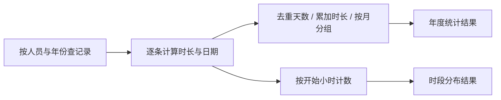

# 第 11 章 业务模块：统计校验

第 10 章解决的是“一条记录能不能写”。统计面对的是“多条记录合起来说明什么”：同一批数据，换一种范围或计量单位就可能得到另一个同样成立的结果。

## 本章要解决的问题

**一个业务问题怎样变成可计算的指标，指标的口径怎样写到别人无法另作解释？**

同一批数据，两个人可以算出两个都不报错的结果：一个人把同一天的两条记录算作一天，另一个人算作两条。差别不在代码，而在“按什么范围、什么规则、什么计量单位计算”这件事从来没有被写下来。

本章关心的是：一个业务问题怎样变成可计算的指标，以及两个人按同一份数据计算时，凭什么得到同一个结果。

## 本章学习目标

读完第 11 章并完成实训后，你应该能：

1. 把一个业务问题拆成可计算的指标，用范围、规则、计量单位、边界四项写清口径，形成口径卡。
2. 按问题选择聚合动作（计数、去重计数、累加、补齐），实现年度汇总与分组统计，并返回稳定的结果结构。
3. 区分只读与写入的事务边界，说明什么时候需要回滚。
4. 用小样本手算核对，说明口径不一致如何制造假数字，并列出变更影响。

## 11.1 指标与统计口径

“某个人一年值了多少班”不是一个可以直接计算的指标。它至少包含四个问题：这一年有几天在执勤、累计多少小时、每个月各多少、一天里哪个时段最集中。前三个问题各自对应一个指标，时段问题再派生出“高峰时段”。把问题拆开，才有可计算的指标。

| 指标 | 回答什么问题 | 数据来源 | 用途 |
| --- | --- | --- | --- |
| 总执勤天数 | 这一年有几天在执勤 | `duty_record.start_time`，按日期去重 | 年度考勤 |
| 总执勤时长 | 这一年累计值了多少小时 | `duty_record.start_time`、`end_time` | 工作量核算 |
| 月度分布 | 每个月各多少天、多少小时 | `start_time` 的月份 | 趋势展示 |
| 时段分布 | 记录集中在一天里的哪些小时 | `start_time` 的小时 | 值勤分析 |
| 高峰时段 | 哪个小时记录最多 | 时段分布的结果 | 值勤提醒 |

指标要有名、有用途、有来源。名字让前后端说同一件事；用途决定精度要求；来源决定查哪张表、哪些字段。指标定错，代码再对也没用。

**统计口径**是业务统计中的常用说法，指一个指标按什么范围、什么规则、什么计量单位计算；数据管理知识体系对指标定义有类似要求（DAMA-DMBOK）。口径要写到别人照着能算出同一个数，至少写清四项：

- **范围**：按哪些记录算？写清人员、年份、表与字段；数据来源不能只写“执勤数据”。
- **规则**：同一天多条算几条？跨月归哪个月？高峰并列怎么返回？没有记录的月份或小时补不补？
- **计量单位**：时长用小时还是分钟？天数用自然日还是 24 小时折算？计量单位不同，结果不能直接相加。
- **边界**：年份的第一天与最后一天算不算？跨月从哪一天切开？月末 24:00 与次月 00:00 是否重复计算？

**统计口径卡**

把四项写进一张表，就是本课程约定的**口径卡**：

| 指标 | 用途 | 范围与来源 | 规则（含边界） | 计量单位 | 手算样本 | 变更影响 |
| --- | --- | --- | --- | --- | --- | --- |
| 总执勤天数 | 考勤汇总 | 某人员某年度的执勤记录；来源 `duty_record.personnel_certificate_number`、`start_time`、`end_time` | 按自然日去重；把开始日到结束日的每个日期放入集合，结束日为次日 00:00 时也算一天 | 天 | 5 条记录落在 5 个日期，则为 5 天 | 口径不变；若改为只算开始日，跨日记录的天数会减少 |

各列的用途：指标决定统计对象；用途决定精度；范围与来源决定查哪张表；规则含边界，是口径的核心；计量单位决定能否相加；手算样本用于核对；变更影响提醒下游报表。口径卡应附在接口说明或设计文档里，不藏在代码里。例如“跨月记录按开始时间归月”是一条约定；如果不写，两个人可能一个按开始时间、一个按结束时间，统计结果就对不上。

## 11.2 聚合与结果结构

**聚合**指把多条记录按某个维度（人员、月份、小时）合并成一个结果，对应关系数据库的聚合查询。聚合的关键不是 `sum()` 或 `group by` 的写法，而是“按哪个维度、先过滤还是先分组、重复值怎么处理”。这三个决定就是口径。

按口径卡选动作：

| 动作 | 回答什么问题 | 典型写法 | 执勤记录例子 |
| --- | --- | --- | --- |
| 计数 | 一共多少次 | `count()`、`len()` | 时段分布里的记录条数 |
| 去重计数 | 一共多少天、多少人 | `set`、`distinct` | 总执勤天数 |
| 累加 | 一共多少小时 | `sum()`、`+=` | 总执勤时长 |
| 补齐 | 没有数据的位置返回什么 | 预置 12 项或 24 项 | 月度分布、时段分布 |

**统计代码的归属**

统计要读执勤记录、人员、哨位三张表，算出的结果不写回任何表。按第 4 章 4.4 的划分，它是一个独立模块 `analytics`：没有 `model.py` 与 `crud.py`，只有 `schema.py` 描述返回结构、`service.py` 做聚合、`controller.py` 暴露只读接口。它直接 `from app.modules.duty_record.model import DutyRecord`、`from app.modules.personnel.model import Personnel` 读别的模块的表模型，其他模块不反过来依赖它。

年度统计按口径卡选动作：总天数用去重计数、总时长用累加、月度用补齐。查询时按人员证件号和年份过滤：

**代码 11-2-1** · `app/modules/analytics/service.py`（统计代码，Python）

```python
records = db.query(DutyRecord).filter(
    DutyRecord.personnel_certificate_number == cert,
    extract("year", DutyRecord.start_time) == int(year),
).all()
```

先查人员是否存在，再查记录。人员不存在返回 400；人员存在但没有记录，返回 0 或空列表，这不是错误。

下面的代码 11-2-2 用到 `timedelta`，需在文件顶部写上 `from datetime import timedelta`。

**代码 11-2-2** · `app/modules/analytics/service.py`（统计代码，Python）

```python
total_hours = 0.0
days = set()
monthly_days = {m: set() for m in range(1, 13)}
monthly_hours = {m: 0.0 for m in range(1, 13)}

for r in records:
    hours = (r.end_time - r.start_time).total_seconds() / 3600
    total_hours += hours
    current = r.start_time.date()
    end_date = r.end_time.date()
    while current <= end_date:
        days.add(current)
        monthly_days[r.start_time.month].add(current)
        current += timedelta(days=1)
    monthly_hours[r.start_time.month] += hours

return {
    "personnel_certificate_number": cert,
    "year": year,
    "total_duty_days": len(days),
    "total_duty_hours": round(total_hours, 2),
    "duty_by_month": [
        {
            "month": m,
            "days": len(monthly_days[m]),
            "hours": round(monthly_hours[m], 2),
        }
        for m in range(1, 13)
    ],
}
```

三个细节：

1. **天数用 `set` 去重**：把开始日到结束日的每个日期放进集合；同一天两条记录只留下一个日期，跨日记录则按跨越的日期各算一天（结束日为次日 00:00 时，结束日也算一天）。
2. **时长用 `total_seconds() / 3600`**：直接减两个时间得到的是时间差对象，转成小时才方便累加。
3. **月份补齐 12 项**：没有记录的月份返回 0，前端画图时不会缺柱子。

聚合得到数字之后，还要按固定结构返回。

**返回结构的三条要求**

统计结果不是“算出来一个数”就够了，还要有稳定的结构。前端要画图、要判断空状态，返回的形状必须先定下来。三条要求：

- **行数固定**：月度分布固定 12 项，时段分布固定 24 项，不因有没有数据而变。
- **并列可表达**：高峰可能不止一个，返回值要能放下多个，而不是只给第一个。
- **空值有定义**：没有数据时返回 0 或空列表，不返回 `None`，更不能报 500。

**分组与补齐**

时段统计要回答的是：记录集中在一天里的哪些小时？没有记录的小时怎样返回？高峰并列时怎样表示？

**代码 11-2-3** · `app/modules/analytics/service.py`（统计代码，Python）

```python
hour_counts = {h: 0 for h in range(24)}
for r in records:
    hour_counts[r.start_time.hour] += 1

max_count = max(hour_counts.values()) if records else 0
peak_hours = [h for h, c in hour_counts.items() if c == max_count] if max_count else []

return {
    "year": year,
    "personnel_certificate_number": cert,
    "time_distribution": [{"hour": h, "count": c} for h, c in hour_counts.items()],
    "peak_hours": peak_hours,
    "total_records": len(records),
}
```

24 个小时都要返回，没有记录的小时返回 0。高峰时段（Peak Hour）可能有多个：如果 8 点和 13 点都是 2 条记录，`peak_hours` 就是 `[8, 13]`。无记录时高峰时段为空列表，而不是 `None`。分组维度决定行数，补齐决定没有数据的位置怎么返回；两件事合起来，前端才不用为“缺一项”写特例。

**空数据不是异常**

统计接口最容易在“没有数据”时报 500：`max()` 对空列表报错、除法分母为 0、前端拿到 `null` 无法渲染。正确做法是把“无记录”当作合法输入：总天数返回 0，总时长返回 0，月度与时段返回补齐的 0 列表，高峰时段返回空列表。

## 11.3 统计的事务边界

统计接口不写数据，只做三件事：按条件查记录、按口径算指标、返回结果。因为是只读，它通常不需要事务；但如果统计结果要写入汇总表，或者统计过程中伴随其他写操作，就需要事务来保证“要么全部成功，要么全部回滚”。

**事务**指一组必须一起成功或一起失败的操作；**回滚**指事务失败时撤销已经执行的部分，回到事务开始前的状态。这两个概念属于数据库事务处理的标准内容。

**代码 11-3-1** · `app/modules/analytics/service.py`（统计代码，Python）

```python
try:
    db.add_all(summary_rows)
    db.commit()
except Exception:
    db.rollback()
    raise
```

回滚的意义是避免“写了一半”：统计结果要么完整写入，要么完全不写。判断要不要事务，看一个操作是否包含多次写入：查询并返回统计，只有读，不需要；写汇总表、批量导入，有写，需要。判断标准不是“接口重不重要”，而是“失败时会不会留下中间状态”。

> 💡 **易错点**：只读统计也开事务、带写入的统计却不回滚。前者增加无谓开销，后者在失败时留下半批数据；按“有没有写操作”判断，而不是按“接口重不重要”判断。

## 11.4 统计结果的核对与口径一致性

**输入检查**

统计接口至少检查两件事：年份格式是否为 4 位数字；人员是否存在。年份格式错误返回 400，人员不存在返回 400。记录为空则正常返回 0/空。

**代码 11-4-1** · `app/modules/analytics/service.py`（统计代码，Python）

```python
if len(year) != 4 or not year.isdigit():
    raise HTTPException(status_code=400, detail="年份格式错误")

person = db.query(Personnel).filter(
    Personnel.certificate_number == cert
).first()
if not person:
    raise HTTPException(status_code=400, detail="人员不存在")
```

**接口层只做转发**

校验与聚合落在 `service.py`，`controller.py` 只接收参数、调用 service、按 `response_model` 返回结果。两个只读接口挂在 `/analytics` 下：

**代码 11-4-2** · `app/modules/analytics/controller.py`（统计接口，Python）

```python
from fastapi import APIRouter, Depends, Query
from sqlalchemy.orm import Session

from app.core.database import get_db
from app.modules.analytics import service
from app.modules.analytics.schema import DutyTimeDistribution, StaffDutyYearly

router = APIRouter(prefix="/analytics", tags=["统计分析"])


@router.get("/staff-duty-yearly", response_model=StaffDutyYearly)
def staff_duty_yearly(
    personnel_certificate_number: str = Query(...),
    year: str = Query(...),
    db: Session = Depends(get_db),
):
    return service.get_staff_duty_yearly(db, personnel_certificate_number, year)


@router.get("/duty-time-distribution", response_model=DutyTimeDistribution)
def duty_time_distribution(
    personnel_certificate_number: str = Query(...),
    year: str = Query(...),
    db: Session = Depends(get_db),
):
    return service.get_duty_time_distribution(db, personnel_certificate_number, year)
```

`response_model` 把返回结构固定下来：多出的字段被过滤掉，缺少的字段直接报校验错误。结果的形状由 `schema.py` 决定，不靠 service 里的字典写对。年份格式错误时 service 抛出的 `HTTPException` 直接透出为 400，controller 不再包一层 `try`。

**手算核对**

统计结果不能只看“接口返回了数字”。拿 3–5 条记录手算一遍，再和接口结果对比：总天数、总时长、各月数字、高峰时段。手算能发现口径错误，接口自测只能发现代码报错。

核对时看三条对账关系：

| 关系 | 检查什么 |
| --- | --- |
| 总天数 = 各月天数之和 | 月度天数没有漏算或重复 |
| 总时长 = 各月时长之和 | 跨月记录只归了一次 |
| 总天数与月度天数同一口径 | 两边都用日期去重，或两边都不用 |

任何一条对不上，先查口径，不要先改代码。

**口径不一致的后果**

一个常见错误是：总天数用 `set` 去重，月度天数却按记录条数累加。这样同一天两条记录会让月度天数变成 2，而总天数仍是 1，两个数字对不上。正确做法是月度天数也用日期集合去重。

另一个常见错误是跨月记录：一条从 1 月 31 日 22:00 到 2 月 1 日 02:00 的记录，按开始时间归 1 月。这个约定本身可以接受，但必须写清楚；否则有人按开始时间、有人按结束时间，月度统计就会漂移。



*图 11-1：统计接口的计算路径*

**口径变更与细度成本**

口径一改，下游结果都会跟着变。变更前做三件事：

1. **列出受影响的范围**：哪些指标、哪些页面、哪些导出报表会变。
2. **判断旧数据能否重算**：原始字段齐全才可重算；缺字段的只能保留旧口径，并在报表上标注。
3. **记录版本与生效时间**：在口径卡与接口说明里写清新旧口径，旧报表注明用的是哪一版。

口径越细越少争议，但查询与测试成本越高：跨月按小时拆分更精确，按开始时间归月更简单。选择取决于报表用途，关键是**把选择写下来，并让所有接口用同一套口径**。

## 示范例题

#### 例 11-1：计算某人的年度统计

**题目**：某人员 2026 年有以下 5 条记录：

- 1 月 5 日 08:00–12:00
- 1 月 5 日 13:00–17:00
- 1 月 6 日 08:00–10:00
- 2 月 10 日 20:00–次日 00:00
- 3 月 1 日 00:00–02:00

请计算总天数、总时长，以及 1–3 月的天数与时长。

**解**：

先写口径卡：

| 指标 | 用途 | 范围与来源 | 规则（含边界） | 计量单位 | 手算样本 | 变更影响 |
| --- | --- | --- | --- | --- | --- | --- |
| 总执勤天数 | 年度考勤 | 2026 年该人员的全部记录；来源 `duty_record` | 按自然日去重；开始日到结束日每个日期都算，结束日为次日 00:00 也算一天；年份按 `start_time` 判定 | 天 | 5 条记录为 5 天 | 无 |
| 总执勤时长 | 工作量核算 | 同上 | 每条“结束减开始”后累加 | 小时 | 5 条记录为 16 小时 | 无 |
| 月度分布 | 趋势展示 | 同上 | 按 `start_time` 的月份分组；跨月归开始月 | 天、小时 | 1 月 2 天 10 小时 | 若改为按天拆分，2 月数字变化 |

再按口径卡计算：

1. 总天数按不同日期去重：1 月 5 日、1 月 6 日、2 月 10 日、2 月 11 日、3 月 1 日，共 5 天。
2. 总时长逐条累加：4 + 4 + 2 + 4 + 2 = 16 小时。
3. 1 月：日期为 1 月 5 日、1 月 6 日，共 2 天；时长为 4 + 4 + 2 = 10 小时。
4. 2 月：2 月 10 日与 2 月 11 日（记录到次日 00:00），共 2 天，4 小时。
5. 3 月：1 天，2 小时。

注意 1 月 5 日有两条记录，总天数只算 1 天，但时长要累加 8 小时；月度天数同样按日期去重，所以 1 月是 2 天，不是 3 天。2 月 10 日的记录跨到次日 00:00，按日期集合算 2 天，但时长仍为 4 小时。先定口径、再算数字，结果才能被别人复核。

#### 例 11-2：什么时候需要事务

**题目**：下面三种操作，哪些需要事务？说明理由。1）查询某人某年的执勤记录并返回统计；2）把统计结果写入汇总表；3）批量导入 100 条执勤记录。

**解**：

1. **不需要**。只读查询不改变数据，失败也不会留下中间状态。
2. **需要**。写汇总表是一次写操作；如果写了一半失败，汇总数据会不完整，下一次统计会基于错误数据继续算。应把写入放在一个事务里，失败回滚。
3. **需要**。批量导入是多条写入；若第 50 条失败，前 49 条不应留在库里。应整体提交，失败整体回滚。

## 独立习题

#### 习题 11-1

**题目**：某统计接口的总天数是 10，但 12 个月的月度天数加起来是 14。请按三条对账关系逐条排查可能的原因，并给出修正方案。

#### 习题 11-2

**题目**：跨月记录（如 1 月 31 日 22:00 到 2 月 1 日 02:00）应该归到哪个月？请用口径卡的四项说明两种可选口径，比较它们的优缺点，并说明你会选择哪一种、为什么。

#### 习题 11-3

**题目**：某器材借还系统原本按“借出时间”统计每月借用次数。现在管理员要求改为按“实际占用时长”统计，并把跨月借用按天拆分到两个月。请写出新旧两张口径卡、需要修改的查询与测试用例，并说明这项改动会影响哪些已有报表、旧数据是否需要重算。**不能照抄本章执勤天数的口径**：器材借还没有“执勤天数”，只有借出、归还与时长。

## ◆ 实训 11-1

> **课堂达标（B 档）**：年度总天数/记录数两个指标 + 空数据提示。完整达成（教师版）为教师参考，不作为学生及格条件。
：业务模块：统计校验

### 一、任务目标与验收

| 目标 | 验收标志 |
| --- | --- |
| 口径卡完整 | 范围、规则、计量单位、边界四项齐全 |
| 年度统计可用 | 天数、时长、月份正确；只读边界正确 |
| 时段分布可用 | 返回 24 项，高峰可并列 |
| 空数据、输入检查与手算核对 | 空数据返回 0；非法输入返回 400；三条对账关系一致 |
| 事务边界 | 说明统计接口为什么只读、不写 `commit()`；列出写入批次异常时需要 `rollback()` 的位置 |
| 变更影响说明 | 列出口径变更影响哪些报表 |

### 二、课前准备

- 第 10 章可用的执勤记录数据
- 一组 5–10 条可手算的测试数据
- 一份七列口径卡模板

### 三、操作步骤

1. **定义指标、写口径卡（15 分钟）**
   - 做什么：把“某人某年值了多少班”拆成指标，填口径卡
   - 操作：写清范围与来源、规则、计量单位、边界四项
   - 预期输出：→ 一张无歧义的口径卡
   - 做错会看到什么：口径只写在代码里；先写卡再写查询
2. **实现年度统计（25 分钟）**
   - 做什么：在 `app/modules/analytics/` 下建 `schema.py`、`service.py`、`controller.py`，实现年度统计，顺带核一次只读边界
   - 操作：按人员与年份过滤，去重天数、累加时长、补齐 12 个月
   - 预期输出：→ 结果与手算一致；只读查询不写事务
   - 做错会看到什么：漏掉月份补齐；用空月份数据检查
3. **实现分组与并列（20 分钟）**
   - 做什么：实现时段分布
   - 操作：按小时分组，补齐 24 小时，高峰并列返回列表
   - 预期输出：→ 返回 24 项，高峰可并列
   - 做错会看到什么：只返回有数据的时段；补零到 24
4. **空数据、输入检查与手算核对（25 分钟）**
   - 做什么：处理空数据与非法输入，并用 3–5 条记录手算
   - 操作：空数据返回 0；年份格式与人员存在各测一次；按三条对账关系逐项检查
   - 预期输出：→ 空数据返回 0 而非 500；总天数、总时长、月度数字一致
   - 做错会看到什么：空结果抛异常，或只对总数不对分项；补做对账
5. **口径变更影响说明（5 分钟）**
   - 做什么：说明口径变化会影响哪些报表
   - 操作：列出受影响接口、旧数据是否重算
   - 预期输出：→ 一段可交接的变更说明
   - 做错会看到什么：只改代码不写影响；补文档

### 四、排错清单

| 现象 | 先查什么 |
| --- | --- |
| 统计与手工不一致 | 年份边界、时区、去重规则 |
| 返回项数不足 24 | 分组后未补齐 |
| 高峰只有一个 | 并列处理缺失 |
| 接口变慢 | 先确认数据量，再考虑索引或预聚合 |

### 五、提交与验收

提交统计接口、口径卡、手算核对记录、事务边界说明与变更影响说明；验收按“口径卡完整”“年度统计可用”“时段分布可用”“空数据、输入检查与手算核对”“事务边界”“变更影响说明”六项判定，每项对应上面一个步骤。

### 六、课后扩展

- 增加“只统计启用中哨位”的口径开关（按 `workstation.is_active` 过滤）并说明影响
- 给统计接口加缓存并说明失效策略
- 用 SQL 直接写一遍对照 ORM 结果
- **复习任务**：回看第 10 章 10.4（规则校验的执行）与第 12 章 12.4（测试路径与测试数据），对照本章 11.1（指标与统计口径），说明“规则”和“口径”分别约束什么、为什么口径要写在代码之前

## 本章小结

**核心结论**：

1. 业务问题不是指标；先把问题拆成指标，再写清每个指标的名称、用途与数据来源。
2. **统计口径**由范围、规则、计量单位、边界四项构成；四项写进一张七列的**口径卡**，附在接口说明或设计文档里。
3. 聚合有四种动作：计数、去重计数、累加、补齐；按指标问的问题选动作，不按代码习惯选。
4. 统计结果要有稳定的结构：行数固定、并列可表达、空值有定义；空数据不是异常，返回 0 或空列表。
5. **事务**只在有写入时使用；**回滚**保证失败时不留下半批数据。只读统计不需要事务。
6. 用 3–5 条记录手算，检查三条对账关系；口径不一致会制造“假数字”，口径变更要说明影响范围。

把这章压缩成一句话：**统计的可信度不来自代码复杂，而来自口径写清、结果能被人手算核对。**

口径卡让“两个人算出两个数”变成可以当场对账的约定；统计的可信度来自可复核，而非代码复杂。

**自检**：回到章首的学习目标，逐条问自己做到了没有——

- [ ] 把一个业务问题拆成可计算的指标，用范围、规则、计量单位、边界四项写清口径，形成口径卡。
- [ ] 按问题选择聚合动作（计数、去重计数、累加、补齐），实现年度汇总与分组统计，并返回稳定的结果结构。
- [ ] 区分只读与写入的事务边界，说明什么时候需要回滚。
- [ ] 用小样本手算核对，说明口径不一致如何制造假数字，并列出变更影响。

