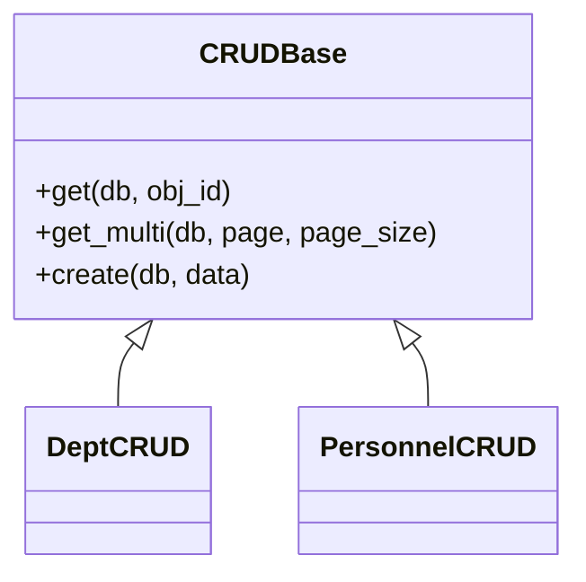

# 第 11 章 数据模块：查询复用

> **节首信息条**｜对应课次 10 · 2 学时 · 实践｜前置：第 10 章的部门与人员 CRUD；第 5 章 5.1.4；基本的 Python 类与继承

上一章把部门模块写透了。现在照着它做人员列表：复制过来，把 `Department` 换成 `Personnel`，把过滤字段换成姓名，跑通，收工。当时看是最快的办法。

一周后产品提了两个小需求：列表要能按名称搜，底部要显示「共几页」。你在部门模块改好、测完，人员模块忘了同步。于是同一个系统里，部门列表搜完显示「共 3 页」，人员列表搜完还显示「共 12 页」——而第 4 页点进去是空的。两个页面长得一模一样，行为却对不上；更麻烦的是，以后每改一个分页细节，都要记得改两处。

本章就处理这两件互相咬着的事：先把列表查准（过滤、总数、总页数的先后次序，排序字段的边界），再把两个模块里一字不差的那部分收拢到一处。收拢之后，「改一处」重新变成字面意义上的改一处。

读完你会带走一句能直接用的判断：换一个模型仍然一字不改的代码，才值得抽出来；需要知道「部门」或「人员」是什么意思的，就该留在各自的 service。

## 本章学习目标

读完第 11 章并完成实训后，你应该能：

1. 指出部门与人员模块中完全重复的查询代码，并说明重复带来的维护成本。
2. 实现分页返回 `pages`，并保证过滤、排序与总数计算顺序正确。
3. 把排序字段限制在白名单内，避免任意字段注入。
4. 抽取 `CRUDBase`，并说明“只抽完全重复部分”的边界。
5. 改造后跑回归测试（Regression Test），确认两个模块行为不变。

## 前置知识卡

| # | 你需要已经会 | 不会就回看 |
| --- | --- | --- |
| 1 | 第 10 章亲手写过的部门／人员列表接口，知道 `items` 和 `total` 各从哪一行来 | 第 10 章 10.1；本章 11.1.1 会把两个模块并排摆出来 |
| 2 | 会写 Python 的 `class`、`__init__` 与方法，知道 `self` 指当前实例 | 附录 A；`getattr` 若没见过，11.1.6 会现讲，不必提前查 |
| 3 | 知道 SQL 里先 `WHERE` 再 `COUNT` 和先 `COUNT` 再 `WHERE`，结果不一样 | 附录 D《SQL 基础》；本章 11.1.3 用一个对不上的分页数字讲透 |
| 4 | 改造前留过一份接口返回样例，或手工点过列表页 | 第 10 章实训；本章 11.1.8 回归时拿它当对照 |

> 卡住时先回看，不必从头重读。11.1.6 那整屏代码若读不下去，按「先看 `__init__` 收了什么，再看 `get_multi`，最后看 `create`」拆成三口，不必一次读懂。

## 11.1 概念讲解

### 11.1.1 重复从哪里来

把第 10 章 `/departments` 和 `/personnel` 两个列表函数并排打开，逐行对：都先收 `page`、`page_size`，都先 `count()` 再 `offset/limit`，都返回 `items` 与 `total`。真正不同的只有三处——查哪张表、主键叫什么、按哪个字段过滤。

复制粘贴当时最省事，问题不在「抄」，在抄完之后：分页公式要改，得在两个文件里各改一遍；漏掉一个，同一个系统就出现两种行为。章首那个「搜完还显示 12 页」，往往就是这么来的。这类代价叫**维护成本**：不是代码现在跑不动，而是每一次改动都要押上「别忘了第二处」。

所以本章抽取的目标不是「让代码变短」，而是**同一条规则只写一次**。11.1.7 会把这句话变成一条能直接套用的判据。

### 11.1.2 分页：多返回一个 pages

前端同事拿到第 10 章的返回 `{"items": [...], "total": 23}`，问了一句「一共几页？」他自己算 23 ÷ 10 = 2.3：显示 2 页会漏掉最后 3 条，显示 3 页又像在硬凑。这个判断不该推给前端——后端本来就知道 `page_size`，顺手把总页数算好返回即可。

于是列表返回从两个字段补成五个：`items`（本页数据）、`total`（符合条件的总条数）、`page`（当前第几页）、`page_size`（每页几条）、`pages`（总页数）。其中 `pages` 是向上取整：

**代码 11-1-1** · 示例（文本）

```text
pages = ceil(total / page_size) = (total + page_size - 1) // page_size
```

为什么不直接写 `math.ceil(total / page_size)`？除法会先产生浮点数，条数很大时多一层不必要的转换；整数写法一步到位。23 条、每页 10 条，`(23 + 10 - 1) // 10 = 3`，正好三页；20 条则得 2，不会多出一页空的。

边界也在这层统一收口：`page` 小于 1 按 1 处理，`page_size` 超过 100 按 100 处理（防止一次拉走整张表），小于等于 0 按 1 处理。放进通用函数后，每个模块不必各写一遍，也不会出现「部门页最少 1 条、人员页最少 0 条」这种说不清的差别。

### 11.1.3 过滤：条件要加在 count 之前

章首那个 bug，现在可以当场复现。

**现象**。部门表共 120 条，搜索框填「张」，表格只出来 3 行，底部分页却写着「共 120 条 / 12 页」。点第 2 页，一片空白。

**先试几个笨办法**。有人去改前端：既然只搜到 3 条，干脆把分页藏起来。可用户取消搜索后又得显示回来，而且「共几条」本身是有用的信息。也有人把 `total` 改成 `len(items)`：那第一页永远是 10 条，翻页再也翻不动。两种都在修显示，没修数字。

**数字从哪来**。`total` 和 `items` 用的是同一个 `query` 对象，错就错在次序：错版把 `total = query.count()` 写在了 `if full_name: query = query.filter(...)` 前面。于是 `total` 数到没过滤的 120 条，`items` 却只取到过滤后的 3 条。两个数各自都对，放在一起就自相矛盾——`pages` 按 120 算成 12 页，可实际只有 3 条数据，第 2 页自然是空的。

**命名与规则**。把 `filter` 放在 `count()` 之前，让 `total` 与 `items` 出自同一个已经过滤的 `query`——这就是「过滤条件必须加在 count 之前」这句话的意思。它不是一条要背的规定，而是「总数和列表必须是同一批数据」的必然结果。

**正确写法**：

**代码 11-1-3** · 示例代码（Python）

```python
query = db.query(Department)
if full_name:
    query = query.filter(Department.full_name.contains(full_name))
total = query.count()
items = query.offset((page - 1) * page_size).limit(page_size).all()
```

**边界**。空字符串不能当过滤条件：用户没填名称时 `full_name` 是 `None` 或 `""`，此时应整段跳过 `filter`；拿空串去 `contains`，既会把「没搜」和「搜了空」混为一谈，也让 SQL 多一次无意义的拼接。

**回扣**。下次看到「分页数字对不上」，先找 `count()` 那一行，看它上面有没有已经加好的 `filter`。实训「四、排错清单」里那条「过滤后总数不变」，说的就是这一处。

### 11.1.4 排序：只允许白名单字段

列表要能点表头排序。最顺手的写法是把前端传来的字段名直接拼进 `order_by`：传 `full_name` 就按名称排，传 `dept_code` 就按编码排。看着没毛病，直到有人在地址栏把 `sort_by` 改成 `password`——接口要么 500，要么按一个本不该被拿来排序的字段排了。用户能填的字符串，不能直接当成 SQL 的一部分。

范围要由后端自己划定：先列一张**白名单**，把「允许的字符串」映射到「实际的模型列」，映射不到就回落到默认列。

**代码 11-1-5** · 示例代码（Python）

```python
sort_fields = {
    "dept_code": Department.dept_code,
    "full_name": Department.full_name,
}
column = sort_fields.get(sort_by, Department.dept_code)
query = query.order_by(column.desc() if order == "desc" else column.asc())
```

三行各管一件事：字典是**允许范围**（只有两个键合法）；`get(..., Department.dept_code)` 是**非法输入的落点**（不报错，回到默认）；最后一行决定升降序。白名单同时挡住两件事：任意字段拼进 SQL 带来的注入风险，以及按不存在的字段排序导致的 500。

默认排序必须固定。否则两次请求返回同一批数据却顺序不同，用户翻到第 2 页会看到第 1 页已经出现过的记录——这是「翻页重复」最常见的原因。

### 11.1.5 参数命名要统一

真实项目里常见一种不一致：部门列表用 `sort_order`，人员列表用 `order`。功能都能用，但前端要为每个模块记一套参数名，文档也很难写。

本课程统一用 `sort_by` 与 `order`。发现文档与代码不一致时，以实际代码和 `/docs` 为准，然后把文档改过来。契约一致不是「谁对谁错」的问题，而是「只保留一个说法」。

这也是 11.1.6 能抽取的前提：两个模块连参数名都不一样，抽出来的通用方法就得带一堆分支去兼容，反而不通用了。

### 11.1.6 抽取 CRUDBase

现在可以动手收拢。先把 11.1.7 的判据拿来用：**换一个模型仍然一字不改的代码，才进基类**。部门与人员的「按主键取一条、分页取多条、创建一条」正好满足——它们只关心「查哪张表」和「主键叫哪一列」，完全不需要知道这是部门还是人员。

于是把这两样信息做成参数，得到 `CRUDBase`：

**代码 11-1-7** · 示例代码（Python）

```python
class CRUDBase:
    def __init__(self, model, pk: str = "id"):
        self.model = model
        self.pk = pk

    def get(self, db, obj_id):
        return db.query(self.model).filter(getattr(self.model, self.pk) == obj_id).first()

    def get_multi(self, db, page: int = 1, page_size: int = 10):
        page = max(page, 1)
        page_size = min(max(page_size, 1), 100)
        query = db.query(self.model)
        total = query.count()
        items = query.offset((page - 1) * page_size).limit(page_size).all()
        pages = (total + page_size - 1) // page_size
        return {"items": items, "total": total, "page": page, "page_size": page_size, "pages": pages}

    def create(self, db, data):
        obj = self.model(**data.model_dump())
        db.add(obj)
        db.commit()
        db.refresh(obj)
        return obj
```

别一口气吞下整屏，按三口读：

1. `__init__` 只收两样东西：`model` 是「这次查哪张表」，`pk` 是「用哪一列当主键」，默认 `id`。
2. `get_multi` 就是 11.1.2 那套分页，一字没改，只把写死的 `Department` 换成了 `self.model`。
3. `get` 里的 `getattr(self.model, self.pk)` 是唯一可能陌生的写法，意思是「按名字从这张表上取到那一列」。`self.pk` 是字符串 `"dept_code"`，`getattr(Department, "dept_code")` 拿到的就是 `Department.dept_code` 这一列。**为什么要绕这一圈**：不同模块主键名不同，写死 `Department.id` 就没法给人员用。`create` 里的 `**data.model_dump()` 同理，是把输入模型的字段摊开成构造参数，不依赖具体有哪些字段。

使用时把「哪张表、哪一列」告诉它：

**代码 11-1-9** · 示例代码（Python）

```python
dept_crud = CRUDBase(Department, pk="dept_code")
personnel_crud = CRUDBase(Personnel, pk="certificate_number")
```

部门主键是 `dept_code`，人员是 `certificate_number`，都不是 `id`。这就是 `pk` 参数存在的全部理由。



*图 11-1：通用 CRUDBase 与各模块的关系*

图上两个子类本章并不要求你真的写：更多时候模块直接持有一个 `CRUDBase` 实例就够了，理由见 11.1.9。

### 11.1.7 抽取的边界：只抽完全重复的

抽取不是越多越好。`CRUDBase` 只放三类操作：按主键取一条、分页取多条、创建一条。它们对所有模型都一样。

业务规则不能进基类：部门新增要查重（部门编码不能重复），人员新增要查部门是否存在（人员得归属于一个真实存在的部门）。这两条只有各自的模块才知道；把它们塞进基类，基类就得先判断「这次是不是部门」，再决定跑哪条检查——一个本该通用的类开始认识具体业务，以后每加一个模块都要回来改它。这种「什么都管、谁都要改」的类，就是常说的**上帝类**，它比复制粘贴更难维护。

一条能直接用的判据：**如果一段代码换个模型仍然一字不改，它可以进基类；如果它需要知道「部门」或「人员」的业务含义，它应该留在 service**。例 11-2 的四段代码，就用这句话逐条判。

这条判据也是章首那两个模块能合并的前提：一字不改的收进 `CRUDBase`，各自不同的规则留在原处，「改一处」才真的只改一处。

### 11.1.8 改造与回归测试

抽取之后必须回归测试：代码看起来更整洁，不等于行为没变。至少验三件事——两个模块的列表还能正常分页、详情还能按各自的主键查到、新增还能写入并返回。

动手前先留一份「改造前」的响应样例（第 10 章实训那一版就行），改造后用同样的请求再跑一次，逐字段对 `items`、`total`、`page`、`page_size`、`pages`。这比凭印象判断可靠，也是实训「四、排错清单」里几条现象的对照依据。

最常见的破坏方式是主键名没传对：用默认的 `id` 去查 `dept_code`，结果永远查不到，而且不报错、只是返回空——这类问题只有回归能拦住。

改造顺序建议：先抽一个模块，跑通；再迁第二个模块，跑通；最后才删旧代码。一次改两个模块，出问题时很难判断是哪一步引入的。

### 11.1.9 继承层次别做太深

`CRUDBase` 只做一层。如果为了复用再派生 `DeptCRUD(CRUDBase)`、`PersonnelCRUD(DeptCRUD)`，读代码时要连跳好几个文件，才知道一个方法最终执行的是哪一版；改基类也会同时影响一条链上的所有类。

优先用「组合」而不是「深继承」：模块持有一个 `CRUDBase` 实例，在 service 里调用它，就像 11.1.6 那两行 `dept_crud = CRUDBase(...)`；只有确实需要扩展通用行为时，才派生子类。层次浅，改动容易定位。

独立习题 11-1 里那条四层继承，就是把本章三条边界一起踩了一遍：继承过深、基类里混进业务规则、以及为了复用而复用。

## 11.2 示范例题

两道题分别对应章首的两个麻烦。例 11-1 把「一字不改的那部分」落成可运行的 `CRUDBase`，写完回头对照章首：以后改分页公式，是不是真的只改一处了？例 11-2 练的是边界——四段代码逐条问一句「换个模型还一字不改吗」，答不上来的就留在 service。

#### 例 11-1：用 CRUDBase 复用部门与人员查询【Bloom：应用】

**题目**：写一个最小 `CRUDBase`，支持按主键取一条、分页取多条、创建一条；并用它分别为部门和人员创建实例。要求分页返回 `items`、`total`、`page`、`page_size`、`pages`。

**解**：

**代码 11-2-1** · 示例代码（Python）

```python
class CRUDBase:
    def __init__(self, model, pk: str = "id"):
        self.model = model
        self.pk = pk

    def get(self, db, obj_id):
        return db.query(self.model).filter(getattr(self.model, self.pk) == obj_id).first()

    def get_multi(self, db, page: int = 1, page_size: int = 10):
        page = max(page, 1)
        page_size = min(max(page_size, 1), 100)
        query = db.query(self.model)
        total = query.count()
        items = query.offset((page - 1) * page_size).limit(page_size).all()
        pages = (total + page_size - 1) // page_size
        return {"items": items, "total": total, "page": page, "page_size": page_size, "pages": pages}

    def create(self, db, data):
        obj = self.model(**data.model_dump())
        db.add(obj)
        db.commit()
        db.refresh(obj)
        return obj

dept_crud = CRUDBase(Department, pk="dept_code")
personnel_crud = CRUDBase(Personnel, pk="certificate_number")
```

#### 例 11-2：为什么这些代码该抽、那些不该抽【Bloom：分析】

**题目**：下面四段代码，哪些适合放进 `CRUDBase`，哪些应留在各自的 service？说明判断依据。

1. 按主键查一条记录。
2. 分页查询多条记录。
3. 新增部门前检查 `dept_code` 是否重复。
4. 新增人员前检查 `dept_code` 对应的部门是否存在。

**解**：

1. 适合。所有模型都按主键查一条，只是主键名不同；基类通过 `pk` 参数适配。
2. 适合。所有模型的分页逻辑完全相同：`count`、`offset`、`limit`、算 `pages`。
3. 不适合。它依赖“部门编码唯一”这条业务规则，只有部门模块知道；放进基类会让基类知道部门。
4. 不适合。它依赖“人员必须属于一个存在的部门”这条业务规则，只有人员模块知道；应留在人员 service。

判断依据：换一个模型仍然一字不改的，进基类；需要知道具体业务含义的，留 service。

## 11.3 独立习题

#### 习题 11-1【Bloom：分析】

**题目**：某同学为了复用，设计了 `Base → CRUDBase → DeptCRUD → DeptAdminCRUD` 四层继承，并在 `CRUDBase` 里加了“部门编码查重”和“人员部门校验”。请指出至少三处问题，并说明更合适的做法。

#### 习题 11-2【Bloom：创造】（开放题）

**题目**：系统即将新增“工位”“值班记录”“查班记录”三个模块。请设计一套复用方案：哪些操作进 `CRUDBase`，哪些留在各模块的 service，参数命名如何统一，如何保证抽取后不破坏已有模块。给出类结构或代码骨架，并说明设计理由。

## ◆ 实训 11-1：数据模块：查询复用（对应课次 10 · 2 学时）

### 一、任务目标与验收

| 目标 | 验收标志 |
| --- | --- |
| 识别重复 | 列出至少三处完全重复的查询代码 |
| CRUDBase 可用 | 按主键取一条、分页取多条、创建一条 |
| 两模块切换成功 | 部门与人员都改用 CRUDBase |
| 分页与排序正确 | `pages` 正确、排序只接受白名单 |
| 回归通过 | 改造前后接口行为一致 |

### 二、课前准备

- 第 10 章两个模块的代码
- 现有接口测试或手工验证清单
- 一份“改造前”的响应样例

### 三、操作步骤

1. **找重复**
   - 做什么：找重复
   - 操作：`并排打开部门与人员模块，标出完全相同的代码`
   - 预期输出：→ 至少三处，且换模型后一字不改
   - 做错会看到什么：把“看起来像”的代码也抽走；只抽完全重复的
2. **写 CRUDBase**
   - 做什么：写 CRUDBase
   - 操作：`实现按主键取一条、分页取多条、创建一条`
   - 预期输出：→ 三个方法可被两个模型复用
   - 做错会看到什么：把业务规则写进基类；业务规则留在各自 service
3. **替换并回归**
   - 做什么：替换并回归
   - 操作：`两个模块改用 CRUDBase，跑测试`
   - 预期输出：→ 响应结构与改造前一致
   - 做错会看到什么：分页 `pages` 算错；检查向上取整公式
4. **收紧排序**
   - 做什么：收紧排序
   - 操作：`排序字段改为白名单校验`
   - 预期输出：→ 非法字段被拒绝或回落到默认
   - 做错会看到什么：直接拼接字段名；改为白名单映射

### 四、排错清单

| 现象 | 先查什么 |
| --- | --- |
| `pages` 少一页 | 向上取整公式写错 |
| 过滤后总数不变 | 条件加在 `count` 之后 |
| 抽取后行为变化 | 把非完全重复的代码也抽走了，退回各自模块 |
| 继承层次过深 | 优先组合，只有确实需要扩展时才派生 |

### 五、提交与验收

提交改造后的两个模块与回归记录；验收按“重复识别”“抽取边界”“回归结果”三项判定。

### 六、课后扩展

- 给 `CRUDBase` 补一个按条件取多条的通用方法，并说明适用边界
- 为排序白名单（Sort Whitelist）补测试
- 记录一次“抽错”的回退过程

### 七、回链

- 第 10 章 10.1.4–10.1.9；本章 11.1.1–11.1.8

## 本章小结

**核心结论**：

1. 分页返回 `items`、`total`、`page`、`page_size`、`pages`；`pages` 用 `(total + page_size - 1) // page_size` 计算。
2. 过滤条件必须加在 `count()` 之前；空字符串不能当成过滤条件。
3. 排序字段只允许白名单，不能把用户输入直接拼进 SQL；参数命名统一为 `sort_by` 与 `order`。
4. `CRUDBase` 只放完全重复的通用操作：按主键取一条、分页取多条、创建一条；主键名可配置。
5. 业务规则留在各自 service；继承层次保持浅，优先组合；抽取后必须回归测试。

**学完本章，你可以体会到**：复用不是“抽得越多越高级”，而是只把真正相同的部分收拢，让改动只发生在一处。
**自检**：回到章首的学习目标，逐条问自己做到了没有——

- [ ] 指出部门与人员模块中完全重复的查询代码，并说明重复带来的维护成本。 → 回看 11.1.1，自测：习题 11-2
- [ ] 实现分页返回 `pages`，并保证过滤、排序与总数计算顺序正确。 → 回看 11.1.2–11.1.4，自测：例 11-1、实训「四、排错清单」
- [ ] 把排序字段限制在白名单内，避免任意字段注入。 → 回看 11.1.4–11.1.5，自测：习题 11-2
- [ ] 抽取 `CRUDBase`，并说明“只抽完全重复部分”的边界。 → 回看 11.1.6–11.1.7，自测：例 11-2、习题 11-1
- [ ] 改造后跑回归测试，确认两个模块行为不变。 → 回看 11.1.8–11.1.9，自测：习题 11-2

**下一章预告**：通用查询解决了“数据怎么取”。下一章进入业务规则：值班时间冲突、状态流转、跨表校验，这些规则该写在哪一层、怎么保证不被绕过。

