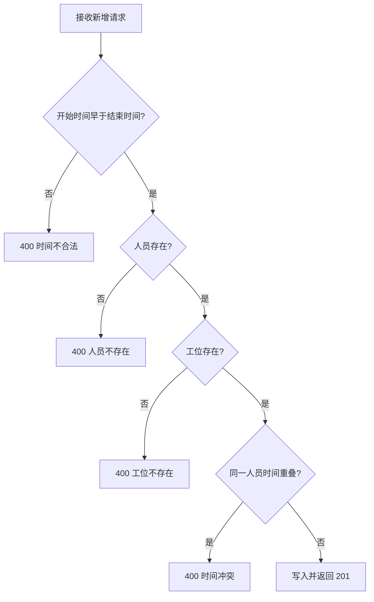

# 第 12 章 业务模块：规则描述

> **节首信息条**｜对应课次 11 · 4 学时 · 实践｜前置：第 10 章的 CRUD 与错误分层；第 5 章 5.5（HTTPException）、5.4（Depends）

**已会**：第 10 章的 CRUD、输入输出模型与 422/400/404 的错误分层。
**本章只加**：业务规则——把“格式合法但业务不合法”的情况写成可执行、可测试的判断。
**关系**：第 10 章保证“存进去的数据形状正确”；本章保证“存进去的数据在业务上讲得通”。

第 10 章的列表、新增、详情已经能处理“数据”。但执勤记录不是普通数据：同一个人在同一时间段可以被排两次，开始时间可以晚于结束时间，人员证件号格式正确却查无此人。

## 本章要解决的问题

**数据在格式上合法，不等于在业务上合法；规则应该写在哪一层？**

字段类型、必填与长度能保证数据的形状正确，却管不了记录之间的先后关系、跨表的引用是否存在，以及多段记录是否重叠。这些判断需要同时看多个字段、多张表或多条记录，放错位置就会与该层的职责冲突。

本章以执勤记录为例，讲清三条规则：开始时间必须早于结束时间、人员与工位必须存在、同一人员同一时间段不能重复。重点是规则放在哪一层、按什么顺序校验，以及怎样让每条规则都能被测试。

## 本章学习目标

读完第 12 章并完成实训后，你应该能：

1. 区分“数据合法”与“业务合法”，并说明为什么业务规则必须放在 service。
2. 为执勤记录设计表与关联，说明人员、工位与记录之间的关系。
3. 实现“开始早于结束”“人员与工位存在”“同一人员时间不重叠”三条规则。
4. 按固定顺序校验，并返回可定位的错误信息与正确状态码。
5. 确定事务边界：先完成全部校验，再一次写入，异常回滚。

## 12.1 数据合法与业务合法

本章用执勤记录表做例子。表的结构如下：

| 字段 | 说明 |
| --- | --- |
| `id` | 记录编号，主键 |
| `personnel_certificate_number` | 值班人员证件号，外键 |
| `successor_certificate_number` | 接班人员证件号，可选 |
| `workstation_id` | 工位编号，外键 |
| `start_time` | 开始时间 |
| `end_time` | 结束时间 |
| `status` | 状态，`normal` 或 `abnormal` |
| `remark` | 备注 |

关系是：人员 1—N 执勤记录 N—1 工位。一条记录属于一个人员、一个工位；人员和工位必须先在各自表里存在。时间是这条记录的核心，也是冲突规则的依据。

Pydantic 能保证字段类型正确、必填项不缺、长度不超限，这些是“数据合法”。数据库的主键、外键、唯一与必填约束，能保证“存进去的数据形状正确”。但两者都管不了“业务上讲不讲得通”。

| 情况 | 数据层能拦住吗 | 为什么 |
| --- | --- | --- |
| 开始 14:00、结束 08:00 | 不能 | 两个时间字段都合法，问题在先后关系 |
| 人员证件号格式正确但人不存在 | 数据库外键能拦，接口反馈差 | 外键抛异常，前端可能收到 500 |
| 同一人员两段时间重叠 | 不能 | 每条记录单独看都合法，问题在记录之间 |

**业务规则**（Business Rule）指“什么情况下拒绝、返回什么错误”的判断。本章的核心概念是**业务规则与一致性**：规则回答“这条写不写”，一致性回答“多条规则、多次写入之间不能互相矛盾”。业务规则有三个特点：跨字段（时间先后）、跨表（人员与工位是否存在）、跨记录（时间是否重叠）。因此，它不属于表结构，也不属于单个字段的参数校验，而属于 service 层的职责。

## 12.2 业务规则的分类

**规则一：开始时间必须早于结束时间**

**代码 12-1-1** · `app/modules/duty_record/service.py`（规则代码，Python）

```python
if data.start_time >= data.end_time:
    raise HTTPException(status_code=400, detail="开始时间必须早于结束时间")
```

为什么放在 service 而不是 schema？因为它是业务语义，不是字段格式。schema 可以校验“是不是时间”，但“先后顺序”需要知道两个字段的关系，放在 service 更合适。

**规则二：人员和工位必须存在**

**代码 12-1-2** · `app/modules/duty_record/service.py`（规则代码，Python）

```python
person = db.query(Personnel).filter(
    Personnel.certificate_number == data.personnel_certificate_number
).first()
if not person:
    raise HTTPException(status_code=400, detail="人员不存在")

workstation = db.query(Workstation).filter(
    Workstation.workstation_id == data.workstation_id
).first()
if not workstation:
    raise HTTPException(status_code=400, detail="工位不存在")
```

数据库外键也能阻止写入不存在的关联，但它通常抛出数据库异常，前端收到的是 500 或含糊的错误。提前在 service 里检查，可以返回明确的 400 和可读的错误信息。

**规则三：同一人员的时间不能重叠**

判断两个时间段是否重叠，用“有交集”的条件：

**代码 12-1-3** · 示例（文本）

```text
已有记录：start1 ~ end1
新记录：  start2 ~ end2
重叠条件：start1 < end2 且 end1 > start2
```

这个条件覆盖包含、部分重叠、完全相同三种情况；首尾相接不算重叠。例如已有 08:00–12:00：

| 新记录 | 是否冲突 | 原因 |
| --- | --- | --- |
| 10:00–11:00 | 冲突 | 被已有区间包含 |
| 11:00–13:00 | 冲突 | 与已有区间部分重叠 |
| 08:00–12:00 | 冲突 | 完全相同 |
| 12:00–14:00 | 不冲突 | 首尾相接 |
| 13:00–15:00 | 不冲突 | 完全在之后 |

查询时只查同一人员的记录：

**代码 12-1-4** · `app/modules/duty_record/service.py`（规则代码，Python）

```python
conflict = db.query(DutyRecord).filter(
    DutyRecord.personnel_certificate_number == data.personnel_certificate_number,
    DutyRecord.start_time < data.end_time,
    DutyRecord.end_time > data.start_time,
).first()

if conflict:
    raise HTTPException(status_code=400, detail="该时间段已存在值班记录")
```



*图 12-1：执勤记录新增的校验顺序*

> 💡 **易错点**：重叠条件写成 `start1 <= end2 and end1 >= start2`。多出来的等号会把“首尾相接”误判为冲突：08:00–12:00 之后接 12:00–14:00 是合法的连续排班，不该被拒绝。边界要用手算用例逐条验证。

## 12.3 业务规则的归属

controller 的职责是接收请求、取出参数、调用 service、返回响应。它不应该知道“时间重叠”怎么判断，也不应该直接查人员表。把规则写在 service，有三个好处：规则可以单独测试；controller 保持薄；其他入口（批量导入、定时任务）也能复用同一套规则。

**服务层**指承载业务规则、组合多个操作的那一层。它与 crud 的分工是：crud 只回答“怎么读写”，service 回答“什么情况下允许写”。把三种写法放在一起比较：

| 写法 | 后果 |
| --- | --- |
| 规则写在 controller | 换一个入口（批量导入）就要复制一遍；测试要绕过 HTTP 层 |
| 规则写在 schema | schema 只能看到单个请求的数据，查不了库，也判断不了跨记录冲突 |
| 规则写在 service | 一处判断、多处复用；可以单独调用测试；controller 只负责转发 |

判断一条逻辑该不该写成业务规则，看它是否满足两个条件：**只看一条记录或一个字段的，放 schema；要看多条记录或多张表的，放 service。** 例外的“唯一性”看似是单字段，实际要查库，所以也放 service。

规则写在 service 也带来一个代价：service 依赖数据库会话，测试时要准备数据或替换依赖。这个代价是值得的，因为“规则可测试”本身就是质量的一部分（第 14 章会用到）。

## 12.4 校验顺序与错误信息

**校验顺序**

校验顺序建议按“先便宜、后昂贵”和“先格式、后业务”排列：先判断时间顺序（不查库），再查人员、工位（各一次查询），最后查时间冲突（一次范围查询）。这样绝大多数非法请求在第一次判断就被拒绝，不会白白查库。

顺序还影响错误信息的准确性。如果先查时间冲突、再查人员是否存在，人员不存在时可能先命中一条无关的冲突记录，返回“时间冲突”，把调用方引向错误的方向。

**错误信息**

错误信息要具体：写“开始时间必须早于结束时间”，不写“参数错误”；写“该时间段已存在值班记录”，不写“操作失败”。具体的信息让调用方知道该改什么。状态码也要分层：业务规则不满足用 400，参数格式不对由 Pydantic 返回 422，资源不存在用 404。

**写入纪律**

本章的写入只有一条记录，`db.commit()` 成功即完成。一次操作要写多条记录时，要么全部成功、要么全部回滚，不能留下“一半写入”的中间状态；完整的事务处理见第 13 章 13.4。本章只需守住一条纪律：**先完成所有校验，再执行写入**，校验过程中不要提前 `commit`。

每条规则至少用正常、边界、冲突三类数据各验一遍（边界包括首尾相接与刚好等于上限），完整的三类路径写法见第 14 章 14.4。

> 💡 **易错点**：先写库、再校验。写入已经提交，后面发现不合法再删除，中间状态可能被其他请求读到；更糟的是删除失败，脏数据永久留下。校验必须在写入之前完成。

## 示范例题

#### 例 12-1：实现时间顺序与关联存在校验【Bloom：应用】

**题目**：实现执勤记录新增的 service：先判断开始时间是否早于结束时间，再检查人员与工位是否存在。要求每类错误返回 400 并给出具体提示。

**解**：

**代码 12-2-1** · `app/modules/duty_record/service.py`（规则代码，Python）

```python
def create_duty_record(db, data):
    if data.start_time >= data.end_time:
        raise HTTPException(status_code=400, detail="开始时间必须早于结束时间")

    person = db.query(Personnel).filter(
        Personnel.certificate_number == data.personnel_certificate_number
    ).first()
    if not person:
        raise HTTPException(status_code=400, detail="人员不存在")

    workstation = db.query(Workstation).filter(
        Workstation.workstation_id == data.workstation_id
    ).first()
    if not workstation:
        raise HTTPException(status_code=400, detail="工位不存在")

    record = DutyRecord(**data.model_dump())
    db.add(record)
    db.commit()
    db.refresh(record)
    return record
```

校验顺序是：时间顺序（不查库）→ 人员（一次查询）→ 工位（一次查询）→ 写入。每一类错误都有独立的 400 提示，调用方能直接定位问题。

#### 例 12-2：判断时间是否重叠【Bloom：分析】

**题目**：已有记录 08:00–12:00。判断以下新记录是否冲突，并说明依据：10:00–11:00、12:00–14:00、13:00–15:00、08:00–12:00、11:00–13:00。

**解**：

重叠条件是 `已有开始 < 新结束 且 已有结束 > 新开始`。

| 新记录 | 判断 | 结论 |
| --- | --- | --- |
| 10:00–11:00 | 08:00 < 11:00 且 12:00 > 10:00 | 冲突 |
| 12:00–14:00 | 08:00 < 14:00 但 12:00 > 12:00 不成立 | 不冲突（首尾相接） |
| 13:00–15:00 | 12:00 > 13:00 不成立 | 不冲突 |
| 08:00–12:00 | 两个条件都成立 | 冲突（完全相同） |
| 11:00–13:00 | 08:00 < 13:00 且 12:00 > 11:00 | 冲突（部分重叠） |

## 独立习题

#### 习题 12-1【Bloom：理解】

**题目**：说明为什么业务规则要写在 service，而不是 controller 或 schema。分别举一个“放在 controller 会怎样”和“放在 schema 会怎样”的例子。

#### 习题 12-2【Bloom：分析】

**题目**：某模块的新增接口只校验了“开始时间早于结束时间”，没有校验人员是否存在、时间是否重叠。请指出可能导致的问题，并给出补充校验的顺序与理由。

#### 习题 12-3【Bloom：创造】（开放题，换场景）

**题目**：为“器材借还”写三条业务规则，并给出校验顺序：器材必须存在、器材必须处于“在库”才能借出、同一器材不能同时被两个人借走。请为每条规则说明它属于跨字段、跨表还是跨记录，放在哪一层，返回什么状态码与错误信息；再写出“归还”时的校验顺序。**不能照抄本章执勤记录的时间字段**：器材借用有借出时间与归还时间，但没有“同一人员时间重叠”这条规则。

## ◆ 实训 12-1：业务模块：规则描述（对应课次 11 · 4 学时）

### 一、任务目标与验收

| 目标 | 验收标志 |
| --- | --- |
| 表与关联正确 | 执勤记录含人员、工位、起止时间等字段 |
| 三条规则生效 | 分别有通过/失败用例 |
| 校验顺序固定 | 先存在性、再时间、最后重叠 |
| 错误信息可定位 | 返回 400 并指明违反的规则 |
| 事务边界正确 | 失败后无半条记录 |

### 二、课前准备

- 第 10 章的项目与数据库
- 人员、工位测试数据
- 一份规则用例表（每条规则至少一正一反）

### 三、操作步骤

1. **建表与关联**
   - 做什么：建表与关联
   - 操作：写 `DutyRecord` 模型与外键字段
   - 预期输出：→ 表结构能表达人员—工位—时间
   - 做错会看到什么：字段名与接口不一致；对照设计文档统一
2. **实现存在性校验**
   - 做什么：实现存在性校验
   - 操作：新增前查人员与工位是否存在
   - 预期输出：→ 不存在返回 400
   - 做错会看到什么：直接写入导致悬空外键
3. **实现时间与重叠规则**
   - 做什么：实现时间与重叠规则
   - 操作：先比开始/结束，再查同一人员重叠区间
   - 预期输出：→ 违规返回 400 且信息具体
   - 做错会看到什么：重叠条件写错；用边界值（相等、首尾相接）测试
4. **事务与回归**
   - 做什么：事务与回归
   - 操作：把校验放在写入前，失败不提交
   - 预期输出：→ 失败后数据库无残留
   - 做错会看到什么：循环内提交或吞异常；改为一次提交 + 回滚

### 四、排错清单

| 现象 | 先查什么 |
| --- | --- |
| 规则通过但数据仍脏 | 校验在写入之后，或异常被吞 |
| 重叠判断漏掉边界 | 区间比较未统一开闭 |
| 错误码混用 | 业务规则用 400，参数校验用 422 |
| 规则散落在 controller | 把规则移到 service，controller 只转发 |

### 五、提交与验收

提交规则实现与用例表；验收按“三条规则”“校验顺序与错误信息”“事务边界”三项判定。

### 六、课后扩展

- 补一条“跨天值班”的规则用例
- 把重叠查询改为一次 SQL 查询并说明性能
- 为规则写 pytest 参数化用例
- **复习任务**：回看第 10 章 10.4（错误分层）与第 5 章 5.5（HTTPException），对照本章 12.2–12.4，说明三条规则分别由哪一层拒绝、为什么不能都交给数据库

## 本章小结

**核心结论**：

1. 数据合法不等于业务合法；**业务规则**回答“什么情况下拒绝、返回什么错误”，它跨字段、跨表或跨记录。
2. 执勤记录新增至少有三条规则：开始时间早于结束时间、人员与工位存在、同一人员时间不重叠。
3. 时间重叠条件是 `已有开始 < 新结束 且 已有结束 > 新开始`；首尾相接不算冲突。
4. 规则写在 **service**，controller 只转发；校验顺序按“先便宜、后昂贵”排列，全部校验完成后再写入。
5. 每条规则至少用正常、边界、冲突三类数据测试；错误提示要具体，状态码要分层。

把这章压缩成一句话：**格式校验挡住“写错的形状”，业务规则挡住“说不通的组合”。**

**本章不引入**：规则引擎、工作流引擎、复杂事件处理。这些在后续课程或工程环境中按需了解。

**学完本章，你可以体会到**：业务规则不是“多加几个判断”，而是把现实约束写成可验证、可回归的代码。

**自检**：回到章首的学习目标，逐条问自己做到了没有——

- [ ] 区分“数据合法”与“业务合法”，并说明为什么业务规则必须放在 service。
- [ ] 为执勤记录设计表与关联，说明人员、工位与记录之间的关系。
- [ ] 实现“开始早于结束”“人员与工位存在”“同一人员时间不重叠”三条规则。
- [ ] 按固定顺序校验，并返回可定位的错误信息与正确状态码。
- [ ] 确定事务边界：先完成全部校验，再一次写入，异常回滚。

**下一章预告**：规则解决了“一条记录能不能写”。下一章处理多条记录的汇总：按人员、时段统计值班次数，并处理统计口径与事务边界。
