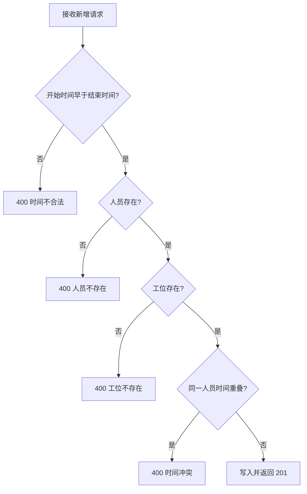

# 第 12 章 业务模块：规则描述

> **节首信息条**｜对应课次 11 · 4 学时 · 实践｜前置：第 10 章的 CRUD 与错误分层；第 5 章 5.1.5（HTTPException）、5.1.6（Depends）

上一章的列表、新增、详情已经能处理“数据”。但执勤记录不是普通数据：同一个人在同一时间段被排了两次，数据本身格式没问题，业务上却不允许。这类“格式合法但业务不合法”的情况，就是业务规则（Business Rule）要解决的问题。

本章以执勤记录为例，讲清三条规则：开始时间必须早于结束时间；人员和工位必须存在；同一人员同一时间段不能重复。重点不在写多少代码，而在把规则放在正确的层、按正确的顺序校验，并让每条规则都能被测试。

## 本章学习目标

读完第 12 章并完成实训后，你应该能：

1. 区分“数据合法”与“业务合法”，并说明为什么业务规则必须放在 service。
2. 为执勤记录设计表与关联，说明人员、工位与记录之间的关系。
3. 实现“开始早于结束”“人员与工位存在”“同一人员时间不重叠”三条规则。
4. 按固定顺序校验，并返回可定位的错误信息与正确状态码。
5. 确定事务边界（Transaction Boundary）：先完成全部校验，再一次写入，异常回滚。

## 前置知识卡

| # | 已有知识 | 回看位置 |
| --- | --- | --- |
| 1 | 本章依赖的前置内容 | 第 10 章的 CRUD 与错误分层；第 5 章 5.1.5（HTTPException）、5.1.6（Depends） |
| 2 | 上一章的核心结论 | 见上一章「本章小结」 |
| 3 | 本章实训/案例所需的环境与数据 | 见本章实训「二、课前准备」或章首导入 |

> 卡住时先回看，不必从头重读。

## 12.1 概念讲解

### 12.1.1 数据合法不等于业务合法

Pydantic 能保证字段类型正确、必填项不缺、长度不超限，这些是“数据合法”。但数据合法不代表业务合法：开始时间 14:00、结束时间 08:00，两个字段都是合法时间，顺序却反了；人员证件号格式正确，但数据库里根本没有这个人；两条记录各自都合法，时间却重叠。

业务规则要回答的是“什么情况下拒绝、返回什么错误”。它不属于表结构，也不属于参数校验，而属于 service 层的职责。

### 12.1.2 执勤记录表与关系

| 字段 | 说明 |
| --- | --- |
| `id` | 记录编号，主键 |
| `personnel_certificate_number` | 值班人员证件号，外键 |
| `successor_certificate_number` | 接班人员证件号，可选 |
| `workstation_id` | 工位编号，外键 |
| `start_time` | 开始时间 |
| `end_time` | 结束时间 |
| `status` | 状态，`normal` 或 `abnormal` |
| `remark` | 备注 |

关系是：人员 1—N 执勤记录 N—1 工位。一条记录属于一个人员、一个工位；人员和工位必须先在各自表里存在。时间是这条记录的核心，也是冲突规则的依据。

### 12.1.3 规则一：开始时间必须早于结束时间

**代码 12-1-1** · 示例代码（Python）

```python
if data.start_time >= data.end_time:
    raise HTTPException(status_code=400, detail="开始时间必须早于结束时间")
```

为什么放在 service 而不是 schema？因为它是业务语义，不是字段格式。schema 可以校验“是不是时间”，但“先后顺序”需要知道两个字段的关系，放在 service 更合适。

### 12.1.4 规则二：人员和工位必须存在

**代码 12-1-3** · 示例代码（Python）

```python
person = db.query(Personnel).filter(
    Personnel.certificate_number == data.personnel_certificate_number
).first()
if not person:
    raise HTTPException(status_code=400, detail="人员不存在")

workstation = db.query(Workstation).filter(
    Workstation.workstation_id == data.workstation_id
).first()
if not workstation:
    raise HTTPException(status_code=400, detail="工位不存在")
```

数据库外键也能阻止写入不存在的关联，但它通常抛出数据库异常，前端收到的是 500 或含糊的错误。提前在 service 里检查，可以返回明确的 400 和可读的错误信息。

### 12.1.5 规则三：同一人员的时间不能重叠

判断两个时间段是否重叠，用“有交集”的条件：

**代码 12-1-5** · 示例（文本）

```text
已有记录：start1 ~ end1
新记录：  start2 ~ end2
重叠条件：start1 < end2 且 end1 > start2
```

这个条件覆盖包含、部分重叠、完全相同三种情况；首尾相接不算重叠。例如已有 08:00–12:00：

| 新记录 | 是否冲突 | 原因 |
| --- | --- | --- |
| 10:00–11:00 | 冲突 | 被已有区间包含 |
| 11:00–13:00 | 冲突 | 与已有区间部分重叠 |
| 08:00–12:00 | 冲突 | 完全相同 |
| 12:00–14:00 | 不冲突 | 首尾相接 |
| 13:00–15:00 | 不冲突 | 完全在之后 |

查询时只查同一人员的记录：

**代码 12-1-7** · 示例代码（Python）

```python
conflict = db.query(DutyRecord).filter(
    DutyRecord.personnel_certificate_number == data.personnel_certificate_number,
    DutyRecord.start_time < data.end_time,
    DutyRecord.end_time > data.start_time,
).first()

if conflict:
    raise HTTPException(status_code=400, detail="该时间段已存在值班记录")
```



*图 12-1：执勤记录新增的校验顺序（Validation Order）*

### 12.1.6 规则写在 service，controller 只转发

controller 的职责是接收请求、取出参数、调用 service、返回响应。它不应该知道“时间重叠（Time Overlap）”怎么判断，也不应该直接查人员表。把规则写在 service，有三个好处：规则可以单独测试；controller 保持薄；其他入口（批量导入、定时任务）也能复用同一套规则。

### 12.1.7 校验顺序与错误信息

校验顺序建议按“先便宜、后昂贵”和“先格式、后业务”排列：先判断时间顺序（不查库），再查人员、工位（各一次查询），最后查时间冲突（一次范围查询）。这样绝大多数非法请求在第一次判断就被拒绝，不会白白查库。

错误信息要具体：写“开始时间必须早于结束时间”，不写“参数错误”；写“该时间段已存在值班记录”，不写“操作失败”。具体的信息让调用方知道该改什么。

### 12.1.8 事务边界：先校验，再写入

本章的写入只有一条记录，`db.commit()` 成功即完成。但如果一次操作要写多条记录（例如批量导入），就必须考虑事务：要么全部成功，要么全部回滚，不能留下“一半写入”的中间状态。

事务的完整处理放在后续章节，本章先建立一条纪律：**先完成所有校验，再执行写入**。校验过程中不要提前 `commit`，否则校验失败时已经写进去的数据无法自动撤销。

### 12.1.9 规则要能被三类数据验证

每条业务规则至少用三类数据测试：正常数据（应当成功）、边界数据（首尾相接、刚好等于上限）、冲突数据（应当被拒绝）。只测正常数据，规则可能根本没生效；只测冲突数据，可能把合法情况也误伤。

## 12.2 示范例题

#### 例 12-1：实现时间顺序与关联存在校验【Bloom：应用】

**题目**：实现执勤记录新增的 service：先判断开始时间是否早于结束时间，再检查人员与工位是否存在。要求每类错误返回 400 并给出具体提示。

**解**：

**代码 12-2-1** · 示例代码（Python）

```python
def create_duty_record(db, data):
    if data.start_time >= data.end_time:
        raise HTTPException(status_code=400, detail="开始时间必须早于结束时间")

    person = db.query(Personnel).filter(
        Personnel.certificate_number == data.personnel_certificate_number
    ).first()
    if not person:
        raise HTTPException(status_code=400, detail="人员不存在")

    workstation = db.query(Workstation).filter(
        Workstation.workstation_id == data.workstation_id
    ).first()
    if not workstation:
        raise HTTPException(status_code=400, detail="工位不存在")

    record = DutyRecord(**data.model_dump())
    db.add(record)
    db.commit()
    db.refresh(record)
    return record
```

校验顺序是：时间顺序（不查库）→ 人员（一次查询）→ 工位（一次查询）→ 写入。每一类错误都有独立的 400 提示，调用方能直接定位问题。

#### 例 12-2：判断时间是否重叠【Bloom：分析】

**题目**：已有记录 08:00–12:00。判断以下新记录是否冲突，并说明依据：10:00–11:00、12:00–14:00、13:00–15:00、08:00–12:00、11:00–13:00。

**解**：

重叠条件是 `已有开始 < 新结束 且 已有结束 > 新开始`。

| 新记录 | 判断 | 结论 |
| --- | --- | --- |
| 10:00–11:00 | 08:00 < 11:00 且 12:00 > 10:00 | 冲突 |
| 12:00–14:00 | 08:00 < 14:00 但 12:00 > 12:00 不成立 | 不冲突（首尾相接） |
| 13:00–15:00 | 12:00 > 13:00 不成立 | 不冲突 |
| 08:00–12:00 | 两个条件都成立 | 冲突（完全相同） |
| 11:00–13:00 | 08:00 < 13:00 且 12:00 > 11:00 | 冲突（部分重叠） |

## 12.3 独立习题

#### 习题 12-1【Bloom：理解】

**题目**：说明为什么业务规则要写在 service，而不是 controller 或 schema。分别举一个“放在 controller 会怎样”和“放在 schema 会怎样”的例子。

#### 习题 12-2【Bloom：分析】

**题目**：某模块的新增接口只校验了“开始时间早于结束时间”，没有校验人员是否存在、时间是否重叠。请指出可能导致的问题，并给出补充校验的顺序与理由。

## ◆ 实训 12-1：业务模块：规则描述（对应课次 11 · 4 学时）

### 一、任务目标与验收

| 目标 | 验收标志 |
| --- | --- |
| 表与关联正确 | 执勤记录含人员、工位、起止时间等字段 |
| 三条规则生效 | 分别有通过/失败用例 |
| 校验顺序固定 | 先存在性、再时间、最后重叠 |
| 错误信息可定位 | 返回 400 并指明违反的规则 |
| 事务边界正确 | 失败后无半条记录 |

### 二、课前准备

- 第 10 章的项目与数据库
- 人员、工位测试数据
- 一份规则用例表（每条规则至少一正一反）

### 三、操作步骤

1. **建表与关联**
   - 做什么：建表与关联
   - 操作：写 `DutyRecord` 模型与外键字段
   - 预期输出：→ 表结构能表达人员—工位—时间
   - 做错会看到什么：字段名与接口不一致；对照设计文档统一
2. **实现存在性校验**
   - 做什么：实现存在性校验
   - 操作：`新增前查人员与工位是否存在`
   - 预期输出：→ 不存在返回 400
   - 做错会看到什么：直接写入导致悬空外键
3. **实现时间与重叠规则**
   - 做什么：实现时间与重叠规则
   - 操作：`先比开始/结束，再查同一人员重叠区间`
   - 预期输出：→ 违规返回 400 且信息具体
   - 做错会看到什么：重叠条件写错；用边界值（相等、首尾相接）测试
4. **事务与回归**
   - 做什么：事务与回归
   - 操作：`把校验放在写入前，失败不提交`
   - 预期输出：→ 失败后数据库无残留
   - 做错会看到什么：循环内提交或吞异常；改为一次提交+回滚

### 四、排错清单

| 现象 | 先查什么 |
| --- | --- |
| 规则通过但数据仍脏 | 校验在写入之后，或异常被吞 |
| 重叠判断漏掉边界 | 区间比较未统一开闭 |
| 错误码混用 | 业务规则用 400，参数校验用 422 |
| 规则散落在 controller | 把规则移到 service，controller 只转发 |

### 五、提交与验收

提交规则实现与用例表；验收按“三条规则”“校验顺序与错误信息”“事务边界”三项判定。

### 六、课后扩展

- 补一条“跨天值班”的规则用例
- 把重叠查询改为一次 SQL 查询并说明性能
- 为规则写 pytest 参数化用例

### 七、回链

- 第 10 章 10.1.8；第 5 章 5.1.5；本章 12.1.3–12.1.8

## 本章小结

**核心结论**：

1. 数据合法不等于业务合法；业务规则回答“什么情况下拒绝、返回什么错误”。
2. 执勤记录新增至少有三条规则：开始时间早于结束时间、人员与工位存在、同一人员时间不重叠。
3. 时间重叠条件是 `已有开始 < 新结束 且 已有结束 > 新开始`；首尾相接不算冲突。
4. 规则写在 service，controller 只转发；校验顺序按“先便宜、后昂贵”排列，全部校验完成后再写入。
5. 每条规则至少用正常、边界、冲突三类数据测试；错误提示要具体，状态码要分层。

**学完本章，你可以体会到**：业务规则不是“多加几个判断”，而是把现实约束写成可验证、可回归的代码。
**自检**：回到章首的学习目标，逐条问自己做到了没有——

- [ ] 区分“数据合法”与“业务合法”，并说明为什么业务规则必须放在 service。 → 回看 12.1.1–12.1.2，自测：习题 12-1
- [ ] 为执勤记录设计表与关联，说明人员、工位与记录之间的关系。 → 回看 12.1.3–12.1.5，自测：习题 12-1
- [ ] 实现“开始早于结束”“人员与工位存在”“同一人员时间不重叠”三条规则。 → 回看 12.1.6–12.1.7，自测：习题 12-1
- [ ] 按固定顺序校验，并返回可定位的错误信息与正确状态码。 → 回看 12.1.7，自测：习题 12-1
- [ ] 确定事务边界：先完成全部校验，再一次写入，异常回滚。 → 回看 12.1.8–12.1.9，自测：习题 12-1

**下一章预告**：规则解决了“一条记录能不能写”。下一章处理多条记录的汇总：按人员、时段统计值班次数，并处理统计口径与事务边界。

