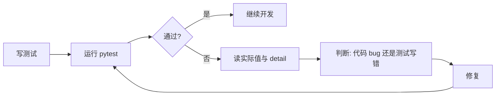

# 第 12 章 模块测试与调试

第 11 章用手算核对过一次统计结果。手算能覆盖一次，改完代码还要再算一遍；接口多了，手工点一遍既慢又容易漏。

## 本章要解决的问题

**怎样证明系统做对了，并在改坏时快速定位？**

一次看起来无关的修改，可能让原本正常的功能悄悄坏掉。手工点一遍既不可重复，也覆盖不到边界与异常路径；出了问题，只能从现象开始一层层往回找。

本章关心的是：测试能证明什么、不能证明什么；什么算测够了；失败信息怎样把人引回缺陷所在。

## 本章学习目标

读完第 12 章并完成实训后，应能：

1. 说明测试要解决什么问题，并说出单元、接口、集成三层的区别。
2. 用 pytest 与 TestClient 写出第一条接口测试，会运行、会读通过和失败。
3. 为正常、边界、异常三类路径写测试，并让测试数据连续运行两次结果一致。
4. 从失败信息判断是代码问题还是测试问题，并按状态码定位。

## 12.1 测试的作用与限度

测试是把“系统应该怎么表现”写成可重复执行的代码。改完代码运行一遍，通过说明原有行为还在，失败说明有一处不符合预期。

没有测试时，验证靠手工点击。手工点击有两个无法回避的限制：**不可重复**——每次都要重新点一遍，步骤和顺序可能不同；**覆盖不全**——正常路径容易点到，边界与异常路径很少有人主动去试。

这两个限制叠加，会产生一类特定的缺陷：**回归缺陷**。ISTQB 把这类现象归为回归——修改之后，原本正常的功能被破坏。例如把时间判断从 `>` 改成 `>=`，中间时段的记录仍然正常，首尾相接的记录却被拒绝；改代码的人只测了自己关心的中间时段，没有发现边界已经改变。

测试的价值因此不在“证明代码没错”，而在“改动能被快速验证”。具体有三个作用：

1. **回归**：改一处，立刻知道有没有坏三处。
2. **说明书**：测试写明接口在什么输入下应返回什么结果，比口头约定更可靠。
3. **重构信心**：敢动结构，因为运行一遍就知道行为有没有变。

需要明确测试的边界：它只能证明“写下的用例”通过了，不能证明系统没有缺陷。测试覆盖的是作者想到的情况；作者没想到的边界，测试也不会替他想。这不是测试的失败，而是测试的定位——它是一种可重复的证据，不是正确性的证明。

## 12.2 测试的分层

ISTQB 把测试分为组件（单元）、集成、系统与验收四级；本章按课程项目归为单元、接口与集成三层。其中接口测试验证前后端之间的契约，是本章要写的主要一种。

| 类型 | 测什么 | 例子 | 成本 |
| --- | --- | --- | --- |
| 单元测试 | 一个函数或一段纯逻辑 | 时间重叠判断 | 低，运行快 |
| 接口测试 | 一个 HTTP 接口的输入与输出 | 登录返回 200 或 401 | 中，需要客户端与数据 |
| 集成测试 | 多个部件连在一起 | 登录 → 建单位 → 查列表 | 高，依赖多、跑得慢 |

三层不是“越往后越高级”，而是成本与覆盖范围的交换。单元测试快、定位准，但只覆盖一段逻辑；接口测试验证契约，能发现字段、状态码、权限的问题；集成测试覆盖链路，但失败时不容易判断是哪一环出的错。

单元测试最容易误解。它不是“比较小的接口测试”，而是直接调用一个函数，给输入、看输出。下面这段演示的是最纯粹的形式；它不在你的项目里，只看形状：

**代码 12-1-1** · 示例（Python）

```python
def is_overlap(start1, end1, start2, end2):
    return start1 < end2 and end1 > start2

def test_touching_is_not_overlap():
    assert is_overlap(8, 12, 12, 14) is False
```

没有客户端、没有数据库，一行输入对应一行期望。要让第 10 章的重叠规则也能这样测，得先把判断抽成一个不查库的函数；本章不要求做这次改造，只需要知道单元测试长什么样。

本章以接口测试为主，因为接口是前后端契约的落点。集成测试用第 13 章的联调代替；端到端测试成本最高，初学阶段先不展开。**不要为了“测试齐全”把每个接口都写成端到端测试**，那会让测试运行变慢、失败难定位，反而降低改代码的意愿。

## 12.3 pytest 用例与 fixture

**装好环境与测试账号**

pytest 是测试工具，httpx 是 TestClient 发请求时用的客户端库。它们只在开发时用，不进运行依赖也可以：

```text
$ pip install pytest httpx
```

登录测试要用管理员账号。第 6、7 章的用户数据在内存里，**随进程新建**：在终端里单独运行一次 seed 脚本，不会带进 pytest 进程。因此把第 7 章 7.2 的 `create_admin()` 放进 `tests/conftest.py`，让 pytest 在自己的进程里自动建好管理员。第 8 章把用户落库后，这条 seed 仍可保留：脚本本身幂等，重复运行不会建出两个管理员。

pytest 的规则只有两条（pytest 官方文档）：文件名以 `test_` 开头、函数名以 `test_` 开头的会被发现；函数里的 `assert` 不成立，测试就失败。

**先放好测试要用的东西**

测试要两样东西：一个能发请求的客户端，和登录后带上令牌的请求头。这两样写在 `tests/conftest.py` 里，pytest 每次运行自动加载：

**代码 12-1-2** · `tests/conftest.py`（测试夹具，Python）

```python
import pytest
from fastapi.testclient import TestClient
from main import app
from app.scripts.create_admin import create_admin

@pytest.fixture(scope="session", autouse=True)
def seed_admin():
    """内存用户表随进程新建：在测试进程里 seed 管理员，供各登录用例共用。"""
    create_admin()

@pytest.fixture
def client():
    return TestClient(app)

@pytest.fixture
def admin_headers(client):
    resp = client.post("/api/v1/users/login", json={"username": "admin", "password": "admin123"})
    token = resp.json()["access_token"]
    return {"Authorization": f"Bearer {token}"}
```

`@pytest.fixture` 标记的函数叫 **fixture**（测试夹具），意思是“测试开始前准备好的东西”。测试函数把 fixture 名写成参数，pytest 会自动调用它并注入结果；`admin_headers` 的参数里写了 `client`，pytest 会先准备好客户端，再用它去登录。

`seed_admin` 用 `scope="session"` 让整轮测试只建一次账号，`autouse=True` 让它无需被任何测试声明就自动运行——`test_login_success` 不用 `admin_headers`，但仍需要管理员存在。

抽成 fixture 的理由很直接：第二条测试也要登录。如果不抽出来，每条测试都要重复这五行登录代码；抽出来以后，测试只写自己关心的那件事。

`from main import app` 要求从项目根目录运行 pytest，否则找不到 `main`。这是第一次运行最常见的报错。

**写第一条测试并让它失败**

在 `tests/test_auth.py` 里写第一条测试：

**代码 12-1-3** · `tests/test_auth.py`（登录成功，Python）

```python
def test_login_success(client):
    resp = client.post("/api/v1/users/login", json={"username": "admin", "password": "admin123"})
    assert resp.status_code == 200
    assert "access_token" in resp.json()
```

在项目根目录运行：

```text
$ python -m pytest -q
```

会看到：

**代码 12-1-4** · 运行结果（文本）

```text
.                                                                        [100%]
1 passed in 0.02s
```

一个点代表一条测试通过。`-q` 是“少说废话”，只报结果。

把上面请求里的密码改成 `wrong`，再运行一次：

**代码 12-1-5** · 失败结果（文本）

```text
    def test_login_success(client):
        resp = client.post("/api/v1/users/login", json={"username": "admin", "password": "wrong"})
>       assert resp.status_code == 200
E       assert 401 == 200
E        +  where 401 = <Response [401 Unauthorized]>.status_code

FAILED tests/test_auth.py::test_login_success - assert 401 == 200
```

读法是 `assert 实际 == 期望`：实际返回 401，期望 200。这里实际才是对的——密码错了本来就该 401，是测试里的密码写错了。把密码改回 `admin123`，测试重新变绿。

失败不是坏事。它告诉你哪一处不符合预期；要先分清是代码不对，还是测试写错了。

## 12.4 测试路径与测试数据

**三类路径与四条测试**

按等价类划分与边界值分析，一个接口至少应覆盖三类路径（ISTQB）。等价类划分是把输入按取值分成若干类，每类取一个代表；边界值分析是取每类的边缘值（例如分页上限附近的 99、100、101）——边界最容易出错。

| 路径 | 例子 | 期望 |
| --- | --- | --- |
| 正常 | 正确密码登录 | 200，返回令牌 |
| 边界 | 前一段 12:00 结束、后一段 12:00 开始 | 201，不算冲突 |
| 异常 | 错误密码、重复编码、缺字段 | 401 / 400 / 422 |

只测正常路径，规则可能根本没生效；只测异常路径，可能把合法情况也误伤。边界路径最能暴露“差一点”的错误：把 `>` 写成 `>=`，首尾相接就会被误判为冲突；把 `page_size` 的上限 `le=100` 写成 `le=99`，传 100 就会被拒绝（422），边界值是 99、100、101。

**一个测试只验一个行为**

一个测试只验一件事。失败时，一个测试只对应一个行为，定位更快；如果一个函数里既验成功又验失败，失败信息只能说明“这个函数挂了”，还要再判断是哪一组断言。

准备数据不算验证。写“重复编码返回 400”时，必须先成功建一条记录，这一步可以用 `assert 201` 确认准备成功；真正的验证是第二次请求返回 400。准备失败时测试应当立刻变红，而不是拿一个空结果继续断言。

本章要写的四条测试覆盖三类路径：

1. 登录成功（正常）。
2. 登录密码错（异常）。
3. 单位编码重复（异常）。
4. 执勤记录首尾相接（边界）。

第一条（登录成功）已在 12.3 写过。第二条结构相同，只改密码和期望：

**代码 12-1-6** · `tests/test_auth.py`（登录失败，Python）

```python
def test_login_wrong_password(client):
    resp = client.post("/api/v1/users/login", json={"username": "admin", "password": "wrong"})
    assert resp.status_code == 401
```

单位重复测试用每次不同的编码，这样不会与上一次运行留下的数据冲突：

**代码 12-1-7** · `tests/test_dept.py`（单位重复，Python）

```python
import uuid

def test_create_dept_duplicate(client, admin_headers):
    payload = {
        "dept_code": f"D-{uuid.uuid4().hex[:6]}",
        "full_name": "测试单位",
    }
    assert client.post("/api/v1/departments", json=payload, headers=admin_headers).status_code == 201
    assert client.post("/api/v1/departments", json=payload, headers=admin_headers).status_code == 400
```

执勤记录接口来自第 10 章实训的 `duty_record` 模块，完整路径是 `POST /api/v1/duty-records`。如果测试返回 404，先查 `main.py` 是否挂载了这个模块的路由；没有就按第 4 章的六文件结构补一个 `controller.py`（写法与单位模块相同），补完在 `/docs` 里应能看到这个接口。

执勤边界测试需要一名人员和一个哨位。正文用 `ZHANG001` 与 `WS001` 举例，运行前换成你实训里已有的值；时间取一个靠后的随机日期，避免与上一次运行留下的记录撞上：

**代码 12-1-8** · `tests/test_duty.py`（首尾相接，Python）

```python
import random
from datetime import date, timedelta

def test_duty_record_touching(client, admin_headers):
    day = date.today() + timedelta(days=random.randint(1000, 2000))
    base = {"personnel_certificate_number": "ZHANG001", "workstation_id": "WS001"}
    first = {**base, "start_time": f"{day}T08:00:00", "end_time": f"{day}T12:00:00"}
    second = {**base, "start_time": f"{day}T12:00:00", "end_time": f"{day}T14:00:00"}
    assert client.post("/api/v1/duty-records", json=first, headers=admin_headers).status_code == 201
    assert client.post("/api/v1/duty-records", json=second, headers=admin_headers).status_code == 201
```

第二条 12:00 开始、前一条 12:00 结束，首尾相接不算冲突，所以两条都应是 201。若第二条返回 400，多半是重叠条件多写了一个等号。

**测试数据要可重复**

测试会写数据。如果依赖上一次运行留下的状态，第二次运行可能因为数据已存在而失败；这类“第一次通过、第二次失败”不是代码坏了，而是测试没有隔离。三种常见做法各有代价：

| 做法 | 怎么用 | 代价 |
| --- | --- | --- |
| 测试前清理 | 每个用例开始前删除相关数据 | 清理逻辑本身要维护，并发时可能互相影响 |
| 独立测试库 | 测试连单独的库，和开发库分开 | 要维护建库与迁移脚本 |
| 每次不同编号 | 用时间戳或随机后缀生成编号 | 断言不能写死具体值，可读性下降 |

本章用第三种：单位编码用 uuid，执勤时间用靠后的随机日期。固定数据适合验证规则，例如“重复编码返回 400”；随机数据适合避免冲突，例如并发创建。两者要分开考虑；无论用哪种，测试都不应该依赖上一次运行留下的状态。

独立测试库更干净，但要改数据库连接、建表、准备数据，本章不展开，留作课后扩展。

## 12.5 失败信息的定位

测试失败时，pytest 会指出哪一行断言不成立，并给出实际值与期望值。12.3 的失败输出是最简单的一种：

```text
>       assert resp.status_code == 200
E       assert 401 == 200
```

读法是 `assert 实际 == 期望`。这里实际返回 401，期望 200。先看实际响应的 `detail`，判断是“代码有 bug”还是“测试期望写错了”。如果密码本来就该错，那么是测试写错了；如果期望 200 且代码返回 401，才需要查登录逻辑。

调试顺序可以固定为四步：先看状态码，再看 `detail`，再看 `/docs` 里的契约，最后才改代码。不要一上来就重装环境或改业务逻辑，那会把真正的原因覆盖掉。

| 状态码 | 先查什么 |
| --- | --- |
| 422 | 请求体字段名、类型、必填 |
| 400 | 业务规则：重复、时间冲突、人员不存在 |
| 401 | 密码、令牌、请求头 |
| 500 | 日志或堆栈：字段名、表名、空值 |



*图 12-1：测试—失败—定位—修复的循环*

**找 bug 活动**

下面三处是“改坏代码，让测试抓住”的练习。每处改一行或两行，运行对应的测试，看它变红，再按说明恢复。改之前先记下原行，恢复时逐字对照。

**改坏 1：登录不再校验密码。** 打开 `app/modules/user/service.py` 的 `login()`，把

```python
if not user or not verify_password(data.password, user.password_hash):
```

改成

```python
if not user:
```

运行 `python -m pytest -q tests/test_auth.py`，`test_login_wrong_password` 会失败：

```text
>       assert resp.status_code == 401
E       assert 200 == 401
```

密码错了却返回 200，说明校验被绕过了。恢复原行。

**改坏 2：单位查重条件写反。** 打开 `app/modules/dept/service.py` 的 `create_department()`，把

```python
if crud.get_by_code(db, data.dept_code):
```

改成

```python
if not crud.get_by_code(db, data.dept_code):
```

运行 `python -m pytest -q tests/test_dept.py`，`test_create_dept_duplicate` 会在第一次新增时就失败：

```text
>       assert client.post("/api/v1/departments", json=payload, headers=admin_headers).status_code == 201
E       AssertionError: assert 400 == 201
```

本来不存在的编码被判成重复，规则反了。恢复原行。

**改坏 3：重叠判断多一个等号。** 打开 `app/modules/duty_record/service.py` 的 `create_duty_record()`，把查询里的

```python
DutyRecord.end_time > data.start_time,
```

改成

```python
DutyRecord.end_time >= data.start_time,
```

运行 `python -m pytest -q tests/test_duty.py`，`test_duty_record_touching` 会在第二条请求上失败：

```text
>       assert client.post("/api/v1/duty-records", json=second, headers=admin_headers).status_code == 201
E       AssertionError: assert 400 == 201
```

首尾相接本是合法排班，却因为等号被判成冲突。恢复 `>`。

改坏 1 和改坏 3 都是小改动，正常路径看不出来，只有对应的异常、边界用例能抓到。改坏 2 不同：连正常新建也会返回 400，所以测试的第一次新建就红了——这也说明准备断言不是多余的，它把“规则写反”和“数据没准备好”分开报了出来。这就是测试的作用：把“哪一处不许改”固定下来。

测试要跟代码一起维护。接口改了，测试要跟着改；测试长期失败却没人管，就会失去“快速验证”的作用。把测试放在 `tests/` 目录、与代码同仓提交，每次改完代码运行一遍，是最低限度的纪律。测试不是一次性的交付物，而是随代码演进的安全网。

## 示范例题

两道例题对应本章的两个动作。例 12-1 写一条覆盖异常路径的测试，数据准备比前四条复杂；它是额外的例题，不计入 12.4 的四条，抄进测试文件后运行结果会多一条。例 12-2 读一条失败信息，练习“先判断是代码问题还是测试问题”。

#### 例 12-1：写执勤重叠测试

**题目**：同一人员已有 08:00–12:00 的执勤记录，再写 11:00–13:00 的一条，应返回 400。请写这条测试，并说明为什么要先断言第一条 201。

**解**：

**代码 12-2-1** · `tests/test_duty.py`（时间重叠，Python）

```python
import random
from datetime import date, timedelta

def test_duty_record_overlap(client, admin_headers):
    day = date.today() + timedelta(days=random.randint(1000, 2000))
    base = {"personnel_certificate_number": "ZHANG001", "workstation_id": "WS001"}
    first = {**base, "start_time": f"{day}T08:00:00", "end_time": f"{day}T12:00:00"}
    second = {**base, "start_time": f"{day}T11:00:00", "end_time": f"{day}T13:00:00"}
    assert client.post("/api/v1/duty-records", json=first, headers=admin_headers).status_code == 201
    assert client.post("/api/v1/duty-records", json=second, headers=admin_headers).status_code == 400
```

第一条断言 201 不只是“顺手”：如果人员或哨位不存在，第一条会返回 400，测试立刻变红，你才知道准备错了。若只断言第二条是 400，准备失败时第二条也会 400，测试反而“通过”，把一个真实的错误掩盖掉。

重叠判断靠两条同时成立：新记录的开始早于已有记录的结束，新记录的结束晚于已有记录的开始。第 10 章 10.2 把这条规则写进了 service；本测试从接口验证它有没有被正确执行。

#### 例 12-2：读一条失败信息

**题目**：运行测试后出现下面的失败信息。请判断实际结果、期望结果分别是什么，最可能的原因是什么，应该先查哪里。

**代码 12-2-2** · 失败信息（文本）

```text
    def test_duty_record_touching(client, admin_headers):
        ...
>       assert client.post("/api/v1/duty-records", json=second, headers=admin_headers).status_code == 201
E       AssertionError: assert 400 == 201
E        +  where 400 = <Response [400 Bad Request]>.status_code

FAILED tests/test_duty.py::test_duty_record_touching
```

**解**：

1. 实际结果是 400，期望结果是 201。
2. 400 表示业务规则拒绝，不是参数格式错误（那会是 422），也不是服务器错误（那会是 500）。
3. 失败在第二条断言，说明第一条已经通过：人员、哨位存在，第一条记录写进去了。问题出在第二条请求被判成冲突。最可能的原因：重叠条件多写了等号（`>` 写成 `>=`），或者第二条的时段写错、与第一条真的重叠了。
4. 先查 `app/modules/duty_record/service.py` 的重叠条件，再核对第二条的起止时间是不是首尾相接。如果红的是第一条断言，那才是准备问题：人员或哨位不存在，或日期撞上了上一次运行留下的记录。

## 独立习题

#### 习题 12-1

**题目**：说明一个接口测试通常由哪几部分组成（准备、执行、断言），并解释 `fixture` 在其中的作用。为什么测试数据要可重复？

#### 习题 12-2

**题目**：下面是三条测试失败信息。请分别判断是“代码有 bug”还是“测试写错了”，并说明下一步应该查什么。

1. `assert 200 == 401`
2. `assert 201 == 400`
3. `assert 500 == 201`

#### 习题 12-3

**题目**：为你自己的一个模块另选一条规则（不要用 12.5 的三处），设计一条能抓住改坏的测试：先说明改哪一行会让它变红，再说明正常路径为什么发现不了。

## ◆ 实训 12-1：模块测试与调试

### 一、任务目标与验收

| 目标 | 验收标志 |
| --- | --- |
| 四条测试可运行 | `python -m pytest -q` 至少显示 4 passed（抄了例 12-1 则为 5 passed），连续运行两次结果一致 |
| 三类路径覆盖 | 正常、边界、异常各至少一条用例 |
| 失败可定位 | 至少一次故意失败，写出现象、原因与处理 |

### 二、课前准备

- 第 6–11 章的模块代码
- 已安装 pytest 与 httpx：`pip install pytest httpx`
- `tests/conftest.py` 已在测试进程内 seed 管理员（内存用户表每轮测试自动重建）
- 一个可用的单位、一名人员、一个哨位；正文示例用 `ZHANG001` 与 `WS001`，运行前换成自己的值

### 三、操作步骤

1. **跑起来（20 分钟）**
   - 做什么：建 `tests/conftest.py` 与 `tests/test_auth.py`
   - 操作：抄写代码 12-1-2 与 12-1-3，在项目根目录运行 `python -m pytest -q`
   - 预期输出：→ `1 passed`
   - 做错会看到什么：`ModuleNotFoundError: No module named 'main'`——不在项目根目录运行；`401`——`seed_admin` 未执行，或测试进程里没有管理员账号
2. **抄写登录测试（30 分钟）**
   - 做什么：在 `tests/test_auth.py` 补第二条测试
   - 操作：抄代码 12-1-6，运行 `python -m pytest -q tests/test_auth.py`
   - 预期输出：→ `2 passed`
   - 做错会看到什么：两条都 401——账号或密码不对；只有一条红——核对断言写的是 401 还是 200
3. **写单位与执勤测试（50 分钟）**
   - 做什么：新建 `tests/test_dept.py` 与 `tests/test_duty.py`
   - 操作：抄代码 12-1-7 与 12-1-8，把人员与哨位编号换成自己的值；运行 `python -m pytest -q`，再运行一次
   - 预期输出：→ `4 passed`（或 5 passed），两次结果一致
   - 做错会看到什么：单位测试第一次就 400——编码写死了或 uuid 没生效；执勤第一条 400——人员或哨位编号不是自己的；第二条 400——日期不是每次不同，或重叠条件写错
4. **故意改坏并定位（30 分钟）**
   - 做什么：从 12.5 的三处改法里选一处
   - 操作：改坏、运行对应测试、读失败信息，填写记录表的五栏：现象、实际值、期望值、判断、处理；然后恢复
   - 预期输出：→ 指定测试变红，记录表能复述判断过程
   - 做错会看到什么：看到红就直接改测试——先判断是代码还是测试；恢复后没有重跑——恢复后必须重新变绿
5. **找 bug 活动（30 分钟）**
   - 做什么：把另外两处改法各自独立做一遍
   - 操作：按 12.5 的步骤逐处改坏、运行、记录、恢复
   - 预期输出：→ 三处都能被对应测试抓到，能指出文件与函数
   - 做错会看到什么：三处一起改，红的测试混在一起——一次只改一处
6. **提交与小结（20 分钟）**
   - 做什么：整理 `tests/` 与定位记录，口述一次
   - 操作：运行 `python -m pytest -q`，用三句话说清：写了哪四条、覆盖哪三类、抓到过什么
   - 预期输出：→ `4 passed`（或 5 passed）与一页记录
   - 做错会看到什么：只贴截图没有记录——记录要能说明判断过程

### 四、排错清单

| 现象 | 先查什么 |
| --- | --- |
| 测试互相影响 | 共享数据未隔离；单位编码与执勤日期是否每次不同 |
| 偶发失败 | 日期、随机数是否固定；外部服务是否可用 |
| 断言太宽 | 只断言状态码，未检查关键字段 |
| 一运行就 401 | `conftest.py` 是否在测试进程里 seed 管理员；令牌请求头是否带上 |
| 执勤测试返回 404 | `main.py` 是否挂载 `duty_record` 路由；路由前缀是否为 `/api/v1` |

### 五、提交与验收

提交 `tests/` 与一份失败定位记录（现象、实际值、期望值、判断、处理）。验收按“四条测试可运行”“三类路径覆盖”“失败可定位”三项判定。

### 六、课后扩展

- 为统计接口补参数化用例
- 改用独立测试库，让测试不碰开发数据
- 把测试接入提交前检查（pre-commit 或脚本）
- 写一条“测试本身写错”的排查记录
- **复习任务**：回看第 3 章 3.5（Pydantic）与 3.6（`HTTPException`）、第 4 章 4.6（`Depends`）、第 10 章 10.3（业务规则的归属），以及本章 12.3–12.5，说明 fixture、断言与失败信息分别解决测试中的哪一步问题

## 本章小结

**核心结论**：

1. 测试是“可执行的说明书”，用于回归、说明与重构信心；手工点击不可重复，也不能稳定覆盖异常路径。
2. 测试按范围分三层：单元测试快而窄，接口测试验证契约，集成测试覆盖链路但成本最高；本章以接口测试为主，不为齐全把一切写成端到端测试。
3. 一个测试只验一个行为；正常、边界、异常三类路径都要有用例，边界最能暴露“差一点”的错误。
4. 测试数据必须可重复：单位用 uuid，执勤用靠后的日期，连续运行两次结果一致。
5. 读失败信息先看“实际 == 期望”，再看状态码与 `detail`；先判断是代码 bug 还是测试写错，再改代码。

本章讨论的验证，其目标不是覆盖率数字，而是让每一次修改都能被快速、可重复地检查。测试不能证明系统没有缺陷，但能让已知的行为在修改后仍然成立。

**自检**：对照本章学习目标逐条检查——

- [ ] 说明测试要解决什么问题，并说出单元、接口、集成三层的区别。
- [ ] 用 pytest 与 TestClient 写出第一条接口测试，会运行、会读通过和失败。
- [ ] 为正常、边界、异常三类路径写测试，并让测试数据连续运行两次结果一致。
- [ ] 从失败信息判断是代码问题还是测试问题，并按状态码定位。

**下一章**：测试能证明“行为没变”，但代码是否好读、是否有安全隐患，还需要评审。下一章进入后端综合实践：在脚手架上读、改、扩，并按评审清单检查质量与安全。
