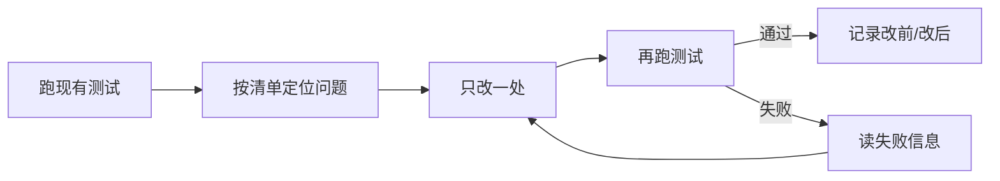

# 第 13 章 后端开发综合实践

前面各章分别解决了一类问题：契约、数据、规则、测试。每一部分单独成立，不等于合起来可以交付；模块之间的依赖、响应里暴露的字段、缺失的验收判断，都只在整体运行时才显形。

## 本章要解决的问题

**把前 12 章的契约、分层、数据、规则、测试合成一条可运行、可交付的链路，还差什么？**

每个模块单独测过，合起来却可能在权限、字段或数据依赖上断开；代码能返回数据，响应里却带着不该出现的字段。前面的工作都在“把功能做出来”，本章要判断的是“这个系统能不能交出去”。

本章关心的是：每个模块单独成立之后，系统作为整体还缺什么；以及“能跑”与“能交”之间，还隔着哪些需要证明的事。

## 本章学习目标

读完第 13 章，应能：

1. 用“安全、错误、重复、性能、规范”五类质量清单审查一个后端模块，并按风险排出修复顺序。
2. 为写操作确定事务边界，说明 `commit()` 与 `rollback()` 应放在哪里、为什么。
3. 按真实使用顺序完成全流程联调，逐步记录“请求 → 期望结果 → 实际结果”。
4. 按“状态码 → `detail` → 日志 → 定位 → 重跑”的顺序排查联调失败。
5. 对文档、代码、调用方三处契约不一致（Contract Mismatch）做对账，并以实际代码与 `/docs` 收敛口径。
6. 整理一份可交接的交付清单（Deliverables List），并用五分钟说清“做了什么、能跑什么、还有什么问题”。

## 13.1 代码质量的检查

**能跑与能上线的差别**

两个版本都能返回数据：A 版本响应里有 `password_hash`，管理接口没有权限；B 版本响应干净，管理接口只有管理员能调。A 能跑，但不能上线，因为它把安全边界交给了“用户不会直接调接口”这个假设。

代码质量可按 ISO/IEC 25010 的质量特性检查；本课程取安全、错误处理、重复、性能与规范五个方面，分别对应安全性、可靠性、可维护性与性能效率等特性。按风险排序：安全优先，异常与事务其次，重复代码第三，性能只要求识别两类明显问题。

| 类别 | 常见问题 | 怎么看 |
| --- | --- | --- |
| 安全 | 密码明文、响应带密码、管理接口无权限、输入不校验 | 搜 `password`，逐个看管理接口 |
| 错误 | 400/500 混用、所有错误都 500 | 看每个 `raise` |
| 重复 | 单位与人员的分页代码一样 | 对比两个文件 |
| 性能 | 列表不分页、循环里查数据库 | 看列表接口、看 `for` 循环 |
| 规范 | 字段名不一致、响应结构不一致 | 对比接口 |

清单的作用不是“全部改完”，而是“按同一套标准找问题”。一次只改一个，改完跑测试，才能把“改动”和“结果”对应起来。

**四类安全问题**

这四类问题分别对应 OWASP Top 10 的访问控制失效、加密机制失效与注入等类别：

**密码明文**：创建用户时直接把 `password` 存进 `password_hash`。修正：写入前调用 `get_password_hash`。

**响应泄露密码**：接口直接返回 ORM 对象，序列化时把 `password_hash` 一起带出。修正：用输出模型裁剪字段，只返回 `id`、`username`、`role`、`is_active`。

**管理接口无权限**：列表、改角色、启用/禁用只靠前端隐藏按钮。修正：在后端挂管理员依赖，未认证返回 401，角色不足返回 403。

**输入不校验**：字段长度、必填、类型都不限制。修正：用 Pydantic 的 `Field` 与 `Literal` 在进入业务前拒绝非法值。

四类问题的共同点是“信任了调用方”。安全代码的默认假设应该是：调用方可能绕过页面、伪造请求、提交任意值。

**质量清单的粒度**

五类清单可以无限扩展，但每次只改一处、改完跑测试，才能定位问题。一次改五个问题，测试失败时不知道是哪一处引入的；把清单当成“全部要改完”的任务，反而会拖延交付。**先修安全与错误，再谈重复与性能**，这是按风险排序的结果。

## 13.2 错误分层与事务边界

错误码要按语义分工：

| 状态码 | 含义 | 谁抛 |
| --- | --- | --- |
| 400 | 业务规则不满足 | service |
| 401 | 未登录、令牌失效 | 认证依赖 |
| 403 | 已登录但无权限 | 权限依赖 |
| 404 | 资源不存在 | service 或 crud |
| 422 | 参数校验失败 | FastAPI 自动 |
| 500 | 未预期异常 | 框架兜底 |

业务规则不满足时，在 service 里 `raise HTTPException` 并写明状态码与 `detail`，由 FastAPI 转成统一响应体 `{"detail": "..."}`。不必自定义异常类，也不必注册全局处理器：400、401、403、404 各自用 `HTTPException` 抛出，422 由 Pydantic 校验自动产生，未预期的 500 由框架兜底。业务代码只负责 `raise`，不自己拼 `JSONResponse`；500 的堆栈由服务端日志记录，不返回给前端。

**代码 13-2-1** · `app/modules/duty_record/service.py`（抛出业务异常，Python）

```python
from fastapi import HTTPException

def get_duty_record(db, record_id: int):
    record = crud.get_by_id(db, record_id)
    if not record:
        raise HTTPException(status_code=404, detail="执勤记录不存在")
    return record
```

状态码由语义决定：资源不存在用 404，业务规则不满足用 400，参数问题交给 schema 产生 422。把业务错误手工改成 400，或把 404 写成 200 加空对象，都会让前端无法据状态码判断结果。

一个业务动作应当是一个事务：要么全部成功，要么全部回滚。三条纪律：

1. `commit()` 放在业务动作最后，不要写在循环里。
2. 出现异常要 `rollback()`，否则会话处于脏状态，后续请求可能继续失败。
3. 只读接口（查询、统计）不需要事务。

**代码 13-2-2** · 事务的反例与正例（Python 片段）

```python
# 反例：中途提交，失败会留下半批数据
for row in rows:
    db.add(DutyRecord(**row))
    db.commit()

# 正例：先校验，再一次提交，异常回滚
try:
    for row in rows:
        db.add(DutyRecord(**row))
    db.commit()
except Exception:
    db.rollback()
    raise
```

回滚后要继续向上抛，由框架转成 500 响应；吞掉异常假装成功，会让调用方以为数据已经写入。

## 13.3 重复代码与性能问题识别

单位与人员的分页代码几乎一样，可以抽成公共函数：

**代码 13-3-1** · `app/core/pagination.py`（公共分页，Python）

```python
def paginate(query, offset: int, limit: int):
    total = query.count()
    items = query.offset(offset).limit(limit).all()
    return items, total
```

这就是第 7 章 7.5 收拢出的公共分页函数：它只接收一个已经过滤、已经排好序的查询，页码到偏移量的换算仍由各模块的 service 完成，参数名与调用方式都不变。返回结构与各模块保持一致：二元组交给 service 组装成 `items` 与 `total`，翻页所需的总页数由前端依据 `total` 和每页条数计算。抽取的判据仍是第 7 章那条：换一个模型仍然一字不改的，可以抽；需要知道具体业务含义的，留在模块内。抽完必须回归测试，不要为了“看起来高级”过度抽象。

性能先识别两类问题。第一类是列表不分页，数据一多就慢；修正是加 `page`、`page_size`。第二类是循环里查数据库（N+1）：每条记录查一次人员，100 条记录就查 101 次；修正是先一次查出所需人员，再用字典匹配。

**代码 13-3-2** · 消除 N+1 查询（Python 片段）

```python
persons = {p.certificate_number: p for p in db.query(Personnel).all()}
for r in records:
    person = persons.get(r.personnel_certificate_number)
```

索引是另一类优化，常用查询字段（如 `dept_code`、`start_time`）可以加索引，但索引不是越多越好。本章只要求识别问题，不要求改索引。

## 13.4 全链路联调

单元测试验证“一个接口对不对”，**联调**验证“一串接口能不能配合”；联调（集成调试）指按真实使用顺序串起多个接口验证，对应 ISTQB 的集成测试。联调的顺序应当接近真实使用：登录 → 建用户 → 建单位/人员 → 建执勤记录 → 查统计 → 验证权限。


*图 13-1：后端主流程的联调顺序*

每一步都要记录“请求 → 期望结果 → 实际结果”。失败时不要从头重来，先定位是哪一步断的。

| 步骤 | 请求 | 期望 |
| --- | --- | --- |
| 1 | 管理员登录 | 200，拿到令牌 |
| 2 | 创建普通用户 | 201 |
| 3 | 普通用户登录 | 200 |
| 4 | 普通用户查用户列表 | 403 |
| 5 | 管理员建单位 | 201 |
| 6 | 管理员建人员（带 `dept_code`） | 201 |
| 7 | 管理员建执勤记录 | 201 |
| 8 | 再建一条时间重叠的记录 | 400 |
| 9 | 查年度统计 | 200，数字正确 |
| 10 | 查时段分布 | 200，24 项 |
| 11 | 不带令牌访问 `/users/me` | 401 |
| 12 | 缺字段新增单位 | 422 |

清单的价值在于“可证明”：每一步都有明确的期望，通过与否不靠感觉。至少跑通主流程，失败步骤要写清原因。

**按真实顺序联调的理由**

按接口清单逐个测，容易漏掉“前置数据不存在”的问题：单独测“建执勤记录”时，人员和哨位可能是手工插进数据库的；真实使用时，它们由上一步的接口创建。按真实顺序走，才能发现“创建人员的 `dept_code` 与单位接口返回的字段不一致”这类跨步骤契约问题。

**改动流程与互评**

安全的改动流程是：改前跑一遍现有测试，确认基线；改一处；再跑测试；记录改前、改后与测试结果。一次改多个问题，失败时很难判断是哪一处引入的。



*图 13-2：按清单改代码的循环*

拿到一个陌生模块，先找入口，再顺着调用链往下读：controller 找路由与参数，service 找业务规则，crud 找查询与写入，model 找字段与关系。定位问题时，不要一上来全文搜索；先确认“这个行为由哪条链路产生”，再看链路上的每一层。

互评不评价“写得好不好”，只评价“有没有风险”。检查项包括：密码是否哈希、响应是否泄露、管理接口是否有权限、输入是否校验、错误码是否统一、写操作是否一次提交、异常是否回滚、列表是否分页、是否有明显重复。每组只找两个问题，写清“问题 + 建议”，避免泛泛而谈。

## 13.5 联调的排错与对账

联调失败时，按这个顺序排查：

1. **看状态码**：401 是身份、403 是权限、404 是路径或资源、422 是参数、400 是业务规则、500 是代码或环境。
2. **看 `detail`**：它通常已经指出具体原因。
3. **看服务日志**：500 的堆栈在日志里，不在响应里。
4. **定位到具体接口与字段**：是哪一步、哪个参数、哪张表。
5. **改完重跑清单**，而不是只重跑失败的那一步。

不要一上来就改代码。先确认“哪一步、什么错”，再决定改哪里。常见卡点如下：

| 卡点 | 可能原因 |
| --- | --- |
| 普通用户登录失败 | 账号被禁用（`is_active` 为 0） |
| 普通用户能看管理列表 | 管理接口没挂管理员依赖 |
| 建人员失败 | `dept_code` 不存在，或字段名与接口不一致 |
| 重叠记录没有被拒绝 | 重叠条件写错，或只查了部分记录 |
| 统计全是 0 | 年份或人员参数不对，或记录确实为空 |
| 联调 404 | URL 前缀、尾斜杠或路径参数不一致 |

**三处说法对不上**

联调中最常见的问题不是“代码坏了”，而是“三处说法不一致”：设计文档写 `dept_id`，代码用 `dept_code`；文档把集合路径写成带尾斜杠，代码是不带斜杠的；前端按旧字段名传参，后端已经改了。

处理原则：以实际代码与 `/docs` 为准，把文档改过来；前端按 `/docs` 调整。三处必须收敛到同一个说法，否则每次联调都要重新猜。

> 💡 **易错点**：联调失败后从头把所有步骤重跑一遍。这样既慢，又无法判断“是不是上一次的残留数据影响了这一次”。先定位断点，改完再从断点重跑，最后全量回归。

## 13.6 回归与交付准备

**改完跑回归**

改完一处必须跑回归：不只是重跑失败的那一步，而是把受影响的接口与测试再跑一遍。回归的意义是确认“改 A 没有弄坏 B”。第 12 章的测试用例就是回归的底稿；没有测试时，至少按 13.4 的 12 步清单重走一遍。

**交付清单**

一份可交接的成果至少包括（可对照 ISO/IEC/IEEE 12207 的转移与验收过程）：代码在 Git 仓库且提交记录完整；接口文档（`/docs` 或 Markdown）；能运行的测试；一份“做了什么”的清单；一份“已知问题（Known Issues）”列表。已知问题要写出来，不要藏；藏起来的问题会在验收时集中爆发。

| 交付项 | 合格证据 | 常见缺失 |
| --- | --- | --- |
| 代码与提交记录 | 仓库能克隆，提交信息说明改了什么 | 只留一个压缩包 |
| 接口文档 | `/docs` 可打开，字段与代码一致 | 文档停在旧版本 |
| 可运行测试 | 一条命令跑完并给出通过数 | 测试依赖本机数据 |
| 工作清单 | 做了什么、没做什么各写一段 | 只列功能名 |
| 已知问题 | 按“阻断上线／影响体验／可延后”分级 | 空白，或只写“无” |

**成果展示**

成果展示按四段组织，控制在三分钟以内：做了哪些模块；演示 1–2 个能跑的接口；遇到的最大问题与解决办法；还有什么没做完。展示的重点不是“功能多”，而是“能说清边界”：能跑什么、不能跑什么、为什么。

> 💡 **易错点**：把“交付”等同于“代码写完”。没有 Git 记录、没有接口文档、没有测试、没有已知问题清单，接手的人无法判断系统能做什么、不能做什么；交付清单不是形式，而是交接的最低证据。

## 示范例题

#### 例 13-1：按清单修复一个安全问题

**题目**：下面的创建用户代码把明文密码写进了 `password_hash`，并且直接返回 ORM 对象。请修复这两处，并说明改完要跑哪些测试。

**代码 13-6-1** · `app/modules/user/controller.py`（改前与改后，Python）

```python
# 改前
user = User(username=data.username, password_hash=data.password)
db.add(user); db.commit(); return user

# 改后
user = User(username=data.username, password_hash=get_password_hash(data.password))
db.add(user); db.commit(); db.refresh(user)
return {"id": user.id, "username": user.username, "role": user.role, "is_active": user.is_active}
```

**解**：改完至少跑三类测试：创建用户成功；响应中不含 `password_hash`；用正确密码能登录、错误密码返回 401。第一类验证主流程，第二类验证不泄露，第三类验证哈希可校验。

#### 例 13-2：读一段代码并定位问题

**题目**：下面是某模块的接口与 service。请顺着 controller → service → crud → model 说明调用链，并指出至少三处质量或安全问题。

**代码 13-6-2** · `app/modules/user/controller.py`（问题代码，Python）

```python
@router.get("/users/")
def list_users(db: Session = Depends(get_db)):
    users = db.query(User).all()
    return users

def create_user(db, data):
    user = User(username=data.username, password_hash=data.password)
    db.add(user)
    db.commit()
    return user
```

**解**：

调用链：`GET /users` 进入 controller 的 `list_users`；它直接查 `User` 模型并返回，没有经过 service 与 crud；`create_user` 也没有经过 schema 校验与哈希。

问题：

1. **管理接口无权限**：`list_users` 没有管理员依赖，任何登录用户（甚至未登录用户，取决于全局依赖）都能看全部用户。
2. **响应泄露密码**：直接返回 ORM 对象，`password_hash` 会出现在响应里。
3. **密码明文**：`password_hash=data.password` 把明文存进了哈希字段。
4. **列表不分页**：`db.query(User).all()` 一次返回全部，数据量大时性能差。
5. **缺少输入校验**：`data` 没有用 Pydantic 模型约束用户名长度、密码长度。

修正方向：加管理员依赖；用输出模型裁剪字段；写入前哈希；列表分页；用 schema 校验输入。

#### 例 13-3：实现执勤记录列表接口

**题目**：实现 `GET /duty-records`，支持按人员证件号过滤与分页，返回 `items` 与 `total`。说明参数来源与返回字段。

**代码 13-6-3** · `app/modules/duty_record/controller.py`（列表接口，Python）

```python
@router.get("")  # router 已带 prefix="/duty-records"
def list_duty_records(
    personnel_certificate_number: str | None = None,
    page: int = Query(1, ge=1),
    page_size: int = Query(10, ge=1, le=100),
    db: Session = Depends(get_db),
):
    query = db.query(DutyRecord)
    if personnel_certificate_number:
        query = query.filter(
            DutyRecord.personnel_certificate_number == personnel_certificate_number
        )
    total = query.count()
    items = query.order_by(DutyRecord.start_time.desc()).offset((page - 1) * page_size).limit(page_size).all()
    return {
        "items": [
            {
                "id": r.id,
                "personnel_certificate_number": r.personnel_certificate_number,
                "workstation_id": r.workstation_id,
                "start_time": r.start_time,
                "end_time": r.end_time,
            }
            for r in items
        ],
        "total": total,
    }
```

**解**：参数来源——人员证件号是筛选条件，放查询参数；分页也是查询参数；路径里没有单个资源标识。返回只包含列表需要的字段，不返回内部备注等无关内容。

#### 例 13-4：定位联调中的 403

**题目**：联调第 4 步“普通用户查用户列表”期望 403，实际返回 200。请分析最可能的原因，并给出排查与修正步骤。

**解**：

1. 200 说明请求成功，身份已通过认证；问题不在登录，而在授权。
2. 最可能的原因：用户列表接口没有挂管理员依赖，普通用户也能访问。
3. 排查：打开该接口的路由定义，看是否有 `Depends(get_current_admin_user)`；再看依赖内部是否真的检查了 `role`。
4. 修正：在路由或函数参数上挂管理员依赖；用管理员、普通用户、未登录三种请求分别验证 200、403、401。
5. 回归：跑权限相关测试，确认没有把普通接口也误加管理员限制。

## 独立习题

#### 习题 13-1

**题目**：某写接口在循环里对每条记录执行 `db.commit()`，并且异常时没有 `rollback()`。请说明调用链上可能出现的问题，并给出修正方案。

#### 习题 13-2

**题目**：你接手了一个能跑但质量问题较多的后端模块。请制定一份两周的改进计划：先改什么、后改什么，每步如何验证，如何避免改动引入新问题。给出优先级与理由。

#### 习题 13-3

**题目**：联调时前端按设计文档传 `dept_id`，代码用 `dept_code`，导致创建人员失败；另一个接口文档把集合路径写成带尾斜杠，代码是不带斜杠的，导致前端请求触发重定向。请分析这两处契约不一致的影响，并给出统一方案。

## ◆ 实训 13-1

> **课堂达标（B 档）**：一类安全问题 + 一处事务收拢 + 5 步主链路联调 + 一页交付清单。完整达成（教师版）为教师参考，不作为学生及格条件。
：后端质量改造与联调交付

### 一、任务目标与验收

本实训把质量检查与联调交付合并为一条流程：先按五类问题定位并改造代码，再按真实使用顺序跑通主链路，最后整理可交接的成果。

| 目标 | 验收标志 |
| --- | --- |
| 基线与改动后可对比 | 改动前跑一遍测试，记录通过数与失败数；改动后重跑，差异可解释 |
| 五类问题均已登记 | 安全、错误、重复、性能、规范各至少一条，位置精确到文件与函数 |
| 安全类问题已修复 | 响应不含 `password_hash`；管理接口未登录 401、非管理员 403；输入非法 422 |
| 错误码与异常统一 | 400 / 401 / 403 / 404 / 422 各至少一个用例，响应结构一致 |
| 写操作事务化 | 批量写入失败后无半批数据；异常路径有 `rollback()` |
| 联调与交付完整 | 主流程按 13.4 的顺序跑通；交付清单五项齐全，已知问题有记录 |

### 二、课前准备

- 第 6–12 章的代码已能跑通，Git 工作区干净，当前分支可回退。
- 测试能在本地一条命令跑完，记录命令与当前通过数。
- 准备两名账号：一名管理员、一名普通用户。
- 准备「问题清单」表，列：类别 / 位置（文件:函数）/ 问题 / 修复动作 / 验证方式。
- 准备「联调记录」表，列：步骤 / 请求 / 期望 / 实际 / 结论 / 失败原因。
- 准备一页交付清单模板。

### 三、操作步骤

1. **跑基线测试（10 分钟）**
   - 做什么：在改动前跑一遍全部测试，记录通过数与失败数。
   - 操作：`$ python -m pytest -q`
   - 预期输出：→ 全部通过，或记录既有失败项作为基线
   - 做错会看到什么：环境未激活时出现 `ModuleNotFoundError`；先回到第 5 章确认虚拟环境与依赖。
2. **按安全、错误（含事务）、重复、性能、规范五类定位问题（20 分钟）**
   - 做什么：依次查五类，把发现写进问题清单；每类先只记，不改。事务归入错误类，按 13.2 的三条纪律核对；重复看 13.3 的分页判据，性能看列表是否分页、循环里是否查库，规范看命名与目录是否与第 4 章一致。
   - 操作：`$ git grep -n "password"`、逐个打开管理接口；`$ git grep -n "db.query"` 找循环内查询
   - 预期输出：→ 清单中每类至少 1 条，位置精确到文件与函数
   - 做错会看到什么：只搜关键词会漏掉“返回 ORM 对象”这类隐性问题；必须逐个看接口返回值。
3. **修复安全类问题（30 分钟）**
   - 做什么：补 `response_model`，确认管理接口挂上权限依赖，确认输入模型约束生效。
   - 操作：`$ python -m pytest -q tests/test_auth.py tests/test_department.py`（第 12 章已有的两个测试文件）
   - 预期输出：→ 响应不含 `password_hash`；未登录 401、非管理员 403、字段非法 422
   - 做错会看到什么：401 与 403 混淆；检查认证依赖是否先执行、角色字段是否为 `admin`。
4. **错误分层与事务改造（25 分钟）**
   - 做什么：把业务错误改成带语义状态码的 `HTTPException`（代码 13-2-1）；把循环内的 `commit()` 改为最后一次性提交，异常 `rollback()`（代码 13-2-2）；重复的分页代码按 13.3 的 `paginate` 收拢。
   - 操作：`$ python -m pytest -q tests/test_duty.py`（第 12 章已有的边界用例），改造后重跑一次全部测试
   - 预期输出：→ 失败批次后数据库无残留；错误响应结构一致；回归测试仍全绿
   - 做错会看到什么：异常被吞掉却返回 200；检查 `except` 分支是否 `raise`。
5. **全链路联调（45 分钟）**
   - 做什么：按 13.4 的顺序执行联调清单：管理员登录 → 建普通用户 → 建单位与人员 → 建执勤记录 → 查统计 → 验证普通用户 403。
   - 操作：在 `/docs` 的 Try it out 或本地客户端逐条发起请求，填写联调记录表
   - 预期输出：→ 主流程全部符合期望；失败步骤定位到接口与字段
   - 做错会看到什么：普通用户 200 而非 403——管理接口漏挂权限依赖（见例 13-4）；建人员 422——`dept_code` 字段名或单位不存在。
6. **交付清单与口头小结（25 分钟）**
   - 做什么：补齐代码、接口文档、测试、交付清单、已知问题五项；用五分钟按“做了什么 / 能跑什么 / 还有什么问题”说清边界。
   - 操作：`$ git log --oneline -10`
   - 预期输出：→ 提交记录可读；五项成果齐全；小结说清能跑与不能跑
   - 做错会看到什么：小结变成功能罗列；删掉与“能跑/不能跑/为什么”无关的内容。
7. **提交（15 分钟）**
   - 做什么：提交代码、问题清单、改动前后测试结果、联调记录与交付清单。
   - 预期输出：→ 一次提交，信息说明改了什么；`git status` 干净

### 四、排错清单

| 现象 | 先查什么 |
| --- | --- |
| 测试全部失败 | 虚拟环境、依赖版本、测试数据库路径 |
| 401 与 403 混淆 | 认证依赖是否先执行、角色字段是否为 `admin` |
| 响应仍带 `password_hash` | 是否直接返回 ORM 对象、输出模型是否生效 |
| 批量失败后仍有数据 | `commit()` 是否在循环内、异常分支是否 `rollback()` |
| 登录返回 401 | 用户名/密码、账号是否禁用、令牌请求头格式 |
| 普通用户能看管理数据 | 管理接口权限依赖、依赖内部角色判断 |
| 建人员 422 | `dept_code` 字段名、单位是否存在 |
| 统计数字与预期不符 | 年份参数、记录是否落在统计区间、是否按启用中哨位过滤 |
| 联调 404 | `include_router` 前缀、尾斜杠、路径参数 |
| 文档与代码不一致 | 以代码与 `/docs` 为准，列已知问题并同步文档 |

### 五、提交与验收

提交：代码提交记录、问题清单、改动前后测试结果、联调记录表、交付清单、已知问题列表。验收按本章「质量评价」的五个维度打分；缺交付清单或已知问题列表任一项，本实训记不通过。

### 六、课后扩展

- 用 13.3 的 `paginate` 消除一处完全重复的分页代码，说明抽取判据并跑回归。
- 识别两处性能问题（列表不分页、循环内查询），写出修正方向，不必实现。
- 为联调清单补一条“并发写入同一时段”的用例，观察业务规则是否仍然成立。
- 把已知问题按“阻断上线 / 影响体验 / 可延后”分级，并给出处理建议。
- **复习任务**：回看第 3 章 3.2（状态码）、3.6（`HTTPException`）、第 9 章 9.2（权限依赖）与第 11 章 11.1（统计口径），说明 `HTTPException` 分层与权限依赖分别覆盖了哪一类错误。

## 质量评价（覆盖实训 13-1）

| 维度 | 分档描述 | 权重 | 评价方式 |
| --- | --- | --- | ---: |
| 安全与代码质量 | 优：五类问题全查、修复有验证；良：查满五类且修复三类；中：登记不足五类或修复无验证；差：未按清单 | 25% | 自评 30% + 互评 30% + 师评 40% |
| 事务与异常 | 优：错误码分工清楚、事务边界正确、异常可回滚；良：基本正确；中：有遗漏；差：循环提交或吞异常 | 15% | 同上 |
| 联调完整度 | 优：主流程与权限/异常用例全过；良：主流程过；中：主流程部分过；差：无法跑通 | 30% | 同上 |
| 契约一致性 | 优：三处一致或差异已登记；良：主要字段一致；中：差异未登记；差：三处互相矛盾 | 15% | 同上 |
| 交付与小结 | 优：五项成果齐全、小结说清边界；良：四项齐全；中：缺已知问题；差：无交付清单 | 15% | 同上 |
| **合计** | | **100%** | |

**一票否决**：涉密信息未脱敏、安全漏洞不处理、提交记录造假——出现任一项，本章实训记不通过。

## 本章小结

**核心结论**：

1. 能跑不等于能上线；代码质量按风险排序：安全优先，异常与事务其次，重复代码第三，性能识别为主。
2. 四类安全问题：密码明文、响应泄露密码、管理接口无权限、输入不校验；共同点是“信任了调用方”。
3. 错误码按语义分工：400 业务、401 未登录、403 无权限、404 不存在、422 参数、500 未预期；用 `HTTPException` 抛出业务错误，FastAPI 统一转成 `{"detail": ...}` 响应。
4. 一个业务动作一个事务：先校验、最后一次 `commit`、异常 `rollback` 并继续抛出；只读接口不需要事务。
5. **联调**按真实使用顺序串接口，排查按“状态码 → detail → 日志 → 定位 → 重跑”，契约不一致以代码与 `/docs` 收敛。
6. 交付不只是代码：Git 记录、接口文档、可运行测试、交付清单、已知问题，缺一不可；新模块应复用已有概念，而不是重新发明。

本章要点：**质量清单、事务边界与联调记录合在一起，才构成一条可交接的后端交付链路。**

**知识地图**：后端各模块的依赖关系可以这样记——用户模块解决“你是谁”；单位与人员模块解决“数据怎么管”；执勤记录模块解决“业务规则怎么落”；统计分析模块解决“多条记录怎么汇总”。四类依次依赖：没有用户就没有权限；没有单位与人员，执勤记录没有关联对象；没有记录，统计没有数据。

**增量功能：换一个统计维度，复用同一套概念**。综合实践的最后一关，是在现有脚手架上独立加一个功能，例如“按单位汇总执勤时长”——它不新建业务表，而是基于已有的执勤记录与单位表做只读聚合，与统计分析模块的年度统计、时段分布是同一类。做法不是重新发明，而是把前 12 章的概念逐个搬过去：

| 要做什么 | 复用的概念 | 回看 |
| --- | --- | --- |
| 数据契约与聚合口径 | 输入输出模型与统计口径 | 第 6、11 章 |
| 接口与契约 | 接口契约 | 第 3 章 |
| 分层与职责 | 分层与职责（只读聚合只需 schema/service/controller） | 第 4 章 |
| 空数据与输入检查 | 业务规则与一致性 | 第 10、11 章 |
| 权限 | 认证与授权 | 第 8、9 章 |
| 测试 | 验证与回归 | 第 12 章 |

如果新增功能能复用这张表里的做法，说明概念真的迁移过去了；如果每加一个功能都要重新想一遍“接口怎么定、口径怎么算”，说明前面几章还停留在“照着抄”。

**自检**：回到章首的学习目标，逐条问自己做到了没有——

- [ ] 用五类质量清单审查模块并按风险排序。
- [ ] 为写操作确定事务边界，说明 `commit()` 与 `rollback()` 的位置。
- [ ] 按真实使用顺序完成全流程联调，逐步记录期望与实际。
- [ ] 按“状态码 → detail → 日志 → 定位 → 重跑”排查联调失败。
- [ ] 对契约三方对账并收敛口径。
- [ ] 整理成果并做五分钟口头小结。


## 参考文献

本专题引用的标准、文献与报告如下，正文中的行内括注与此表对应。各工具的官方文档在正文首次使用时已注明，版本以书中所用为准。

- Fielding, R. T. *Architectural Styles and the Design of Network-based Software Architectures*. 博士论文，2000.
- RFC 9110. *HTTP Semantics*. 2022.
- RFC 8259. *The JavaScript Object Notation (JSON) Data Interchange Format*. 2017.
- RFC 4918. *HTTP Extensions for Web Distributed Authoring and Versioning (WebDAV)*. 2007.
- RFC 7519. *JSON Web Token (JWT)*. 2015.
- RFC 6750. *The OAuth 2.0 Authorization Framework: Bearer Token Usage*. 2012.
- RFC 8018. *PKCS #5: Password-Based Cryptography Specification Version 2.1*. 2017.
- Codd, E. F. “A Relational Model of Data for Large Shared Data Banks.” *Communications of the ACM*, 1970.
- ISO/IEC 9075. *Information technology — Database languages — SQL*.
- Parnas, D. L. “On the Criteria To Be Used in Decomposing Systems into Modules.” *Communications of the ACM*, 1972.
- Yourdon, E., & Constantine, L. L. *Structured Design*. Prentice-Hall, 1979.
- Gamma, E., Helm, R., Johnson, R., & Vlissides, J. *Design Patterns: Elements of Reusable Object-Oriented Software*. Addison-Wesley, 1994.
- Saltzer, J. H., & Schroeder, M. D. “The Protection of Information in Computer Systems.” *Proceedings of the IEEE*, 1975.
- Allen, J. F. “Maintaining Knowledge about Temporal Intervals.” *Communications of the ACM*, 1983.
- IEEE Std 828-2012. *IEEE Standard for Configuration Management in Systems and Software Engineering*.
- ISO/IEC/IEEE 24765:2017. *Systems and software engineering — Vocabulary*.
- ISO/IEC/IEEE 12207:2017. *Systems and software engineering — Software life cycle processes*.
- IIBA. *A Guide to the Business Analysis Body of Knowledge (BABOK Guide)*.
- OpenAPI Initiative. *OpenAPI Specification*.
- OWASP. *Top 10*；*API Security Top 10*；*Password Storage Cheat Sheet*；*Authentication Cheat Sheet*.
- Brown, W. J., Malveau, R. C., McCormick, H. W., & Mowbray, T. J. *AntiPatterns*. Wiley, 1998.
- Fowler, M. *Patterns of Enterprise Application Architecture*. Addison-Wesley, 2002.
- Martin, R. C. *Clean Architecture*. Prentice Hall, 2017.
- Evans, E. *Domain-Driven Design*. Addison-Wesley, 2003.
- Jacobson, I., et al. *Object-Oriented Software Engineering*. Addison-Wesley, 1992.
- DAMA International. *DAMA Guide to the Data Management Body of Knowledge (DAMA-DMBOK)*.
- ISO/IEC 25010. *Systems and software Quality Requirements and Evaluation (SQuaRE) — Product quality model*.
- Wiggins, A. *The Twelve-Factor App*. 2011.
- Conventional Commits. conventionalcommits.org.
- ISTQB. *Certified Tester Foundation Level Syllabus*；IEEE Computer Society. *SWEBOK v4.0*, 2024.
- 工具官方文档：Git、Python、FastAPI、SQLAlchemy、pytest。
