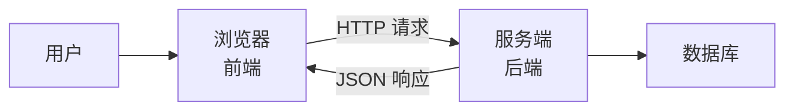
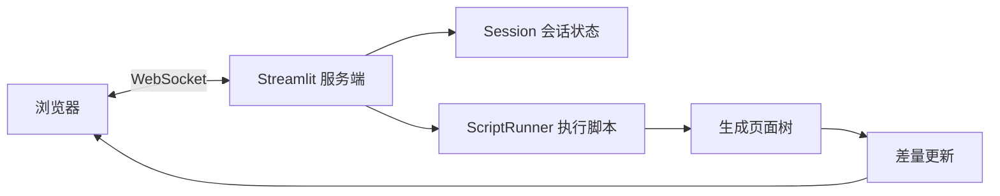

# 第 14 章 前端开发框架基础

> **节首信息条**｜**专题三第 1 章**｜对应课次 16 · 2 学时 · 理论讲授｜前置：第 3 章的 HTTP 与接口契约；第 8–13 章的后端接口；基本 Python 语法

第 3–13 章完成了后端的接口、数据与测试。本章进入专题三：前端界面构建。

后端按契约返回的是数据，用户需要的是可看、可点、可填的界面。本章先说明前端在系统中的位置与页面的构成，再说明本课程使用的 Streamlit 是什么、怎样运行，最后说明它按什么方式保存状态、适合什么场景。

## 本章要解决的问题

**后端已经能按契约返回数据，用户为什么还需要一个界面？本课程用什么工具把数据变成页面，它又按什么方式运行？**

第 8 章的部门列表接口返回如下：

`{"items": [{"dept_code": "D01", "full_name": "综合办公室"}], "total": 12}`

这串花括号是给程序读的。用户看到它只会问：按钮在哪儿，输入框在哪儿。前端负责把数据摆成能看、能点、能填的页面；本课程使用 Streamlit，用 Python 写页面。

本章依次回答三组问题：前端在系统中做什么、页面由什么构成；Streamlit 是什么、怎样运行；页面在交互后怎样重新计算，值该放在哪里才不会丢。

## 本章学习目标

读完第 14 章，应能：

1. 说明前端在系统中的位置与职责，以及前后端的分界。
2. 说明页面由 HTML、CSS、JavaScript 三层构成，各自负责什么。
3. 说明 Streamlit 的定位与“用 Python 写页面”的做法，并安装、运行一个最小页面。
4. 解释 Streamlit 的重跑与差量更新，说明普通变量为何在点击后归零。
5. 解释 `st.session_state` 为什么能跨重跑保存状态。
6. 判断 Streamlit 适合与不适合的场景，并说明理由。

## 14.1 前端在系统中的位置

Web 应用按部署位置分为三层：前端、后端与数据库。第 3 章已按这一划分说明接口的位置；本节补前端一侧的职责。

**前后端的分工**

前端是运行在浏览器中的部分，负责把数据变成用户能看、能点的界面。后端是运行在服务端的部分，负责查询数据、判断权限、执行业务规则，并按接口契约返回结果。二者通常由不同人员开发，可以独立部署，共同依据是接口契约：URL、方法、字段与状态码（见第 3 章）。



*图 14-1：前端在系统中的位置*

前后端分离之后，同一套接口可以同时服务网页、移动端与第三方系统；界面换一套，后端不必改动。这是分工的直接收益。

**前端的四项职责**

| 职责 | 做什么 | 本课程的落点 |
| --- | --- | --- |
| 展示数据 | 把接口返回的字段摆成标题、表格与指标 | 第 15、17 章 |
| 接收输入并做基本校验 | 提供输入框、选择器与按钮，提交前检查必填、格式与范围 | 第 15、18 章 |
| 组织导航 | 安排页面入口与跳转，使用户知道从哪里开始 | 第 16 章 |
| 给出操作反馈 | 说明操作成功、失败或正在处理 | 第 17、20 章 |

前端的校验只用于减少无效请求，不能替代后端校验：用户可以绕过页面直接调用接口，最终判断仍在后端（见第 7 章）。由此形成一条分界：界面负责好用，接口负责正确。

## 14.2 页面的三层构成

一个页面无论简单还是复杂，都由三层技术构成。以计数器页面为例：一行标题“计数器”，一行文字“当前计数：0”，下面一个按钮“点我 +1”。三层各管一件互不替代的事。HTML、CSS 与 JavaScript 是浏览器的三项基础技术：

| 技术 | 管什么 | 在这个页面上对应什么 |
| --- | --- | --- |
| HTML | 结构：页面上有哪些东西、谁挨着谁 | 标题、数字、按钮这三个“部件”本身 |
| CSS | 样式：这些东西长什么样 | 数字的字号、按钮的蓝色与圆角、部件之间的间距 |
| JavaScript | 交互：点了以后发生什么 | 点按钮后，把数字加一 |

把按钮的蓝色改成红色，结构没变；把按钮从数字下面挪到旁边，样式没变；点按钮没反应，前两层都对，坏的是第三层。三者分开写，改颜色时不会碰坏点击逻辑——这就是“既好维护又好扩展”的实际意思。

浏览器负责解释这三层并绘制页面。前端框架的价值在于替开发者生成这三层：开发者只描述“页面上有什么、点击后做什么”，框架负责产出对应的 HTML、CSS 与 JavaScript。本书不要求手写这三层；认得出它们，才看得懂框架替读者做了什么。

## 14.3 Streamlit：用 Python 写页面

**从三种语言到一个脚本**

按 14.2 的方式，这个计数器页要写 HTML 写结构、写 CSS 写样式，再写 JavaScript 接住点击、把数字加一。

Streamlit 换了个做法：页面部件都用 Python 写。Streamlit 是一个用 Python 编写数据应用的 Web 框架，把脚本直接变成可交互页面；HTML、CSS 与 JavaScript 由框架生成，开发者不直接编写。这些由框架提供的页面部件，称为**组件**（Streamlit 官方文档）。

**安装**

Streamlit 是一个 Python 包。在项目目录中安装：

**代码 14-1-1** · 命令（Bash）

```bash
pip install streamlit
```

本课程项目在 `requirements.txt` 中约定 `streamlit>=1.50,<2`，安装与依赖管理见第 5 章。

**第一个页面**

**代码 14-1-2** · 示例代码（Python）

```python
import streamlit as st

st.title("计数器")
st.write("当前计数：0")
st.button("点我 +1")
```

`st.title` 出标题，`st.write` 出文字，`st.button` 出按钮。代码从上到下执行一次，页面就按这个顺序从上到下排好：标题、文字、按钮。组件的种类与参数在第 15 章展开；本节只需看出“写 Python 调用，得到页面部件”。把这段代码保存为 `app.py`。

**运行**

在项目目录中启动页面脚本：

**代码 14-1-3** · 命令（Bash）

```bash
streamlit run app.py
```

命令把 `app.py` 作为页面脚本启动，浏览器自动打开对应地址（默认 `http://localhost:8501`）。修改并保存脚本后，页面会提示脚本已变化；点击 Rerun（或按 `R` 键）即可重新执行并更新显示，不需要刷新浏览器。按 `Ctrl+C` 停止服务。

**控制力与开发速度的取舍**

四行 Python 画出页面，代价是指定不了“按钮距左边 137 像素”，也做不了复杂动画。这是一次明确的取舍：**用控制力换开发速度**。值班管理这类内部工具、后台、数据查询与统计展示，要的是把数据清楚摆出来、能点能填，不是像素级排版；这正是这笔交换划算的场景。14.6 说明不划算的场景。

## 14.4 运行模型：一次点击后的重跑

上一节的按钮还没有接上逻辑。给它补上“点一次加一”：

**代码 14-1-4** · 示例代码（Python）

```python
import streamlit as st

count = 0
if st.button("点我 +1"):
    count += 1
st.write("当前计数：", count)
```

点第一下，数字从 0 变成 1；点第二下，还是 1；点第十下，还是 1，而代码中明明写了 `count += 1`。本节把一次点击拆开，看它到底发生了什么。

**运行架构与五个部件**

有一个细节：点按钮时浏览器地址栏没变，页面也没有整页刷新，数字却重新变成了 1。“重新算一遍”这件事不在浏览器里发生——浏览器只负责显示和上报点击，真正执行 Python 脚本的是另一头的服务端。

图 14-2 是这两端之间的通路。初读时只需认出两个角色：左边的浏览器，右边跑脚本的服务端；中间几个名字的含义，会在本节后半段随一次按钮点击逐步展开。



*图 14-2：Streamlit 的运行架构*

图上几个名字各管一段。这些名字对应 Streamlit 的运行机制（Streamlit 官方文档）；框架版本升级后，内部结构可能变化，但“重跑—生成页面树—差量更新”这条主线不变：

- **WebSocket**：浏览器与服务端之间一条不断开的双向通道，点击由它送过去。
- **Session**：记住“现在是谁在看这个页面”，每个访问者一份。
- **ScriptRunner**：每次交互把 `.py` 从头执行一遍。
- **页面树**：这一次执行算出来的“页面上该有什么”。
- **差量更新**：只把页面树上变了的部分发回浏览器，所以不会看到整页闪一下。

其中 Session 里有一块专门的地方叫 `st.session_state`。组件状态为什么留得住、计数器为什么归零，差别就在这里，14.5 会展开。

**一次点击的执行过程**

把一次点击拆开，计数器停在哪一步就清楚了。几种直观的修法都不成立。把 `count = 0` 挪进 `if` 里，会连 `count` 是否定义都说不清；改用 `global`，变量仍然定义在脚本里，重跑时照样重新初始化；写进文本文件再读回来，虽然能行，但两个人同时打开页面会互相覆盖，每次点击还要读磁盘——为一个计数器付出这些代价，明显不成比例。这几种做法都绕开了真正的问题：问题不是“怎么把值留住”，而是“值为什么会没有”。

Streamlit 不在点击时局部修改页面，而是把整个脚本**从头到尾重新执行一遍**，这称为**重跑**；这一次执行算出一张新的页面树，再与上一张比较，只把不同的部分发回浏览器，这称为**差量更新**（Streamlit 官方文档）。

既然每次都从头执行，`count = 0` 就会在每次点击时执行一次：先清零，再 `+= 1`，于是永远等于 1。这不是框架的缺陷，而是它最核心的工作方式。一句话概括：**页面不是被修改的，而是被重新算了一遍**。

输入框、选择器等组件自身的状态由框架托管：用户在页面上填过的内容记在 Session 里，重跑时按记录还原。会丢的是写在脚本里的普通变量；不会丢的是框架托管的状态，以及后面要讲的 `st.session_state`。普通变量回到起点、组件状态留得住，差别就在这里。

这条规律还解释两件常见现象：页面上的耗时查询在每次点击时都会重新执行，因此不应放在每次重跑都会走到的位置；一次点击中出现两遍日志，多半也是因为页面被重跑了。

## 14.5 会话状态与跨重跑数据

上一节说明了值为什么会丢；本节回答值该放在哪里，多次点击之后才不会重新归零。

会丢的是脚本里的普通变量，修法因此很自然：把值放到一个“不在脚本里、但脚本能读写”的地方。Streamlit 提供的地方叫 `st.session_state`，它按访问者分开存放，重跑不会清空。

修复后的写法：

**代码 14-1-5** · 示例代码（Python）

```python
import streamlit as st

if "count" not in st.session_state:
    st.session_state.count = 0

if st.button("点我 +1"):
    st.session_state.count += 1

st.write("当前计数：", st.session_state.count)
```

这段代码有三处需要把握：`if "count" not in ...` 只在**第一次**设初始值（重跑时该判断为假，不会把计数清零）；`st.session_state.count` 既能按字典写成 `["count"]`，也能按属性写成 `.count`；除此之外，加减与显示的写法与普通变量完全一致。

| | 普通变量 | `st.session_state` |
| --- | --- | --- |
| 重跑后 | 重新初始化 | 保留 |
| 作用范围 | 本次脚本执行 | 当前访问者的整个会话 |
| 适合 | 临时计算结果 | 计数、登录态、筛选条件 |

本章只要求能解释“为什么第二种写法不会归零”。登录态、分页页码、筛选条件这些真实用法，会在第 16–18 章反复出现；它们与计数器是同一类问题：值要跨重跑保留，就必须放进会话状态，而不是普通变量。

## 14.6 Streamlit 的使用边界

前五节分别说明前端做什么、页面由什么构成、Streamlit 是什么、点击后怎样重跑、状态如何跨重跑保留；本节回答最后一个问题：什么时候不该用它。

**适合与不适合的项目**

Streamlit 适合内部工具、管理后台、数据查询与统计展示、原型验证与课程项目：这些场景页面结构规整、用户量不大，要的是快速把数据摆出来。它不适合精细排版、复杂动画、高并发公网产品，对 SEO 也不友好。按课程与项目经验，判断如下：

| 场景 | 判断 | 原因 |
| --- | --- | --- |
| 内部管理后台 | 适合 | 页面结构规整，用户量小，要的是快速摆出数据 |
| 面向公众的高并发产品 | 不适合 | 每次交互重跑整个脚本，并发代价高 |
| 像素级排版的品牌页 | 不适合 | 只能按比例分区，不能指定坐标 |
| 课程原型、数据看板 | 适合 | 要的是快速把数据摆出来 |

两条原因各一句：它只按比例划分区域，不能指定像素坐标；它每次交互都重跑整个脚本，页面复杂、并发上来以后，代价会越来越明显。

选框架的顺序因此是：先看场景，再动手写页面，避免写到一半才发现需要像素级布局。本课程做的是值班数据统计这类内部工具，选它有理由，不只是因为它简单。

**本章问题的回答**

回到章首的问题：

- **前端做什么**：把接口返回的数据变成可看、可点、可填的界面，负责展示、输入与校验、导航、反馈；正确性仍由后端保证。
- **Streamlit 是什么**：一个用 Python 编写数据应用的 Web 框架；组件由框架提供，HTML、CSS 与 JavaScript 由框架生成，代价是让出像素级控制力。
- **页面怎样运行、状态放在哪里**：交互触发脚本从头重跑，结果与上一张页面树比较后做差量更新；普通变量随重跑重新初始化，跨重跑要保留的值放进 `st.session_state`。

这一页计数器小到可以一眼看完，但它已经包含了后面所有前端页面共用的运行方式。登录态、筛选条件、页码，只是把同一个问题放到更大的页面上。

> 💡 **易错点**：把“点击后执行一次”写成“每次重跑都执行”。`st.button()` 的返回值只在点击的那一次为真；放在 `if` 外面的代码，每次重跑都会跑，包括用户只是改动了其他组件。

## 示范例题

两道示范例题都围绕同一个计数器。例 14-1 把一次点击拆成三步，解释页面为什么不是被局部修改的；例 14-2 用会话状态给计数器加一个“清零”按钮，练习“哪些代码只在点击时执行、哪些每次都执行”。

#### 例 14-1：解释一次按钮点击发生了什么【Bloom：理解】

**题目**：在 Streamlit 页面里点击一次按钮，脚本会发生什么？为什么页面不是被“局部修改”？请按“操作—重跑—更新”三步说明。

**解**：

1. **操作**：浏览器把点击事件通过 WebSocket 发给 Streamlit 服务端。
2. **重跑**：ScriptRunner 把脚本从头到尾重新执行一遍，重新生成页面树；普通变量重新初始化。
3. **更新**：Streamlit 比较新旧页面树，只把变化的部分发给浏览器，即差量更新。

所以页面不是被局部修改，而是被重新计算后对比出来的；这也是为什么跨重跑的状态要放进 `session_state`。

#### 例 14-2：给计数器加一个清零按钮【Bloom：应用】

**题目**：在计数器页面上再加一个“清零”按钮：点“点我 +1”让计数加一，点“清零”让计数回到 0。写出代码，并说明哪几行只在点击时执行、哪几行每次重跑都执行。

**解**：

**代码 14-2-1** · 示例代码（Python）

```python
import streamlit as st

if "count" not in st.session_state:
    st.session_state.count = 0

if st.button("点我 +1"):
    st.session_state.count += 1

if st.button("清零"):
    st.session_state.count = 0

st.write("当前计数：", st.session_state.count)
```

初始化只在第一次重跑时执行；“+1”与“清零”各自只在对应按钮被点击的那一次为真；`st.write` 每次重跑都执行，所以页面总显示最新的值。

## 独立习题

#### 习题 14-1【Bloom：记忆】

**题目**：写出前端在系统中的四项职责，HTML、CSS、JavaScript 各负责什么，以及 `st.title`、`st.write`、`st.button`、`st.session_state` 的用途；指出其中哪一个负责跨重跑保存状态。

#### 习题 14-2【Bloom：理解】

**题目**：用自己的话解释“页面不是被修改，而是被重新算了一遍”。并说明为什么普通变量在点击按钮后会重置，而 `st.session_state` 不会。

#### 习题 14-3【Bloom：分析】

**题目**：某同学写了下面的计数器，点击按钮后数字始终是 1。请分析原因，并给出两种修正方案（一种用 `session_state`，一种说明为什么普通变量做不到）。

**代码 14-3-1** · 习题 14-3 的计数器（Python）

```python
count = 0
if st.button("点我 +1"):
    count += 1
st.write("当前计数：", count)
```

#### 习题 14-4【Bloom：理解】（原理解释）

**题目**：Streamlit 每次交互都重跑整个脚本，为什么仍然能保留用户输入？请从事件模型与 `session_state` 两方面解释。

#### 习题 14-5【Bloom：分析】（换场景）

**题目**：某“器材借还”页面有一个器材类型下拉框和一个“只看在库”复选框。用户选好条件、翻到第 2 页，再点“下一页”，结果筛选条件回到默认值、页码也回到第 1 页。请指出哪些值在重跑中丢了、为什么；给出两种修法，并比较它们的代价（一种用 `session_state`，一种把条件放进 `st.form`）。**不能照抄本章的计数器**：这里要保留的是多个筛选条件与页码。

## ◇ 课堂活动块（课次 16 · 理论讲授）

**听讲要点**：

1. 前端把接口返回的数据变成可看、可点的界面；正确性由后端保证。
2. 页面由结构（HTML）、样式（CSS）与交互（JavaScript）三层构成。
3. Streamlit 用 Python 写页面，组件由框架提供，代价是让出像素级控制力。
4. 每次交互都会重跑脚本，跨重跑要保留的值放进 `st.session_state`。
5. 选框架先看场景，工具没有全能。

**讨论·演示**：

1. （讨论）既然后端已经能返回数据，为什么还需要前端？本课程为什么选 Streamlit，而不是直接写 HTML、CSS 与 JavaScript？
2. （演示）运行计数器页面，指出哪一行触发重跑、哪个值在重跑时被清零、哪个值需要放进 `st.session_state`。

## 本章小结

**核心结论**：

1. **前端在系统中的位置**：前端把接口返回的数据变成可操作的界面，负责展示、输入与校验、导航与反馈；前后端以接口契约分界，正确性由后端保证。
2. **页面由什么构成**：页面由结构（HTML）、样式（CSS）与交互（JavaScript）三层构成；Streamlit 用 Python 包起这三层，代价是让出像素级的控制力。
3. **一次点击背后谁在算**：点击不是局部修改页面，而是把脚本从头重跑一遍、再对页面树做差量更新——这正是普通变量在点击后归零的原因。
4. **状态跨重跑保留**：会丢的是脚本里的普通变量，不会丢的是框架托管的状态；`st.session_state` 就是给前者找一个重跑不清空的存放处。
5. **何时不该用**：Streamlit 适合内部工具与数据应用，不适合精细排版、高并发公网产品；选框架先看场景，再看写法。

把本章压缩成一句话：**前端把数据变成界面；页面不是被修改的，而是被重新算了一遍；要跨重跑留下的值，必须放进会话状态。**

**学完本章，你可以体会到**：前端不是“画得好看”，而是把后端的契约变成用户能理解、能操作的一组动作。

**自检**：回到章首的学习目标，逐条问自己做到了没有——

- [ ] 说明前端在系统中的位置与职责，以及前后端的分界。
- [ ] 说明页面由 HTML、CSS、JavaScript 三层构成，各自负责什么。
- [ ] 说明 Streamlit 的定位与“用 Python 写页面”的做法，并安装、运行一个最小页面。
- [ ] 解释 Streamlit 的重跑与差量更新，说明普通变量为何在点击后归零。
- [ ] 解释 `st.session_state` 为什么能跨重跑保存状态。
- [ ] 判断 Streamlit 适合与不适合的场景，并说明理由。

**下一章预告**：知道了页面怎样运行，下一章学习常用组件：输入、展示、交互三类，把页面真正搭起来。
