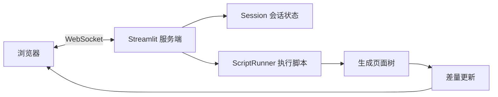

# 第 14 章 前端开发框架基础

> **节首信息条**｜对应课次 16 · 2 学时 · 理论讲授｜前置：第 3 章的 HTTP 与接口契约；第 8–13 章的后端接口；基本 Python 语法

**已会**：第 3 章的接口契约，以及第 8–13 章见过的列表返回 `{"items": [...], "total": 12}`。
**本章只加**：事件模型与状态——页面为什么会在点击后重算，哪些值会丢、哪些不会。
**关系**：后端把数据按契约返回；本章回答前端怎样把这份数据变成能看、能点的页面，并保住跨点击的状态。

前十五章完成了后端的接口、数据与测试。本章转入前端：先不接接口，只用一个计数器页面，把页面怎样运行这件事看清楚。

## 本章要解决的问题

**页面为什么会在点击后“重算”，状态为什么有时丢、有时不丢？**

一个只有一行数字和一个按钮的页面，点一次让数字加一。代码里写的是 `count += 1`，页面却永远显示 1；而输入框里刚填的名字，重跑之后却还在。同样是保存值，为什么有的留得住、有的留不住？

本章只用一个计数器页面，依次回答三个问题：页面由什么组成、一次点击背后发生了什么、状态该放在哪里；最后说明这套做法适合什么场景、不适合什么场景。

## 本章学习目标

读完第 14 章，你应该能：

1. 说明前端在系统中的位置，以及 HTML、CSS、JavaScript 各自负责什么。
2. 解释 Streamlit 的“脚本重跑”事件模型，以及 `st.session_state` 为什么能跨重跑保存状态。
3. 判断 Streamlit 适合与不适合的场景，并说明理由。
4. 读懂一个 Streamlit 页面脚本，指出其中触发重跑与保存状态的位置。

## 14.1 页面的三层分工

本节只用一个最小的计数器页面，说明一个页面由什么构成，以及 Streamlit 在其中替读者做了什么。

**接口返回与页面显示**

真实系统里，页面上的数字和列表往往来自后端接口。第 8 章部门列表接口的返回如下：

`{"items": [{"dept_code": "D01", "full_name": "综合办公室"}], "total": 12}`

这串花括号是给程序读的，不是给人用的。用户看到它只会问：按钮在哪儿，输入框在哪儿。**前端**负责把它变成一张能看、能点、能填的页面；**后端**负责查出这 12 条数据、判断谁能查、按约定格式返回。

本章不展开接口调用——那是第 17 章的内容。这里只留下一个判断：后端返回的是数据，前端要交付的是页面；两者之间隔着“把数据摆成界面”这一层工作。

**计数器页面的三层**

先看一个最小的页面：一行标题「计数器」，一行文字「当前计数：0」，下面一个按钮「点我 +1」。点第一下，数字变成 1。

这一页由三层构成，各管一件互不替代的事：

| 技术 | 管什么 | 在这个页面上对应什么 |
| --- | --- | --- |
| HTML | 结构：页面上有哪些东西、谁挨着谁 | 标题、数字、按钮这三个「部件」本身 |
| CSS | 样式：这些东西长什么样 | 数字的字号、按钮的蓝色与圆角、部件之间的间距 |
| JavaScript | 交互：点了以后发生什么 | 点按钮后，把数字加一 |

把按钮的蓝色改成红色，结构没变；把按钮从数字下面挪到旁边，样式没变；点按钮没反应，前两层都对，坏的是第三层。三者分开写，改颜色时不会碰坏点击逻辑——这就是「既好维护又好扩展」的实际意思。

本书不要求手写这三层。但认得出它们，才看得懂 Streamlit 替读者做了什么，也才明白 14.4 说的边界具体少了哪一块。

**四行 Python 出一个页面**

按上面的方式，这个计数器页要写 HTML 写结构、写 CSS 写样式，再写 JavaScript 接住点击、把数字加一。只学过第 8–13 章后端内容的读者，得再学三门语言的写法，才能看见一个能点的页面。

Streamlit 换了个做法：这些部件都用 Python 写。`st.title("计数器")` 出标题，`st.write("当前计数：0")` 出文字，`st.button("点我 +1")` 出按钮；HTML、CSS、JavaScript 由框架按这些调用生成。这些由框架提供的页面部件，称为**组件**。

**代码 14-1-1** · 示例代码（Python）

```python
import streamlit as st

st.title("计数器")
st.write("当前计数：0")
st.button("点我 +1")
```

四行 Python 画出页面，代价是指定不了「按钮距左边 137 像素」，也做不了复杂动画。这是一次明确的取舍：**用控制力换开发速度**。值班管理这类内部工具、后台、数据查询与统计展示，要的是把数据清楚摆出来、能点能填，不是像素级排版；这正是这笔交换划算的场景。14.4 会说明不划算的场景。

这段代码只画出了页面的样子；按钮点下去要发生什么，还没有写。下一节补上这段逻辑，就会遇到章首那个“永远是 1”的问题。

## 14.2 一次点击后的重跑

上一节的按钮还没有接上逻辑。给它补上“点一次加一”：

**代码 14-1-2** · 示例代码（Python）

```python
import streamlit as st

count = 0
if st.button("点我 +1"):
    count += 1
st.write("当前计数：", count)
```

点第一下，数字从 0 变成 1；点第二下，还是 1；点第十下，还是 1，而代码中明明写了 `count += 1`。本节把一次点击拆开，看它到底发生了什么。

**运行架构与五个部件**

有一个细节：点按钮时浏览器地址栏没变，页面也没有整页刷新，数字却重新变成了 1。「重新算一遍」这件事不在浏览器里发生——浏览器只负责显示和上报点击，真正执行 Python 脚本的是另一头的服务端。

图 14-1 是这两端之间的通路。初读时只需认出两个角色：左边的浏览器，右边跑脚本的服务端；中间几个名字的含义，会在本节后半段随一次按钮点击逐步展开。



*图 14-1：Streamlit 的运行架构*

图上几个名字各管一段：

- **WebSocket**：浏览器与服务端之间一条不断开的双向通道，点击由它送过去。
- **Session**：记住「现在是谁在看这个页面」，每个访问者一份。
- **ScriptRunner**：每次交互把 `.py` 从头执行一遍。
- **页面树**：这一次执行算出来的「页面上该有什么」。
- **差量更新**：只把页面树上变了的部分发回浏览器，所以不会看到整页闪一下。

其中 Session 里有一块专门的地方叫 `st.session_state`。输入框里的名字为什么还在、计数器为什么归零，差别就在这里，14.3 会展开。

**一次点击的执行过程**

把一次点击拆开，计数器停在哪一步就清楚了。几种直观的修法都不成立。把 `count = 0` 挪进 `if` 里，会连 `count` 是否定义都说不清；改用 `global`，变量仍然定义在脚本里，重跑时照样重新初始化；写进文本文件再读回来，虽然能行，但两个人同时打开页面会互相覆盖，每次点击还要读磁盘——为一个计数器付出这些代价，明显不成比例。这几种做法都绕开了真正的问题：问题不是「怎么把值留住」，而是「值为什么会没有」。

Streamlit 不在点击时局部修改页面，而是把整个脚本**从头到尾重新执行一遍**，这称为**重跑**；这一次执行算出一张新的页面树，再与上一张比较，只把不同的部分发回浏览器，这称为**差量更新**。

既然每次都从头执行，`count = 0` 就会在每次点击时执行一次：先清零，再 `+= 1`，于是永远等于 1。这不是框架的缺陷，而是它最核心的工作方式。一句话概括：**页面不是被修改的，而是被重新算了一遍**。

输入框里的名字没有丢，是因为输入框的值不由普通变量保存，框架把这类组件的状态记在 Session 里，重跑时按记录还原。会丢的是写在脚本里的普通变量；不会丢的是框架托管的状态，以及后面要讲的 `st.session_state`。本章开篇提出的两个现象——一处值回到起点、一处内容留得住——到这里得到解释。

这条规律还解释两件常见现象：页面上的耗时查询在每次点击时都会重新执行，因此不应放在每次重跑都会走到的位置；一次点击中出现两遍日志，多半也是因为页面被重跑了。

## 14.3 会话状态与跨重跑数据

上一节说明了值为什么会丢；本节回答值该放在哪里，多次点击之后才不会重新归零。

会丢的是脚本里的普通变量，修法因此很自然：把值放到一个「不在脚本里、但脚本能读写」的地方。Streamlit 提供的地方叫 `st.session_state`，它按访问者分开存放，重跑不会清空。

修复后的写法：

**代码 14-1-3** · 示例代码（Python）

```python
import streamlit as st

if "count" not in st.session_state:
    st.session_state.count = 0

if st.button("点我 +1"):
    st.session_state.count += 1

st.write("当前计数：", st.session_state.count)
```

这段代码有三处需要把握：`if "count" not in ...` 只在**第一次**设初始值（重跑时该判断为假，不会把计数清零）；`st.session_state.count` 既能按字典写成 `["count"]`，也能按属性写成 `.count`；除此之外，加减与显示的写法与普通变量完全一致。

| | 普通变量 | `st.session_state` |
| --- | --- | --- |
| 重跑后 | 重新初始化 | 保留 |
| 作用范围 | 本次脚本执行 | 当前访问者的整个会话 |
| 适合 | 临时计算结果 | 计数、登录态、筛选条件 |

本章只要求能解释「为什么第二种写法不会归零」。登录态、分页页码、筛选条件这些真实用法，会在第 16–18 章反复出现；它们与计数器是同一类问题：值要跨重跑保留，就必须放进会话状态，而不是普通变量。

## 14.4 Streamlit 的使用场景

前三节分别说明页面由什么构成、点击后怎样重跑、状态如何跨重跑保留；本节回答最后一个问题：什么时候不该用它。

**适合与不适合的项目**

Streamlit 适合内部工具、管理后台、数据查询与统计展示、原型验证与课程项目：这些场景页面结构规整、用户量不大，要的是快速把数据摆出来。它不适合精细排版、复杂动画、高并发公网产品，对 SEO 也不友好。

| 场景 | 判断 | 原因 |
| --- | --- | --- |
| 内部管理后台 | 适合 | 页面结构规整，用户量小，要的是快速摆出数据 |
| 面向公众的高并发产品 | 不适合 | 每次交互重跑整个脚本，并发代价高 |
| 像素级排版的品牌页 | 不适合 | 只能按比例分区，不能指定坐标 |
| 课程原型、数据看板 | 适合 | 要的是快速把数据摆出来 |

两条原因各一句：它只按比例划分区域，不能指定像素坐标；它每次交互都重跑整个脚本，页面复杂、并发上来以后，代价会越来越明显。

选框架的顺序因此是：先看场景，再动手写页面，避免写到一半才发现需要像素级布局。本课程做的是值班数据统计这类内部工具，选它有理由，不只是因为它简单。

**章首问题的回答**

现在再看章首那个计数器：页面由标题、数字、按钮三层构成；点击后脚本从头重跑，`count = 0` 重新执行，所以数字总是 1；要跨重跑留下的值，必须放进 `st.session_state`。这一页小到可以一眼看完，但它已经包含了后面所有前端页面共用的运行方式。登录态、筛选条件、页码，只是把同一个问题放到更大的页面上。

> 💡 **易错点**：把“点击后执行一次”写成“每次重跑都执行”。`st.button()` 的返回值只在点击的那一次为真；放在 `if` 外面的代码，每次重跑都会跑，包括用户只是改了输入框。

## 示范例题

两道示范例题都围绕同一个计数器。例 14-1 把一次点击拆成三步，解释页面为什么不是被局部修改的；例 14-2 用会话状态给计数器加一个“清零”按钮，练习“哪些代码只在点击时执行、哪些每次都执行”。

#### 例 14-1：解释一次按钮点击发生了什么【Bloom：理解】

**题目**：在 Streamlit 页面里点击一次按钮，脚本会发生什么？为什么页面不是被“局部修改”？请按“操作—重跑—更新”三步说明。

**解**：

1. **操作**：浏览器把点击事件通过 WebSocket 发给 Streamlit 服务端。
2. **重跑**：ScriptRunner 把脚本从头到尾重新执行一遍，重新生成页面树；普通变量重新初始化。
3. **更新**：Streamlit 比较新旧页面树，只把变化的部分发给浏览器，即差量更新。

所以页面不是被局部修改，而是被重新计算后对比出来的；这也是为什么跨重跑的状态要放进 `session_state`。

#### 例 14-2：给计数器加一个清零按钮【Bloom：应用】

**题目**：在计数器页面上再加一个“清零”按钮：点“点我 +1”让计数加一，点“清零”让计数回到 0。写出代码，并说明哪几行只在点击时执行、哪几行每次重跑都执行。

**解**：

**代码 14-2-1** · 示例代码（Python）

```python
import streamlit as st

if "count" not in st.session_state:
    st.session_state.count = 0

if st.button("点我 +1"):
    st.session_state.count += 1

if st.button("清零"):
    st.session_state.count = 0

st.write("当前计数：", st.session_state.count)
```

初始化只在第一次重跑时执行；“+1”与“清零”各自只在对应按钮被点击的那一次为真；`st.write` 每次重跑都执行，所以页面总显示最新的值。

## 独立习题

#### 习题 14-1【Bloom：记忆】

**题目**：写出下列组件或函数的用途：`st.title`、`st.write`、`st.button`、`st.session_state`，并指出其中哪一个负责跨重跑保存状态。

#### 习题 14-2【Bloom：理解】

**题目**：用自己的话解释“页面不是被修改，而是被重新算了一遍”。并说明为什么普通变量在点击按钮后会重置，而 `st.session_state` 不会。

#### 习题 14-3【Bloom：分析】

**题目**：某同学写了下面的计数器，点击按钮后数字始终是 1。请分析原因，并给出两种修正方案（一种用 `session_state`，一种说明为什么普通变量做不到）。

**代码 14-3-1** · 习题 14-3 的计数器（Python）

```python
count = 0
if st.button("点我 +1"):
    count += 1
st.write("当前计数：", count)
```

#### 习题 14-4【Bloom：理解】（原理解释）

**题目**：Streamlit 每次交互都重跑整个脚本，为什么仍然能保留用户输入？请从事件模型与 `session_state` 两方面解释。

#### 习题 14-5【Bloom：分析】（换场景）

**题目**：某“器材借还”页面有一个器材类型下拉框和一个“只看在库”复选框。用户选好条件、翻到第 2 页，再点“下一页”，结果筛选条件回到默认值、页码也回到第 1 页。请指出哪些值在重跑中丢了、为什么；给出两种修法，并比较它们的代价（一种用 `session_state`，一种把条件放进 `st.form`）。**不能照抄本章的计数器**：这里要保留的是多个筛选条件与页码。

## ◇ 课堂活动块（课次 16 · 理论讲授）

**听讲要点**：

1. 前端负责把数据变成可看可点的界面。
2. HTML 结构、CSS 样式、JavaScript 行为各司其职。
3. Streamlit 每次交互都重跑脚本，`session_state` 保存跨次状态。
4. 选框架先看场景，工具没有全能。

**讨论·演示**：

1. （讨论）为什么 Streamlit 每次点击都重跑整个脚本，却不会让输入框清空？
2. （演示）打开计数器页面，指出哪一行触发重跑、哪个值被框架托管、哪个值在重跑时被清零。

**课后自测**：完成独立习题 14-1、16-2（答案见书末 98-参考答案），作为课次 16 的书面检查。

**目标对应**：本章目标与习题逐条对应，见章末「本章小结」。

## 本章小结

**核心结论**：

1. **页面由什么组成**：页面由结构（HTML）、样式（CSS）与交互（JavaScript）三层构成；前端把后端返回的契约变成可操作的界面，Streamlit 用 Python 包起这三层，代价是让出像素级的控制力。
2. **一次点击背后谁在算**：点击不是局部修改页面，而是把脚本从头重跑一遍、再对页面树做差量更新——这正是普通变量在点击后归零的原因。
3. **状态跨重跑保留**：会丢的是脚本里的普通变量，不会丢的是框架托管的状态；`st.session_state` 就是给前者找一个重跑不清空的存放处。
4. **何时不该用**：Streamlit 适合内部工具与数据应用，不适合精细排版、高并发公网产品；选框架先看场景，再看写法。

把本章压缩成一句话：**页面不是被修改的，而是被重新算了一遍；要跨重跑留下的值，必须放进会话状态。**

**本章不引入**：前端工程化、React/Vue、CSS 体系、打包工具；页面布局与多页面导航留给第 16 章，第 15 章先讲组件。

**学完本章，你可以体会到**：前端不是“画得好看”，而是把后端的契约变成用户能理解、能操作的一组动作。

**自检**：回到章首的学习目标，逐条问自己做到了没有——

- [ ] 说明前端在系统中的位置，以及 HTML、CSS、JavaScript 各自负责什么。
- [ ] 解释 Streamlit 的“脚本重跑”事件模型，以及 `st.session_state` 为什么能跨重跑保存状态。
- [ ] 判断 Streamlit 适合与不适合的场景，并说明理由。
- [ ] 读懂一个 Streamlit 页面脚本，指出其中触发重跑与保存状态的位置。

**下一章预告**：知道了页面怎么跑起来，下一章学习常用组件：输入、展示、交互三类，把页面真正搭起来。
