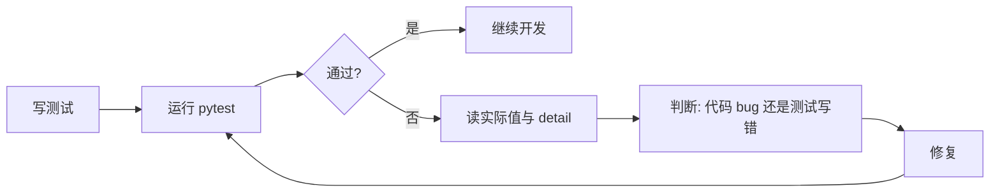

# 第 14 章 模块测试与调试

> **节首信息条**｜对应课次 13 · 4 学时 · 实践｜前置：第 8–13 章的后端模块；第 12 章的业务规则；Python 基础与 pytest 的初步使用

**已会**：第 8–13 章的后端模块与第 12 章的规则校验。
**本章只加**：验证与回归——用可重复的测试证明行为没有变。
**关系**：前几章让功能“能跑”；本章让功能“改完还敢动”。

第 13 章用 5 条记录手算核对了统计结果。手算能覆盖一次，改完代码还要再算一遍；接口多了，手工点一遍既慢又容易漏。

## 本章要解决的问题

**怎样证明系统做对了，并在改坏时快速定位？**

一次看起来无关的修改，可能让原本正常的功能坏掉：判断条件从 `>` 改成 `>=`，首尾相接的记录就被误判。手工点一遍既不可重复，也覆盖不到边界与异常路径；出了问题，只能从现象开始一层层往回找。

本章分四步：先说明测试为什么是“可执行的说明书”，再区分单元、接口、集成三个层次，然后写出可重复的用例，最后学会从失败信息回到缺陷。

## 本章学习目标

读完第 14 章并完成实训后，应能：

1. 说明单元测试（Unit Test）、接口测试（API Test）与集成测试（Integration Test）各自验证什么、成本如何。
2. 写出 pytest 的测试函数、断言（Assertion）与 fixture，用 TestClient 发起接口请求。
3. 为正常、边界、异常三类路径各设计用例，并让测试数据可重复。
4. 根据失败信息定位是代码、数据还是测试本身的问题。
5. 按“先看状态码”的调试清单排查接口故障，并让测试与代码一起维护。

## 前置知识卡

| # | 已有知识 | 回看位置 |
| --- | --- | --- |
| 1 | 第 8–13 章写过的接口，知道正常请求返回什么、错误时返回什么状态码 | 第 10 章 10.1.4 的错误分层；第 12 章的规则校验 |
| 2 | Python 函数、`assert` 与异常的基本写法 | 附录 A《Python 基础》 |
| 3 | 表格与时间字段的处理，例如值班记录的开始、结束时间 | 第 12 章 12.1.1–12.1.2 |
| 4 | 测试数据要能与开发数据分开，避免互相污染 | 本章 14.1.5 会给出三种做法 |

> 前置知识不足时，应先回看对应位置，不必从头重读。14.1.3 的 fixture 若一时读不顺，可先记住“它是在测试开始前准备好客户端和登录头”，细节可以边写边查。

## 14.1 概念讲解

### 14.1.1 测试的三项作用与边界

测试是把“系统应该怎么表现”写成可重复执行的代码。改完代码运行一遍，通过说明原有行为还在，失败说明有一处不符合预期。

没有测试时，验证靠手工点击。手工点击有两个无法回避的限制：**不可重复**——每次都要重新点一遍，步骤和顺序可能不同；**覆盖不全**——正常路径容易点到，边界与异常路径很少有人主动去试。

这两个限制叠加，会产生一类特定的缺陷：**回归缺陷**。它指原本正常的功能，在一次看似无关的修改之后坏掉了。例如把时间判断从 `>` 改成 `>=`，中间时段的记录仍然正常，首尾相接的记录却被拒绝；改代码的人只测了自己关心的中间时段，没有发现边界已经改变。

测试的价值因此不在“证明代码没错”，而在“改动能被快速验证”。具体有三个作用：

1. **回归**：改一处，立刻知道有没有坏三处。
2. **说明书**：测试写明接口在什么输入下应返回什么结果，比口头约定更可靠。
3. **重构信心**：敢动结构，因为运行一遍就知道行为有没有变。

需要明确测试的边界：它只能证明“写下的用例”通过了，不能证明系统没有缺陷。测试覆盖的是作者想到的情况；作者没想到的边界，测试也不会替他想。这不是测试的失败，而是测试的定位——它是一种可重复的证据，不是正确性的证明。

### 14.1.2 单元测试、接口测试与集成测试

按验证范围，测试通常分三层。

| 类型 | 测什么 | 例子 | 成本 |
| --- | --- | --- | --- |
| 单元测试 | 一个函数或一段纯逻辑 | 时间重叠判断 | 低，运行快 |
| 接口测试 | 一个 HTTP 接口的输入与输出 | 登录返回 200 或 401 | 中，需要客户端与数据 |
| 集成测试 | 多个部件连在一起 | 登录 → 建部门 → 查列表 | 高，依赖多、跑得慢 |

三层不是“越往后越高级”，而是成本与覆盖范围的交换。单元测试快、定位准，但只覆盖一段逻辑；接口测试验证契约，能发现字段、状态码、权限的问题；集成测试覆盖链路，但失败时不容易判断是哪一环出的错。端到端测试（End-to-End Test）可以看作集成测试的完整形态，成本最高，初学阶段先不展开。

本章主要写接口测试，因为接口是前后端契约的落点；单元测试用来覆盖纯逻辑，例如时间重叠判断；集成测试在实训中各写一个，用来确认多个部件能连起来。**不要为了“测试齐全”把每个接口都写成端到端测试**，那会让测试运行变慢、失败难定位，反而降低改代码的意愿。

以“值班记录时间重叠”为例，三层分别这样落：

1. **单元测试**只调用判断函数，输入两组时间，断言是否冲突，不需要数据库。
2. **接口测试**向 `POST /duty-records` 发请求，断言冲突时返回 400、合法时返回 201。
3. **集成测试**按“登录 → 建人员 → 建记录 → 查统计”走一遍，确认多个部件能接上。

选择哪一层，先问“这次改动最可能坏在哪”：纯逻辑改动写单元测试，契约改动写接口测试，跨模块改动才补集成测试。

### 14.1.3 pytest 用例与 fixture

pytest 的规则很简单：文件名以 `test_` 开头、函数名以 `test_` 开头的会被发现；函数里的 `assert` 不成立，测试就失败。

**代码 14-1-1** · `tests/test_auth.py`（登录测试，Python）

```python
def test_login_success(client):
    resp = client.post("/api/v1/auth/login", json={"username": "admin", "password": "admin123"})
    assert resp.status_code == 200
    assert "access_token" in resp.json()
```

一个测试只验证一件事。上面的测试验证“登录成功返回 200 且带令牌”；密码错误应另写一个测试，而不是在同一个函数里塞两组断言。失败时，一个测试只对应一个行为，定位更快；若一个函数里既验成功又验失败，失败信息只能说明“这个函数挂了”，还要再判断是哪一组断言。

`fixture` 是“测试开始前准备好的东西”。接口测试通常需要两样：客户端 `client`，以及登录后的请求头 `admin_headers`。

**代码 14-1-3** · `tests/conftest.py`（测试夹具，Python）

```python
import pytest
from fastapi.testclient import TestClient
from main import app

@pytest.fixture
def client():
    return TestClient(app)

@pytest.fixture
def admin_headers(client):
    resp = client.post("/api/v1/auth/login", json={"username": "admin", "password": "admin123"})
    token = resp.json()["access_token"]
    return {"Authorization": f"Bearer {token}"}
```

测试函数把 fixture 名写成参数，pytest 会自动注入。`client` 负责发请求，`admin_headers` 负责带上令牌。这样多个测试共用同一份准备逻辑，不必每个函数都重新登录一次。

### 14.1.4 三类测试路径

一个接口至少有三类测试：

| 路径 | 例子 | 期望 |
| --- | --- | --- |
| 正常 | 正确密码登录 | 200，返回令牌 |
| 边界 | 前一段 12:00 结束、后一段 12:00 开始 | 201，不算冲突 |
| 异常 | 错误密码、重复编码、缺字段 | 401 / 400 / 422 |

只测正常路径，规则可能根本没生效；只测异常路径，可能把合法情况也误伤。边界路径最能暴露“差一点”的错误：把 `>` 写成 `>=`，首尾相接就会被误判为冲突；把 `page_size` 的上限写成 `>=100`，第 100 条就会被拒绝。

**代码 14-1-5** · `tests/test_dept.py`（部门接口测试，Python）

```python
def test_create_dept_duplicate(client, admin_headers):
    payload = {"dept_code": "D01", "full_name": "一中队"}
    assert client.post("/api/v1/departments", json=payload, headers=admin_headers).status_code == 201
    assert client.post("/api/v1/departments", json=payload, headers=admin_headers).status_code == 400
```

### 14.1.5 可重复的测试数据

测试数据要可重复。测试会写数据，如果依赖上一次运行留下的状态，第二次运行可能因为数据已存在而失败；这类“第一次通过、第二次失败”不是代码坏了，而是测试没有隔离。

三种常见做法各有代价：

| 做法 | 怎么用 | 代价 |
| --- | --- | --- |
| 测试前清理 | 每个用例开始前删除相关数据 | 清理逻辑本身要维护，并发时可能互相影响 |
| 独立测试库 | 测试连单独的库，和开发库分开 | 要维护建库与迁移脚本 |
| 每次不同编号 | 用时间戳或随机后缀生成编号 | 断言不能写死具体值，可读性下降 |

**代码 14-1-6** · `tests/test_dept.py`（用唯一编号隔离数据，Python）

```python
import uuid

def test_create_dept(client, admin_headers):
    payload = {
        "dept_code": f"D-{uuid.uuid4().hex[:6]}",
        "full_name": "测试部门",
    }
    resp = client.post("/api/v1/departments", json=payload, headers=admin_headers)
    assert resp.status_code == 201
```

这段代码用每次运行都不同的编号，避免与上一次留下的数据冲突；代价是断言不能写死 `dept_code`，只能检查状态码或返回字段的类型。

固定数据适合验证规则，例如“重复编码返回 400”；随机数据适合避免冲突，例如并发创建。两者要分开考虑；无论用哪种，测试都不应该依赖上一次运行留下的状态。

### 14.1.6 从失败信息到缺陷

测试失败时，pytest 会给出实际值与期望值：

**代码 14-1-7** · 示例（文本）

```text
>       assert resp.status_code == 201
E       assert 400 == 201
E        +  where 400 = <Response [400 Bad Request]>.status_code
```

读法是：`assert 实际 == 期望`。这里实际返回 400，期望 201。先看实际响应的 `detail`，判断是“代码有 bug”还是“测试期望写错了”。如果重复编码本来就该返回 400，那么是测试写错了；如果期望 201 且代码返回 400，才需要查业务规则。

调试顺序可以固定为四步：先看状态码，再看 `detail`，再看 `/docs` 里的契约，最后才改代码。不要一上来就重装环境或改业务逻辑，那会把真正的原因覆盖掉。

| 状态码 | 先查什么 |
| --- | --- |
| 422 | 请求体字段名、类型、必填 |
| 400 | 业务规则：重复、时间冲突、人员不存在 |
| 401 | 密码、令牌、请求头 |
| 500 | 日志或堆栈：字段名、表名、空值 |



*图 14-1：测试—失败—定位—修复的循环*

测试要跟代码一起维护。接口改了，测试要跟着改；测试长期失败却没人管，就会失去“快速验证”的作用。把测试放在 `tests/` 目录、与代码同仓提交，每次改完代码运行一遍，是最低限度的纪律。测试不是一次性的交付物，而是随代码演进的安全网。

## 14.2 示范例题

两道例题对应本章的两个动作。例 14-1 写正常与异常两条用例，练习“一个测试只验一件事”；例 14-2 读一条失败信息，练习“先判断是代码问题还是测试问题”。

#### 例 14-1：写登录成功与失败的测试【Bloom：应用】

**题目**：用 pytest 与 `TestClient` 写两个测试：正确密码登录返回 200 且带 `access_token`；错误密码返回 401。

**解**：

**代码 14-2-1** · `tests/test_auth.py`（登录成功与失败，Python）

```python
def test_login_success(client):
    resp = client.post("/api/v1/auth/login", json={"username": "admin", "password": "admin123"})
    assert resp.status_code == 200
    assert "access_token" in resp.json()

def test_login_wrong_password(client):
    resp = client.post("/api/v1/auth/login", json={"username": "admin", "password": "wrong"})
    assert resp.status_code == 401
```

两个测试分别验证正常路径与异常路径；断言只检查该测试关心的行为，不把“令牌长度”“错误文案”等无关细节塞进来。

#### 例 14-2：读一条失败信息【Bloom：分析】

**题目**：运行测试后出现下面的失败信息。请判断实际结果、期望结果分别是什么，最可能的原因是什么，应该先查哪里。

**代码 14-2-3** · 示例（文本）

```text
>       assert resp.status_code == 201
E       assert 400 == 201
E        +  where 400 = <Response [400 Bad Request]>.status_code
```

**解**：

1. 实际结果是 400，期望结果是 201。
2. 400 表示业务规则拒绝，不是参数格式错误（那会是 422），也不是服务器错误（那会是 500）。
3. 最可能的原因：这是一个“重复新增”的请求，部门编码已存在，接口按规则返回 400；而测试期望 201，说明测试的期望写错了，或者测试数据没有清理，第二次运行时撞上了第一次留下的数据。
4. 先查两处：测试是否在每次运行前清理数据；重复编码是否本来就该返回 400。若规则正确，改测试；若规则不正确，改代码。

## 14.3 独立习题

#### 习题 14-1【Bloom：理解】

**题目**：说明一个接口测试通常由哪几部分组成（准备、执行、断言），并解释 `fixture` 在其中的作用。为什么测试数据要可重复？

#### 习题 14-2【Bloom：分析】

**题目**：下面是三条测试失败信息。请分别判断是“代码有 bug”还是“测试写错了”，并说明下一步应该查什么。

1. `assert 200 == 401`
2. `assert 201 == 400`
3. `assert 500 == 201`

## ◆ 实训 14-1：模块测试与调试（对应课次 13 · 4 学时）

### 一、任务目标与验收

| 目标 | 验收标志 |
| --- | --- |
| 三层测试齐全 | 单元、接口、集成各有至少一个用例 |
| fixture 可复用 | 测试数据与客户端准备抽成 fixture |
| 三类路径覆盖 | 正常、边界、异常各有用例 |
| 测试可重复 | 连续运行两次结果一致 |
| 失败可定位 | 至少一次故意失败并写出定位过程 |

### 二、课前准备

- 第 8–13 章的模块代码
- pytest 与 httpx 已安装
- 一个独立的测试数据库或测试数据目录

### 三、操作步骤

1. **搭测试骨架**
   - 做什么：搭测试骨架
   - 操作：建 `tests/`，写第一个接口测试
   - 预期输出：→ `pytest -q` 能发现并运行测试
   - 做错会看到什么：导入路径错；用 `conftest.py` 统一路径与 fixture
2. **写 fixture**
   - 做什么：写 fixture
   - 操作：准备测试客户端与可重复数据
   - 预期输出：→ 多个测试共用，不互相污染
   - 做错会看到什么：测试顺序影响结果；每个用例自建数据或在事务中回滚
3. **覆盖三类路径**
   - 做什么：覆盖三类路径
   - 操作：每个关键接口写正常、边界、异常用例
   - 预期输出：→ 三类均有断言
   - 做错会看到什么：只测 200；补 401/403/404/422 与边界值
4. **读失败信息并修复**
   - 做什么：读失败信息并修复
   - 操作：故意改错一处，读 traceback 定位
   - 预期输出：→ 能指出失败在断言、数据还是代码
   - 做错会看到什么：只看最后一行；从第一个失败点与请求响应体查起

### 四、排错清单

| 现象 | 先查什么 |
| --- | --- |
| 测试互相影响 | 共享数据未隔离、执行顺序依赖 |
| 偶发失败 | 时间、随机数、外部服务未固定 |
| 断言太宽 | 只断言状态码，未检查关键字段 |
| 测试越写越慢 | 重复建库；用 fixture 或事务回滚 |

### 五、提交与验收

提交 `tests/` 与一次失败定位记录；验收按“三层测试”“可重复性”“失败定位”三项判定。

### 六、课后扩展

- 为统计接口补参数化用例
- 把测试接入提交前检查（pre-commit 或脚本）
- 写一条“测试本身写错”的排查记录
- **复习任务**：回看第 5 章 5.1.4–5.1.5 与本章 14.1.3–14.1.6，说明 fixture、断言与失败信息分别解决测试中的哪一步问题

## 本章小结

**核心结论**：

1. 测试是“可执行的说明书”，用于回归、说明与重构信心；手工点击不可重复，也不能稳定覆盖异常路径。
2. 测试按范围分三层：单元测试快而窄，接口测试验证契约，集成测试覆盖链路但成本最高；不要为了齐全把一切都写成端到端测试。
3. 接口测试至少覆盖正常、边界、异常三类路径；一个测试只验一件事。
4. pytest 用 `test_` 发现用例，用 `assert` 判断结果；`fixture` 负责准备 client、令牌与测试数据；测试数据必须可重复。
5. 读失败信息先看“实际 == 期望”，再看状态码与 `detail`；先判断是代码 bug 还是测试写错，再改代码。

本章讨论的验证，其目标不是覆盖率数字，而是让每一次修改都能被快速、可重复地检查。测试不能证明系统没有缺陷，但能让已知的行为在修改后仍然成立。

**自检**：对照本章学习目标逐条检查——

- [ ] 说明单元测试、接口测试与集成测试各自验证什么、成本如何。
- [ ] 写出 pytest 的测试函数、断言与 fixture，用 TestClient 发起接口请求。
- [ ] 为正常、边界、异常三类路径各设计用例，并让测试数据可重复。
- [ ] 根据失败信息定位是代码、数据还是测试本身的问题。
- [ ] 按“先看状态码”的调试清单排查接口故障，并让测试与代码一起维护。

**下一章**：测试能证明“行为没变”，但代码是否好读、是否有安全隐患，还需要评审。下一章进入后端综合实践：在脚手架上读、改、扩，并按评审清单检查质量与安全。
